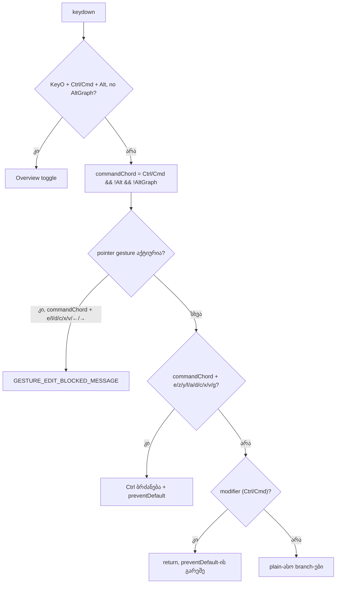

# GATE264-S2 — Ctrl/Cmd+ასო shortcut-ები Alt-ით ან AltGr-ით აღარ სრულდება

**თარიღი:** 2026-10-30
**სტატუსი:** Completed (C round 267 PASS)
**შეცვლილი პროექტი:** Store

## კონტექსტი

Gate 264-ის reviewer-მა იპოვა, რომ Studio-ს keydown handler-ი (`StudioWorkspace.tsx`, `handleKeyDown`) Ctrl/Cmd+ასო ბრძანებებს მხოლოდ `modifier = event.ctrlKey || event.metaKey`-ით ამოწმებდა. Alt და AltGraph არ მოწმდებოდა. B-მ cloud Chromium-ში ორივე viewport-ზე გაიმეორა: AltGr+Z (`ż`) Undo-ს უშვებდა, AltGr+Y და AltGr+Shift+Z — Redo-ს, AltGr+E clip-ს ჭრიდა, AltGr+D selection-ს აორმაგებდა, AltGr+L loop handler-ს აღწევდა. ყველა ეს event `preventDefault`-ით იბლოკებოდა. იგივე ხდებოდა AltGraph-ის გარეშე რეალურ `Control+Alt+KeyZ`/`Control+Alt+KeyE`-ზეც.

ზიანი: პოლონელი, ჩეხი ან გერმანელი მომხმარებელი, რომელიც text field-ის გარეთ ż, ę, ł, ą ან € სიმბოლოს კრეფს. Windows-ის AltGr layout-ებზე Chromium AltGr-ს `ctrlKey && altKey`-ად აწვდის. Severity: Medium, ბაგი ადრინდელია და არა რეგრესია.

## მიდგომა

**Ableton-ის წყარო.** Live 12 Reference Manual, თავი 42 "Live Keyboard Shortcuts" (https://www.ableton.com/en/live-manual/12/live-keyboard-shortcuts/, B-მ წაიკითხა 2026-10-30):
- §42.5 და §42.16: Ctrl+Z/Y, Ctrl+E (Split Clip at Selection), Ctrl+L, Ctrl+A/D/C/X/V; §42.19: Ctrl+G — chord-ში Alt არ არის.
- §42.1, §42.12, §42.16, §42.19, §42.22: Ctrl+Alt+ასო **სხვა** ბრძანებაა (Ctrl+Alt+O Overview, Ctrl+Alt+E Full-Size Clip View, Ctrl+Alt+G Filter View და ა.შ.). Alt-ის დამატება Ctrl ბრძანებას არასოდეს ნიშნავს.
- AltGr-ზე წყარო ვერ მოიძებნა (თავ 42-ის ტექსტში "AltGr"/"Alt Gr" ძებნა). Ableton-თან შესაბამისობა AltGr-ზე — „დაუდასტურებელი (წყარო არ არის)“.

**გადაწყვეტილება.** `modifier`-ის შემდეგ დაემატა ერთი boolean `commandChord = modifier && !event.altKey && !event.getModifierState('AltGraph')`. ის `modifier`-ს ცვლის pointer-gesture-ის ბლოკის Ctrl-arm-ში და ათ Ctrl-ასო branch-ში (e, z, y, l, a, d, c, x, v, g). შედეგად Ctrl/Cmd+Alt ან AltGr chord ამ ასოებზე state-ს არ ცვლის, status-ს არ წერს, `preventDefault` არ ხდება და gesture-ის დროს `GESTURE_EDIT_BLOCKED_MESSAGE` არ ჩნდება. Plain Ctrl/Cmd chord-ები უცვლელია.

უცვლელი დარჩა: KeyO branch (Ctrl+Alt+O Overview, რომელიც AltGraph-ს უკვე ამოწმებდა), Space branch, `timelineNavigationKey`, Ctrl+Arrow branch და `if (modifier) { return; }`. ეს უკანასკნელი `modifier`-ზე რჩება, რომ Alt chord აქ გაჩერდეს და plain-ასო branch-ებამდე (M, G, A, U, ციფრები) ვერ მივიდეს.

**ალტერნატივები.** (1) Ctrl+Alt ბრძანებების დამატება Live-ის მსგავსად — ამ რაუნდის გარეთაა. (2) თითო branch-ში `&& !event.altKey`-ის ცალ-ცალკე დამატება — 11 ადგილზე იგივე წესის გამეორება იქნებოდა და AltGraph-ს ვერ დაფარავდა.

## არქიტექტურა

## შეცვლილი ფაილები

- `app/components/arrangement/StudioWorkspace.tsx` — მხოლოდ `handleKeyDown`: 1 დამატებული ხაზი, 11 ჩანაცვლება.
- `app/lib/arrangement/__tests__/meta-shortcuts-ui.test.tsx` — add-only: ერთი ახალი `describe` (GATE264-S2) და `GESTURE_EDIT_BLOCKED_MESSAGE` არსებულ import-ში.
- `docs/implementation/2026/quarter-IV/199-gate264-s2-altgr-shortcuts.md` — ეს დოკუმენტი.

## პრობლემები და გადაწყვეტები

**Problem:** AltGr ზოგ ბრაუზერში მხოლოდ `getModifierState('AltGraph')`-ით ჩანს, `altKey`-ის გარეშე, ამიტომ მხოლოდ `!event.altKey` საკმარისი არ იქნებოდა.
**Solution:** `commandChord` ორივე პირობას ამოწმებს. AG6 სწორედ ამ შემთხვევას (`ctrlKey` + AltGraph, `altKey: false`) ამოწმებს; ეს contract row-ია და არა მტკიცება რომელიმე რეალური პლატფორმის შესახებ.

**Problem:** `if (modifier) return;`-ის `commandChord`-ზე გადაყვანა AltGraph chord-ს plain G branch-მდე მიიყვანდა და Snap-ს გადართავდა.
**Solution:** early return `modifier`-ზე დარჩა; M-RETURN mutant-ი AG6-ს აწითლებს.

**Problem:** gesture-ის დროს AltGr+E „Editing is blocked“ status-ს წერდა, თუმცა ეს ბრძანება არ არის.
**Solution:** gesture ბლოკის Ctrl-arm-იც `commandChord`-ს იყენებს (AG5).

## ტესტირება

`meta-shortcuts-ui.test.tsx`-ის ახალი block `GATE264-S2: Alt or AltGr held with Ctrl/Meta runs no Ctrl-letter command`. AG1–AG4 `it.each`-ით გადის სამ variant-ზე (AltGr, Ctrl+Alt, Meta+Alt); ყოველი row ჯერ ეფექტს ამოწმებს, ბოლოს `dispatchEvent`-ის `true`-ს (not prevented), და იმავე mount-ში plain chord-ის positive control-ით მთავრდება.

- **AG1** — chord+Z, chord+Shift+Z, chord+Y: Undo/Redo არ ხდება; plain Ctrl+Z ხსნის.
- **AG2** — chord+E: clip არ იჭრება; plain Ctrl+E ჭრის.
- **AG3** — chord+L, chord+Shift+L: loop არ ირთვება, range არ ფართოვდება; plain Ctrl+L loop-ს რთავს.
- **AG4** — chord+A, D, C, X, V, G, Shift+G: selection, clip-ები, history და group-ები უცვლელია; plain Ctrl+D აორმაგებს.
- **AG5** — pointer gesture-ის დროს AltGr+E blocked message-ს არ წერს; plain Ctrl+E წერს.
- **AG6** — AltGraph `altKey`-ის გარეშე: Ctrl+Z არ აუქმებს, Ctrl+G Snap-ს არ რთავს.

**Red-proof (scratch ასლზე, `store`-ის გარეთ):** 10 per-branch mutant-ი (თითო branch `modifier`-ზე დაბრუნებული), M-ALT, M-AG, M-GESTURE და M-RETURN — 14-ვე წითელია (e → AG2/AG5, z → AG1/AG6, y → AG1, l → AG3, a/d/c/x/v → AG4, g → AG6, M-ALT → Ctrl+Alt და Meta+Alt variant-ები AG1–AG4-ში, M-AG → AG6, M-GESTURE → AG5, M-RETURN → AG6).

Targeted: 13 ფაილი, 231/231 PASS; `npm run typecheck` და `npm run lint` rc 0; `npx biome check` ორ შეცვლილ code ფაილზე — დიაგნოსტიკის გარეშე. Full suite, build და `npm run verify` — root gate-ის row-ებია. Browser-ის შემოწმება (ALTGR-UNDO, ALTGR-EDIT, CTRLALT-REAL, META-ALT-REAL, POS-CTRL, FOCUS-ALT) C-ს ეკუთვნის.

## TODO / შემდეგი ნაბიჯები

- **B-ს გადაწყვეტილებას ელოდება (A-R267-REVIEW-GESTURE-ARROW, Medium):** gesture-ის დროს `ctrlKey` + AltGraph (`altKey`-ის გარეშე) + ArrowLeft/ArrowRight gesture ბლოკს აღარ ხვდება და Ctrl+Arrow branch-ში marker-ს გადაადგილებს (HEAD-ზე იბლოკებოდა). ასევე Ctrl+Alt/Meta+Alt+Arrow gesture-ის დროს blocked message-ის ნაცვლად ჩუმად გადის. გამოსწორება task-ის მიერ დაუშვებელ ხაზს ეხება, ამიტომ ამ რაუნდში არ გაკეთდა.
- **ღია კითხვა (B-R266-LINUX-ALTGR-PLAIN-LETTERS, ჰიპოთეზა):** ზოგმა პლატფორმამ (სავარაუდოდ Linux X11) AltGr შეიძლება AltGraph-ად აწოდოს `altKey`-ისა და `ctrlKey`-ის გარეშე. plain-ასო branch-ები (M, G, A, U, 1–5) მხოლოდ `!event.altKey`-ს ამოწმებს, ამიტომ იქ AltGr+M შეიძლება marker-ს ამატებდეს. დაუდასტურებელია; ეს რაუნდი არ ასწორებს. რეალური repro მას ჩვეულებრივ finding-ად აქცევს.
- რეალური Windows AltGr hardware-ზე შემოწმება (TLM-R232-ALTGR-WIN) Saba-სთან რჩება.
- Live-ის Ctrl+Alt ბრძანებები, რომლებიც CZABA-ს არ აქვს (V, B, M, E, F, T, G და სხვ.), ამ რაუნდის გარეთაა.
