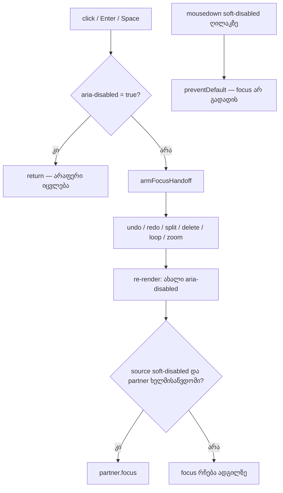

# SYS-5 ეტაპი 1 — transport-ის მიუწვდომელი ღილაკები keyboard-ით მისაწვდომი რჩება და მიზეზს ასახელებს

**თარიღი:** 2026-10-30
**სტატუსი:** In Progress (stage 1 of 2; C round 276 PASS; gate 276 test fix-up round 277)
**შეცვლილი პროექტი:** Store

## კონტექსტი

Transport-ის შვიდი ღილაკი — Undo, Redo, Split, Delete, Loop, Zoom to selection და Zoom back — მიუწვდომელ მდგომარეობაში native `disabled`-ს იყენებდა. ბრაუზერი ასეთ ღილაკს Tab-ის რიგიდან იღებს, ამიტომ keyboard-ისა და screen reader-ის მომხმარებელი ვერ აღწევდა `title`-მდე, სადაც მიზეზი ეწერა (C-R229-01, GATE229-S1). ოთხ ღილაკს (Undo, Redo, Split, Delete) `title`-ში მიზეზი საერთოდ არ ჰქონდა, მხოლოდ მოქმედების სახელი. ეს Saba-ს დამტკიცებული DUX-R-4(b)-ის გაგრძელებაა (2026-10-25). SYS-5 ორ ეტაპად იყოფა: ეს რაუნდი (276) შვიდ transport-ის ღილაკს ეხება, მეორე ეტაპი (277) — metronome toggle-სა და ბიბლიოთეკის Add ღილაკს.

## მიდგომა

- **Soft-disabled ნიმუში `ArrangementTransport.tsx`-ში:** ლოკალური helper `softDisabledButtonProps(isUnavailable)` მიუწვდომელ ღილაკს აძლევს `aria-disabled="true"`-სა და `onMouseDown`-ს, რომელიც `preventDefault()`-ს იძახებს. ხელმისაწვდომ ღილაკზე ატრიბუტი საერთოდ არ იწერება (`"false"` არა). `disabled` ატრიბუტი აღარ გამოიყენება, ამიტომ ღილაკი Tab-ის რიგში რჩება. `tabIndex` არ იცვლება.
- **Click guard:** ყოველი ღილაკის `onClick`-ის პირველი ქმედებაა `isSoftDisabledButton(event.currentTarget)`-ის შემოწმება. ის `armFocusHandoff`-მდე და action-მდე სრულდება, ამიტომ click და Enter მიუწვდომელ ღილაკზე არაფერს ცვლის: status line-ს, ისტორიას, range-ს, loop-სა და zoom-ს. Space-ზე workspace-ის play/stop ქცევა უცვლელი რჩება. Status line-ში ახალი ჩანაწერი არ ემატება (`product-designer`-ის Q1: ჩუმი no-op).
- **Mouse focus:** `mousedown`-ის `preventDefault()` მაუსის click-ისას focus-ს timeline-დან არ აშორებს, როგორც native disabled ღილაკის შემთხვევაში იყო. შედეგად, ჩამქრალ ღილაკზე click ფოკუსირებულ ტექსტურ ველს (მაგ. marker-ის სახელს ან tempo-ს) blur-ს აღარ უკეთებს და ის blur-ზე commit-ს არ აკეთებს. Chrome-ში HEAD-ის native disabled ღილაკი ასეთ ველს blur-ს უკეთებდა.
- **მიზეზები `title`-ში:** `studioEditStrings.undoTitle(null)` = `Undo — nothing to undo yet (Ctrl+Z)`, `redoTitle(null)` = `Redo — nothing to redo (Ctrl+Shift+Z)`. დაემატა `splitNeedsTargetTitle` და `deleteNeedsTargetTitle` (`Split/Delete — select a clip or make a time selection first`). Split-ისა და Delete-ის title ჯერ range-ს ამოწმებს, შემდეგ მონიშნულ კლიპს, ბოლოს კი მიზეზს ასახელებს. Loop-ის, Zoom to selection-ისა და Zoom back-ის title-ებს მიზეზი უკვე ჰქონდათ და არ შეცვლილა. მუდმივი ახალი ტექსტი ეკრანზე არ დამატებულა.
- **იერსახე:** `toolButtonClass`-ში `enabled:`/`disabled:` variant-ები შეიცვალა `not-aria-disabled:`/`aria-disabled:`-ით. ჩამქრალი იერი ახლა შვილობილ ელემენტებზე ვრცელდება (`aria-disabled:*:opacity-40`), ამიტომ focus ring სრული სიძლიერით ჩანს. ამავე ფაილში `enabled:` override-ები (Follow-on, Play, Stop, Loop-on) იმავე ცვლილებაში გადავიდა `not-aria-disabled:`-ზე: tailwind-merge განსხვავებულ prefix-ს დუბლიკატად ვერ ცნობს. გლობალური press scale (`app.css`, `utilities.css`) soft-disabled ღილაკს აღარ აპატარავებს.
- **Focus handoff:** Delete → Undo, Undo → Redo, Redo → Undo და Zoom back → Fit (doc 093, D-29z73) ახლა `aria-disabled`-ზეა მიბმული. თუ partner-იც მიუწვდომელია, focus წყარო ღილაკზე რჩება, რადგან ის ისევ focusable-ია. ამას predicate-ის early return უზრუნველყოფს. ეს მდგომარეობა პრაქტიკულად მიუღწევადია: Delete Undo-ს ააქტიურებს, Undo — Redo-ს, Redo — Undo-ს, Fit კი არასოდესაა მიუწვდომელი. ამიტომ ცალკე ტესტი (SD5b) არ დაწერილა.
- **Keyboard shortcuts უცვლელია** (D-29z616): Ctrl+Z, Ctrl+Shift+Z, Ctrl+E, Delete, Ctrl+L, Z და X თავიანთ status ტექსტებს ისევ წერენ.
- **უარყოფილი ალტერნატივები:** მიზეზის status line-ში ჩაწერა (screen reader ორჯერ წაიკითხავდა; მაუსის click ეკრანის ბიუჯეტს ხარჯავს); `aria-disabled:opacity-40` თავად ღილაკზე (ring-იც ჩაქრებოდა); `disabled` prop-ის დამატება `~/components/ui` Button-ზე (ჯერ architecture checkpoint-ს საჭიროებს).

## არქიტექტურა

## შეცვლილი ფაილები

- `app/components/arrangement/ArrangementTransport.tsx` — soft-disabled helper, შვიდი ღილაკი, click guard, Split/Delete title, class variant-ები, handoff predicate
- `app/lib/arrangement/strings.ts` — `undoTitle`/`redoTitle`-ის null branch, `splitNeedsTargetTitle`, `deleteNeedsTargetTitle`
- `app/styles/app.css`, `app/styles/base/utilities.css` — press scale selector-ს დაემატა `:not([aria-disabled="true"])`
- `app/lib/arrangement/__tests__/self-disabling-focus.test.tsx` — `.disabled` შემოწმებები გადავიდა `aria-disabled`-ზე; ახალი describe SD1–SD7
- `app/lib/arrangement/__tests__/transport-surface-ui.test.tsx`, `mode-toggle-colour-ui.test.tsx` — transport-ის token-ების სიები (ცალკე `TRANSPORT_*` კონსტანტები; Snap/Env/Master/Metronome სიები უცვლელია)
- `app/lib/arrangement/__tests__/waveform-zoom.test.tsx` — `transportButton` `ariaDisabled`-ს აბრუნებს
- `app/lib/arrangement/__tests__/strings.test.ts` — ახალი ტექსტები და ორი ახალი key

## პრობლემები და გადაწყვეტები

- **Problem:** `aria-disabled`-ის შემთხვევაში წყარო `.disabled`-ს აღარ აბრუნებს, ამიტომ handoff ჩუმად შეწყდებოდა. **Solution:** predicate გადაება `aria-disabled`-ს; M3 mutant-ი (`.disabled`-ზე დაბრუნება) FL3–FL6, FL10 და SD5 ტესტებს წითლად აქცევს.
- **Problem:** `aria-disabled:*:opacity-40` stacked variant-ი ადრე არავის დაეკომპილირებინა. **Solution:** Tailwind 4.1.18-ით კომპილაციამ და production build-მა ააწყო `:is(.aria-disabled\:\*\:opacity-40[aria-disabled=true]>*){opacity:.4}`.
- **Problem:** `BASE_FILL` და `ON_TOKENS`/`DROPPED_TOKENS` სატესტო კონსტანტებს transport-ის და frozen კომპონენტების (Snap, Env, Master, Metronome) ტესტები ერთად იყენებდა. **Solution:** transport-ისთვის შეიქმნა იმავე სიგრძის ცალკე კონსტანტები; ძველები frozen კომპონენტებზე დარჩა. Assertion არ წაშლილა.
- **Problem:** `aria-disabled:cursor-not-allowed` ბრაუზერში არ მოქმედებს: `app.css`-ის unlayered `button { cursor:pointer }` წესი `@layer utilities`-ს სჯობს. HEAD-ის `disabled:cursor-not-allowed`-საც იგივე შედეგი ჰქონდა, ამიტომ regression არ არის. **Solution:** B-ის გადაწყვეტილებას ელოდება: ან ამ ხაზის შეცვლა (grant-ის გარეთაა), ან `!` ფორმა.
- **Problem:** ტესტში `fit` ცვლადს Biome `noFocusedTests`-ად (`fit()`) კითხულობდა. **Solution:** ცვლადს დაერქვა `fitButton`.
- **Problem:** gate 276 ჩავარდა NS1, NS6 და TC9 ტესტებზე (`navigation-strings-ui.test.tsx`, `transport-centre-ui.test.tsx`): ისინი ჯერ კიდევ native `disabled`-სა და Split-ის ძველ title-ს ამოწმებდნენ. **Solution:** რაუნდ 277-ში assertion-ები გადავიდა `aria-disabled`-სა და ახალ title-ზე; არცერთი assertion არ დაკარგულა (Split-ის ძველი title ახლა მონიშნული კლიპის მდგომარეობაში მოწმდება).

## ტესტირება

- `self-disabling-focus.test.tsx`: SD1 (შვიდივე ღილაკი `aria-disabled`, focusable, მიზეზიანი title), SD2 (click არაფერს ცვლის — status, sequence, ისტორია, range, loop, clips, zoom), SD2b (იგივე აქტიური pointer gesture-ის დროს, როცა undo/redo/split/delete/loop უარის ტექსტს წერდნენ), SD3 (mousedown default-prevented; Fit-ზე არა), SD4 (კლიპი/range → Split/Delete ხელმისაწვდომი, action-ის title), SD5 (Undo → Redo → Undo handoff), SD6 (focused soft-disabled Redo Ctrl+Z-ის შემდეგ ადგილზე ხელმისაწვდომი ხდება), SD7 (source-ში 0 `enabled:`/`disabled:` token და 0 `disabled={`; rendered Undo-ს class-ში ოთხი ახალი token). FL3–FL10 გადაყვანილია `aria-disabled`-ზე, დაემატა `hasAttribute('disabled') === false`.
- Mutant-ები M1–M5 წითელია: SD2, SD3, FL3–FL6/FL10/SD5, SD1/ST-K1 და SD7. დამატებითი M6/M7 (Undo-ს ან Redo-ს guard-ის წაშლა) SD2b-ს წითლად აქცევს.
- §6.3-ის 20 ფაილი (379 ტესტი) გავიდა, ასევე `npm run typecheck`, `npm run lint`, Biome owned ფაილებზე და `npm run build`.
- რაუნდი 277: NS1 (Split-ის მიზეზიანი title და `aria-disabled` → კლიპის მონიშვნის შემდეგ ძველი title, ატრიბუტის გარეშე), NS6 (Loop-ს `disabled` არასოდეს აქვს, `aria-disabled` = `"true"`/არ არის) და TC9 (Undo `aria-disabled="true"`, `disabled === false`) — `navigation-strings-ui.test.tsx` და `transport-centre-ui.test.tsx`.

## TODO / შემდეგი ნაბიჯები

- SYS-5 ეტაპი 2 (რაუნდი 277): metronome toggle (`ArrangementTempoRow.tsx`) და ბიბლიოთეკის Add ღილაკი; helper საერთო ფაილში გადადის.
- მიუწვდომელ ღილაკზე `cursor: not-allowed` (B-ის გადაწყვეტილება, იხ. ზემოთ).
- B-R275-FOCUS-REASON-VISIBLE (Low): keyboard focus-ზე მიზეზი ვიზუალურად არ ჩანს (`title` focus-ზე არ ჩნდება).
- B-R275-SPLIT-HELD-ENTER (Low): ხელმისაწვდომ Split/Loop/Zoom to selection-ზე Enter-ის დაჭერით გაჩერება.
- LIVE-MEAS-SYS5-DISABLED: Live 12-ის ქცევა მიუწვდომელ კონტროლზე Tab-ით/screen reader-ით დაუდასტურებელია.
