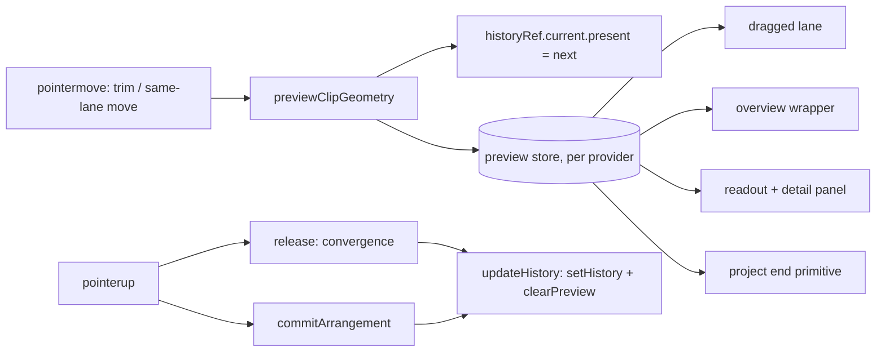
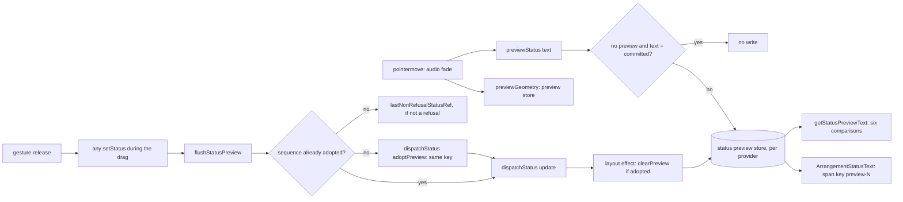
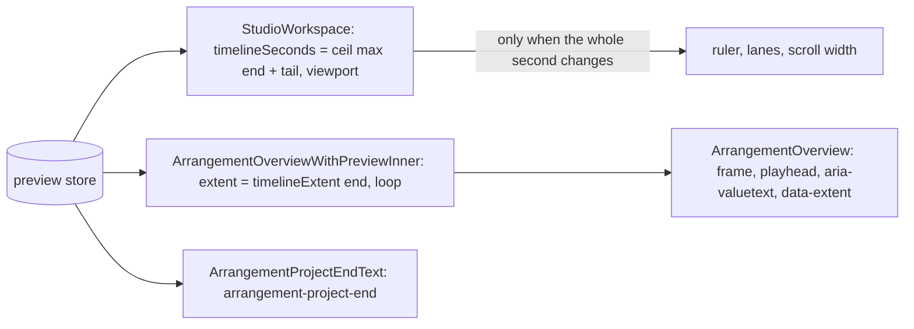
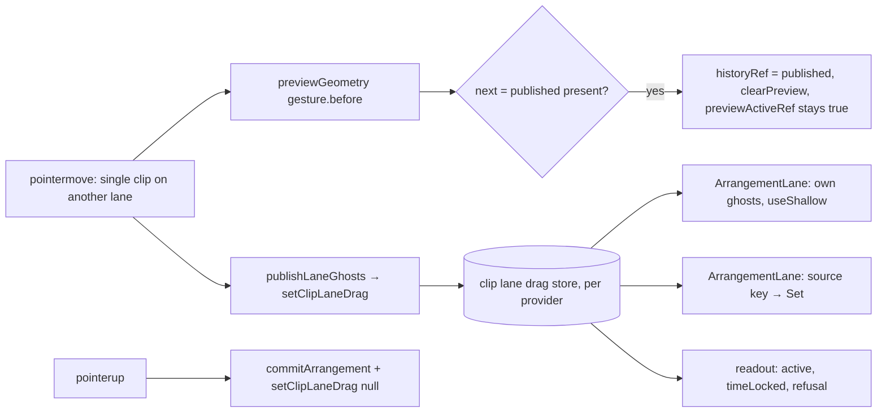

# კლიპის drag-ის preview გავიდა React history-დან (PERF-DRAG-PREVIEW: ეტაპი a — trim და same-lane move, ეტაპი b — audio fade, ეტაპი c1 — project end, ეტაპი c2a — არჩეული კლიპის მკითხველები, ეტაპი c2b-i — overview და meter, ეტაპი c2b-ii — Clip details-ის Start/End ტექსტი, ეტაპი c2b-iii — waveform-ის primitive props, ეტაპი c3-i — cross-lane move-ის perf row, ეტაპი c3-ii — cross-lane ghost-ები store-ში, ეტაპი c4-i — group move-ის perf row, ეტაპი c4-ii — group move-ის preview store-ში, ეტაპი c5-i — video კლიპის move-ის perf row, ეტაპი c5-ii — video კლიპის preview store-ში, ეტაპი c6-i — lucide icon-ების hoist, ეტაპი c6-ii — fader-ებისა და clip gain-ის memo, ეტაპი conversions — trim/move/fade row-ები assert-ზე, ეტაპი video-trim-fade — video კლიპის trim/fade-ის perf row-ები, ეტაპი video-trim-fade-cost — video dock-ის per-move render-ის მოხსნა, ეტაპი video-trim-fade-cost-2 — video trim/fade row-ები assert-ზე, ეტაპი dp-test-polish — DP69/DP70/DP72-ის გამკაცრება)

**თარიღი:** 2026-11-04
**სტატუსი:** In Progress (stage conversions of a, b, c1, c2a, c2b-i, c2b-ii, c2b-iii, c3-i, c3-ii, c4-i, c4-ii, c5-i, c5-ii, c6-i, c6-ii, conversions, video-trim-fade, video-trim-fade-cost-1, video-trim-fade-cost-2, dp-test-polish; C round 355 PASS)
**შეცვლილი პროექტი:** Store (`app/lib/arrangement/preview-store.ts`, `app/lib/arrangement/status-preview-store.ts`, `app/lib/arrangement/clip-lane-drag-store.ts`, `app/contexts/ArrangementContext.tsx`, `app/components/arrangement/ArrangementClip.tsx`, `ArrangementLane.tsx`, `StudioWorkspace.tsx`, `ArrangementTrackMeter.tsx`, `ArrangementDetailPanel.tsx`, `ArrangementTransport.tsx`, `ArrangementMarkerRow.tsx`, `perf/budgets.interactions.json`, `app/lib/arrangement/waveform-zoom.ts`, `app/lib/arrangement/model.ts`, `perf/studio-lab-interactions.perf.spec.ts`, `app/components/arrangement/ArrangementVideoDock.tsx`)

## კონტექსტი

`/studio-lab`-ში audio კლიპის trim-ის ან move-ის ყოველი pointermove მთელ Studio-ს render-ავდა. HEAD `b925434`-ზე (C-ის round 324-ის production run, `c-round-324/perf-atree-results/latest-interactions.json`) `interact.drag.trim.*.move-components-per-move` იყო 106.2, ხოლო `interact.drag.move.*` 105.317. Dev probe-მა (`c-round-324/probe/names-a.json`) აჩვენა, რომ ყოველ move-ის commit-ში render-დებოდა `ArrangementProvider`, `StudioWorkspace` და მთელი ხე: Transport, Library, VideoDock, Overview, Ruler, ოთხივე `ArrangementLane`, DetailPanel, Master, ExportDialog და ShortcutSheet.

მიზეზი: `previewArrangement(next)` წერდა `updateHistory({ ...historyRef.current, present: next })`-ს. ეს `setHistory`-ს იძახებდა, ამიტომ context-ის მთელი value იცვლებოდა.

**ეტაპი b (round 327).** ეტაპ a-ს შემდეგ (HEAD `234ccdd`, C-ის round 325-ის production run) audio კლიპის Fade In/Out handle-ის drag კვლავ **103.25 component-ს** render-ავდა თითო move-ზე (max 105). fade-ის branch ყოველ move-ზე ორ რამეს წერდა: `previewArrangement(next)` (`setHistory`) და `setStatus(studioClipStrings.fadePreview(…))`. `status` provider-ის `useReducer`-ია, footer კი `{status}`-ს context value-დან render-ავდა. მხოლოდ geometry-ის გადატანა ~100 component-ს დატოვებდა, ამიტომ status-იც უნდა გასულიყო provider-იდან drag-ის დროს.

## მიდგომა

1. **Contract A (D-29z919).** ახალი context ფუნქცია `previewClipGeometry(next)`: აყენებს `previewActiveRef.current = true`-ს, წერს მხოლოდ ref-ს (`historyRef.current = { ...historyRef.current, present: next }`, `setHistory`-ის გარეშე) და `next`-ს აქვეყნებს ახალ per-provider preview store-ში. `historyRef` preview-ს აგრძელებს, რადგან `commitArrangement(getArrangement(), …)`, loop-wrap resync და video import-ის ლოდინი სწორედ ref-ს კითხულობს. `previewArrangement` უცვლელია ყველა სხვა გამომძახებლისთვის.
2. **ახალი მოდული `preview-store.ts`** (`zustand/vanilla`, `range-store.ts`-ისა და `selection-store.ts`-ის ფორმით): `{ preview: Arrangement | null }`, `setPreview` (იგივე reference-ზე notify არ ხდება), `clearPreview`, და pure selector-ები: `selectPreviewLaneClips`, `selectPreviewProjectEnd`, `selectPreviewClip`, `selectPreviewClipsAmong`, `selectPreviewOrCommittedArrangement`. თითოეული `preview ?? committed`-ს კითხულობს, ამიტომ preview-ს არქონისას committed მნიშვნელობას აბრუნებს.
3. **გამოძახების ადგილები (ეტაპი a).** `previewClipGeometry`-ს იძახებს მხოლოდ audio კლიპის same-lane, არა-ჯგუფური move-ის წარმატებული preview და `trimStart`/`trimEnd`-ის preview (`ArrangementClip.tsx`, ლოკალური `previewGeometry`). Video კლიპები (`isVideo`), group move, cross-lane და `gesture.before`-ზე ყოველი დაბრუნება `previewArrangement`-ზე რჩება (ეტაპ c3-ii-დან single-clip cross-lane შტო `previewGeometry`-ს იძახებს, item 51).
4. **გასუფთავება.** `updateHistory` store-ს ასუფთავებს იმავე გამოძახებაში, სადაც `setHistory`. ამიტომ commit, `before`-ზე დაბრუნება, Undo/Redo და restore store-ს იმავე tick-ში ასუფთავებს.
5. **Convergence.** `publishedHistoryRef` ინახავს ბოლო history-ს, რომელიც React state-ში ჩაიწერა (მხოლოდ `updateHistory` წერს). როცა pointer gesture-ების რაოდენობა 0-ს უბრუნდება (`beginPointerGesture`-ის release), და `historyRef.current` მისგან განსხვავდება, provider `updateHistory(historyRef.current)`-ს იძახებს. ეს ფარავს mid-drag-ზე unmount-ილ კლიპს, რომლის cleanup revert-ის გარეშე release-ს აკეთებს. ჩვეულებრივ pointerup-ზე `finishGesture` ჯერ release-ს იძახებს, შემდეგ `commitArrangement`-ს; ორივე ერთ event-შია, ამიტომ React მათ ერთ commit-ად აერთიანებს.
6. **Subscriber-ები** (თითოეული მხოლოდ საკუთარი slice-ის ცვლილებაზე render-დება):
   - გადატანილი კლიპის lane: `useArrangementPreviewLaneClips` (`useShallow`; `replaceClip` ხელუხლებელ კლიპებს იგივე object-ებად ტოვებს, ამიტომ სხვა lane-ები არ render-დება);
   - overview: ახალი `ArrangementOverviewWithPreviewInner` + `memo` wrapper `StudioWorkspace.tsx`-ში (`ArrangementOverview.tsx` არ შეცვლილა);
   - მონიშნული კლიპის readout (`ArrangementSelectedClipReadoutInner`) და detail panel (`ArrangementDetailPanelWithSelectionInner`, `useShallow` მონიშნულ კლიპებზე);
   - project end, როგორც primitive: `StudioWorkspace`-ის `timelineSeconds`/`extent` და transport-ის `arrangement-project-end` readout.
7. **ეტაპები (D-29z916).** a: audio trim და same-lane move. b: audio fade drag-ები (ყოველ move-ზე status-ს წერენ). c: group move, cross-lane move, video კლიპები და move, რომელიც project end-ს ცვლის.

### ეტაპი b: status preview (round 327, D-29z931)

8. **ახალი მოდული `status-preview-store.ts`** (`zustand/vanilla`, `preview-store.ts`-ის ფორმით): state `preview: { text, sequence } | null` და `written` — მთვლელი, რომელიც არასოდეს ნულდება. `showPreview(text)` notify-ს არ აკეთებს, როცა ტექსტი მიმდინარე preview-ს ტოლია; სხვა შემთხვევაში წერს `{ text, sequence: written + 1 }`-ს. `clearPreview()` და pure helper `statusPreviewKey(preview)` → `` `preview-${sequence}` ``.
9. **Provider-ის status reducer.** dispatch ახლა `dispatchStatus`-ია, state-ს კი დაემატა `previewKey: string | null`. შიდა action `{ adoptPreview }` `text`-ს preview-ს ტექსტით ცვლის, `sequence`-ს ზრდის და `previewKey = statusPreviewKey(preview)`-ს აყენებს. ყველა სხვა action უცვლელად გადის `reduceArrangementStatus`-ზე (`status-announcement.ts` არ შეცვლილა); შეცვლილი შედეგი `previewKey: null`-ს იღებს, უცვლელი იგივე object-ს აბრუნებს.
10. **`setStatus` stable wrapper-ია.** ჯერ `flushStatusPreview()`, შემდეგ `dispatchStatus(update)`. როცა preview არსებობს, flush (round 327-ში) ასუფთავებდა store-ს (round 328-დან ამას layout effect აკეთებს, იხ. პუნქტი 16), `lastNonRefusalStatusRef.current`-ს preview-ს ტექსტზე აყენებს (თუ ის refusal არ არის, `gestureRefusalPrefix`) და `{ adoptPreview }`-ს dispatch-ავს. ამიტომ drag-ის დროს ნებისმიერი committed write (updater, refusal, playback-ის stop) ხედავს და ცვლის ეკრანზე ნაჩვენებ ტექსტს, როგორც HEAD-ზე. gesture release-ის closure (`statusAfterGestureRelease`) არ შეცვლილა: wrapper-ის flush-ის გამო updater ბოლო preview ტექსტს ხედავს.
11. **ახალი context ფუნქციები და value.** `previewStatus(text)` (`statusPreviewStore.showPreview`), `getStatusPreviewText()` (preview-ს ტექსტი ან `null`) და `statusKey = previewKey ?? String(statusSequence)`. `statusSequence` value-ში რჩება იმავე მნიშვნელობით.
12. **`ArrangementClip.tsx`, მხოლოდ fade-ის branch.** `previewArrangement(next)` → ლოკალური `previewGeometry(next)` (video-სთვის ის `previewArrangement` რჩება). ტექსტი `previewStatus(text)`-ზე მიდის, როცა `previewStatus` გადაცემულია და კლიპი video არ არის; სხვა შემთხვევაში — `setStatus(text)`-ზე, როგორც ადრე. `ArrangementLane.tsx` `previewStatus`-ს context-იდან გადასცემს.
13. **Footer.** `{status}` → `ArrangementStatusText` (`function ArrangementStatusTextInner` + `memo`). preview-ს არსებობისას render-დება `{preview.text}`, სხვა შემთხვევაში `{status}`. `<output aria-live="polite" data-testid="arrangement-status">` wrapper, მისი class-ები და პოზიცია უცვლელია. adopt-ის დროს `previewKey` იგივე key-ს ინარჩუნებს, ამიტომ span-ი ხელახლა არ mount-დება და `aria-live` ერთსა და იმავე ტექსტს ორჯერ არ აცხადებს.
14. **ექვსი შედარება ეკრანზე ნაჩვენებ ტექსტს კითხულობს:** `getStatusPreviewText() ?? <committed status>`. `StudioWorkspace.tsx`-ში stop effect-ის `insertMarkerStatusKind(…)` და `FOLLOW_PAUSED_MESSAGE`-ის შედარება (ერთი `shownStatus` const) და nudge-ის `NUDGE_AT_TIME_START_MESSAGE`; `ArrangementMarkerRow.tsx`-ში `status !== message` ×2 და `MARKER_AT_TIME_START_MESSAGE`. HEAD-ზე fade drag-ის დროს ისინი "Fade In: x s"-ს ხედავდნენ; ცვლილების გარეშე drag-მდელ ტექსტს დაინახავდნენ.
15. **Round 328-ის fix-up (C-R327-01/02, D-29z938).** `flushStatusPreview` store-ს აღარ წერს. ის adopt-ს აკეთებს თითო preview sequence-ზე მხოლოდ ერთხელ: ახალი ref `adoptedPreviewSequenceRef` ინახავს ბოლო adopt-ილ sequence-ს, და თუ `pending.sequence` მასზე მეტი არ არის, flush არაფერს აკეთებს. სხვა შემთხვევაში ref-ს აახლებს, `lastNonRefusalStatusRef`-ს წერს (მხოლოდ თუ ტექსტი refusal არ არის, `gestureRefusalPrefix`) და `{ adoptPreview }`-ს dispatch-ავს. ამიტომ ერთ batch-ში ორი `setStatus` preview-ს ორჯერ არ adopt-ავს და მეორე updater პირველ write-ს ხედავს.
16. **Layout effect-ის გასუფთავება.** ახალი `useIsomorphicLayoutEffect` (deps `[statusEntry, statusPreviewStore]`) store-ის preview-ს `clearPreview()`-ით ასუფთავებს მხოლოდ მაშინ, როცა მისი sequence უკვე adopt-ილია, ანუ reducer-ის commit-ის შემდეგ. flush-ის შემდეგ დაწერილი უფრო ახალი preview რჩება. adopt-ილ entry-ს `previewKey` preview-ს key-ს უდრის, ამიტომ committed span-ს და preview span-ს ერთი key და ტექსტი აქვს და React node-ს ინარჩუნებს.
17. **Same-text guard.** ახალი ref `committedStatusTextRef` ინახავს committed ტექსტს (status-ის layout effect მას refusal-ის შემოწმებამდე აყენებს). `previewStatus(text)` არაფერს წერს, როცა store-ში preview არ არის და `text` committed ტექსტს უდრის; ეს HEAD-ის წესს იმეორებს (`reduceArrangementStatus`-ში gesture-ის დროს იგივე ტექსტი span-ს არ ცვლის). Reducer, `adoptPreview`, `statusKey`, `getStatusPreviewText`, footer და settle-ის კოდი არ შეცვლილა.
18. **Budget-ები.** ხუთი 1× fade row assert-ია (owner `PERF-DRAG-PREVIEW-b`): `interact.drag.fade.{stopped,playing}.move-components-per-move` და `.move-components-max` `<= 24`, `interact.drag.fade.playing.move-restarts` `== 0`. `.6x` ასლები `record` რჩება. ეტაპ a-ს trim/move per-move row-ები `record` რჩება და ეტაპ c-ზე გადადის (D-29z932). round 348-იდან (ეტაპი conversions) fade-ის ოთხი component row `<= 4`-ია, owner `PERF-DRAG-PREVIEW-conv`; trim და move row-ებიც assert-ზეა (იხ. ეტაპი conversions).

### ეტაპი c1: project end-ის მკითხველები (round 329, D-29z950/D-29z951)

19. **პრობლემა HEAD `dae81bf`-ზე.** `StudioWorkspace` raw preview project end-ზე იყო გამოწერილი; ის კლიპის ყოველ move-ზე იცვლება, რომელიც end-ს წევს. dev names probe-ით (`b-round-328/names-head-dae81bf.json`, 1440×900) audio კლიპის header move თითო move-ზე 105–107 component-ს render-ავდა. end-bound probe-მა აჩვენა, რომ harness-ის gesture-ში (60 ნაბიჯი, +120 px) end 60 sample-დან 60-ზე იცვლება, ruler-ის სიგანე კი მხოლოდ 3-ჯერ.
20. **`timelineSeconds` საკუთარი primitive selector-ია.** `useArrangementPreview((state) => Math.ceil(Math.max(selectPreviewProjectEnd(state.preview, committedProjectEnd) + TIMELINE_TAIL_SECONDS, viewportSeconds)))`. ფორმულა HEAD-ისაა, ამიტომ მნიშვნელობა ყველა input-ზე იგივეა; `StudioWorkspace` render-დება მხოლოდ მაშინ, როცა timeline-ის მთელი წამი იცვლება. viewport-ზე დამოკიდებულ შემთხვევაში (მოკლე project, ფართო ფანჯარა) move არაფერს ცვლის.
21. **Overview-ის extent wrapper-ში გადავიდა.** `extent`-ის `useMemo` წაიშალა. `ArrangementOverviewWithPreviewInner` ახლა `committedProjectEnd`-ს იღებს (ტიპი `ArrangementOverviewWithPreviewProps`: overview-ის props `extent`-ის გარეშე), თავად კითხულობს preview end-ს და გადასცემს `extent={timelineExtent(projectEnd, arrangement.loop)}`-ს; loop committed arrangement-იდან მოდის, როგორც HEAD-ზე. `ArrangementOverview.tsx` არ შეცვლილა.
22. **Transport-ის readout leaf-ია.** ახალი `ArrangementProjectEndText({ committedProjectEnd })` (`ArrangementTransport.tsx`) preview end-ზეა გამოწერილი და იგივე `arrangement-project-end` span-ს render-ავს; `ArrangementTransport` preview-ზე აღარ არის გამოწერილი. `memo` არ დაემატა: ერთადერთი prop primitive-ია და parent move-ზე აღარ render-დება (no-memo mutant მწვანე დარჩა) (round 330-ში შეიცვალა, იხ. item 23).
23. **Readout-ის leaf memo-შია (round 330, D-29z955).** `ArrangementProjectEndTextInner` + `const ArrangementProjectEndText = memo(ArrangementProjectEndTextInner)`: memo-ს გარეშე leaf, როგორც ჩვეულებრივი child, `ArrangementTransport`-ის ყოველ render-ზე (click, play, zoom, range) render-დებოდა. ეს ცვლის item 22-ის round 329-ის გადაწყვეტილებას „`memo` არ დაემატა“. inline ფორმა `memo(function ArrangementProjectEndText …)` არ გამოიყენება, რადგან jsdom-ის render log მას ვერ ხედავს.
24. **უცვლელი:** `fitTimeline` committed end-ს `workspaceRef`-ით კითხულობს და gesture-ის დროს უარს ამბობს, როგორც ადრე.

### ეტაპი c2a: არჩეული კლიპის მკითხველები (round 331, D-29z966)

25. **პრობლემა HEAD `1e5f552`-ზე.** მონიშნული კლიპის readout (`ArrangementSelectedClipReadoutInner` + `ArrangementTimeText`) და detail panel-ის wrapper (`ArrangementDetailPanelWithSelectionInner` → `ArrangementDetailPanel` → content → waveform → `ArrangementPeakPathInner`) preview-ის კლიპს object identity-ით ირჩევდნენ. fade drag-ის ყოველ move-ზე preview ახალ კლიპის object-ს ქმნის, ამიტომ ორივე ხელახლა render-დებოდა, თუმცა არც ერთი fade-ის ან envelope-ის ველს არ აჩვენებს.
26. **Shown-field equality.** `preview-store.ts`-ში `sameSelectedClipShownFields` ადარებს მხოლოდ იმ ველებს, რომლებსაც readout და detail panel აჩვენებენ ან რომლებზეც მოქმედებენ: `id`, `trackId`, `sourceId`, `start`, `sourceOffset`, `duration`, `gainDb`. `fadeIn`, `fadeOut` და `envelope` იგნორირდება. `sameSelectedClipsShownFields` სიას თანმიმდევრობით ადარებს (სიგრძე + თითო ელემენტი).
27. **ამომწურავი roles record.** `SELECTED_CLIP_FIELD_ROLES: Record<keyof ArrangementClip, PreviewClipFieldRole>` თითო ველს `shown`-ად ან `ignored`-ად აკლასიფიცირებს. `ArrangementClip`-ზე ახალი ველი compile error-ია, სანამ მას კლასს არ მიანიჭებენ; record runtime-ში არ გამოიყენება: equality შვიდ ველს თავად ადარებს, ხოლო მათ თანხვედრას ტესტები იცავს (PS-ROLES: `shown` ველის ცვლილება equality-ს false-ს ხდის, `ignored`-ისა — არა; DP27: `ignored` ველი markup-ში არ ჩანს). equality-ები განზრახ ხელით არის დაწერილი: TS strict-ში cast-ის გარეშე record-იდან მათი გამოყვანა key-ების სიას მოითხოვს, ამიტომ PS row-ები (PS-ROLES, PS-OVR-ROLES) თითო record-ს თავის equality-სთან ველ-ველ აკავშირებს (GATE331-S1).
28. **Hook.** `useArrangementPreview` equality-ს არ იღებს, ამიტომ `StudioWorkspace.tsx`-ში ორი გამომძახებლის გვერდით დაემატა `useEqualityStableSelector(selector, isEqual)`: წინა მნიშვნელობას ref-ში ინახავს და, თუ ახალი მნიშვნელობა მას უდრის, ძველ reference-ს აბრუნებს. ეს იგივე pattern-ია, რაც zustand-ის `useShallow`-ს აქვს (`zustand/esm/react/shallow.mjs`), ამიტომ ref-ის ჩაწერა selector-ის შიგნით ბიბლიოთეკის დოკუმენტირებული ფორმაა. `useShallow`-ის import `StudioWorkspace.tsx`-დან წაიშალა (ერთადერთი გამოყენება detail wrapper იყო).
29. **Lane-move hint-ის შტო.** readout `clipLaneDrag`-ის დროს კლიპის ნაცვლად hint-ს აჩვენებს, ამიტომ selector ამ დროს `null` id-ს გადასცემს და move-ზე readout აღარ render-დება. release-ის შემდეგ readout კლიპის ახალ start-ს აჩვენებს (DP26).
30. **შენახული კლიპის object უსაფრთხოა.** equality-ს გამო detail panel-მა შეიძლება ძველი fade/envelope-ის მქონე object შეინახოს; panel-ის ქმედებები (range, Clip Gain, reset) მხოლოდ shown ველებს (`id`, `trackId`, `start`, `sourceOffset`, `duration`, `gainDb`) კითხულობენ და კლიპს მთლიანად უკან არ წერენ.

### ეტაპი c2b-i: overview და meter (round 332, D-29z976)

31. **პრობლემა HEAD `c1d3fbf`-ზე.** audio fade drag-ის ყოველ move-ზე 14 component render-დებოდა (C round 331, `c-round-331/names-a.json`). მათგან სამი ზედმეტი იყო: `ArrangementOverviewWithPreviewInner`, `ArrangementOverviewInner` და ერთი `ArrangementTrackMeter`. overview მხოლოდ კლიპის `id`-ს, `trackId`-ს, `start`-ს და `duration`-ს, track-ების თანმიმდევრობას და სახეს და კლიპების რაოდენობას ხატავს; fade-ის, envelope-ის, gain-ის, source-ის ან offset-ის ველს არ კითხულობს. meter-ის props მხოლოდ `trackId` და `trackName` იყო, მაგრამ memo-ში არ იყო, ამიტომ lane-ის ყოველი render მას render-ავდა (click, play, zoom და move-ის წამის გადაკვეთის commit-იც).
32. **Overview-ის roles record.** `preview-store.ts`-ში `OVERVIEW_CLIP_FIELD_ROLES: Record<keyof ArrangementClip, PreviewClipFieldRole>`: shown = `id`, `trackId`, `start`, `duration`; დანარჩენი 6 ველი `ignored`-ია. `ArrangementClip`-ზე ახალი ველი compile error-ია, სანამ record მას არ დააკლასიფიცირებს. `sameOverviewClipShownFields` ოთხ shown ველს ადარებს.
33. **`tracks`-ის reference-ის წესი.** `sameOverviewArrangementShownFields` true-ს აბრუნებს მხოლოდ მაშინ, როცა `tracks` იგივე reference-ია და კლიპების რაოდენობა და თანმიმდევრობა ტოლია (თითო კლიპი `sameOverviewClipShownFields`-ით). track-ების ახალი reference ყოველთვის render-ზე გადადის, ამიტომ equality მხოლოდ render-ს ტოვებს და overview ძველ მდგომარეობას ვერ აჩვენებს. overview wrapper-ის პირველი selector ამ equality-ით არსებულ `useEqualityStableSelector`-ზე გადის; `useArrangementPreview` კვლავ equality-ს არ იღებს, ხოლო `projectEnd`-ის selector და extent უცვლელია.
34. **Meter memo-ში, `Inner` სახელით (D-29z977).** `ArrangementTrackMeter.tsx`-ში ფუნქცია `ArrangementTrackMeterInner` გახდა და export-ია `export const ArrangementTrackMeter = memo(ArrangementTrackMeterInner);`. `ArrangementLane.tsx`-ის call site უცვლელია. meter საკუთარ subscription-ებს ინარჩუნებს (`useSyncExternalStore` over latch-ისთვის, `useTrackMeterWriter`), ამიტომ latch მას memo-ს ქვეშაც render-ავს (`track-meter-ui.test.tsx`). `track-meter-ui.test.tsx`-ის 4 `renderLog.counts.get('ArrangementTrackMeter')` სტრიქონი `'ArrangementTrackMeterInner'`-ზე გადავიდა; `expect(` არ წაშლილა.

### ეტაპი c2b-ii: Clip details-ის Start/End ტექსტი render-ში (round 333, D-29z989)

35. **პრობლემა HEAD `de28cca`-ზე.** trim-ის, same-lane move-ისა და range move-ის ყოველ pointermove-ზე ორი commit ხდებოდა (C round 332, `c-round-332/names-a.json`, 1440×900): trim [22, 2, 22, 2, …], move [21, 2, 21, 2, 103, 2, 21, 2], კლიპზე click [100, 2, 0]. ყოველი `2` არის `ArrangementDetailContentInner` და ერთი host. მიზეზი: `ArrangementDetailContentInner` `onClipStart`-ს, `onClipEnd`-ს, `clipStart`-სა და `clipDuration`-ს რედაქტირებად `startText`/`endText`-ში `useIsomorphicLayoutEffect`-ით აკოპირებდა, ამიტომ ყოველ ცვლილებას მთავარი commit-ის შემდეგ კიდევ ერთი commit მოჰყვებოდა.
36. **Sentinel render-ში, raw რიცხვებზე.** იგივე component-ში Clip Gain-ს უკვე აქვს ეს pattern (`syncedClipGainText`). `ArrangementDetailPanel.tsx`-ში `function ArrangementDetailContentInner({`-ის ზემოთ, module-ის დონეზე, დაემატა სამი სახელი (D-29z993): `interface DetailRangeTextSource` (ოთხი raw მნიშვნელობა: `onClipStart`, `onClipEnd`, `clipStart`, `clipDuration`), `isSameDetailRangeTextSource(synced, next)` (ოთხივე ველი `Object.is`-ით, ამიტომ `NaN` loop-ს ვერ იწვევს) და `detailRangeTexts(source)` (`null`, სანამ clip-ის start ან duration `undefined`-ია, თორემ `rangeInputText(onClipStart ?? clipStart)` და `rangeInputText(onClipEnd ?? clipStart + clipDuration)`). render-ში, როცა source synced-ს არ უდრის, component მას ინახავს და, თუ ტექსტები `null` არ არის, ორივე ტექსტს წერს. copy-ის layout effect წაიშალა; `isContentMountedRef` და დანარჩენი layout effect-ები რჩება (`useIsomorphicLayoutEffect`-ის text match-ები, import-ის ჩათვლით, 5 → 4; გამოძახებები 4 → 3).
37. **Seeded საწყისი state (D-29z989).** `startText`, `endText` და `syncedRangeTextSource` mount-ზე მიმდინარე source-ით ივსება, ამიტომ mount-ზე დამატებითი render pass არ არის. content clip-ის id-ით არის keyed, ამიტომ მონიშვნა და მონიშვნის მოხსნა მას თავიდან mount-ავს, როგორც HEAD-ზე. აკრეფილი ტექსტი ზუსტად მაშინ იცვლება, როცა ოთხი raw მნიშვნელობიდან ერთი იცვლება, ისევე როგორც effect-ის dependency list-ით.
38. **HEAD-ის pin-ები და D-29z992.** DP35–DP37 და DP39–DP42 HEAD-ის source-ზეც მწვანეა და HEAD-ის ქცევას იცავს; DP33, DP34, DP38 და DP39-ის range move-ის count ახალ ქცევას ამტკიცებს (content ერთხელ render-დება თითო move-ზე ან range-ის ცვლილებაზე). ეს render count-ები დამოკიდებულია იმაზე, თუ როგორ აღწევს `selection.clip` panel-მდე: D-29z915-ის პასუხმა (preview-readers module) DP33, DP34 და DP38 ხელახლა უნდა შეამოწმოს (D-29z992).

### ეტაპი c2b-iii: ArrangementPeakPath-ის primitive props (round 334, D-29z998)

39. **პრობლემა HEAD `3f945e3`-ზე.** `ArrangementPeakPath` `memo`-შია, მაგრამ მთელ `clip` object-ს იღებდა. preview ყოველ move-ზე ახალ clip object-ს ქმნის, ამიტომ shallow compare ყოველთვის ვარდებოდა, თუმცა path-ის არც ერთი დახატული ველი არ იცვლებოდა. C round 333-ში (`c-round-333/names-a.json`, 1440×900) fade-ის ყოველ commit-ში 11 component იყო, მათ შორის ერთი `ArrangementPeakPathInner` (lane); same-lane move-ის ყოველ commit-ში 21 (წამის გადაკვეთაზე 103), მათ შორის ორი `ArrangementPeakPathInner` (lane და detail panel).
40. **ოთხი primitive prop.** `ArrangementPeakPathProps`-ში `clip: ArrangementClip` შეიცვალა `clipId`-ით, `sourceOffset`-ით, `duration`-ით და `gainDb`-ით; `peaks`, `columns`, `isVideo` და `zoom` უცვლელია. inner ფუნქცია `ArrangementPeakPathInner`-ად რჩება, რადგან names probe და `renderLog` ამ სახელით ითვლის. Clip Gain-ის draft კვლავ clip id-ით იკითხება (`clipGainDraftKey(clipId)`), scale კი `waveformScaleForGainDb(draftGainDb ?? gainDb, isVideo, zoom)`-ია, რაც HEAD-ის `{ ...clip, gainDb: draftGainDb }` შტოს ტოლია (`useMixDraftValue` `number | undefined`-ს აბრუნებს). lane-ისა და detail panel-ის call site-ები ოთხივე ველს გადასცემს; detail-ის call site `isVideo`-ს და `zoom`-ს არ გადასცემს, რადგან მხოლოდ `!selection.isVideo` შტოში render-დება.
41. **ორი helper.** `model.ts`-ში `gainDbLinearGain(gainDb)` დაემატა `clipLinearGain`-ის ქვემოთ, და `clipLinearGain` მას იძახებს, რომ waveform-მა და აუდიოს gain-მა ერთი dB ფორმულა გამოიყენონ. `waveform-zoom.ts`-ში `waveformScaleForGainDb(gainDb, isVideo, zoom)`-ს აქვს `clipWaveformScale`-ის ძველი body, `clipWaveformScale` კი მას იძახებს. `clipWaveformScale`-ს production caller აღარ აქვს; ის რჩება როგორც მხოლოდ `waveform-zoom.test.tsx`-ის (WZ1) მიერ გამოყენებული delegate. მისი წაშლა ამ ტესტის რედაქტირებას მოითხოვს და ამ რაუნდის ფარგლებს გარეთაა.
42. **Pin-ები.** DP45 და DP46 (trim-start და trim-end: ორ move-ზე `ArrangementPeakPathInner` ზუსტად 4-ჯერ, lane + detail თითო move-ზე) HEAD-ზეც მწვანეა და HEAD-ის ქცევას იცავს, რადგან trim `sourceOffset`-ს ან `duration`-ს ცვლის. WG9 (detail panel-ის `d` offset 0.5-დან) და WG10 (committed `sourceOffset` 1.5, იგივე duration: lane-ისა და detail-ის `d` იცვლება) HEAD pin-ებია, რომ offset-ის wiring და `useMemo`-ს dependency-ები დაცული იყოს. ბრაუზერში B-ის sketch-ზე lane-ისა და detail-ის ყველა path-ის `d` HEAD-ის ტოლია 22 sample-ზე ორივე viewport-ზე (`b-round-333/wd-compare.txt`).

### ეტაპი c3-i: cross-lane move-ის perf row (round 335, D-29z1008)

43. **პრობლემა HEAD `0d22ab9`-ზე (B-ის dev probe, `b-round-334/cross-head-1440-summary.txt`, 1440×900, ორი იდენტური run).** პირველი music კლიპის name bar-ზე press, 4 move საკუთარ lane-ზე, 1 move ქვემოთ `stems` lane-ზე და იქ 4 move, 1 move უკან და 4 move საკუთარ lane-ზე, release, Ctrl+Z. საკუთარ lane-ზე: 4 commit, 19, 19, 101 და 19 component, `ArrangementProvider` არ render-დება და ghost არ ჩანს (round 334-ის `move-moves`-ის ტოლი). სხვა lane-ში შესვლა: 2 commit, 101 და 91, provider მეორეში render-დება. სხვა lane-ზე: 4 commit, თითო **87** component, provider **ყოველ** move-ზე render-დება (hook-ები 0 და 35 იცვლება). `stems` lane-ში ჩანს ერთი ghost, `data-blocked="false"`, start 1.100 → 2.100. უკან დაბრუნებისას ghost ქრება და commit-ები ისევ 19, 19, 101, 19-ია. release: 1 commit, 93; კლიპი `music`-ზე რჩება, Undo "Undo: Move clip"-ია. დასკვნა: cross-lane move დაახლოებით 4.5-ჯერ ძვირია same-lane move-ზე, რადგან ghost-ები provider-ის `useState`-შია (`clipLaneDrag`). harness ამას დღეს ვერ ხედავს: მისი `move` drag მხოლოდ ჰორიზონტალურია.
44. **სცენარი `measureLaneDrag`.** spec-ში ერთხელ stopped ბლოკში (ოთხი drag-ის შემდეგ) და ერთხელ playing ბლოკში (ოთხი drag-ის შემდეგ, `pause`-მდე), ყოველ pass-ში და ორივე CPU rate-ზე. `DragName` და `dragNames` უცვლელია. gesture: name bar-ზე press, 10 step +40 px საკუთარ lane-ზე; 1 step ქვემოთ შემდეგ lane-ზე (`emptyLanePointAfterClip`-ის `y`) და 10 step +40 px იქ; ghost-ის წაკითხვა; 1 step უკან და 10 step +40 px საკუთარ lane-ზე; ghost-ის წაკითხვა; release; reset Ctrl+Z-ით (`resetAfterDrag` + lane-ის შემოწმება). ghost-ის წაკითხვამდე double-`requestAnimationFrame` settle (არა `waitForQuiet`, L37). სამი window: **whole** (`firstMove < t < up`, როგორც `measureDrag`-ში), **cross** (`t1 < t < t2`: step-ი შემდეგ lane-ზე → ghost-ის წაკითხვა) და **lane** (`firstMove < t < t1` და `t2 < t < up`; `firstMove`-დან, რომ pointerdown-ის commit არ შევიდეს).
45. **26 row, ყველა `record`, owner `PERF-DRAG-PREVIEW-c3-i`.** stopped: `move-components-per-move`, `move-components-max`, `release-commits` (deterministic, whole window), `cross-components-per-move` და `lane-components-per-move` (wallclock, რადგან მათ საზღვრებს in-page timestamp-ები ადგენს); playing: იგივე ხუთი და `move-restarts`, `release-restarts`; `interact.harness.drag-lane-live` და თითოეულის `.6x` ასლი. `commits-per-move` metric არ გამოიყენება (DC-KINDS მას მხოლოდ range/fade/trim/move-ისთვის უშვებს). liveness 1-ია მხოლოდ მაშინ, როცა ორივე state-ში: (a) cross-ის წაკითხვაზე target lane-ში ≥ 1 non-blocked ghost-ია; (b) უკან დაბრუნების წაკითხვაზე document-ში 0 ghost-ია; (c) release-ის შემდეგ კლიპი საკუთარ lane-ზეა და `data-clip-start` შეიცვალა; (d) reset-ის შემდეგ ხელახალი წაკითხვა საწყის მდგომარეობას საკუთარ lane-ზე აჩვენებს. ჩავარდნილი პირობა problem-ად იწერება (ასოთი), ამიტომ run-ის `failures` ცარიელი აღარ არის. row-ები `record`-ია, რადგან B-ს ეს spec sketch-ზე არ გაუშვია (L58); liveness `interact.harness.drag-move-live`-ის მსგავსად assert `== 1` გახდება c3-ii-ში, C round 335-ის გაზომვის შემდეგ.
46. **c3-ii.** `clipLaneDrag` provider-ის state-იდან გადადის (own store), და c3-ii იზომება ამ row-ების წინააღმდეგ (C round 335-ის `c-round-335/lane-rows.txt`).

### ეტაპი c3-ii: cross-lane ghost-ები provider-იდან store-ში (round 338, D-29z1034)

47. **პრობლემა HEAD `bbc281f`-ზე (B-ის dev probe, `b-round-337/cross-lane-probe.mjs`, 1440×900 და 1280×720).** same-lane-ის 4 move: 19, 19, 101, 19 component და provider-ის hook არ იცვლება. სხვა lane-ში შესვლა: 101 და 91. სხვა lane-ზე 4 move: თითო **87** component, provider და `StudioWorkspace` ყოველ move-ზე render-დება და იცვლება hook-ები 0 და 35. release: 106, hook-ები 0, 16, 35. hook 35 არის provider-ის `useState<ClipLaneDragState | null>`, რომელიც context-ის value-ს ველი იყო და მას `StudioWorkspace` და ყველა `ArrangementLane` `useArrangement()`-ით კითხულობდა. hook 0 provider-ის `history`-ია: single-clip cross-lane შტო ყოველ move-ზე `previewArrangement(gesture.before)`-ს იძახებდა, ანუ `updateHistory` → `setHistory(next)`. B-ის mutant A-მ (drag store-შია, history-ის per-move write დაბრუნებულია) აჩვენა 25.25 component თითო move-ზე 24.906-ის ნაცვლად: history-ის write მხოლოდ provider-ის fiber-ს render-ავს, 87-component-იანი commit-ები hook 35-იდან მოდის. ორივე მოიხსნა, რადგან TL-1 (item 50) history-ის write-ის მოხსნას მაინც მოითხოვს.
48. **Store.** ახალი `app/lib/arrangement/clip-lane-drag-store.ts` (PERF-8a-ის range store-ის pattern): `ClipLaneGhost` და `ClipLaneDragState` interface-ები context-იდან გადმოვიდა (re-export-ის გარეშე); `createArrangementClipLaneDragStore()` არის zustand vanilla store `{ drag, setDrag }`, `Object.is` guard-ით (იგივე drag ან `null` → state object უცვლელია, notify არ ხდება); `selectLaneDragGhosts(drag, trackId)` lane-ის ghost-ებს ან ერთ საერთო ცარიელ array-ს აბრუნებს; `selectLaneMoveSourceKey(drag, clipIds)` lane-ის non-blocked source კლიპების id-ებს `\n`-ით აერთებს; `selectLaneMoveRefusal(drag)` პირველი blocked ghost-ის message-ს ან `null`-ს აბრუნებს.
49. **Provider.** store ერთხელ იქმნება provider-ზე (`useState(() => createArrangementClipLaneDragStore())`). `setClipLaneDrag` stable `useCallback`-ია, store-ში წერს და context-ის value-ში რჩება; `clipLaneDrag` ველი interface-იდან, value-დან და dependency-ებიდან ამოვიდა. ახალი `ArrangementClipLaneDragContext` provider `ArrangementRangeContext`-ის შიგნითაა, hook-ებით `useArrangementClipLaneDragStore()` და `useArrangementClipLaneDrag(selector)`.
50. **Subscriber-ები.** `ArrangementLane`: `laneGhosts` — `useShallow`-ით `selectLaneDragGhosts`-ზე; `isLaneMoveSource` — lane-ის string key (`selectLaneMoveSourceKey`), რომელიც `useMemo`-ში `Set`-ად იშლება, ამიტომ lane render-დება მხოლოდ მაშინ, როცა მისი ghost-ები ან source-ის მდგომარეობა იცვლება. `ArrangementSelectedClipReadoutInner` სამ primitive-ს თავად ირჩევს: `drag !== null`, `drag?.timeLocked ?? false` და `selectLaneMoveRefusal(drag)`; მისი `clipLaneDrag` და `laneMoveRefusal` props და `StudioWorkspace`-ის drag-ის წაკითხვა ამოვიდა.
51. **TL-1 და `previewClipGeometry`-ის ახალი შტო.** `ArrangementClip.tsx`-ის single-clip cross-lane success შტოში `previewArrangement(gesture.before)` შეიცვალა `previewGeometry(gesture.before)`-ით (audio კლიპზე ეს `previewClipGeometry`-ა). `previewClipGeometry` ჯერ კვლავ `previewActiveRef.current = true`-ს აყენებს; თუ `next === publishedHistoryRef.current.present`, ის `historyRef.current`-ს published history-ზე აბრუნებს, preview store-ს ასუფთავებს და ბრუნდება. ამიტომ განმეორებითი გამოძახება render-ს არ იწვევს, video import-ის ლოდინი კი (`previewActiveRef`) drag-ს კვლავ ხედავს. group-ის შტო, stale-gesture-ის გზა და დანარჩენი `previewArrangement(gesture.before)` გამოძახებები უცვლელია (HEAD-ზე 3, ახლა 2).
52. **Budget-ები და mutant-ები.** 7 lane row გახდა `assert`: `interact.drag.lane.{stopped,playing}.move-components-per-move` `<= 25` (sketch 24.906, mutant A 25.25 წითელია), `interact.drag.lane.{stopped,playing}.release-commits` `== 1`, `interact.drag.lane.playing.move-restarts` `== 0`, `interact.harness.drag-lane-live` და `.6x` `== 1` (liveness-ის check (e): target lane-ის ghost-ის start შესვლის წაკითხვიდან cross-ის წაკითხვამდე უნდა გაიზარდოს; mutant E-ზე 0). `move-components-max` (101, same-lane commit), wallclock `cross-`/`lane-components-per-move`, `release-restarts` და `.6x` component-ის ასლები `record` რჩება. ექვსი jsdom mutant (MU-WS-SUB, MU-CLIP-GUARD, MU-GUARD-V2, MU-LANE-ALL, MU-REFUSAL, MU-CLEAR) თავის row-ზე წითელია.

### ეტაპი c4-i: ორი მონიშნული კლიპის (group) move-ის perf row (round 339, D-29z1044)

53. **პრობლემა HEAD `662ed42`-ზე (B-ის dev probe, `b-round-338/group-probe.mjs`, 1440×900 და 1280×720, ორივეზე ერთნაირი რიცხვები).** კლიპის დამატება, name bar-ზე click, Ctrl+D (ასლი კლიპის ბოლოდან იწყება), შემდეგ Ctrl+click პირველ კლიპზე. ≥ 2 მონიშნული კლიპიდან ერთ-ერთზე press group move-ს იწყებს. same-lane group-ის 4 move: 106, 104, 104 და 104 component თითო commit-ზე; `ArrangementProvider` და `StudioWorkspace` ყოველ move-ზე render-დება და provider-ის hook 0 (history) იცვლება, რადგან group-ის შტო ყოველ move-ზე `previewArrangement(next)`-ს იძახებს. single-clip same-lane move 19 component-ია (round 335). cross-lane group move: 5 + 1 თითო move-ზე; ghost-ები c3-ii-ის store-შია, 1 კი provider-ის fiber-ია (hook 0, `previewArrangement(gesture.before)`, SIG-R338-GROUP-CROSS-PREVIEW). release: 89 (hook-ები 0 და 16), Undo "Undo: Move (2)". blocked group move (group start 0-ზე, მარცხნივ): 1 component თითო move-ზე (მხოლოდ provider-ის fiber). დასკვნა: group move single-clip move-ზე დაახლოებით 5-ჯერ ძვირია, და harness ამას ვერ ხედავდა: არც ერთი row ან ფუნქცია group drag-ს არ ასახელებდა.
54. **Setup და teardown.** `setupGroupClips` ყოველ pass-ში და ორივე CPU rate-ზე `pause`-ის შემდეგ (Space → stopped) ეშვება: Undo-ს title-ისა და კლიპის state-ის წაკითხვა; name bar-ზე click, blur, Ctrl+D, ზუსტად 2 audio კლიპის მოლოდინი და quiet; ასლის `data-clip-id`-ის პოვნა; Ctrl+click პირველი კლიპის name bar-ზე (Control `finally`-ში ეშვება). `null` clip id ან ასლის არქონა problem-ია და ფუნქცია `null`-ს აბრუნებს; მაშინ liveness row 0-ია და დარჩენილი ასლი Ctrl+Z-ით იშლება. `teardownGroupClips` Ctrl+Z-ს აჭერს, სანამ Undo-ს title საწყისს არ დაუბრუნდება (მაქს. 3-ჯერ; 1-ზე მეტი დაჭერა problem-ია, რომ წარუმატებელმა reset-მა 1×-ის ბლოკი არ ჩამოაგდოს), შემდეგ 1 კლიპს, კლიპის საწყის state-სა და Undo-ს საწყის title-ს ამოწმებს, სხვაგვარად problem იწერება.
55. **სცენარი `measureGroupDrag`.** `measureLaneDrag`-ის იგივე gesture პირველი კლიპის name bar-ზე: 10 step +40 px საკუთარ lane-ზე; 1 step ქვემოთ შემდეგ lane-ზე და 10 step +40 px იქ; 1 step უკან და 10 step +40 px საკუთარ lane-ზე; release; reset Ctrl+Z-ით. დამატებითი წაკითხვები: პირველი segment-ის შემდეგ double-`requestAnimationFrame` settle და ასლის state; შემდეგ lane-ში შესვლისთანავე ghost-ის წაკითხვა. windows იგივეა: whole (`firstMove < t < up`), cross (`t1 < t < t2`) და lane (`firstMove`-დან). თანმიმდევრობა: setup → stopped drag → Space + `waitForPlaybackSettled` → playing drag (ჯერ Home) → Space → teardown. `DragName`, `dragNames`, `measureDrag`, `measureLaneDrag` და ყველა არსებული row id უცვლელია.
56. **26 row, owner `PERF-DRAG-PREVIEW-c4-i`.** ფორმა lane-ის row-ებისაა (`interact.drag.lane.` → `interact.drag.group.`): stopped 5 row, playing 7 row (`move-restarts`, `release-restarts` დამატებით), `interact.harness.drag-group-live` და თითოეულის `.6x` ასლი. 24 row `record`-ია (`budget: null`): ეს ეტაპი HEAD-ის მნიშვნელობებს იწერს, c4-ii კი მათ წინააღმდეგ იზომება. B-ის sketch-ზე (`b-round-338/perf-sketch-results/latest-interactions.json`) სამივე pass-ში, 1×-ზეც და 6×-ზეც: `move-components-per-move` 74.781 (stopped და playing; lane drag 24.906), `move-components-max` 106, `release-commits` 1, `move-restarts` 0, `release-restarts` 2; wallclock `lane-components-per-move` 110.45 და `cross-components-per-move` 16.727. `commits-per-move` metric არ გამოიყენება (DC-KINDS).
57. **Liveness `interact.harness.drag-group-live` — assert `== 1`.** 1-ია მხოლოდ მაშინ, როცა ორივე state-ში: (f) ასლის `data-clip-start` საკუთარი lane-ის წაკითხვაზე შეიცვალა (ასლი დაჭერილ კლიპთან ერთად მოძრაობს, ანუ ეს group move-ია); (a) cross-ის წაკითხვაზე შემდეგ lane-ში ზუსტად 2 non-blocked ghost-ია; (e) target lane-ის პირველი ghost-ის start შესვლის წაკითხვიდან cross-ის წაკითხვამდე იზრდება; (b) უკან დაბრუნების წაკითხვაზე document-ში 0 ghost-ია; (c) release-ის შემდეგ ორივე კლიპი საკუთარ lane-ზეა და ერთი და იგივე delta-თი (±0.0015 s) მარჯვნივაა; (d) Ctrl+Z reset-ის შემდეგ ორივე კლიპის state საწყისია, თითო საკუთარ lane-ზე. assert-ია, რადგან B-მა spec sketch-ზე გაუშვა (1 ყველა pass-ში) და mutant MU-GROUP-SINGLE (Ctrl+click გამოტოვებულია, press ერთ კლიპს მიათრევს) მას 0-ად აქცევს, (f), (a), (b) და (c) problem-ებით (L58).
58. **c4-ii.** group-ის preview provider-ის history-დან გადადის preview store-ზე და იზომება ამ row-ების წინააღმდეგ (C round 339-ის `c-round-339/group-rows.txt`).

### ეტაპი c4-ii: group move-ის preview store-ში (round 343, D-29z1052, D-29z1077)

59. **პრობლემა HEAD `99a5912`-ზე.** `ArrangementClip.tsx`-ის `handlePointerMove`-ის group შტო ყოველ same-lane move-ზე `previewArrangement(next)`-ს იძახებდა, cross-lane plan კი `previewArrangement(gesture.before)`-ს. `previewArrangement` `updateHistory`-ს უშვებს, ანუ provider-ის state-ს წერს, ამიტომ `ArrangementProvider` და `StudioWorkspace` ყოველ move-ზე render-დებოდა. c4-i-ის row-ები (`c-round-339/group-rows.txt`): group `move-components-per-move` 74.781 და `move-components-max` 106 (single-clip lane drag 24.906), wallclock lane window 110.45, cross window 16.727. single-clip move უკვე `previewGeometry` = `previewClipGeometry`-ით (zustand preview store, provider-ის state-ის გარეშე) მუშაობს.
60. **ცვლილება `ArrangementClip.tsx`-ში.** gesture-ის `group` ველი იღებს `hasVideo: boolean`-ს, რომელსაც press-ზე ერთხელ ითვლის ახალი module ფუნქცია `groupHasVideoClip(arrangement, ids)` (true, თუ რომელიმე მონიშნული კლიპი `kind === 'video'` track-ზეა; `Set` lookup). group შტოში `const previewGroup = gesture.group.hasVideo ? previewArrangement : previewGeometry;`, და cross-lane plan-ის `previewArrangement(gesture.before)` და same-lane `previewArrangement(next)` გახდა `previewGroup(...)`. `setStatus(GROUP_MOVE_BLOCKED_MESSAGE)`, `publishLaneGhosts`, `groupDeltaOnGrid`, release, `endStaleClipGesture` და single-clip-ის ყველა შტო უცვლელია; `previewArrangement(gesture.before)` ახლა ერთხელ გვხვდება (stale gesture-ის revert).
61. **Video-ის წესი.** group, რომელშიც video კლიპია, HEAD-ის history-ის გზაზე რჩება, რადგან video კლიპის preview ჯერ store-ში არ გადასულა: ეს ეტაპი c5-ია. DP53 ამას იცავს (mutant MU-VIDEO-STORE: მხოლოდ DP53 წითელია). ეს წესი round 345-მდე მოქმედებდა; c5-ii-ში video-იანი group-იც store-ზე გადავიდა (იხ. 73).
62. **Collapsed group-ის overview reader.** collapsed track group-ის header (`ArrangementGroupHeaderWithSelection`, `StudioWorkspace.tsx`) თავისი დამალული კლიპების overview block-ებს აჩვენებს. HEAD-ზე ეს block-ები workspace-ის `trackGroupOverviews` memo-დან მოდიოდა, რომელიც ყოველ move-ზე workspace-ის render-ით ახლდებოდა. ახლა wrapper იღებს `overviewGroupId` prop-ს (`= row.id`), committed array-ს ლოკალურად `committedOverviewClips` ჰქვია, ხოლო `overviewClips` იკითხება `useArrangementPreview(useEqualityStableSelector(...))`-ით: როცა header collapsed-ია და preview არსებობს — `trackGroupOverviewClips(state.preview, overviewGroupId)`, სხვა შემთხვევაში committed array. equality არის ახალი `sameTrackGroupOverviewClips` (clipId, trackId, start, duration, ელემენტობრივად), ამიტომ არა-collapsed header-ები არ render-დება. ეს გზა რეალურად მიღწევადია: Ctrl+A collapsed group-ის დამალულ კლიპსაც მონიშნავს, და მისი block drag-ის დროს უნდა მიჰყვეს (B-ის `b-round-339/overview-probe.mjs`: `0.000` → mid-drag `3.000` → release `3.000` → Undo `0.000`, HEAD-ზე და sketch-ზე ერთნაირად). workspace-ის `trackGroupOverviews` memo უცვლელია.
63. **Blocked status.** blocked group move კვლავ `setStatus(GROUP_MOVE_BLOCKED_MESSAGE)`-ს წერს (D-29z1053): ტექსტი და მისი სიცოცხლის ხანგრძლივობა HEAD-ისაა. განმეორებით blocked move-ზე მხოლოდ provider-ის fiber render-დება (≤ 1), workspace და lane-ები — 0 (DP55).
64. **GATE338-S1.** `ArrangementContext.tsx`-ში `historyRef.current`-ს წერს მხოლოდ `updateHistory` და `previewClipGeometry`-ის ორი write (identity შტო published history-ზე აბრუნებს, სხვა შემთხვევაში `present`-ს preview-ით ცვლის). ამიტომ group drag-ის დროს identity reset-ს მხოლოდ preview-ის შიგთავსის მოშორება შეუძლია, committed history-ის — არა. ამას C-ის READ row ამოწმებს.
65. **L49: ჩანაცვლებული გამოძახების გვერდითი ეფექტები.** `previewArrangement` აყენებს `previewActiveRef`-ს, `historyRef`-ს, `publishedHistoryRef`-ს და React history-ს და store-ს ასუფთავებს. `previewClipGeometry` აყენებს `previewActiveRef`-სა და `historyRef`-ს და store-ში წერს ან მას ასუფთავებს. ერთადერთი მოხსნილი ეფექტი per-move publish-ია, რაც ამ ცვლილების მიზანია; release კვლავ `commitArrangement`-ითა და gesture-ის release-ით აქვეყნებს, როგორც single-clip-ის გზაზე.
66. **Budget-ები.** 10 group row `record`-იდან `assert`-ზე გადავიდა, owner `PERF-DRAG-PREVIEW-c4-ii`: `interact.drag.group.{stopped,playing}.move-components-per-move` და `.6x` `<= 27`; `interact.drag.group.{stopped,playing}.release-commits` და `.6x` `== 1`; `interact.drag.group.playing.move-restarts` და `.6x` `== 0`. სულ 219 row, 12 assert group row, 55 assert row. B-ის საბოლოო sketch-ზე (მარტო, production build; `b-round-339/perf-sketch-final.log`): 55/55 assert გადის, C round 339-თან შედარებით 149 ტოლი და 8 `DIFF`: `move-components-per-move` 74.781 → 26.969 და `move-components-max` 106 → 104 (stopped და playing, 1× და 6×, სამივე pass); wallclock lane window 110.45 → 35.45, cross window 16.727 → 14. perf mutant MU-HEAD-SOURCE (HEAD-ის წყარო + ეს budget-ები) rc 1-ია: ზუსტად ოთხი `move-components-per-move` assert ვარდება (74.781 > 27).

### ეტაპი c5-i: video კლიპის move-ის perf row (round 344, D-29z1081)

67. **პრობლემა HEAD `0aa317f`-ზე (B-ის dev probe, `b-round-343/video-probe.mjs`, 1440×900 და 1280×720).** `public/videos/hero/10.mp4` `arrangement-video-input`-ით იტვირთება: ერთი video კლიპი 0.000-ზე და Undo "Undo: Add video — 10.mp4 (Ctrl+Z)". video-ს move, trim და fade, თითო 60 move 120 px-ზე: move 99.433 component თითო move-ზე (max 103), trim 100.7 (max 103, 1440-ზე), fade 94.4 (max 96). `ArrangementProvider`, `StudioWorkspace` და `ArrangementVideoDock` move-ის 59-ვე commit-ზე render-დება; provider-ის hook 0 (history) ყოველ move-ზე იცვლება, fade-ზე hook 16-იც (status). release: 1 commit (max 88–90), `pageErrors` []. მიზეზი: video კლიპი `previewGeometry = isVideo ? previewArrangement : …`-ს იღებს, რაც `updateHistory`-ზე მიდის, dock-ი კი React-ის `arrangement`-ს კითხულობს stopped-sync effect-ში, caption-ში, gap caption-სა და fade overlay-ში. შედარებისთვის audio single-clip move c3-ii-დან ~24.9-ია, group move c4-ii-დან 26.969. დასკვნა: video კლიპის drag audio-ზე ~4-ჯერ ძვირია, harness-ს კი video row არ ჰქონდა.
68. **Fixture, zoom-in და window-ები.** `setupVideoClip` ცარიელ video lane-ს ამოწმებს, `public/videos/hero/1.mp4`-ს (tracked, 12.99 s) `setInputFiles`-ით ტვირთავს, ზუსტად 1 video კლიპს ელოდება, ამოწმებს, რომ import-მა Undo-ს ახალი entry დაამატა, და `data-clip-id`-ით locator-ს აგებს (`videoClipById`), რომ liveness სწორედ video კლიპის `data-clip-start`-ს კითხულობდეს. press-ის სხვა (audio) კლიპზე მოხვედრას `visibleGrabPoint`-ის შემოწმება კრძალავს: grab point-ზე და 120 px-ით მარჯვნივ ელემენტი video კლიპის name bar-ს უნდა ეკუთვნოდეს. liveness row 1-ს მხოლოდ ორივე video drag-ის შემდეგ იწერს (code-reviewer-ის Medium, round 344), ამიტომ შუაში შეწყვეტილ run-ში row გაუზომავი რჩება. select-same-lane ნაბიჯი timeline-ს zoom out-ს უკეთებს, ამიტომ setup `=`-ს აჭერს (თითოს შემდეგ 150 ms "სიჩუმე"), სანამ name bar ≥ 480 px არ გახდება, მაქს. 16 key (`videoGrabWidthPx`, `videoZoomInKeyLimit`, `videoZoomSettleMs`); ვიწრო name bar problem-ია. gesture და window-ები არსებული `measureDrag`-ისაა (`dragSteps` 60, `dragDistancePx` 120, `firstMove < t < up`, release "სიჩუმემდე"). `teardownVideoClip` Ctrl+Z-ით Undo-ს საწყის title-ზე ბრუნდება (მაქს. 3; 1-ზე მეტი problem-ია) და 0 video კლიპს ამოწმებს.
69. **11 row, owner `PERF-DRAG-PREVIEW-c5-i`, ყველა `record`.** `interact.drag.video.stopped.{move-components-per-move, move-components-max, release-commits, move-to-paint-p95}`, `interact.drag.video.playing.{…, move-restarts, release-restarts}` და `interact.harness.drag-video-live`. unit და kind `interact.drag.move.*`-ის შესაბამისი row-ისაა. ისინი HEAD-ის video preview-ს (provider-ის history ყოველ move-ზე) იწერენ და assert-ად მხოლოდ c5-ii-ში გადავა, B-ის sketch run-ისა და წითელი mutant-ის შემდეგ (L58; c3-i-ისა და c4-i-ის პრეცედენტი). `DragMeasure.rows`-ის ახალი მნიშვნელობა `'all-but-ratio'` ყველა `'all'` row-ს წერს `commits-per-move`-ის გარდა, ამიტომ wallclock `commits-per-move` row-ების რაოდენობა 16 რჩება (DC-KINDS). `interact.drag.video.playing.move-components-per-move` `wallclock`-ია: B-ის sketch v2-ში მისმა `componentsSum`-მა სამ pass-ში [5903, 5901, 5903] აჩვენა (determinism-ის failure, D-29z1082); stopped-ის ratio deterministic-ია.
70. **რატომ 1× და ბოლოს.** import playhead-ს 0-ზე აბრუნებს და range-ს ასუფთავებს; ბლოკი `cpuRate === 1`-ის ბლოკის ბოლოს, `measureSelectSameLane`-ის შემდეგაა, ამიტომ არც ერთი ადრინდელი row მას ვერ ხედავს და 157 non-wallclock row round 343-ის ტოლი რჩება. 6× pass-ები უცვლელია; `.6x` video row არ არის.
71. **c5-ii.** video კლიპის preview (move, trim, fade და video-იანი group-ები) provider-ის history-დან preview store-ზე გადადის და იზომება ამ row-ების წინააღმდეგ.

### ეტაპი c5-ii: video კლიპის preview store-ში (round 345, D-29z1086)

72. **პრობლემა HEAD `c79642c`-ზე.** C round 344-ის production perf-ზე (`c-round-344/perf-results/latest-interactions.json`) video კლიპის name bar-ის move 98.35 component-ს render-ავს თითო move-ზე (max 100), audio lane-ის move კი 22.8-ს. B-ის dev probe-ზე (`b-round-343/probe/head-*.json`) move 99.4, trim 100.7 და fade 94.4-ია, ხოლო `ArrangementProvider`, `StudioWorkspace` და `ArrangementVideoDock` move-ის 59-ვე commit-ზე render-დება. მიზეზი სამია: `ArrangementClip.tsx` video კლიპის geometry-ს `previewArrangement`-ზე აგზავნიდა (`updateHistory`), video fade-ის readout `setStatus`-ს წერდა (`previewStatus && !isVideo`), და video-იანი group `previewGroup`-ით ისევ `previewArrangement`-ზე მიდიოდა. dock-ი კი React-ის `arrangement`-ს კითხულობდა stopped-sync effect-ში, caption-ში, gap caption-სა და fade overlay-ში.
73. **სამი ცვლილება `ArrangementClip.tsx`-ში.** (1) `const previewGeometry = previewClipGeometry ?? previewArrangement;` — `isVideo` შტოს გარეშე; (2) fade-ის readout audio-სა და video-ს ერთნაირად `if (previewStatus) {`-ით status preview-ში წერს, release კი committed ტექსტს აქვეყნებს (ერთი ელემენტი — ერთი წესი, audio fade-ის კონტრაქტი); (3) gesture-ის `group` ველი `hasVideo`-ს კარგავს, module ფუნქცია `groupHasVideoClip` და ლოკალური `previewGroup` წაიშალა, group შტო `previewGeometry`-ს იძახებს. `endStaleClipGesture`-ის `previewArrangement(gesture.before)` უცვლელია: ეს საერთო committed state-ის აღდგენაა, რომელიც store-საც ასუფთავებს.
74. **`useVideoLaneArrangement` (`ArrangementVideoDock.tsx`).** ახალი module hook აბრუნებს `{ ...arrangement, clips: videoLaneClips }`-ს, `useMemo`-თი `[arrangement, videoLaneClips]`-ზე. `videoLaneClips` არსებული `useArrangementPreviewLaneClips(arrangement, videoTrackId)`-ია (`useShallow`), სადაც `videoTrackId` `kind === 'video'` track-ის id-ია ან `''` (ცარიელი სია). audio drag-ზე video lane-ის კლიპები shallow-ტოლია, ამიტომ dock-ი არ render-დება (DP60). object-ი მხოლოდ video lane-ის კლიპებს შეიცავს; `video.ts` და `video-fades.ts` მხოლოდ `tracks`-სა და video lane-ის კლიპებს კითხულობს (tech-lead).
75. **რა მიჰყვება preview-ს და რა რჩება committed.** `videoLaneArrangement` ცვლის `arrangement`-ს ოთხ ადგილას: stopped-sync effect-ის `resolveVideoTarget` (და მისი deps), `ArrangementVideoCaption`, `ArrangementVideoFadeOverlay` და `ArrangementVideoGapCaption`. drag-ის შუაში preview-ს მიჰყვება video lane, detail panel, transport და project end, dock-ის caption, gap caption, fade overlay და stopped frame, ხოლო playing sync `getArrangement()`-ით (`previewClipGeometry` `historyRef`-ს წერს). committed რჩება `hasVideoClips` (gesture-ის დროს edit-ები უარყოფილია, ამიტომ კლიპების რაოდენობა drag-ის შუაში ვერ შეიცვლება), overview (video-ს გამოტოვებს), envelope (video-ზე არ ჩანს) და export dialog (modal). audio drag-ის შუაში ხელახლა არ იგეგმება (`move-restarts` 0); release-ის restart-ები 31 რჩება. `ArrangementContext.tsx` არ შეცვლილა.
76. **Budget-ები.** 5 video row `record`-იდან `assert`-ზე გადავიდა, owner `PERF-DRAG-PREVIEW-c5-ii`: `interact.drag.video.stopped.move-components-per-move` `<= 24` (ceil 23.617), `interact.drag.video.{stopped,playing}.release-commits` `== 1`, `interact.drag.video.playing.move-restarts` `== 0` და `interact.harness.drag-video-live` `== 1`. `record` რჩება ორივე `move-components-max`, ორივე `move-to-paint-p95`, `release-restarts` და playing-ის wallclock ratio; ორ max row-სა და playing ratio-ს note გაფართოვდა. სულ 230 row, 11 video row, 5 assert video row, 60 assert row, 16 `commits-per-move` row.
77. **რიცხვები.** B-ის sketch-ის production perf-ზე (`b-round-344/perf-rowcmp-sketch-vs-c344.txt`) C round 344-თან შედარებით 162 ტოლი და 3 `DIFF`: `interact.drag.video.stopped.move-components-per-move` 98.35 → 23.617, stopped და playing `move-components-max` 100 → 25; playing ratio [23.617, 23.617, 23.65]; `drag-video-live` [1, 1, 1]. A-ის საკუთარი run (იგივე 162/3/0) ტესტირების სექციაშია.

### ეტაპი c6-i: lucide icon-ების hoist (round 346, D-29z1092)

78. **პრობლემა HEAD `645b2e6`-ზე.** B-ის dev names probe-ზე (`b-round-345/names-probe-v2.mjs`, 1440×900, `b-round-345/names-head-645b2e6-v2.json`; v2 forwardRef-ის `displayName`-საც კითხულობს) თითო pointermove commit-ში fade 10 component-ს render-ავს, trim 22-ს, move 19-ს (project end-ის გადაკვეთის commit 101-ს). მათგან შვიდი trim-ზე ისეთს ხატავს, რასაც gesture არ ცვლის: lane-ის fold chevron (lucide wrapper + შიდა `Icon`, 2), რომელიც `ArrangementLane.tsx`-ში inline იქმნება; კლიპის header-ის grip icon (2), inline `ArrangementClip.tsx`-ში; ორი `ArrangementMixFader` და `ArrangementDetailClipGain` (3). inline JSX ყოველ render-ზე ახალ element-ს და ახალ props object-ს ქმნის, ამიტომ React-ი icon-ს თავიდან render-ავს, თუმცა DOM იგივე რჩება. detail panel-ს chevron-ები უკვე module constant-ებად აქვს (`DETAIL_TOGGLE_CHEVRON_RIGHT/DOWN`) და ისინი render-ს გამოტოვებენ.
79. **ცვლილება (B-ის `b-round-345/sketch/source.patch.txt`, უცვლელად).** `ArrangementLane.tsx`: სამი module constant `LANE_FOLD_CHEVRON_RIGHT`, `LANE_FOLD_CHEVRON_DOWN` და `LANE_ADD_PLUS_ICON`; fold ღილაკი `{folded ? LANE_FOLD_CHEVRON_RIGHT : LANE_FOLD_CHEVRON_DOWN}`-ს render-ავს, video import-ის ორივე ღილაკი `{LANE_ADD_PLUS_ICON}`-ს. `ArrangementClip.tsx`: `CLIP_HEADER_VIDEO_ICON` და `CLIP_HEADER_GRIP_ICON`; header `{isVideo ? CLIP_HEADER_VIDEO_ICON : CLIP_HEADER_GRIP_ICON}`-ს render-ავს. JSX ზუსტად ძველი inline element-ებია (იგივე class, `strokeWidth`, `aria-hidden`), ამიტომ DOM byte-ით იგივეა. ერთი constant element ორ ადგილას (ორი Plus ღილაკი) React-ში დასაშვებია: ისინი ურთიერთგამომრიცხავ შტოებშია.
80. **რიცხვები B-ის sketch-ზე (dev, `b-round-345/names-sketch-v2.json`, `names-compare.txt`).** component-ები მხოლოდ მოიხსნა, ახალი არ დამატებულა: fade [10×4] → [6×4], trim [22×4] → [18×4], move [19, 19, 101, 19] → [15, 15, 89, 15], clip click [100, 0] → [88, 0]. project end-ის გადაკვეთის commit-ში დარჩენილი chevron-ები library-სა და marker row-ს ეკუთვნის და ამ ეტაპის ფარგლებს გარეთაა.
81. **რატომ ელოდება fader-ები და clip gain c6-ii-ს.** `ArrangementMixFader` და `ArrangementDetailClipGain` forwardRef component-ებია inline props-ით (callback-ები, lane-ისა და detail-ის მნიშვნელობები). მათი გამოტოვება `memo`-სა და სტაბილურ props-ს მოითხოვს lane-სა და detail panel-ში, ანუ ქცევის ცვლილების რისკს და სხვა ფაილებს. icon-ის hoist კი მხოლოდ element-ის იდენტობას ცვლის. ამიტომ c6-i მხოლოდ icon-ებს ეხება, c6-ii კი ცალკე, საკუთარი mutant-ებით.

### ეტაპი c6-ii: MixFader და DetailClipGain memo (round 347, D-29z1097)

82. **პრობლემა HEAD `4895732`-ზე.** C-ის round 346-ის names probe-ზე (`c-round-346/names.json`, dev :5173) თითო pointermove commit-ში fade 6 component-ს render-ავს (`ArrangementLane`, 2× `ArrangementMixFader`, `ArrangementClipViewInner`, `ArrangementClipEnvelope`, `ArrangementStatusTextInner`), trim 18-ს, move 15-ს (project end-ის გადაკვეთისას 89-ს). ორი lane fader და `ArrangementDetailClipGain` drag-ის შედეგს არ ხატავს; ისინი render-დება, რადგან მშობელი ყოველ render-ზე ახალ closure-ებს გადასცემს: lane დაახლოებით 12-ს (pan change, pointer end, blur, keydown, double-click, `renderPanReadout` და ხუთი inline volume arrow), detail panel ოთხ inline arrow-ს, თავიდან შექმნილ named handler-ებს და ახალ `storedClipGainsDb` array literal-ს.
83. **ცვლილება (B-ის `b-round-346/sketch/source.patch.txt`, უცვლელად).** ახალი hook `app/hooks/useStableHandler.ts`: ბოლო handler-ს ref-ში ინახავს (`useIsomorphicLayoutEffect`-ში წერს) და აბრუნებს `useCallback((...args) => handlerRef.current(...args), [])`-ს. `ArrangementMixFader.tsx`: forwardRef ახლა `ArrangementMixFaderInner`-ია (`displayName` კვლავ `'ArrangementMixFader'`), export კი `memo(ArrangementMixFaderInner)`. `ArrangementLane.tsx`: 10 handler `useStableHandler`-შია, მათ შორის ახალი `handleVolumeChange`, `handleVolumePointerEnd`, `handleVolumeKeyUp`, `handleVolumeBlur` და `handlePanDoubleClick` inline arrow-ების ნაცვლად. `ArrangementDetailPanel.tsx`: `ArrangementDetailClipGainInner` + `memo` (`displayName` `'ArrangementDetailClipGain'`); `selectedClipGainIds` და `storedClipGainsDb` JSON string key-ით memo-ში (`parseClipGainDbKey` მხოლოდ finite რიცხვებს ტოვებს; clip gain −60…+24 dB-ია); 10 handler `useStableHandler`-ით (5 არსებული და 5 ახალი inline arrow-ების ნაცვლად). DOM, attribute-ები და ქცევა უცვლელია.
84. **`useStableHandler`-ის კონტრაქტი.** (1) დაბრუნებული ფუნქციის identity მთელი სიცოცხლის განმავლობაში იგივეა; (2) გამოძახებისას ბოლო commit-ის handler-ს იძახებს, ამიტომ handler მნიშვნელობებს გამოძახების დროს კითხულობს (Escape-ის restore, fader-ის guard, reset არჩევანის შეცვლის შემდეგ); (3) **render-ის დროს მისი გამოძახება აკრძალულია**: ref layout effect-ში ახლდება, ამიტომ render-ში ის წინა render-ის handler-ს გამოიძახებდა. ამის გამო `renderPanReadout`, რომელსაც `ArrangementMixFader` render-ში იძახებს, `useCallback`-ია deps-ით `[isPanCentred, setTrackPan, trackId, trackName]`, და `renderTrackVolumeReadout` უცვლელია. hook-ს JSDoc არ აქვს; კონტრაქტი აქ ცხოვრობს (`AGENT_DISCOVERABLE_CODE.md` §8). `tech-lead`-მა მისი `docs/technical/`-ში ჩაწერა ურჩია; ეს 7-ფაილიან რაუნდს სცდება და შემდეგ რაუნდს რჩება, რომელიც `docs/technical/`-ს შეეხება.
85. **უარყოფილი ვარიანტები (D-29z1097).** (a) თითო call site-ზე `useCallback` deps-ით: deps-ების სია გრძელია და ერთი გამორჩენილი dep ჩუმ stale ბაგს იძლევა. (c) memo-იანი lane header-ის ცალკე component-ად გამოტანა: ეს checkpoint-ის მესამე კითხვაა (ARCH-CHECKPOINT-PERF-DRAG-PREVIEW-CLOSE) და ამ რაუნდის საზღვარს სცდება.
86. **ცნობილი შეზღუდვები.** no-selection state-ში `ArrangementDetailClipGain`-ის memo არ ჭრის, რადგან `reasonNode` ყოველ render-ზე ახალი element-ია; იქ drag არ ხდება (D-29z1098). `ArrangementMaster` და `ArrangementGroupHeader` memo-იან fader-ს ისევ inline props-ს გადასცემენ, ამიტომ ისინი render-ს არასდროს გამოტოვებენ; ქცევა უცვლელია (PERF-CAND-MASTER-GROUP-FADER-PROPS). fader-ის საკუთარი drag (SABA-B-5) draft store-ის subscription-ით კვლავ render-დება; memo ამას არ ცვლის.
87. **რიცხვები B-ის sketch-ზე.** names (dev, `b-round-346/names-sketch-v2.json`): fade [6×4] → [4×4], trim [18×4] → [15×4], move [15, 15, 89, 15] → [12, 12, 82, 12], click [88, 0] → [83, 0]; component-ები მხოლოდ მოიხსნა. interactions perf (production, `b-round-346/sketch-perf-results/latest-interactions.json`): per move trim 17.7 → 14.75, move 18.467 → 15.317, fade 5.9 → 3.933; 0 row მაღლა. fader perf (`b-round-346/sketch-fader-perf-results/latest.json`): 94/94 assert row გადის და არცერთი `fader.*` components/commits/restarts row round 341-ის oracle-ისგან არ განსხვავდება. A-ის გაზომვები იხ. „ტესტირება“.

### ეტაპი conversions: trim/move/fade row-ები assert-ზე (round 348, D-29z1102)

88. **რატომ.** c6-i და c6-ii C-მ round 346-სა და 347-ში შეამოწმა. HEAD `95774e6`-ზე trim და move component row-ები ისევ `record` იყო, fade-ისა კი ეტაპ b-ის `<= 24`-ს ამოწმებდა. provider-ის გზაზე დაბრუნება trim-ისა და move-ის არცერთ row-ს არ გააწითლებდა.
89. **ცვლილება (B-ის `b-round-347/sketch/budgets.patch.txt`, უცვლელად; owner `PERF-DRAG-PREVIEW-conv`).** budget თითოეულ row-ზე C-ის round 347-ის მნიშვნელობის ceil-ია (1× stopped და playing ერთნაირია):

    | row (1×, `stopped` და `playing`) | ადრე | ახლა |
    |---|---|---|
    | `interact.drag.trim.<state>.move-components-per-move` | record | `<= 15` (14.75) |
    | `interact.drag.trim.<state>.move-components-max` | record | `<= 15` (15) |
    | `interact.drag.trim.<state>.release-commits` | record | `== 1` |
    | `interact.drag.move.<state>.move-components-per-move` | record | `<= 16` (15.317) |
    | `interact.drag.move.<state>.release-commits` | record | `== 1` |
    | `interact.drag.fade.<state>.move-components-per-move` | assert `<= 24` | `<= 4` (3.933) |
    | `interact.drag.fade.<state>.move-components-max` | assert `<= 24` | `<= 4` (4) |

    სულ 14 row; assert row-ები 60 → 70 (230 row-დან). `max` row-ები deterministic-ია, ამიტომ headroom-ის გარეშეა. per-move-ის margin (`tech-lead`): round 347-ის ყველა sample-ში `movesInWindow` 60-ია და `windowCommits` 59; კიდევ ერთი window commit trim-ს 900 / 60 = 15.0-ზე, fade-ს 240 / 60 = 4.0-ზე, move-ს დაახლოებით 15.55-ზე მიიყვანს, ანუ budget-ში რჩება. წითელი per-move row ჯერ `windowCommits`-ისა და `componentsSum`-ის detail-ით უნდა შემოწმდეს.
90. **უცვლელი რჩება.** move-ის `move-components-max` `record`-ია (82, project end-ის გადაკვეთის commit, D-29z1092); `.6x` ასლები `record`-ია (36 row); fade-ის `release-commits` `record`-ია: stopped 3, playing 2, round 346-შიც და 347-შიც. ასიმეტრია ჯერ ახსნილი არ არის (`performance-optimizer`: მეორე commit `statusPreviewStore.clearPreview()`-ის layout effect-ია, მესამე stopped-ზე უცნობია), ამიტომ budget-ად არ ფიქსირდება (PERF-CAND-FADE-RELEASE-COMMITS). D-29z1092-ის `== 1` მხოლოდ trim-სა და move-ს ეხება.
91. **move და ≤ 15.** ceil(15.317) = 16. move-ის `componentsSum` 919-ში შედის project end-ის გადაკვეთის ერთი 82-component-იანი commit; დანარჩენი 58 commit საშუალოდ 14.43-ია. item-ის target „≤ 15 თითო move-ზე“ trim-ზე (885 / 60) და fade-ზე (236 / 60) სრულდება, move-ზე კი მხოლოდ steady state-ში. გადაკვეთის მოსაშორებლად საჭიროა checkpoint-ის პირველი კითხვა ან PERF-CAND-MASTER-GROUP-FADER-PROPS; ამიტომ ამ ეტაპის PASS PERF-DRAG-PREVIEW-ს დასრულებულად არ აქცევს.
92. **mutant-ები (production interactions spec, თითო მარტო).** B-ის sketch-ზე (`b-round-347/perf-summary.txt`): **sketch** 70/70 assert გადის; **MU-FINE-CLIPGAIN** (`ArrangementDetailClipGain`-ის `memo` მოხსნილი) წითელია trim per-move 15.733, trim max 16, move per-move 16.3 (6 failure); **MU-GROSS-PREVIEW** (`ArrangementClip.tsx`-ში `previewGeometry` ყოველთვის `previewArrangement`, ანუ provider-ის გზა) წითელია ათივე component assert-ზე (fade 76.7 / 77, trim 82.6 / 84, move 80.75) და შვიდ არსებულ lane/group/video per-move assert-ზე (17 failure); **MU-COMBO** (`ArrangementMixFader`-ის `memo` მოხსნილი + `flushSync` trim/move-ის release `commitArrangement`-ის გარშემო) წითელია fade per-move 5.9 / max 6, trim per-move 16.717 / max 17, move per-move 17.483, trim-ისა და move-ის `release-commits` 2, და რვა არსებულ lane/group/video `release-commits` assert-ზე, რომლებიც იმავე release ხაზს იყენებენ (22 failure). fade-ის `release-commits` ყველა run-ში 3 / 2 რჩება, MU-GROSS-PREVIEW-ის გარდა (2 / 2). A-ის გაზომვები იხ. „ტესტირება“.
93. **DP63/DP65-ის `finally` (GATE347-S2, D-29z1103).** ორივე ტესტი სამ gesture-ზე ციკლავს: pointerdown, move, assert, release, Undo. assert-ის ჩავარდნისას pointer დაჭერილი რჩებოდა. ახლა `pointerDownAt`-ის შემდეგ ტანი `try { … released = true; undo } finally { if (!released) pointerUpAt(…) }`-შია (B-ის `b-round-347/sketch/tests.patch.txt`). `catch` არ არის, ამიტომ assert-ის შეცდომა არ იყლაპება; assert-ები და მათი თანმიმდევრობა უცვლელია.

### ეტაპი video-trim-fade: video კლიპის trim და fade-ის perf row-ები (round 349, D-29z1109)

94. **რატომ.** D-29z1088-მა და D-29z1104-მა ეს ეტაპი conversions-ის შემდეგ ჩააყენა: ჯერ `record` row-ები, assert-ები კი მხოლოდ C-ის გაზომვის შემდეგ (L58). video კლიპს აქვს trim-ის კიდე და fade-in handle (`arrangement-video-fade-in-handle`, ჩანს კლიპის ≥ 24 px სიგანეზე, preview იგივე `previewGeometry` გზით მიდის, რაც audio-ზე), მაგრამ harness მათ არასდროს ათრევდა: fade-ის target audio-ს testid-ზე იყო მიბმული, ხოლო video ბლოკი მხოლოდ name bar-ით move-ს ზომავდა.
95. **ცვლილება (B-ის `b-round-348/sketch/spec.patch.txt` და `budgets.patch.txt`, უცვლელად; owner `PERF-CAND-VIDEO-TRIM-FADE-ROWS`).**
    - spec: `dragTarget`-ს ემატება `kind` არგუმენტი (default `'audio'`), video-სთვის fade-ის video testid-ს ირჩევს; `DragMeasure`-ს ემატება optional `kind`; 1×-only video ბლოკი move-ზე, trim-სა და fade-ზე ციკლავს: ჯერ stopped, შემდეგ Space, playing (თითო playing drag Home-ის შემდეგ), ბოლოს Space; თითო drag Ctrl+Z-ით ბრუნდება. helper-ები `videoDrags`, `videoDragBaseId`, `videoDragLiveId`, `videoDragMeasure`; sequence-ის ტექსტი განახლდა. move-ის id-ები, `liveId` და `rows: 'all-but-ratio'` უცვლელია.
    - budgets: 22 ახალი row `interact.harness.drag-video-live`-ის შემდეგ, ყველა `record`, budget `null`: `interact.drag.video-trim.<state>.*` და `interact.drag.video-fade.<state>.*` (`move-components-per-move`, `move-components-max`, `release-commits`, `move-to-paint-p95`, playing-ზე დამატებით `move-restarts` და `release-restarts`; 10 row თითო gesture-ზე, `kind` შესაბამისი `interact.drag.video.<state>.<metric>` row-იდან), და `interact.harness.drag-video-trim-live`, `interact.harness.drag-video-fade-live` (1 მხოლოდ მაშინ, როცა stopped და playing drag-ი ორივე live იყო). row-ები 230 → 252, assert row-ები 70 რჩება.
96. **B-ის გაზომვა (`b-round-348/perf-summary.txt`, production, მარტო, 3 pass).** ყველა ახალი deterministic row სამივე pass-ში ერთნაირი იყო, liveness row-ები 3/3-ში 1:

    | gesture | per move (stopped / playing) | max | release-commits | move-restarts | release-restarts |
    |---|---|---|---|---|---|
    | video trim-start | 18.683 / 18.717 | 19 | 1 | 0 | 31 |
    | video fade-in | 8.85 / 8.85 | 9 | 2 | 0 | 31 |
    | (არსებული) video move | 15.75 / 15.783 | 17 | 1 | 0 | 31 |

    HEAD-ის control run: 230 row, 70/70, `durationMs` 459503; sketch: 252 row, 70/70, 22 NEW, C348-თან 0 განსხვავებული deterministic row, `durationMs` 496938.
97. **L31-ის ruling (D-29z1108).** `playwright.perf.config.ts`-ის timeout 900000 ms-ია, L31-ის ზღვარი 450000 ms. HEAD უკვე 459503 ms იყო (51 %), C round 348 — 454664 ms; ახალი row-ები +37435 ms-ს ამატებს (55 %). ეს რაუნდში მიღებულია (45 % headroom); A-ის STOP-ია `durationMs` > 540000 (60 %). **ამ რაუნდის შემდეგ interactions spec-ს ახალი row აღარ ემატება**, სანამ root არ გამოიყენებს ROOT-REQ-PERF-TIMEOUT-ს (`timeout: 25 * 60 * 1000`) ან spec არ გაიყოფა; გაყოფა ARCH-CHECKPOINT-PERF-DRAG-PREVIEW-CLOSE-ის მე-3 კითხვას (ARCH-R339-DRAG-MEASURE-EXTRACT) ელოდება.
98. **M1-ის ruling (`tech-lead`, ცვლილების გარეშე).** trim-ისა და fade-ის grab-ს ეკრანზე timeline-ის x ≈ 0 სჭირდება, zoom-ის ღილაკები კი playhead-ზე ანკერდება. sketch-მა 6/6 drag × 3 pass live დაიჭირა. დაკარგული grab pass-ს იმ ნაბიჯზე წყვეტს (locator-ის `toHaveCount(1)` ლოდინის შემდეგ), ამიტომ შემდეგ ნაბიჯებს sample არ აქვს: `interact.drag.video.playing.release-commits` და `.move-restarts` `report.ts`-ში sample-ის გარეშე ჩავარდნილ assert-ად ჩანს, run კი `rows short of 3 samples because a pass aborted`-ს წერს. ჩავარდნა ხმამაღალია და არა vacuous. Home-ის დამატება zoom-ის წინ asserted video move row-ების საწყის მდგომარეობას შეცვლიდა, ამიტომ ამ რაუნდში არ კეთდება.
99. **ღირებულების დასკვნა (budget არ არის).** video trim თითო move-ზე 18.683 component-ს render-ავს, item-ის ≤ 15 target-ზე მეტს; video fade 8.85-ს, audio fade-ის 3.933-თან შედარებით; playing-ის დროს release-ი graph-ს ხელახლა რთავს (31 `start()`), ისევე როგორც video move. ეს მიდის PERF-CAND-VIDEO-TRIM-FADE-COST-ში (შემდეგი ეტაპი); assert row-ები C-ის გაზომვის შემდეგ (L58).

### ეტაპი video-trim-fade-cost: video dock აღარ ხატავს ყოველ move-ზე (round 350, D-29z1113)

100. **მიზეზი.** C round 349-მა თითო pointermove-ზე გაზომა: video trim-start 18.683 component (item-ის target ≤ 15), video fade-in 8.85 (audio fade-ის assert ≤ 4), video move 15.75. B-ის names probe-მა (`b-round-349/video-names-dev.json`) აჩვენა, რომ ყოველ move-ზე render-დებოდა `ArrangementVideoDock`, `ArrangementVideoCaption`, `ArrangementVideoFadeOverlay`, `ArrangementVideoGapCaption`, `Maximize2` და მისი forwardRef. მიზეზი: dock-ის body-ში `useVideoLaneArrangement` → `useArrangementPreviewLaneClips` გამოწერა, რომელიც ყოველ preview-ზე ახალ `videoLaneArrangement` object-ს აძლევდა Caption-ს, GapCaption-სა და FadeOverlay-ს. ამ გამოწერას რეალური ქცევა ჰქონდა და ის შენარჩუნდა: trim-start playhead-ის ქვეშ media time-ს ინარჩუნებს, playhead-ის გამოჩენისას gap caption preview-შივე ჩნდება, fade-ის დროს `data-video-opacity` preview-ს მიჰყვება.
101. **Reader (B-ის `b-round-349/sketch/dock.patch.txt`, უცვლელად).** body-ის გამოწერა წაიშალა; მის ნაცვლად `useVideoLanePreviewReader(arrangement, getArrangement)` აბრუნებს `VideoLanePreviewReader`-ს:
    - `readVideoLaneArrangement()` — video lane-ის arrangement `getArrangement()`-იდან და preview store-ის მიმდინარე `preview`-დან; cache ორივეს identity-ზეა, ხოლო element-wise ტოლი კლიპების სიისას წინა object ბრუნდება (audio drag იგივე object-ს იძლევა);
    - `subscribeVideoLanePreview(onChange)` = `previewStore.subscribe`.

    reader memo-შია `[arrangement, getArrangement, previewStore]`-ზე: identity იცვლება commit-ზე (Undo/Redo-ს ჩათვლით, რომლებიც preview store-ს არ აცნობებენ) და არასდროს move-ზე. Caption და GapCaption `sourceId`-ს `useSyncExternalStore`-ით კითხულობენ (position store + preview store, snapshot string-ია), ამიტომ მხოლოდ playhead-ის ქვეშ source-ის ცვლილებაზე render-დებიან. FadeOverlay `data-video-opacity`-სა და `style.opacity`-ს imperatively წერს position writer-იდან და preview store-ის გამოწერიდან. stopped video-ს seek effect `readVideoLaneArrangement()`-ს კითხულობს და preview store-საც იწერს. playing sync, floating box, markup, testid-ები და ტექსტები უცვლელია.
102. **Release-ის რიგის ruling (D-29z1114).** `tech-lead`-მა და `performance-optimizer`-მა დამოუკიდებლად ერთი და იგივე High იპოვეს B-ის პირველ sketch-ში: reader-ის base render-ის დროინდელი `arrangement` იყო. pointerup-ზე `updateHistory` ჯერ `historyRef.current = next`-ს აკეთებს, შემდეგ batched `setHistory(next)`-ს, ბოლოს `clearPreview()`-ს, რომელიც გამომწერებს მაშინვე აცნობებს. პირველი sketch-ის overlay ამ მომენტში "preview null + drag-მდე კლიპებს" კითხულობდა და წამიერად drag-მდე opacity-ს წერდა (`video-release-sketch1-mutant.json`: 2 mutation, ერთი `oldValue` 1.000). ruling: base არის `getArrangement()` (`historyRef.current.present`), რომელიც `clearPreview`-მდე ახლდება. B-ის release probe: HEAD და გასწორებული sketch — fade-ისა და move-ის release-ზე 0 ჩანაწერი.
103. **B-ის გაზომვა გასწორებულ sketch-ზე (D-29z1115).**

    | შემოწმება | შედეგი |
    |---|---|
    | names თითო move-ზე (dev) | trim 19 → 13, fade 9 → 3, move 17 → 11; move commit-ში არც `ArrangementVideo*`, არც `Maximize2` |
    | ქცევა (dev, 1440×900) | HEAD-ის იდენტური 6-ვე ჯგუფში (`src`-ის გარდა, blob URL) |
    | release-ის რიგი | 0 ჩანაწერი, როგორც HEAD-ზე |
    | covering vitest | 107 ფაილი, 1768/1768 PASS |
    | interactions perf (production, მარტო) | 252 row, 70/70 assert, 0 NEW, 9 deterministic DIFF (ყველა video component row, ყველა დაბლა), `durationMs` 490450 |

104. **ჯერ record, შემდეგ assert.** L58-ის მიხედვით asserted რიცხვი C-ის საკუთარი შენახული output-ია. 22 row ამ რაუნდში `record` რჩება; assert-ზე გადაყვანა C round 350-ის გაზომვის შემდეგ, შემდეგ PERF-CAND task-ში, budgets-only ცვლილებით. interactions spec-ს row არ ემატება (D-29z1108), `budgets.interactions.json` უცვლელია.

### ეტაპი video-trim-fade-cost-2: video trim/fade row-ები assert-ზე (round 354, D-29z1138)

105. **რატომ.** ეტაპ video-trim-fade-cost-ის კოდი C-მ round 350-ში შეამოწმა, ტესტები კი round 352-ში (gate 352, `a55543b`). video trim-ისა და fade-ის 22 row ისევ `record` იყო, ამიტომ dock-ის per-move render-ის დაბრუნებას არცერთი row არ დაიჭერდა.
106. **ცვლილება (B-ის `b-round-353/sketch/budgets.patch.txt`, უცვლელად; ახალი owner `PERF-CAND-VIDEO-TRIM-FADE-COST-2`, ეს ეტაპი).** budget C round 350-ის მნიშვნელობის ceil-ია (სამი ტოლი sample, 1×):

    | row | ადრე | ახლა |
    |---|---|---|
    | `interact.drag.video-trim.stopped.move-components-per-move` | record | `<= 13` (12.817) |
    | `interact.drag.video-trim.<state>.move-components-max` | record | `<= 15` (15) |
    | `interact.drag.video-trim.<state>.release-commits` | record | `== 1` |
    | `interact.drag.video-trim.playing.move-restarts` | record | `== 0` |
    | `interact.drag.video-fade.stopped.move-components-per-move` | record | `<= 3` (2.95) |
    | `interact.drag.video-fade.<state>.move-components-max` | record | `<= 3` (3) |
    | `interact.drag.video-fade.playing.move-restarts` | record | `== 0` |
    | `interact.harness.drag-video-trim-live`, `interact.harness.drag-video-fade-live` | record | `== 1` |

    სულ 12 row; assert row-ები 70 → 82 (252 row-დან). `record` რჩება 10: ოთხი `move-to-paint-p95` და ორი `playing.move-components-per-move` (`kind` wallclock-ია; playing-ში trim-ის sample-ები ტოლი არ არის), ორი `release-restarts` (31; ფაილში არცერთი release-restarts row არ არის assert) და video fade-ის ორი `release-commits` (2/2; მეორე commit ჯერ ახსნილი არ არის, PERF-CAND-FADE-RELEASE-COMMITS).
107. **margin (`tech-lead`).** stopped-ში ყველა sample-ს 60 move-ზე 59 window commit აქვს: trim 769 / 60, fade 177 / 60. კიდევ ერთი სრული commit trim-ს 13.03-ზე აიყვანს, fade-ს 4-component-იანი commit — 3.0-ზე მეტზე. ეს სწორი სიგნალია: stopped-ში საათი არ მუშაობს, ამიტომ დამატებითი commit drag-ზე ზედმეტ render-ს ნიშნავს. წითელი per-move row ჯერ `windowCommits`-ისა და `componentsSum`-ის detail-ით უნდა შემოწმდეს.
108. **B-ის sketch-ის გაზომვა (production, მარტო; `b-round-353/perf-summary.txt`).** sketch: rc 0, 252 row, 82/82 assert გადის, 0 NEW, C round 350-ზე მაღალი deterministic row 0, `durationMs` 488086. mutant M-B2′ (`b-round-350/mutant-M-B2prime.diff.txt`, dock-ი preview store-ს ისევ იწერს): rc 1, 16 წითელი row — 6 ახალი video component row (trim stopped per-move 18.683, max 19 / 19; fade stopped per-move 8.85, max 9 / 9) და audio trim/fade/move-ის 10 არსებული row; release, restart და live row-ები მწვანეა. mutant M-B2 (`b-round-350/mutant-M-B2.diff.txt`, dock-ი video lane-ის preview კლიპებს ირჩევს): rc 1, წითელია მხოლოდ ეს 6 ახალი row, audio-ს ყველა assert მწვანეა — ანუ ამ ეტაპამდე ასეთ regression-ს არცერთი row არ იჭერდა. M-B2-ის დროს video move-ის per-move 9.883 → 15.75 გაიზარდა და არსებულმა `<= 24`-მა ვერ დაიჭირა (PERF-CAND-VIDEO-MOVE-BUDGET, შემდეგი ეტაპი).

### ეტაპი dp-test-polish: DP69, DP70 და DP72 ვეღარ გაივლის ცარიელად (round 355, D-29z1142)

109. **რატომ.** code-reviewer-მა (A rounds 350 და 352) და gate 352-ის review-მ ოთხი Low იპოვა (SYS-R353-DP-TEST-POLISH, D-29z1132): A-R350-REVIEW-TEST-NITS, A-R352-REVIEW-COMMIT-EXACT, A-R352-REVIEW-DRAG-DISTANCE და A-R352-REVIEW-WINDOW-PRECONDITION. ყველა ერთ ფაილს ეხება, `drag-preview-render.test.tsx`-ს; app-ის კოდი არ იცვლება.
110. **ცვლილებები (B-ის `b-round-354/sketch/test.patch.txt`, უცვლელად).**
    - **DP69:** `writtenValues` ზედმეტი იყო (ძველი მნიშვნელობები და საბოლოო მნიშვნელობა უკვე ფარავდა). მის ნაცვლად release-ის შემდეგ `MutationObserver`-ის ჩანაწერები 0-ია: release overlay-ზე არაფერს წერს. ეს უფრო მკაცრია — A-M5 (overlay-ის თანაბარი მნიშვნელობის skip წაშლილი) ახლა DP69-საც აწითლებს. სათაური შესაბამისად შეიცვალა.
    - **DP70:** ამ fixture-ში video source რეგისტრირებული არ არის, ამიტომ caption ყველა მდგომარეობაში ცარიელია, ხოლო fade-ის commit gap-ს არ ცვლის — ორივე check ვერ ჩავარდებოდა. caption-ის check წაიშალა (caption-ს DP64 იცავს, `film.mp4`); gap-ის check-ის ნაცვლად fade-ის შემდეგ committed trimStart-ია (start 2.5, playhead 2 s ღიაა): gap ჩნდება და overlay `1.000`-ია, Undo gap-ს აქრობს და faded-ს აბრუნებს, მეორე Undo → `1.000`, Redo → faded და gap არაა, მეორე Redo → gap და `1.000`; ყოველ ნაბიჯზე preview `null`-ია.
    - **DP72:** (ა) drag-ის მანძილი: `shownStart − imported.start > 0.01` (seek-ის სიზუსტე 3 ციფრია); (ბ) committed start `toBe(shownStart)`, seek-ების რაოდენობის check-ამდე, რომ commit-ის შეცდომა commit-ის შეცდომად გამოჩნდეს; (გ) 20 ms-იანი რეალური ლოდინის ნაცვლად `vi.useFakeTimers({ toFake: ['setTimeout', 'clearTimeout'] })` release-მდე, `act`-ში `vi.runAllTimersAsync()` და `finally`-ში `vi.useRealTimers()`.
    - `'Video Fade In'`-ის literal რჩება (DP13, DP67, DP70): `VIDEO_FADE_LABELS` `ArrangementClip.tsx`-ში export-ირებული არ არის, export კი app-ის კოდის ცვლილებაა.
111. **დაფარვის საზღვარი (A-R352-REVIEW-WINDOW-PRECONDITION).** DP72-ის „release-ის შემდეგ ჩანაწერი არ არის“ ფარავს microtask-ებს და `setTimeout`-ით ნებისმიერი დაყოვნებით დაგეგმილ ჩანაწერს. არ ფარავს: `requestAnimationFrame`-ით დაგეგმილს (ფაილში ის stub-ია, `() => 1`, ამიტომ playing-ის გზაც არ სრულდება), `setTimeout`-ის იმ reference-ს, რომელიც მოდულმა ჩატვირთვისას შეინახა (`tech-lead`, TL-R355), და jsdom-ის `readyState` 0-ის მიღმა ქცევას. playing-ის გზას ბრაუზერის perf row-ები და C-ის video probe ამოწმებს.
112. **B-ის mutant-ები (scratch, `b-round-354/sketch/mutant-summary.txt`; sketch და HEAD-ის ტესტი ერთსა და იმავე app კოდზე).** M-B1-LATE (M-B1 + stopped seek 50 ms-იანი timer-ით) → sketch-ზე DP72 წითელია seek-ების რაოდენობაზე, HEAD-ზე მწვანე (20 ms ვერ ხედავდა); FX-SHORTDRAG (DP72-ის drag 0.3 px) → sketch-ზე წითელი მანძილის ხაზზე (0.008), HEAD-ზე მწვანე; M-B6 → DP72-ის პირველი წითელი ხაზი ახლა `toBe(shownStart)`-ია; A-M5 → sketch-ზე DP69 და DP71, HEAD-ზე მხოლოდ DP71; M-B9 (GapCaption მხოლოდ position-ს იწერს და memo მას არასოდეს ხელახლა არ ხატავს) → sketch-ზე DP70 წითელია trim-ის commit-ის შემდეგ gap-ის ხაზზე, HEAD-ზე DP70 მწვანე; M-B8 (gap mount-ზე იყინება) → sketch-ზე DP70 წითელი. M-B1, M-B3, M-B4 და M-B7-ის წითელი ტესტები უცვლელია. ტესტების რაოდენობა 74.

### განხილული ალტერნატივები

- **flag `previewArrangement`-ში** ცალკე ფუნქციის ნაცვლად (`tech-lead`): უარყოფილია; ცალკე ფუნქცია ცხადად აჩვენებს, რომელი call site გადავიდა.
- **ref-ის გაჩერება preview-ზე** (ref მხოლოდ committed): უარყოფილია; commit no-op გახდებოდა და loop wrap drag-ის დროს ძველ აუდიოს დაგეგმავდა (mutant MU-REF-NOT-TRACKED).
- **Status მხოლოდ release-ზე (ეტაპი b):** უარყოფილია; ის შეცვლიდა, რას აცხადებს `aria-live` drag-ის შუაში, და ამაზე perf-ის რაუნდი ვერ გადაწყვეტს. per-move ტექსტი რჩება.
- **მხოლოდ geometry-ის გადატანა (ეტაპი b):** უარყოფილია; `setStatus` ყოველ move-ზე provider-ს მაინც render-ავდა (~100 component).
- **`selectPreviewTimelineSeconds` helper `preview-store.ts`-ში (ეტაპი c1):** უარყოფილია (`tech-lead`); tail-ის მუდმივა და viewport layout-ის პოლიტიკაა, არა preview state.
- **Lane-ები timeline-ის სიგანეს store-იდან კითხულობენ (ეტაპი c1):** გადადებულია; წამის გადაკვეთის commit (108 component) harness-ის gesture-ში მხოლოდ 3-ჯერ ხდება და მხოლოდ მაშინ ღირს, როცა `ArrangementLane` memo გახდება.
- **`Pick<ArrangementClip, …>` projection (ეტაპი c2a, `tech-lead`):** უარყოფილია (D-29z967). `ArrangementDetailPanel` კლიპს `ArrangementPeakPath`-სა და `clipWaveformScale` → `clipLinearGain`-ს გადასცემს, ორივე `ArrangementClip`-ს იღებს; Pick ცვლილებას `ArrangementClip.tsx`-ში, `waveform-zoom.ts`-სა და `model.ts`-ში გაავრცელებდა. რჩება სიგნალად SIG-R331-DETAIL-PICK.
- **Overview იმავე equality-ით ეტაპ c2a-ში (`performance-optimizer`):** გადადებულია c2b-ზე (D-29z966, `tech-lead`): overview-ის wrapper signal-3-ის churn-ის რეგიონშია და lane/overview geometry-ის store-ზე გადაწყვეტილება D-29z915-ს ეკუთვნის. fade move-ზე 2 render რჩება (SIG-R331-OVERVIEW-FADE).
- **`ArrangementPeakPath`-ის ველების comparator (ეტაპი c2b-i):** გაზომილია და ამოღებულია (D-29z983). custom `memo` comparator-ი MemoComponent wrapper fiber-ს ამატებს inner fiber-ის გვერდით და ორივე probe ორივეს ითვლის. B-ის v1 sketch-ზე trim 24.583 → 25.567 per move გაიზარდა (max 23 → 24), fade 9.833-მდე და move 26.233-მდე დაეცა (`b-round-331/perf-rowcmp-vs-c331-v1-comparator.txt`). მემკვიდრე: PERF-CAND-PEAK-PRIMITIVE-PROPS (c2b-ii-ის დაგეგმვისას).
- **Named function expression `memo(function ArrangementTrackMeter …)`:** უარყოფილია (D-29z977). esbuild მას `ArrangementTrackMeter2`-ად არქმევს (`b-round-331/meter-name-probe.txt`), და `track-meter-ui.test.tsx`-ის სახელით მთვლელი probe ჩუმად 0-ს დაითვლიდა.
- **Overview-ის გაჩერება D-29z915-ის პასუხამდე (`tech-lead`):** არ შესრულდა (D-29z976). equality მხოლოდ render-ს ტოვებს, `tracks`-ის ახალი reference render-ზე გადადის, და DP29, DP30, DP32 და ხუთი overview mutant მას იცავს.
- **Detail-ის Start/End ტექსტი ამ რაუნდში:** c2b-ii-ზე გადავიდა (D-29z976). ტექსტი რედაქტირებადი input state-ია და არსებულ `clipGainText` sentinel pattern-ს საჭიროებს raw რიცხვებზე; ერთი რაუნდი — ერთი მექანიზმი.
- **Layout effect-ის შენარჩუნება (ეტაპი c2b-ii):** უარყოფილია; ის trim-ის, move-ისა და range move-ის ყოველ move-ზე დამატებით commit-ს იწვევს.
- **Sentinel-ის `null`-ით seed (v1 sketch, ეტაპი c2b-ii):** უარყოფილია (D-29z989): ყოველ mount-ზე კიდევ ერთი render pass. perf-ის შედეგი v2-ის იდენტურია (`b-round-332/perf-rowcmp-vs-c332-v1.txt`).
- **PeakPath-ის primitive props ამ რაუნდში:** გადავიდა c2b-iii-ზე (D-29z990): სხვა მექანიზმია, `ArrangementClip.tsx`-სა და 2 call site-ს ეხება და საკუთარ perf run-ს საჭიროებს.
- **Sentinel ფორმატირებულ string-ებზე:** უარყოფილია (D-29z976): შედარება raw რიცხვებზე ხდება.
- **PeakPath-ის custom `memo` comparator (ეტაპი c2b-iii):** უარყოფილია (D-29z1000): wrapper fiber ითვლება, და round 331-ის გაზომვაზე trim-ს თითო move-ზე +1 component დაემატა (`b-round-331/perf-rowcmp-vs-c331-v1-comparator.txt`).
- **`clip`-ის გადაცემა და არჩეული ველების შედარება component-ის შიგნით (ეტაპი c2b-iii):** უარყოფილია: იგივე comparator-ის პრობლემაა.
- **guard `if (getArrangement() !== gesture.before)` cross-lane შტოში (ეტაპი c3-ii, B-ის v2 sketch):** უარყოფილია (TL-1, D-29z1035): პირდაპირ სხვა lane-ზე გადატანისას `previewActiveRef = true` აღარ დაყენდებოდა და video import-ის ლოდინი drag-ს ვერ დაინახავდა (mutant MU-GUARD-V2 წითელია DP49-ის `isArrangementPreviewActive()`-ზე).
- **ghost-ები preview store-ში (ეტაპი c3-ii):** არ აირჩია: ghost-ები geometry არ არის და release-ის convergence-ს არ ეხება; ცალკე store თითო subscriber-ს მხოლოდ თავის ველს აძლევს (range store-ის precedent).
- **`Pick<ArrangementClip, 'gainDb'>` პარამეტრები ახალი helper-ების ნაცვლად (ეტაპი c2b-iii, `tech-lead`):** არ აირჩია (D-29z999): `performance-optimizer`-მა ერთი dB ფორმულა `model.ts`-ში ამჯობინა, Pick ორ არსებულ signature-ს შეცვლიდა, და გაზომილი მტკიცებულება helper-ების ვერსიაზეა.

### რატომ ეტაპი c (project end)

როცა move project end-ს ცვლის (harness-ის move სცენარში კლიპი მარჯვნივ გადადის და ყოველი move end-ს ცვლის), primitive selector-ი იცვლება და `StudioWorkspace` render-დება როგორც HEAD-ზე, მასთან ერთად კი ყველა lane (`ArrangementLane` memo არ არის). ამიტომ move-ის row-ები ეტაპ a-ში ბევრს ვერ იკლებს. ეს ეტაპ c-ს ეკუთვნის (lane memo ან extent store-ით, architecture checkpoint-ის პასუხთან ერთად). ეტაპი c1 (round 329) ამ გზას ხურავს წამის შიგნით; დანარჩენი ნაწილი c2–c5-ზეა (D-29z950).

## არქიტექტურა

ეტაპი b — status preview-ის გზა:

Round 328: flush store-ს აღარ ასუფთავებს; store-ს reducer-ის commit-ის შემდეგ layout effect ასუფთავებს, ამიტომ footer-ში ძველი committed ტექსტი წამითაც აღარ ჩანს.

ეტაპი c1 — project end-ის subscription-ები:

ეტაპი c3-ii — cross-lane ghost-ების store:

`StudioWorkspace` და provider cross-lane move-ზე აღარ render-დება; context-ის value-ში მხოლოდ stable `setClipLaneDrag` რჩება.

## შეცვლილი ფაილები

- `app/lib/arrangement/preview-store.ts` (ახალი, ეტაპი a; ეტაპი c2a: `PreviewClipFieldRole`, `SELECTED_CLIP_FIELD_ROLES`, `sameSelectedClipShownFields`, `sameSelectedClipsShownFields`; ეტაპი c2b-i: `OVERVIEW_CLIP_FIELD_ROLES`, `sameOverviewClipShownFields`, `sameOverviewArrangementShownFields`)
- `app/lib/arrangement/status-preview-store.ts` (ახალი, ეტაპი b)
- `app/lib/arrangement/clip-lane-drag-store.ts` (ახალი, ეტაპი c3-ii: `ClipLaneGhost`, `ClipLaneDragState`, `createArrangementClipLaneDragStore`, `selectLaneDragGhosts`, `selectLaneMoveSourceKey`, `selectLaneMoveRefusal`)
- `app/contexts/ArrangementContext.tsx`
- `app/components/arrangement/ArrangementClip.tsx` (ეტაპი c2b-iii: ArrangementPeakPath-ის primitive props; ეტაპი c3-ii: cross-lane შტოს `previewGeometry`; ეტაპი c4-ii: `groupHasVideoClip`, gesture-ის `group.hasVideo` და group შტოს `previewGroup`; ეტაპი c5-ii: ეს სამი წაიშალა, `previewGeometry` `isVideo` შტოს გარეშე, video fade-ის readout `previewStatus`-ზე)
- `app/components/arrangement/ArrangementLane.tsx`
- `app/components/arrangement/StudioWorkspace.tsx` (ეტაპი c1: `timelineSeconds`-ის selector, overview wrapper-ის `committedProjectEnd`; ეტაპი c2a: `useEqualityStableSelector`, readout-ისა და detail wrapper-ის selector-ები; ეტაპი c2b-i: overview wrapper-ის პირველი selector `sameOverviewArrangementShownFields`-ით; ეტაპი c4-ii: `ArrangementGroupHeaderWithSelection`-ის `overviewGroupId` prop, preview selector და `sameTrackGroupOverviewClips`)
- `app/components/arrangement/ArrangementTrackMeter.tsx` (ეტაპი c2b-i: `ArrangementTrackMeterInner` + `memo`)
- `app/components/arrangement/ArrangementDetailPanel.tsx` (ეტაპი c2b-ii: `DetailRangeTextSource`, `isSameDetailRangeTextSource`, `detailRangeTexts`; ეტაპი c2b-iii: PeakPath-ის call site)
- `app/components/arrangement/ArrangementTransport.tsx` (ეტაპი a; ეტაპი c1: `ArrangementProjectEndText` leaf)
- `app/components/arrangement/ArrangementMarkerRow.tsx` (ეტაპი b)
- `app/lib/arrangement/waveform-zoom.ts` (ეტაპი c2b-iii: waveformScaleForGainDb)
- `app/lib/arrangement/model.ts` (ეტაპი c2b-iii: gainDbLinearGain)
- `perf/budgets.interactions.json` (ეტაპი a: `interact.drag.trim.playing.move-restarts` და `interact.drag.move.playing.move-restarts` → assert `== 0`; ეტაპი b: ხუთი fade row → assert; ეტაპი c3-i: 26 `interact.drag.lane.*` და `interact.harness.drag-lane-live` row, `record`; ეტაპი c3-ii: მათგან 7 → assert; ეტაპი c4-i: 26 `interact.drag.group.*` და `interact.harness.drag-group-live` row, 24 `record`, liveness assert `== 1`; ეტაპი c4-ii: მათგან 10 → assert; ეტაპი conversions: 14 trim/move/fade row → assert, owner `PERF-DRAG-PREVIEW-conv`, fade `<= 24` → `<= 4`; `drag-lane-live`-ის ორი note-იდან მოძველებული წინადადება ამოვიდა, gate 338 #3)
- `perf/studio-lab-interactions.perf.spec.ts` (ეტაპი c3-i: `measureLaneDrag`, `readLaneGhosts`, `clipLaneTrackId`, `interactionSequence`-ის ორი ჩანაწერი; ეტაპი c3-ii: `targetStart`, შესვლის წაკითხვა, liveness-ის check (e); ეტაპი c4-i: `setupGroupClips`, `measureGroupDrag`, `teardownGroupClips`, `interactionSequence`-ის ოთხი ჩანაწერი)
- ეტაპი c5-i (round 344): `perf/studio-lab-interactions.perf.spec.ts` (`videoClips`, `videoClipById`, `videoFixturePath`, `videoGrabWidthPx`, `videoZoomInKeyLimit`, `videoZoomSettleMs`, `setupVideoClip`, `teardownVideoClip`, `DragMeasure.rows`-ის `'all-but-ratio'`, video ბლოკი 1× pass-ის ბოლოს, `interactionSequence`-ის ორი ჩანაწერი), `perf/budgets.interactions.json` (11 `record` row, owner `PERF-DRAG-PREVIEW-c5-i`), `docs/implementation/2026/quarter-IV/168-perf-interactions-baseline.md` (pass-ის თანმიმდევრობა, liveness, მეტრიკები)
- ეტაპი c5-ii (round 345): `app/components/arrangement/ArrangementClip.tsx` (იხ. ზემოთ), `app/components/arrangement/ArrangementVideoDock.tsx` (`useVideoLaneArrangement`, `videoLaneArrangement` ოთხ მკითხველში), `perf/budgets.interactions.json` (5 video row → `assert`, owner `PERF-DRAG-PREVIEW-c5-ii`), `app/lib/arrangement/__tests__/drag-preview-render.test.tsx` (DP9b, DP13, DP48, DP53 store-ის კონტრაქტზე; ახალი DP57–DP62), `docs/implementation/2026/quarter-IV/168-perf-interactions-baseline.md` (liveness, მეტრიკები)
- ეტაპი c6-i (round 346): `app/components/arrangement/ArrangementLane.tsx` (`LANE_FOLD_CHEVRON_RIGHT`, `LANE_FOLD_CHEVRON_DOWN`, `LANE_ADD_PLUS_ICON`), `app/components/arrangement/ArrangementClip.tsx` (`CLIP_HEADER_VIDEO_ICON`, `CLIP_HEADER_GRIP_ICON`), `app/lib/arrangement/__tests__/drag-preview-render.test.tsx` (render counter-ი forwardRef-ის `displayName`-ს კითხულობს; DP62-ის `finally`; ახალი DP63, DP64 და `video.client`-ის module mock), `perf/budgets.interactions.json` (სამი video row-ის note: c5-ii-ის შედეგი; `mode` და budget უცვლელი)
- ეტაპი c6-ii (round 347): `app/hooks/useStableHandler.ts` (ახალი, `useStableHandler`), `app/hooks/__tests__/useStableHandler.test.ts` (ახალი, SH1–SH4), `app/components/arrangement/ArrangementMixFader.tsx` (`ArrangementMixFaderInner` + `memo`), `app/components/arrangement/ArrangementLane.tsx` (10 stable handler, `renderPanReadout` `useCallback`-ით), `app/components/arrangement/ArrangementDetailPanel.tsx` (`ArrangementDetailClipGainInner` + `memo`, `parseClipGainDbKey`, 10 stable handler), `app/lib/arrangement/__tests__/drag-preview-render.test.tsx` (DP65, DP64-ის `waitFor`)
- ეტაპი conversions (round 348): `perf/budgets.interactions.json` (14 row, იხ. ეტაპი conversions), `app/lib/arrangement/__tests__/drag-preview-render.test.tsx` (DP63 და DP65: `try/finally` და `released` flag), ეს doc
- ეტაპი video-trim-fade (round 349): `perf/studio-lab-interactions.perf.spec.ts` (`dragTarget`-ის `kind`, `DragMeasure.kind`, video ბლოკის move/trim/fade ციკლი, `videoDrags`, `videoDragBaseId`, `videoDragLiveId`, `videoDragMeasure`), `perf/budgets.interactions.json` (22 `record` row, owner `PERF-CAND-VIDEO-TRIM-FADE-ROWS`), ეს doc
- ეტაპი video-trim-fade-cost (round 350): `app/components/arrangement/ArrangementVideoDock.tsx` (`VideoLanePreviewReader`, `useVideoLanePreviewReader`, `sameClipList`; `useVideoLaneArrangement` წაიშალა), `app/lib/arrangement/__tests__/drag-preview-render.test.tsx` (DP66–DP71; DP72 — rounds 351–352).
- ეტაპი video-trim-fade-cost-2 (round 354): `perf/budgets.interactions.json` (12 row, იხ. ეტაპი video-trim-fade-cost-2).
- ეტაპი dp-test-polish (round 355): `app/lib/arrangement/__tests__/drag-preview-render.test.tsx` (DP69, DP70, DP72; იხ. ეტაპი dp-test-polish).
- ტესტები: `app/lib/arrangement/__tests__/preview-store.test.ts`, `drag-preview-render.test.tsx` (ახალი, ეტაპი a; ეტაპ b-ში ეტაპ a-ს fade/video row-ის ნაცვლად DP9a/DP9b და დაემატა DP10–DP16; round 328-ში DP17–DP19; round 329-ში DP20–DP22; round 330-ში DP23–DP24, fixture/mount `loop` პარამეტრი; round 331-ში DP25–DP28 და preview-store.test.ts-ში PS-ROLES/PS-LIST; round 332-ში DP29–DP32, PS-OVR-ROLES/PS-OVR-ARR და track-meter-ui.test.tsx-ის 4 სახელი; round 333-ში DP33–DP42; round 334-ში DP43–DP48 და clip-gain-waveform.test.tsx-ში WG9–WG10; round 338-ში DP49–DP50; round 343-ში DP51–DP56 და `PROJECT_END_CLIP` fixture), `status-preview-store.test.ts` (ახალი, ეტაპი b); `clip-lane-drag-store.test.ts` (ახალი, ეტაპი c3-ii); `gesture-guard.test.tsx`, `shortcut-sheet-ui.test.tsx`, `track-groups-ui.test.tsx`, `workspace-strings-ui.test.tsx`, `track-group-collapse-ui.test.tsx` (ეტაპი c3-ii: probe-ი drag-ს store-იდან კითხულობს); `grid-snap-ui.test.tsx`, `grid-snap-edit.test.tsx`, `gesture-guard.test.tsx` (pattern P1, ეტაპი a); `grid-snap-ui.test.tsx` GS5b (ეტაპი c4-ii: `shownClipOf`)

## პრობლემები და გადაწყვეტები

- **Problem:** 9 არსებული assertion drag-ის შუაში context-ის `arrangement`-ს კითხულობდა (`grid-snap-ui.test.tsx` GS12/GS13, `grid-snap-edit.test.tsx` SE5/SE20/SE14, `gesture-guard.test.tsx` ორი D-26 row). 8 preview-ს ელოდა და წითლდებოდა; მეცხრე (`gesture-guard.test.tsx`, stale gesture-ის დასრულების შემდეგ `toBe(2)`) code-reviewer-მა იპოვა: ის ყოველთვის გადიოდა, რადგან React state drag-ის დროს აღარ იცვლება.
  **Solution:** pre-ruled pattern P1: ეს read-ები გადავიდა `getArrangement()`-ზე (helper-ები `previewClipOf`/`previewClipStart`); `expect(` რაოდენობა არ შემცირებულა.
- **Problem:** `gesture-reentry.test.tsx` `ArrangementClipView`-ს პირდაპირ render-ავს; ახალი სავალდებულო prop მას დაარღვევდა.
  **Solution:** `previewClipGeometry` prop optional-ია და მისი არქონისას `previewArrangement` გამოიყენება. ეტაპ b-ის `previewStatus` prop-იც optional-ია; მისი არქონისას fade `setStatus`-ს წერს.
- **Problem:** zustand v5-ის `useStore` `Object.is`-ით ადარებს; ახალი array-ის დამბრუნებელი selector უსასრულო loop-ს იწვევს.
  **Solution:** lane-ის და detail panel-ის selector-ები `useShallow`-შია (mutant MU-NO-SHALLOW). round 331-დან (ეტაპი c2a) detail panel-ის selector `useEqualityStableSelector`-ზეა; MU-NO-SHALLOW ახლა მხოლოდ lane-ის hook-ს ეხება.
- **Problem:** gate 325-ზე `insert-marker-ui.test.tsx` IM24 წითლდა (`16.001` ნაცვლად `16`-ისა): test fake-ის `currentTime` `Date.now()`-ს მიჰყვება, playback seek-ის შემდეგ პოზიციას მხოლოდ 50 ms-ით (`PLAYBACK_LOOKAHEAD`) აჩერებს, ხოლო სრული suite-ის load-ის დროს IM24-ის ბოლო playing read-მდე 50 ms-ზე მეტი გავიდა.
  **Solution:** IM24 `mountMarkerWorkspace()`-ის შემდეგ `Date.now`-ს ყინავს (`vi.spyOn(Date, 'now').mockReturnValue(Date.now())`; `afterEach`-ის `vi.restoreAllMocks()` აღადგენს); დრო მხოლოდ `advance()`-ით მოძრაობს. mutant MU-DELAY-60 (60 ms busy-wait ბოლო read-მდე) freeze-ის გარეშე წითელია, freeze-ით — მწვანე.
- **Problem (ეტაპი b):** status-ის provider-იდან გატანის შემდეგ drag-ის დროს გაკეთებული committed write (refusal, playback-ის ტექსტი, release-ის restore) ძველ committed ტექსტს დაინახავდა და preview-ს გადაფარავდა ან გამოტოვებდა.
  **Solution:** `setStatus` wrapper ყოველ write-მდე preview-ს adopt-ავს (`flushStatusPreview`); adopt იგივე key-ს ინარჩუნებს, რომ span ხელახლა არ mount-დეს. mutant-ები MU-NO-FLUSH, MU-ADOPT-REMOUNT და MU-NO-LASTNONREFUSAL წითელია.
- **Problem (ეტაპი b):** stop effect, nudge და marker row-ის refusal-ის განმეორების შემოწმება committed `status`-ს ადარებდა; HEAD-ზე fade drag-ის დროს ის "Fade In: x s" იყო.
  **Solution:** ექვსივე შედარება `getStatusPreviewText() ?? status`-ს კითხულობს. jsdom-ში stop effect-ის read-ს DP16 ფარავს (mutant MU-A-STOP-EFFECT-NO-GETTER წითელია); marker row-ისა და nudge-ის read-ებამდე gesture-ის დროს key ვერ აღწევს, რადგან gesture guard მას refusal-ით უარყოფს (mutant MU-A-MARKER-NO-GETTER მწვანე რჩება).

- **Problem (C-R327-01, Medium; C-R327-02, Low; round 328):** collection-ის settle (`setStatus` updater) fade drag-ის დროს `aria-live`-ში ჯერ ძველ committed ტექსტს ("“Night Pulse · Pulse” added…") აჩენდა და ~6 ms-ში ახალ span-ს fade-ის ტექსტით; შემდეგ იგივე მნიშვნელობის (მხოლოდ ვერტიკალური) move span-ს ხელახლა mount-ავდა. მიზეზი round 327-ის spec-შია: `flushStatusPreview` store-ს სინქრონულად ასუფთავებდა reducer-ის commit-მდე. store-ის გასუფთავება `useSyncExternalStore`-ის sync re-render-ია, `adoptPreview`-ის dispatch კი default lane-ში ჯერ კიდევ მოლოდინში იყო.
  **Solution:** flush თითო sequence-ზე ერთხელ adopt-ავს და store-ს არ ეხება; store-ს layout effect ასუფთავებს adopt-ის commit-ის შემდეგ; `previewStatus` committed ტექსტის ტოლ ტექსტს არ წერს. jsdom mutant-ები (`b-round-327/run-mutants.sh`, A-ის გაშვება `a-round-328/mutants-a-final.txt`) MU-NO-SAME-TEXT-GUARD (DP17), MU-READOPT (DP19) და MU-NO-LAYOUT-CLEAR (DP9a, DP12, DP14–DP19) წითელია. MU-SYNC-CLEAR (თავად C-R327-01) jsdom-ში მწვანე რჩება, რადგან jsdom lane-ების გაყოფას ვერ იმეორებს; ამიტომ ამ ბაგის row ბრაუზერის probe-ია (C-ის SETTLE-REMOUNT), DP18 კი jsdom-ში timer-ის same-text გზას იცავს.

- **Problem (ეტაპი c1, round 329):** raw project end-ის selector-ი `StudioWorkspace`-ს (და მასთან ერთად transport-ს, ruler-სა და ოთხივე lane-ს) ყოველ move-ზე render-ავდა, რომელიც end-ს წევს, თუმცა timeline-ის სიგანე მხოლოდ მთელი წამის გადაკვეთისას იცვლება.
  **Solution:** workspace ახლა ceil-ილ timeline-ის სიგანეს (`timelineSeconds`) ირჩევს, end-ის მკითხველები კი leaf-ებში გადავიდა (overview wrapper-ის extent და `ArrangementProjectEndText`). jsdom mutant-ები (`b-round-328/run-mutants.sh`) MU-WORKSPACE-RAW-END (DP21, DP22), MU-WORKSPACE-COMMITTED-END (DP22), MU-OVERVIEW-COMMITTED-END (DP21, DP22) და MU-TRANSPORT-SUBSCRIBES (DP2, DP9a, DP21) წითელია.

- **Problem (C-R329-01, Low; round 330):** C-მ round 329-ში production perf-ზე transport-ის ყოველ render-ზე +1 component გაზომა: click 106 → 107, range `move-components-max` 30 → 31, zoom.1 99 → 100, zoom.30 244 → 245, play start/stop 90 → 91. ზედმეტი სახელი მხოლოდ `ArrangementProjectEndText` იყო (memo-ს გარეშე leaf).
  **Solution:** leaf-ზე `memo` (`ArrangementProjectEndTextInner` + `memo`); DP23 ამას იცავს (mutant MU-ENDTEXT-NO-MEMO წითელია DP23-ზე). C-R329-02-ის (overview extent loop-ით) ტესტის ხარვეზს DP24 ხურავს (mutant MU-OVERVIEW-NO-LOOP წითელია DP24-ზე).

- **Problem (ეტაპი c2a, round 331):** audio fade drag-ის ყოველ move-ზე detail panel (wrapper, panel, content, waveform, peak path) და მონიშნული კლიპის readout ხელახლა render-დებოდა, თუმცა მათი არც ერთი ველი არ იცვლებოდა; same-lane move-ზე readout render-დებოდა, თუმცა მის ნაცვლად lane-move hint ჩანს.
  **Solution:** shown-field equality (`sameSelectedClipShownFields`, ამომწურავი `SELECTED_CLIP_FIELD_ROLES`) `useEqualityStableSelector`-ით და readout-ის `null` selector-ი hint-ის დროს. DP25 ამტკიცებს, რომ fade-ის move-ზე ეს component-ები 0-ჯერ render-დება (reference სტაბილურია), DP27 კი — რომ მათი markup `ignored` ველებზე არ არის დამოკიდებული (equality-ის უსაფრთხოების წინაპირობა); B-ის 7 jsdom mutant (`b-round-330/run-mutants.py`) წითელია.

- **Problem (ეტაპი c2b-i, round 332):** audio fade drag-ის ყოველ move-ზე overview (wrapper და `ArrangementOverviewInner`) და track meter render-დებოდა, თუმცა არც ერთი მათი ნაჩვენები ველი არ იცვლებოდა; meter lane-ის ყოველ render-ზე render-დებოდა.
  **Solution:** ამომწურავი `OVERVIEW_CLIP_FIELD_ROLES` და `sameOverviewArrangementShownFields` `useEqualityStableSelector`-ით, plus `memo` meter-ზე. DP29 ამტკიცებს, რომ fade-ის move-ზე სამივე 0-ჯერ render-დება; B-ის 6 jsdom mutant (`b-round-331/run-mutants.py`) წითელია.
- **Problem (ეტაპი c2b-i):** `memo(function ArrangementTrackMeter …)` ფორმა esbuild-მა `ArrangementTrackMeter2`-ად გადაარქვა, და სახელით მთვლელი probe 0-ს ითვლიდა.
  **Solution:** ცალკე `function ArrangementTrackMeterInner` და `export const ArrangementTrackMeter = memo(ArrangementTrackMeterInner);`, როგორც `ArrangementProjectEndTextInner`-ზე (item 23).
- **Problem (ეტაპი c2b-ii, round 333):** trim-ის, same-lane move-ისა და range move-ის ყოველ move-ზე და კლიპზე click-ზე მეორე commit ხდებოდა (`ArrangementDetailContentInner` და ერთი host), რადგან Start/End ტექსტს layout effect აკოპირებდა.
  **Solution:** sentinel render-ში (`DetailRangeTextSource`, `isSameDetailRangeTextSource`, `detailRangeTexts`), seeded საწყისი state-ით. DP33, DP34, DP38 და DP39 ამტკიცებს, რომ content თითო move-ზე ან range-ის ცვლილებაზე ერთხელ render-დება; B-ის 6 jsdom mutant (`b-round-332/run-mutants.py`) წითელია, მათ შორის MU-DTXT-EFFECT-BACK (HEAD-ის layout effect) DP33-ზე, DP34-ზე, DP38-ზე და DP39-ზე.
- **Problem (ეტაპი c2b-iii, round 334):** audio fade-ისა და same-lane move-ის ყოველ move-ზე `ArrangementPeakPathInner` render-დებოდა (fade-ზე lane, move-ზე lane და detail panel), თუმცა path-ის დახატული ველი არ იცვლებოდა: `memo` მთელ `clip` object-ს ადარებდა, preview კი ყოველ move-ზე ახალს ქმნიდა.
  **Solution:** ოთხი primitive prop (`clipId`, `sourceOffset`, `duration`, `gainDb`) და `waveformScaleForGainDb`. DP43, DP44, DP47 და DP48 ამტკიცებს, რომ fade, move, video fade და committed fade-only ცვლილება PeakPath-ს 0-ჯერ render-ავს; B-ის 9 jsdom mutant (`b-round-333/run-mutants.py`) წითელია.

- **Problem (ეტაპი c3-i, round 335):** cross-lane move-ის segment-ების commit-ები in-page timestamp-ებით შემოსაზღვრულ window-შია და 6×-ზე ან load-ის დროს commit-ი საზღვარზე შეიძლება გადავიდეს (L37).
  **Solution:** whole-window row-ები იგივე საზღვრებს იყენებს, რასაც არსებული drag row-ები (`firstMove < t < up`), ამიტომ `deterministic`-ია; cross და lane window-ის row-ები `wallclock`-ია. pre-ruling (L10): თუ deterministic row 3 pass-ში განსხვავდება, ის `wallclock`-ზე გადადის და მნიშვნელობები pass-ების მიხედვით იწერება.
- **Problem (ეტაპი c3-ii, TL-1, Medium, round 338-ის დაგეგმვა):** B-ის v2 sketch-ში cross-lane შტო `previewGeometry`-ს მხოლოდ მაშინ იძახებდა, როცა `getArrangement() !== gesture.before`; პირდაპირ სხვა lane-ზე გადატანისას `previewActiveRef` false რჩებოდა და video import-ის ლოდინი drag-ის დროს არ დაელოდებოდა.
  **Solution:** შტო ყოველთვის იძახებს `previewGeometry(gesture.before)`-ს, `previewClipGeometry`-ის ახალი identity შტო კი განმეორებით გამოძახებას render-ის გარეშე ტოვებს. DP49 ამტკიცებს `isArrangementPreviewActive()` true-ს და MU-GUARD-V2 წითელია.
- **Problem (ეტაპი c4-i, round 339):** group move-ს მეორე მონიშნული კლიპი სჭირდება, harness-ის pass კი ერთი კლიპით მუშაობს, და მის შემდეგ 1×-ის ბლოკი (30 კლიპი, zoom, select same lane) ერთი კლიპიდან იწყება.
  **Solution:** სცენარი მეორე კლიპს Ctrl+D-ით ქმნის და Ctrl+Z-ით შლის; teardown 1 კლიპს, კლიპის საწყის state-სა და Undo-ს საწყის title-ს ამოწმებს, და 139 არსებული non-wallclock row round 338-ის run-ის ტოლი რჩება.
- **Problem (ეტაპი c4-ii, round 343):** GS5b group drag-ის შუაში committed `clipOf`-ს კითხულობდა; store-ზე გადასვლის შემდეგ committed state drag-ის დროს აღარ იცვლება და B-ის პირველ sketch-ზე GS5b წითლდა (`expected 4.3 to be 5.3`).
  **Solution:** ორი mid-drag read გადავიდა ახალ helper-ზე `shownClipOf` (`live(api).getArrangement()`), და დაემატა assert-ები: committed `s1` 4.3-ზე და committed `m1` თავის საწყის start-ზე რჩება drag-ის დროს, DOM-ის `data-clip-start` კი `5.300`-ია. `expect(` არ წაშლილა.
- **Problem (ეტაპი c4-ii, D-29z1057):** B-ის sketch-ის მეორე dev server-მა, რომელიც store-ის `node_modules`-ს symlink-ით იყენებდა, `node_modules/.vite/deps` ხელახლა optimize-ა და root-ის :5173-ს შეეძლო გატეხილიყო.
  **Solution:** sketch-ის ბრაუზერის probe production build-ზე გაეშვა; A და C store-ის `node_modules`-ის symlink-იანი tree-დან მეორე dev server-ს არ უშვებენ. A-ის HEAD-ის და mutant-ის scratch tree-ებზე მხოლოდ vitest გაეშვა.

- **Problem (ეტაპი c5-i, round 344):** select-same-lane ნაბიჯის zoom out-ის შემდეგ video კლიპის name bar-ს viewport-ში grab point აღარ ჰქონდა: B-ის sketch v1-ის სამივე 1× pass შეწყდა "drag target has no visible grab point inside the viewport"-ით (`b-round-343/perf-sketch-v1.log`).
  **Solution:** `setupVideoClip`-ის შემოსაზღვრული zoom-in: `=` (150 ms "სიჩუმე" თითოს შემდეგ), სანამ name bar ≥ 480 px არ გახდება, მაქს. 16 key; ვიწრო name bar problem-ია და liveness 0-ს წერს.
- **Problem (ეტაპი c5-ii, round 345):** video კლიპის preview store-ში გადასვლის შემდეგ React-ის `arrangement` drag-ის დროს აღარ იცვლება; dock-ი, რომელიც მას კითხულობდა, drag-ის შუაში ვერაფერს გაჰყვებოდა: gap caption, fade overlay და stopped frame release-მდე ძველ მდგომარეობაში დარჩებოდა. B-ის mutant (dock committed `arrangement`-ს კითხულობს) DP58-ს, DP59-სა და DP61-ს წითლად აქცევს.
  **Solution:** video lane-ის selector `useVideoLaneArrangement` (`useArrangementPreviewLaneClips`, `useShallow`) dock-ის ოთხ მკითხველს preview-ის video lane-ს აძლევს; audio drag-ზე dock-ი არ render-დება (DP60; mutant „dock მთელ preview-ს იწერს“ DP60-ზე წითელია).

## ტესტირება

- `preview-store.test.ts` (DP1): store-ის notify-ები, lane selector-ის shallow თანასწორობა და provider-ით გავლილი lane hook (lane B არ render-დება).
- `drag-preview-render.test.tsx`, ეტაპი a (DP2–DP8b): render-log-ით (DP2: `ArrangementProvider`, `StudioWorkspace`, `ArrangementTransport`, `ArrangementLibrary` 0, `ArrangementLane` = 2 ორ move-ზე), history-ის ერთი entry და Undo (DP3), window blur (DP4), contract A (DP5), live readout/detail/overview (DP6, `ArrangementOverviewWithPreviewInner` > 0), live project end (DP7), convergence (DP8a), დაბრუნება საწყის ადგილზე (DP8b), same lane → სხვა lane → უკან (DP5b).
- `drag-preview-render.test.tsx`, ეტაპი b: DP9a (audio fade-in move: `ArrangementProvider` და `StudioWorkspace` 0, `ArrangementStatusTextInner` 2, release-ზე ერთი entry და Undo), DP9b (video move provider-ის გზაზე), DP10 (თითო შეცვლილ readout-ზე span ერთხელ იცვლება, უცვლელზე — არა), DP11 (pointercancel fade-ს აბრუნებს და ბოლო readout-ის span-ს ინარჩუნებს), DP12 (drag-ის შუაში committed write იმარჯვებს; refusal-ის შემდეგ release ბოლო readout-ს აბრუნებს), DP13 (video fade provider-ის გზაზე), DP14 (0-ზე დაბრუნებული fade: entry არ ემატება), DP15 (getter drag-ის დროს readout-ს, მის შემდეგ `null`-ს აბრუნებს), DP16 (drag-ის დროს playback-ის stop insert-marker-ის rewrite-ს არ იწვევს, როგორც HEAD-ზე; HEAD-ის ასლზე getter-ის assert-ის გარეშე მწვანეა).
- `drag-preview-render.test.tsx`, round 328: DP17 (drag-ის შუაში same-text committed write და იგივე მნიშვნელობის move status span-ის node-ს ინარჩუნებს, getter `null`-ს აბრუნებს; შემდეგი რეალური move span-ს ცვლის), DP18 (timer-იდან same-text updater drag-ის დროს status-ში არც ერთ node-ს არ ამატებს და არ შლის, `MutationObserver`), DP19 (ერთ batch-ში ორი committed write: preview ერთხელ adopt-დება და მეორე updater პირველ write-ს ხედავს).
- `drag-preview-render.test.tsx`, round 329: DP20 (C-R328-01: fade-ის შუაში committed write და შემდეგი fade მნიშვნელობის move ერთ `act`-ში; footer და `getStatusPreviewText()` "Fade In: 3.000 s"-ს აჩვენებს, release committed fade ტექსტს; mutant MU-CLEAR-ANY-PREVIEW წითელია), DP21 (`LATE_AUDIO_CLIPS`, end-ის move ერთი წამის შიგნით: `ArrangementProvider`, `StudioWorkspace`, `ArrangementRuler`, `ArrangementTransport` 0, `ArrangementProjectEndText` (round 330-დან key `ArrangementProjectEndTextInner`), `ArrangementLane`, `ArrangementOverviewWithPreviewInner` 2; end 00:12.750, `data-extent` 12.750, ruler-ის სიგანე უცვლელი), DP22 (შემდეგ წამში გადასვლა: `ArrangementProvider` 0, `StudioWorkspace` და `ArrangementRuler` 1, ruler ზუსტად ერთი წამის pixel-ით იზრდება, `data-extent` 13.250).
- `drag-preview-render.test.tsx`, round 330: DP23 (C-R329-01: `LATE_AUDIO_CLIPS`; positive control — mount-ზე `ArrangementProjectEndTextInner` render-დება; შემდეგ `selectClip('c1')` და `selectClip(null)` თითოეული `ArrangementTransport`-ს render-ავს (> 0), `ArrangementProjectEndTextInner`-ს კი 0-ჯერ, end-ის ტექსტი უცვლელია), DP24 (C-R329-02: loop {2, 20, enabled}; `data-extent` 20.000 მოსვენებულ მდგომარეობაში და end-ის 12.750-მდე გადამწევი move-ის შემდეგ; loop-ს გადაცილებული move extent-ს 20-ზე მეტს ხდის). fixture და mount optional `loop` პარამეტრს იღებენ (default `null`). DP21 გაძლიერდა: release-ის შემდეგ Undo end-ის ტექსტს და `data-extent`-ს mount-ის მნიშვნელობებზე აბრუნებს (memo-ს ქვეშ committed prop-ის ცვლილება leaf-ს render-ავს).
- Production perf, round 330: C ზომავს ამ რაუნდში (`c-round-330`); B-ის sketch-ზე (`b-round-329/perf-rowcmp-vs-c328.txt`) 36 assert row გადის, 113 non-wallclock row round 328-ის ტოლია, move-ის 8 record row: per-move 30.367, max 108.
- Dev names probe, ეტაპი c1 (B-ის sketch, `b-round-328/names-sketch-final.json` vs `names-head-dae81bf.json`): move-ის commit-ები HEAD-ზე 105–107 component, sketch-ზე [23, 2, 23, 2, 108, 2, 23, 2]: წამის შიგნით 105 → 23 (trim-ის ტოლი), 108 კი ის move-ია, რომელიც ruler-ს აფართოებს. fade და trim უცვლელია. production perf-ის move row-ები `record` რჩება (L58); მას C ზომავს.
- `drag-preview-render.test.tsx`, round 331 (ეტაპი c2a): DP25 (fade-in move; positive control `ArrangementClipViewInner` 2 და `data-fade-in` მიჰყვება; readout, `ArrangementTimeText`, detail wrapper, `ArrangementDetailPanel`, content და waveform 0-ჯერ; readout-ისა და detail-ის ტექსტი drag-ისა და release-ის შემდეგ უცვლელი, committed `fadeIn` 3), DP26 (same-lane move: hint ჩანს, readout 0-ჯერ და არ არის DOM-ში, detail panel-ის ტექსტი `00:04.000`-ს მიჰყვება, release-ის შემდეგ readout `00:04.000`), DP27 (თითო `ignored` ველზე ახალი mount variant კლიპით readout-ისა და detail-ის იგივე markup-ს იძლევა; control: `start`-ის variant განსხვავდება), DP28 (იგივე mount-ში committed ცვლილება clip view-ს ცვლის, readout/detail-ს — არა, და variant ინახება).
- `preview-store.test.ts`, round 331: PS-ROLES (record-ში ზუსტად 10 ველი; `ignored` = envelope, fadeIn, fadeOut; equality true მხოლოდ ignored-ის variant-ებზე), PS-LIST (სიის თანმიმდევრობა, სიგრძე, shown ველის ცვლილება, `undefined`).
- Production perf, ეტაპი c2a, B-ის sketch (`b-round-330/perf-rowcmp-vs-c330.txt`, C round 330-თან შედარებით): 36 assert row გადის, 104 non-wallclock row ტოლია; `interact.drag.fade.{stopped,playing}.move-components-per-move` 21.633 → 13.767, `-max` 22 → 14; `interact.drag.move.{stopped,playing}.move-components-per-move` 30.367 → 29.4, `-max` 108 → 107. რეალურ მნიშვნელობებს C ზომავს ამ რაუნდში.
- `drag-preview-render.test.tsx`, round 332 (ეტაპი c2b-i): DP29 (fade-in move; positive control `ArrangementClipViewInner` 2, `ArrangementLane` render-დება, `data-fade-in` მიჰყვება, preview არსებობს; `ArrangementOverviewWithPreviewInner`, `ArrangementOverviewInner` და `ArrangementTrackMeterInner` 0-ჯერ; overview-ის markup drag-ისა და release-ის შემდეგ უცვლელი, committed `fadeIn` 3), DP30 (same-lane move: lane, clip view, detail waveform და `ArrangementOverviewInner` render-დება, overview-ის bar-ების `left` იცვლება, meter 0-ჯერ; release-ის შემდეგ readout `00:04.000`), DP31 (trim-start move: peak path და overview render-დება, bar-ების `left` იცვლება, meter 0-ჯერ), DP32 (თითო overview-ignored ველზე ახალი mount variant კლიპით overview-ის იგივე markup-ს იძლევა; control: `start`-ის variant განსხვავდება).
- `preview-store.test.ts`, round 332: PS-OVR-ROLES (record-ში ზუსტად 10 ველი; shown = duration, id, start, trackId; კლიპის equality true მხოლოდ ignored-ის variant-ებზე), PS-OVR-ARR (ტოლია: იგივე object და ignored-ის variant-ები fadeIn, gainDb; არ არის ტოლი: `start`, `duration`, თანმიმდევრობა, რაოდენობა და `tracks`-ის ახალი reference).
- Production perf, ეტაპი c2b-i, B-ის sketch (`b-round-331/perf-rowcmp-vs-c331.txt`, C round 331-თან შედარებით): 36 assert row გადის, 83 non-wallclock row ტოლია, 38 row დაბალია: `interact.drag.fade.*.move-components-per-move` 13.767 → 10.817, `-max` 14 → 11; trim per-move 24.583 → 23.6, max 23 → 22; move per-move 29.4 → 28.2, max 107 → 103; `interact.click.components` 106 → 102. რეალურ მნიშვნელობებს C ზომავს ამ რაუნდში.
- `drag-preview-render.test.tsx`, round 333 (ეტაპი c2b-ii): DP33 (same-lane move: `ArrangementDetailContentInner` ერთხელ თითო pointermove-ზე; Start/End `4`/`10`, release-ის შემდეგ Start `4`), DP34 (trim-start move: ერთხელ; Start/End `4`/`8`), DP35 (აკრეფილი `3.5`/`5.25` committed `gainDb`-ის ცვლილების შემდეგ რჩება; content render-დება — positive control), DP36 (clip start-ის 3-ზე commit-ი აკრეფილ ტექსტს `3`/`9`-ით ცვლის), DP37 (HEAD pin: deselect inputs-ს disabled-სა და `''`-ს ტოვებს, ხელახალი მონიშვნა `2`/`8`), DP38 (trim-end move: ერთხელ; Start `2`, End `7`, release-ის შემდეგაც `7`), DP39 (clip-ზე time selection 3–5.5 Start/End-ს ავსებს, 3–6-ზე გადაადგილება მათ ცვლის და content-ს ერთხელ render-ავს, სხვა lane-ზე selection clip-ის საზღვრებს `2`/`8` აბრუნებს), DP40 (HEAD pin: Enter აკრეფილ `3.25`/`6.5`-ს ასრულებს და status `00:03.250`-სა და `00:06.500`-ს აჩვენებს, მეორე Enter ტექსტს ინარჩუნებს, არასწორი Start `1` Enter-ის შემდეგ აკრეფილი რჩება და status `DETAIL_RANGE_INVALID_MESSAGE`-ია), DP41 (move-ისა და release-ის შემდეგ Undo `2`/`8`-ს აჩვენებს), DP42 (focused Start input-ში (focus მოწმდება) აკრეფილ `3.5`-ს drag-ის start `4` ცვლის drag-ის დროს და მის შემდეგ, როგორც HEAD-ზე; jsdom-ში კლიპის pointerdown input-ის focus-ს HEAD-ზეც და ახლაც ხსნის).
- Production perf, ეტაპი c2b-ii, B-ის sketch (`b-round-332/perf-rowcmp-vs-c332.txt`, C round 332-თან შედარებით): 103 non-wallclock row ტოლია, 18 row დაბალია: `interact.drag.trim.*.move-components-per-move` 23.6 → 21.633, `interact.drag.move.*.move-components-per-move` 28.2 → 26.233, `interact.drag.range.*.move-components-per-move` 9.233 → 7.267, `interact.click.commits` 3 → 2, `interact.click.components` 102 → 100, `interact.select.same-lane.30.components` 24 → 22, `interact.harness.hook-live` 2 → 1 (budget assert ≥ 1, SIG-R333-HOOK-LIVE-MARGIN). Dev names probe, B-ის sketch (`b-round-332/names-compare.txt`): `harness-clip-click` [100, 2, 0] → [100, 0], `trim-moves` → [22, 22, 22, 22], `move-moves` → [21, 21, 103, 21], `fade-moves` [11, 11, 11, 11] უცვლელი. C round 333-მა იგივე მნიშვნელობები გაზომა (`c-round-333/perf-rowcmp-vs-c332.txt`, `names-compare.txt`).
- `drag-preview-render.test.tsx`, round 334 (ეტაპი c2b-iii): DP43 (ორი fade-in move: clip view 2-ჯერ, `data-fade-in` `3.000`, `ArrangementPeakPathInner` 0-ჯერ), DP44 (ორი same-lane move: detail content 2-ჯერ, Start `5`, `ArrangementPeakPathInner` 0-ჯერ), DP45 (HEAD pin: ორი trim-start move — `ArrangementPeakPathInner` ზუსტად 4-ჯერ), DP46 (HEAD pin: იგივე trim-end-ზე), DP47 (committed fade-only ცვლილება clip view-ს render-ავს და PeakPath-ს 0-ჯერ; committed `gainDb: -6` ზუსტად 2-ჯერ, lane + detail), DP48 (video fade-in move provider-ის გზაზე რჩება, `ArrangementProvider` 1-ჯერ, `ArrangementPeakPathInner` 0-ჯერ). `clip-gain-waveform.test.tsx`: WG9 (HEAD pin: detail-ის `d` offset 0.5-დან 480 column-ზე, offset 0-ის shape-ისგან განსხვავდება), WG10 (HEAD pin: committed `sourceOffset` 1.5 იგივე duration-ით lane-ის column-ების რაოდენობას ინარჩუნებს და ორივე `d`-ს ცვლის მოსალოდნელ shape-ზე).
- Production perf, ეტაპი c2b-iii, B-ის sketch (`b-round-333/perf-rowcmp-vs-c333.txt`, C round 333-თან შედარებით): 36 assert row გადის, 104 non-wallclock row ტოლია, 17 row დაბალია: `interact.drag.fade.*.move-components-per-move` 10.817 → 9.833, `-max` 11 → 10; `interact.drag.move.*.move-components-per-move` 26.233 → 24.267, `-max` 103 → 101. Dev names probe, B-ის sketch (`b-round-333/names-compare.txt`): `fade-moves` [11, 11, 11, 11] → [10, 10, 10, 10], `move-moves` [21, 21, 103, 21] → [19, 19, 101, 19], `trim-moves` [22, 22, 22, 22] და `harness-clip-click` [100, 0] უცვლელი. ბრაუზერის waveform probe (`b-round-333/wd-compare.txt`): `DIFFS 0` ორივე viewport-ზე, 22 sample თითოზე. რეალურ მნიშვნელობებს C ზომავს ამ რაუნდში.
- Production perf, ეტაპი c3-i (A, round 335, მარტო; `a-round-335/perf-results/latest-interactions.json`): rc 0, `complete` true, 193 row, `failures` [], 36 assert row გადის; C round 334-თან შედარებით 121 non-wallclock row ტოლია, 0 `DIFF`, 18 `NEW` (`a-round-335/perf-rowcmp-vs-c334.txt`). ახალი row-ები სამივე pass-ში და 1×-ზეც და 6×-ზეც ერთნაირია, stopped = playing: `move-components-per-move` 58.969 (1887 component / 32 move), `move-components-max` 101 (= `interact.drag.move.*.move-components-max` 101), `release-commits` 1, `cross-components-per-move` 96.545 (1062 / 11), `lane-components-per-move` 41.25 (825 / 20; whole-ის 32 move = პირველი move + lane 20 + cross 11, რადგან lane window `t > firstMove`-ით იწყება), `move-restarts` 0, `release-restarts` 1, `interact.harness.drag-lane-live` 1 (ghost target lane-ში 1, უკან დაბრუნებისას 0, release-ის შემდეგ `music`-ზე start 3.000, reset-ის შემდეგ 0.000). cross > lane, ანუ harness B-ის §43-ის cross-lane ღირებულებას ხედავს. kind-ის pre-ruling არ გააქტიურებულა. Mutant MU-LANE-NO-CROSS (cross step-ში `target.y`-ის ნაცვლად `grab.y`, scratch copy, მარტო): `interact.harness.drag-lane-live` და `.6x` სამივე pass-ში 0-ია, და ყოველ pass-სა და state-ში problem "lane-drag liveness (a) target-lane stems non-blocked ghosts 0 at the cross read" იწერება (`a-round-335/mutant/`).
- `status-preview-store.test.ts`: SP1 (ახალი ტექსტი preview-ს ცვლის, იგივე ტექსტი იგივე object-ს ტოვებს), SP2 (`clearPreview`-ის შემდეგ sequence აგრძელებს თვლას, ამიტომ key არ მეორდება), SP3 (`statusPreviewKey` sequence-იდან გამოდის და ყოველ write-ზე განსხვავდება).
- Mutant-ები, ეტაპი a: 7 (`a-round-325/mutants.py`), თითოეული თავის row-ს წითლად აქცევს. ეტაპი b: B-ის 7 jsdom mutant A-ის tree-ზე (scratch copy) წითელია თავის row-ებზე; A-ის MU-A-STOP-EFFECT-NO-GETTER წითელია DP16-ზე; აღდგენის შემდეგ 18/18 მწვანეა.
- Production perf, ეტაპი a (`perf/studio-lab-interactions.perf.spec.ts`, HEAD `b925434` vs A, scratch build-ები, თითო ერთხელ, მარტო; `failures` [] ორივეზე, 6 pass-ში problem არ არის):

  | Row (1×, stopped = playing) | HEAD | A |
  |---|---|---|
  | `interact.drag.trim.*.move-components-per-move` | 106.2 | 24.583 |
  | `interact.drag.trim.*.move-components-max` | 106 | 23 |
  | `interact.drag.trim.*.commits-per-move` | 1.967 | 1.967 |
  | `interact.drag.move.*.move-components-per-move` | 105.317 | 106.85 |
  | `interact.drag.move.*.move-components-max` | 107 | 107 |
  | `interact.drag.{trim,move}.playing.move-restarts` | 0 | 0 |
  | `interact.drag.{trim,move}.playing.release-restarts` | 1 | 1 |
  | `interact.harness.drag-trim-live`, `drag-move-live` | 1 | 1 |

  trim-ის თანაფარდობა 0.231-ია. move-ის window-ში A-ს 120 commit აქვს (HEAD-ს 118) და workspace კვლავ render-დება project end-ის გამო (ეტაპი c). fade და zoom row-ები commit-ზე 1-ით გაიზარდა: ახალი overview wrapper, ერთხელ თითო workspace commit-ზე.
- Dev name probe (`c324-names-probe.mjs`, ეტაპ a-ს tree): `trim-moves` commit-ები 106 → 23 fiber; `ArrangementProvider`, `StudioWorkspace`, `ArrangementTransport`, `ArrangementLibrary`, `ArrangementRuler`, `ArrangementMaster`, `ArrangementExportDialog`, `ArrangementShortcutSheet` არც ერთ commit-ში, `ArrangementLane` 1.
- Production perf, ეტაპი b (A, round 327, საბოლოო tree, მარტო; `a-round-327/perf-a-results/latest-interactions.json`):

  | Row (1× = 6×, სამი pass) | HEAD `234ccdd` (C round 325) | A |
  |---|---|---|
  | `interact.drag.fade.{stopped,playing}.move-components-per-move` | 103.25 | 21.633 |
  | `interact.drag.fade.{stopped,playing}.move-components-max` | 105 | 22 |
  | `interact.drag.fade.playing.move-restarts` | 0 | 0 |
  | `interact.drag.fade.stopped.release-commits` | 1 | 2 |
  | `interact.drag.fade.playing.release-commits` | 1 | 1 |
  | `interact.drag.fade.*.release-commits` → `releaseComponentsMax` | — | 96 |
  | `interact.drag.fade.playing.release-restarts` | 1 | 1 |

  `failures` [], `complete: true`, `durationMs` 319528. ხუთივე assert row გადის (headroom: 2.37 per move, 2 max). trim, move და range-ის ყველა row C-ის round 325-ის run-ს უდრის. stopped release-ზე მეორე commit ჩნდება; harness მხოლოდ max-ს (96) აჩვენებს, B-ის probe-ის მიხედვით კი მეორე commit 0 component-ს render-ავს (`b-round-326/perf-sketch-probe-results/`); A-ის run ამას ცალკე არ ზომავს.
- `drag-preview-render.test.tsx`, round 338 (ეტაპი c3-ii): DP49 (`c1`-ის name bar-ზე press და პირდაპირ SFX lane-ზე: ghost `{ trackId: 'sfx', start: 3 }`, `previewOf(api)` null, `getArrangement()` committed-ია, `isArrangementPreviewActive()` true; კიდევ ორ cross-lane move-ზე ghost start 5, `ArrangementProvider`, `StudioWorkspace`, `ArrangementTransport`, `ArrangementLibrary` 0-ჯერ, `ArrangementLane` 2-ჯერ; hint "Shift — lock the time; only the track changes"; release: Undo "Move to track — SFX", კლიპი `{ start: 5, trackId: 'sfx' }`), DP50 (`c2`-ის ადგილზე blocked ghost `CLIP_LANE_REFUSAL_MESSAGES.overlap`-ით; refusal "No room here · ", hint და status; release-ზე კლიპი და history უცვლელია). DP5b უცვლელია და გადის.
- `clip-lane-drag-store.test.ts`, round 338: CL1 (`setDrag` `null`-ზე და იგივე drag-ზე state object-ს ინარჩუნებს, ახალ drag-ზე ერთხელ notify-ს), CL2 (საერთო ცარიელი ghost array და lane-ის ფილტრი), CL3 (source key კლიპების რიგს ინარჩუნებს და blocked ghost-ებს უგულებელყოფს), CL4 (პირველი blocked message ან `null`).
- jsdom mutant-ები, ეტაპი c3-ii (`b-round-337/unit-mutants/run-unit-mutants.py`, A-ის tree-ის scratch copy-ზე, `a-round-338/unit-mutants-summary.txt`): MU-WS-SUB, MU-CLIP-GUARD, MU-GUARD-V2 (DP49-ის `isArrangementPreviewActive()`-ზე) და MU-LANE-ALL წითელია DP49-ზე, MU-REFUSAL DP50-ზე, MU-CLEAR DP5b-სა და DP49-ზე.
- Production perf, ეტაპი c3-ii (A, round 338, მარტო; `a-round-338/perf-results/latest-interactions.json`): rc 0, `complete` true, 193 row, `failures` [], 43/43 assert row გადის; C round 337-თან შედარებით (`a-round-338/perf-rowcmp-vs-c337.txt`) 131 non-wallclock row ტოლია, 8 `DIFF`, 0 `NEW`, `ids-equal 193`. `DIFF`: `interact.drag.lane.{stopped,playing}.move-components-per-move` (და `.6x`) 58.969 → 24.906; `interact.drag.move.{stopped,playing}.move-components-per-move` (და `.6x`) 24.267 → 22.8 (HEAD-ზე პირველი same-lane move `{ ghosts: [] }`-ს აქვეყნებდა და provider-ს ერთხელ render-ავდა). liveness [1, 1, 1] 1×-ზეც და 6×-ზეც; check (e): ghost-ის start შესვლაზე 1, cross-ზე 2.
- Dev probe, ეტაპი c3-ii (B-ის sketch vs HEAD, `b-round-337/probe/compare-1440.txt`, `compare-1280.txt`): ქცევის 0 განსხვავება ორივე viewport-ზე; cross-lane move 87 → 5 component თითო commit-ზე, provider და `StudioWorkspace` არ render-დება; შესვლა 101 + 91 → 101; release 106, hook-ები [0, 16, 35] → [0, 16].
- Production perf, ეტაპი c4-i (A, round 339, მარტო; `a-round-339/perf-results/latest-interactions.json`): rc 0, `complete` true, 219 row, `failures` [], 45/45 assert row გადის; C round 338-თან შედარებით (`a-round-339/perf-rowcmp-vs-c338.txt`) 139 non-wallclock row ტოლია, 0 `DIFF`, 18 `NEW`. ახალი row-ები სამივე pass-ში და 1×-ზეც და 6×-ზეც ერთნაირია, stopped = playing: `move-components-per-move` 74.781 (lane drag 24.906), `move-components-max` 106, `release-commits` 1, `move-restarts` 0, `release-restarts` 2; wallclock `cross-components-per-move` 16.727 და `lane-components-per-move` 110.45; `interact.harness.drag-group-live` [1, 1, 1] ორივე rate-ზე. kind-ის pre-ruling არ გააქტიურებულა. Mutant MU-GROUP-SINGLE (`b-round-338/make-mutant.py`, scratch copy, მარტო): rc 1, liveness და `.6x` სამივე pass-ში 0-ია, 50 failure: (f), (a), (b) და (c) თითო 12, plus 2 assert failure; (d), (e) და teardown-ის problem არ არის (`a-round-339/mutant-results/`).
- `drag-preview-render.test.tsx`, round 343 (ეტაპი c4-ii; fixture `PROJECT_END_CLIP` — `c3` music-ზე 20 s-ზე, რომ group move-მა project end და timeline-ის სიგანე არ შეცვალოს): DP51 (same-lane group move: `ArrangementProvider`, `StudioWorkspace`, `ArrangementTransport` და `ArrangementLibrary` 0-ჯერ; ორივე კლიპი გადატანილ start-ს აჩვენებს, committed state კი ადგილზე რჩება; release ერთ "Move (2)" entry-ს ამატებს, Undo ორივეს აბრუნებს), DP52 (cross-lane group move: 2 ghost, store-ში preview არ არის, provider და workspace 0-ჯერ 2 move-ზე; release ორივე კლიპს SFX-ზე ერთ entry-ში აყენებს), DP53 (video კლიპიანი group history-ის preview-ზე რჩება: store null, committed გადატანილია, როგორც HEAD-ზე), DP54 (collapsed group-ის დამალული მონიშნული კლიპის overview block drag-ს მიჰყვება workspace-ისა და provider-ის 0 render-ით, release-ის შემდეგ ახალ start-ს ინარჩუნებს და Undo-ზე ბრუნდება), DP55 (blocked group move `GROUP_MOVE_BLOCKED_MESSAGE`-ს აჩვენებს და ორივე კლიპს ადგილზე ტოვებს; განმეორებითი blocked move: workspace 0, lane-ები 0, provider ≤ 1), DP56 (window blur group move-ის შუაში ორივე კლიპს აბრუნებს, entry-ის, preview-ისა და preview-active-ის გარეშე). `grid-snap-ui.test.tsx` GS5b: mid-drag read-ები `shownClipOf`-ზე, plus committed `s1` 4.3, committed `m1` საწყისი start და DOM `data-clip-start` `5.300`.
- HEAD-ის ასლზე (A, `git archive HEAD` + მხოლოდ ორი ტესტის ფაილი; `a-round-343/unit-head-new-tests.log`): DP51, DP52, DP54, DP56 და GS5b წითელია, DP53 და DP55 მწვანე (HEAD-ის ქცევას იცავენ). Mutant MU-OVERVIEW-COMMITTED (A-ის tree, `StudioWorkspace.tsx` HEAD-ზე; `a-round-343/unit-mut-ws.log`): მხოლოდ DP54 წითელია (`expected '1.000' to be '4.000'`). B-ის MU-VIDEO-STORE (`const previewGroup = previewGeometry;`): მხოლოდ DP53 წითელია (`b-round-339/unit-mut-video.log`).
- Production perf, ეტაპი c4-ii (A, round 343, მარტო; `a-round-343/perf-results/latest-interactions.json`): rc 0, `complete` true, 219 row, `failures` [], 55/55 assert row გადის; C round 339-თან შედარებით (`a-round-343/perf-rowcmp-vs-c339.txt`) 149 non-wallclock row ტოლია, 8 `DIFF`, 0 `NEW`. `DIFF`: `interact.drag.group.{stopped,playing}.move-components-per-move` (და `.6x`) 74.781 → 26.969, `move-components-max` (და `.6x`) 106 → 104, სამივე pass-ში ერთნაირად. wallclock: lane window 35.45, cross window 14; `release-commits` 1, `move-restarts` 0, `release-restarts` 2, `interact.harness.drag-group-live` 1 ორივე rate-ზე. perf/lib-ის `report.test.ts` scratch config-ით 34/34 (`a-round-343/perf-lib.log`).
- `drag-preview-render.test.tsx`, round 345 (ეტაპი c5-ii): DP9b (video move: `ArrangementProvider` და `StudioWorkspace` 0, clip view 2, `data-clip-start` 4.000, preview-ის `v1` 4, React-ის 1, release ერთ "Move clip" entry-ს ამატებს, store ცარიელია, Undo 1-ს აბრუნებს), DP13 (video fade-in: provider და workspace 0, status-ის ტექსტი ერთხელ render-დება, readout მნიშვნელობას შეიცავს, committed `status` drag-ის შუაში უცვლელია; release-ის შემდეგ Undo "Video Fade In"-ია და ნაჩვენები status committed-ის ტოლია, Undo fade-ს 0-ზე აბრუნებს), DP48 (provider 0), DP53 (`c1`, `v1` და `PROJECT_END_CLIP`-იანი group store-ით; release "Move (2)"), DP57 (video trimEnd store-ით, preview-ში 3, React-ში 4), DP58 (gap caption stopped video move-ს store-იდან მიჰყვება), DP59 (fade overlay-ის `data-video-opacity` stopped fade drag-ს მიჰყვება; Undo 1.000), DP60 (audio move video კლიპით: positive control — dock-ი mount-ზე render-დება და fade overlay DOM-შია; drag-ის დროს provider, workspace და `ArrangementVideoDock` 0), DP61 (pointercancel video fade-ის შუაში: store ცარიელი, entry არ ემატება, fade 0, overlay 1.000, readout რჩება), DP62 (video move playback-ის დროს: provider და workspace 0, `getArrangement()` 4, release "Move clip", playback გრძელდება). DP9b-ის, DP13-ის, DP48-ისა და DP53-ის ზემოთ მოცემული ადრინდელი აღწერები (provider-ის გზა) round 345-მდე ეხება. jsdom mutant-ები (`b-round-344/sketch/run-unit-mutants.sh`, A-ის tree-ის scratch copy-ზე, `a-round-345/unit-mutants-summary.txt`): HEAD-ის წყარო ახალი ტესტებით — 8 წითელი (DP9b, DP13, DP48, DP53, DP57, DP58, DP59, DP62); dock committed `arrangement`-ს კითხულობს — DP58, DP59, DP61; dock მთელ preview-ს იწერს — DP60; `previewStatus && !isVideo` დაბრუნებული — DP13, DP48.
- Production perf, ეტაპი c5-ii (A, round 345, საბოლოო tree, მარტო; `a-round-345/perf-results/latest-interactions.json`, `a-round-345/perf-rowcmp-vs-c344.txt`): rc 0, `complete` true, 230 row, `failures` [], 60/60 assert row გადის; C round 344-თან შედარებით 162 ტოლი, 3 `DIFF`, 0 ახალი. `DIFF`: `interact.drag.video.stopped.move-components-per-move` 98.35 → 23.617 (სამივე pass-ში), stopped და playing `move-components-max` 100 → 25. ყველა non-video row ტოლია. playing-ის wallclock ratio [23.617, 23.65, 23.617], `drag-video-live` [1, 1, 1], `release-restarts` 31. `durationMs` 476277 (450 s-ის ზღვარს ზემოთ; ROOT-REQ-PERF-TIMEOUT).
- Production perf, ეტაპი c5-i (A, round 344, საბოლოო tree, მარტო; `a-round-344/perf-results/latest-interactions.json`, `a-round-344/perf-rowcmp-vs-c343.txt`): rc 0, `complete` true, 230 row, `failures` [], 6 pass-ში problem არ არის, 55/55 assert row გადის; C round 343-თან შედარებით 157 non-wallclock row ტოლია, 0 განსხვავებული, 8 ახალი (stopped `move-components-per-move` 98.35, `move-components-max` 100 და `release-commits` 1; playing `move-components-max` 100, `release-commits` 1, `move-restarts` 0 და `release-restarts` 31; `interact.harness.drag-video-live` 1, `zoomKeys` 8). wallclock: playing `move-components-per-move` [98.383, 98.35, 98.383], `move-to-paint-p95` stopped [7.5, 6.9, 7.6] და playing [13.5, 12.1, 12.3] ms. იმავე run-ში audio move `interact.drag.move.stopped.move-components-per-move` 22.8-ია, ანუ video move ~4.3-ჯერ ძვირია. `durationMs` 469442 (15 წუთის timeout-ის 52.2 %; ROOT-REQ-PERF-TIMEOUT). code-review-ის Medium-ის (liveness 1 drag-ებამდე) გასწორებამდე B-ის sketch-ის ზუსტ ასლზე პირველი run-იც იგივე შედეგს აჩვენებს (`a-round-344/perf-run1-*`, `durationMs` 463678).
- `drag-preview-render.test.tsx`, round 346 (ეტაპი c6-i): render counter-ის `componentName` ახლა forwardRef-ის string `displayName`-საც აბრუნებს (narrowing `typeof`/`in`-ით, `as`-ის გარეშე), ამიტომ lucide icon-ები ითვლება. DP63 (fixture `[...AUDIO_CLIPS, PROJECT_END_CLIP]`, რომ move-მა project end არ გადაკვეთოს — გადაკვეთის commit-ში library-სა და marker row-ის chevron-ები render-დება, რაც ამ ეტაპს არ ეკუთვნის; positive control: mount-ზე `GripVertical` და `ChevronDown` > 0; `c1`-ის trimStart, name bar-ის move და fade-in: clip view > 0, `GripVertical`, `ChevronDown`, `ChevronRight` 0, release და Undo თითოეულის შემდეგ). DP64 (C-R345-CAPTION-MUTANT-GAP: `video.client`-ის module mock, `probeVideoFile` `{ url: 'blob:film', duration: 4, width: 640, height: 360 }`, `decodeVideoAudio` არასდროს resolve-დება; import-ის შემდეგ playhead კლიპის შიგნით, caption `film.mp4`; header-ის move playhead-ის მიღმა: committed start უცვლელი, preview start > playhead, caption `''`; release-ზე `''`, Undo-ზე `film.mp4`). DP62 (A-R345-REVIEW-DP62-FINALLY): Space-ის შემდეგ ყველაფერი `try { … } finally {}`-შია და playback ჩერდება, assert-ები უცვლელია. mock-ები `beforeEach`-ში reset-დება. 66/66; lane/clip suite-ებთან ერთად 5 ფაილი, 133/133 (`a-round-346/vitest-covering-2.log`).
- jsdom mutant-ები, ეტაპი c6-i (A, scratch copy, `a-round-346/mutant2-*.log`): (1) lane-ის fold chevron ისევ inline → DP63 წითელი (trimStart: 2 ≠ 0); (2) კლიპის grip ისევ inline → DP63 წითელი; (3) `ArrangementVideoCaption arrangement={arrangement}` → DP64 წითელი (drag-ის შუაში caption `film.mp4`). ფაილები აღდგა, store-ის `git status` უცვლელია.
- Production perf, ეტაპი c6-i (A, round 346, მარტო; `a-round-346/perf-results/latest-interactions.json`, `a-round-346/perf-rowcmp-vs-c345.txt`): rc 0, `complete` true, 230 row, `failures` [], 60/60 assert row გადის; C round 345-თან შედარებით 108 ტოლი, 57 `DIFF`, 0 ახალი, ყველა `DIFF` დაბალია. trim per move 21.633 → 17.7 (max 22 → 18), move 22.8 → 18.467 (max 101 → 89), fade 9.833 → 5.9 (max 10 → 6). move-ის მოსალოდნელ ~18.9-ზე დაბალია, რადგან გადაკვეთის commit-იც 12-ით მცირდება. lane icon-ები ყველა lane render-ზე აღარ render-დება, ამიტომ დაბალია ასევე group (26.969 → 21.219), lane (24.906 → 20.531), video move (23.617 → 17.717), click (100 → 88), play start/stop (86 → 76), zoom (95 → 83, 30× 240 → 170) და select same-lane (22 → 16). `durationMs` 463379 (ROOT-REQ-PERF-TIMEOUT-ის 450 000-ზე მეტი).
- `useStableHandler.test.ts`, round 347 (ეტაპი c6-ii): SH1 (identity ახალი handler-ით rerender-ის შემდეგაც იგივეა), SH2 (rerender-ის შემდეგ ახალი handler გამოიძახება, ძველი არა), SH3 (არგუმენტები და დაბრუნებული მნიშვნელობა გადის), SH4 (mount და ორი rerender handler-ს არ იძახებს; გამოძახებების რაოდენობა = ცხადი გამოძახებები).
- `drag-preview-render.test.tsx`, round 347 (ეტაპი c6-ii): DP65 (`[...AUDIO_CLIPS, PROJECT_END_CLIP]`; positive control: mount-ზე `ArrangementMixFader` და `ArrangementDetailClipGain` render-დება; trimStart, header move და fade-in handle `c1`-ზე DP63-ის ნაბიჯებით: მონიშნულია `['c1']`, counter-ის გასუფთავების შემდეგ ორ move-ზე clip view > 0, MixFader 0, DetailClipGain 0; release და Undo). DP64-ის ფიქსირებული 5-tick loop შეიცვალა `waitFor`-ით (GATE346-L1).
- jsdom mutant-ები, ეტაპი c6-ii (A, scratch copy, `a-round-347/mutant-*.log`): (1) MixFader-იდან `memo` მოხსნილი → DP65 წითელი; (2) lane volume `onChange` ისევ inline arrow → DP65 წითელი; (3) ClipGain-იდან `memo` მოხსნილი → DP65 წითელი; (4) `storedClipGainsDb` ისევ inline array literal → DP65 წითელი; (5) `isPanCentred` `renderPanReadout`-ის deps-იდან ამოღებული → `track-pan.test.tsx`-ის 2 ტესტი წითელი; (6a) hook `handler`-ს პირდაპირ აბრუნებს → SH1 წითელი; (6b) ref არ ახლდება → SH2 წითელი.
- Production perf, ეტაპი c6-ii (A, round 347, მარტო; `a-round-347/perf-results/latest-interactions.json`, `a-round-347/perf-rowcmp-vs-c346.txt`): rc 0, `complete` true, 230 row, `failures` [], 60/60 assert row გადის; C round 346-თან შედარებით 100 EQUAL, 65 DIFF, 0 NEW, ყველა DIFF დაბალია. per move: trim 17.7 → 14.75 (max 18 → 15), move 18.467 → 15.317 (max 89 → 82), fade 5.9 → 3.933 (max 6 → 4); click 88 → 83. `durationMs` 432344. fader spec (`a-round-347/fader-perf-results/latest.json`, `a-round-347/fader-perf-rowcmp-vs-c341.txt`): rc 0, `complete` true, 321 row, `failures` [], 94/94 assert row გადის, round 341-თან შედარებით ყველა შედარებული row EQUAL (164), 0 NEW; `durationMs` 402658. PERF-LIB 40/40.
- ეტაპი conversions (A, round 348): `drag-preview-render.test.tsx` 67/67 (DP63 და DP65 `try/finally`-ით; `a-round-348/vitest-dp.log`), PERF-LIB 40/40, Biome ამ test ფაილზე rc 0 (`perf/` Biome-ს არ ამუშავებს; JSON-ს spec-ის ჩატვირთვისას `perf/lib/budgets.ts` ამოწმებს).
- Production perf, ეტაპი conversions (A, round 348, მარტო; `a-round-348/perf-store-results/latest-interactions.json`, `a-round-348/perf-rowcmp-vs-c347.txt`): rc 0, `complete` true, 230 row, `failures` [], **70/70** assert row გადის; C round 347-თან შედარებით 165 EQUAL, 0 DIFF, 0 NEW. trim 14.75 / 15, move 15.317 (max 82, `record`), fade 3.933 / 4; release: trim 1, move 1, fade 3 stopped / 2 playing (`record`). `durationMs` 453013.
- Production perf mutant-ები, ეტაპი conversions (A, round 348, scratch copy, თითო მარტო; `a-round-348/perf-summary.txt`, `a-round-348/mutant-red-vs-b.txt`): MU-FINE-CLIPGAIN 6 failure, MU-GROSS-PREVIEW 17, MU-COMBO 22; სამივეში წითელი row-ების id-ები და მნიშვნელობები B-ის `b-round-347/perf-summary.txt`-ს ზუსტად ემთხვევა. store-ის `git status` mutant-ებმა არ შეცვალა.
- Production perf, ეტაპი video-trim-fade (A, round 349, მარტო; `a-round-349/perf-results/latest-interactions.json`, `a-round-349/perf-rowcmp-vs-c348.txt`, `a-round-349/perf-checks.txt`): rc 0, `complete` true, 252 row, `failures` [], 6 pass-ში `abortedAt` და problem არ არის, **70/70** assert row გადის; C round 348-თან შედარებით 165 EQUAL, 0 DIFF, 22 NEW (ზუსტად ამ ეტაპის id-ები). ახალი deterministic row-ები სამივე pass-ში ერთნაირია: video trim per move 18.683 (stopped; playing — wallclock row, median 18.683, sample-ები 18.683 / 18.683 / 18.717), max 19, release-commits 1, playing-ზე move-restarts 0, release-restarts 31; video fade per move 8.85, max 9, release-commits 2, move-restarts 0, release-restarts 31. ორივე liveness row 3/3-ში 1 (`data-clip-start` 0.000 → 1.500 → 3.000, `data-fade-in` 0.000 → 1.500 → 3.000). `durationMs` 490693 (ზღვარი 540000). PERF-LIB 40/40, `npm run typecheck` rc 0, `npm run lint` rc 0 (205 warning).
- `drag-preview-render.test.tsx`, round 350 (ეტაპი video-trim-fade-cost): DP66 (video trimStart, playhead 4 s: ორ move-ზე `ArrangementVideoDock`, `ArrangementVideoCaption`, `ArrangementVideoFadeOverlay`, `ArrangementVideoGapCaption` 0 render, `data-clip-start` `3.000`, release-ზე ერთი Trim entry, Undo აბრუნებს), DP67 (video fade-in, playhead 2 s: იგივე ოთხი component 0, overlay ყოველ move-ზე `videoFadeOpacityAt(preview, 2)`-ს უდრის და ეცემა), DP68 (trimStart playhead-ს 1.5 s-ზე ხსნის: `arrangement-video-gap` preview-შივე ჩნდება, release-ის შემდეგ რჩება, Undo აქრობს), DP69 (fade release: `MutationObserver` `attributeOldValue`-ით — არც ერთი ძველი მნიშვნელობა არ არის `1.000`, release-ის შემდეგ 0 ჩანაწერი, საბოლოო = release-მდე ნანახი; round 355), DP70 (preview-ს გარეშე committed video fade და trimStart: overlay faded, trim → gap და `1.000`, Undo → gap არაა და faded, Undo → `1.000`, Redo → faded, Redo → gap; round 355), DP71 (audio move video-სთან ერთად: ოთხი component 0 render, `data-video-opacity`-ის 0 mutation). jsdom mutant-ები (A, scratch copy, `a-round-350/mutant-*.log`): M-B1 (base = render-ის `arrangement`) → DP69 წითელი; M-B2 (body-ში ისევ `useArrangementPreviewLaneClips`) → DP66 და DP67 წითელი; DP71 მწვანე რჩება, რადგან hook `useShallow`-ით audio drag-ზე video lane-ის სიას არ ცვლის, ამიტომ B-ის ruling-ით (round 351, D-29z1119) DP71-ს იცავს M-B2′ (render-ის ნახევარი) და A-M5 (`data-video-opacity`-ის mutation-ის ნახევარი); M-B3 (GapCaption მხოლოდ position store-ს იწერს) → DP68 წითელი; M-B4 (reader memo `arrangement`-ის გარეშე) → DP70 წითელი; დამატებით A-M5 (overlay-ის თანაბარი მნიშვნელობის skip წაშლილი) → DP71 წითელი და M-B2′ (body-ში `useArrangementPreview((state) => state.preview)`) → DP66, DP67, DP71 წითელი.
- `drag-preview-render.test.tsx`, rounds 351–352 (A-R350-REVIEW-SEEK-TEST, D-29z1120; C-R351-01, D-29z1124): DP72 (import-ილი video, playhead clip-ში 2 s-ზე, stopped move drag; spy მხოლოდ `HTMLVideoElement`-ის `currentTime` ჩანაწერებს ითვლის. preview-ის დროს, release-მდე, ბოლო ჩანაწერი = `playhead − preview start + sourceOffset`; drag-ის მანძილი > 0.01 s; committed start ზუსტად = preview start; release ახალ ჩანაწერს არ წერს (fake `setTimeout`-ის სრული გასუფთავების შემდეგ ჩანაწერების რაოდენობა უცვლელია, round 355); Undo ახალ ჩანაწერს წერს და drag-მდე მნიშვნელობას აბრუნებს). mutant-ები: M-B5 (stopped seek effect-ს `subscribeVideoLanePreview` წაშლილი) → DP72 წითელი preview-ის ნაწილზე; M-B1 (reader-ის base = `arrangement`) → DP72 წითელი release-ის ნაწილზე (round 351-ის DP72 მასზე მწვანე იყო); M-B6 (`commitArrangement` `before`-ს აკომიტებს) → DP72 წითელი committed start-ზე; M-B7 (seek effect-ის deps-დან `videoLane` წაშლილი) → მხოლოდ DP72 წითელი, Undo-ს ჩანაწერის ხაზზე.
- Production perf, ეტაპი video-trim-fade-cost (A, round 350, მარტო; `a-round-350/perf-results/latest-interactions.json`, `a-round-350/perf-rowcmp-vs-c349.txt`): rc 0, `complete` true, 252 row, `failures` [], 70/70 assert გადის, 0 NEW, 172 EQUAL, 9 deterministic DIFF — ზუსტად B-ის sketch-ის სიმრავლე და მნიშვნელობები (video trim stopped per move 18.683 → 12.817, max 19 → 15, playing max 19 → 15; video fade stopped per move 8.85 → 2.95, max 9 → 3, playing max 9 → 3; video move stopped per move 15.75 → 9.883 (assert ≤ 24), max 17 → 13, playing max 17 → 12); playing per-move (wallclock) trim 12.883, fade 2.95, move 9.883; `release-commits`, `move-restarts` და `release-restarts` უცვლელია; video-ის სამი liveness row 3/3-ში 1; `durationMs` 475397 (timeout-ის 52.8 %).

## TODO / შემდეგი ნაბიჯები

- GATE333-S3-TYPED-TEXT-DRAG (deferred Low, Saba-ს კითხვა): Start ველში აკრეფილ ტექსტს drag-ის დაწყება ცვლის (DP42). ეს HEAD-ის ქცევაა; ცვლილება ქცევას შეცვლის, ამიტომ Saba-ს პასუხამდე არ კეთდება.
- SIG-R334-INLINE-DB-GAIN: `ArrangementContext.tsx`-ის inline `10 ** (gainDb / 20)` → `gainDbLinearGain`. `clipWaveformScale` მხოლოდ ტესტში გამოიყენება (production caller არ აქვს); მისი წაშლა `waveform-zoom.test.tsx`-ის რედაქტირებას საჭიროებს.
- სიგნალები: SIG-R333-HOOK-LIVE-MARGIN (`interact.harness.hook-live` sketch-ზე 2 → 1, budget-ის საზღვარზე, assert ≥ 1; `perf/**` ამ რაუნდში არ იცვლება) და PERF-CAND-DETAIL-CLIPGAIN-MEMO (`ArrangementDetailClipGain`-ის memo; დასრულდა c6-ii-ში).
- Checkpoint-ის სიგნალები D-29z915-ისთვის: ARCH-R331-PREVIEW-READERS და ARCH-R331-PREVIEW-ISEQUAL.
- SIG-R331-DETAIL-PICK: `Pick<ArrangementClip, …>` projection T12-ADVANCED-ისთვის (micro fades), როცა panel პირველად აჩვენებს fade-ის ველს.
- ~~PERF-CAND-FADE-BUDGET~~ (დასრულდა round 348-ში, D-29z1105): fade budget `≤ 24` → `≤ 4` (ეტაპი conversions).
- ~~PERF-CAND-DETAIL-CLIPGAIN-MEMO~~ (დასრულდა c6-ii-ში, round 347, D-29z1105).
- ~~c6-ii (round 347)~~: დასრულდა; C-მ round 347-ში შეამოწმა (D-29z1100).
- ~~conversions (round 348)~~: დასრულდა; C round 348 PASS (D-29z1106).
- ~~video-trim-fade (round 349)~~: დასრულდა; C round 349 PASS (D-29z1111).
- ~~video-trim-fade-cost (rounds 350–352)~~: დასრულდა; C round 352 PASS (D-29z1127).
- ~~video-trim-fade-cost-2 (round 354)~~: დასრულდა; C round 354 PASS (D-29z1140); 12 video row assert-ზე.
- dp-test-polish (round 355): DP69/DP70/DP72 გამკაცრდა. შემდეგი რიგი (D-29z1144): PERF-CAND-VIDEO-MOVE-BUDGET (budgets-only, GATE354-S1-ის ჩათვლით) → PERF-CAND-MASTER-GROUP-FADER-PROPS → PERF-CAND-FADE-RELEASE-COMMITS (video fade-ის `release-commits` 2/2-ის ჩათვლით). interactions spec-ს ახალი row არ ემატება ROOT-REQ-PERF-TIMEOUT-ის პასუხამდე ან spec-ის გაყოფამდე (D-29z1108). move-ის გადაკვეთის commit-ისა და PERF-CAND-MASTER-GROUP-FADER-PROPS-ის წინ საჭიროა ARCH-CHECKPOINT-PERF-DRAG-PREVIEW-CLOSE. `useStableHandler`-ის კონტრაქტის `docs/technical/`-ში გადატანა შემდეგ რაუნდს, რომელიც იქ შეეხება.
- c5-ii (დასრულდა round 345-ში): video კლიპების preview store-ში, მათ შორის video-იანი group-ები, და გაზომვა ეტაპ c5-i-ის 11 row-ის წინააღმდეგ (C round 344-ის `c-round-344/video-rows.txt`). input-ები: `ArrangementClip.tsx`-ის `isVideo` შტო `previewArrangement`-ის ნაცვლად `previewClipGeometry`-ზე; `ArrangementVideoDock.tsx`-ის stopped-sync effect-ი, caption, gap caption და fade overlay preview-ს კითხულობენ (playing-ის ნაბიჯი უკვე `getArrangement()`-ს კითხულობს); group-ის `hasVideo` fallback იშლება (ARCH-R343-THREE-PREVIEW-PATHS); video trim-ისა და fade-ის jsdom row-ები; video row-ები `record` → `assert` მხოლოდ B-ის sketch run-ისა და წითელი mutant-ის შემდეგ (L58). სიგნალები c4-ii-დან: SIG-R340-GROUP-PERMOVE-CPU, SIG-R340-FADER-EDIT-DURING-DRAG, SIG-R340-UNMOUNT-RELEASE-PUBLISHES. ცალკე, მოგვიანებით: SIG-R338-GHOST-LAYER (lane-ის ghost layer-ი ცალკე memo child-ად, რომ ghost-ის ცვლილება მთელ lane-ს არ render-ავდეს) და ARCH-R339-DRAG-MEASURE-EXTRACT.
- ეტაპი c (D-29z950): c1 (project end) დასრულდა round 330-ში. c2 დასრულდა; c3 დასრულდა round 338-ში (cross-lane ghost-ები store-ში); c4-i (group-ის perf row) round 339-შია; c4-ii (group move store-ში, collapsed group-ის overview reader) round 343-შია; c5-i (video-ის perf row) round 344-შია; c5-ii (video კლიპების preview store-ში) round 345-შია; c6-i/c6-ii round 346–347-შია; conversions (trim/move/fade row-ების assert-ზე გადაყვანა) round 348-შია; PERF-CAND-VIDEO-TRIM-FADE-ROWS (video trim-ისა და fade-ის harness row-ები, `record`) round 349-შია; დარჩენილია PERF-CAND-VIDEO-TRIM-FADE-COST, მისი assert-ები მხოლოდ sketch perf run-ისა და წითელი perf mutant-ის შემდეგ (L58). architecture checkpoint D-29z915-ის პასუხი რჩება; A-ის status-hook-ის trigger შემოწმდა და არ სრულდება (D-29z949: ეს რაუნდი status-preview-ის ბლოკს არ ეხება).
- კანდიდატი: lane-ები timeline-ის სიგანეს store-იდან კითხულობენ (წამის გადაკვეთის 108-component commit); ღირს მხოლოდ `ArrangementLane`-ის memo-სთან ერთად.
- fade-ის item target ≤ 15 component თითო move-ზე (D-29z935): ეტაპ b-ის შემდეგ ~21.6 იყო; c6-ii-ის შემდეგ 3.933-ია და round 348-იდან `<= 4` assert-ია (სრულდება). კანდიდატები: SIG-R326-READOUT-PRIMITIVE, SIG-R326-DETAIL-IGNORES-FADE, SIG-R326-SKIP-UNCHANGED-FADE.
- marker, envelope და loop-brace drag-ები provider-ის გზაზე რჩება (SIG-R324-OTHER-PREVIEW-CALLERS).
- A-R329-REVIEW-VIEWPORT-BOUND (deferred, D-29z957): `timelineSeconds`-ის viewport-ზე დამოკიდებულ შტოს jsdom row არ აქვს (resize plumbing საჭიროა); ამჟამად მას C-ის ბრაუზერის probe C-VIEWPORT-BOUND ფარავს.
