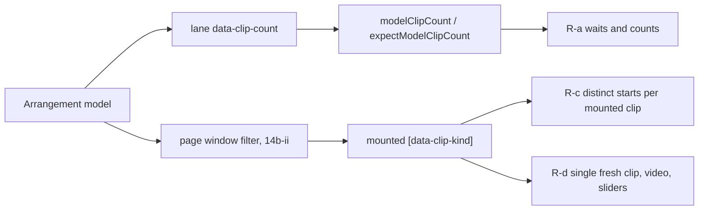

# PERF-14b-i: perf harness-ები clip-ებს model-იდან ითვლის, რომ clip virtualization შეძლოს (round 399)

**თარიღი:** 2026-11-08
**სტატუსი:** In Progress (stage 2 of 4; C round 399 PASS)
**შეცვლილი პროექტი:** Store (`perf/lib/page.ts`, `perf/studio-lab-interactions.perf.spec.ts`, `perf/studio-lab-resources.perf.spec.ts`, `perf/studio-lab-scale.perf.spec.ts`, `perf/budgets.interactions.json`, `perf/budgets.resources.json`, `perf/budgets.scale.json`). `app/**` არ შეცვლილა.

## კონტექსტი

PERF-14 ოთხ ეტაპადაა დაყოფილი: 14a (scale harness და lane-ის `data-clip-count`, doc 254), 14b-i (ეს doc), 14b-ii (clip virtualization lane-ში) და 14c (peak pyramid და canvas tiles).

B-ის virtualization sketch-ზე (`tmp/studio-real-loop/b-round-398/sketch-14bii-lane.patch.txt`) lane მხოლოდ page window-ის clip-ებს ხატავს. ამის შემდეგ ორი perf spec ვეღარ სრულდებოდა (`tmp/studio-real-loop/b-round-398/perf-sketch-studio-lab-interactions.log`, `…-resources.log`):

- **interactions:** group setup-ში Ctrl+D-ის შემდეგ `toHaveCount(2)` mount-ებულ clip-ებს ელოდებოდა. ასლი default zoom-ზე 4566 px-ზე იწყება (lane area 512–1440 px, 1440×900), page window-ის გარეთაა და mount-ებული არ არის, ამიტომ pass abort-დებოდა.
- **resources:** Ctrl+D-ის შემდეგ 2 mount-ებულ clip-ს ელოდებოდა; `res.harness.clips-2` = 1 და export 2 არ სრულდებოდა.

ორივე spec-ში clip-ების რაოდენობა DOM-ით იკითხებოდა. Virtualization-ის შემდეგ DOM-ის რიცხვი mount-ებულ clip-ებს ნიშნავს და არა project-ის clip-ებს.

## მიდგომა

D-29z1365 (B): perf grep-ის ყოველი hit interactions და resources spec-ში ზუსტად ერთ კლასს იღებს.

| კლასი | Hit-ის სახე | წესი |
|---|---|---|
| **R-a model fact** | wait ან count, რომელიც ამბობს, რამდენი clip არსებობს edit-ის შემდეგ (Add, Ctrl+D, undo, delete, 30-clip build) | `[data-track-id][data-clip-count]`-ის `data-clip-count`-ების ჯამი ახალი helper-ებით. DOM-ის რიცხვი შეიძლება `detail`-ში დარჩეს, პირობად — არასოდეს |
| **R-b ერთი clip პოზიციით** | locator, რომელიც clip-ს DOM-ის რიგით ან `data-clip-start`-ით ირჩევს click-ის, drag-ის, hover-ის ან გაზომვისთვის | target-ის იდენტობა model-ით (`data-clip-id` ან `data-clip-start`) ფიქსირდება, mount-ის რიგით არასოდეს; interaction-მდე clip lane area-ში შემოდის scroll-ით, measured window-ის გარეთ |
| **R-c განსხვავებული start-ები** | „N განსხვავებული `data-clip-start` == target“ | „≥ 1 mount-ებული clip და თითო mount-ებულ clip-ზე ერთი განსხვავებული start“ |
| **R-d clip-ის არსებობას არ ეხება** | dialog-ები, slider-ები, `toHaveCount` არა-clip element-ზე, ერთადერთი ახალი clip Add-ის შემდეგ scroll 0-ზე, video clip-ები | ცვლილება არ არის |

**ახალი helper-ები `perf/lib/page.ts`-ში (მხოლოდ დამატება):**

- `modelClipCount(page)` — ყველა `[data-track-id][data-clip-count]` lane-ის `data-clip-count`-ის ჯამი. Video lane-იც ითვლება; R-a-ს ყოველ wait-ზე video clip არ არსებობს (video setup interactions spec-ის ბოლოს მოდის და teardown-ში ქრება), ამიტომ ჯამი audio clip-ების რიცხვს უდრის. Precondition: collapsed group-ის member lane DOM-ში არ არის, ამიტომ helper მის clip-ებს ვერ დათვლის; არცერთი გამომძახებელი group-ს არ აკეცავს.
- `expectModelClipCount(page, count, timeoutMs?)` — `expect.poll` ამ ჯამზე. `timeoutMs`-ის გარეშე Playwright-ის expect timeout-ს იყენებს, ისევე როგორც წინა `toHaveCount`.

ყველა არსებული export, მათ შორის `audioClips`, უცვლელია.

**Scale spec:** B-ის harness patch (`tmp/studio-real-loop/b-round-398/sketch-399-harness.patch.txt`, sha256 `204e282ad46a827c…`) byte-identical დაემატა: in-window lane area-ს მიხედვით, visible-gap self-check და build self-check „≥ 1 mount-ებული clip, თითოზე ერთი განსხვავებული start“. A-მ `scaleSequence`-ის c ხაზში gap check-ის დაშვება ჩაწერა (back-to-back Control+d build). დეტალები doc 254-ის კონტრაქტის სექციაშია. ერთადერთი განზრახ შეცვლილი deterministic მნიშვნელობა PERF-14a-ს run-თან შედარებით არის `scale.clips.in-window.min-zoom-mid`: 24 (`tmp/studio-real-loop/c-round-398/perf-results/latest-scale.json`) → 19, რადგან in-window ახლა sticky track header-ის ქვეშ მყოფ clip-ებს აღარ ითვლის (C-R398-SIGNAL-M2). c და f ნაბიჯები scroll 0-ზეა, ამიტომ იქ header-ის ქვეშ clip არ არის და მნიშვნელობა არ იცვლება. B-ის HEAD baseline (`tmp/studio-real-loop/b-round-398/perf-head-harness-scale.json`) უკვე harness patch-ით არის გაზომილი და 19-ს შეიცავს. Scale spec-ის DOM hit-ები (მაგ. Add-ის შემდეგ `toHaveCount(1)`) ქვემოთ ცხრილში არ არის, რადგან ის B-ის patch-მა migrate-ა.

**Budget-ები:** row-ის id, kind, mode და budget არ შეცვლილა. მხოლოდ შემდეგი row-ების `note` შეიცვალა: `interact.harness.clips-30`, `res.harness.clips-2` (ახლა model-იდან), `res.dom.page-2`, `res.dom.ruler-2`, `res.dom.page-per-added-clip` („virtualization-ის დროს ასლი შეიძლება mount-ებული არ იყოს; ეს mount-ებულ element-ებს ითვლის“) და scale-ის in-window და keydown-p95 row-ები (harness patch).

**Superseded doc-ები (L34):** clip-ების wait-ებისა და clip-ის targeting-ის ნაწილში ეს doc ცვლის 168, 169, 175, 176, 194, 195, 207, 208, 209, 210, 222, 223, 231, 232, 233, 234, 240, 247, 248 და 252 doc-ების აღწერას. თავად ის doc-ები თავიანთ round-ებს აღწერს და არ შეცვლილა.

### Per-site ცხრილი

ხაზის ნომრები HEAD-ის (`c3ee1d6`) ფაილისაა (`tmp/studio-real-loop/b-round-398/perf-dom-clip-grep.txt`).

**`perf/studio-lab-interactions.perf.spec.ts` (34 hit):**

| ძველი ხაზი | რა არის | კლასი | ახალი კოდი |
|---|---|---|---|
| 133 | `clipById` | R-b | უცვლელი: target უკვე `data-clip-id`-ით ფიქსირდება |
| 135, 138 | `videoClips`, `videoClipById` | R-d | უცვლელი (video) |
| 173 | `readClipState`-ის `data-clip-start` read | R-b | უცვლელი: id-ით ნაპოვნ clip-ს კითხულობს |
| 186 | `visibleGrabPoint`-ის `toHaveCount(1)` clip-ის შიდა target-ზე | R-d | უცვლელი (არა-clip element) |
| 243, 299 | `closest('[data-clip-id]') === null` viewport-ის წერტილზე | R-d | უცვლელი (ფონის hit test) |
| 902, 904 | group setup: clip-ის `data-clip-id` | R-b | უცვლელი: id დაჭერილია |
| 912 | Ctrl+D-ის შემდეგ `toHaveCount(2)` | R-a | `expectModelClipCount(page, 2)` |
| 914, 915 | ასლის id mount-ებული clip-ებიდან | R-b | **უცვლელი, STOP** (იხ. „პრობლემები“) |
| 951 | group teardown `toHaveCount(1)` | R-a | `expectModelClipCount(page, 1)` |
| 973, 980, 986, 988, 1050 | video clip-ები | R-d | უცვლელი |
| 1244, 1337, 1399 | slider-ის `toHaveCount(1)` | R-d | უცვლელი |
| 1586 | `visibleClipHeaderCount`: ხილული name bar-ები | R-d | უცვლელი: ხილული clip ყოველთვის mount-ებულია |
| 1616, 1620 | select same-lane-ის candidate loop | R-b | უცვლელი: candidate ხილული name bar-ით და `data-clip-start`-ით ირჩევა |
| 1771 | build: `toHaveCount(press + 1)` | R-a | `expectModelClipCount(page, press + 1)` |
| 1773 | build: `audioClips(page).count()` → `interact.harness.clips-30` | R-a | `modelClipCount(page)`; mount-ებული რიცხვი `detail.mountedClips`-ში |
| 1774, 1775 | build: 30 განსხვავებული `data-clip-start` | R-c | `mountedClips < 1 \|\| distinctStarts !== mountedClips` → problem |
| 1829 | Add-ის შემდეგ `toHaveCount(1)` | R-a | `expectModelClipCount(page, 1)` |
| 1830 | waveform `toHaveCount(1)` | R-d | უცვლელი |
| 1835, 1836 | Add-ის ერთადერთი clip-ის id, scroll 0 | R-d | უცვლელი |
| 1906 | group-ის fallback: `count() === 2` | R-a | `modelClipCount(page) === 2` |
| 1909 | fallback: `toHaveCount(1)` | R-a | `expectModelClipCount(page, 1)` |

**`perf/studio-lab-resources.perf.spec.ts` (11 hit):**

| ძველი ხაზი | რა არის | კლასი | ახალი კოდი |
|---|---|---|---|
| 504 | dialog `toHaveCount(0)` | R-d | უცვლელი |
| 508 | `duplicateFirstClip`: `audioClips(page).first()` | R-d | უცვლელი: ერთადერთი clip Add-იდან, start 0, scroll 0 |
| 516, 517 | Ctrl+D-ის შემდეგ `toHaveCount(2, { timeout: 10000 })` | R-a | `expectModelClipCount(page, 2, 10000)` |
| 682, 741 | `pcmLiveProblems`-ის `placed` | R-a | `modelClipCount(page)` |
| 703 | Add-ის შემდეგ `toHaveCount(1)` | R-a | `expectModelClipCount(page, 1)` |
| 704 | waveform `toHaveCount(1)` | R-d | უცვლელი |
| 707 | `res.harness.clips-1` | R-d | უცვლელი: ერთადერთი ახალი clip Add-ის შემდეგ scroll 0-ზე; row-ის note („`[data-clip-kind="audio"]` count after Add“) grant-ში არ იყო |
| 716 | `res.dom.clip-subtree`: `first()` | R-d | უცვლელი (იგივე ერთადერთი clip) |
| 783 | `res.harness.clips-2` | R-a | `modelClipCount(page)`; mount-ებული რიცხვი `detail.mountedClips`-ში |

## არქიტექტურა

R-a-ს ყოველი პირობა model-ის რიცხვზეა, ამიტომ virtualization მას არ ცვლის. DOM-ის რიცხვი მხოლოდ R-c-სა და `detail`-ში რჩება.

## შეცვლილი ფაილები

- `perf/lib/page.ts` — `modelClipCount` და `expectModelClipCount` (დამატება).
- `perf/studio-lab-interactions.perf.spec.ts` — R-a/R-c migration.
- `perf/studio-lab-resources.perf.spec.ts` — R-a migration.
- `perf/studio-lab-scale.perf.spec.ts` — B-ის harness patch და c ხაზის დაშვება.
- `perf/budgets.interactions.json`, `perf/budgets.resources.json`, `perf/budgets.scale.json` — მხოლოდ `note`.
- `docs/implementation/2026/quarter-IV/254-perf-scale-harness.md` — l.4 და კონტრაქტის სექცია.
- `docs/implementation/2026/quarter-IV/255-perf-harness-model-count.md` — ეს doc.

## პრობლემები და გადაწყვეტები

- **Problem:** lane-ის `data-clip-count` video lane-ზეც არის, ამიტომ ჯამი video clip-ებსაც ითვლის. → **Solution:** R-a-ს ყოველი wait audio-only მდგომარეობაშია (video setup spec-ის ბოლოსაა და lane ცარიელი უნდა იყოს); doc და report ამას აფიქსირებს.
- **Problem:** `expectModelClipCount`-ის ფიქსირებული timeout `toHaveCount`-ზე მოკლე ან გრძელი შეიძლებოდა ყოფილიყო. → **Solution:** `timeoutMs`-ის გარეშე Playwright-ის expect timeout გამოიყენება; resources-ის Ctrl+D wait-ი თავის 10000 ms-ს ინარჩუნებს.
- **Problem (STOP, B-ის ruling-ს ელოდება):** group setup-ში ასლის id mount-ებული clip-ებიდან იკითხება (ძველი ხაზი 914), ხოლო `measureGroupDrag` ასლის მდგომარეობას gesture-მდე, release-ის და Undo-ს შემდეგ კითხულობს. HEAD-ზე ასლი 4566 px-ზე იწყება (lane area 512–1440 px). R-b-ის სიტყვასიტყვით შესრულებას ~4000 px scroll სჭირდება, და playing მდგომარეობაში ხელით scroll Follow-ს აჩერებს: „Follow paused“ რჩება scroll-ის დაბრუნებისა და Home-ის შემდეგაც (`tmp/studio-real-loop/a-round-399/probe/follow-probe.txt`). ეს HEAD-ის მდგომარეობას measured window-მდე ცვლის, რაც D-29z1365-ის „deterministic row-ები HEAD-ის ტოლი“ წესს ეწინააღმდეგება. → **Solution:** ეს ნაწილი არ შეცვლილა; B წყვეტს (იხ. `tmp/studio-real-loop/a-round-399.md`).

## ტესტირება

- `npm run typecheck` — rc 0 (`tmp/studio-real-loop/a-round-399/typecheck.log`).
- perf/lib vitest (`b-round-334/vitest.perf-lib.config.mjs`) — 3 ფაილი, 54 test PASS (`tmp/studio-real-loop/a-round-399/perf-lib-vitest.log`).
- Budget-ების JSON diff HEAD-თან: მხოლოდ ჩამოთვლილი row-ების `note` (`tmp/studio-real-loop/a-round-399/budget-shape.txt`).
- Perf spec-ები სამუშაო ხეზე (production build, 1440×900, თითო spec ცალკე): interactions rc 0, 189/189 deterministic row HEAD-ის baseline-ის ტოლია, 498 წმ; resources rc 0, 46/46; scale rc 0, 17/17, `scale.clips.in-window.min-zoom-mid` = 19. ყველა pass-ის `problems` ცარიელია (`tmp/studio-real-loop/a-round-399/a4-*-compare.txt`).
- იგივე spec-ები virtualization sketch-ის scratch-ზე: scale rc 0 (`scale.dom.page` 950 / 1532 / 1868, `scale.clips.model` 200, problems ცარიელი); resources rc 0 (`res.harness.clips-2` = 2, problems ცარიელი); interactions rc 1, `abortedAt` null, მაგრამ ყოველ pass-ში ერთი problem — „group setup: no Ctrl+D copy“ (STOP-ის ნაწილი), 24 group row null; 13 failing assert-იდან 12 group row-ია (STOP), ამის გარდა ერთი assert ვარდება: `interact.zoom.30.out.path-rewrites` 2, budget == 3 (`tmp/studio-real-loop/a-round-399/a5-*-summary.txt`).

## TODO / შემდეგი ნაბიჯები

1. B-ის ruling group copy-ის R-b read-ებზე (STOP), შემდეგ ამ ნაწილის migration.
2. **PERF-14b-ii — clip virtualization** (RETRO 400-ის შემდეგ), `sketch-14bii-lane.patch.txt`-იდან, TL-R398-SK-M1 და TL-R398-SK-L1-ის გასწორების შემდეგ; scale assert-ების flip და A5-ის failing assert-ების ხელახალი ruling.
3. **PERF-14c — peak pyramid და canvas tiles.**
