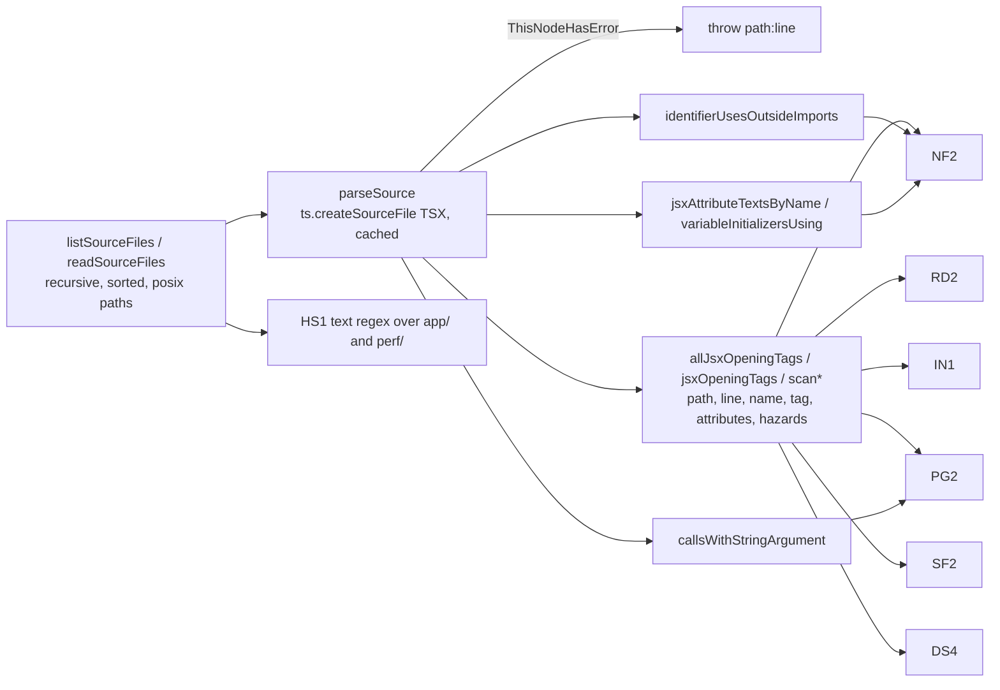

# SYS-R435-SOURCE-SCAN-HELPER: ერთი საერთო JSX source scanner TypeScript parser-ზე, Studio-ს ექვსი source-scan ტესტისთვის

**თარიღი:** 2026-11-10
**სტატუსი:** Completed (C round 439 PASS)
**შეცვლილი პროექტი:** Store (მხოლოდ test ფაილები `app/lib/arrangement/__tests__/`-ში და ეს doc. App-ის runtime კოდი, layout და ქცევა უცვლელია)

## კონტექსტი

Studio-ს ექვს source-scan ტესტს (NF2, RD2, PG2, SF2, DS4, HS1) თითოეულს საკუთარი regex scanner ჰქონდა. RETRO 435-მა (D-29z1542) ისინი ერთ systemic task-ად გააერთიანა, რადგან:

- ხუთი scanner `app/components/arrangement`-ის მხოლოდ top level-ს კითხულობდა (non-recursive `readdirSync`). ARCH-SPLIT ფაილებს subfolder-ებში გადაიტანს და გადატანილი ფაილი ჩუმად გაივლიდა (L8: deferred Low test selector-ზე time bomb-ია).
- ცხრა deferred Low ერთსა და იმავე კლასს ეკუთვნოდა: regex ვერ ხედავდა spread-ს ან `style=`-ს tag-ზე, `data-type=`-ს `type=`-ად ითვლიდა, `datetime-local`-ს უარყოფდა, comment-ში apostrophe-ს ვერ ცნობდა და ა.შ.

ეს test-only round-ია; reference-first და product-designer consult არ ეხება.

## მიდგომა

**წესები (D-29z1557):**

- **(0) Engine — TypeScript parser** (`ts.createSourceFile`, TSX; `typescript` უკვე dependency-ა). v1 sketch-ის ხელით დაწერილი tag walker-მა tech-lead-ის v1 review-ში იგივე blind-spot კლასი გაიმეორა (quote overrun — Medium, skeleton fallback, `style = {x}` whitespace, nested literal-ები, unescaped სახელები). Parser-ში spread არის `JsxSpreadAttribute` node, attribute-ის სახელი ზუსტია, nested JSX ცალკე node-ია. წყარო, რომელსაც parser `ThisNodeHasError`-ით მონიშნავს, `path:line`-ით throw-ს აკეთებს (SS2) — scanner წაუკითხავ ფაილზე არასდროს გადის.
- **(a) NF2:** ყოველი number tag-ის `className` ზუსტად `{inputClass}`, `{STUDIO_NUMBER_FIELD_CLASS}` ან `{cn(inputClass | STUDIO_NUMBER_FIELD_CLASS, …)}`-ია; ternary ან სხვა carrier წითელია. `inputClass`-ის გამოყენებისას ფაილი მას ზუსტად ერთხელ აცხადებს და initializer-ში `STUDIO_NUMBER_FIELD_CLASS` identifier-ია (AST); ყოველი `inputClass=` hand-off ზუსტად `{inputClass}`-ია. Owner ფაილი constant-ს import-ების გარეთ იყენებს (AST identifier-ები; import, string და comment არ ითვლება). NF2 სამ tag-ს pin-ავს და number tag-ზე spread-ს ან `style`-ს უარყოფს. Rendered ნახევარი F10-ია (უცვლელი).
- **(b) MixFader-ის spread:** IN1 ზუსტად ერთ spread-attribute owner-ს უშვებს, `ArrangementMixFader.tsx`-ს, და ამოწმებს, რომ მისი props type არის `Omit<InputHTMLAttributes<HTMLInputElement>, 'type' | …>`. ეს მხოლოდ compile-time guard-ია; app fix (spread `type`-მდე) არის TL-R438-02-MIXFADER-SPREAD-ORDER, deferred Low. Ruling line: `ArrangementMixFader`-ის `<input>`-ზე IN1-ის allow-list სჯობს წესს „input-ზე spread არ არის“.
- **(c) RD2 და IN1 გაყოფილია:** RD2 — 6 radio tag, `className` ზუსტად `{STUDIO_RADIO_CLASS}`, spread-ისა და style-ის გარეშე. ახალი **IN1** — ყოველ arrangement `<input>`-ს აქვს literal `type`, რომელიც `^[a-z-]+$`-ს ემთხვევა, და spread-ის ერთადერთი owner (b)-ისაა.
- **(d) არე** რჩება `app/components/arrangement`, ახლა recursive. `app/components/studio/` frozen legacy-ა; DS4 კვლავ მხოლოდ legacy `ExportDialog.tsx`-ის default-ს pin-ავს.
- **(e) HS1** რჩება text regex-ად `.ts`/`.tsx`-ზე `app/`-სა და `perf/`-ში, საერთო recursive walker-ით. `REPEAT`-ს დაემატა lookbehind `(?<![!\w.?])`, HS2-ს — ორი negated-repeat fixture.
- **(f) ამ round-ით არ იხურება:** GATE431-REVIEW-L3-STRING-COUNT-PINS (DXA7/DXL8 — სხვა suite-ები და string count-ები, არა scanner; deferred რჩება); GATE434-S2-ის „StudioDialog render test“ ნახევარი (ARCH-SPLIT checkpoint-თან რჩება); ოთხი suite საკუთარი recursive walker-ით (`studio-focus-ring`, `studio-theme-obsidian`, `panel-radius-ui`, `strings`) ჩაწერილია სიგნალად SIG-R438-OTHER-SCANNERS — ეს დუბლირებაა და არა ხვრელი.
- **(g) Path-ები:** helper store root-ს `__dirname`-იდან ადგენს, ამიტომ DS4 და SF2 აღარ არიან დამოკიდებული `process.cwd()`-ზე. Owner სიები `app/components/arrangement`-ის მიმართ relative path-ებია (დღეს — ფაილის სახელები). Subfolder-ში გადატანილი ფაილი ჩანს როგორც `sub/File.tsx`, ამიტომ owner pin-ები შეგნებულად წითლდება; ARCH-SPLIT-მა ისინი იმავე ცვლილებაში უნდა განაახლოს.
- **(h) v4.1 (C-R438-01, round 439):** NF2 number field-ებს `type`-ის literal-ით **ნებისმიერ** JSX tag-ზე ირჩევს (`scanAllJsxOpeningTags`), არა მხოლოდ `<input>`-ზე; არა-`input` number tag-ების სია ცარიელზეა pin-ული. NF2, PG2 და IN1 raw text-საც ამოწმებენ: თითო arrangement `.ts`/`.tsx` ფაილში `type="number"`-ის (lookbehind `(?<![\w-])`), `<progress`-ისა და `<input`-ის ტექსტის რაოდენობა JSX tag-ების რაოდენობას უდრის. ამიტომ markup string-ში ან comment-ში და wrapper-ის computed `type` წითელია, როგორც HEAD-ზე. `jsxOpeningTags` ახლა `allJsxOpeningTags`-ის filter-ია. HEAD-ის DS4-ის `<Modal` ტექსტი string-ში ან comment-ში არ გადმოვიდა: React component string-იდან არ რენდერდება.
- **(i) PG2-ის paired tag:** HEAD-ის PG2 ამოწმებდა, რომ ყოველი `<progress` self-closing იყო და `</progress>` არსად ყოფილიყო, რადგან მისი regex paired tag-ს ვერ კითხულობდა. Parser paired tag-საც კითხულობს და class-ის, hazard-ისა და რაოდენობის წესი მასზეც მოქმედებს, ამიტომ ეს ორი შემოწმება არ გადმოვიდა (M24: paired tag class-ით — HEAD წითელი, ახალი მწვანე; M25: class-ის გარეშე — ორივე წითელი). HEAD-ის assertion-ების სრული რუკა: `b-round-438/head-assertion-map.md`.
- **(j) Test ფაილები:** HEAD-ის SF2 და DS4 top-level `*.test.tsx`-საც კითხულობდნენ, NF2, RD2 და PG2 კი `*.spec.tsx`-ს. Helper `__tests__`-ს, `*.test.*`-სა და `*.spec.*`-ს გამოტოვებს, რადგან test ფაილი Studio-ს UI-ში არ რენდერდება. დღეს `app/components/arrangement`-ში ასეთი ფაილი არ არის.

**Docs 277–282** ძველ per-file scanner-ებს აღწერენ თავიანთი round-ებისთვის და უცვლელი რჩება. **Doc 282-ის მე-7 პუნქტი ჩანაცვლებულია: DS4 ახლა recursive-ია.**

**დახურული finding-ები და მათი red-proof (B-ის გაშვებები: `b-round-438/mutants/head.jsonl`, `v3.jsonl`, `sketch.jsonl`, `helper.jsonl`):**

| Id | Mutant | HEAD-ის ტესტები | ახალი ტესტები |
|---|---|---|---|
| A-R430-REVIEW-NF2-TYPE-BOUNDARY | M1: `data-input-type="number"` text input-ზე | წითელი NF2 (false red) | მწვანე |
| A-R430-REVIEW-NF2-CLASSNAME-CONST | M2: სამი number tag პირდაპირ `className={STUDIO_NUMBER_FIELD_CLASS}`, `inputClass` constant-ს კარგავს | წითელი NF2 (false red) | მწვანე |
| A-R430-REVIEW-NF2-SIDE-EFFECT-IMPORT | H3: helper import-ებში identifier-ებს ითვლის | — | წითელი SS5 |
| A-R431-REVIEW-L1-RD2-SPREAD-AFTER-TYPE | M3: `{...radioOverrides}` radio-ზე | მწვანე (false pass) | წითელი IN1, RD2 |
| A-R431-REVIEW-L2-RD2-DATA-TYPE | M4: `data-type="radio"` text input-ზე | წითელი RD2 (false red) | მწვანე |
| A-R431-REVIEW-L3-RD2-DATETIME-LOCAL | M5: `type="datetime-local"` | წითელი RD2 (false red) | მწვანე |
| A-R432-REVIEW-RV432-5-PG2-SPREAD | M6: spread; M7: `style=`; M8: `createElement('progress')` | მწვანე ×3 (false pass) | წითელი PG2 ×3 |
| A-R433-REVIEW-SF2-SCANNER-BLIND-SPOTS | M9: spread search tag-ზე; M10: `// …'s >` comment tag-ში | M9 მწვანე (false pass); M10 მწვანე | M9 წითელი SF2; M10 მწვანე (parser comment-ს თავისით კითხულობს; SF1/SS1 comment fixture-ები) |
| GATE434-S2 (subfolder ნახევარი) | M11: ახალი `dialogs/ArrangementNewDialog.tsx` unskinned `Modal`-ით | მწვანე (false pass) | წითელი DS4 |
| A-R429-REVIEW-SCAN-NEGATED-REPEAT | M12: `!event.repeat && event.key === 'Enter'` | წითელი HS1 (false red) | მწვანე |
| ახალი guard-ები (tech-lead v1-7, v2-1) | M13: `style=` number input-ზე; M14: tag კარგავს `inputClass`-ს; M15: hand-off string ხდება; M16: ternary `className` carrier | მწვანე ×4 | წითელი NF2 ×4 |
| C-R438-01-NF2-WRAPPER-TAG-NARROWING | M17: `<Input type="number" />` ახალ ფაილში; M18: იგივე `ArrangementDetailPanel.tsx`-ში; M22: `'<input type="number" />'` string-ში; M23: `<Input type={'number' as const} />` | M17, M22, M23 წითელი NF2; M18 მწვანე (false pass) | წითელი NF2 ×4 |
| A-R438-REVIEW-L1-PG2-STRING-MARKUP | M19: `<progress>` markup string-ში; M20: radio markup string-ში; M21/M21b: search markup string-ში | წითელი PG2; წითელი RD2; M21 წითელი SF2 | წითელი PG2; წითელი IN1; M21 მწვანე SF2, M21b წითელი IN1 |
| ruling (i), paired `<progress>` | M24: paired tag class-ით; M25: paired tag class-ის გარეშე | წითელი PG2 ×2 | M24 მწვანე (მიღებული); M25 წითელი PG2 |
| helper row-ები | H1 no recursion; H2 no spread hazard; H4 no style hazard; H5 no `{'…'}` literal; H6 no syntax throw; H7 tag-name prefix match; H8 any call argument; H9 property-access names counted; H10 any-tag query input-only | — | წითელი SS6; IN1 + SS4; SS4; SF1 + SS3 + SS9; SS2; DS4 + SS2; SS7; SS5; DS4 + PG2 + SS2 + SS9 |

## არქიტექტურა

## შეცვლილი ფაილები

- `app/lib/arrangement/__tests__/helpers/source-scan.ts` (ახალი): `STORE_ROOT`, `ARRANGEMENT_COMPONENTS_DIR`, recursive file walk (`__tests__`, `node_modules` და `*.test|spec.*` გამოტოვებულია), TSX parse-ი error throw-ით, JSX opening tag-ების სკანირება (სახელით ან ნებისმიერი სახელის, `name` ველით) hazard-ებით (`spread`, `style`), identifier-ების დათვლა import-ების გარეთ, string argument-იანი call-ები, attribute ტექსტები სახელით და variable initializer-ები.
- `app/lib/arrangement/__tests__/source-scan.test.ts` (ახალი): helper-ის fixture-ები SS1–SS9. SS6 დროებით ხეს `os.tmpdir()`-ში აშენებს და `afterEach`-ში შლის.
- `app/lib/arrangement/__tests__/studio-number-field.test.ts`: NF2 helper-ზე.
- `app/lib/arrangement/__tests__/studio-radio.test.ts`: RD2 helper-ზე და ახალი IN1.
- `app/lib/arrangement/__tests__/studio-progress.test.ts`: PG2 helper-ზე.
- `app/lib/arrangement/__tests__/studio-search-field.test.ts`: SF1 (comment fixture-ით) და SF2 helper-ზე.
- `app/lib/arrangement/__tests__/studio-dialog-scrollbar.test.tsx`: DS4 helper-ზე, recursive.
- `app/lib/arrangement/__tests__/held-enter-source-scan.test.ts`: HS1 საერთო walker-ზე, `REPEAT`-ის lookbehind; HS2 fixture-ები.
- ეს doc.

NF1, RD1, PG1 და DS1–DS3 უცვლელია. HEAD-ზე წითელი და იმავე suite-ში ახალ ტესტებზე მწვანე მხოლოდ M1, M2, M4, M5, M12, M21 და M24-ია: M1, M4, M5 და M12 HEAD-ის false red-ებია; M2 უფრო მკაცრი per-tag carrier-ით არის ჩანაცვლებული; M21-ს IN1 იჭერს (M21b); M24 ruling (i)-ია. შეგნებულად არ გადმოვიდა სამი scanner-ის დაფარვის შემოწმება: DS4-ის `<Modal` ტექსტი string-ში (ruling (h)), PG2-ის self-closing / `</progress>` შემოწმება (ruling (i)) და test/spec ფაილების კითხვა (ruling (j)). რუკა: `b-round-438/head-assertion-map.md`.

## პრობლემები და გადაწყვეტები

- **პრობლემა:** ხელით დაწერილმა tag walker-მა (v1 sketch) regex-ის blind spot-ები გაიმეორა (quote overrun, whitespace, nested literal-ები). **გადაწყვეტა:** TypeScript parser — spread, attribute-ის სახელი და nested JSX AST node-ებია.
- **პრობლემა:** parser-მა გაუმართავი წყარო შეიძლება ჩუმად ნაწილობრივ წაიკითხოს. **გადაწყვეტა:** `ThisNodeHasError`-ზე `path:line` throw (SS2, H6 mutant).
- **პრობლემა:** `ArrangementMixFader.tsx`-ის `{...props}` `type="range"`-ის შემდეგაა და runtime-ში `type`-ს გადაფარავს შეიძლებოდა. **გადაწყვეტა:** test-only round-ში — IN1-ის compile-time `Omit` guard; app fix ცალკე deferred Low-ია (TL-R438-02-MIXFADER-SPREAD-ORDER).
- **პრობლემა:** DS4 და SF2 `process.cwd()`-ზე იყო დამოკიდებული. **გადაწყვეტა:** root `__dirname`-იდან (`STORE_ROOT`).

## ტესტირება

- A-ს გაშვებები (round 439), log-ები `tmp/studio-real-loop/a-round-439/`-ში:
  - sketch-ის 8 ფაილი B-ის ასლებს ემთხვევა (`cmp`, 8/8);
  - covering set: 7 ფაილი, 24/24, rc 0;
  - `npm run typecheck`: rc 0;
  - `npm run lint`: rc 0, 205 warning (HEAD-ისა და sketch-ის ტოლი);
  - Biome 8 შეცვლილ test ფაილზე: rc 0.
- Mutant-ები (ცხრილი ზემოთ) B-მა გაუშვა scratch ასლებში (`b-round-438/mutants/`); C round 439 მათ იმავე script-ებით იმეორებს.
- სრული suite და verify gate-ის row-ებია.

## TODO / შემდეგი ნაბიჯები

- TL-R438-02-MIXFADER-SPREAD-ORDER: `ArrangementMixFader.tsx`-ში spread `type`-მდე გადატანა (deferred Low).
- TL-R438-04-HS1-TEXT-REGEX: HS1-ის parser-ზე გადატანა, SIG-R438-OTHER-SCANNERS-თან ერთად (deferred Low).
- TL-R438-N1-INITIALIZER-PROPERTY-NAMES, TL-R438-N2-IDENTIFIER-KEYS, TL-R438-N3-CN-OVERRIDE: helper-ის დათვლის დაზუსტებები (deferred Low).
- ARCH-SPLIT: ფაილის subfolder-ში გადატანისას owner pin-ები (`sub/File.tsx`) იმავე ცვლილებაში განახლდეს.
- GATE434-S2-ის StudioDialog render test-ის ნახევარი — ARCH-SPLIT checkpoint-თან.
- A-R438-REVIEW-L2-DS4-SF2-TEXT-CONTAINMENT: DS4/SF2 tag-ის მთლიან ტექსტზე containment-ს ამოწმებენ (HEAD-ის ტოლი; deferred Low).
- A-R438-REVIEW-L3-PARSE-DIAGNOSTICS: `ThisNodeHasError` scanner-ის diagnostics-ს ვერ ხედავს; typecheck ფარავს (deferred Low).
- TL-R439-N1-NF2-RAW-SPELLING: NF2-ის raw guard-ი და AST სხვადასხვა ჩაწერას ითვლიან (`type={ "number" }`); ორი შეგნებული ცვლილებით შეიძლება გაქრეს (deferred Low).
