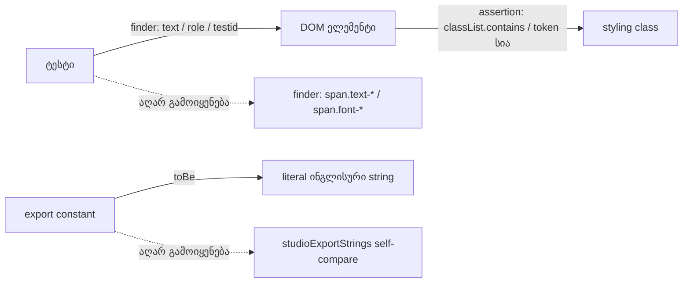

# SYS-1 ეტაპი 1: ტესტები ელემენტს ტექსტით პოულობენ და არა styling class-ით; self-compare-ები literal pin-ებად

**თარიღი:** 2026-11-10
**სტატუსი:** Completed (C round 440 PASS)
**შეცვლილი პროექტი:** Store (მხოლოდ ექვსი test ფაილი `app/lib/arrangement/__tests__/`-ში და ეს doc. App-ის runtime კოდი, layout და ქცევა უცვლელია)

## კონტექსტი

SYS-1 systemic task-ია, რომელიც deferred Low-ების ერთ კლასს ხურავს: ტესტები, რომლებიც ელემენტს styling class-ით პოულობენ ან constant-ს საკუთარ განმარტებას ადარებენ.

- **RETRO200-CLASS-SELECTORS:** ოთხი suite ელემენტს `span.font-sans`, `span.text-dim`, `span.text-foreground` ან `span.font-mono` selector-ით პოულობდა. STORE-REDESIGN და ARCH-SPLIT სწორედ ამ class-ებს შეცვლის, ამიტომ ასეთი finder "time bomb"-ია (lessons L8, L12): class-ის გადარქმევისას ტესტი ან ჩუმად ცარიელ სიას იღებს, ან სხვა ელემენტს პოულობს.
- **GATE146-S4-LRS3-CLASSNAME-PINS:** LRS3 Library-ის Playing marker-ისა და meta row-ის მთლიან `className`-ს `toBe`-თი ამოწმებდა, ანუ token-ების რიგსაც კი აფიქსირებდა.
- **C-R127-L1f-SELF-COMPARE-TESTS:** `export-cancel.test.ts` და `export-wav.test.ts` (EW8f) constant-ს ადარებდნენ `studioExportStrings`-ის იმავე ჩანაწერს, რომლიდანაც ის არის განსაზღვრული. ტექსტის ცვლილებისას ეს შედარება ყოველთვის მწვანე რჩებოდა (vacuous).

SYS-1 ორ ეტაპად გაიყო (D-29z1565). ეს ეტაპი მხოლოდ test-only ცვლილებაა; მეორე ეტაპს runtime data hook-ები სჭირდება.

## მიდგომა

**წესი:** ტესტი ელემენტს პოულობს text-ით, role-ით, `data-testid`-ით ან data attribute-ით. Styling class ჩნდება მხოლოდ assertion-ში (`classList.contains`, token-ების სია) და არასოდეს finder-ად.

| ფაილი | ადრე (HEAD) | ახლა | ხურავს |
|---|---|---|---|
| `detail-panel-polish.test.tsx` (design (d) block) | label-ებს `span.font-sans` პოულობდა | label span-ები text-ით (`Track`, `Tracks`, `Start`, `Length`, `Clip origin`). ახალი explicit assert: `font-sans` span-ები ზუსტად `Start`, `Length`, `Clip origin`-ია (group-ზე: `Start`, `Length`). label-ების სიას `Track`/`Tracks` დაემატა | RETRO200 |
| `detail-panel-strings-ui.test.tsx` DPS2, DPS4 | `span.text-dim` finder | DPS2: text-ით ნაპოვნი label span-ები ოთხ label-ს უდრის **და** `text-dim` span-ებიც იგივე ოთხია. DPS4: ზუსტად ერთი span ტექსტით `Tracks`, და მას `text-dim` აქვს | RETRO200 |
| `library-preview.test.tsx` (C-R16-01 row) | `row.querySelector('span.text-foreground')` | ზუსტად ერთი span ტექსტით `მუსიკა`; მას `text-foreground` აქვს და row-ში პირველი `text-foreground` span-ია (HEAD-ის რიგის შემოწმება შენარჩუნებულია) | RETRO200 |
| `library-row-strings-ui.test.tsx` LRS3 | marker-ისა და meta row-ის `className` `toBe`-თი; `children[1].querySelectorAll('span.font-mono')` | token-ის მიხედვით `toContain` (marker: `flex items-center gap-0.5 whitespace-nowrap text-xs text-foreground`; meta: `flex gap-2 text-xs tabular-nums text-muted`); `not.toContain('flex-wrap')` რჩება. ხანგრძლივობა იძებნება როგორც **leaf** span ტექსტით `00:20.000`: მას `font-mono` აქვს, მისი `parentElement` არის `children[1]`, და მთელ meta row-ში ერთადერთი `font-mono` span არის `00:20.000` (HEAD-ის მხოლოდ `children[1]`-ის count-ზე ძლიერი) | RETRO200, GATE146 |
| `export-cancel.test.ts` | `ARRANGEMENT_EXPORT_CANCELLED_MESSAGE` და `…_ENCODER_MESSAGE` შედარებული `studioExportStrings`-ის ჩანაწერებთან, რომლიდანაც განისაზღვრება | შედარება literal ინგლისურ string-ებთან; გამოუყენებელი `studioExportStrings` import წაიშალა | C-R127 |
| `export-wav.test.ts` EW8f | `ARRANGEMENT_WAV_WORKER_STALLED_MESSAGE` შედარებული `studioExportStrings.wavWorkerStalled(30)`-თან | შედარება literal-თან `Writing WAV stalled — the worker has not responded for 30 seconds.`; სათაური "…the stalled message is exact" ახლა მართალია | C-R127 |

**Ruling S1-R1 (შეგნებული drop):** LRS3-ის ზუსტი `className` ტოლობა ("სხვა token არ არის") არ გადმოვიდა — GATE146 სწორედ ამ ზუსტი pin-ის მოხსნას ითხოვდა. token-ების გადალაგება (R1, R2) ახლა მწვანეა; ნებისმიერი ჩამოთვლილი token-ის წაშლა ან გადარქმევა წითელია (S7, S8). ეს ერთადერთი HEAD შემოწმებაა, რომელიც არ გადმოვიდა; ყველა სხვა HEAD assertion-ს ტოლი ან უფრო ძლიერი ჩანაცვლება აქვს (`tmp/studio-real-loop/b-round-439/sketch-review.md`, HEAD assertion map).

ცვლილება B-ის sketch-ის ზუსტი apply-ია (`tmp/studio-real-loop/b-round-439/sketch-440.patch.txt`); tech-lead-მა sketch-ის v1 და v2 განიხილა (0 Medium ან მეტი).

## არქიტექტურა

## შეცვლილი ფაილები

- `app/lib/arrangement/__tests__/detail-panel-polish.test.tsx` — design (d) block: label-ები text-ით, `font-sans`-ის explicit assert.
- `app/lib/arrangement/__tests__/detail-panel-strings-ui.test.tsx` — DPS2 და DPS4: `text-dim` finder-ების ნაცვლად text finder + class assert.
- `app/lib/arrangement/__tests__/library-preview.test.tsx` — C-R16-01 row: active-lane name span text-ით, რიგის შემოწმებით.
- `app/lib/arrangement/__tests__/library-row-strings-ui.test.tsx` — LRS3: per-token `toContain`, leaf duration span.
- `app/lib/arrangement/__tests__/export-cancel.test.ts` — literal string pin-ები, ზედმეტი import წაიშალა.
- `app/lib/arrangement/__tests__/export-wav.test.ts` — EW8f literal pin.
- `docs/implementation/2026/quarter-IV/286-sys-1-stage-1-test-selectors.md` — ეს doc.

## პრობლემები და გადაწყვეტები

- **პრობლემა:** Library meta row-ში ხანგრძლივობის wrapper span-საც და შიდა span-საც ერთი და იგივე ტექსტი (`00:20.000`) აქვს, ამიტომ text finder ორს პოულობს. **გადაწყვეტა:** finder იღებს leaf span-ს (შვილი ელემენტის გარეშე) და ცალკე ამოწმებს მის `parentElement`-ს; mutant S9 (wrapper იღებს `font-mono`-ს, შიდა span იშლება) წითელია.
- **პრობლემა:** "პირველი `text-foreground` span" finder-ს decoy span შეეძლო მოეტყუებინა. **გადაწყვეტა:** span ტექსტით `მუსიკა` იძებნება და მოწმდება, რომ ის row-ის პირველი `text-foreground` span-ია; mutant S10 (decoy წინ) წითელია.
- **პრობლემა:** HEAD-ის self-compare ტექსტის ცვლილებას ვერ იჭერდა (V1–V3 მწვანე). **გადაწყვეტა:** literal pin-ები; `strings.test.ts` ამ literal-ებს უკვე ამოწმებდა, ამიტომ full suite-ში დაცვა არსებობდა — ეს რაუნდი მხოლოდ vacuous შედარებას შლის ორ ფაილში.

## ტესტირება

**Mutant matrix** (runtime source-ის mutant-ები მხოლოდ scratch tree-ში; script `tmp/studio-real-loop/b-round-439/mutants/run-mutants.sh`, შედეგები `tmp/studio-real-loop/b-round-439/mutants/results.jsonl`):

| Id | Mutant | Suite | HEAD | ახლა |
|---|---|---|---|---|
| S1 | Detail `Start` label კარგავს `font-sans`-ს | detail-panel-polish | red | red |
| S2 | `sourceOffsetLabel` 'Clip origin' → 'Source offset' | detail-panel-strings-ui | red | red |
| S3 | `Track` label `text-dim` → `text-muted` | detail-panel-strings-ui | red | red |
| S4 | `Tracks` label `text-dim` → `text-muted` | detail-panel-strings-ui | red | red |
| S5 | active-lane name span `text-foreground` → `text-muted` | library-preview | red | red |
| S6 | Library duration span კარგავს `font-mono`-ს | library-row-strings-ui | red | red |
| S7 | Playing marker კარგავს `whitespace-nowrap`-ს | library-row-strings-ui | red | red |
| S8 | meta row კარგავს `tabular-nums`-ს | library-row-strings-ui | red | red |
| R1 | marker token-ების გადალაგება | library-row-strings-ui | red | **green (ruling S1-R1)** |
| R2 | meta token-ების გადალაგება | library-row-strings-ui | red | **green (ruling S1-R1)** |
| V1 | `exportCancelled` ტექსტი შეიცვალა | export-cancel | **green (HEAD vacuous)** | red |
| V2 | `exportCancelledEncoder` ტექსტი შეიცვალა | export-cancel | **green (HEAD vacuous)** | red |
| V3 | `wavWorkerStalled` ტექსტი შეიცვალა | export-wav | **green (HEAD vacuous)** | red |
| S9 | duration wrapper span იღებს `font-mono`-ს, შიდა span იშლება | library-row-strings-ui | red | red |
| S10 | decoy `text-foreground` span active-lane name-ის წინ | library-preview | red | red |

V1–V3 თითო test ფაილს უშვებს.

**Covering run:** ექვსი შეცვლილი test ფაილი, 89/89 მწვანე. Typecheck და Biome lint — rc 0 (205 warning; B-ის sketch run-მა `tmp/studio-real-loop/b-round-439/lint-sketch.log` იგივე 205 აჩვენა). სრული suite, build და verify root gate-ის row-ებია.

**Scope-ს გარეთ (ruled):**
- `export-wav.test.ts`-ში `${studioExportStrings.wavWorkerFailed} boom` შედარება — worker error-ის suffix-თან კომპოზიციას ამოწმებს და არა constant-ს საკუთარ განმარტებასთან.
- UI ტესტები, რომლებიც rendered ტექსტს `studioExportStrings`-ს ადარებენ (მაგ. `export-cancel-ui.test.tsx`) — render-vs-source შემოწმებაა, არა self-compare.
- DPS3-ის `.sr-only` finder და სხვა suite-ების lucide icon-class finder-ები — ჩაწერილია ქვემოთ მოცემულ pin-ებთან ერთად.
- `className).toBe(` სტილის pin-ები closes სიის გარეთ: CookieConsent, detail-panel-reason, detail-panel-polish `WAVEFORM_BOX_CLASS`, track-layout, track-group-collapse-ui, render-budget. SYS-1-ზე ჩაწერილია RETRO-450-ის კითხვად (`sys1_other_classname_pins`), ახალი finding id-ის გარეშე.

**ხურავს:** RETRO200-CLASS-SELECTORS, GATE146-S4-LRS3-CLASSNAME-PINS, C-R127-L1f-SELF-COMPARE-TESTS.

## TODO / შემდეგი ნაბიჯები

SYS-1 ეტაპი 2 (runtime data hook-ები `ArrangementOverview.tsx`-ში და export dialog-ის video-sound line-ის jsdom render):

- GATE164-OV1-FRAGILE
- GATE173-S4-OVERVIEW-BAR-POSITIONAL-SELECTOR
- GATE81-S2-UM8-SOURCE-TEXT
