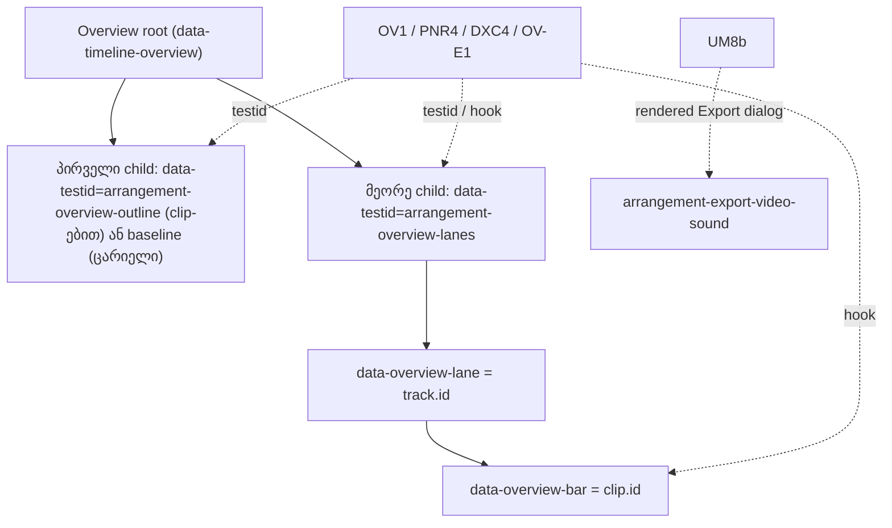

# SYS-1 ეტაპი 2: Overview-ის data hook-ები; ტესტები Overview-ის ნაწილებს აღარ პოულობენ პოზიციით ან source ტექსტით

**თარიღი:** 2026-11-10
**სტატუსი:** Completed (C round 441 PASS)
**შეცვლილი პროექტი:** Store (`ArrangementOverview.tsx`-ში მხოლოდ ოთხი data attribute, ხუთი test ფაილი `app/lib/arrangement/__tests__/`-ში და ეს doc. Class-ები, სტრუქტურა, ტექსტი, ქცევა და სტილი უცვლელია)

## კონტექსტი

SYS-1-ის მეორე (ბოლო) ეტაპი. პირველმა ეტაპმა (doc 286) styling class selector-ები მოაშორა. ამ ეტაპზე დარჩა Overview-ის ნაწილების ძებნის ორი მყიფე ფორმა:

- **პოზიციით:** `overview.firstElementChild`, `children[1]`, `:scope > div > div`. თუ Overview-ში ახალი div ჩაჯდება (STORE-REDESIGN, ARCH-SPLIT ზუსტად ამ markup-ს გადააწყობს), ტესტი სხვა ელემენტს იპოვის ან ცრუ განგაშს ატეხს (lessons L8: "time bomb").
- **Source ტექსტით:** OV1 კომპონენტის source-ში overlay-ის ზუსტ JSX სტრიქონს ითვლიდა, UM8 კი `ArrangementExportDialog.tsx`-ის source-ს კითხულობდა და იქ ფუნქციის სახელს ეძებდა. Rendered ქცევას არცერთი არ ამოწმებდა.

იხურება: **GATE164-OV1-FRAGILE**, **GATE173-S4-OVERVIEW-BAR-POSITIONAL-SELECTOR**, **GATE81-S2-UM8-SOURCE-TEXT**.

## მიდგომა

**წესი:** ტესტი Overview-ის ნაწილს პოულობს `data-testid`-ით ან data hook-ით; არასოდეს child-ის პოზიციით (`children[n]`, `firstElementChild`, `:scope > div > div`) და არასოდეს კომპონენტის source-ის კითხვით. Class ჩნდება მხოლოდ assertion-ის შიგნით.

`ArrangementOverview.tsx`-ს ემატება ოთხი hook (Biome-მა outline overlay და lanes container რამდენიმე სტრიქონზე გადაიტანა, bar-ს ერთი სტრიქონი დაემატა, lane row ერთ სტრიქონზე დარჩა; class-ები, ელემენტების რიგი და props უცვლელია):

- `data-testid="arrangement-overview-outline"` — outline overlay (რენდერდება მხოლოდ მაშინ, როცა პროექტს clip-ები აქვს);
- `data-testid="arrangement-overview-lanes"` — lane-ების container;
- `data-overview-lane={track.id}` — თითო lane row;
- `data-overview-bar={clip.id}` — თითო clip bar.

| Test ფაილი | ადრე | ახლა | ხურავს |
|---|---|---|---|
| `studio-theme-obsidian.test.tsx` OV1 | overlay-ის ზუსტ JSX სტრიქონს ითვლიდა source-ში (1) | Root-ისა და frame-ის შემოწმება უცვლელია. SSR ცარიელია (`data-overview-state="empty"`, ერთი baseline), ამიტომ OV1 იქ 0 outline-ს ამოწმებს. სათაური განახლდა | GATE164 |
| `panel-radius-ui.test.tsx` PNR4 | overlay — `firstElementChild`; bar-ები — `children[1] :scope > div > div` | ზუსტად ერთი `arrangement-overview-outline`, რომლის parent root-ია და რომლის დალაგებული class სია **ტოლია** ექვსი token-ის. Bar-ები `[data-overview-bar]`-ით (2, ყველა lanes container-ში). ყველა lane row hook-იანია, child-ების ჯამი bar-ების რაოდენობის ტოლია. Radius-ის შემოწმება უცვლელია | GATE164, GATE173 |
| `content-colour-ui.test.tsx` DXC4 | `[data-timeline-overview].children[1].children` row-ები; `:scope > div` bar-ები | Row-ები `[data-overview-lane]`-ით: 4, თითო lanes container-ის შვილი, id-ები track-ების რიგის ტოლი. Bar-ები `[data-overview-bar]`-ით (`[1,1,1,1]`), `row.children` — `[1,1,1,1]`. Ladder-ისა და no-brand შემოწმება უცვლელია | GATE173 |
| `overview-visibility-ui.test.tsx` OV-E1 | `root.children[1]`, testid-ის გარეშე, 2 child | Lanes container testid-ით: parent root-ია, წინა sibling baseline-ია, 2 child, 2 hook-იანი lane და 0 bar. Outline-ები 0 → 1 → 0 (empty → clip → undo), full მდგომარეობაში 1 bar | L23 collision |
| `track-group-mix-ui.test.tsx` UM8 / ახალი UM8b | UM8 კითხულობდა `ArrangementExportDialog.tsx`-ის source-ს | UM8 model assert-ებს ინარჩუნებს; source-ის კითხვა და `node:fs`/`node:path` import-ები მოიხსნა, სათაური განახლდა. **UM8b** mock-ავს `video.client`-ს (`probeVideoFile`, `decodeVideoAudio`), შემოაქვს `film.mp4` სანამ ხმა `ready` გახდება, აჯგუფებს SFX-სა და stems-ს, ხსნის Export-ს და სამჯერ კითხულობს `arrangement-export-video-sound`-ს: `Original video sound (film.mp4): Included` → group Solo: `… Off (M/Solo)` → unsolo: `… Included`. ყოველ ჯერზე Done-ით იხურება (დახურვის შემდეგ 0 სტრიქონი) | GATE81 |

### Rulings

- **S2-R1:** overlay-ის token-ების *რიგს* OV1 აღარ აფიქსირებს (მუტანტი O2: HEAD-ზე წითელი, sketch-ზე მწვანე). ზუსტ *სიმრავლეს* PNR4 აფიქსირებს. panel-radius-ის `PANEL` სია source-ში მაინც ზუსტ class სტრიქონებს ამოწმებს (S2-R2), ამიტომ რიგის შეცვლა იმ suite-ში წითელი რჩება. ერთი ელემენტი — ერთი წესი (L4): outline overlay-ის class-ებს PNR4-ის ზუსტი rendered class set განსაზღვრავს; `PANEL` source სია არ შეცვლილა.
- **S2-R2:** Overview-ის ეს source read-ები შეგნებულად რჩება (closes სიის გარეთ არსებული source contract-ები, RETRO 450-ისთვის ჩაწერილი): PNR2/PNR4 source count-ები და `PANEL` სია; content-colour-ის scan-ები; studio-focus-ring; strings ST27.
- **S2-R3:** UM8-ის `toContain('isTrackAudibleWithGroups(videoTrack, arrangement)')` და `not.toMatch(/isTrackAudible\(/)` ჩანაცვლდა rendered UM8b-ით. მუტანტი U1 (dialog-ის წესი, რომელიც group-ებს უგულებელყოფს) UM8b-ზე წითელია; U2 (Included/Off გაცვლილი) წითელია მხოლოდ UM8b-ზე — HEAD-ის UM8 იქ vacuous იყო. Group Mute არ არის rendered: TL-R440-UM8-GROUP-MUTE (Low, deferred).

### SSR-empty აღმოჩენა

OV1 Overview-ს SSR-ით რენდერავს demo-ს გარეშე, ანუ ცარიელ მდგომარეობაში (`data-overview-state="empty"`, ერთი baseline). Outline overlay მხოლოდ clip-ების არსებობისას რენდერდება, ამიტომ HEAD-ის OV1 source count rendered overlay-ს საერთოდ ვერ ხედავდა. ახალი OV1 SSR-ში 0 outline-ს ამოწმებს, rendered overlay-ის class set კი PNR4-ში (clip-ებით) მოწმდება.

## არქიტექტურა

## შეცვლილი ფაილები

- `app/components/arrangement/ArrangementOverview.tsx` — ოთხი data hook (მხოლოდ attribute-ები).
- `app/lib/arrangement/__tests__/studio-theme-obsidian.test.tsx` — OV1: source pin → SSR-empty assert.
- `app/lib/arrangement/__tests__/panel-radius-ui.test.tsx` — PNR4: პოზიციური finder-ები → testid/hook; overlay-ის ზუსტი class set.
- `app/lib/arrangement/__tests__/content-colour-ui.test.tsx` — DXC4: row-ები და bar-ები hook-ებით.
- `app/lib/arrangement/__tests__/overview-visibility-ui.test.tsx` — OV-E1: lanes container testid-ით, outline-ების 0 → 1 → 0.
- `app/lib/arrangement/__tests__/track-group-mix-ui.test.tsx` — UM8 source read მოიხსნა; ახალი UM8b rendered Export dialog-ზე.
- `docs/implementation/2026/quarter-IV/287-sys-1-stage-2-overview-hooks.md` — ეს doc.

## პრობლემები და გადაწყვეტები

- **პრობლემა:** sketch v1-ზე B-ის სრულმა suite-მა OV-E1 ჩააგდო — HEAD-ის OV-E1 ამოწმებდა, რომ `root.children[1]`-ს `data-testid` არ ჰქონდა, lanes container-მა კი ახლა `arrangement-overview-lanes` testid მიიღო (`expected 'arrangement-overview-lanes' to be null`). **გადაწყვეტა:** OV-E1 (L23 collision) grant-ში შევიდა და lanes container-ს testid-ით პოულობს (`tmp/studio-real-loop/b-round-440/precheck-full-v1.log`).
- **პრობლემა:** OV1-ის source count rendered overlay-ს ვერ ხედავდა (SSR ცარიელია). **გადაწყვეტა:** OV1 SSR-ში 0 outline-ს ამოწმებს, class set — PNR4-ში.
- **პრობლემა:** UM8 Included/Off-ის გაცვლას (U2) ვერ იჭერდა. **გადაწყვეტა:** UM8b rendered dialog-ის სტრიქონს სამ მდგომარეობაში კითხულობს.

### მუტანტების მატრიცა

წყარო: `tmp/studio-real-loop/b-round-440/mutants/results.jsonl` (script `tmp/studio-real-loop/b-round-440/mutants/run-mutants.sh`, log-ები `tmp/studio-real-loop/b-round-440/mutants/logs/`).

| Id | მუტანტი (მხოლოდ scratch) | Suite | HEAD | Sketch |
|---|---|---|---|---|
| O1 | overlay `rounded-panel` → `rounded-sm` | studio-theme-obsidian | red | green (გადავიდა PNR4-ში) |
| O1 | (იგივე) | panel-radius-ui | red | red |
| O2 | overlay-ის token-ების რიგი შეცვლილი | studio-theme-obsidian | red | **green (ruling S2-R1)** |
| O3 | overlay-ს აკლია `border-outline` | panel-radius-ui | red | red |
| D1 / D1H | ახალი overlay div lanes container-ის წინ (GATE173-ის შემთხვევა; D1 — sketch-ის ფორმის, D1H — HEAD-ის ფორმის source; თითო მხოლოდ ერთ tree-ზე ჯდება) | panel-radius-ui, content-colour-ui | red (D1H, ცრუ განგაში) | **green (D1)** |
| B1 | bar-ები `rounded-xs` → `rounded-sm` | panel-radius-ui | red | red |
| B2 | პირველი audio ladder token → `bg-brand/80` | content-colour-ui | red | red |
| B3 | lane-ები შებრუნებული რიგით | content-colour-ui | red | red |
| H1 | bar hook მოხსნილი (მხოლოდ sketch) | panel-radius-ui, content-colour-ui | n/a | red |
| U1 | dialog-ის წესი group-ებს უგულებელყოფს | track-group-mix-ui | red (UM8 source) | red (UM8b) |
| U2 | dialog Included / Off-ს ცვლის | track-group-mix-ui | **green (HEAD vacuous)** | red |

## ტესტირება

- A1: ექვსი path-ი sketch-ის ფაილების იდენტურია (6/6 `cmp`).
- A2: 12 covering ფაილი, 267/267 გავიდა (rc 0).
- A3: `npm run typecheck` rc 0; `npm run lint` rc 0, 205 warning (= HEAD).
- A4: claims script-ის diff ემთხვევა B-ის მოსალოდნელ diff-ს.
- ბრაუზერი: B-ის pre-check-მა sketch server-ზე იმავე job-ის HEAD server-თან შედარებით hook checker `ALL OK` და Overview-ის 4 screenshot-ზე 0 px აჩვენა (`tmp/studio-real-loop/b-round-440/probe/pxdiff-head-5177.txt`). C იმავეს A-ის tree-ზე ამოწმებს C6-ში, auth guard-ს, smoke-სა და რეალურ WAV export-ს კი C7-ში.
- სრული suite, build და verify — root gate-ის row-ებია.

## TODO / შემდეგი ნაბიჯები

- **TL-R440-UM8-GROUP-MUTE** (Low, deferred): group Mute-ის შემთხვევა export dialog-ში rendered ტესტით ჯერ არ მოწმდება.
- **RETRO 450:** S2-R2-ის source pin-ები (PNR2/PNR4 source count-ები და `PANEL` სია, content-colour scan-ები, studio-focus-ring, strings ST27) — დარჩეს source contract-ად თუ rendered შემოწმებით ჩანაცვლდეს.
