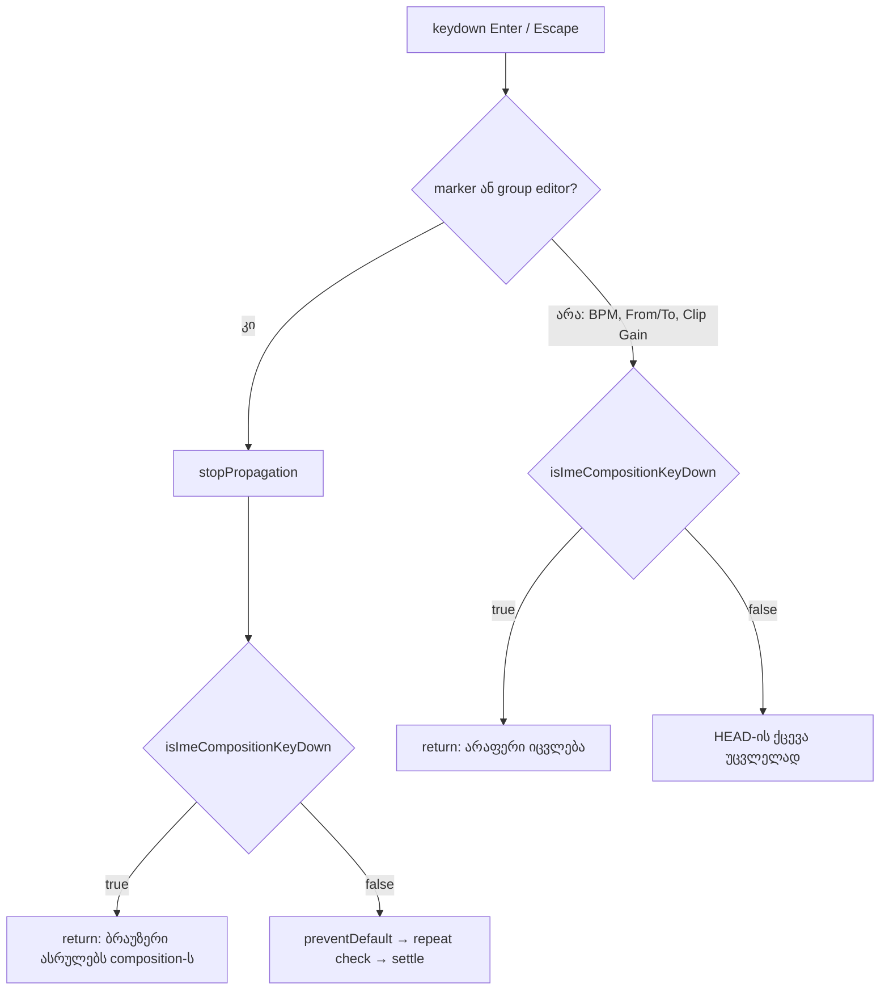

# SYS-3 ეტაპი 1: IME composition-ის Enter ან Escape Studio-ს inline editor-ს აღარ ადასტურებს და აღარ აუქმებს

**თარიღი:** 2026-11-10
**სტატუსი:** Completed (C round 445 PASS)
**შეცვლილი პროექტი:** Store (ერთი ახალი helper `app/components/arrangement/`-ში, guard ოთხ არსებულ კომპონენტში ხუთ key handler-ზე, ერთი ახალი test ფაილი და ეს doc. ხილული UI უცვლელია)

## კონტექსტი

იაპონური, ჩინური, კორეული ან სხვა IME-ით ტექსტის აკრეფისას მომხმარებელი Enter-ით ირჩევს candidate-ს, Escape-ით კი composition-ს აუქმებს. ეს keydown გვერდამდე მიდის `isComposing: true`-ით (Safari-ში დამადასტურებელი Enter `isComposing: false`-ით, მაგრამ keyCode 229-ით). Studio-ს inline editor-ები ამ განსხვავებას არ ამოწმებდნენ: candidate-ის დადასტურება editor-ს ადასტურებდა ან ხურავდა.

B-მ HEAD-ზე (`5d81795`) რეალურ Chromium-ში გაიმეორა: CDP `Input.imeSetComposition` + ერთი რეალური Enter ან Escape. 9 cell × 2 viewport (1440×900, 1280×720) — **18-დან 18 ჩავარდა** (`b-round-441/probe/compare-head.txt`: `NOT ALL OK (18 of 18 failing)`):

- BPM ველი blur-დებოდა და 96 BPM-ს აყენებდა;
- marker ემატებოდა სახელით "7";
- group სახელდებოდა "7";
- Detail-ის From ველი time selection-ს ადებდა;
- Clip Gain +7 dB-ს ადებდა;
- ყოველი Escape editor-ს აუქმებდა.

`app/components/arrangement/`-ში `isComposing`-ის არცერთი შემთხვევა არ არსებობდა.

## მიდგომა

ერთი საერთო helper — `isImeCompositionKeyDown` (`studio-ime-composition.ts`). ის `true`-ს აბრუნებს, როცა `nativeEvent.isComposing` ჭეშმარიტია ან `keyCode === 229`. პარამეტრი სტრუქტურული `ImeCompositionKeyEvent` ტიპია, ამიტომ React-ის `KeyboardEvent<HTMLInputElement>` ხუთივე ადგილზე type assertion-ის გარეშე გადაეცემა.

ყოველ handler-ში helper-ის guard ჩაჯდა; composing key-ზე handler არაფერს აკეთებს და ბრაუზერი composition-ს თვითონ ასრულებს. მომდევნო ჩვეულებრივი Enter ან Escape ზუსტად ისე იქცევა, როგორც HEAD-ზე.

| ადგილი | Handler | Guard-ის მდებარეობა |
|---|---|---|
| BPM ველი (`arrangement-tempo-input`) | `handleTempoKeyDown`, `ArrangementTempoRow.tsx` | პირველი ხაზი: return |
| Marker-ის სახელის editor (`arrangement-marker-name-input`) | inline Enter/Escape branch, `ArrangementMarkerRow.tsx` | `stopPropagation()` → guard return → `preventDefault()` → repeat check → settle |
| Group-ის სახელის editor (`arrangement-group-name-input`) | inline Enter/Escape branch, `ArrangementGroupHeader.tsx` | იგივე რიგი, რაც marker editor-ში |
| Detail From / To (`arrangement-detail-start` / `-end`) | `handleRangeInputKeyDown`, `ArrangementDetailPanel.tsx` | პირველი ხაზი: return |
| Detail Clip Gain (`arrangement-detail-clip-gain-input`) | `handleClipGainKeyDown`, `ArrangementDetailPanel.tsx` | პირველი ხაზი: return |

### Rulings (`tech-lead`, `b-round-441/sketch-review.md`)

- **R1 — guard-ის რიგი.** Marker და group editor-ში composing key ისევ ჩერდება ancestor-ებამდე (`stopPropagation()`, როგორც HEAD-ზე), მაგრამ `preventDefault()` აღარ ეძახება, რომ ბრაუზერმა composition დაასრულოს. ამ რიგს NOSTOP და PD მუტანტები იცავს.
- **R2 — keyCode 229 რჩება.** Safari-ს დამადასტურებელ Enter-ს `isComposing` false აქვს და keyCode 229. Android-ის key-ები, რომლებიც 229-ს აგზავნიან, `key: "Unidentified"`-ს ატარებენ და Enter/Escape branch-მდე ვერ აღწევენ. იშვიათი false positive მსუბუქია: Enter არაფერს აკეთებს, blur კი მაინც ადასტურებს.
- **R3 — ფარგლებს გარეთ:**
  - blur composition-ის შუაში (Low): ბრაუზერი composition-ს blur-მდე ასრულებს;
  - Library search, shortcut sheet და `focus-source.ts` — ეტაპი 2.

### განხილული ალტერნატივა

Guard-ის ჩასმა მხოლოდ `preventDefault()`-ის შემდეგ (PD მუტანტი) ან `stopPropagation()`-მდე (NOSTOP მუტანტი) უარყოფილია: პირველ შემთხვევაში ბრაუზერი composition-ს ვეღარ ასრულებს, მეორეში კი composing Escape ancestor-ებამდე აღწევს, რაც HEAD-ის propagation-ს ცვლის.

### Fix-up (round 443): დაჭერილი Enter ან Escape composition-ის შემდეგ (C-R442-M1)

**Ruling (D-29z1574, Medium, contract level).**

- **დადასტურებული ფაქტი:** B-მ `4aa3c82`-ზე რეალურ Chromium-ში გაუშვა synthetic CDP მიმდევრობა: composing keydown → `Input.insertText` → სამი `autoRepeat` keydown → keyUp (`b-round-442/probe/ime-held.mjs`). 18-დან 8 cell ჩავარდა: BPM-ის Enter 96 BPM-ს ადასტურებდა და blur-ს აკეთებდა; BPM-ის, marker-ის და Clip Gain-ის Escape editor-ს აუქმებდა.
- **დაუდასტურებელი:** რომ რეალური OS IME ზუსტად ამ მიმდევრობას აგზავნის. ეს რჩება TLM-SYS3-IME-PLATFORMS-ზე.

**გადაწყვეტა:** სამი editor-ის Enter/Escape branch auto-repeat keydown-ზე (`event.repeat`) არაფერს აკეთებს, მხოლოდ `preventDefault()`-ს იძახებს — იგივე წესი, რაც group editor-სა და HM11b-ში. პირველი, არა-repeat keydown უცვლელად მოქმედებს, ამიტომ IME-ის გარეშე მომხმარებელი ცვლილებას ვერ ამჩნევს.

| ადგილი | Handler | HEAD (`4aa3c82`) | Round 443 |
|---|---|---|---|
| BPM ველი (`arrangement-tempo-input`) | `handleTempoKeyDown`, `ArrangementTempoRow.tsx` | Enter: `preventDefault` + blur. Escape: `preventDefault`, commit-ის გამოტოვება, draft-ის მოშორება, blur | Enter: blur მხოლოდ `!event.repeat`-ზე. Escape: `event.repeat`-ზე return `skipCommitRef`-ის დაყენებამდე |
| Marker-ის სახელის editor (`arrangement-marker-name-input`) | inline Enter/Escape branch, `ArrangementMarkerRow.tsx` | repeat check მხოლოდ Enter-ზე (`preventRepeatedEnterKeyDown`) | `if (event.repeat) return;` ორივე key-ზე, როგორც group editor-ში |
| Detail Clip Gain (`arrangement-detail-clip-gain-input`) | `handleClipGainKeyDown`, `ArrangementDetailPanel.tsx` | Escape: `preventDefault` + ტექსტის revert | Escape: revert მხოლოდ `!event.repeat`-ზე |

**მუტანტები** (`b-round-442/mutants/results.jsonl`; 7-დან 7 წითელი):

| id | ცვლილება | წითელი row-ები |
|---|---|---|
| TEMPO-ENTER-REPEAT | BPM Enter blur-ს repeat-ზეც აკეთებს | IME6 |
| TEMPO-ESC-REPEAT | BPM Escape-ის repeat check მოხსნილი | IME6 |
| MARKER-ESC-REPEAT | marker editor-ში ისევ Enter-only repeat check | IME6 |
| GAIN-ESC-REPEAT | Clip Gain Escape repeat-ზეც revert-ს აკეთებს | IME6 |
| TEMPO-ESC-NO-CANCEL | BPM Escape `skipCommitRef`-ს აღარ აყენებს | IME7 |
| TEMPO-SKIP-BEFORE-REPEAT | `skipCommitRef` repeat check-მდე | IME6 |
| IME-GUARD-TEMPO-OFF | BPM-ის IME guard მოხსნილი | IME1, IME6, IME7 |

**ტესტები** (`ime-composition-ui.test.tsx`, ორივე ფორმით): `IME6` — composing key + სამი `repeat: true` keydown BPM ველზე, marker editor-სა და Clip Gain-ზე (Enter და Escape) focus-ს, მნიშვნელობას, ღია editor-სა და snapshot-ს ინარჩუნებს, შემდეგ ახალი ჩვეულებრივი key მოქმედებს; `IME7` — composing Escape-ის შემდეგ ჩვეულებრივი Escape ძველებურად აუქმებს (BPM, marker, group, Clip Gain); `IME1`-ს დაემატა assertion `status === tempoStatusMessage(96)` (A-R442-REVIEW-L2).

**TLM-SYS3-IME-PLATFORMS** ახალ ნაბიჯს იღებს: candidate-ის დადასტურებისას Enter-ის ან Escape-ის დაჭერილად დატოვება.

**ბრაუზერი** (`b-round-442/probe/ime-held.mjs` + `compare-held.py`, 9 cell × 2 viewport): HEAD — `NOT ALL OK (8 of 18 failing)`; sketch — `ALL OK (18 cells)`. საბოლოო ბრაუზერის მტკიცებულება C round 443-ის C5 row-ია. ეს row მხოლოდ handler-ის კონტრაქტს ამტკიცებს; რეალური IME პლატფორმები TLM-ზე რჩება.

## არქიტექტურა

## შეცვლილი ფაილები

- `app/components/arrangement/studio-ime-composition.ts` — ახალი: `ImeCompositionKeyEvent` ტიპი და `isImeCompositionKeyDown` helper.
- `app/components/arrangement/ArrangementTempoRow.tsx` — guard `handleTempoKeyDown`-ში.
- `app/components/arrangement/ArrangementMarkerRow.tsx` — guard marker-ის სახელის editor-ში (R1 რიგით).
- `app/components/arrangement/ArrangementGroupHeader.tsx` — guard group-ის სახელის editor-ში (R1 რიგით).
- `app/components/arrangement/ArrangementDetailPanel.tsx` — guard `handleRangeInputKeyDown`-სა და `handleClipGainKeyDown`-ში.
- `app/lib/arrangement/__tests__/ime-composition-ui.test.tsx` — ახალი: IME0–IME5 რეგრესიის ტესტები.
- Round 443 fix-up: `ArrangementTempoRow.tsx`, `ArrangementMarkerRow.tsx`, `ArrangementDetailPanel.tsx` — Enter/Escape branch-ები auto-repeat keydown-ს უგულებელყოფს; `ime-composition-ui.test.tsx` — IME6, IME7 და IME1-ის დამატებითი assertion.
- `docs/implementation/2026/quarter-IV/288-sys-3-stage-1-ime-composition.md` — ეს doc.

## პრობლემები და გადაწყვეტები

- **პრობლემა:** sketch v1-ის IME0 ტესტში იყო `as unknown as` (CLAUDE.md კრძალავს type assertion-ს).
  **გადაწყვეტა:** helper სტრუქტურულ `ImeCompositionKeyEvent`-ს იღებს; IME0 მარტივ ობიექტებს გადასცემს.
- **პრობლემა:** v1-ში Detail-ის To ველი არ იყო დატესტილი.
  **გადაწყვეტა:** v2-ში IME4 composing Enter-ს ორივე ველს (`arrangement-detail-start` და `-end`) უგზავნის.
- **პრობლემა:** jsdom-ის ტესტი ბრაუზერის რეალურ IME-ს ვერ ამტკიცებს.
  **გადაწყვეტა:** B-მ HEAD-სა და sketch-ზე რეალური Chromium probe გაუშვა (`b-round-441/probe/ime-sites.mjs`): HEAD 18/18 ჩავარდა, sketch `ALL OK (18 cells)`. C იმავეს თავის job-ში იმეორებს (C6, C6-HEAD).

## ტესტირება

**Unit/UI ტესტები** (`app/lib/arrangement/__tests__/ime-composition-ui.test.tsx`; ყოველი IME1–IME5 ორი ფორმით: `isComposing` და `keyCode229`):

- `IME0 the helper reads nativeEvent.isComposing and keyCode 229, and nothing else`
- `IME1 BPM field (%s): a composing Enter or Escape keeps focus and the draft and commits nothing; a plain Enter then commits`
- `IME2 marker name editor (%s): a composing Enter or Escape keeps the editor open and adds nothing; a plain Enter then adds the marker`
- `IME3 group name editor (%s): a composing Enter or Escape keeps the editor open and renames nothing; a plain Enter then renames`
- `IME4 Detail From and To fields (%s): a composing Enter in either field applies no time selection; a plain Enter then applies it`
- `IME5 Detail Clip Gain field (%s): a composing Enter applies nothing and a composing Escape does not revert the text; a plain Enter then applies`
- `IME6 held key after a composing key, %s editor (%s): auto-repeat Enter or Escape (repeat: true, not composing) settles nothing; a fresh plain key then acts (BPM Enter commits 96, marker Escape cancels, Clip Gain Escape shows the stored gain)` (round 443; round 445-ში editor-ებად დაიყო)
- `IME7 a plain Escape after a composing Escape cancels as before (%s): BPM draft dropped, marker editor closed, group name kept, Clip Gain text reverted` (round 443)

Round 443-ში IME1-ს დაემატა assertion: ჩვეულებრივი Enter-ის შემდეგ status ტოლია `tempoStatusMessage(96)`-ის (A-R442-REVIEW-L2).

**მუტანტები** (`b-round-441/mutants/results.jsonl`, sketch v2-ზე; 14-დან 14 წითელი):

| id | ცვლილება | წითელი row-ები |
|---|---|---|
| M-TEMPO | tempo guard მოხსნილი | IME1 ×2 |
| M-MARKER | marker guard მოხსნილი | IME2 ×2 |
| M-MARKER-NOSTOP | marker guard `stopPropagation()`-მდე | IME2 ×2 |
| M-MARKER-PD | marker guard `preventDefault()`-ის შემდეგ | IME2 ×2 |
| M-GROUP | group guard მოხსნილი | IME3 ×2 |
| M-GROUP-NOSTOP | group guard `stopPropagation()`-მდე | IME3 ×2 |
| M-GROUP-PD | group guard `preventDefault()`-ის შემდეგ | IME3 ×2 |
| M-RANGE | range handler-ის guard მოხსნილი | IME4 ×2 |
| M-GAIN | Clip Gain guard მოხსნილი | IME5 ×2 |
| M-HELPER-NO229 | helper keyCode 229-ის გარეშე | IME0 + 5 keyCode229 row |
| M-HELPER-NOCOMPOSING | helper `isComposing`-ის გარეშე | IME0 + 5 isComposing row |
| M-HELPER-ALWAYS | helper true ნებისმიერ keyCode ≠ 0-ზე | IME0 |
| M-HELPER-TRUE | helper ყოველთვის true | ყველა 11 |
| M-HEAD-SOURCE | ყველა guard მოხსნილი (HEAD-ის ქცევა) | IME1–IME5, 10 row |

**A-ს შემოწმებები (round 442):** covering set — 60 ფაილი, 1114 ტესტი, rc 0; `npm run typecheck` rc 0; `npm run lint` rc 0, 205 warning (HEAD-ის ტოლი); scoped `npx biome check` 6 sketch path-ზე rc 0. სრული suite, build და verify — root gate.

**A-ს შემოწმებები (round 443):** sketch-ის 4 path `cmp`-ით იდენტური; covering set — 60 ფაილი, 1118 ტესტი, rc 0; `npm run typecheck` rc 0; `npm run lint` rc 0, 205 warning; scoped `npx biome check` 4 sketch path-ზე rc 0.

**ბრაუზერი:** HEAD — `NOT ALL OK (18 of 18 failing)`; sketch — `ALL OK (18 cells)`. საბოლოო ბრაუზერის მტკიცებულება C round 442-ის C6 row-ია.

## TODO / შემდეგი ნაბიჯები

- **SYS-3 ეტაპი 2:**
  - `focus-source.ts` — A-R203-REVIEW-M1 და A-R203-REVIEW-I1;
  - Library search-ის Escape და ArrowDown (`handleSearchKeyDown`);
  - shortcut sheet-ის Escape, რომელიც საერთო Modal-ის document listener-იდან მოდის. `tech-lead` წყვეტს: guard Modal-ში თუ sheet-ში.
  - საერთო settle-key helper და inline editor-ების key handler-ების scan (SIG-R442-INLINE-EDITOR-KEYS);
  - TL-R443-G3: ჩვეულებრივი (IME-ის გარეშე) დაჭერილი key-ის jsdom row-ები.
- **TLM-SYS3-IME-PLATFORMS** (Tech Lead manual, არ ბლოკავს; deadline RETRO 450): macOS და Windows IME Chrome-სა და Safari-ში, ჩვეულებრივი Enter Android-ის soft keyboard-ზე, და ახალი ნაბიჯი: candidate-ის დადასტურებისას Enter-ის ან Escape-ის დაჭერილად დატოვება (editor არ უნდა დაიხუროს და არ უნდა დადასტურდეს).
- **Low, ფარგლებს გარეთ (R3):** blur composition-ის შუაში.
