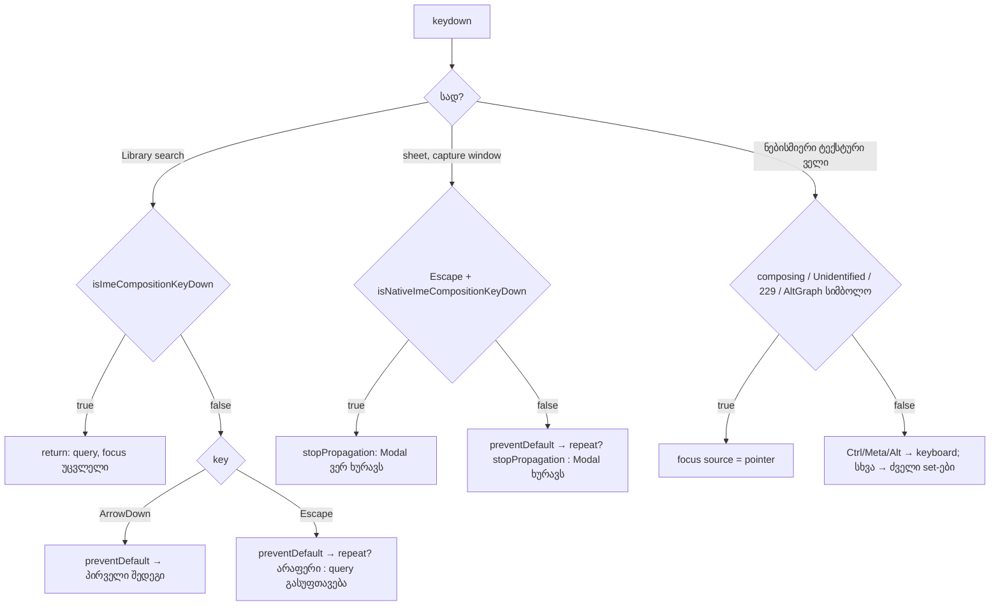

# SYS-3 ეტაპი 2a: IME composition Library search-ს და shortcut sheet-ის search-ს აღარ ასუფთავებს და აღარ ხურავს; focus-source IME-ზე, Android-სა და AltGr-ზე ring-ს აღარ რთავს

**თარიღი:** 2026-11-11
**სტატუსი:** Completed (C round 445 PASS)
**შეცვლილი პროექტი:** Store (guard სამ არსებულ source ფაილში, ერთი ახალი native helper `studio-ime-composition.ts`-ში, ერთი ახალი და ერთი გაფართოებული test ფაილი და ეს doc. ხილული UI IME-ის გარეშე მომხმარებლისთვის უცვლელია)

## კონტექსტი

SYS-3-ის პირველმა ეტაპმა (doc 288) Studio-ს inline editor-ები IME composition-ისგან დაიცვა. სამი იმავე კლასის ბაგი დარჩა:

- **Library search** (`handleSearchKeyDown`) — composing Escape query-ს ასუფთავებდა, composing ArrowDown კი focus-ს პირველ შედეგზე გადაიტანდა. დაჭერილი Escape ყოველ repeat-ზე ხელახლა ასუფთავებდა.
- **Shortcut sheet-ის search** — composing Escape sheet-ს ხურავდა: sheet-ის capture listener-ი `preventDefault`-ს იძახებდა, საერთო `Modal`-ის `document` listener-ი კი sheet-ს ხურავდა. დაჭერილი Escape-იც ხურავდა.
- **`focus-source.ts`** (A-R203-REVIEW-M1, A-R203-REVIEW-I1) — `isFocusSourceFieldEditingKey` ჯერ Ctrl/Meta/Alt-ზე აბრუნებდა false-ს, ამიტომ composing, `Unidentified` (Android, keyCode 229) ან AltGraph-ის სიმბოლო (Windows/Linux AltGr) ტექსტურ ველში focus source-ს `keyboard`-ზე რთავდა და სიტყვის შუაში focus ring ჩნდებოდა.

B-მ HEAD-ზე (`1eefb4c`) რეალურ Chromium-ში გაიმეორა (CDP composition + რეალური key, `b-round-443/probe/ime-stage2.mjs`): 9 cell × 2 viewport — `NOT ALL OK (14 of 18 failing)` (`b-round-443/probe/compare-head.txt`).

## მიდგომა

| ადგილი | HEAD | ახლა |
|---|---|---|
| `isFocusSourceFieldEditingKey` (`app/lib/focus-source.ts`) | ჯერ false Ctrl/Meta/Alt-ზე ან არა-string key-ზე. Composing, `Unidentified`/229 ან AltGraph-ის სიმბოლო ტექსტურ ველში source-ს `keyboard`-ზე რთავდა | (1) false მხოლოდ არა-string key-ზე. (2) false არა-ტექსტურ target-ზე, როგორც ადრე. (3) ტექსტურ ველში `isComposing`, `key === 'Unidentified'`, keyCode 229 ან 1-სიმბოლოიანი key `getModifierState('AltGraph')`-ით ითვლება editing-ად და `pointer` რჩება. (4) შემდეგ Ctrl/Meta/Alt-ის return და ძველი key set-ები |
| Library search, `handleSearchKeyDown` (`ArrangementLibrary.tsx`) | ArrowDown: `preventDefault` და პირველ შედეგზე focus. Escape: `preventDefault` და გასუფთავება | Composing key (`isImeCompositionKeyDown`) პირველივე ხაზზე return: არც `preventDefault`, არც გასუფთავება, არც გადაადგილება. Repeat Escape `preventDefault`-ს ისევ იძახებს, მაგრამ არ ასუფთავებს |
| Shortcut sheet, capture `keydown` `window`-ზე (`ArrangementShortcutSheet.tsx`) | Escape: `preventDefault`. შემდეგ `Modal`-ის `document` listener-ი sheet-ს ხურავს | Composing Escape (`isNativeImeCompositionKeyDown`): `stopPropagation`, `preventDefault`-ის გარეშე, sheet ღია რჩება. Repeat Escape: `preventDefault` + `stopPropagation`, sheet ღია რჩება. ჩვეულებრივი Escape უცვლელია |
| `studio-ime-composition.ts` | `isImeCompositionKeyDown` (React event) | ემატება `isNativeImeCompositionKeyDown` (native event: `isComposing` ან keyCode 229). React helper მას გადასცემს |

### Rulings (`tech-lead`, `b-round-443/sketch-review.md`)

- **Sheet-local guard და არა `ui/Modal.tsx` (TL-R444-L2).** `Modal`-ს სამი importer აქვს: `ArrangementShortcutSheet`, `ArrangementExportDialog` და დაცული legacy `app/components/studio/ExportDialog.tsx`. Modal-ის ცვლილება დაცული ფაილის ქცევას loop-ის მტკიცებულების გარეშე შეცვლიდა. Sheet-ის capture listener-ი `window`-ზე Modal-ის `document` listener-ზე ადრე სრულდება, ამიტომ მისი `stopPropagation` საკმარისია. Modal და სხვა store dialog-ები (AuthModal, CommandPalette, StemsPlayerModal) — `deferred_low_polish`.
- **IME ფლობს key-ს (TL-R444-L1).** Composing key-ზე `preventDefault` არ ეძახება, როგორც ეტაპ 1-ში. **გაზომილი ფაქტი:** B-ის synthetic CDP თანმიმდევრობით composing Escape-ის შემდეგ `type=search` ველის query მაინც ცარიელდება, ბრაუზერის default action-ით; page capture listener-ი `preventDefault`-ით მას ინარჩუნებს (`native-clear-control.json`, `native-clear-prevent.json`). **დასკვნა** (არ გაზომილა): რეალური IME key-ს პირველი იღებს და default არ სრულდება. ამიტომ browser row-ში LIB-ESC query მხოლოდ ჩაიწერება და არ მოწმდება; რეალური IME — Tech Lead manual ნაბიჯი.
- **A5 / TL-R444-I1:** `focus-source` `key === 'Unidentified'`-ს composing-ად ითვლის, native helper `isNativeImeCompositionKeyDown` კი არა — ეს განზრახ არის: focus ring და editor-ის key handling სხვადასხვა საკითხია.
- **Composing Tab (TL-R444-L3).** FT7 ამოწმებს, რომ composing Tab `pointer`-ზე რჩება. Composition-ის დროს Tab IME-ს ეკუთვნის (candidate-ების ნავიგაცია) და focus-ს არ გადაადგილებს. თუ რომელიმე engine მაინც გადაადგილებს, შემდეგი keyboard key ring-ს აღადგენს (fail-safe).
- **დაჭერილი Escape (TL-R444-I2).** Sheet-ს მხოლოდ ახალი დაჭერა ხურავს; დაჭერილი Escape არასდროს — იგივე წესი, რაც held Enter-ზე (SYS-2).
- **`stopPropagation`-ის შედეგი.** Sheet-ის listener-ი `window`-ის capture ფაზაშია, ამიტომ composing ან repeat Escape sheet-ის input-მდე, React root-მდე და `document`-ის listener-ებამდე ვეღარ აღწევს. Default action უცვლელია და IME key-ს მაინც იღებს. Sheet-ის input-ზე მომავალი Escape handler-ი ამ ორ შემთხვევაში არ გაეშვება.
- **AltGraph browser-ში.** Playwright-ის `keyboard.down('AltGraph')` და CDP modifier-ები ამ Chromium-ში `getModifierState('AltGraph')`-ს არ აყენებს (`altgraph-check-sketch.json`). AltGraph-ის ნახევარს jsdom-ის FT9 და მუტანტი M3 ამტკიცებს; პლატფორმის ნახევარი Tech Lead manual-ია.

### განხილული ალტერნატივა

Guard საერთო `Modal`-ში — უარყოფილია (ზემოთ, TL-R444-L2). Composing key-ზე `preventDefault` — უარყოფილია: ბრაუზერი და IME composition-ს ვეღარ დაასრულებდნენ.

## არქიტექტურა

## შეცვლილი ფაილები

- `app/lib/focus-source.ts` — composing/`Unidentified`/229 და AltGraph-ის შემოწმება Ctrl/Meta/Alt-ის return-მდე.
- `app/components/arrangement/studio-ime-composition.ts` — ახალი `NativeImeCompositionKeyEvent` ტიპი და `isNativeImeCompositionKeyDown`; React helper მას გადასცემს.
- `app/components/arrangement/ArrangementLibrary.tsx` — guard და repeat Escape `handleSearchKeyDown`-ში.
- `app/components/arrangement/ArrangementShortcutSheet.tsx` — composing და repeat Escape sheet-ის capture listener-ში.
- `app/lib/__tests__/focus-source-typing.test.tsx` — FT7, FT8, FT9.
- `app/lib/arrangement/__tests__/ime-composition-stage2-ui.test.tsx` — ახალი: IME8, IME9, IME10.
- `docs/implementation/2026/quarter-IV/288-sys-3-stage-1-ime-composition.md` — სტატუსის ხაზი (stage 1 of 3).
- `docs/implementation/2026/quarter-IV/289-sys-3-stage-2a-ime-search-fields.md` — ეს doc.

## პრობლემები და გადაწყვეტები

- **პრობლემა:** synthetic CDP composing Escape `type=search` ველს ბრაუზერის default action-ით მაინც ასუფთავებს.
  **გადაწყვეტა:** `preventDefault` არ ვამატებთ (IME ფლობს key-ს); browser row query-ს მხოლოდ იწერს, რეალური IME — TLM ნაბიჯი (TL-R444-L1).
- **პრობლემა:** Playwright/CDP ამ Chromium-ში AltGraph-ს ვერ ასიმულირებს.
  **გადაწყვეტა:** AltGraph-ს jsdom-ის FT9 და მუტანტი M3 ფარავს; პლატფორმა — TLM.
- **პრობლემა:** sheet-ის Escape-ს საერთო `Modal`-ის `document` listener-ი ხურავს, Modal კი დაცულ legacy ExportDialog-საც ემსახურება.
  **გადაწყვეტა:** guard sheet-ის საკუთარ capture listener-შია, `stopPropagation`-ით.

## ტესტირება

**Unit/UI ტესტები:**

- `app/lib/__tests__/focus-source-typing.test.tsx`:
  - `FT7: a composing key in a text field keeps the source on pointer, with or without modifiers; on a non-text target it still switches`
  - `FT8: an Unidentified key or keyCode 229 (Android and IME placeholders) in a text field keeps pointer; elsewhere it switches`
  - `FT9: an AltGraph character (AltGr or Option) in a text field keeps pointer even when Ctrl and Alt are reported; Ctrl+Alt without AltGraph, a non-character AltGraph key and a non-text target still switch`
  - FT9 მხოლოდ AltGr-ს ამტკიცებს (სინთეზური `AltGraph` modifier); macOS-ის Option+character Chrome-სა და Safari-ში არ არის დაფარული (GATE444-L1-MACOS-OPTION, deferred).
- `app/lib/arrangement/__tests__/ime-composition-stage2-ui.test.tsx` (IME9 და IME10 ორი ფორმით: `isComposing` და `keyCode229`):
  - `IME8 the native helper reads isComposing and keyCode 229 only, and the React helper delegates to it`
  - `IME9 Library search (%s): a composing Escape keeps the query and a composing ArrowDown keeps focus; held Escape repeats clear nothing; a plain Escape then clears and a plain ArrowDown moves to the first result`
  - `IME10 shortcut sheet search (%s): a composing Escape and held Escape repeats keep the sheet open with focus and query; a plain Escape then closes it and focus returns to the footer button`

**მუტანტები** (`b-round-443/mutants/results.jsonl`, sketch-ზე; 8-დან 8 წითელი):

| id | ცვლილება | წითელი row-ები |
|---|---|---|
| M1-FS-COMPOSE | focus-source composing შემოწმების გარეშე | FT7, FT8 |
| M2-FS-MODIFIER-ORDER | Ctrl/Meta/Alt-ის return ისევ პირველ ხაზზე | FT7, FT9 |
| M3-FS-ALTGRAPH | focus-source AltGraph შემოწმების გარეშე | FT9 |
| M4-LIB-GUARD | Library search guard მოხსნილი | IME9 |
| M5-LIB-REPEAT | repeat Escape ისევ ასუფთავებს | IME9 |
| M6-SHEET-GUARD | sheet-ის composing guard მოხსნილი | IME10 |
| M7-SHEET-REPEAT | repeat Escape-ზე `stopPropagation` მოხსნილი | IME10 |
| M8-NATIVE-229 | native helper keyCode 229-ის გარეშე | IME8, IME9, IME10 |

**A-ს შემოწმებები (round 444):** sketch-ის 6 path `cmp`-ით იდენტური; covering set — 25 ფაილი, 440 ტესტი, rc 0; `npm run typecheck` rc 0; `npm run lint` rc 0, 205 warning (HEAD-ის ტოლი); scoped `npx biome check` 6 sketch path-ზე rc 0. სრული suite, build და verify — root gate.

**ბრაუზერი** (`b-round-443/probe/ime-stage2.mjs`, 1440×900 და 1280×720): HEAD — `NOT ALL OK (14 of 18 failing)`; sketch — `ALL OK (18 cells)`. საბოლოო ბრაუზერის მტკიცებულება C round 444-ის C5 row-ია.

## TODO / შემდეგი ნაბიჯები

- **SYS-3 ეტაპი 2b:**
  - საერთო settle-key helper და inline editor-ების key handler-ების scan (SIG-R442-INLINE-EDITOR-KEYS);
  - TL-R443-G3: ჩვეულებრივი (IME-ის გარეშე) დაჭერილი key-ის jsdom row-ები;
  - A-R443-REVIEW-L1 და A-R443-REVIEW-L2.
- **TLM-SYS3-IME-PLATFORMS** (Tech Lead manual, არ ბლოკავს; deadline RETRO 450): macOS და Windows IME Chrome-სა და Safari-ში. ახალი ნაბიჯი (TL-R444-L1): macOS Chrome-ში იაპონური IME-ით და Windows Chrome-ში MS-IME-ით composing Escape Library search-სა და sheet-ის search-ში query-ს ინარჩუნებს და sheet ღია რჩება. Android: Library search-ში აკრეფისას focus ring არ ჩნდება. Windows AltGr `@`: ring არ ჩნდება.
- **Low, `deferred_low_polish` (TL-R444-L2):** `Modal`, AuthModal, CommandPalette და StemsPlayerModal composing და repeat Escape-ზე იხურება — ცალკე რაუნდი, დაცული ფაილების შეხების გარეშე.
