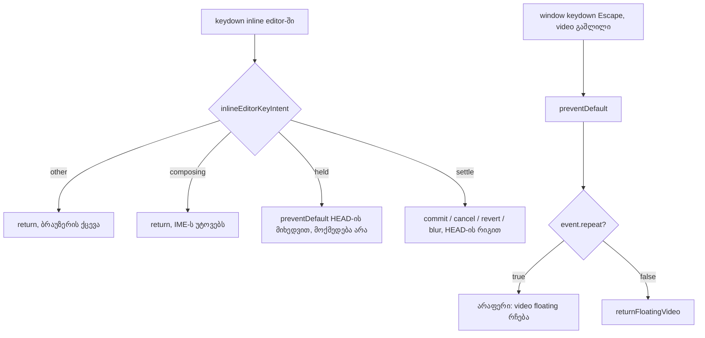

# SYS-3 ეტაპი 2b: ხუთი inline editor-ის ერთი key-intent წესი და დაჭერილი Escape აღარ აბრუნებს floating video-ს

**თარიღი:** 2026-11-11
**სტატუსი:** Completed (C round 445 PASS)
**შეცვლილი პროექტი:** Store (`studio-ime-composition.ts`-ში ახალი pure helper, ოთხ კომპონენტში ხუთი key handler მასზე გადავიდა, `StudioWorkspace`-ის floating video-ს Escape branch-ს repeat guard დაემატა; ოთხი test ფაილი და სამი doc)

## კონტექსტი

SYS-3-ის პირველ ეტაპებში (doc 288, doc 289) Studio-ს ხუთ inline editor-ს (BPM, marker-ის სახელი, group-ის სახელი, Detail-ის From/To და Clip Gain) თითოეულს საკუთარი inline შემოწმება ჰქონდა: IME composition (`isComposing` ან keyCode 229) და auto-repeat (`event.repeat`). წესი ერთი იყო, მაგრამ ხუთ ადგილას ხელით იწერებოდა (SIG-R442-INLINE-EDITOR-KEYS). TL-R443-G3-მა აჩვენა, რომ IME-ს გარეშე, ჩვეულებრივ დაჭერილ Enter/Escape-ზე რიგები ცალკე არ იყო დაფიქსირებული, A-R443-REVIEW-L1-მა — რომ IME6-ის Clip Gain assertion (`!== '-3'`) ზედმეტად სუსტი იყო, ხოლო A-R443-REVIEW-L2-მა — რომ IME6 სამ editor-ს ერთ `it`-ში ამოწმებდა და ადრეული ჩავარდნა დანარჩენებს მალავდა.

ამავე დროს A-R444-REVIEW-I1 (B-მ რეალურ Chromium-ში გაიმეორა და Low-მდე აწია): როცა floating video გაშლილია და მომხმარებელი Escape-ს აჭერს და უჭერს ხელს, რომ shortcut sheet, Export dialog, BPM ან marker editor დახუროს, პირველი keydown დიალოგს ხურავს, ხოლო auto-repeat keydown-ები `window`-მდე აღწევს და video-ს ადგილზე აბრუნებს. Loop-ის წესი "დაჭერილი key ერთხელ მოქმედებს" (L4) ამ შემთხვევაში "Esc აბრუნებს video-ს" წესზე მაღლა დგას.

## მიდგომა

- **ერთი pure helper:** `inlineEditorKeyIntent(event, keys)` აბრუნებს ოთხიდან ერთ intent-ს, ამ რიგით: `other` (key სიაში არ არის), `composing` (`isComposing` ან keyCode 229), `held` (`repeat`), სხვა შემთხვევაში `settle`. Composing repeat-ზე მაღლა დგას. სიები typed-ია (`InlineEditorSettleKey = 'Enter' | 'Escape'`): `INLINE_EDITOR_SETTLE_KEYS` და `INLINE_EDITOR_ENTER_ONLY_KEYS`.
- **ქცევა ხუთივე editor-ში უცვლელია.** ყოველი handler HEAD-ის (`616729c`) `preventDefault`, `stopPropagation`, blur, commit, cancel და revert გამოძახებებს იმავე რიგით ინახავს; IME12 ამ HEAD truth table-ს აფიქსირებს.
- **Floating video:** `StudioWorkspace`-ის window Escape branch-ში, როცა video გაშლილია, `preventDefault` ყოველთვის რჩება, ხოლო `returnFloatingVideo()` მხოლოდ `!event.repeat`-ზე იძახება. ახალი Escape video-ს ისევ აბრუნებს.
- **Ableton reference:** არ ეხება. IME და auto-repeat-ისთვის Ableton-ის წყარო არ არსებობს; წესი არის პლატფორმის standard (W3C UI Events `KeyboardEvent.isComposing`, `KeyboardEvent.repeat`) და loop-ის L4.

### საიტების ცხრილი

| საიტი | HEAD (`616729c`) | შემდეგ |
|---|---|---|
| `studio-ime-composition.ts` | `isImeCompositionKeyDown`, `isNativeImeCompositionKeyDown` | ემატება `InlineEditorSettleKey`, `INLINE_EDITOR_SETTLE_KEYS`, `INLINE_EDITOR_ENTER_ONLY_KEYS`, `inlineEditorKeyIntent(event, keys)`; pure, side effect-ის გარეშე |
| BPM `handleTempoKeyDown` | inline composing check, შემდეგ Enter/Escape branch-ები საკუთარი repeat check-ით | `other`/`composing` → return; შემდეგ `preventDefault`; `held` → return; Escape → commit გამოტოვება + draft-ის გაუქმება; შემდეგ `blur()` |
| Marker და group name editor | Enter/Escape: ჯერ `stopPropagation`, შემდეგ composing return, `preventDefault` და repeat check | იგივე რიგი intent-ით: `other` → return; `stopPropagation`; `composing` → return; `preventDefault`; `settle` → `settleEditor` |
| Detail From/To `handleRangeInputKeyDown` | composing return; Enter → `preventDefault`, apply როცა repeat არ არის | `INLINE_EDITOR_ENTER_ONLY_KEYS`; `other`/`composing` → return; `preventDefault`; `settle` → apply |
| Clip Gain `handleClipGainKeyDown` | composing return; Enter ან Escape → `preventDefault`, მოქმედება როცა repeat არ არის | `other`/`composing` → return; `preventDefault`; `held` → return; Enter → commit; `else if` Escape → ტექსტის revert |
| `StudioWorkspace` window Escape branch, video გაშლილი | `preventDefault` + `returnFloatingVideo()` ყოველ Escape-ზე, repeat-ების ჩათვლით | `preventDefault` ყოველთვის; `returnFloatingVideo()` მხოლოდ `!event.repeat`-ზე. ამ handler-ში შემდეგი Escape branch არ არსებობს (tech-lead R2) |

### HEAD truth table და რატომ ინახება (IME12)

IME12 ყოველ editor-ზე ექვს უჯრას ამოწმებს (composing Enter, composing Escape, held Enter, held Escape, plain Escape, plain Enter) და იწერს ორ ფაქტს: `defaultPrevented` და მიაღწია თუ არა keydown-მა `document`-ს.

| Editor | composing Enter/Escape | held Enter | held Escape | plain Escape | plain Enter |
|---|---|---|---|---|---|
| BPM | არ prevented, აღწევს | prevented, აღწევს | prevented, აღწევს | prevented, აღწევს | prevented, აღწევს |
| Marker | არ prevented, stopped | prevented, stopped | prevented, stopped | prevented, stopped | prevented, stopped |
| Group | არ prevented, stopped | prevented, stopped | prevented, stopped | prevented, stopped | prevented, stopped |
| From/To | არ prevented, აღწევს | prevented, აღწევს | არ prevented, აღწევს (Escape სიაში არ არის) | არ prevented, აღწევს | prevented, აღწევს |
| Clip Gain | არ prevented, აღწევს | prevented, აღწევს | prevented, აღწევს | prevented, აღწევს | prevented, აღწევს |

B-მ IME12 და IME13 შეუცვლელ `616729c`-ზე გაუშვა: 10 passed, rc 0 — ე.ი. ცხრილი HEAD-ის ქცევაა და არა ახალი კონტრაქტი.

**GATE443-L1 ruling:** propagation-ი HEAD-ისაა და არ გაერთიანდა. tech-lead-ის თქმით `stopPropagation` editor-ებს შორის კანონიერად განსხვავდება (marker და group თავად აჩერებს, დანარჩენები — არა). Workspace-ის window handler typing target-ზე (`isTypingTarget`) ბრუნდება, ხოლო BPM ახალ დაჭერაზე blur-ს აკეთებს, ამიტომ მისი repeat-ები body-ზე მიდის და ამ რაუნდის video fix-ით მუშავდება. Clip Gain-სა და Library search-ში დაჭერილი Escape video-ს HEAD-ზეც არ ცვლის (probe-ის GAIN და LIBSEARCH უჯრები). დასკვნა: "მომხმარებლისთვის ხილული ეფექტი არ აქვს"; finding იხურება, როცა C იგივე უჯრებს გაივლის.

### tech-lead-ის keep note (Architecture)

Helper რჩება `studio-ime-composition.ts`-ში. `handleInlineEditorKey(event, { onEnter, onEscape, stop })`-ის მსგავსი wrapper არ გამოიყოფა: სამი განსხვავებული გამოძახების pattern wrapper-ს flag-ებით მართულს გახდიდა. Intent helper მხოლოდ კლასიფიკაციას აკეთებს; side effect-ები და მათი რიგი თითო handler-ში რჩება.

## არქიტექტურა

## შეცვლილი ფაილები

- `app/components/arrangement/studio-ime-composition.ts` — `inlineEditorKeyIntent`, `InlineEditorSettleKey`, `INLINE_EDITOR_SETTLE_KEYS`, `INLINE_EDITOR_ENTER_ONLY_KEYS`.
- `app/components/arrangement/ArrangementTempoRow.tsx` — BPM handler intent-ზე.
- `app/components/arrangement/ArrangementMarkerRow.tsx` — marker name editor intent-ზე.
- `app/components/arrangement/ArrangementGroupHeader.tsx` — group name editor intent-ზე.
- `app/components/arrangement/ArrangementDetailPanel.tsx` — From/To და Clip Gain handler-ები intent-ზე.
- `app/components/arrangement/StudioWorkspace.tsx` — floating video-ს Escape branch-ის repeat guard.
- `app/lib/arrangement/__tests__/ime-composition-ui.test.tsx` — IME6 გაიყო editor-ებად; Clip Gain-ის assertion `toBe(shown)`.
- `app/lib/arrangement/__tests__/ime-composition-stage2b-ui.test.tsx` — ახალი: IME11, IME12, IME13.
- `app/lib/arrangement/__tests__/ime-composition-source-scan.test.ts` — ახალი: IME14, IME15.
- `app/lib/arrangement/__tests__/floating-video.test.tsx` — FV-HELD.
- `docs/implementation/2026/quarter-IV/288-sys-3-stage-1-ime-composition.md` — სტატუსი და IME6-ის ახალი სათაური.
- `docs/implementation/2026/quarter-IV/289-sys-3-stage-2a-ime-search-fields.md` — სტატუსი, AltGr-ის ფორმულირება და FT9-ის შენიშვნა.
- ეს doc.

## პრობლემები და გადაწყვეტები

- **პრობლემა:** დაჭერილი Escape, რომელიც sheet-ს, Export-ს, BPM-ს ან marker editor-ს ხურავს, auto-repeat-ით გაშლილ video-საც აბრუნებდა.
  **გადაწყვეტა:** window Escape branch-ში `returnFloatingVideo()` მხოლოდ `!event.repeat`-ზე. `preventDefault` HEAD-ის მსგავსად ყველა Escape-ზე რჩება. Browser-ის მტკიცებულება (`held-escape-video.mjs`, 1440×900 და 1280×720): HEAD — `NOT ALL OK (8 of 14 failing)` (EXPORT, MARKER, SHEET, TEMPO ორივე viewport-ზე); sketch — `ALL OK (14 cells)` და `FRESH ALL SAME (14 cells)`. ძირითადი მტკიცებულება Chromium probe-ია; FV-HELD სინთეზურ repeat-ებს `window`-ზე აგზავნის და მხოლოდ რეგრესიის დამცავია (tech-lead Info 2).
- **პრობლემა:** ერთი წესი ხუთ ადგილას ხელით იწერებოდა და ახალი editor ადვილად გამოტოვებდა მას.
  **გადაწყვეტა:** `inlineEditorKeyIntent` + IME14 source scan, რომელიც `app/components/arrangement`-ში helper-ის გარეთ inline `isComposing`-ს, keyCode/which 229-ს და destructured `isComposing`-ს კრძალავს. IME15 pattern-ის თვითშემოწმებაა.
- **პრობლემა (gate-444 finding 3):** Library search-ის repeat Escape prevented-ია, მაგრამ propagation-ი არ ჩერდება.
  **გადაწყვეტა:** უვნებელია — window handler typing target-ზე ბრუნდება და probe-ის LIBSEARCH უჯრა video-ს floating-ად ინახავს. ცვლილება არ გაკეთდა; ფაქტი აქ ჩაიწერა.

## ტესტირება

**Unit/UI ტესტები:**

- `app/lib/arrangement/__tests__/ime-composition-ui.test.tsx`:
  - `IME6 held key after a composing key, %s editor (%s): auto-repeat Enter or Escape (repeat: true, not composing) settles nothing; a fresh plain key then acts (BPM Enter commits 96, marker Escape cancels, Clip Gain Escape shows the stored gain)`
- `app/lib/arrangement/__tests__/ime-composition-stage2b-ui.test.tsx`:
  - `IME11 inlineEditorKeyIntent: other keys pass, composing (isComposing or keyCode 229) wins over repeat, a repeat is held, a fresh press settles`
  - `IME12 %s editor: composing, held and plain Enter/Escape keep the HEAD 616729c truth table (defaultPrevented, reaches document)`
  - `IME13 BPM field: plain held Enter or Escape (repeat only, no IME) keeps focus and the draft; a fresh Escape then drops the draft`
  - `IME13 marker name editor: plain held Enter or Escape keeps the editor open and adds nothing; a fresh Enter then adds the marker once`
  - `IME13 group name editor: plain held Enter or Escape keeps the editor open and renames nothing; a fresh Enter then renames once`
  - `IME13 Detail From field: plain held Enter applies no time selection; a fresh Enter then applies it`
  - `IME13 Clip Gain field: plain held Enter or Escape applies and reverts nothing; a fresh Escape then shows the stored gain again`
- `app/lib/arrangement/__tests__/ime-composition-source-scan.test.ts`:
  - `IME14: no Studio component reads isComposing or keyCode 229 inline; the inline editors call inlineEditorKeyIntent and only the two search fields call the composition helper directly (a new legitimate caller updates these lists on purpose)`
  - `IME15: the inline-read pattern matches React and native forms, both operand orders and != of 229, which, and destructuring, and ignores object keys`
- `app/lib/arrangement/__tests__/floating-video.test.tsx`:
  - `FV-HELD a held Esc (auto-repeat) that reaches the window keeps the video floating and is prevented; a fresh Esc then returns it (SYS-3 stage 2b, A-R444-REVIEW-I1)`

**Mutation testing** (`b-round-444/mutants/results.jsonl`, 12 მუტანტი, ყველა წითელი):

| Mutant | წითელი რიგები |
|---|---|
| M1-TEMPO-HELD | IME13, IME6 |
| M2-TEMPO-COMPOSE | IME1, IME12, IME6, IME7 |
| M3-MARKER-STOP | IME12, IME2 |
| M4-GROUP-HELD | IME13 |
| M5-RANGE-HELD | IME13 |
| M6-GAIN-HELD | IME13, IME6 |
| M7-GAIN-REVERT-VALUE | IME13, IME6, IME7 |
| M8-HELPER-REPEAT-FIRST | IME11 |
| M9-HELPER-KEYS | IME11, IME12 |
| M10-VIDEO-HELD | FV-HELD |
| M11-SCAN-INLINE-COMPOSING | IME14 |
| M12-SCAN-INTENT-BYPASS | IME14 |

**A-ს გაშვებები (round 445):** covering set — 60 ფაილი, 1082 passed, rc 0; typecheck rc 0; lint rc 0 (`Found 205 warnings`); scoped Biome rc 0.

**Browser (B-ს planning run, `b-round-444/probe/`; Chromium, Playwright, `/studio-lab`, 1440×900 და 1280×720):** held-Escape video probe — HEAD `NOT ALL OK (8 of 14 failing)`, sketch `ALL OK (14 cells)` / `FRESH ALL SAME (14 cells)`. მეზობელი IME probe-ები (sites, held, stage 2a) — `ALL OK (18 cells)`; plain held probe — `ALL SAME (18 cells)`. საბოლოო მტკიცებულება C round 445-ისაა.

## TODO / შემდეგი ნაბიჯები

- **GATE444-L1-MACOS-OPTION** (Low, deferred): macOS Chrome/Safari Option+character-ზე AltGraph-ს არ აცნობებს; რეალური Mac-ის გარეშე heuristic არ ირჩევა.
- **A-R444-REVIEW-L1-ALTGRAPH-META** (Low, deferred): Cmd+Option და `metaKey` `focus-source.ts`-ში.
- **SIG-R444-COMPOSING-LIB-HELPER** (signal only, gate-444 Architecture note).
- **TL-R445-I1** (signal): IME14-ის scan nested destructuring-ს (`{ nativeEvent: { isComposing } }`) და bracket access-ს ვერ ხედავს; დღეს არცერთი არ არსებობს.
- **TLM-SYS3-IME-PLATFORMS** (Tech Lead manual, deadline RETRO 450): macOS Chrome/Safari-ში Library search-ში Option+e ან Option+2 მაუსით focus-ის შემდეგ — ჩნდება თუ არა ring.
