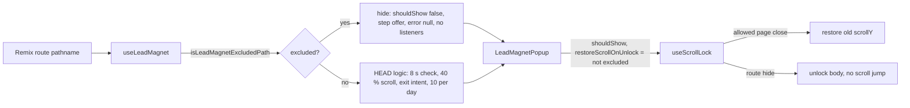

# STORE-2b-1: LeadMagnet popup-ი აღარ იხსნება პროდუქტის, კალათისა და checkout-ის გვერდებზე

**თარიღი:** 2026-11-11
**სტატუსი:** Completed (C round 446 PASS)
**შეცვლილი პროექტი:** Store (LeadMagnet hook, scroll lock hook, LeadMagnet popup, ტესტები)

## კონტექსტი

- Product design review-ის (2026-10-31) F4 და Saba-ს გადაწყვეტილება Q3: LeadMagnet „FREE DOWNLOAD“ popup-ი keep-list-შია — მისი შინაარსი და ქცევა რჩება, მაგრამ ის არ უნდა გაიხსნას `/products/*`, `/cart` და `/checkout*` გვერდებზე.
- Baymard Institute, guideline #709 „Overlays Appearing During Checkout“ (საჯარო შეჯამება, 2026-11-11): საიტის მიერ გახსნილი overlay checkout-ში მომხმარებელს კრიტიკულ მომენტში აფერხებს და მიტოვების რისკს ზრდის.
- პროდუქტის გვერდისთვის პირველწყარო ვერ მოიძებნა; ავტორიტეტია Saba-ს Q3.
- HEAD `4bfebd7`-ზე popup-ი 8 წამიანი ერთჯერადი შემოწმებით (40 % scroll) ან exit intent-ით ყველა გვერდზე იხსნებოდა, კალათისა და checkout-ის ჩათვლით. ეს STORE-4-ის პროდუქტის გვერდის შემოწმებებსაც უშლიდა ხელს.

## მიდგომა

`app/root.tsx` დაცული ფაილია, ამიტომ popup-ის mount ადგილზე რჩება და გამორიცხვა hook-ში ხდება: `useLeadMagnet` კითხულობს მიმდინარე `pathname`-ს Remix-ის `useLocation`-ით.

გადაწყვეტილებები (product-designer-ის კონსულტაცია, B-ის ruling-ები):

- **(a) ჩუმი ჩახშობა.** გამორიცხულ გვერდზე popup-ი არ ჩანს, view არ ითვლება, scroll და mouseleave listener-ები და timer არ ირთვება.
- **(b) ახალი ფანჯარა.** გამორიცხულ გვერდზე scroll engagement-ად არ ითვლება. ნებადართულ გვერდზე დაბრუნებისას საჭიროა საკუთარი ≥ 40 % scroll ახალ 8 წამიან ფანჯარაში ან exit intent საკუთარი scroll-ის შემდეგ. ორ ნებადართულ გვერდს შორის გადასვლა HEAD-ის ქცევას ინარჩუნებს (LMR8).
- **(c) ღია popup-ის დამალვა.** თუ popup-ი ღიაა და მომხმარებელი Back/Forward-ით გამორიცხულ გვერდზე მოხვდება, popup-ი იხურება dismissal-ის ჩაწერის გარეშე, step ბრუნდება offer-ზე და ბოლო submit error იშლება.
- **(d) მხოლოდ Saba-ს სია, მთლიანი path segment-ებით.** `/products` (prefix-ის გარეშე), `/cartography`, `/checkouts`, `/recordings/*`, `/scenes/*` არ არის გამორიცხული.
- **ერთჯერადი timer-ის შესწორება.** Designer-ის ფორმულირება „კვლავ scroll 40 % და 8 წამი“ HEAD-ის ქცევა არ არის: 8 წამიანი შემოწმება ერთჯერადია და მის შემდეგ popup-ს მხოლოდ exit intent აჩენს. keep-list უპირატესია, ამიტომ ეს ქცევა უცვლელია (LMR13).
- **Same-render mask.** Hook-ი აბრუნებს `shouldShow`-ს გამორიცხული route-ის ნიღბით იმავე render-ში, რომ route-ის შეცვლისას effect-მდე არცერთი render-ი popup-ს ღიად არ აჩვენებდეს (LMR11, tech-lead M2).

ალტერნატივები Saba-სთვის (`SABA-Q-LEADMAGNET-NAV-RULES`): ღია popup-ის დატოვება გამორიცხულ გვერდზე; ფანჯრის ხელახლა არ ჩართვა, თუ ის უკვე დაიხარჯა.

## არქიტექტურა

## შეცვლილი ფაილები

- `app/hooks/useLeadMagnet.ts` — ახალი exported `isLeadMagnetExcludedPath`, route-ის წაკითხვა, effect-ის dependency `isExcludedRoute`, გამორიცხულ route-ზე დამალვა და reset, ნიღბიანი `shouldShow` და ახალი `isRouteExcluded`.
- `app/hooks/useScrollLock.ts` — არჩევითი `restoreScrollOnUnlock` (default `true`), რომელიც unlock-ისა და cleanup-ის დროს ref-იდან იკითხება; სხვა გამომძახებლები (`AuthModal`, `ui/Modal`) უცვლელია.
- `app/components/marketing/LeadMagnetPopup.tsx` — scroll lock-ს გადასცემს `restoreScrollOnUnlock`-ს route-ის გამორიცხვის მიხედვით; markup და copy უცვლელია.
- `app/lib/__tests__/store-lead-magnet-routes.test.tsx` — ახალი ტესტები LMR1–LMR13, SL1–SL2.

## პრობლემები და გადაწყვეტები

- **პრობლემა: Back-ის შემდეგ ახალი გვერდი ძველი გვერდის scroll-ზე ხტებოდა (tech-lead M1).** B-მ ბრაუზერში გაზომა შუალედური sketch (`sketch-446-interim.patch.txt`, scroll fix-მდე): პროდუქტის გვერდი Back-ის შემდეგ `scrollY` = 206 იყო, popup-ის გარეშე საკონტროლო სცენარში კი 0 (1440 px, `b-round-445/probe/sketch-back-1440.json`, BACK და BACKCTL სტრიქონები). მიზეზი: `useScrollLock` unlock-ისას დაბლოკილ scroll-ს აღადგენდა. **გადაწყვეტა:** route hide-ისას popup-ი scroll lock-ს `restoreScrollOnUnlock` = false-ით აძლევს; ჩვეულებრივი Close ნებადართულ გვერდზე აღდგენას ინარჩუნებს (LMR9, LMR10, SL1, SL2; დიალოგის ფაილში LM8).
- **პრობლემა: route-ის ცვლილების render-ში popup-ი ერთი render-ით ღია რჩებოდა (tech-lead M2).** **გადაწყვეტა:** same-render mask hook-ის დაბრუნებულ მნიშვნელობაში (LMR11).
- **პრობლემა: ძველი submit error ხელახლა გახსნისას ჩანდა (tech-lead L3).** **გადაწყვეტა:** route hide `error`-ს ასუფთავებს (LMR12). Popup-ის ლოკალური `email` და `validationError` state რჩება — `TL-R446-L3-LOCAL-STATE` (deferred Low).
- **ცნობილი შეზღუდვა `TL-R446-L1-POP-RESTORE-LOST`:** თუ Back ღია popup-ით გამორიცხულ გვერდზე მიდის, Remix-ის შენახული scroll position იკარგება და გვერდი თავიდან იხსნება. ამ რაუნდისთვის მიღებულია.

## ტესტირება

- ახალი ფაილი `store-lead-magnet-routes.test.tsx`: LMR1 (path-ების ცხრილი), LMR2 (საკონტროლო home), LMR3 (გამორიცხული გვერდები: scroll და 8 წამი, view არ ითვლება), LMR4 (exit intent), LMR5 (scroll არ გადადის), LMR6 (ღია popup-ის დამალვა dismissal-ის გარეშე), LMR7 (journey), LMR8 (ნებადართულ გვერდებს შორის ფანჯარა გადადის), LMR9 და LMR10 (scroll restore), LMR11 (same-render mask), LMR12 (error reset), LMR13 (ერთჯერადი timer), SL1 და SL2 (`useScrollLock`-ის option).
- A-მ გაუშვა covering ფაილები (`store-lead-magnet-routes`, `store-lead-magnet-dialog`, `store-theme-tokens`, `store-focus-ring`): 4 ფაილი, 100 ტესტი მწვანე; `npm run typecheck` rc 0; `npm run lint` rc 0 (205 warning, როგორც B-ის sketch-ზე); Biome ოთხ sketch ფაილზე rc 0.
- Mutation testing (B-მ გაუშვა sketch-ზე, `b-round-445/mutants/results.jsonl`): 14 mutant, ყველა წითელი — M0-HEAD-SOURCES, M1-NO-ROUTE-DEP, M2-NO-EXCLUDED-RETURN, M3-CART-LOOSE-PREFIX, M4-NO-CHECKOUT, M5-NO-STEP-RESET, M6-HIDE-DISMISSES, M7-NO-HIDE, M8-PRODUCTS-EXACT-TOO, M9-SAME-RENDER-MASK-REMOVED, M10-POPUP-NO-RESTORE-OPTION, M11-CLEANUP-IGNORES-OPTION, M12-OPTION-DEFAULT-FALSE, M13-NO-ERROR-RESET.
- ბრაუზერის შემოწმება (Chromium, 1440×900, 1280×720, 375×812: გამორიცხული გვერდები, exit intent, journey, Back-hide, focus, keep-list) C-ის round 446-ის row-ებია C1–C14.

## TODO / შემდეგი ნაბიჯები

- STORE-2b-2 — hardcoded teal-ის გაწმენდა TS/TSX ფაილებში.
- STORE-2b-3 — glow blob-ები, gradient text, `shadow-glow` და teal token-ები `app/styles/app.css`-ში.
- STORE-2b-4 — F6-ის ვიზუალური ნაწილი restyle ეტაპებში.
- `SIG-R446-LEADMAGNET-CAP-COMMENT` — `MAX_VIEWS_PER_DAY = 10` და კომენტარი „Max 2 views per day“ ერთმანეთს არ ემთხვევა; Saba-ს გადაწყვეტილების გარეშე არ შეცვლილა.
- `SABA-Q-LEADMAGNET-RECORDINGS-SCENES` — გამოირიცხოს თუ არა `/recordings/*` და `/scenes/*`.
- `TL-R446-L1-POP-RESTORE-LOST` — Back-ზე დაკარგული scroll position.
- `TL-R446-L3-LOCAL-STATE` — popup-ის ლოკალური state route hide-ის შემდეგ.
- `SABA-Q-LEADMAGNET-NAV-RULES` — ღია popup-ის დამალვა და ფანჯრის ხელახლა ჩართვა Saba-ს დასადასტურებლად.
