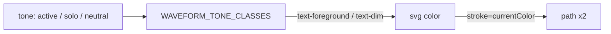

# STORE-2b-2a: hardcoded teal ქრება Store-ის ხელმისაწვდომი ეკრანებიდან

**თარიღი:** 2026-11-11
**სტატუსი:** In Progress (stage 2b-2a of STORE-2b; C round 447 PASS)
**შეცვლილი პროექტი:** Store (home სექციები, ProductCard, entrance loader, gift-cards, checkout success, ტესტი)

## კონტექსტი

- Saba-ს Store redesign spec (`docs/technical/store-redesign/store-redesign-spec.md`) ადგენს ერთ brass accent-ს (#C9A46A) #0E0D0C-ზე და ამბობს, რომ teal Store-იდან ქრება. keep-list სექციებზე glow-სა და gradient-ის მოხსნა დაშვებული restyle-ია (Saba-ს გადაწყვეტილება 2).
- `5df7717`-ზე სრული recount (claims regex: `teal-N`, `cyan-N`, `emerald-N`, teal hex, `rgba(19, 217, 204 …)` და მისი ოჯახი, `hsl(17x …)`) აჩვენებს **44 hit-ს 14 TS/TSX ფაილში**. ადრინდელმა recount-მა `rgba(...)` და `hsl(175 …)` ფორმები გამოტოვა.
- ეს ეტაპი (2b-2a) ეხება მხოლოდ იმ 21 hit-ს 7 ფაილში, რომლებიც C-სთვის ხელმისაწვდომ Store გვერდებზე ჩანს. ცვლილების შემდეგ რჩება **23 hit 7 ფაილში** (დავალების ტექსტში ეწერა „23/9“; გაზომილი ფაილების რაოდენობა 7-ია).

## მიდგომა

- **დაყოფა (D-29z1587).** 2b-2a — 21 hit 7 ფაილში (ეს რაუნდი). Stems modal-ის 2 hit (`StemsPlayerModal.tsx`, `StemControl.tsx`) გადადის STORE-4-ში, სადაც modal-ი inline stems mini-mixer-ით იცვლება. e-mail HTML-ის 8 hit (`email.server.ts`, `hire-us.tsx`) — 2b-2b. Dead code-ის 12 hit (`audio/Timeline.tsx`, `loading/CinemaCurtainLoader.tsx`) — LEGACY-DEAD-STORE-COMPONENTS. Frozen legacy-ის 1 hit (`studio/StudioTrack.tsx`) — SRW-21 / legacy Studio-ს მოხსნა.
- **product-designer-ის წესები.** ყველა glow ან halo ქრება. Brass რჩება მხოლოდ flat fill-სა და stroke-ზე. Solo იყენებს ღია foreground-ს და არა brass-ს (brass Studio-ში „playing“-ს ნიშნავს) ან ყვითელს (მეორე accent). Checkout-ის ripple ქრება, რადგან check icon-ის scale-in უკვე წარმატების მომენტია; brass ripple უარყოფილი ვარიანტია და Saba-ს ეკითხება როგორც `SABA-Q-CHECKOUT-RIPPLE`.
- **Per-hit mapping (tokens only, hex არა):**
  - `ProductCard.tsx` — ორი mouse-follow radial teal ფენა ქრება, მათთან ერთად `mousePosition`, `isHovering`, `handleMouseMove`, mouse handler-ები და `cardRef` (მისი ერთადერთი გამოყენება spotlight იყო). Card-ის hover scale და preview overlay wrapper რჩება.
  - `SpecialOffersSection.tsx` — ორივე ბარათს `transition-shadow` და teal hover shadow ეხსნება; დანარჩენი კლასები, ტექსტი და ბმულები უცვლელია.
  - `NewsletterSection.tsx` — submit ღილაკს teal hover shadow ეხსნება; `hover:bg-brand-hover` რჩება.
  - `gift-cards.tsx` — არჩეულ თანხას teal glow ეხსნება; `border-brand bg-brand/5` რჩება.
  - `checkout.success.tsx` — ripple `motion.div` მთლიანად ქრება.
  - `SpotlightLoader.tsx` — teal halo („Secondary glow - brand color“) ქრება; wordmark-ს gradient text და teal `drop-shadow` ეხსნება და იღებს `text-foreground`-ს (`font-bold` და ზომა STORE-2c-მდე უცვლელია); sweep line-ის inline gradient იცვლება `bg-brand/50`-ით, width/opacity ანიმაცია უცვლელია.
  - `StudioMockup.tsx` — hex `colorMap` და teal `drop-shadow` ქრება; `MockWaveform`-ის prop `color` გადაერქვა `tone: 'active' | 'solo' | 'neutral'`-ად; paths იყენებს `stroke="currentColor"`-ს, svg იღებს `text-foreground`-ს (active, solo) ან `text-dim`-ს (muted; `--color-dim`, `app/styles/app.css:71`, `@theme` ბლოკის შიგნით); volume fill `bg-brand`, thumb `bg-foreground`, Play `bg-brand text-brand-foreground`, „Export Mix“ `bg-brand/15 text-brand`.
- **შეგნებულად ხელუხლებელი:** არა-teal glow-ები (Newsletter-ისა და gift-cards-ის „Background glow“, loader-ის თეთრი spotlight და floor reflection) და CSS კლასები `text-glow`, `hero-title-glow`, `light-flicker-effect` — 2b-3-ის ინვენტარია.

## არქიტექტურა

ახალი არქიტექტურა არ შემოსულა. ერთადერთი სტრუქტურული ცვლილება: `MockWaveform`-ის ფერი hex map-იდან გადავიდა token კლასზე და `currentColor`-ზე.

## შეცვლილი ფაილები

- `app/components/product/ProductCard.tsx`
- `app/components/home/SpecialOffersSection.tsx`
- `app/components/home/NewsletterSection.tsx`
- `app/routes/gift-cards.tsx`
- `app/routes/checkout.success.tsx`
- `app/components/loading/SpotlightLoader.tsx`
- `app/components/home/StudioMockup.tsx`
- `app/lib/__tests__/store-teal-sweep.test.ts` (ახალი)
- `docs/implementation/2026/quarter-IV/292-store-2b-2a-teal-sweep.md` (ეს ფაილი)

## პრობლემები და გადაწყვეტები

- **Problem:** ძველი recount-ი (24 hit 9 ფაილში) `rgba(19, 217, 204 …)` და `hsl(175 …)` ფორმებს ვერ ხედავდა. **Solution:** ტესტი იყენებს claims script-ის იმავე regex-ს (`R=`), ხაზ-ხაზ, case-insensitive.
- **Problem:** allow-list შეიძლება მოძველდეს და ტესტი ცარიელად გაიაროს. **Solution:** TS2 მოითხოვს ≥ 200 სკანირებულ ფაილს, 7 granted path-ის არსებობას და ყოველ allow-list ჩანაწერზე ≥ 1 hit-ს — მომდევნო ეტაპი სიას აუცილებლად შეამცირებს.
- **Problem:** glow შეიძლება brass ფერით დაბრუნდეს. **Solution:** TS3 ფერის მიუხედავად კრძალავს `shadow-[0_0_` და `drop-shadow(0 0` token-ებს 7 ფაილში (mutant M4).
- **Problem:** `bg-brand/50` და `bg-brand/15` Chromium-ში computed style-ად `oklab(… / α)` ფორმით ბრუნდება და არა `rgba`-ით. **Solution:** contrast იზომება შეღებილ pixel-ზე (screenshot), არა computed string-ის parse-ით.

## ტესტირება

- `app/lib/__tests__/store-teal-sweep.test.ts`:
  - **TS1** — `app/**/*.{ts,tsx}`-ში (`__tests__`-ის გარეშე) ყოველი teal hit allow-list-ის ფაილშია (ფაილი → მიზეზი).
  - **TS2** — walker ≥ 200 ფაილს ხედავს, 7 granted path-ს შეიცავს, ყოველ allow-list ფაილს ≥ 1 hit აქვს.
  - **TS3** — 7 granted ფაილში არ არის `shadow-[0_0_`, `drop-shadow(0 0` და teal ფერი.
  - **TS4** — `SpotlightLoader.tsx`-ში არ არის `WebkitBackgroundClip` და `backgroundClip`.
- **Mutants** (scratch clone-ზე, store tree-ში არა; შედეგი `a-round-447/mutants.txt`):
  - M1 — StudioMockup-ში `bg-teal-500` დაბრუნებული → TS1 (და TS3) წითელი.
  - M2 — allow-list-იდან ჩანაწერის წაშლა → TS1 წითელი.
  - M3 — სუფთა ფაილის ყალბი allow-list ჩანაწერი → TS2 წითელი.
  - M4 — SpecialOffers-ში brass glow `hover:shadow-[0_0_20px_rgba(201,164,106,0.3)]` → TS3 წითელი.
  - M5 — loader-ში `WebkitBackgroundClip: 'text'` → TS4 წითელი.
  - revert-ის შემდეგ ყოველი მწვანეა.
- Covering ფაილები (`b-round-446/covering-files.txt`, 8 ფაილი, 126 ტესტი) მწვანეა; `npm run typecheck` და `npm run lint` rc 0 (205 warning, HEAD-ის ტოლი).
- ბრაუზერში (Chromium, 1440×900) გაზომილი contrast: Play glyph brass-ზე 8.32:1; „Export Mix“ შეღებილ `bg-brand/15`-ზე 5.82:1; waveform foreground track-ის ფონზე 16.89:1, muted `text-dim` 6.15:1 (path opacity-მდე); wordmark `rgb(236, 230, 218)`, gradient და filter არ აქვს.

## TODO / შემდეგი ნაბიჯები

- [ ] STORE-2b-2b — e-mail HTML-ის 8 hit (`email.server.ts`, `hire-us.tsx`).
- [ ] STORE-4 — stems modal-ის 2 hit; საჭიროა mock product stems-ით (ROOT-REQ-MOCK-API-STEMS).
- [ ] STORE-2b-3 — არა-teal glow-ები და `text-glow` / `hero-title-glow` / `light-flicker-effect`.
- [ ] STORE-2b-4.
- [ ] LEGACY-DEAD-STORE-COMPONENTS — `audio/Timeline.tsx`, `loading/CinemaCurtainLoader.tsx`, `PianoLoadingAnimation.tsx`-ის მოხსნა.
- [ ] SABA-Q-CHECKOUT-RIPPLE — Saba-ს პასუხი brass ripple-ზე (default: ripple-ის გარეშე).
