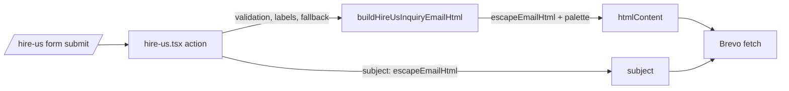

# STORE-2b-2b: Hire-Us inquiry e-mail ტოვებს teal-ს და ყველა mail client-ში იკითხება

**თარიღი:** 2026-11-11
**სტატუსი:** In Progress (stage 2b-2b of STORE-2b; C round 448 PASS)
**შეცვლილი პროექტი:** Store (`/hire-us` action, inquiry e-mail builder, ტესტები)

## კონტექსტი

- STORE-2b-2b თავდაპირველად 8 e-mail hit-ად იყო დაგეგმილი: `app/lib/email.server.ts` 5 და `app/routes/hire-us.tsx` 3.
- **`app/lib/email.server.ts` dead code-ია.** მას `app`, `perf` და `e2e`-ში 0 importer აქვს. მისი ერთადერთი export, `sendOrderPaidEmail`, ბოლო caller-ს `3b094eb`-ში („Remove all Shopify code and migrate to backend API“) დაკარგავდა. round 447-ის `Timeline.tsx`-ის წესით ის არ გადაიღება; ემატება **LEGACY-DEAD-STORE-COMPONENTS**-ს (`PianoCurtainLoader.tsx`-თან ერთად) Saba-ს legacy removal policy-ით (2026-11-10). ამ რაუნდში იცვლება მხოლოდ მისი allow-list reason `store-teal-sweep`-ში.
- დარჩენილი 3 live hit არის inquiry e-mail-ში, რომელსაც `/hire-us` ფორმის action საიტის მფლობელს უგზავნის. HEAD-ის e-mail Chromium-ში გაზომილია (რეალური `action`, `fetch` stub-ით):
  - **light client-ში (თეთრი ფონი) 12-დან 10 ტექსტური ელემენტი WCAG contrast-ს ვერ აკმაყოფილებს:** სახელი, project type და budget `#fff`-ია თეთრზე (1:1), headings და e-mail ბმული teal-ია 1.78:1-ით, labels `#888` 3.54:1-ით;
  - **dark client-ში (#121212) 12-დან 1:** footer, 3.26:1;
  - wrapper ფონს საერთოდ არ აყენებდა.
- ეს არის pre-existing ბაგი **B-R447-HIREUS-EMAIL-LIGHT-CLIENT** (Medium). მარტივი teal→brass ჩანაცვლება ვერ გამოასწორებდა: brass თეთრზე 2.33:1-ია. ამიტომ teal და წაკითხვადობა ერთად სწორდება.

## მიდგომა

- **e-mail თავის ფონს თავად ხატავს** — Store-ის Obsidian & Brass palette, `app/styles/app.css`-ის `@theme` ბლოკის ზუსტი ასლი (HE1 წითლდება drift-ზე). e-mail HTML-ს stylesheet არ აქვს, ამიტომ Tailwind-first აქ ვერ გამოიყენება; hex მნიშვნელობები token-ების სარკეა.
- **ფერების რუკა (HEAD → შემდეგ):**

| ელემენტი | HEAD | შემდეგ |
|---|---|---|
| `h2`, `h3` | `#13D9CC` | foreground #ece6da |
| mailto ბმული | `#13D9CC` | brand #c9a46a |
| value cells | `#fff` | foreground |
| label cells | `#888` | muted #a39b8e |
| borders | `#333` | outline #24211e |
| message box | `#1a1a1a`, ტექსტი `#fff` | surface #161412, ტექსტი foreground |
| footer | `#666` | muted |
| outer table, `td`, content `div` | მხოლოდ content `div`, ფონის გარეშე | background #0e0d0c; ახალ `td`-ს აქვს `padding: 24px` |

- **Background hardening:** e-mail HTML fragment-ია საკუთარი `<body>`-ის გარეშე. mail client-ები ხშირად აგდებენ `body` styles-ს, Outlook-ის Word engine კი `bgcolor`-ს table/cell-ზე უფრო საიმედოდ იცავს, ვიდრე `div`-ის ფონს. ამიტომ ფონი სამჯერ იხატება `background-color` longhand-ით: გარე `<table role="presentation" bgcolor>`, მისი `td` და content `div`. message box-ის `background:` გადაიწერა `background-color:`-ად. ეს `tech-lead`-ის sketch review-ის finding 2-ია.
- **Extraction:** e-mail-ის markup გადავიდა route-იდან pure builder module-ში `app/lib/hire-us-inquiry-email.server.ts` — `HIRE_US_INQUIRY_EMAIL_PALETTE`, `HireUsInquiryEmailFields`, `escapeEmailHtml` (ძველი `escapeHtml`, body უცვლელი) და `buildHireUsInquiryEmailHtml(fields)`. ასე ტესტებსა და C-ს შეუძლიათ e-mail-ის render ფოსტის გაგზავნის გარეშე.
- **უცვლელი:** ტექსტი, ველების რიგი, subject, sender, reply-to, validation, no-key 500, `fetch` call და responses. ყველა user-supplied მნიშვნელობა ისევ HTML-escaped-ია. label-ების fallback (`… || 'Not specified'`, subject `… || 'General'`) action-შია, როგორც HEAD-ზე.
- **უარყოფილი ვარიანტი:** light e-mail (მუქი ტექსტი თეთრზე, brass ბმული). Dark არჩეულია, რადგან ემთხვევა საიტის ბრენდს და HEAD-ის dark-intended ფერებისგან უმცირესი ცვლილებაა. ვარიანტი Saba-ს ერთხელ ეკითხება როგორც SABA-Q-HIREUS-EMAIL-THEME (`awaiting_user`).

## არქიტექტურა

## შეცვლილი ფაილები

- `app/lib/hire-us-inquiry-email.server.ts` — ახალი: palette, fields type, escaper, builder.
- `app/routes/hire-us.tsx` — local `escapeHtml` წაიშალა; `htmlContent` builder-იდან მოდის.
- `app/lib/__tests__/hire-us-inquiry-email.test.ts` — ახალი: HE1–HE7.
- `app/lib/__tests__/hire-us-inquiry-email-contrast.test.ts` — ახალი (jsdom `DOMParser`): HE8–HE9.
- `app/lib/__tests__/store-teal-sweep.test.ts` — allow-list ახლა `{ hits, reason }` ზუსტი რაოდენობებით; `routes/hire-us.tsx` გავიდა allow-list-იდან და, ახალ module-თან ერთად, teal-free სიაშია; `lib/email.server.ts`-ის reason არის `LEGACY-DEAD-STORE-COMPONENTS (0 importers)`; TS2 ზუსტ რაოდენობებს ადარებს; ახალი TS5 `perf/`-ს სკანავს.
- `docs/implementation/2026/quarter-IV/293-store-2b-2b-hire-us-email.md` — ეს დოკუმენტი.

## პრობლემები და გადაწყვეტები

- **Problem:** brass თეთრ ფონზე 2.33:1-ია, ამიტომ teal→brass swap light client-ში ვერ შველის. **Solution:** e-mail საკუთარ Obsidian ფონს ხატავს; ტექსტი light ink-ია, labels/footer muted, ბმული brass.
- **Problem:** `body`-ზე ან `div`-ზე დაყენებული ფონი ზოგ client-ში იკარგება. **Solution:** გარე presentation table `bgcolor`-ით და `background-color`-ით, მისი `td` და content `div` — სამი ფენა.
- **Problem:** multipart `FormData` `\n`-ს `\r\n`-ად აქცევს, ამიტომ HE5-ის შედარება newline-იან message-ზე ცრუ სხვაობას იძლევა. **Solution:** HE5 message-ს newline-ის გარეშე აგზავნის.
- **Problem:** `email.server.ts`-ის restyle მკვდარ კოდზე შრომა იქნებოდა. **Solution:** არ გადაიღება; LEGACY-DEAD-STORE-COMPONENTS-ში გადავიდა.

## ტესტირება

- **HE1** — palette-ის თითო hex უდრის `--color-<token>`-ს `app.css`-ის `@theme {` ბლოკში.
- **HE2** — builder output იყენებს მხოლოდ palette hex-ებს (≥ 10 გამოყენება) და teal არ აქვს.
- **HE3** — e-mail იწყება `<table role="presentation"`-ით, რომლის opening tag-ს აქვს `bgcolor` და `background-color` = background.
- **HE4** — 5-ვე ველი `'&`-ით მხოლოდ escaped სახით ჩანს, mailto `href`-ის ჩათვლით.
- **HE5** — რეალური `action` (`BREVO_API_KEY` stub, `fetch` captured) აგზავნის `htmlContent === buildHireUsInquiryEmailHtml(...)`, subject `🎬 New Project Inquiry: Film/Video Scoring`, status 200; body `unknown`-ად parse-დება და type guard-ით ვიწროვდება.
- **HE6** — project type-ისა და budget-ის გარეშე: subject `General`, ორივე label `Not specified`, როგორც HEAD-ზე.
- **HE7** — characterisation: key-ის გარეშე action აბრუნებს 500-ს და `fetch`-ს 0-ჯერ იძახებს (HEAD-ზეც მწვანეა, mutant არ აქვს).
- **HE8** — 12-ვე ტექსტურ ელემენტს აქვს resolved (own or inherited) ფერი და painted background (`background-color` ან `bgcolor`) თავის თავზე ან ancestor-ზე e-mail-ის შიგნით.
- **HE9** — ყველა ტექსტური ელემენტი ≥ 4.5:1 უახლოეს painted background-თან.
- **TS2** — allow-listed ფაილის hit რაოდენობა ზუსტად pinned-ია.
- **TS5** — `perf/**` (≥ 10 ფაილი) teal-ის გარეშეა.
- **Process evidence (repo-ს ტესტები არ არის; artifacts loop folder-ის `a-round-448/`-შია):**
  - Mutants M1–M10 (scratch clone-ზე, არა store tree-ში) თითოეული აწითლებს მოსალოდნელ row-ებს: M1→HE4, M2→HE3, M3→HE1/HE2/TS1/TS3, M4→HE5/TS1/TS3, M5→TS2, M6→TS5, M7→HE2, M8→HE9, M9→HE3/HE8/HE9, M10→HE6.
  - e-mail-ის Chromium render და contrast-ის გაზომვა light და dark client-ის ფონზე: 0 failing row ორივეში (12/12, მინიმუმი 7.06:1).
  - HEAD-თან structure diff (hex → `HEX`): განსხვავდება მხოლოდ გარე table/`tr`/`td`, content `div`-ის `background-color`/`color` და message box-ის `background` → `background-color`.
- **არ დატესტილა:** რეალური გაგზავნა Brevo-თი და render რეალურ mail client-ებში (Gmail, Outlook, Apple Mail) — cloud-ში mail client არ არის. ეს არის Tech Lead manual row **TLM-R448-HIREUS-EMAIL-CLIENTS** (deadline RETRO 465).

## TODO / შემდეგი ნაბიჯები

- [ ] STORE-2b-3 — `app.css` glow/gradient.
- [ ] STORE-2b-4.
- [ ] LEGACY-DEAD-STORE-COMPONENTS — `email.server.ts`, `PianoCurtainLoader.tsx` (და `Timeline.tsx`) წაშლა cleanup ან ARCH-SPLIT რაუნდში.
- [ ] STORE-4 — stems modal-ის teal hits (`StemsPlayerModal.tsx`, `StemControl.tsx`).
- [ ] TLM-R448-HIREUS-EMAIL-CLIENTS — რეალური mail client-ების შემოწმება.
- [ ] TL-R448-L6 deferred Lows: prototype key (`projectType=toString`) → 500; subject HTML escaper-ით გადის; mailto `href` URL-encoded არ არის; `formData.get(...) as string` casts.
- [ ] SABA-Q-HIREUS-EMAIL-THEME — light vs dark e-mail, Saba-ს პასუხის მოლოდინში.
