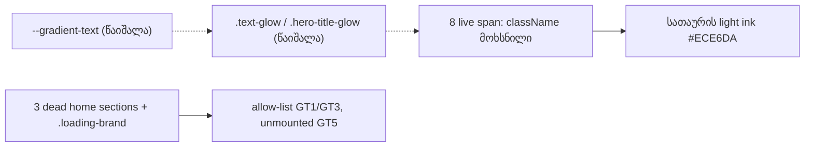

# STORE-2b-3a: gradient text ტოვებს Store-ს — ხაზგასმული სიტყვები სათაურის light ink-ით

**თარიღი:** 2026-11-11
**სტატუსი:** In Progress (stage 2b-3a of STORE-2b; C round 449 PASS)
**შეცვლილი პროექტი:** Store (home sections, `/about`, 404, LeadMagnet popup, `app.css`, `base/utilities.css`, ტესტები)

## კონტექსტი

- `store-redesign-spec.md`-ის STORE-2 რიგი ითხოვს glow blob-ების, **gradient text**-ისა და `shadow-glow`-ის მოშორებას; Direction A („Obsidian & Brass gallery“) ერთ accent-ს, brass-ს, იცნობს.
- STORE-2b-3 ოთხ ეტაპად გაიყო, რადგან Store-ის CSS-ში 70 teal hit-ია glow/blur/gradient წესებთან ერთად და ერთ შემოწმებად რაუნდში არ ეტევა:
  - **2b-3a (ეს ეტაპი):** gradient text;
  - **2b-3b:** glow shadows (`--shadow-glow` და მისი TSX მომხმარებლები, მათ შორის `ui/Button` და `ui/IconButton`);
  - **2b-3c:** დარჩენილი live teal CSS წესები;
  - **2b-3d:** dead tokens და წესები, LEGACY cleanup-თან ერთად.
- HEAD-ზე (`48e16b8`) რვა ხაზგასმული სიტყვა light grey → teal gradient-ით იხატებოდა (`background-clip: text` + transparent fill). Chromium-ში გაზომილი teal ink ყოველი სიტყვის glyph-ებში 34–80 %-ია (24 რიგი: 8 სიტყვა × 1440/1280/375).

## მიდგომა

- **Light ink, არა brass.** `product-designer`-ის გადაწყვეტილებით gradient დეკორაცია იყო და არა მნიშვნელობა. სიტყვა იღებს სათაურის საკუთარ light ink-ს #ECE6DA (round 447-ში სათაურები და loader wordmark უკვე light ink-ზეა).
  - **უარყოფილი: brass სიტყვა.** brass სათაურის ტექსტში წყვეტს clickable ელემენტის აღნიშვნას, link-ად იკითხება და brass CTA-ებს ასუსტებს.
  - **უარყოფილი: სათაურის დანარჩენი ნაწილის დამუქება.** ეს სათაურის contrast-ს ამცირებს.
- **რვა სიტყვა:** home hero h1-ის „CZABA“, „Releases“, „Studio“ (CZABA Studio), „Inner Circle“, `/about`-ის „Cinema“ და „Stand For“, 404-ის „Sound“ და LeadMagnet popup-ის „CZABA“ eyebrow.
- **LeadMagnet keep-list-შია:** მხოლოდ restyle. class token-ის მოხსნა paint-only ცვლილებაა; ტექსტი, დარჩენილი classes (`tracking-[0.5em] uppercase`), DOM და ქცევა უცვლელია. designer-ს eyebrow-სთვის caption grey ერჩივნა; ვაგზავნით light ink-ს და Saba-ს ერთხელ ვეკითხებით (SABA-Q-LEADMAGNET-EYEBROW-TONE).
- **`span` ელემენტები რჩება**, იხსნება მხოლოდ მათი `className`, ამიტომ DOM tree და box-ები უცვლელია.
- **CSS:** `--gradient-text` token (1 definition + 4 `var()` read) წაიშალა; `.text-glow` (`app.css` და `base/utilities.css`-ის დუბლიკატი) და `.hero-title-glow` წაიშალა. `.hero-title-glow`-ის `text-shadow` კითხულობდა `--primary-hue`-ს, რომელიც არსად არ არის განსაზღვრული, ამიტომ HEAD-ზეც არაფერს ხატავდა. `.product-detail-title`-ს (0 მომხმარებელი) მოეხსნა `background: var(--gradient-text)` და მისი 3 clip/fill ხაზი; დანარჩენი უცვლელია. Obsidian ბლოკი byte-identical-ია.
- **Dead code არ გადაიღება (round 447-ის წესი):** `ArtistBioSection.tsx`, `TestimonialsSection.tsx` და `VideoShowcase.tsx`-ს barrel-ის გარდა 0 importer აქვთ; ისინი `text-glow` token-ს ინარჩუნებენ allow-list-ში ზუსტი რაოდენობით (GT3) და re-import-ისგან დაცულია (GT5). dead წესი `.loading-brand` თავის clip-ს ინარჩუნებს (GT1); მისი მომხმარებელი `PianoLoadingAnimation` 0 importer-ით არის. სამი home section ემატება **LEGACY-DEAD-STORE-COMPONENTS**-ს, სადაც `PianoLoadingAnimation` უკვე არის.
- `docs/design/star-brand-audit.md`-ის `text-glow` ხაზები (CZABA ლოგო და სათაურების „text-glow“ ნიმუში) ამ ეტაპით **ძალადაკარგულია (superseded)**. ფაილი აქ არ იცვლება; design docs-ს STORE-5 განაახლებს.

## არქიტექტურა

## შეცვლილი ფაილები

- `app/styles/app.css` — `--gradient-text`, `.text-glow`, `.hero-title-glow` წაიშალა; `.product-detail-title`-ს gradient-ის 4 declaration მოეხსნა.
- `app/styles/base/utilities.css` — დუბლიკატი `.text-glow` წესი და მისი კომენტარი წაიშალა.
- `app/components/home/HeroSection.tsx`, `app/components/home/NewsletterSection.tsx`, `app/components/home/StudioShowcase.tsx`, `app/components/marketing/LeadMagnetPopup.tsx`, `app/routes/$.tsx`, `app/routes/_index.tsx`, `app/routes/about.tsx` (×2) — span-ებს მოეხსნა `text-glow` / `hero-title-glow`.
- `app/lib/__tests__/store-gradient-text.test.ts` — ახალი (node): GT1–GT5.
- `app/lib/__tests__/studio-naming.test.tsx` — NM2-ის მხოლოდ სათაური: „with the glow on Studio“ → „with the emphasised span on Studio“; assertions უცვლელია.
- `docs/implementation/2026/quarter-IV/294-store-2b-3a-gradient-text.md` — ეს დოკუმენტი.

## პრობლემები და გადაწყვეტები

- **Problem:** keep-list წესი („restyle only“) vs LeadMagnet-ის class token-ის მოხსნა. **Solution:** მოხსნა paint-only restyle-ია; ტექსტი, tag sequence, box და ქცევა HEAD-ის ტოლია.
- **Problem:** „არცერთი ფაილი არ ასახელებს retired class-ს“ vs „dead code არ გადაიღება“. **Solution:** dead-code წესი იმარჯვებს; სამი dead section და `.loading-brand` allow-list-ში რჩება ზუსტი რაოდენობით, ხოლო GT5 ამოწმებს, რომ ისინი ხელახლა არ დაიმონტაჟდა.
- **Problem:** ძველი case-sensitive regex ვერ იჭერდა `Background-Clip : padding-box, text`-ს, nested `@media`-ს ან `#0000` fill-ს. **Solution:** GT1 rule-aware scan-ს იყენებს; GT4 parser-ის self-test-ით ამოწმებს, რომ სკანი non-vacuous-ია და hit-ები სწორ selector-ზე იწერება.
- **Problem:** NM2 `heading.querySelector('span')`-ს კითხულობს. **Solution:** span რჩება; იცვლება მხოლოდ ტესტის სათაური.

## ტესტირება

- Repo ტესტები: `store-gradient-text.test.ts`-ის GT1 (background-clip/transparent fill-ის rule-aware scan, `.loading-brand`-ის გარდა), GT2 (`--gradient-text` არსად), GT3 (retired class მხოლოდ სამ dead ფაილში, თითოში ერთხელ), GT4 (non-vacuous scan + parser self-test), GT5 (ოთხი dead component unmounted); `studio-naming.test.tsx`-ის NM2 (სათაური განახლდა). `store-header-footer.test.tsx`-ის `.text-glow`-ის არარსებობის assertion უცვლელად გადის.
- Covering set (16 ფაილი / 190 ტესტი), `npm run typecheck`, `npm run lint` (205 warning = HEAD), scoped Biome (2 warning = HEAD) და `npm run build` — მწვანე.
- Process evidence (არა repo ტესტები): 11 mutant (M1–M11) თითო GT რიგს აწითლებს, M6 control მწვანეა; Chromium probe 8 სიტყვაზე × 1440/1280/375 ადარებს HEAD-ს: fill `rgb(236, 230, 218)`, `background-image: none`, teal ink ≤ 0.01, box-ები და ხაზების რაოდენობა HEAD-ის ტოლია. C round 449 ამოწმებს selection-ს, forced-colors-ს, LeadMagnet dialog-ს და `/studio-lab`-ის 0 px-ს.

## TODO / შემდეგი ნაბიჯები

- STORE-2b-3b (glow shadows), 2b-3c (დარჩენილი teal CSS), 2b-3d (dead tokens/წესები) და 2b-4.
- LEGACY-DEAD-STORE-COMPONENTS — ახლა სამი home section-იც (`ArtistBioSection`, `TestimonialsSection`, `VideoShowcase`) და `PianoLoadingAnimation`; testimonials keep-list-შია, ამიტომ Saba-ს კითხვა რჩება.
- TLM-R449-WEBKIT-HEADING-INK — Safari/WebKit-ის შემოწმება Tech Lead-ის მიერ (cloud-ში WebKit არ არის).
- SABA-Q-LEADMAGNET-EYEBROW-TONE — light ink vs caption grey.
- TL-R449-ის deferred Low-ები `deferred_low_polish`-ში.
