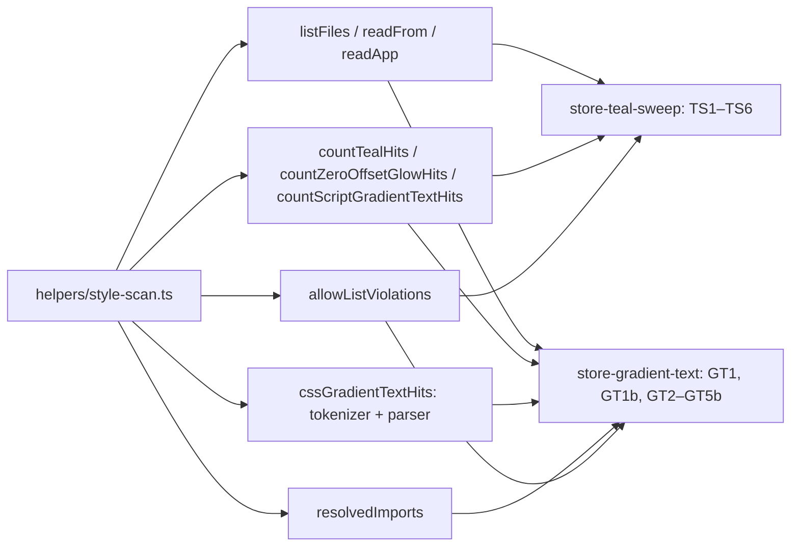

# SYS-R450-STORE-STYLE-SCAN: ერთი საერთო style-scan helper Store-ის სტილის guard ტესტებისთვის

**თარიღი:** 2026-11-11
**სტატუსი:** Completed (C round 452 PASS)
**შეცვლილი პროექტი:** Store (მხოლოდ ტესტები: `app/lib/__tests__/`)

## კონტექსტი

- STORE-2b-ის ეტაპებმა (2b-2a teal sweep, 2b-3a gradient text) source-scanning guard ტესტები შექმნა: `store-teal-sweep.test.ts` და `store-gradient-text.test.ts`.
- RETRO 450-მა (D-29z1601, `tech-lead`) აჩვენა ერთი კლასის პრობლემა: guard-ები ზედმეტად ვიწროდ სკანირებდა ან ზედმეტად თავისუფლად parse-ავდა.
  - GT1 მხოლოდ `app.css`-სა და `styles/base/*`-ს კითხულობდა; TSX-ში (`bg-clip-text`, inline `WebkitBackgroundClip`) და legacy Studio CSS-ში gradient text ვერ ჩანდა (A-R449-REVIEW-GT1-TSX, Medium; TL-R449-L3-SCAN-ROOTS).
  - TS3 მხოლოდ ორ class token-ს იჭერდა (`shadow-[0_0_` და `drop-shadow(0 0`); inline `boxShadow`, `textShadow` და ახალ ხაზზე გადატანილი მეორე shadow layer ვერ ჩანდა (A-R447-REVIEW-L2).
  - CSS parser-ი quoted `{};`-ზე, comment marker-ზე string-ის შიგნით და alpha-zero fill-ზე ცდებოდა (TL-R449-L4-PARSER-QUOTES, A-R449-REVIEW-L-FILL-REGEX).
  - ორივე suite-ს საკუთარი walker, allow-list ტიპი და count ლოგიკა ჰქონდა (A-R449-REVIEW-L-TEST-HYGIENE); perf root-ის დაფარვა (A-R447-REVIEW-L3) helper-ში უნდა შენარჩუნებულიყო.
- მიზანი: STORE-2b-3b (glow shadows) დაიწყოს guard-ებით, რომლებიც TSX-ს, legacy CSS-სა და inline glow-ს ხედავს. Runtime კოდი არ იცვლება.

## მიდგომა

- **ერთი helper:** `app/lib/__tests__/helpers/style-scan.ts` აერთიანებს walker-ს (`listFiles`, HEAD-ის იდენტური), წამკითხველებს, hit counter-ებს (`countTealHits`, `countZeroOffsetGlowHits`, `countScriptGradientTextHits`), `hitsByFile`/`hitsByRootedFile`-ს, CSS parser-ს (`cssGradientTextHits`), import resolver-ს (`resolvedImports`) და allow-list-ის შედარებას (`allowListViolations`, `Object.hasOwn`-ით).
- **Port HEAD-ის შენარჩუნებით (L4):** ყოველი HEAD assertion და კონსტანტა თანაბარ ან უფრო მკაცრ row-ზე გადადის; HEAD-ის ფუნქციების verbatim ასლი helper-თან ერთად golden შედარებით შემოწმდა (loop-ის process evidence, ქვემოთ).
- **B-ის sketch უცვლელად:** A-მ sketch v4 (round 451) და v4 → v5 delta (round 452) `git apply`-ით დაადო, fix-up-ების გარეშე; v4-ს სამი `tech-lead` review ჰქონდა, v4 → v5 delta-ს — მეოთხე; ორივეს ბოლო verdict — APPROVE.
- **განხილული ალტერნატივა:** თითო suite-ში ცალ-ცალკე გაფართოება. უარყოფილია: იგივე walker/parser ორ ადგილას დარჩებოდა და STORE-2b-3b-ს მესამე ასლი დასჭირდებოდა.
- **შეგნებული ფარგლები:** teal scan რჩება TS/TSX-ზე (CSS teal — STORE-2b-3c); TS3 რჩება 9 granted ფაილზე (app-wide 5 zero-offset glow hit STORE-2b-3b-ის ინვენტარია); legacy `styles/studio.css` და `styles/pages/studio.css` მხოლოდ იკითხება და არ რედაქტირდება.

## არქიტექტურა

## შეცვლილი ფაილები

- `app/lib/__tests__/helpers/style-scan.ts` — ახალი საერთო helper (scan root-ები, walker, counter-ები, CSS parser, import resolver, allow-list ტიპი და შედარება).
- `app/lib/__tests__/store-teal-sweep.test.ts` — helper-ზე გადატანა; TS3-ს ემატება zero-offset glow შემოწმება; ახალი TS6 (scanner-ის probe-ები).
- `app/lib/__tests__/store-gradient-text.test.ts` — helper-ზე გადატანა; GT1 ყველა app CSS ფაილს კითხულობს; ახალი GT1b, GT4b და GT5b; GT4 და GT5 ახალ probe-ებსა და ჩანაწერებს იღებს.
- `app/lib/__tests__/studio-naming.test.tsx` — მხოლოდ NM2-ის ლოკალური ცვლადის სახელი `glow` → `emphasis`; assertion-ები უცვლელია.
- `docs/implementation/2026/quarter-IV/295-sys-r450-store-style-scan.md` — ეს დოკუმენტი.

## პრობლემები და გადაწყვეტები

- **Problem:** GT1 legacy CSS-ს და TSX-ს ვერ ხედავდა. **Solution:** GT1 ყველა app CSS ფაილს სკანირებს (allow-list key `<file> <selector>`), GT1b კი `app/` და `perf/` script-ებს — class-ებს, inline/assigned style-ს, `setProperty`-ს და script-ში ჩაწერილ CSS ტექსტს.
- **Problem:** TS3 inline და wrapped glow-ს ვერ იჭერდა. **Solution:** `countZeroOffsetGlowHits` მთელ source-ზე მუშაობს (არა ხაზ-ხაზ), shadow value span 300 სიმბოლოთია შეზღუდული და `;`, `}` ან `, key:`-ზე ჩერდება; TS6 probe-ები ამოწმებს როგორც hit-ებს, ისე offset shadow-სა და ring-ს.
- **Problem:** CSS parser-ი quote-ებსა და comment marker-ებზე ცდებოდა. **Solution:** ერთგავლიანი tokenizer comment-ებს ბლანკავს და string-ის შიგნით `{};`-ს ბლანკავს; დაემატა `@apply bg-clip-text` და alpha-zero fill-ები (GT4 probe-ები).
- **Problem:** ზოგადი სახელის მქონე dead module-ებს (`components/audio/Timeline.tsx`, `lib/email.server.ts`) სახელით guard ვერ დაიცავდა (`Timeline` ცოცხალ ფაილებშიც გვხვდება). **Solution:** GT5b resolved import specifier-ით ამოწმებს, barrel-ებისა და namespace import-ის ჩათვლით.
- **Problem:** v4-მა საერთო `BARREL_FILES` ხუთ barrel-მდე გააფართოვა (`components/audio/index.ts` და `components/index.ts` დაემატა). GT5 ამ სიას exclusion-ად იყენებს, ამიტომ GT5-ის სახელით სკანირება ორ ფაილს აღარ კითხულობდა, რომელსაც HEAD კითხულობდა: root ან audio barrel-ში dead component-ის alias re-export (`export { ArtistBioSection as Bio } …`) HEAD-ზე GT5-ს აწითლებდა, v4-ზე კი არა (A-R451-REVIEW-M1-GT5-BARREL-SCOPE, Medium; L4-ის დარღვევა). **Solution:** `BARREL_FILES` HEAD-ის სამ barrel-ს დაუბრუნდა და GT5 მას ზუსტად HEAD-ივით იყენებს. GT5b-ს საკუთარი exclusion აქვს: ახალი `deadModuleBarrelFiles(dead)` თითო dead module-ისთვის მხოლოდ მის საკუთარ barrel-ებს აბრუნებს (Timeline → `components/audio/index.ts` და `components/index.ts`; `email.server` → არცერთი). Mutant-ები loop-ის process evidence-ია (არა repo row-ები): `b-round-451/mutants.txt`-ში root და audio barrel-ის alias mutant-ები GT5-ს აწითლებს, ხოლო own-barrel exclusion-ის მოხსნა GT5b-ს; `b-round-451/head-mutants/mutants.txt`-ში იგივე ორი alias mutant HEAD-ზეც წითელია (HEAD pin); A-ს გამეორება — `a-round-452/mutants/mutants.txt`.

## ტესტირება

- Sketch-ის ფაილები: `sha256sum -c b-round-451/sketch-files-sha256.txt` rc 0 (4 ფაილი B-ის sketch v5-ის იდენტურია).
- `npm run typecheck` rc 0; `npm run lint` rc 0, 205 warning (HEAD-ის ტოლი).
- Covering set: `store-teal-sweep.test.ts`, `store-gradient-text.test.ts`, `studio-naming.test.tsx` — 3 ფაილი, 16 ტესტი PASS. Row-ები: TS1–TS6, GT1, GT1b, GT2, GT3, GT4, GT4b, GT5, GT5b, NM2.
- Process evidence (არა repo ტესტები):
  - golden შედარება — loop-ის `b-round-450/golden/style-scan-golden.test.ts`, გაშვებული throwaway clone-ში `store/`-ის გარეთ; შედეგი `a-round-452/golden.json`: `equal: true`; ზომები: 349 app script, 17 perf script, 5 CSS, 354 styled ფაილი, 6 teal ფაილი, 1 CSS selector, 3 GT3 ფაილი, 5 probe hit.
  - mutant-ები — B-ის pre-check, `b-round-451/mutants.txt` (57 ხაზი) და `b-round-451/head-mutants/mutants.txt` (37 ხაზი): დახურული id-ების mutant-ები sketch-ზე წითელია; HEAD-ზე ისინი მწვანეა ან ვერ ედება (EDIT-FAILED, რადგან HEAD-ს შესაბამისი კოდი არ აქვს). HEAD-ზე წითელია მხოლოდ `drop-shadow-[0_0_` class-ის mutant-ი, რადგან HEAD-ის `shadow-[0_0_` token მისი substring-ია (D-29z1604-e), და ორი barrel alias mutant-ი, რომლებიც განზრახ HEAD pin-ებია (GT5).

## TODO / შემდეგი ნაბიჯები

- STORE-2b-3b: app-wide 5 zero-offset glow hit, `--shadow-glow` და `ui/Button`; ამ ეტაპზე helper-ის export სახელები კონტრაქტია.
- `deferred_low_polish`: TL-R451-L1-RESOLVER-COMMENTS, TL-R451-L2-SIDE-EFFECT-IMPORT, TL-R451-L3-RESOLVER-FORMS, TL-R451-L4-BRACKET-KEY, A-R451-REVIEW-L1-SCRIPT-CSS-MULTILINE, A-R451-REVIEW-L2-ZERO-OFFSET-UNITS (`0rem`, `0em`, `-0` offset-ები; STORE-2b-3b ხელახლა ამოწმებს), A-R451-REVIEW-L3-REREAD.
- TL-R449-D2-BARREL-ALIAS: alias re-export HEAD-ის სამი barrel-ის გავლით HEAD-ზეც არსებული ხვრელია; იხურება dead ფაილების წაშლით STORE-2b-3d-ში.
- INFO: INFO-TL-R451-FILL-FORMS (`hsl(… / 0)`, `color-mix`, `var()` fill-ები), INFO-TL-R451-GLOW-CALC, INFO-TL-R451-WALKER-HOST; TL-R451-CODE4-TEAL-TEXT-SHADOW — STORE-2b-3c.
