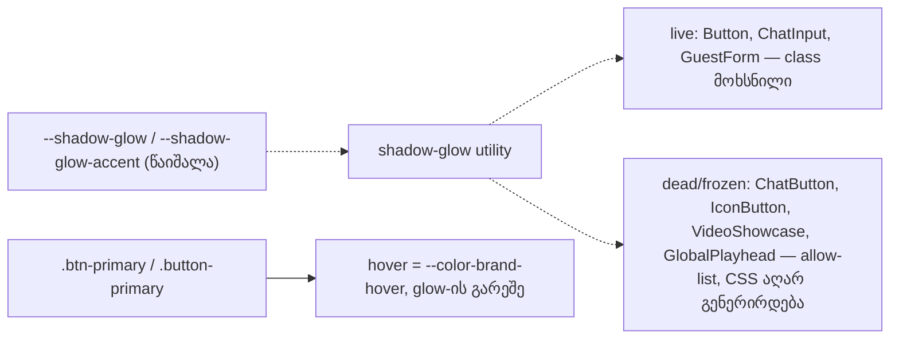

# STORE-2b-3b: glow shadows ტოვებს Store-ს — `--shadow-glow`, primary ღილაკების glow და zero-offset glow-ების ინვენტარი

**თარიღი:** 2026-11-11
**სტატუსი:** In Progress (stage 2b-3b of STORE-2b; C round 453 PASS)
**შეცვლილი პროექტი:** Store (`app.css`, `ui/Button`, chat ფორმები, `PurchaseHeader`, `/store` route, ტესტები)

## კონტექსტი

- `store-redesign-spec.md`-ის STORE-2 რიგი ითხოვს `shadow-glow`-ის მოშორებას. Direction A („Obsidian & Brass gallery“) ერთ accent-ს, brass-ს, იცნობს და glow-ს არ იყენებს.
- STORE-2b-3 ოთხ ეტაპადაა გაყოფილი: 2b-3a gradient text (doc 294), **2b-3b glow shadows (ეს ეტაპი)**, 2b-3c დარჩენილი live teal CSS, 2b-3d dead tokens და წესები.
- HEAD-ზე (`ee7cf7c`) ბრაუზერში გაზომილი მდგომარეობა:
  - ყოველ brass primary CTA-ს hover-ზე და press-ზე teal glow ჰქონდა: header-ის „Sign In“, hero-ს „Discover the Collection“, 404-ის „Back Home“, `/account`-ის „Sign In“ (`ui/Button`) და `/support`-ის „Start Chat“.
  - ორ stub გვერდზე (`/account/login`, `/search`) „Back to Home“ ბმული (`.button-primary`) teal gradient-ზე თეთრი ტექსტით იხატებოდა. hover-ზე ტექსტის contrast **2.36:1** იყო.
  - პროდუქტის გვერდზე cart ღილაკის „Added“ მდგომარეობას brass 20px glow ჰქონდა.

## მიდგომა

- **Primary ღილაკის feedback — `product-designer`-ის Q1, ვარიანტი (b):** hover მხოლოდ fill-ს ცვლის — უფრო ღია brass `#D9B87F` (`--color-brand-hover`), სრული opacity-ით.
  - `ui/Button` ინარჩუნებს offset `shadow-sm`-ს; იხსნება მხოლოდ `hover:shadow-glow`.
  - `.btn-primary:hover`-დან `opacity: 0.9` იხსნება: glow-ის გარეშე ის hover-ს თითქმის უხილავს ხდიდა.
  - press feedback რჩება: `.btn-primary`-ზე opacity 0.8, `ui/Button`-ზე 0.9. keyboard focus ring უცვლელია.
  - **უარყოფილი (a):** `shadow-sm`-ის მოხსნა — STORE-2-ის ფარგლებს გარეთაა და სხვა filled variant-ებს არ ემთხვევა.
  - **უარყოფილი (c):** lift ან border hover-ზე — ახალი დიზაინი, რომელსაც direction არ ითხოვს.
- **`.button-primary` — Q2, ვარიანტი (a):** brass fill და brand-foreground (`#0E0D0C`) ტექსტი, hover-ზე უფრო ღია brass. teal gradient, თეთრი ტექსტი, `--shadow-lg` drop shadow და teal hover glow იხსნება. hover contrast 2.36 → 10.28.
  - **უარყოფილი (b):** secondary-ად გადაქცევა — გვერდს ერთადერთ primary მოქმედებას წაართმევს.
- **Q3 — dead და frozen ფაილები უცვლელია:** `ChatButton.tsx`, `ui/IconButton.tsx`, `home/VideoShowcase.tsx` და frozen `components/studio/GlobalPlayhead.tsx` ინარჩუნებენ `shadow-glow` class-ს. token-ის წაშლის შემდეგ Tailwind v4 ამ class-ისთვის CSS-ს აღარ აგენერირებს, ამიტომ ბრაუზერში computed `box-shadow` `none`-ია. GS2 მათ ზუსტი რაოდენობით allow-list-ში ინახავს, სანამ LEGACY-DEAD-STORE-COMPONENTS და legacy Studio-ს მოშორება მათ არ წაშლის.
- **Token-ის წაშლა vs frozen legacy Studio:** წაშლა იმარჯვებს, რადგან `@theme` ცვლილებები legacy Studio-ს round 192-დან აღწევს.
  - GlobalPlayhead-ის non-amber playhead კარგავს teal 40px halo-ს; brass ხაზი რჩება.
  - legacy ExportDialog-ის „Export Audio“ (`ui/Button` primary) კარგავს teal hover glow-ს; hover-ზე რჩება `shadow-sm` და brass hover fill.
  - ორივე გაზომილია მხოლოდ stubbed client path-ზე. ownership/backend ნაწილი cloud-ში არ მოწმდება.
- **ყველა `ui/Button` default ან `primary` variant-ით** კარგავს hover glow-ს, მათ შორის signed-in და frozen მომხმარებლები (`studio/ExportDialog`, `studio/DownloadDialog`, `account.downloads`, `studio.$productId`, recordings, scenes, `gift-cards`, `account`, `cart`). მათი ფაილები არ იცვლება — მხოლოდ საერთო Button class და token.
- **Dead CSS წესები, რომლებიც წაშლილ token-ს კითხულობდა:** `.special-offer-card:hover` (მთლიანად) და `.track-card:hover`-ის `box-shadow` ხაზი. ორივეს 0 TSX მომხმარებელი აქვს; `var()` read იშლება და dangling არ რჩება. ამ წესების დანარჩენი ნაწილი 2b-3d-ს ეკუთვნის.
- **D-29z1604-c ინვენტარი (zero-offset glow app TS/TSX-ში, HEAD-ზე 5 hit):**
  - `PurchaseHeader` (live) — „Added“ glow იხსნება; „Added“ ტექსტი, Sparkles icon და scale pulse რჩება.
  - `routes/store.tsx` — ბარათის „Hover Glow Effect“ overlay იშლება. HEAD-ზე ის არაფერს ხატავდა, რადგან `var(--color-brand)25` არავალიდური CSS-ია.
  - `CinemaCurtainLoader` (2 hit, dead) — 2b-3d.
  - `GlobalPlayhead` (frozen) — allow-list.
- **A-R451-REVIEW-L2-ZERO-OFFSET-UNITS და INFO-TL-R451-GLOW-CALC** ისევ fail open რჩება (`0rem 0 20px`, `0 0 calc(…)` ფორმები). ფიქსი `helpers/style-scan.ts`-ს ეკუთვნის, რომელიც ამ ეტაპში არ იცვლება; owner — **STORE-2b-3c**.

## არქიტექტურა

## შეცვლილი ფაილები

- `app/styles/app.css` — ორი `@theme` token, `.btn-primary` (transition, hover, active), `.button-primary` (rest, hover), `.special-offer-card:hover`, `.track-card:hover`-ის `box-shadow`. obsidian ბლოკი უცვლელია.
- `app/components/ui/Button.tsx` — primary: `'shadow-sm hover:shadow-glow'` → `'shadow-sm'`.
- `app/components/chat/ChatInput.tsx`, `app/components/chat/GuestForm.tsx` — `hover:shadow-glow` იხსნება.
- `app/components/product/PurchaseHeader.tsx` — „Added“ მდგომარეობის glow class.
- `app/routes/store.tsx` — inert „Hover Glow Effect“ overlay.
- `app/lib/__tests__/store-theme-tokens.test.ts` — ST5-ის primary literal (`'shadow-sm',`).
- `app/lib/__tests__/store-glow-shadow.test.ts` (ახალი) — GS1–GS4.

## პრობლემები და გადაწყვეტები

- **Problem:** glow-ის მოხსნის შემდეგ `.btn-primary:hover`-ის `opacity: 0.9` hover-ს თითქმის უხილავს ტოვებდა. → **Solution:** opacity იხსნება და hover-ს სრული opacity-ით უფრო ღია brass fill აჩვენებს.
- **Problem:** stub გვერდების „Back to Home“ teal gradient-ზე თეთრი ტექსტით hover-ზე 2.36:1 contrast-ს იძლეოდა. → **Solution:** brass fill და `#0E0D0C` ტექსტი; hover contrast 10.28:1.
- **Problem:** token-ის წაშლა frozen და dead ფაილებზეც მოქმედებს, რომელთა რედაქტირება არ შეიძლება. → **Solution:** მათი class რჩება, მაგრამ CSS აღარ გენერირდება (computed `box-shadow: none`); GS2 ზუსტ რაოდენობას ამოწმებს, რომ allow-list შეუმჩნევლად არ გაიზარდოს.
- **Problem:** `routes/store.tsx`-ის overlay glow-ს ჰგავდა, მაგრამ არავალიდური ფერის გამო არაფერს ხატავდა. → **Solution:** overlay იშლება (ეკრანზე არაფერი იცვლება); `BRAND_COLOR` და `isHovered` სხვაგან რჩება გამოყენებაში.
- **Problem:** ST5 `ui/Button`-ის primary ბლოკს ზუსტი literal-ით ამოწმებდა. → **Solution:** literal ახლით (`'shadow-sm',`) იცვლება იმავე სიზუსტით; glow-ის აკრძალვას GS2/GS4 ამატებს. არცერთი assertion არ წაშლილა.

## ტესტირება

- `store-glow-shadow.test.ts`:
  - **GS1** — `--shadow-glow` და `--shadow-glow-accent` app CSS/TS/TSX-ში არც განსაზღვრულია და არც იკითხება.
  - **GS2** — `shadow-glow` utility მხოლოდ ოთხ allow-listed ფაილშია, თითოში ზუსტად ერთხელ.
  - **GS3** — ყოველ წესს, რომლის selector `.btn-primary`, `.btn-primary:hover`, `.btn-primary:active`, `.button-primary` ან `.button-primary:hover`-ით მთავრდება (`@media`, descendant და comma ფორმების ჩათვლით), არ აქვს zero-offset glow, teal ან `--gradient-primary`; `.button-primary`-ს brand-foreground ტექსტი აქვს; `.btn-primary:hover`-ს brand-hover fill აქვს და opacity არა.
  - **GS4** — scan non-vacuous-ია (≥ 200 წყარო, ყოველი granted და allow-listed ფაილი წაკითხულია); granted ფაილებს utility და token არ აქვს, zero-offset glow — 0; matcher-ის self-test.
- `store-theme-tokens.test.ts` **ST5** — `ui/Button`-ის primary literal.
- covering set (5 ფაილი, 66 ტესტი) მწვანეა; typecheck და lint rc 0.
- mutants (21 ხაზი, BASE და კონტროლების ჩათვლით) და browser probe-ები (primary ღილაკების მდგომარეობები 1440 და 1280-ზე, „Added“, `/store` ბარათი, `/studio-lab` digest, legacy playhead stubbed path-ზე) **loop-ის არტეფაქტებია და რეპოში არ არის** (GATE452-L4).

## TODO / შემდეგი ნაბიჯები

- **STORE-2b-3c:** დარჩენილი live teal და glow CSS წესები (`.hover-glow`, `.audio-preview-inline-button`, `.audio-player-*` და სხვ.) და `helpers/style-scan.ts`-ის fail-open ფორმები (A-R451-REVIEW-L2-ZERO-OFFSET-UNITS, INFO-TL-R451-GLOW-CALC).
- **STORE-2b-3d:** `CinemaCurtainLoader`-ის ორი zero-offset glow, dead allow-list, `.special-offer-card` და `.track-card` წესების დანარჩენი ნაწილი, dead tokens.
- **STORE-2b-4.**
- **LEGACY-DEAD-STORE-COMPONENTS:** `ChatButton`, `IconButton`, `VideoShowcase`-ის მოშორება და GS2 allow-list-ის შემცირება.
