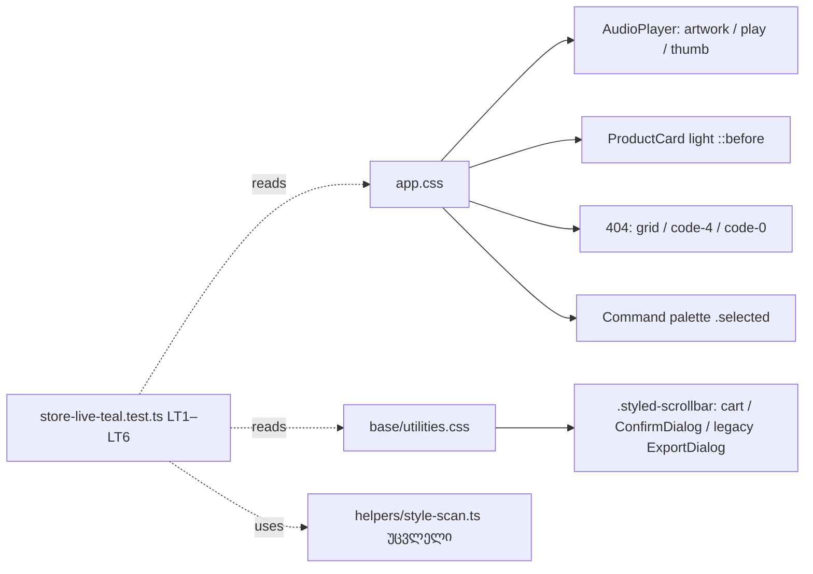

# STORE-2b-3c-1: ბოლო live teal ტოვებს Store-ის CSS-ს — global player, card light, 404, palette selection და store scrollbar

**თარიღი:** 2026-11-11
**სტატუსი:** In Progress (stage 2b-3c-1 of STORE-2b; C round 454 PASS)
**შეცვლილი პროექტი:** Store (`app/styles/app.css`, `app/styles/base/utilities.css`, ახალი ტესტი `store-live-teal.test.ts`)

## კონტექსტი

- `store-redesign-spec.md`-ის წესი 1: ერთი brass accent, teal Store-ს ტოვებს. STORE-2 რიგი: hardcoded teal-ის ჩანაცვლება და glow-ს მოშორება. Direction A (Obsidian & Brass) glow-ს არ იყენებს.
- STORE-2b-3c ორ ეტაპადაა გაყოფილი: **2b-3c-1 (ეს ეტაპი)** — ყოველი teal ან glow CSS წესი, რომელსაც mounted Store ეკრანი ჯერ კიდევ ხატავს; 2b-3c-2 — `helpers/style-scan.ts`-ის fail-open ფორმები.
- HEAD-ზე (`db641ec`) Chromium-ში გაზომილი ხუთი live ჯგუფი:
  - **Global sticky AudioPlayer** (`root.tsx` → `AudioPlayer.tsx`): artwork-ის teal halo (rest და hover), play ღილაკის `0 0 20px`/`40px` teal (rest) და `25px`/`50px` (hover), progress thumb hover-ის `0 0 12px` teal.
  - **ProductCard light** (home „Latest releases“): `.light-flicker-effect::after` teal radial; `::before`-ს 40 %-ზე teal stop ჰქონდა.
  - **404 გვერდი** (`routes/$.tsx`): grid ხაზები, `.code-4` text glow, `.code-0` გარე და inset glow.
  - **Ctrl+K palette:** მონიშნული რიგის ფონი `rgba(19,217,204,.1)`.
  - **`.styled-scrollbar`** (cart list, cart ConfirmDialog `ui/Modal`-ით, frozen legacy ExportDialog): teal thumb; პიქსელები `15,94,87` (HEAD `tealPx` 1046 @1440, 524 @1280).

## მიდგომა

`product-designer`-ის კონსულტაციის არჩევანი (უარყოფილი ვარიანტით):

- **Player:** მხოლოდ teal ფენები იშლება, მუქი offset shadow რჩება; play ღილაკს shadow აღარ აქვს და hover მხოლოდ fill-ს ცვლის (brass `#C9A46A` → `#D9B87F`). უარყოფილი: brass shadow („brass glow მაინც glow-ა“).
- **Card light:** `::after` იშლება, stagger selector-ების `::after` ნახევართან ერთად (`light-flicker-stagger`-ს TSX მომხმარებელი არ ჰყავს). უარყოფილი: brass radial.
- **`::before` teal stop** კონსულტაციამ და B-ის პირველმა ინვენტარმა გამოტოვა; B-მ sketch-ის ბრაუზერულ გაშვებაში იპოვა (`tealRows: ['cardBefore']`). 40 %-ის stop გახდა ნეიტრალური ink (`color-mix(in srgb, var(--color-foreground) 6%, transparent)`), gradient — `180deg in srgb`, რომ interpolation HEAD-ის მსგავსად sRGB დარჩეს (მაქს. 1/255 სხვაობა).
- **404:** grid ხაზები foreground ink-ია იგივე 0.03 alpha-თი (`color-mix`, raw ფერის literal-ის გარეშე); „4“ ციფრებს glow აღარ აქვს; „0“ რგოლი 4px brass border-ს ინარჩუნებს glow-ს გარეშე. უარყოფილი: brass grid (ერთ ეკრანზე ორი accent).
- **Palette:** მონიშნული რიგი `rgba(var(--color-brand-rgb), .12)` (≈ `#2B251D`), სათაურის contrast 12.2:1 (HEAD 12.39). უარყოფილი: ნეიტრალური surface token (hover-ისგან ვერ გაირჩევა).
  - დაკვირვება: hover მონიშვნას გადააადგილებს (`selectedIndex` მაუსს მიჰყვება, HEAD-ზეც), ამიტომ hover და selected ერთად არასდროს ჩანს; გაერთიანებული `:hover, .selected` წესი უცვლელია.
- **Scrollbar:** thumb `var(--color-outline-strong)` (`#736B60`, გვერდზე ≈ 3.7:1), WebKit hover-ზე `var(--color-muted)`. Chromium `scrollbar-color`-ს ხატავს (პიქსელები `115,107,96`). უარყოფილი: brass 0.4 (≈ 2.3:1, 3:1-ზე ნაკლები).
- Motion (play `scale(1.08)`, artwork `scale(1.03)`, thumb `scale(1.3)`, card hover scale, `pulse404`) უცვლელია — STORE-2c/2d-ის საკითხია.

**Dead და frozen წესები ამ ეტაპში არ შეცვლილა:**

- Dead (reachable მომხმარებლის გარეშე, 2b-3d-სთვის): `@theme` teal tokens (`--color-glow-primary`, `--color-video-sync`, `--gradient-primary`, `--gradient-hero`, `--gradient-glow`), `.hover-glow`, `.interactive-card`, `.product-detail-add-to-cart`, `.newsletter-button-large`, `.testimonial-card`, `.track-card-play-button`, `.waveform-bar`, `.track-row-waveform*`, `.loading-brand`, `.piano-key`, `.pack-card-3d`, `.about-image-overlay`, `.value-card`, `.glass-card`, `.premium-card-*`, `glow-pulse` (მხოლოდ dead `.hero-*-dot`-ს ანიმირებს) და `playButtonPulse` (მხოლოდ `.is-playing`, რომელსაც TSX არ აყენებს).
- Inline preview variant: `.audio-preview-inline-button` და მისი `audioPlayingPulse` dead-ია — ყველა გამომძახებელი `variant="overlay"`-ს გადასცემს, inline markup არასდროს რენდერდება.
- Legacy-only CSS (frozen legacy Studio): `.stems-loader-list` და `slider-thumb-teal` (`styles/studio.css`, `styles/pages/studio.css`) რჩება legacy Studio-ს წაშლამდე. Legacy ExportDialog-ის stem list საერთო `.styled-scrollbar`-ით ნეიტრალურ thumb-ს იღებს; legacy loader-ში teal `.stems-loader-list` რჩება (მიღებული შერეული მდგომარეობა).

## არქიტექტურა

## შეცვლილი ფაილები

- `app/styles/app.css` — player-ის 6 hunk, `.light-flicker-effect::after` ბლოკის და stale კომენტარის წაშლა, 6 stagger selector, `::before` 40 % stop, `.not-found-grid`, `.code-4`, `.code-0`, `.command-palette-item.selected`. obsidian ბლოკი byte-identical.
- `app/styles/base/utilities.css` — `.styled-scrollbar` კომენტარი, `scrollbar-color` და ორი thumb ფონი.
- `app/lib/__tests__/store-live-teal.test.ts` (ახალი, node) — LT1–LT6, `helpers/style-scan.ts` უცვლელად.
- ეს დოკუმენტი.

## პრობლემები და გადაწყვეტები

- **პრობლემა:** პირველმა ინვენტარმა მრავალხაზიანი selector-ები და `::before`-ის teal stop გამოტოვა. **გადაწყვეტა:** ინვენტარი თავიდან აიწყო (multi-line selectors, keyframes, compound კლასები, reachability routes-იდან), `::before` stop კი ბრაუზერულმა probe-მა იპოვა.
- **პრობლემა (`tech-lead` M1):** teal შეიძლებოდა token-ით (`var(--color-glow-primary)`) ან 8-ციფრიანი hex-ით დაბრუნებულიყო. **გადაწყვეტა:** LT6 — token-ის წაკითხვა მხოლოდ ორ dead წესშია ნებადართული, alpha-suffix teal hex 0-ია.
- **პრობლემა (`tech-lead` M2):** count-neutral swap (dead ხაზის მოშორება და live წესში teal-ის დამატება) მწვანე რჩებოდა. **გადაწყვეტა:** LT5 ყოველ teal ხაზს მის top-level header-ს უკავშირებს ზუსტი allow-list-ით; LT1 pinned header-ების რაოდენობასაც ამოწმებს.
- **პრობლემა:** gradient-ის interpolation `color-mix`-ით შეიძლებოდა შეცვლილიყო. **გადაწყვეტა:** `180deg in srgb`.

## ტესტირება

- **LT1:** 12 live ბლოკი ზუსტად ერთხელ, teal-free literal-ად; pinned header-ების რაოდენობა.
- **LT2:** `.light-flicker-effect::after` აღარ არსებობს; `::before` ნეიტრალური literal-ია `light-flicker-on` ანიმაციით.
- **LT3:** teal მხოლოდ allow-listed ფაილებში, ზუსტი რაოდენობით: `app.css` 37, `utilities.css` 6, `studio.css` 4, `pages/studio.css` 4.
- **LT4:** non-vacuous scan და matcher-ის self-tests მოშორებულ ფორმებზე, brass negative-ით.
- **LT5:** ყოველი დარჩენილი teal ხაზი allow-listed dead ან frozen top-level header-ის ქვეშაა (23 header).
- **LT6:** teal token-ების წაკითხვა და alpha-suffix teal hex.
- A-ს გაშვებული შემოწმებები: covering set 14 ფაილი / 134 ტესტი PASS; `npm run typecheck` rc 0; `npm run lint` rc 0 (205 warning, HEAD-ის ტოლი); scoped Biome სუფთა (მხოლოდ ტესტ-ფაილზე; Biome CSS-ს აქ არ ამოწმებს); 27 mutant-ის შედეგი B-ის `mutants.txt`-ის ტოლი.
- ბრაუზერი (Chromium, 1440×900 და 1280×720): teal probe `ROWS 19 ALL_OK True`, extras probe `ROWS 8 ALL_OK True`, scrollbar პიქსელები `tealPx` 0, ნაცრისფერი thumb `115,107,96`, geometry HEAD-ის ტოლი; `/studio-lab` digest HEAD-ის ტოლი.
- Mutants, probes და inventory ლუპის არტეფაქტებია და რეპოში არ არის.
- ღრუბელში ვერ მოწმდება: Firefox `scrollbar-color` და Safari WebKit thumb hover (Tech Lead რიგი TLM-R454-FIREFOX-SAFARI-SCROLLBAR); signed-in legacy ExportDialog — backend მიუწვდომელია.

## TODO / შემდეგი ნაბიჯები

- 2b-3c-2: `helpers/style-scan.ts`-ის fail-open ფორმები და GS ტესტების ხარვეზები.
- 2b-3d: dead tokens და წესები (ზემოთ ჩამოთვლილი), CinemaCurtainLoader, dead allow-lists.
- code-reviewer-ის შენიშვნა B-სთვის: LT3/LT5/LT6 dead წესების „სიკვდილს“ (mounted მომხმარებლის არქონას) არ ამოწმებს; `.code-4`-ის pin განუსაზღვრელ `--color-text-primary` token-ს კითხულობს (ძველი ხარვეზი).
- 2b-4.
- STORE-2c/2d: motion (play, artwork, thumb და card hover scale, `pulse404`).
- STORE-5: stale design docs (`DESIGN_TOKENS.md`-ის glow/teal ხაზები).
- Legacy Studio-ს წაშლა: `.stems-loader-list`, `slider-thumb-teal`.
