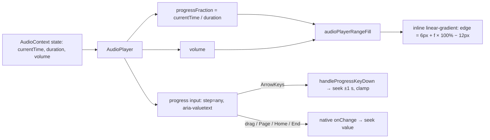

# SABA-B-14: Store player-ის seek thumb brass fill-ის კიდეზე რჩება

**თარიღი:** 2026-11-11
**სტატუსი:** Completed (C round 455 PASS)
**შეცვლილი პროექტი:** Store (`app/components/audio/AudioPlayer.tsx`, ტესტი `app/lib/__tests__/audio-preview-player.test.tsx`)

## კონტექსტი

- საბამ 2026-11-11-ს შენიშნა: Store-ის sticky audio player-ზე თეთრი seek thumb დაკვრისას brass progress fill-ს წინ უსწრებს. ისინი ერთად უნდა მოძრაობდნენ. Severity: **Medium** (საბამ თავად ნახა, bug gate 2026-10-23).
- B-მ HEAD-ზე (`2e26962`) რეალურ Chromium-ში გაზომა (`/products/pulse-loop-kit`, mock API, 150 s preview, track 464 px, 10 გაჩერებული წერტილი 0.4 s … 149.6 s): track-ის დასაწყისში thumb fill-ს 4–7 px-ით უსწრებს, ბოლოსთან 4–5 px-ით ჩამორჩება. მაქსიმალური სხვაობა ორივე viewport-ზე (1440×900 და 1280×720) **7 px**-ია.
- გაზომილი ორი მიზეზი:
  1. **მთელ წამებზე snapping.** progress `<input type="range">`-ს `step` არ ჰქონდა, ამიტომ default step 1 მოქმედებდა. მისი value, ანუ thumb, მთელ წამზე ხტებოდა (currentTime 3.6 → value 4), ხოლო gradient fill ზუსტ წილად დროს იყენებდა.
  2. **Thumb-ის inset.** 12 px thumb-ის ცენტრი 6 px-დან `width − 6 px`-მდე მოძრაობს, fill-ის stop კი 0-დან 100 %-მდე.
- root-ის ვარაუდი („CSS transition-ის დაყოვნება“) მიზეზი არ არის: fill inline gradient-ია transition-ის გარეშე და thumb-თან ერთ render-ში ახლდება.
- იგივე player-ის volume slider-ს იგივე inset აქვს (snapping არა, `step="0.01"` აქვს): HEAD-ზე 5 px სხვაობა.

## მიდგომა

- **Fill helper.** ახალი exported ფუნქცია `audioPlayerRangeFill(fraction)` fill-ის კიდეს thumb-ის ცენტრზე ათავსებს: `calc(6px + f * (100% - 12px))`. fraction იჭრება 0..1-ზე, non-finite მნიშვნელობა 0-ად იწერება. ზომა `AUDIO_PLAYER_THUMB_PX = 12` app.css-ის thumb-ის სიგანეს ემთხვევა (ST8 ამას ამოწმებს). ორივე range (progress და volume) ამ helper-ს იყენებს.
- **`step="any"`** progress range-ზე: thumb წილად დროს მიჰყვება და 1 s-იანი ნახტომები ქრება.
- **კლავიატურის წესი.** `step="any"`-ით native arrow range-ის 1 %-ს გადაადგილდება. ამიტომ `handleProgressKeyDown` ArrowLeft/Right/Up/Down-ს ნებისმიერი modifier-ით (Shift, Alt, Ctrl, Meta) თავად ამუშავებს: ±1 s ზუსტი დროიდან (10.4 → 11.4; HEAD 10.4 → 11 იყო), clamp 0-ზე და duration-ზე. Modifier-ები შედის, რადგან B-ის პირველმა sketch-მა ისინი გამორიცხა და Alt/Ctrl/Meta-ზე +1.5 s გაზომა, HEAD-ის +1 s-თან შედარებით რეგრესია. PageUp/PageDown (10 %), Home და End native რჩება. Alt+ArrowLeft history-ში უკან არ გადადის (HEAD-ის მსგავსად).
- **Volume fill-ის წესი.** volume slider-ის fill-ის კიდე, დიზაინით, 6 px-მდე იძვრება, რომ ისიც thumb-ის ცენტრზე დასრულდეს. ეს ერთადერთი ვიზუალური ცვლილებაა progress bar-ის გარეთ.
- **`aria-valuetext`** = `m:ss of m:ss`. მის გარეშე screen reader წილად value-ს წაიკითხავდა (მაგ. „10.4“). წყარო: WAI-ARIA APG „Media Seek Slider Example“. გადახრა: APG-ის Page step 15 step-ია, ჩვენთან native 10 % რჩება, რადგან ეს რაუნდი ვიზუალურ desync-ს ასწორებს და keyboard step-ებს არ ცვლის.
- **განხილული ალტერნატივა:** thumb CSS-ის შეცვლა (app.css). უარყოფილია: app.css ამ რაუნდის grant-ში არ შედის და thumb-ის ზომა უცვლელი რჩება.

## არქიტექტურა

## შეცვლილი ფაილები

- `app/components/audio/AudioPlayer.tsx` — `AUDIO_PLAYER_THUMB_PX`, `AUDIO_PLAYER_KEY_STEP_SECONDS`, exported `audioPlayerRangeFill`, `progressFraction`, `handleProgressKeyDown`; progress input-ზე `step="any"`, `onKeyDown`, `aria-valuetext`; ორივე input helper-ს იყენებს.
- `app/lib/__tests__/audio-preview-player.test.tsx` — K1 `_REGRESSION` assertion calc ფორმაზე გადავიდა (brand token და fraction იგივე რჩება, assertion არ დაკარგულა); ახალი describe „the seek thumb stays on the brass fill edge (SABA-B-14)“.
- `docs/implementation/2026/quarter-IV/298-saba-b-14-store-seek-thumb.md` — ეს დოკუმენტი.

## პრობლემები და გადაწყვეტები

- **პრობლემა:** `step="any"` native arrow-ს 1 %-იან ნაბიჯად აქცევს (150 s-ზე 1.5 s). **გადაწყვეტა:** arrow-ები ყველა modifier-ით handler-ში ±1 s-ით მუშავდება.
- **პრობლემა:** წილადი value screen reader-ისთვის უხერხულია. **გადაწყვეტა:** `aria-valuetext` დროის ფორმატით.
- **პრობლემა:** volume slider-ს იგივე inset ჰქონდა. **გადაწყვეტა:** იგივე helper.
- **Why we missed it:** STORE-1b-ის (რაუნდი 187) B spec-ში fill-ის ფერი შემოწმდა ერთ still screenshot-ზე, მაგრამ fill-ის კიდისა და thumb-ის შედარების row და range-ის `step`-ის შემოწმება არ იყო. 1 s snapping მხოლოდ დაკვრისას ჩანს, inset კი მხოლოდ შუიდან მოშორებით. წესი: loop-ის საქაღალდის (repo-ს გარეთ, `tmp/studio-real-loop/`) `lessons.md` L61-ს დაემატა „painted range fill“ clause.

## ტესტირება

- Unit ტესტები (`audio-preview-player.test.tsx`):
  - **ST1** — progress range-ს `step="any"` აქვს.
  - **ST2** — fill-ის კიდე thumb-ის ცენტრზეა ყოველი fraction-ისთვის და clamp-დება.
  - **ST3** — ArrowRight/Up და ArrowLeft/Down ზუსტი დროიდან ±1 s-ით seek-ავს.
  - **ST3b** — Shift+Arrow ჩვეულებრივი arrow-ს მსგავსად 1 s-ს seek-ავს.
  - **ST3c** — drag change ზუსტ წილად value-ზე seek-ავს.
  - **ST4** — arrow seek clamp-დება 0-ზე და duration-ზე.
  - **ST5** — Alt/Ctrl/Meta+ArrowRight +1 s-ს seek-ავს; PageUp, PageDown, Home და End handler-ში არ მუშავდება.
  - **ST6** — პოზიცია `time of duration` ფორმით ცხადდება.
  - **ST7** — volume fill იგივე thumb-ცენტრირებულ კიდეს იყენებს.
  - **ST8** — app.css-ის ყოველი player range thumb 12 px სიგანისაა, fill-ის offset-ის შესაბამისად.
- HEAD-ის `AudioPlayer.tsx`-ზე (`2e26962`) ახალი ტესტების გაშვებით გაზომილი: 9 წითელი (K1, ST1, ST2, ST3, ST3b, ST4, ST5, ST6, ST7), ხოლო ST3c და ST8 HEAD-ზეც მწვანეა. ეს ორი guard ტესტია: ST3c-ს mutant M12 აწითლებს, ST8-ს — M10. jsdom range-ის value-ს step-ზე არ ამრგვალებს, ამიტომ 1 s snapping-ის რეალური მტკიცებულება ბრაუზერის probe-ია.
- Mutation-ები: B-ის `run-mutants.sh` (BASE მწვანე, M1–M13 წითელი).
- ბრაუზერი (Chromium, Playwright): `seek-probe.mjs` 1440×900 და 1280×720-ზე, `key-probe.mjs`. სკრიპტები, შედეგები და log-ები loop-ის საქაღალდეშია (repo-ს გარეთ, `tmp/studio-real-loop/`, `a-round-455.md`); დამოუკიდებელ შემოწმებას C ატარებს.
- **Tech Lead row TLM-R455-FIREFOX-SEEK-THUMB:** Firefox-ში `step="any"` და `::-moz-range-thumb`-ის inset cloud-ში ვერ იზომება (`tech-lead`-ის მსჯელობა, გაზომილი არ არის). Deadline: RETRO 465.

## TODO / შემდეგი ნაბიჯები

- TLM-R455-FIREFOX-SEEK-THUMB — Firefox-ში ხელით შემოწმება (Tech Lead).
- SABA-B-13 — Store-ის entrance animation-ის მინიმალური ჩვენების დრო (ცალკე რაუნდი).
