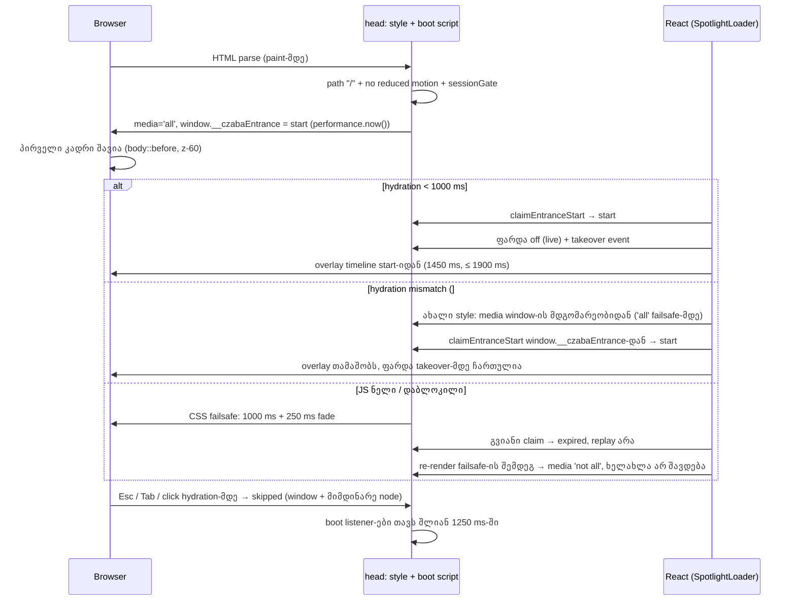

# SABA-B-13: Store-ის შესასვლელი პირველივე კადრიდან შავია და სრულად თამაშობს

**თარიღი:** 2026-11-12
**სტატუსი:** Completed (C round 461 PASS)
**შეცვლილი პროექტი:** Store (`app/components/loading/EntranceCover.tsx`, `app/components/loading/SpotlightLoader.tsx`, `app/root.tsx`, `app/lib/__tests__/store-entrance-loader.test.tsx`)

## კონტექსტი

- Saba-მ (2026-11-11) შენიშნა, რომ Store-ის შესასვლელი ანიმაცია hard refresh-ზეც (Ctrl+F5, ცარიელი cache) ძალიან სწრაფად სრულდება: „ციმციმებს“ და ბოლომდე არ თამაშობს. მან მოითხოვა მინიმალური ჩვენების დრო (1.2–1.5 წმ). ეს Medium-ია, რადგან Saba-მ თავად დაინახა (bug gate 2026-10-23).
- B-მ HEAD `891dc0f` გაზომა production build-ზე, რეალურ Chromium-ში, mock API-ით (`b-round-458/probe/frames.mjs`, `entrance-timing.mjs`):
  - **პრობლემა paint-ის თანმიმდევრობაა და არა მხოლოდ სიგრძე.** გვერდი ჯერ იხატება, შავი overlay კი hydration-ის შემდეგ ჩნდება: 1× CPU-ზე 140–170 ms-ით, 4× CPU-ზე 330–380 ms-ით გვიან. პირველი დახატული კადრის luminance 13.4-ია (გვერდის ფონი და header).
  - K12 (HEAD `fresh`): 1440/cpu1 fp 200, firstCov 260, logo 433, tag 166; 1440/cpu4 fp 244, firstCov 603, logo 446, tag 138; 1280/cpu1 fp 208, firstCov 263, logo 433, tag 166; 1280/cpu4 fp 148, firstCov 689, logo 438, tag 172.
  - overlay ჩანს დაახლოებით 1.16–1.21 წმ. ლოგო სრულად ჩანს 433–446 ms, ტექსტი „Cinematic Sound Design“ — მხოლოდ 138–172 ms.
  - timeline timer-ზე იყო დამოკიდებული (`SPOTLIGHT_ENTRANCE_TOTAL_MS = 1150`), tab-ზე ერთხელ თამაშობდა (`czaba_entrance_seen`), `EntranceCover` მოდული არ არსებობდა.
- **Round 460 (C-R459-01 / A-R459-REVIEW-R1, Medium):** round 459-ის პირველი ვერსია hydration mismatch-ზე (React #418, მაგ. browser extension-ი, რომელიც hydration-მდე `<body>`-ში node-ს ჩასვამს) ანიმაციას საერთოდ ვეღარ აჩვენებდა, HEAD კი აჩვენებდა. B-ის Chromium-ის გაზომვა (`b-round-459/probe/r1-repro.mjs ... inject`): HEAD 3/3, v1 0/3, ახალი ვერსია 3/3 overlay.
- Route-ის შიგნით ფარდა ვერ იმუშავებდა: route content `PageTransition`-შია, რომელიც სერვერზე `opacity: 0`-ით რენდერდება. B-ის პირველმა route-local ესკიზმა header მაინც ~45 ms-ით აჩვენა ფარდამდე.

## მიდგომა

- **ფარდა `<head>`-შია.** `EntranceCoverHead` რენდერავს `<style media="not all">`-ს (`body::before` შავი ფენა, z-index 60) და პატარა boot script-ს. script პირველ paint-მდე ეშვება: მხოლოდ `/`-ზე, reduced motion-ის გარეშე და tab-ზე ერთხელ (`sessionGate`) რთავს ფარდას (`media='all'`), იმახსოვრებს start-ს (`performance.now()`; round 460-დან `window.__czabaEntrance`-ში, `data-start` ატრიბუტს კოდი აღარ კითხულობს, რჩება probe-ებისა და E2-ისთვის) და ამატებს capture keydown/click skip listener-ებს.
- **Hydration-ის შემდეგ** `SpotlightLoader`-ის `claimEntranceStart` ცოცხალი ფარდის start-ს იღებს და timer-ებს აბსოლუტური start-იდან აწყობს. 1000 ms-ის შემდეგ ან start-ის გარეშე ფარდას `expired`-ად აუქმებს. ფარდის გარეშე HEAD-ის session claim-ზე გადადის. React-ის skip listener-ები ჯერ ემატება, შემდეგ ან მოლოდინში მყოფ `skipped`-ს პატივს სცემს, ან ფარდას თიშავს (`live`) და `czaba-entrance-takeover` event-ს აგზავნის, რომელიც boot listener-ებს შლის.
- **Clock:** start არის boot script-ის `performance.now()`. C ხანგრძლივობას პირველი დაფარული rAF sample-იდან ზომავს. მინიმუმი 1450 ms (`ENTRANCE_MIN_TOTAL_MS`), კოდის ზედა ზღვარი 1900 ms (`ENTRANCE_MAX_TOTAL_MS`), exit fade 250 ms.
- **Failsafe:** თუ JS ნელია ან დაბლოკილი, შავი ფარდა მხოლოდ CSS-ით ქრება 1.0 წმ-ის შემდეგ, 250 ms fade-ით. გვიანი hydration ანიმაციას აღარ იმეორებს.
- **Skip:** Esc, Tab (focus მაინც გადადის) ან click ნებისმიერ დროს, hydration-მდეც. ფარდაზე click ქვემოთ მდებარე გვერდს არ აღწევს (ეს მხოლოდ ბრაუზერში მოწმდება, C-ის C9 რიგით; jsdom ვერ ამოწმებს).
- **Window handshake (round 460):** boot script ფარდის მდგომარეობას `window.__czabaEntrance`-ში ინახავს (`{start, state}`, ტიპი `EntranceHandshake`). ეს React-ის მფლობელობაში მყოფი node-ის გარეთაა, ამიტომ document-ის client re-render-ს გადაურჩება. საწყისი მნიშვნელობა მოლოდინის მდგომარეობაა; შემდეგ `skipped`, `live` ან `expired`. `claimEntranceStart` ჯერ window-ის მდგომარეობას კითხულობს: მოლოდინში და failsafe-მდე → მისი `start`; სხვა შემთხვევაში → `expired` და takeover event. ცოცხალი ფარდა handshake-ის გარეშე უქმდება (E13), დანარჩენ შემთხვევაში HEAD-ის session claim რჩება. skip handler ფარდის node-ს გამოძახების მომენტში ეძებს, ამიტომ re-render-ით ჩანაცვლებულ `<style>`-საც თიშავს.
- **ფარდის `media`-ს გამოთვლა render-ისას:** `EntranceCoverHead` `media`-ს window-ის მდგომარეობიდან ითვლის: `'all'` მხოლოდ მაშინ, როცა მდგომარეობა მოლოდინშია და `ENTRANCE_FAILSAFE_MS` (1000 ms) ჯერ არ გასულა, სხვა შემთხვევაში `'not all'`. სერვერი ყოველთვის `'not all'`-ს რენდერავს (E1); ჩვეულებრივ hydration-ზე React ატრიბუტს არ ასწორებს (`suppressHydrationWarning`), ამიტომ DOM boot script-ის `'all'`-ს ინარჩუნებს. re-render-ის შემდეგ ახალი `<style>` ფარდას takeover-მდე ჩართულს ტოვებს, ასე რომ overlay-მდე გვერდის კადრი არ ჩანს. დროის ზღვარი (TL-R460-1) იცავს: failsafe-ის შემდეგ re-render ხილულ გვერდს ხელახლა არ აშავებს (E19). React-ის reference: `https://react.dev/reference/react-dom/client/hydrateRoot` (Caveats: ატრიბუტების სხვაობა mismatch-ზე არ სწორდება). style-ის ჩანაცვლება B-ის ბრაუზერის დაკვირვებაა, არა დოკუმენტირებული ფაქტი.
- **Boot listener-ების self-timeout:** boot keydown/click listener-ები თავს შლიან ფარდის start-იდან 1250 ms-ში (failsafe 1000 + fade 250), მაშინაც თუ takeover საერთოდ არ მოხდა (A-R459-REVIEW-R2; E18).
- **Reload და reduced motion:** იმავე tab-ში reload-ზე (Ctrl+F5-ის ჩათვლით) და reduced motion-ზე შავი კადრი საერთოდ არ ჩანს; tab-ზე ერთხელ რჩება (SABA-Q-ENTRANCE-RELOAD default (a)).
- **`app/root.tsx`-ის narrow grant:** `root.tsx` global_forbidden-ია, მაგრამ ფარდა `<head>`-ში უნდა იყოს. ამიტომ ზუსტად 2 ხაზი დაემატა: `EntranceCoverHead`-ის import და `<EntranceCoverHead />` პირდაპირ `<Links />`-ის შემდეგ. სხვა არაფერი შეცვლილა (precedent: round 201, D-29z166; `tech-lead`-მა დაადასტურა, რომ ეს უმცირესი არჩევანია).
- **Tailwind-ის გამონაკლისი:** `ENTRANCE_COVER_CSS` string-ია, რადგან hydration-მდე `body::before` React-ის node-ზე utility class ვერ იქნება, ხოლო `app/styles/**` grant-ში არ შედის. ფერი theme ცვლადია (`var(--color-black)`), რომელიც გამოიცემა, რადგან `SpotlightLoader` `bg-black`-ს იყენებს. Biome-ს 2 ახალი `noDangerouslySetInnerHtml` warning აქვს (სტატიკური string-ები, user input არ არის); lint 205-დან 207 warning-მდე.
- **Reference — Android 12+ SplashScreen** (`https://developer.android.com/develop/ui/views/launch/splash-screen`, წაკითხულია 2026-11-12): ფარდა გაუმჭვირვალე ერთ ფერია პირველივე კადრიდან; მოძრაობა ადვილად გამოსატოვებელია; დარჩენილი დრო ანიმაციის start-იდან ითვლება; დაუმთავრებელი ინტერფეისი არ ჩანს. **გადახრა:** Android ხატულის ანიმაციისთვის გვირჩევს „not exceeding 1,000 ms“, ჩვენთან მინიმუმი 1.45 წმ-ია — Saba-ს გადაწყვეტილება (2026-11-11) perceived value-ისთვის.
- **უარყოფილი ალტერნატივები** (`product-designer`): hydration-იდან დაწყებული clock (მომხმარებელი პირველი paint-იდან შავს ხედავს) და სტატიკური wordmark ფარდაზე hydration-მდე (ლოგო ორჯერ გამოჩნდებოდა; ვიზუალის ცვლილება Saba-ს სჭირდება).
- ანიმაციის იერი უცვლელია, გარდა იმისა, რომ ფაზები გრძელია და `dark` ფაზა აღარ არის (სტატიკური ფარდა თავადაა dark ფაზა). ტექსტი, პოზიციები და keep-list არ შეცვლილა.

## არქიტექტურა

## შეცვლილი ფაილები

- `app/components/loading/EntranceCover.tsx` (ახალი) — ფარდის კონსტანტები, `ENTRANCE_COVER_CSS`, `ENTRANCE_BOOT_SCRIPT`, `EntranceCoverHead`; round 460-ში `EntranceHandshakeState`, `EntranceHandshake`, `Window.__czabaEntrance` global, window-ზე დაფუძნებული skip handler, listener-ების self-timeout და დროით შეზღუდული `media`.
- `app/components/loading/SpotlightLoader.tsx` — `entranceTimeline` (phase-ების სუფთა მათემატიკა), `claimEntranceStart` და start-იდან დაწყობილი timer-ები; `dark` ფაზა მოიხსნა. round 460: `claimEntranceStart` window handshake-ს კითხულობს, `syncEntranceCover` მდგომარეობას მიმდინარე node-ზე ასახავს (probe-ებისთვის), hand-off window-ის მდგომარეობას კითხულობს.
- `app/root.tsx` — 2 ხაზი (import და `<EntranceCoverHead />` `<Links />`-ის შემდეგ).
- `app/lib/__tests__/store-entrance-loader.test.tsx` — L1–L11 (L3 1450/1900-ზე, L1 console spy, L9 დამატებითი `TOTAL` ნაბიჯი) და ახალი describe „SABA-B-13 static head cover and takeover“; round 460: window global-ის reset ორივე describe-ში, helper-ები `reinsertCoverHeadHtml`, `watchOverlayMounts`, `trackBootCaptureListeners`, E8/E16 ამოწმებს, რომ overlay არ mount-დება, და ახალი E15–E19.
- `docs/implementation/2026/quarter-IV/300-saba-b-13-store-entrance-cover.md` — ეს დოკუმენტი.

## პრობლემები და გადაწყვეტები

- **პრობლემა:** overlay hydration-ის შემდეგ ჩნდებოდა, ამიტომ პირველი კადრი გვერდს აჩვენებდა. **გადაწყვეტა:** სტატიკური ფარდა `<head>`-ში, რომელიც paint-მდე ირთვება.
- **პრობლემა:** route-ის შიგნით ფარდა `PageTransition`-ის `opacity: 0`-ის ქვეშ უჩინარი იყო, body-ში ჩასმული script-ი კი header-ს ~45 ms-ით აჩვენებდა. **გადაწყვეტა:** root-ის narrow grant (2 ხაზი).
- **პრობლემა:** mount-ზე დაფუძნებული timer ხანგრძლივობას hydration-ის გვიანობით ამოკლებდა. **გადაწყვეტა:** timer-ები boot script-ის start-იდან ითვლება (round 460-დან window handshake-იდან).
- **პრობლემა:** თუ boot script-მა ფარდა ჩართო, მაგრამ bundle ნელია ან ვერ ჩაიტვირთა, ფარდა სამუდამოდ დარჩებოდა (JS-ის სრულად გამორთვისას boot script ფარდას საერთოდ არ რთავს). **გადაწყვეტა:** მხოლოდ CSS failsafe 1000 ms-ზე; React-ის გვიანი claim ფარდას `expired`-ად აუქმებს და ანიმაციას არ იმეორებს.

- **პრობლემა (round 460, C-R459-01):** React #418-ის შემდეგ document-ის client re-render ცვლიდა React-ის `<style>`-ს; v1-ის handshake ამ node-ის ატრიბუტებში იყო და იკარგებოდა: ახალი style `media="not all"`-ით ბრუნდებოდა `data-start`-ის გარეშე, `czaba_entrance_seen` უკვე დაყენებული იყო და session fallback უარს ამბობდა, takeover event არ იგზავნებოდა, ამიტომ boot listener-ები tab-ის სიცოცხლის ბოლომდე რჩებოდა. **გადაწყვეტა:** handshake `window`-ზე, დროით შეზღუდული `media` და listener-ების self-timeout.
- **პრობლემა (TL-R460-1, Medium, `tech-lead` review 1):** ნელი JS + #418-ზე მოლოდინის ძველი მდგომარეობა ახალ style-ს `'all'`-ით აბრუნებდა და failsafe-ის შემდეგ ხილულ გვერდს ხელახლა აშავებდა. **გადაწყვეტა:** `media` შეზღუდულია `ENTRANCE_FAILSAFE_MS`-ით; ტესტი E19.
- **პრობლემა (TL-R460-2, Low):** failsafe-ის შემდეგ Chromium probe არ არსებობდა. **გადაწყვეტა:** probe-ის რეჟიმი `delayinject` (C13 რიგი; release-მდე უნდა გაიაროს).
- **პრობლემა (TL-R460-3, Low):** ტესტის helper-ის სახელი React-ის hydration ქცევის მტკიცებულებად იკითხებოდა. **გადაწყვეტა:** სახელი `reinsertCoverHeadHtml`.
- **პრობლემა (v2a-ის ხარვეზი):** პირველ ფიქსში ფარდა re-render-ზე overlay-ის mount-მდე ~40–80 ms-ით ქრებოდა. **გადაწყვეტა:** v2c — დროით შეზღუდული `media`, რომელიც ფარდას takeover-მდე ჩართულს ტოვებს.

### Why we missed it

STORE-1d-ის (doc 156, spec D10) რიგები jsdom-ის timer-ებით, mount-იდან იზომებოდა („at most 1200 ms“) და ბრაუზერში მხოლოდ overlay-ის გამოჩენა მოწმდებოდა. არცერთი რიგი არ უყურებდა, რას აჩვენებს production build-ის პირველი დახატული კადრები; D10-მა სიგრძეს ზედა ზღვარი დაუწესა და არა მინიმუმი. წესი: L18-ს დაემატა „first painted frame“ პუნქტი — ნებისმიერი timed entrance, splash ან overlay იზომება production build-ის პირველი დახატული კადრიდან, frame მტკიცებულებით 1× და 4× CPU-ზე.

**Round 460:** B-ის ესკიზმა და მისმა ორმა `tech-lead` review-მ document re-render (hydration-ის შეცდომის შემდეგ) არ განიხილეს; სცენარების სიაში იყო პირველი paint, failsafe, გვიანი hydration და skip, მაგრამ არა React 18-ის `hydrateRoot(document)` client render. წესი retro input-ად ჩაიწერა (RETRO465-B-PREHYDRATION-HANDSHAKE): hydration-მდე DOM handshake თავის მდგომარეობას React-ის node-ების გარეთ ინახავს და აქვს ბრაუზერის რიგი ჩასმული node-ის mismatch-ით და ნელი JS + mismatch-ით.

## ტესტირება

- `app/lib/__tests__/store-entrance-loader.test.tsx`:
  - L1–L11 — არსებული ქცევა; L3 ახლა ამოწმებს 1450 ms მინიმუმს და 1900 ms ზღვარს.
  - E1 — სერვერი რენდერავს გამორთულ cover style-ს და boot script-ს.
  - E2 — ახალ tab-ზე `/`-ზე boot script რთავს ფარდას და session-ს იჭერს.
  - E3 (`it.each`) — seen tab, reduced motion და სხვა path ფარდას არ რთავს.
  - E4 — დაბლოკილი storage ფარდას გამორთულს ტოვებს და არ აგდებს.
  - E5 — animated overlay მართვას იღებს და ფარდას თიშავს (overlay ჯერ commit-დება, ფარდა passive effect-ში ითიშება).
  - E6 — timeline პირველი cover კადრიდან ითვლება: 1450 ms მინიმუმი, 1900 ms ზღვარი.
  - E7 — failsafe-ის შემდეგ takeover ანიმაციას არ იმეორებს.
  - E8 (`it.each`) — Escape, Tab და click hydration-მდე გამოტოვებს; E8b — სხვა კლავიშები ფარდას ტოვებს.
  - E9 — takeover-ის შემდეგ boot listener-ები აღარ არის და skip-ს overlay ფლობს.
  - E10 — უკვე ნანახი entrance-ის შემდეგ client navigation `/`-ზე არაფერს აჩვენებს.
  - E11 — root layout ფარდას stylesheet link-ების შემდეგ რენდერავს.
  - E12 — ახალ tab-ზე client navigation `/`-ზე მაინც თამაშობს, როგორც HEAD-ზე.
  - E13 — start-ის გარეშე ჩართული ფარდა უქმდება და არ ანიმირდება.
  - E14 — click claim-სა და hand-off-ს შორის animated overlay-საც გამოტოვებს.
  - E15 — client re-render, რომელიც cover style-ს ცვლის, ანიმაციას მაინც უკრავს, ფარდას takeover-მდე ჩართულს ტოვებს და boot listener-ებს ათავისუფლებს.
  - E16 — skip style-ის ჩანაცვლების შემდეგ ახალ style-ს თიშავს და entrance-ს გამოტოვებს (overlay არ mount-დება).
  - E17 — failsafe-ის შემდეგ takeover boot listener-ებს ათავისუფლებს.
  - E18 — takeover-ის გარეშე boot listener-ები თავს შლიან failsafe fade-ის შემდეგ.
  - E19 — failsafe-ის შემდეგ re-render ხილულ გვერდზე ფარდას გამორთულს ტოვებს (999/1000 ms ზღვარი).
- covering set (`b-round-458/covering-459.txt`), mutants (`b-round-458/mutants.py`, M1–M19 წითელი) და A-ს production-ის frame probe — იხ. `a-round-459.md`. C-ის ბრაუზერის მატრიცა (C5–C12) — `c-round-459`.
- Round 460: covering set `b-round-459/covering-460.txt` (11 ფაილი / 206 ტესტი), mutants `b-round-459/mutants.py` (BASE მწვანე, M1–M27 წითელი), A-ს შემოწმება — `a-round-460.md`; C-ის მატრიცა (C5–C13, R1 re-render და ნელი JS + re-render) — `c-round-460`.
- **C6-ის წესი (C-R459-02):** 4× CPU-ზე hydration გვიანდება და 1900 ms ზღვარი ლოგოს ფაზას ამოკლებს. Saba-ს მოთხოვნა მინიმალური ჯამური დროა და ორივე CPU-ზე სრულდება. ამიტომ CPU 1-ზე logo ≥ 600 ms და tag ≥ 400 ms სავალდებულოა (`fresh`, `clientnav`, `arrive`), CPU 4-ზე კი სავალდებულოა ჯამური ხანგრძლივობა, ხოლო logo/tag მხოლოდ ჩაიწერება (> 0). ზღვარი არ შეცვლილა.
- **C9-ის წესი (C-R459-03):** skip-ის დაყოვნება ახლა იზომება როგორც removed − input, სადაც input არის პირველი trusted click/keydown-ის `timeStamp` (`removedMinusInput`): ≤ 200 ms CPU 1-ზე, ≤ 400 ms CPU 4-ზე. removed − `firstCovered` მხოლოდ ჩაიწერება.
- **Round 461 (test hardening, A-R460-REVIEW-1/-6/-7):** იმავე ფაილში დაემატა რეალური React `hydrateRoot` რიგები helper-ით `hydrateHeadCover`, რომელიც head-ს სერვერზე რენდერავს, boot script-ს უშვებს, საათს აგრძელებს და `hydrateRoot(document.head, <EntranceCoverHead />)`-ს `act`-ში ასრულებს; root `afterEach`-ში unmount-დება.
  - E1b — handshake-ის მოლოდინის მდგომარეობაში jsdom-ში style `media="all"`-ია, ხოლო სერვერულ render-ზე (`window` = `undefined`) — `media="not all"` (A-R460-REVIEW-7).
  - E9 — გაძლიერდა: takeover-მდე boot capture listener-ები 2-ია და window takeover listener 1, takeover-ის შემდეგ ორივე 0 (A-R460-REVIEW-6).
  - E21 — სუფთა hydration 160 ms-ზე: 0 recoverable error, 0 `console.error`, იგივე node `media="all"`-ით და `data-start` handshake-ის start-ის ტოლია (A-R460-REVIEW-1, ნაწილი b).
  - E21b — **React tripwire**: სუფთა hydration failsafe-ის დროს იგივე node-ს `media="all"`-ით ტოვებს. source mutant მას ვერ აწითლებს; წითლდება მხოლოდ თუ React hydrated attribute-ების patch-ს დაიწყებს.
  - E20 — mismatch 160 ms-ზე: recoverable error-ები > 0, სერვერის node ახალი style-ით იცვლება (`data-start`-ის გარეშე), ახალი style `media="all"`-ია და handshake ისევ მოლოდინშია; შემდეგ `SpotlightLoader` takeover-ს იღებს და style `not all` ხდება (A-R460-REVIEW-1, ნაწილი a).
  - E20b — mismatch failsafe-ის დროს ჩანაცვლებულ style-ს `not all`-ით რენდერავს, handshake კი მოლოდინში რჩება.
  - E21/E21b E20/E20b-ზე ადრე სრულდება: React-ის dev build hydration warning-ს მოდულზე ერთხელ ბეჭდავს, ამიტომ წინ გაშვებული mismatch რიგი E21-ის `console.error` assert-ს ცარიელს გახდიდა.
  - **production-თან სამი განსხვავება** (`tech-lead`, `b-round-460/sketch-review.md`, review 1, finding 2): production `hydrateRoot(document)`-ს `startTransition`-ში უშვებს; mismatch მთელ `<html>`-ს შლის (stylesheet-ებსა და body-საც), ტესტი კი მხოლოდ `head`-ს ცლის; ტესტის უცხო node `head`-შია და არა `body`-ში. ეს სამი განსხვავება მხოლოდ ბრაუზერის რიგებით იფარება (round 460 C11–C13 და round 461 C7).
  - E8 და E11-ის მცირე გასწორებები (GATE460-5, GATE460-4); mutants `b-round-460/mutants/mutants.py` (BASE მწვანე, M1–M10 წითელი), A-ს შემოწმება — `a-round-461.md`.
- **არ ტესტდება cloud-ში:** Firefox და Safari (`body::before` + `media` toggle, WebKit-ის first-paint timing). Tech Lead-ის რიგი TLM-R459-FIREFOX-SAFARI-ENTRANCE, deadline RETRO 465.
- Saba-ს შემოწმება საჭიროებს **ახალ tab-ს** (იმავე tab-ში reload ანიმაციას არ აჩვენებს).

## TODO / შემდეგი ნაბიჯები

- Saba-ს კითხვები (`user-review/questions-saba-b-13.md`; პასუხამდე default):
  - SABA-Q-ENTRANCE-RELOAD — default (a): tab-ზე ერთხელ.
  - SABA-Q-ENTRANCE-WORDMARK — default: სტატიკური wordmark არა.
  - SABA-Q-ENTRANCE-ARRIVE — default: in-app ნავიგაციით `/`-ზე მისვლისას თამაშობს, როგორც HEAD-ზე.
  - SABA-Q-ENTRANCE-HERO — default: hero-ს ანიმაციები ისე რჩება.
  - SABA-Q-ENTRANCE-BACKGROUND-TAB — default: ისე დარჩეს (ერთხელ tab-ზე, ფონურ tab-შიც).
- TLM-R459-FIREFOX-SAFARI-ENTRANCE — Firefox/Safari-ის ხელით შემოწმება.
- Architecture signal SIG-R459-ENTRANCE-HANDSHAKE: handshake-ის ცალკე მოდულად (`app/lib/entrance-handshake.ts`) გატანა ჩაწერილია, არ არის დაგეგმილი.
- `SpotlightLoader`-ის inline `'#000'` უცვლელია (owner: 2b-3d / STORE-5).
- Deferred Lows (`deferred_low_polish`):
  - A-R460-REVIEW-2 — document re-render-ის შემდეგ `body::before` failsafe ანიმაცია შესაძლოა თავიდან იწყებოდეს, თუ `/`-ზე takeover არ ხდება (დაუდასტურებელი).
  - A-R460-REVIEW-4 — skip claim-სა და hand-off-ს შორის შესაძლოა ერთი შავი კადრი აჩვენოს.
  - A-R460-REVIEW-5 — მოძველებული კომენტარი: entrance-ის timeline `data-start`-ს აღარ კითხულობს (boot script მას ისევ წერს; მას probe-ები და ტესტები კითხულობს).
  - GATE460-2 — dust particles render-ში ხელახლა random-დება.
