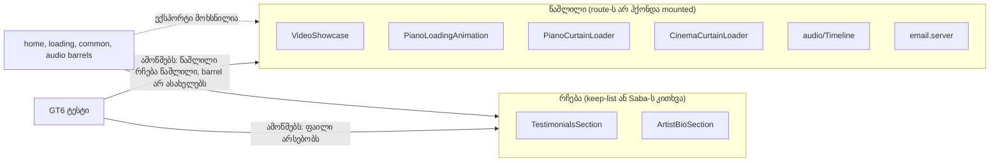

# STORE-2b-3d-1: Store-ის 6 მკვდარი მოდულის წაშლა (LEGACY-DEAD-STORE-COMPONENTS)

**თარიღი:** 2026-11-12
**სტატუსი:** In Progress (stage 2b-3d-1 of STORE-2b; C round 462 PASS)
**შეცვლილი პროექტი:** Store (6 წაშლილი მოდული, 4 barrel, 4 style-scan ტესტი)

## კონტექსტი

- Saba-ს 2026-11-10-ის legacy removal policy: კოდი, რომელსაც არსად არ იყენებენ, ეტაპობრივად იშლება და "ყოველი შემთხვევისთვის" არ რჩება.
- `questions-retro-450.md`-ის Q6-ით Saba-მ მიიღო ფაილების სია ნაგულისხმევი პასუხით "2b-3d შლის მათ, Testimonials-ის გარდა". წინააღმდეგობა არ მოსულა.
- წაშლილი 6 ფაილი HEAD-ზე (`a7fa78e`) არცერთ route-ს არ ჰქონდა mounted. მათ მხოლოდ საკუთარი barrel-ები აექსპორტებდნენ, და HEAD-ის production build-ში მათი არცერთი fingerprint არ იყო:
  - `app/components/home/VideoShowcase.tsx`
  - `app/components/loading/PianoLoadingAnimation.tsx`
  - `app/components/loading/PianoCurtainLoader.tsx`
  - `app/components/loading/CinemaCurtainLoader.tsx`
  - `app/components/audio/Timeline.tsx`
  - `app/lib/email.server.ts`
- Store-ის style-scan ტესტები ამ ფაილებს allow-list-ებში ასახელებდნენ, ამიტომ ტესტების განახლება იმავე ცვლილების ნაწილია.

## მიდგომა

- STORE-2b-3d ორ ეტაპად გაიყო (D-29z1631):
  - **2b-3d-1 (ეს ეტაპი):** TS/TSX მოდულები, მათი barrel ხაზები და ტესტების allow-list ჩანაწერები.
  - **2b-3d-2:** `app.css`-სა და `utilities.css`-ში დარჩენილი მკვდარი CSS წესები და token-ები. მათ შორისაა `.loading-brand`.
- ცვლილება B-ის განხილული sketch-იდან `git apply`-ით გადავიდა, ხელით რედაქტირების გარეშე. sketch-ის sha256 და 8 შეცვლილი ფაილის sha256 შემოწმდა.
- **რა რჩება და რატომ:**
  - **TestimonialsSection** — keep-list (testimonials). Saba-ს კითხვა: SABA-Q-TESTIMONIALS-UNMOUNTED.
  - **ArtistBioSection** — ერთადერთი კომპონენტი, რომელიც ხატავს "Downloads / Products / 10K+ Happy Producers" stats-ს. keep-list მოიცავს "ყველა სხვა stats-ს და claim-ს", და Q6-მა Saba-ს არასწორად უთხრა, რომ keep-list-ის შინაარსი მხოლოდ Testimonials-ს ჰქონდა. ამიტომ keep-list-ის პირობა dead-code-ის პირობას სჯობს. Saba-ს კითხვა: SABA-Q-ARTISTBIO-STATS.
  - **IconButton და ChatButton** — Q6-ის სიაში არ იყო, რომელიც Saba-მ ნახა. ამიტომ რჩება allow-list-ში და LEGACY-DEAD სიგნალად აღირიცხება.
- ორივე შენარჩუნებული section-ის barrel ხაზი უცვლელია.

## არქიტექტურა

## შეცვლილი ფაილები

- **წაიშალა (6):** ზემოთ, კონტექსტში ჩამოთვლილი ფაილები.
- **barrel-ები (4):**
  - `app/components/home/index.ts`
  - `app/components/loading/index.ts` — `// Page Loaders` კომენტარიც მოიხსნა.
  - `app/components/common/index.ts`
  - `app/components/audio/index.ts`

  სულ 8 export ხაზი მოიხსნა.
- **ტესტები (4):**
  - `app/lib/__tests__/store-gradient-text.test.ts`:
    - VideoShowcase-ის allow-list ჩანაწერი მოიხსნა;
    - `SCRIPT_GRADIENT_TEXT_ALLOW_LIST` ცარიელია, და GT1b ამასაც ამოწმებს;
    - GT4b-ის non-vacuity ახლა ≥ 200 დასკანერებულ script-ს ითვლის, მათ შორის `app/root.tsx`, `SpotlightLoader.tsx` და ერთ `perf/` ფაილს;
    - `DEAD_COMPONENTS`-ში მხოლოდ ArtistBioSection და TestimonialsSection დარჩა;
    - GT5b-ის self-test `FIXTURE_DEAD_MODULES`-ზე რჩება;
    - ახალი **GT6**: 6 ფაილი წაშლილი რჩება, ყოველი `DEAD_COMPONENTS` ფაილი არსებობს, და 5 barrel-იდან (home, loading, common, audio, components) არცერთი არ ასახელებს წაშლილ export-ს.
  - `app/lib/__tests__/store-teal-sweep.test.ts` — `email.server`, `Timeline` და `CinemaCurtainLoader` ჩანაწერები მოიხსნა.
  - `app/lib/__tests__/store-glow-shadow.test.ts` — VideoShowcase-ის ჩანაწერი მოიხსნა.
  - `app/lib/__tests__/store-live-teal.test.ts` — `.loading-brand`-ის მიზეზის ტექსტი განახლდა. `DEAD_TOKEN_CONSUMERS['loading-brand']` ახლა `{}`-ია, ამიტომ LT7 ამტკიცებს, რომ ამ წესს არცერთი consumer აღარ ჰყავს.

## პრობლემები და გადაწყვეტები

- **პრობლემა:** მხოლოდ ფაილების წაშლისას 9 style-scan row წითლდებოდა (GS2, GS4, GT1b, GT3, GT4b, GT5, GT5b, LT7, TS2), რადგან ისინი წაშლილ ფაილებს ასახელებდნენ.
  **გადაწყვეტა:** ტესტების განახლება იმავე sketch-ში შევიდა.
- **პრობლემა:** GT5-ის word scan წაშლილ სახელებს ვეღარ შეამოწმებს (TL-R462-L1).
  **გადაწყვეტა:** წაშლილი მოდულის ნებისმიერ import-ზე tsc და build ჩავარდება. GT6 იცავს ფაილის აღდგენისგან და barrel-ში ხელახალი ექსპორტისგან. GT5b-ის real-tree loop მოიხსნა, რადგან მისი ორივე მოდული წაიშალა.
- **პრობლემა:** GT4b-ის non-vacuity CinemaCurtainLoader-ზე იყო დამოკიდებული.
  **გადაწყვეტა:** ახლა ცოცხალ ფაილებს ითვლის (≥ 200 script, `root.tsx`, SpotlightLoader და `perf/` ფაილი).
- **პრობლემა:** ArtistBioSection თავდაპირველად (sketch v1) წასაშლელ სიაში იყო, თუმცა keep-list-ის stats-ს ატარებს.
  **გადაწყვეტა:** v2-ში ის რჩება. Mutant M9 ამოწმებს, რომ მისი შემთხვევით წაშლა GT3-ს, GT5-ს და GT6-ს აწითლებს.

## ტესტირება

- **A-ს შემოწმებები:**
  - `npm run typecheck` — rc 0;
  - `npm run lint` — rc 0, 192 warning (HEAD-ზე 207; წაშლილ ფაილებს 15 ჰქონდა);
  - `npx biome check` 4 barrel-სა და 4 ტესტ ფაილზე — rc 0;
  - covering set (6 ფაილი, `store-focus-ring` და `store-theme-tokens` ჩათვლით) — 6 ფაილი / 77 ტესტი მწვანეა.
- **Mutants** (`mutants.sh`, მთლიანი ფაილები): BASE მწვანეა.

  | Mutant | რომელი row-ები წითლდება |
  |---|---|
  | M1, წაშლილი ფაილი აღდგა | GS2, GT3, GT6 |
  | M2, barrel წაშლილ სახელს ხელახლა აექსპორტებს | GT6 |
  | M3, ცოცხალი ფაილი ტექსტს ისევ clip-ავს | GT1b |
  | M4, `.loading-brand` consumer-ს იძენს | LT7 |
  | M5, TestimonialsSection წაიშალა | GT3, GT5, GT6 |
  | M6, Timeline აღდგა | GT6, TS1 |
  | M7, barrel შემოწმებული სიიდან ამოვარდა | GT6 |
  | M8, ცარიელი perf root | GT4b, TS5 |
  | M9, ArtistBioSection შემთხვევით წაიშალა | GT3, GT5, GT6 |

- **Production build (B-ის გაზომვა, HEAD vs sketch):**
  - server bundle-ში 0 ხაზი განსხვავდება (normalization-ის შემდეგ);
  - client JS-ის 101 chunk-იდან არცერთი არ განსხვავდება;
  - tree build-ში წაშლილი მოდულების fingerprint 0-ია.
- **CSS bundle (შესწორება, C-R462-01):** წაშლილი ფაილების class string-ებიდან Tailwind-ი 12 utility-ს აგენერირებდა; მათი სია loop-ის ფაილშია (`b-round-461/css-removed-live-grep.txt`) და ცოცხალ source-ში არცერთი არ გამოიყენება.
  - B-ის გაზომვამ (12 ტოვებს, 0 ემატება) ეს დოკუმენტი არ შეიცავდა. ამ დოკუმენტის პირველ ვერსიაში 12-ვე class string ეწერა, Tailwind v4 კი `docs/*.md`-საც კითხულობს, ამიტომ round 462-ის გამოქვეყნებულ CSS-ში ისინი დარჩა (C-ის build-compare: removed=0). ცოცხალ ელემენტზე ეს გავლენას არ ახდენდა (C7: 12/12 გვერდი ტოლია).
  - round 463-ში (STORE-2b-3d-2) სია ამ დოკუმენტიდან ამოღებულია, ამიტომ bundle მათ კარგავს.
- **ბრაუზერი (B, prod, mock API):** 6 გვერდი × 2 viewport (1440×900 და 1280×720). 12-ვე row-ზე HEAD და tree ერთნაირია, და არცერთი ელემენტი არ ატარებს 12 token-იდან არცერთს. C-ის C6–C8 row-ები ამას დამოუკიდებლად იმეორებს.

## TODO / შემდეგი ნაბიჯები

- **2b-3d-2** (round 463, დოკუმენტი 302): `app/styles/app.css`-ისა და `utilities.css`-ის მკვდარი CSS წესები, მათ შორის `.loading-brand` ×2.
- **TL-R462-L2** (deferred_low_polish): GT6-ის barrel regex-ს თავად ტესტში დადებითი fixture არ აქვს; მას მხოლოდ mutant M2 ამტკიცებს.
- **TL-R462-L3:** ისტორიული დოკუმენტები ჯერ კიდევ ასახელებენ წაშლილ ფაილებს: `docs/technical/future/stripe-migration-guide.md` (ორი ადგილი) და `docs/technical/video-sync.md` (ერთი ადგილი). ამ რაუნდში ისინი არ ეკუთვნის.
- Saba-ს კითხვები SABA-Q-TESTIMONIALS-UNMOUNTED და SABA-Q-ARTISTBIO-STATS. IconButton და ChatButton LEGACY-DEAD სიგნალად რჩება.
