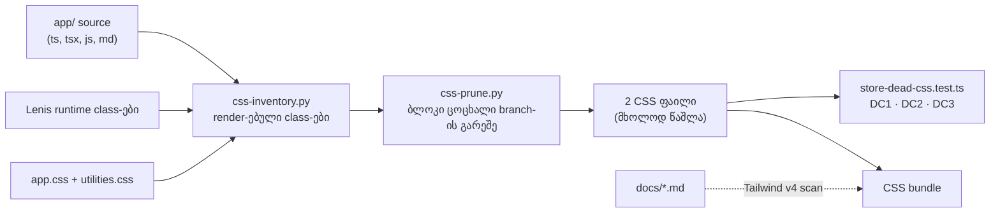

# STORE-2b-3d-2: Store-ის მკვდარი CSS წესების წაშლა (და C-R462-01-ის შესწორება)

**თარიღი:** 2026-11-12
**სტატუსი:** In Progress (stage 2b-3d-2 of STORE-2b; C round 463 PASS)
**შეცვლილი პროექტი:** Store (2 CSS ფაილი, 3 style-scan ტესტი, დოკუმენტი 301)

## კონტექსტი

- Saba-ს 2026-11-10-ის legacy removal policy: კოდი, რომელსაც არსად არ იყენებენ, ეტაპობრივად იშლება. round 462-ის Q6-ის ნაგულისხმევი პასუხი ამ ეტაპს CSS-ზე ავრცელებს.
- round 462-მა (დოკუმენტი 301) წაშალა 6 მკვდარი მოდული. `app/styles/app.css`-სა და `app/styles/base/utilities.css`-ში კი დარჩა ასობით წესი, რომელსაც არცერთი ელემენტი აღარ ემთხვევა: ძველი about, music-listing, product-detail, track card, ფილტრის, newsletter, special-offer, testimonial, stat და badge სტილები, ძველი loader-ის სტილი და hover ეფექტები.
- C-ის round 462-ის build შედარებამ (C-R462-01) აჩვენა, რომ Tailwind v4 `docs/*.md`-საც კითხულობს: დოკუმენტ 301-ში პირდაპირ დაწერილმა 12 utility string-მა გამოქვეყნებულ CSS-ში დააბრუნა ის utility-ები, რომლებიც round 462-მა უნდა მოეშორებინა.

## მიდგომა

- **წაშლის წესი.** B-ის გენერატორი `css-prune.py` (`css-inventory.py`-ის საფუძველზე) შლის:
  - ყოველ rule ბლოკს, `@media`-ში ჩადებულის ჩათვლით, რომელსაც ერთი ცოცხალი selector branch-იც არ აქვს — სულ 306 ბლოკი;
  - branch ცოცხალია, როცა მისი ყველა საჭირო class render-დება. `:not(...)`-ის შიგნით მყოფი class საჭიროდ არ ითვლება;
  - class render-დება, როცა ის მთლიან token-ად გვხვდება `app/`-ის არა-ტესტ source-ში (ts, tsx, js, md; `__tests__` და `*.test.*` გამორიცხულია), ან როცა მას Lenis ბიბლიოთეკა runtime-ში აყენებს. „render-დება“ აქ ტექსტურ დამთხვევას ნიშნავს და არა mounted კომპონენტს: unmounted ფაილში ან კომენტარში დაწერილი სახელიც ითვლება. ამიტომ compound selector, რომლის ერთი class ცოცხალია და მეორე — არა, მკვდარია;
  - ცარიელად დარჩენილ `@media` wrapper-ებს და იმ კომენტარის ხაზებს, რომლებიც უშუალოდ წაშლილ ბლოკს წარადგენს (ორი section header, რომლის ქვეშაც მხოლოდ დარჩენილი ან აღარაფერი დგას, რჩება — TODO);
  - 6 `@keyframes`-ს, რომლის სახელი არც დარჩენილ CSS-ში და არც app source-ში მთლიან სიტყვად არ გვხვდება. ეს ტექსტური წესია: 4 keyframes, რომლის სახელი მხოლოდ კომენტარში, ცვლადის ან type ველის სახელში გვხვდება, დარჩა (A-R463-REVIEW-M1, TODO).
- სრული სია: `b-round-462/pruned-list.txt`. diff მხოლოდ წაშლაა (`diff --minimal`: 0 დამატებული CSS ხაზი).
- ცვლილება B-ის განხილული sketch-იდან `git apply`-ით გადავიდა, ხელით რედაქტირების გარეშე. sketch-ის sha256 და 6 შეცვლილი ფაილის sha256 შემოწმდა.
- **რა რჩება და რატომ:**
  - **Lenis-ის წესები** — ბიბლიოთეკა მათ class-ებს runtime-ში აყენებს (`node_modules/lenis/dist/lenis.mjs`). ტესტში ისინი `RUNTIME_CLASSES` სიაშია, თითო მიზეზით.
  - **dead-ად მონიშნული წესები, რომელთა class-ს ჯერ კიდევ ჰყავს consumer შენარჩუნებულ, unmounted ფაილში** — ჩაშენებული audio preview ღილაკის სტილი თავისი pulse ანიმაციით, waveform-ის ზოლების და track row-ის waveform-ის სტილები. ისინი LEGACY-DEAD-ის ნარჩენთან ერთად წაიშლება, ამიტომ ამ რაუნდში TSX არ იშლება.
  - **`@theme`-ის teal token-ები** (6 ადგილი) და გაყინული legacy Studio-ს stems loader-ის სია და teal slider thumb.
  - Studio-ს obsidian ბლოკი byte-ით უცვლელია.
- **keep-list (L4) ხელუხლებელია.** LeadMagnet, Free downloads, SpecialOffers, Limited badge-ები, testimonials და stats რჩება. წაშლილ ოჯახებს, რომელთა სახელი keep-list-ს ჰგავს (special-offer, testimonial, stat, badge, newsletter), render-ებული ელემენტი არ ჰყავს: ცოცხალი კომპონენტები Tailwind class-ებს იყენებს. გადამწყვეტია render-ებული ელემენტი და არა სახელი; `/` და `/about` ბრაუზერში ტოლია.
- **ალტერნატივა:** კლასების ცალ-ცალკე ხელით წაშლა უარვყავით: 306 ბლოკზე შეცდომის რისკი დიდია, და გენერატორი clean `eb4d6df` clone-ზე ორივე CSS ფაილს sha-ით ზუსტად იმეორებს.

## არქიტექტურა

## შეცვლილი ფაილები

- `app/styles/app.css` — 3850 → 1691 ხაზი; მხოლოდ წაშლა.
- `app/styles/base/utilities.css` — 279 → 208 ხაზი; მხოლოდ წაშლა.
- `app/lib/__tests__/store-dead-css.test.ts` — ახალი: DC1, DC2, DC3.
- `app/lib/__tests__/store-live-teal.test.ts` — allow-list-ები დარჩენილ teal ადგილებამდე შემცირდა (app.css 14, utilities.css 3); 14 წაშლილი ჩანაწერი ამოვიდა rule allow-list-ებიდან; ორივე token-read allow-list ცარიელია.
- `app/lib/__tests__/store-gradient-text.test.ts` — gradient-text allow-list ცარიელია, რადგან ერთადერთი dead rule წაიშალა; `DELETED_STORE_MODULES`-ის გასაღები ახლა რეალური წაშლილი export-ია, `sendOrderPaidEmail` (gate-462 finding 2).
- `docs/implementation/2026/quarter-IV/301-store-2b-3d-1-dead-store-modules.md` — 12 utility string-ის აბზაცი შესწორდა (C-R462-01).
- `docs/implementation/2026/quarter-IV/302-store-2b-3d-2-dead-store-css.md` — ეს დოკუმენტი.

## პრობლემები და გადაწყვეტები

- **პრობლემა:** Tailwind v4 `docs/*.md`-ს source-ად კითხულობს. დოკუმენტ 301-ში პირდაპირ დაწერილმა 12 utility string-მა ისინი round 462-ის გამოქვეყნებულ CSS bundle-ში დააბრუნა (C-R462-01).
  **გადაწყვეტა:** დოკუმენტ 301-ის აბზაცი სიას აღარ ასახელებს და `b-round-461/css-removed-live-grep.txt`-ს უთითებს. ეს დოკუმენტიც არცერთ წაშლილ class-ს, keyframes-ს ან utility-ს პირდაპირ არ ასახელებს; სიები `b-round-462/pruned-list.txt`-სა და `b-round-462/build-compare.txt`-შია. თვითშემოწმება: `doc-class-literals.py` ბეჭდავს `literals=0`.
- **პრობლემა:** compound selector-ში ზოგადი ცოცხალი class (მაგ. აქტიური მდგომარეობის class) მკვდარ წესს ცოცხლად აჩვენებდა.
  **გადაწყვეტა:** branch ცოცხალია მხოლოდ მაშინ, როცა მისი ყველა საჭირო class render-დება (tech-lead-ის Medium, sketch v2). Mutant M9 ამოწმებს.
- **პრობლემა:** Lenis-ის class-ები source-ში არ წერია, მაგრამ runtime-ში ჩნდება.
  **გადაწყვეტა:** `RUNTIME_CLASSES` სია მიზეზით; Mutant M10 ამოწმებს, რომ მისი ამოღება DC1-ს და DC3-ს აწითლებს.
- **პრობლემა:** ტესტების allow-list-ები წაშლილ წესებს ასახელებდნენ.
  **გადაწყვეტა:** ტესტების განახლება იმავე sketch-ში შევიდა.

## ტესტირება

- **ახალი row-ები (`store-dead-css.test.ts`):**
  - **DC1:** ორივე ფაილის ყოველ class rule-ს აქვს selector branch, რომლის ყველა საჭირო class render-დება.
  - **DC2:** ორივე ფაილის ყოველ `@keyframes`-ის სახელი მთლიან სიტყვად გვხვდება სხვა CSS-ში ან app source-ში (ტექსტური დამთხვევა, კომენტარის ჩათვლით; A-R463-REVIEW-M1).
  - **DC3:** non-vacuity — სკანირდება ≥ 150 class rule; fixture 8 შემთხვევას ამოწმებს: მკვდარი წესი `@media`-ში, compound ერთი მკვდარი class-ით, selector list ერთი ცოცხალი branch-ით, `:not(...)`, Lenis runtime class, attribute-ის მნიშვნელობა, მხოლოდ substring consumer და მკვდარი keyframes.
- **A-ს შემოწმებები** (log-ები: `a-round-463/`):
  - `npm run typecheck` — rc 0;
  - `npm run lint` — rc 0, 192 warning (HEAD-ის ტოლი);
  - `npx biome check` 3 ტესტ ფაილზე — rc 0;
  - covering set (`b-round-462/covering-463.txt`) — 14 ფაილი / 148 ტესტი მწვანეა, CSS-ის ყველა წამკითხველი ტესტის ჩათვლით.
- **Mutants** (`mutants.sh`, A-ს გაშვება B-ის შედეგის იდენტურია): BASE მწვანეა.

  | Mutant | რომელი row-ები წითლდება |
  |---|---|
  | M1, HEAD-ის app.css აღდგა | DC1, DC2, GT1, LT3, LT5, LT6 |
  | M2, მკვდარი class rule დაბრუნდა (utilities.css) | DC1 |
  | M3, ობოლი keyframes | DC2 |
  | M4, მკვდარი წესი `@media`-ში | DC1 |
  | M5, ცარიელი საჭირო-class extractor | DC3 |
  | M6, gradient-text წესი დაბრუნდა | DC1, GT1 |
  | M7, barrel `sendOrderPaidEmail`-ს ხელახლა აექსპორტებს | GT6, LT9 |
  | M8, მკვდარი teal წესი დაბრუნდა | DC1, LT3, LT5 |
  | M9, compound ზოგადი ცოცხალი class-ით დაბრუნდა | DC1 |
  | M10, Lenis-ის class ამოვარდა `RUNTIME_CLASSES`-დან | DC1, DC3 |
  | M11, ორი მკვდარი branch-ის selector list | DC1 |

- **Production build (B-ის გაზომვა, HEAD vs sketch):**
  - server bundle-ში 0 ხაზი განსხვავდება (normalization-ის შემდეგ);
  - client JS-ის 101 chunk-იდან არცერთი არ განსხვავდება;
  - CSS: 2068 → 1794 selector, 274 წაიშალა და 0 დაემატა — 262 მკვდარი წესის selector და round 461-ის 12 utility; აუხსნელი 0 (`b-round-462/build-compare.txt`).
- **ბრაუზერი (B, prod, mock API):** 13 გვერდი × 2 viewport (1440×900 და 1280×720) = 26 row, `/studio-lab`-ის ჩათვლით. ყოველი ელემენტის computed style HEAD-სა და tree-ს შორის შედარდა HEAD-HEAD control-ით:
  - შემცირებული fingerprint 26-ვე row-ზე ტოლია;
  - სრული fingerprint 22 row-ზე ტოლია; დანარჩენი 4 (`/` და 404) უსასრულო ანიმაციების გამო control-შიც მოძრაობს;
  - არცერთი ელემენტი არ ემთხვევა წაშლილ selector branch-ს, არცერთი computed ანიმაცია არ არის წაშლილი keyframes, chunk 404 არ არის;
  - non-vacuity: tree-ში ჩადებული სტილის ცვლილება შედარებას აწითლებს.
- C-ის C1–C10 row-ები ამას დამოუკიდებლად იმეორებს.

## TODO / შემდეგი ნაბიჯები

- **LEGACY-DEAD ნარჩენი:** შენარჩუნებული consumer-ები (ჩაშენებული audio preview ღილაკი, waveform-ის კომპონენტები) თავიანთ CSS-თან ერთად, ArtistBioSection, TestimonialsSection, IconButton და ChatButton — Saba-ს კითხვების შემდეგ.
- **TL-R462-L2** (deferred_low_polish): GT6-ის barrel regex-ს ტესტში დადებითი fixture არ აქვს; მას მხოლოდ mutant ამტკიცებს.
- **SIG-R463-TAILWIND-DOCS-SOURCE:** Tailwind v4 `docs/`-ს source-ად კითხულობს, ამიტომ დოკუმენტში დაწერილი class string bundle-ში utility-ს ამატებს. root-ისთვის სიგნალი: `docs/`-ის scan-იდან გამორიცხვა ან წესი დოკუმენტებისთვის.
- **TL-R463-L3:** ტესტი ts/tsx-ს სკანირებს, გენერატორი კი js/md-საც; დღეს შედეგი ტოლია.
- **TL-R463-L7:** `:is`/`:where`/`:has`-ის შიგნით მყოფი class საჭიროდ ითვლება.
- **B-R463-DC2-UNDERSCORE:** keyframes-ის სახელი, რომელიც arbitrary animate მნიშვნელობაში ქვედა ტირით არის ჩაწერილი, consumer-ად არ ითვლება; დღეს ასეთი გამოყენება 0-ია.
- **A-R463-REVIEW-M1** (code-reviewer, B-ს): DC2 კომენტარში ან identifier-ში ნაპოვნ სიტყვასაც consumer-ად თვლის, ამიტომ 4 keyframes (ფირის მარცვლის, მცურავი და ორი fade ანიმაცია), რომელსაც არცერთი animation declaration არ იყენებს, დარჩა. შემოთავაზება: DC2 მხოლოდ animation declaration-სა და animate utility-ში ითვლის, comment-only fixture-ით, და ოთხივე წაიშლება.
- **A-R463-REVIEW-L2:** premium card-ის, track row-ის, waveform-ისა და artist-ის სტილების ოჯახებს consumer-ი მხოლოდ unmounted ფაილებში ჰყავს; LEGACY-DEAD ნარჩენთან ერთად.
- **A-R463-REVIEW-L3/L5:** `app.css`-ში ორი section header დარჩა ცარიელი ან მხოლოდ ობოლი keyframes-ის თავზე; GT1-ის სათაური ჯერ კიდევ allow-list-ის dead rule-ს ახსენებს, თუმცა allow-list ცარიელია.
- **2b-3c-2b** — STORE-2b-ის შემდეგი ეტაპი.
