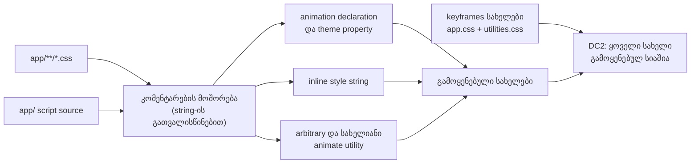

# STORE-2b-3d-3: ოთხი ობოლი keyframes-ის წაშლა და DC2-ის ზუსტი წესი

**თარიღი:** 2026-11-12
**სტატუსი:** In Progress (stage 2b-3d-3 of STORE-2b; C round 464 PASS)
**შეცვლილი პროექტი:** Store (1 CSS ფაილი, 1 ტესტ ფაილი, ეს დოკუმენტი)

## კონტექსტი

- round 463-მა (დოკუმენტი 302) Store-ის CSS-დან მკვდარი წესები წაშალა, მათ შორის ის წესებიც, რომლებიც ოთხ ანიმაციას იყენებდა: `float`, `grain`, `fadeInUp` და `fadeOut`. თავად keyframes-ები კი `app/styles/app.css`-ში დარჩა.
- მიზეზი DC2-ის ტექსტური წესი იყო: keyframes-ის სახელი „გამოყენებულად“ ითვლებოდა, როცა სიტყვა სადმე გვხვდებოდა — კომენტარში, JS ცვლადში ან type ველში. ოთხივეს ასეთი შემთხვევითი დამთხვევა ჰქონდა:
  - `float` — კომენტარი audio encoder worker-ში და video dock-ის data attribute-ები;
  - `grain` — JSX კომენტარი SpotlightLoader-ში;
  - `fadeInUp` — framer-motion-ის variant ობიექტები (JS და არა CSS keyframes);
  - `fadeOut` — clip-ისა და SFX-ის მონაცემების ველები.
- code-reviewer-მა ეს A-R463-REVIEW-M1-ად აღნიშნა, C-მ კი C-R463-01-ად დაადასტურა. ხილული ეფექტი არ ჰქონდა: ოთხივე keyframes-ს ელემენტი ვერ უშვებდა.

## მიდგომა

- **ცვლილება B-ის sketch-იდან `git apply`-ით გადავიდა,** ხელით რედაქტირების გარეშე. sketch-ის sha256 და ორი შეცვლილი ფაილის sha256 შემოწმდა.
- **CSS:** მხოლოდ წაშლა (45 ხაზი, 0 დამატებული) — ოთხი keyframes, „Film Grain Overlay“ კომენტარის header და „PREMIUM ANIMATIONS“ header, რომელიც აღარცერთ წესს არ წარადგენდა (A-R463-REVIEW-L3). Studio-ს obsidian ბლოკი byte-ით უცვლელია.
- **DC2-ის ახალი წესი.** keyframes-ის სახელი გამოყენებულად ითვლება მხოლოდ მაშინ, როცა block და line კომენტარების მოშორების შემდეგ ის გვხვდება:
  - CSS-ის animation ან animation name property-ის მნიშვნელობაში, ან theme-ის animate custom property-ში (ყველა CSS ფაილში და იგივე ნიმუში script-ებში);
  - inline style string-ში (animation ან animationName ველის string მნიშვნელობა);
  - Tailwind-ის arbitrary animate utility-ში, ქვედა ტირიანი ფორმის ჩათვლით (B-R463-DC2-UNDERSCORE);
  - Tailwind-ის სახელიან animate utility-ში.
- **კომენტარის მოშორება string-ს არ ეხება.** კომენტარი იწყება მხოლოდ source-ის დასაწყისში ან whitespace-ის ან `{ } ; , (`-ის შემდეგ, ამიტომ ბრჭყალით დაწყებულ attribute-ის მნიშვნელობაში მყოფი ვარსკვლავიანი glob ან ორი slash-ით დაწყებული URL კომენტარად არ იკითხება (tech-lead-ის Low, mutant-ები M8 და M9). string-ის შიგნით whitespace-ის ან ფრჩხილის შემდეგ მდგომი ორი slash ან ვარსკვლავიანი slash კი კომენტარად იკითხება (code-reviewer-ის Low; `app/`-ის CSS ფაილებში დღეს ასეთი შემთხვევა არ არის).
- **15-ვე keyframes კლასიფიცირდა.** დარჩენილ 11-ს რეალური მომხმარებელი ჰყავს: insert marker-ის ციმციმი theme property-ით, fade-in და slide-up Modal-ის, AuthModal-ის, LeadMagnetPopup-ისა და CookieConsent-ის წესებით, pulse Tailwind-ის utility-ით, დანარჩენი შვიდი კი animation declaration-ით.
- **pulse-ის შენიშვნა (SIG-R464-PULSE-KEYFRAMES-SHADOW, info).** პროექტის საკუთარი pulse keyframes unlayered-ია და Tailwind-ის ამავე სახელის keyframes-ს ფარავს. მისი შეცვლა ხილული ცვლილება იქნებოდა და დიზაინის გადაწყვეტილებას საჭიროებს, ამიტომ ამ რაუნდში არ იცვლება.
- **ალტერნატივა:** ოთხი სახელის ხელით წაშლა DC2-ის შეცვლის გარეშე უარვყავით — ძველი წესი მომავალ ობოლ keyframes-საც ვერ დაინახავდა.

## არქიტექტურა

## შეცვლილი ფაილები

- `app/styles/app.css` — 1691 → 1646 ხაზი; მხოლოდ წაშლა (4 keyframes და 2 კომენტარის header).
- `app/lib/__tests__/store-dead-css.test.ts` — DC2 გადაიწერა, DC3-ის keyframes-ის შემოწმება ახალ წესზე გადავიდა, დაემატა DC4.
- `docs/implementation/2026/quarter-IV/303-store-2b-3d-3-orphan-keyframes.md` — ეს დოკუმენტი.

## პრობლემები და გადაწყვეტები

- **პრობლემა:** DC2 ობოლ keyframes-ს ვერ ხედავდა, რადგან სახელის ნებისმიერ დამთხვევას consumer-ად თვლიდა (A-R463-REVIEW-M1 / C-R463-01).
  **გადაწყვეტა:** consumer მხოლოდ animation declaration, animate utility ან inline animation style-ია, კომენტარების მოშორების შემდეგ. ახალი DC2 HEAD-ზე ზუსტად ოთხ სახელზე წითლდებოდა, წაშლის შემდეგ კი მწვანეა.
- **პრობლემა:** ძველი წესი arbitrary utility-ში ქვედა ტირით ჩაწერილ სახელს ვერ პოულობდა (B-R463-DC2-UNDERSCORE).
  **გადაწყვეტა:** ქვედა ტირე გამყოფად იკითხება; DC4-ს ამის fixture აქვს.
- **პრობლემა:** პირველ ვერსიაში კომენტარის მოშორება string-ში მყოფ glob-ს ან URL-ს კომენტარად კითხულობდა და შემდეგ მდგომ რეალურ გამოყენებას შლიდა.
  **გადაწყვეტა:** კომენტარი მხოლოდ ჩამოთვლილი სიმბოლოების შემდეგ იწყება; DC4-ის ორი fixture და mutant-ები M8, M9.
- **პრობლემა:** Tailwind v4 `docs/*.md`-საც source-ად კითხულობს (SIG-R463-TAILWIND-DOCS-SOURCE).
  **გადაწყვეტა:** ეს დოკუმენტი არცერთ utility-ს ან CSS declaration-ს პირდაპირ არ წერს; ტესტის ორი utility fixture `join()`-ით იწყობა. A-მ doc-leak თვითშემოწმება გაუშვა.
- **ცნობილი შეზღუდვები (ჩაწერილი, არ გასწორებულა):**
  - keyframes, რომელსაც მხოლოდ ისეთი custom property, რომლის სახელი animate წინსართით არ იწყება, ან template-ით აწყობილი სახელი იყენებს, გამოუყენებლად წაიკითხება. იგივე ეხება მრავალხაზიანი მძიმით გამოყოფილი სიის მეორე სახელს, vendor prefix-იან ფორმას, ბრჭყალებიან ობიექტის გასაღებს, JS-ით მინიჭებულ style-ს და ternary მნიშვნელობას. ეს „წითელი“ შედეგია: ცვლილებას დაბლოკავს და არაფერს წაშლის (TL-R464-L2-MATCHER-FAILS-RED-FORMS). დღეს ასეთი 0-ია.
  - კომენტარი, რომელიც უშუალოდ სიის გარეთა სიმბოლოს (ბრჭყალი, დახურვის ფრჩხილი) მოსდევს, ტექსტად რჩება. ამიტომ იქ კომენტარში დარჩენილი გამოყენება მკვდარ keyframes-ს ცოცხლად აჩვენებს და DC2 მწვანე დარჩება (TL-R464-L1-COMMENT-AFTER-UNLISTED-CHAR, deferred). დღეს ასეთი 0-ია.

## ტესტირება

- **`store-dead-css.test.ts`:**
  - **DC2** — ყოველი keyframes-ის სახელი ახალი წესით გამოყენებულია.
  - **DC3** — fixture-ის მკვდარი keyframes ახალი წესითაც გამოუყენებელია.
  - **DC4** — რვა დადებითი fixture (shorthand სახელით ბოლოს, მრავალხაზიანი animation name, theme property, arbitrary utility, სახელიანი utility, inline style, inline style glob-იანი attribute-ის შემდეგ და JSX კომენტარის წინ, inline style URL string-ის შემდეგ) და ექვსი უარყოფითი (block კომენტარი, line კომენტარი, JSX კომენტარი, identifier, ობიექტის ველი, type ველი).
- **Mutants** (B-ის `run-mutants.sh`; A-ს შედეგი B-ის `mutants.txt`-ის იდენტურია): BASE მწვანეა.

  | Mutant | რომელი row წითლდება |
  |---|---|
  | M1, float keyframes დაბრუნდა | DC2 |
  | M2, fadeOut დაბრუნდა მხოლოდ კომენტარში მოხსენიებული გამოყენებით | DC2 |
  | M3, კომენტარების მოშორება გამორთულია | DC4 |
  | M4, arbitrary utility-ის ნიმუში გამორთულია | DC4 |
  | M5, სახელიანი utility-ის ნიმუში გამორთულია | DC2, DC4 |
  | M6, theme property-ის ნიმუში გამორთულია | DC4 |
  | M7, inline style string-ის ნიმუში გამორთულია | DC4 |
  | M8, block კომენტარის მოშორება string-ს არ ითვალისწინებს | DC4 |
  | M9, line კომენტარის მოშორება string-ს არ ითვალისწინებს | DC4 |

- **A-ს შემოწმებები** (log-ები `a-round-464/`-ში): typecheck, lint, Biome ტესტ ფაილზე, covering set (14 ფაილი), mutants და doc-leak თვითშემოწმება.
- C-ის row-ები: build-ის შედარება HEAD-თან (CSS-ში მხოლოდ keyframes-ის percent selector-ები ქრება), 13 გვერდი × 2 viewport computed style-ის შედარებით და `/studio-lab`-ის შემოწმება.

## TODO / შემდეგი ნაბიჯები

- **A-R463-REVIEW-ის დარჩენილი Low-ები** (deferred_low_polish), მათ შორის GT1-ის სათაური და unmounted consumer-ების ოჯახები LEGACY-DEAD ნარჩენთან ერთად.
- **TL-R464-L1-COMMENT-AFTER-UNLISTED-CHAR** და **TL-R464-L2-MATCHER-FAILS-RED-FORMS** (deferred).
- **SIG-R463-TAILWIND-DOCS-SOURCE:** `docs/`-ის Tailwind scan-იდან გამორიცხვა ან დოკუმენტების წესი — root-ისთვის.
- **ARCH-CHECKPOINT-STYLE-SCAN:** „გამოყენებულის“ ერთი საერთო განმარტება style-scan ტესტებისთვის (არქიტექტურული სიგნალი).
- **დახურულია C PASS-ის შემდეგ:** A-R463-REVIEW-M1 (C-R463-01), B-R463-DC2-UNDERSCORE, A-R463-REVIEW-L3.
- **2b-3c-2b** — STORE-2b-ის შემდეგი ეტაპი.
