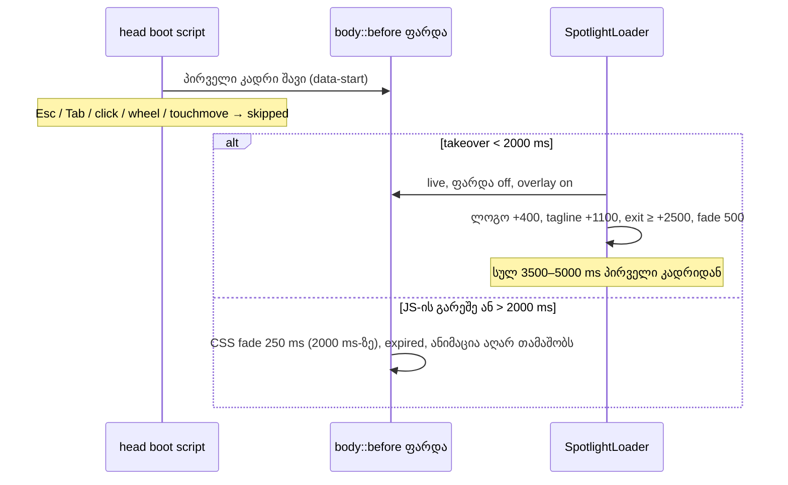

# SABA-B-17: Store-ის შესასვლელი პირველ ვიზიტზე მინიმუმ 3.5 წამი გრძელდება

**თარიღი:** 2026-11-13
**სტატუსი:** Completed (C round 489 PASS)
**შეცვლილი პროექტი:** Store (`app/components/loading/EntranceCover.tsx`, `app/components/loading/SpotlightLoader.tsx`, `app/lib/__tests__/store-entrance-loader.test.tsx`)

## კონტექსტი

- Saba-მ (2026-11-13) დაწერა, რომ შესასვლელი ანიმაცია (SpotlightLoader) ძალიან სწრაფად ქრება: პირველ ვიზიტზე მინიმუმ 3–4 წამი უნდა გრძელდებოდეს, რადგან ისედაც მხოლოდ ერთხელ ჩანს tab-ზე. ეს Medium-ია (Saba-მ თავად დაინახა).
- SABA-B-13-მა (doc 300) პირველი კადრი შავი გახადა და ხანგრძლივობა 1450–1900 ms-ზე დააყენა. B-მ HEAD `73f994d` production build-ზე გაზომა (`b-round-488/probe/head/`): ფარდა პირველი კადრიდან ~1.55 წმ-ში იწევს, ლოგო სრულად ~0.71 წმ ჩანს, tagline ~0.47 წმ.
- იმავე გაზომვამ ორი დაკავშირებული ხარვეზი აჩვენა, რომლებსაც გრძელი ანიმაცია გააძლიერებდა:
  - **ნელი პირველი ვიზიტი:** თუ JavaScript 1000 ms-ზე გვიან მოვიდა (Fast 3G, JS +1.5 წმ), ანიმაცია საერთოდ არ თამაშობს (`expired`), ჩანს მხოლოდ ~1.3 წმ შავი ეკრანი. 4G + 4× CPU-ზე tagline სრულად არასდროს ჩანს.
  - **ბორბალი ფარდის ქვეშ:** ფარდის დროს მაუსის ბორბალი გვერდს უხილავად 600 px-ით ჩამოწევდა.

## მიდგომა

- **ხანგრძლივობა იზომება პირველი შავი კადრიდან** (boot script-ის `performance.now()`, როგორც doc 300-ში): მინიმუმ `ENTRANCE_MIN_TOTAL_MS` = 3500 ms, მაქსიმუმ `ENTRANCE_MAX_TOTAL_MS` = 5000 ms.
- **ტემპი (takeover-იდან):** spotlight 800 ms-ში ჩნდება; ლოგო +400 ms-ზე, 700 ms fade-ით; ხაზი და tagline +1100 ms-ზე, 500 ms fade-ით; exit არაუადრეს +2500 ms-ისა; overlay-ის exit fade 500 ms (`ENTRANCE_OVERLAY_EXIT_MS`). JS-ის გარეშე CSS failsafe-ის fade 250 ms-ად რჩება (`ENTRANCE_EXIT_MS`).
- **takeover-ის ფანჯარა 1000 → 2000 ms** (`ENTRANCE_FAILSAFE_MS`): ნელ პირველ ვიზიტზე შავი ფარდა JS-ს 2 წმ-მდე ელოდება. cap = 2000 + 2500 + 500 = 5000, ამიტომ გვიანი takeover-იც სრულ ტემპს იღებს.
- **wheel და touchmove** ფარდის დროს (hydration-მდეც და მის შემდეგაც) ანიმაციას გამოტოვებს და გვერდს არ ასქროლებს: `window`-ზე capture listener, `preventDefault` + `stopPropagation` (Lenis `window`-ის bubble ფაზაში უსმენს). Esc/Tab/click უცვლელია; სხვა ღილაკები (ისრები, PageDown, Space) ისევ არ გამოტოვებენ.
- **უარყოფილი ალტერნატივები:**
  - 3000 / 4000 ms: Saba-ს „მინიმუმ 3–4 წამის“ ქვედა ზღვარზე იქნებოდა.
  - ერთი საერთო 500 ms exit: no-JS failsafe-ის შეცვლა საჭირო არ იყო.
  - ფარდაზე სტატიკური CSS ლოგო (product-designer-ის რჩევა ნელი ვიზიტისთვის): ვიზუალის ცვლილებაა, Saba-ს კითხვაა (SABA-Q-ENTRANCE-WORDMARK).
- **Saba-ს კითხვები** (default-ით მუშაობს): SABA-Q-ENTRANCE-SCROLL-SKIP, SABA-Q-ENTRANCE-SLOW-WAIT (`loop/user-review/questions-saba-b-13.md`).

## არქიტექტურა

## შეცვლილი ფაილები

- `app/components/loading/EntranceCover.tsx` — 3500 / 5000 / 2000 ms, ახალი `ENTRANCE_OVERLAY_EXIT_MS` და `ENTRANCE_SCROLL_SKIP_EVENTS`; boot script-ში wheel/touchmove skip.
- `app/components/loading/SpotlightLoader.tsx` — ტემპის კონსტანტები, `EXIT_AFTER_TAKEOVER_MIN_MS` (export), timeline-ში overlay exit, wheel/touchmove skip listener-ები.
- `app/lib/__tests__/store-entrance-loader.test.tsx` — L3, E1, E6 ახალ მნიშვნელობებზე; ახალი S1, S2, E6b, E8c, E8d.

## პრობლემები და გადაწყვეტები

- **Problem:** Saba ანიმაციას ვერ ასწრებდა დანახვას (~1.55 წმ). **Solution:** მინიმუმ 3500 ms პირველი კადრიდან და ნელი ტემპი; ლოგო ~1.7 წმ ჩანს სრულად (`b-round-488/probe/sketch/`).
- **Problem:** ნელ პირველ ვიზიტზე ანიმაცია არ თამაშობდა (B-R489-ENTRANCE-SLOW-FIRST-VISIT-EXPIRED). **Solution:** takeover-ის ფანჯარა 2000 ms და cap 5000 ms; Fast 3G (~2.3 წმ) ისევ ვერ ასწრებს — ეს Saba-ს კითხვაა (SABA-Q-ENTRANCE-SLOW-WAIT).
- **Problem:** ბორბალი ფარდის ქვეშ გვერდს ასქროლებდა (B-R489-ENTRANCE-WHEEL-SCROLLS-UNDER-COVER). **Solution:** wheel/touchmove ანიმაციას გამოტოვებს და გვერდი თავში რჩება.
- **Problem:** ერთი ფუნქცია ორ ტიპზე (wheel, touchmove) — listener-ების მთვლელი Set-ით ერთს ითვლიდა. **Solution:** ტესტის მთვლელი ტიპის მიხედვით ითვლის (S1, S2, E8d).

## ტესტირება

- Unit (`store-entrance-loader.test.tsx`): L3 (3500 / 5000), E1 (failsafe 2000), E6 (timeline: 0 → 3500, 160 → 3500 ჯამი, 900 → 3900, 2000 და 2600 → 5000), E6b (გვიანი takeover-იც იღებს +2500 და 500 ms exit-ს), S1 (wheel/touchmove overlay-ს ხურავს, `defaultPrevented`, გვერდამდე არ აღწევს, listener-ები იხსნება), S2 (ბუნებრივი დასრულება და unmount), E8c (wheel/touchmove hydration-მდე → skipped), E8d (boot listener-ები takeover-ზე და failsafe-ზე იხსნება).
- ბრაუზერი (production build, Chromium, mock API; C round 489): პირველი კადრიდან ფარდის აწევამდე 1× CPU-ზე ≥ 3.4 წმ, 4× CPU-ზე ≤ 5 წმ; ლოგო ≥ 1.2 წმ, tagline ≥ 0.6 წმ; 4G + 4× CPU-ზე და JS +1.5 წმ-ზე ანიმაცია თამაშობს; wheel → `scrollY` 0; reload და reduced motion → შავი კადრი არ არის.

## TODO / შემდეგი ნაბიჯები

- Saba-ს პასუხები: SABA-Q-ENTRANCE-SCROLL-SKIP, SABA-Q-ENTRANCE-SLOW-WAIT, SABA-Q-ENTRANCE-WORDMARK, SABA-Q-ENTRANCE-BACKGROUND-TAB.
- ისრები / PageDown / Space ფარდის ქვეშ ისევ ასქროლებს (Low B-R489-ENTRANCE-SCROLL-KEYS-UNDER-COVER, Saba-ს პასუხის შემდეგ).
- Saba ამოწმებს Vercel preview-ზე **ახალ tab-ში** (TLM-R489-SABA-ENTRANCE-FEEL).
