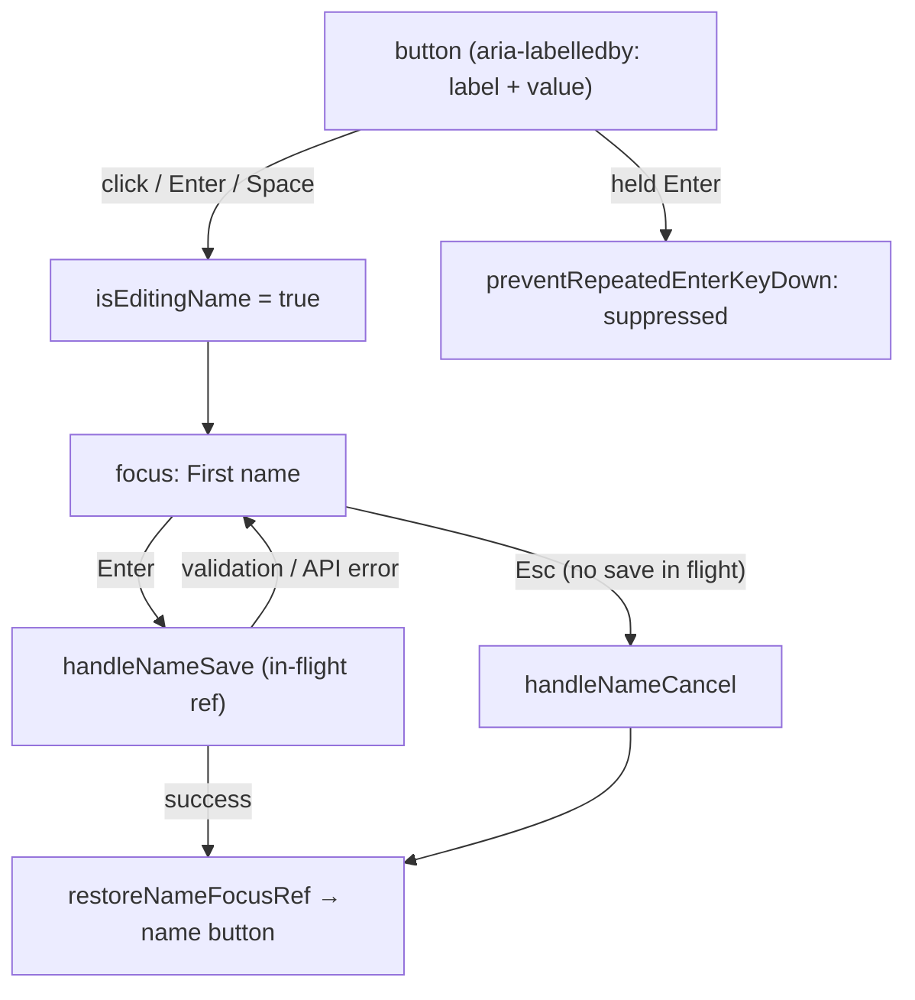

# B-R486-PROFILE-NAME-KEYBOARD: Account Profile-ის სახელის რედაქტორი keyboard-ით და screen reader-ით გამოსაყენებელია

**თარიღი:** 2026-11-13
**სტატუსი:** Completed (C round 488 PASS)
**შეცვლილი პროექტი:** Store (1 route, 1 ახალი ტესტის ფაილი, ეს დოკუმენტი)

## კონტექსტი

`/account`-ზე "Full Name"-ის მნიშვნელობა იყო `
` მხოლოდ mouse click handler-ით. Biome ამას `lint/a11y/useKeyWithClickEvents`-ით აღნიშნავდა. B-მ Chromium-ში HEAD `bb82154`-ზე სამი დაკავშირებული დეფექტი დაადასტურა:

- სახელი Tab stop არ იყო: account nav-ის "Orders"-ის შემდეგ Tab პირდაპირ "Click to change password"-ზე გადადიოდა.
- Esc-ის, ✕ ღილაკის და წარმატებული შენახვის შემდეგ focus `<body>`-ზე ეცემოდა.
- First name ველში დაჭერილი Enter (auto-repeat) 6 `PUT /api/auth/profile` request-ს აგზავნიდა.

ამას გარდა, ორ input-ს მხოლოდ placeholder ჰქონდა, ✓/✕ icon ღილაკებს კი accessible name არ ჰქონდათ. სახელის არქონისას "Click to add name" aria tree-ში `paragraph`-ად ჩანდა. ეს იყო უძველესი ღია, loop-ით გამოსასწორებელი Medium finding.

## მიდგომა

- **Trigger:** WAI-ARIA APG-ის Button pattern (https://www.w3.org/WAI/ARIA/apg/patterns/button/, წაკითხულია 2026-11-13): მოქმედება არის `button`, Enter და Space მას ააქტიურებს. `
` შეიცვალა native `<button type="button">`-ით.
- **სახელი:** WCAG 2.2 SC 2.5.3 Label in Name და SC 4.1.2 Name, Role, Value — accessible name ხილულ ტექსტს შეიცავს. ღილაკს აქვს `aria-labelledby` "Full Name" label-ისა და საკუთარი id-ით (ორივე `useId`), ანუ სახელია "Full Name Probe User". ხილული copy უცვლელია, დამალული ტექსტი არ დამატებულა.
- **ველები:** input-ებს `aria-label` "First name" / "Last name" (placeholder-ის იგივე სიტყვები; placeholder label არ არის); icon ღილაკებს `type="button"` და `aria-label` "Save name" / "Cancel name edit".
- **Focus-ის დაბრუნება:** APG Dialog pattern-ის focus return წესი (ყველაზე ახლო გამოქვეყნებული წესი inline რედაქტორისთვის, რომელიც ქრება). one-shot `restoreNameFocusRef` დგება Cancel/Esc-ზე და წარმატებულ შენახვაზე (round 488-დან — მხოლოდ მაშინ, როცა რედაქტორი ჯერ კიდევ ფლობს focus-ს; იხ. ქვემოთ წესი); `isEditingName`-ის effect გახსნისას First name-ს აფოკუსებს, დახურვისას კი — flag-ის არსებობისას — სახელის ღილაკს.
- **Held key:** პროექტის SYS-2 წესი — ერთი საერთო held-Enter guard (`preventRepeatedEnterKeyDown`). ის იცავს input-ის handler-საც და სახელის ღილაკსაც. `nameSaveInFlightRef` მეორე შენახვას ბლოკავს, სანამ პირველი მიმდინარეობს, და `finally`-ში ნულდება. Escape რედაქტორს მხოლოდ მაშინ ხურავს, როცა შენახვა არ მიმდინარეობს.

### Focus-ის სამიზნეები

| მოვლენა | Focus სად მიდის | ტესტი / C row |
|---|---|---|
| გახსნა (click, Enter, Space) | First name input | PN2, PN-KEYS-STUBBED |
| Esc | სახელის ღილაკი | PN3, PN-KEYS-STUBBED |
| Cancel (✕, mouse ან Enter) | სახელის ღილაკი | PN3, PN-KEYS-STUBBED, PN-FOCUS-STUBBED |
| წარმატებული შენახვა (Enter ან ✓) | სახელის ღილაკი | PN4, PN10h, PN-FOCUS-STUBBED, PN-HELD-STUBBED |
| ვალიდაციის შეცდომა (ცარიელი First name) | First name input | PN6, PN-FOCUS-STUBBED |
| API შეცდომა | First name input, რედაქტორი ღიაა | PN7, PN-FOCUS-STUBBED, PN-KBSAVE-500-STUBBED |
| Esc შენახვის დროს | რედაქტორი ღია რჩება; შენახვის შემდეგ — სახელის ღილაკი | PN9, PN-ESC-INFLIGHT-STUBBED |
| ✓-ით (mouse) შენახვა, focus `<body>`-ზეა | წარმატება — სახელის ღილაკი; შეცდომა — First name | PN10c, PN10d, IF-STAY |
| შენახვა სრულდება მას შემდეგ, რაც მომხმარებელმა focus სხვაგან გადაიტანა ან password dialog გახსნა | focus არ გადაადგილდება (წარმატებისას რედაქტორი იხურება, შეცდომისას ღია რჩება) | PN10, PN10b, PN10e, PN10f, PN10g, IF-PASSWORD, IF-PASSWORD-NOFOCUS, IF-TABAWAY, IF-REPLAY |

**წესი (round 488):** შენახვის დასრულებისას (წარმატება ან API შეცდომა) focus მხოლოდ მაშინ გადადის, როცა რედაქტორი ჯერ კიდევ "ფლობს" focus-ს: password dialog დახურულია **და** `document.activeElement` არის null, `<body>` ან რედაქტორის row-ის შიგნით (`nameEditorRef`). ვალიდაციის შეცდომა, გახსნა, Esc და Cancel მომხმარებლის მოქმედებაა და ამ წესს არ ექვემდებარება. Dialog-ის მდგომარეობა `passwordModalOpenRef`-ით მოწმდება და არა `activeElement`-ით: Safari-სა და Firefox-mac-ზე mouse click ღილაკს focus-ს არ აძლევს, ამიტომ dialog-ის გახსნის შემდეგ `activeElement` `<body>` რჩება და მხოლოდ body-ზე დაფუძნებული guard focus-ს მაინც მოიპარავდა. Ref (და არა state) იმიტომ, რომ მიმდინარე `handleNameSave` closure-ში `isPasswordModalOpen`-ის ძველ მნიშვნელობას წაიკითხავდა. წყარო: WCAG 2.2 SC 3.2.1 / 3.2.2 — async დასრულება მომხმარებლის მოთხოვნა არ არის (B-ის დასკვნა, არა ციტირებული წესი).

### რატომ არის ღილაკი მთელ სიგანეზე

HEAD-ის `
` block ელემენტი იყო: click და hover მთელ row-ზე მუშაობდა. ღილაკი `block w-full text-left`-ით იმავე hit და hover area-ს ინარჩუნებს (PN-BOX). შედეგად keyboard ring მთელ row-ს მოიცავს. shrink-to-fit ღილაკი შეცვლიდა, სად შეუძლია mouse-ის მომხმარებელს დაკლიკება.

### რატომ `active:transform-none!` და რატომ არა `select-text`

- გლობალური unlayered `button:active` წესი ღილაკს 0.98-ზე ამცირებს. HEAD-ის `
`-ს press scale არ ჰქონდა; B-ის browser mutant-მა ამ class-ის გარეშე `matrix(0.98…)` წაიკითხა. `active:transform-none!` ამას მხოლოდ ამ ღილაკზე აუქმებს (PN-PRESS-SELECT).
- `select-text` არ დამატებულა: Chromium-ში მისმა მოხსნამ არცერთი გაზომილი gesture არ შეცვალა (drag row-ის გარედან, drag ტექსტზე, double-click). `cursor-pointer` მოიხსნა, რადგან გლობალური `button { cursor:pointer }` იგივე cursor-ს იძლევა.

### Rulings (task §4)

- Press და selection: `active:transform-none!` რჩება, `select-text` არა (იხ. ზემოთ).
- Hit area: სრული row რჩება, ring row-ს მოიცავს.
- Copy: ხილული "Click to add name" უცვლელია; accessible name-ს "Full Name" label `aria-labelledby`-ით ემატება.
- შეცდომაზე focus ყოველთვის First name-ზე მიდის, მაშინაც კი, როცა მომხმარებელი Last name-ში იყო (ერთი დასახელებული სამიზნე).
- mouse-ით ან keyboard-ით გააქტიურებული ✓ შენახვის დროს disabled ღილაკი focus-ს `BODY`-ზე აგდებს შენახვის დასრულებამდე; მხოლოდ საბოლოო სამიზნე მოწმდება. ✓-ის `aria-disabled`-ზე გადაყვანა ამ რაუნდის ფარგლებს გარეთაა.
- Store route საერთო helper-ს `~/components/arrangement/studio-repeat-safe`-დან იმპორტავს, რადგან HS1 scan inline held-Enter შემოწმებას კრძალავს.
- 375×812-ზე რედაქტორის row (2 × `w-40` input + 2 icon ღილაკი, 420 px) 343 px სვეტზე განიერია, ✓/✕ ეკრანს გარეთაა. ეს წინასწარ არსებული პრობლემაა და ცალკე Medium-ადაა აღრიცხული.
- ფარგლებს გარეთ: `PasswordModal` (მისი `noLabelWithoutControl` warning-ები და password link-ის `type`-ის არქონა), toast announcement-ები, დაცული `account.downloads.tsx`.

## არქიტექტურა

## შეცვლილი ფაილები

- `app/routes/account.tsx` — `ProfileContent`: სახელი native button-ია `aria-labelledby`-ით; focus-ის დაბრუნება, in-flight guard, held-Enter guard; input-ებისა და icon ღილაკების სახელები; `useId` და `preventRepeatedEnterKeyDown` import.
- `app/lib/__tests__/account-profile-name.test.tsx` (ახალი) — PN1, PN1b, PN2–PN9 (round 487) და PN10, PN10b–PN10h (round 488) unit ტესტები.
- `docs/implementation/2026/quarter-IV/315-profile-name-keyboard.md` — ეს დოკუმენტი.

## პრობლემები და გადაწყვეტები

- **პრობლემა:** inline held-Enter შემოწმებამ sketch v1-ზე HS1 source scan ჩააგდო. → **გადაწყვეტა:** საერთო `preventRepeatedEnterKeyDown` helper.
- **პრობლემა:** `<button>`-ს გლობალური press scale ემატებოდა, რაც HEAD-ს არ ჰქონდა. → **გადაწყვეტა:** `active:transform-none!` (გაზომილი `none`).
- **პრობლემა:** სწრაფი (instant) შენახვისას held Enter-ის repeat-ები შენახვაზე მეტხანს გრძელდებოდა და დაბრუნებულ focus-ზე სახელის ღილაკს ისევ ხსნიდა. → **გადაწყვეტა:** იგივე guard სახელის ღილაკის `onKeyDown`-ზეც (PN8, PN-HELD-FAST-STUBBED).
- **პრობლემა:** შენახვის დროს Esc რედაქტორს ხურავდა, შენახვა კი გრძელდებოდა. → **გადაწყვეტა:** Esc იგნორირდება, სანამ შენახვა მიმდინარეობს (PN9).
- **პრობლემა (C-R487-01, Medium):** round 487-ის focus-ის დაბრუნება შენახვის დასრულებისას უპირობოდ ხდებოდა. "Click to change password" შენახვის დროს აქტიურია, ამიტომ თუ მომხმარებელმა password dialog გახსნა ან Tab-ით სხვაგან გადავიდა, PUT-ის დასრულებისას focus ღია dialog-ის უკან სახელის ღილაკზე ან First name-ზე გადადიოდა. → **გადაწყვეტა:** `isNameEditorFocusUnclaimed()` guard ორივე settle path-ზე: `passwordModalOpenRef` (`openPasswordModal`/`closePasswordModal`, dialog-ის ყველა დახურვა `onClose`-ით გადის) და `nameEditorRef`-ით row-ის შემოწმება (PN10–PN10h, IF-PASSWORD, IF-PASSWORD-NOFOCUS, IF-TABAWAY, IF-REPLAY).

## ტესტირება

- Unit (`account-profile-name.test.tsx`):
  - PN1 — native button, სახელი "Full Name Probe User", tab order-ში.
  - PN1b — სახელის გარეშე სახელია "Full Name Click to add name".
  - PN2 — გახსნა labelled First name-ს აფოკუსებს; Save/Cancel სახელები უნიკალურია და `type=button`.
  - PN3 — Esc და Cancel focus-ს სახელის ღილაკზე აბრუნებს.
  - PN4 — Enter ერთხელ ინახავს trimmed მნიშვნელობას და focus-ს აბრუნებს.
  - PN5 — repeated Enter და მეორე Enter შენახვის დროს მეორე შენახვას არ აგზავნის.
  - PN6 — ცარიელი First name First name-ს აფოკუსებს.
  - PN7 — წარუმატებელი შენახვა რედაქტორს ღიას ტოვებს, ხელახლა ააქტიურებს, focus First name-ზეა.
  - PN8 — repeated Enter სახელის ღილაკზე `defaultPrevented`-ია; პირველი Enter და repeated Space — არა.
  - PN9 — Esc მიმდინარე შენახვის დროს რედაქტორს ღიას ტოვებს; შენახვის შემდეგ focus სახელის ღილაკზეა.
  - PN10 / PN10b — შენახვის დროს focus password link-ზე გადავიდა; წარმატება/შეცდომის შემდეგ ის იქვე რჩება (შეცდომისას რედაქტორი ღიაა, ✓ ხელახლა აქტიურია).
  - PN10c / PN10d — ✓-ით შენახვა, focus `<body>`-ზეა; წარმატება — სახელის ღილაკი, შეცდომა — First name.
  - PN10e — შენახვის დროს focus Orders tab-ის link-ზეა და იქვე რჩება.
  - PN10f / PN10g — focus-ის გარეშე click password dialog-ს ხსნის ✓-ით შენახვის დროს; დასრულების შემდეგ focus `<body>`-ზე რჩება, არა სახელის ღილაკზე / First name-ზე.
  - PN10h — dialog-ის Cancel-ის შემდეგ ახალი Enter-შენახვა focus-ს ისევ სახელის ღილაკზე აბრუნებს.
- A-ს გაშვებები (round 487): `npm run typecheck` rc 0; `npm run lint` rc 0; scoped Biome — 4 წინასწარ არსებული warning (`PasswordModal`/password link); 5 covering ტესტის ფაილი — 74 passed (HS1 scan-ის ჩათვლით).
- A-ს გაშვებები (round 488): `npm run typecheck` rc 0; `npm run lint` rc 0; scoped Biome — იგივე 4 წინასწარ არსებული warning; 5 covering ტესტის ფაილი — 82 passed.
- Browser (C round 488): IF-PASSWORD, IF-PASSWORD-NOFOCUS (Safari/Firefox-mac mouse model-ის emulation Chromium-ში, არა Safari-ს შემოწმება), IF-TABAWAY, IF-STAY, IF-LEAVE, IF-OVERLAYS, IF-REPLAY, PN-REG, G488-AUTH; ყველა stubbed backend-ით.
- Browser (C round 487): PN-TAB-STUBBED, PN-KEYS-STUBBED, PN-FOCUS-STUBBED, PN-ESC-INFLIGHT-STUBBED, PN-HELD-STUBBED, PN-HELD-FAST-STUBBED, PN-KBSAVE-500-STUBBED, PN-AX-STUBBED, PN-RING, PN-PIXEL, PN-BOX, PN-PRESS-SELECT, G487-AUTH. ყველა `-STUBBED` row stubbed backend-ითაა, ანუ მხოლოდ client path-ს ამტკიცებს. რეალური backend-ით შემოწმება (OWN-BACKEND) cloud-ში მიუწვდომელია.

## TODO / შემდეგი ნაბიჯები

- TODO: SIG-R487-REPEAT-SAFE-HOME — `preventRepeatedEnterKeyDown` Store-ისა და Studio-ს საერთო helper-ია, მაგრამ `app/components/arrangement/`-შია; მისი `app/lib`-ში გადატანა ცალკე B დავალებაა.
- B-R487-PROFILE-EDITOR-NARROW-OVERFLOW (Medium) — 375×812-ზე რედაქტორის row სვეტზე განიერი იყო და ✓/✕ ეკრანს გარეთ; გამოსწორდა round 491-ში (doc 317).
- რეალური profile update-ის შემოწმება .NET backend-ით (OWN-BACKEND), როცა backend ხელმისაწვდომი იქნება.
- TODO: B-R488-PASSWORD-MODAL-DIALOG (Medium) — `PasswordModal`-ს არ აქვს `role="dialog"`/`aria-modal`, საწყისი focus, Esc-ით დახურვა და focus-ის დაბრუნება; დაგეგმილია round 490-ის შემდეგ.
- TODO: B-R488-SAFARI-MENU-SETTLE-FOCUS (Low, `deferred_low_polish`) — Safari model-ში User/Toggle menu-ის focus-ის გარეშე გახსნა შენახვის დროს ჯერ კიდევ იღებს focus-ის დაბრუნებას; რეალური WebKit/Firefox-mac შემოწმება SAFARI-CHECKS/FIREFOX-CHECKS-შია.
