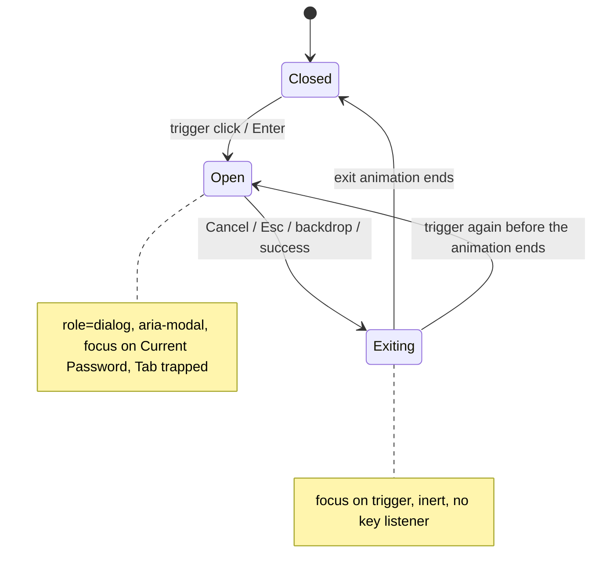

# B-R488-PASSWORD-MODAL-DIALOG: Account-ის "Change Password" ფანჯარა ნამდვილი modal dialog-ია

**თარიღი:** 2026-11-13
**სტატუსი:** Completed (C round 493 PASS)
**შეცვლილი პროექტი:** Store (1 route, 1 ახალი და 1 შეცვლილი ტესტის ფაილი, ეს დოკუმენტი, doc 315-ისა და 317-ის ხაზები)

## კონტექსტი

`/account`-ზე "Click to change password" ხსნიდა `PasswordModal`-ს, რომელიც მხოლოდ ვიზუალურად იყო modal. B-მ HEAD `e4e1d1c`-ის production build-ზე 1440×900, 1280×720 და 375×812-ზე დაადასტურა:

- accessibility tree-ში `role="dialog"` არ იყო (0 dialog), არც `aria-modal` და არც სახელი;
- გახსნის შემდეგ focus trigger-ზე რჩებოდა, ფანჯარაში არ გადადიოდა;
- Esc ფანჯარას არ ხურავდა;
- Cancel-ის შემდეგ focus `<body>`-ზე ეცემოდა, trigger-ზე არ ბრუნდებოდა;
- სამ password ველს accessible name არ ჰქონდა (`<label>`-ს `htmlFor` აკლდა), სამ "თვალის" ღილაკს სახელი საერთოდ არ ჰქონდა;
- შეცდომის ტექსტი screen reader-ს არ ეუბნებოდა (არც `role="alert"`).

ეს არის B-R488-PASSWORD-MODAL-DIALOG (Medium), B-R492-PASSWORD-FIELDS-UNNAMED (Medium) და B-R492-PASSWORD-ERROR-NOT-ANNOUNCED (Medium). წყარო: WAI-ARIA APG, Dialog (Modal) pattern; WCAG 2.2 SC 1.3.1, 2.1.2, 2.4.3, 4.1.2, 4.1.3.

## მიდგომა

ცვლილება მხოლოდ `app/routes/account.tsx`-შია, `PasswordModal`-სა და `ProfileContent`-ის trigger-ზე. mouse-ით გახსნილი ფანჯარა ვიზუალურად HEAD-ს ემთხვევა (B-ის გაზომვა, ზღვარი 16/255: 0 px სხვაობა 1440×900, 1280×720 და 375×812-ზე; ზღვრის გარეშე 823–1158 px განსხვავდება მაქსიმუმ 8/255-ით). Focus ყოველთვის გადადის (APG: გახსნისას ფანჯრის პირველ ველზე, დახურვისას trigger-ზე), მაგრამ focus ring მხოლოდ keyboard-ით მუშაობისას ჩანს: keyboard-ით გახსნისას Current Password ველზე, Esc-ით დახურვისას trigger-ზე. Mouse-ით გახსნისას და mouse-ით Cancel-ის ან backdrop-ის click-ისას ring არ ჩანს (SABA-B-4: pointer-ის შემდეგ საიტზე ring იმალება).

- **Semantics:** ფანჯრის კონტეინერს აქვს `role="dialog"`, `aria-modal="true"` და `aria-labelledby` სათაურზე "Change Password".
- **საწყისი focus:** Current Password ველი. ეფექტი `isPresent`-ზეა მიბმული, ამიტომ თუ ფანჯარა გაქრობის დროს ხელახლა გაიხსნა, `inert` იხსნება და focus ისევ Current Password-ზე გადადის. ასეთ დროს, სავარაუდოდ, იგივე instance ბრუნდება და აკრეფილი მნიშვნელობები, show/hide მდგომარეობა და შეცდომა რჩება (framer-motion-ის ქცევიდან დასკვნა; ტესტით ან browser-ით არ შემოწმებულა).
- **Tab-ის ჩაკეტვა:** document `keydown` listener. ბოლო ჩართული control-იდან Tab პირველზე გადადის, პირველიდან Shift+Tab ბოლოზე. თუ focus ჩართულ control-ზე არ არის (მაგალითად, სათაურზე click-ის შემდეგ `<body>`-ზე, ან ღილაკზე, რომელიც focus-ის დროს disabled გახდა), Tab ფანჯარაში შედის. Disabled ღილაკი (pending "Update Password") სიაში არ ჯდება.
- **Esc:** ხურავს ფანჯარას ისევე, როგორც Cancel. IME composition-ის დამამთავრებელ Esc-ს (`isComposing`) იგნორირებს, როგორც LeadMagnet-ის dialog.
- **დახურვა:** ყველა გზა (Cancel, Esc, backdrop, წარმატება) `closePasswordModal`-ით გადის. ის focus-ს trigger-ზე აბრუნებს და idempotent-ია: თუ ფანჯარა უკვე დახურულია, არაფერს აკეთებს. ამიტომ Esc-ის შემდეგ დასრულებული update focus-ს უკან აღარ წაიღებს.
- **გაქრობის ფაზა:** `AnimatePresence` ფანჯარას გაქრობის ანიმაციის დროს DOM-ში ტოვებს. `useIsPresent()` false-ზე listener იხსნება და კონტეინერი `inert` ხდება, ამიტომ Tab trigger-იდან ქრებად ველზე ვეღარ გადადის.
- **სახელები:** სამ ველს `htmlFor`/`id` (`useId`), "თვალის" ღილაკებს `aria-label` ("Show/Hide current password", "Show/Hide new password", "Show/Hide password confirmation"). Trigger-ს `type="button"`. შეცდომის ბლოკს `role="alert"`.

უარყოფილი ვარიანტები:

- **საერთო `Modal` (`~/components/ui/Modal.tsx`):** ცვლის backdrop-ს (`bg-black/95`, `z-[1000]`, portal) და მასაც არ აქვს საწყისი focus, Tab-ის ჩაკეტვა და focus-ის დაბრუნება. ის დაცული საერთო ფაილია; ეს ცალკე საკითხია (shared-modal-no-focus-management).
- **`useInlineNameEditor` / ProfileNameEditor-ის გამოყოფა:** ARCH-CHECKPOINT-ACCOUNT-PROFILE-ზე root-ის პასუხი ჯერ არ არის, ამიტომ `passwordModalOpenRef` თავის ადგილზე რჩება.
- **Scroll lock და `inert` ფონზე ღია ფანჯრის დროს:** APG scroll lock-ს არ მოითხოვს. Pointer-ს ფონზე backdrop ბლოკავს, keyboard-ს Tab-ის ჩაკეტვა.

## არქიტექტურა

## შეცვლილი ფაილები

- `app/routes/account.tsx` — `PasswordModal` (semantics, focus, Tab, Esc, inert, სახელები, alert) და `ProfileContent` (trigger-ის ref და `type`, idempotent `closePasswordModal` focus-ის დაბრუნებით).
- `app/lib/__tests__/account-password-dialog.test.tsx` — ახალი, PD1–PD15.
- `app/lib/__tests__/account-profile-name.test.tsx` — PN10f / PN10g: გახსნის შემდეგ focus Current Password-ზეა, შემდეგ blur `<body>`-ზე და იგივე body assert-ი.
- `docs/implementation/2026/quarter-IV/315-profile-name-keyboard.md` — სამი ხაზი (ref-ის მიზეზი, PN10f/PN10g, B-R488 TODO).
- `docs/implementation/2026/quarter-IV/317-profile-editor-narrow-overflow.md` — B-R488 TODO ხაზი.
- ეს დოკუმენტი.

## პრობლემები და გადაწყვეტები

- **პრობლემა:** Esc-ით დახურვის შემდეგ ჯერ კიდევ მიმდინარე update-ის დასრულება `onClose()`-ს მეორედ იძახებდა და focus-ს trigger-ზე დააბრუნებდა, თუნდაც მომხმარებელი უკვე სხვაგან იყოს (C-R487-01-ის კლასი). → **გადაწყვეტა:** `closePasswordModal` `passwordModalOpenRef`-ს ამოწმებს და დახურულ ფანჯარაზე არაფერს აკეთებს (PD7).
- **პრობლემა:** B-ის პირველ sketch-ზე browser-მა აჩვენა, რომ გაქრობის ანიმაციის დროს trigger-იდან Tab ქრებად ფანჯარაში შედიოდა, ხოლო ანიმაციის ბოლოს focus `<body>`-ზე ეცემოდა. → **გადაწყვეტა:** `useIsPresent()` false-ზე კონტეინერი `inert` ხდება (PD10, browser P11, P12).
- **პრობლემა:** A-R488-REVIEW-L1-EXIT-ANIMATION-WINDOW — დახურვისას ref მაშინვე იწმინდებოდა, focus კი ქრებად Cancel-ზე რჩებოდა. → **გადაწყვეტა:** დახურვა focus-ს მაშინვე trigger-ზე გადაიტანს.

## ტესტირება

- `account-password-dialog.test.tsx` (jsdom):
  - PD1 — ერთი dialog, `aria-modal="true"`, სახელი "Change Password", focus Current Password-ზე;
  - PD2 — სამი ველი label-ით, dialog-ის ღილაკების სახელები უნიკალურია;
  - PD3 — "Show new password" ველს ტექსტად აჩენს და სახელს "Hide new password"-ად ცვლის;
  - PD4 — Esc ხურავს და focus trigger-ზე ბრუნდება;
  - PD5 — Cancel და backdrop click: focus trigger-ზე;
  - PD6 — წარმატებული update: toast, დახურვა, focus trigger-ზე;
  - PD7 — Esc-ის შემდეგ დასრულებული update focus-ს არ იპარავს;
  - PD8 — Tab ბოლოდან პირველზე, Shift+Tab პირველიდან ბოლოზე; შუა ველზე Tab-ს listener არ აჩერებს (`preventDefault` არ ხდება);
  - PD9 — focus ფანჯრის გარეთ: Tab და Shift+Tab ფანჯარაში შედის;
  - PD10 — დახურვის შემდეგ ფანჯარა `inert`-ია და Tab/Esc აღარ მუშავდება;
  - PD11 — pending update-ის დროს Shift+Tab disabled ღილაკს გამოტოვებს;
  - PD12 — შეცდომა `role="alert"`-შია და ფანჯარა ღია რჩება;
  - PD13 — composition-ის Esc ფანჯარას არ ხურავს, ჩვეულებრივი Esc ხურავს;
  - PD14 — გაქრობის დროს ხელახლა გახსნა: ფანჯარა `inert` აღარ არის და focus Current Password-ზეა;
  - PD15 — focus-ის დროს disabled გამხდარი ღილაკიდან Tab პირველ ველზე გადადის.
- `account-profile-name.test.tsx`: PN10f / PN10g განახლდა, დანარჩენი PN უცვლელია.
- B-ის მუტანტები (20): თითოეული ცვლილების წაშლა მინიმუმ ერთ PD/PN ტესტს წითლად აქცევს.
- Browser (B-ის გაზომვა, Chromium, production build, 1440×900, 1280×720, 375×812, signed-in stub; C ამოწმებს ამ რაუნდში): ერთი dialog სახელით "Change Password", focus Current Password-ზე mouse-ით და keyboard-ით გახსნისას, 8 Tab ფანჯრის შიგნით რჩება, Esc/Cancel/backdrop focus-ს trigger-ზე აბრუნებს, Esc-ის შემდეგ ქრებად ფანჯარაში Tab არ შედის, გაქრობის დროს ხელახლა გახსნილი ფანჯარა `inert` არ არის და focus Current Password-ზეა, შეცდომა `role="alert"`-შია.

## TODO / შემდეგი ნაბიჯები

- B-R492-PASSWORD-CHANGE-NOT-IMPLEMENTED (High, root) — `app/lib/auth.ts` `updatePassword` მიმდინარე პაროლს ამოწმებს და შემდეგ ყოველთვის აგდებს "Password change is not yet implemented"; საჭიროა backend endpoint და დაცული ფაილის ცვლილება.
- shared-modal-no-focus-management — საერთო `Modal`-ს არ აქვს საწყისი focus, Tab-ის ჩაკეტვა და focus-ის დაბრუნება.
- რეალური screen reader-ით შემოწმება (dialog-ის სახელი, alert) — Tech Lead-ის ხელით შემოწმება.
- Ctrl+K-ით CommandPalette ღია ფანჯრის ზემოთ იხსნება (HEAD-შიც ასეა); ახლა ერთი Esc ორივეს ხურავს — ცალკე Low.
- გაქრობის დროს ხელახლა გახსნისას აკრეფილი პაროლები და show/hide მდგომარეობა, სავარაუდოდ, რჩება (დასკვნა, ტესტით არ შემოწმებულა) — Low.
- წინა გახსნის დაგვიანებული წარმატება შემდეგ გახსნილ ფანჯარას დახურავს — დღეს მიუღწევადია (`updatePassword` ყოველთვის აგდებს), Low; გამოსწორდეს backend-ის endpoint-თან ერთად.
