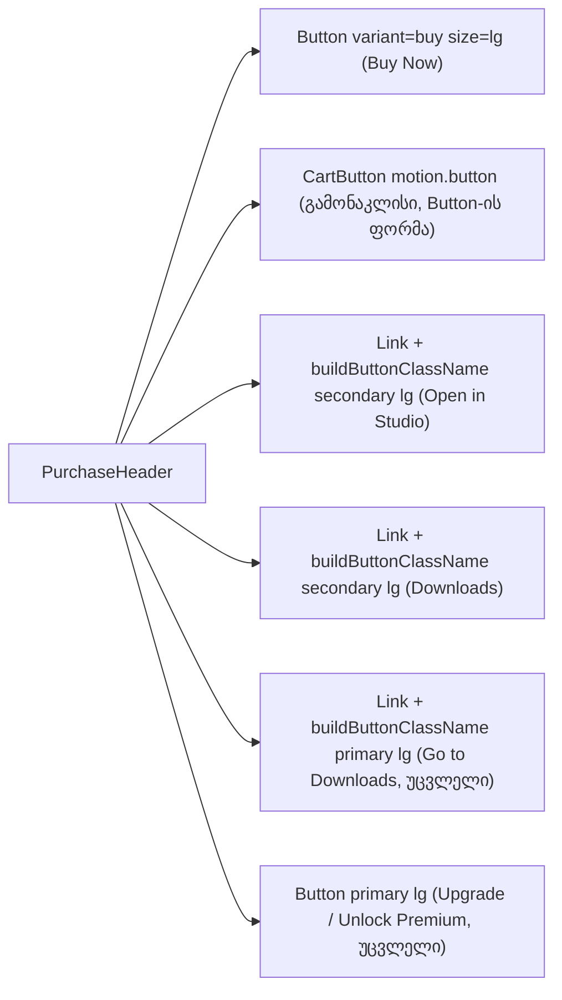

# DPG-BUTTON-CLEANUP-2-NONBRAND, ეტაპი N2: შესყიდვის ბარათი (PurchaseHeader)

**თარიღი:** 2026-11-14
**სტატუსი:** Completed (C round 512 PASS)
**შეცვლილი პროექტი:** Store

## კონტექსტი

Saba-ს DPG-FIX P1 პუნქტი 7 მოითხოვს, რომ Store-ის ღილაკები ერთ Button სისტემაზე იდგეს. ეტაპმა N1 (doc 328) გლობალური audio player გადაიყვანა. N2 პროდუქტის გვერდის შესყიდვის ბარათია (`PurchaseHeader.tsx`), სადაც მყიდველი ფასის გვერდით აჭერს „Buy Now“-ს ან „Add to Cart“-ს.

HEAD `f5d1b9e`-ზე ბარათში ოთხი ხელით აწყობილი ღილაკი იყო. „Buy Now“ იყო `<button>` საკუთარი `bg-buy` კლასით. მფლობელის „Open in Studio“ და „Downloads“ ბმულებს brand და accent outline ჰქონდა. „Add to Cart“ (`CartButton`, `motion.button`) `rounded-lg`-ით და `font-medium`-ით იყო გაფორმებული, Button სისტემაში კი `rounded-md` და `font-semibold` გამოიყენება. ერთ ბარათში ორი ფორმა და ორი ფერის ოჯახი ჩანდა.

## მიდგომა

product-designer-ის გადაწყვეტილებით (`b-round-510/consult-product-designer.md`):

- **Buy Now** იქცა `<Button variant="buy" size="lg">`-ად. `isLoading` არ გამოიყენება, რადგან „Processing...“ ტექსტი და spinner უცვლელი რჩება. ღილაკი ინარჩუნებს handler-ს, `disabled`-ს, `aria-disabled`-ს და `aria-describedby`-ს: ფასის გარეშე ფოკუსირებადია და მიზეზის ტექსტზე მიუთითებს.
- **Open in Studio** (SFX-ის მფლობელი) და **Downloads** (Standard-ის მფლობელი) Link-ები გადავიდა `buildButtonClassName({ variant: 'secondary', size: 'lg' })`-ზე. brand/accent outline აღარ არის. ცალკე outline variant-ის საკითხი Saba-ს კითხვაა (SABA-Q-507-OUTLINE-VARIANT, default: არა).
- **Add to Cart** (`CartButton`) hand-rolled რჩება, როგორც დასახელებული გამონაკლისი (product-designer-ის ვარიანტი b). ფორმა Button-ს გაუთანაბრდა (`rounded-md`, `px-6`, `text-base`, `font-semibold`), სამივე მდგომარეობის ფერი კი უცვლელია. framer-ის „Added“ pulse-იც უცვლელია.
- **PlayStemsButton** N2-ში არ შედის (D-29z1852). ის ვერასოდეს რენდერდება, რადგან `DisplayVersion.stems`-ს app-ის runtime კოდში არცერთი producer არ ავსებს (`app/data/mockProductDetail.ts`-ის `stems` app-ში არსად გამოიყენება). ეს ადასტურებს SIG-R473-STEMS-PLAYER-DEAD-ს. ღილაკი წაიშალოს თუ შეერთდეს, Saba-ს კითხვაა: SABA-Q-511-PLAYSTEMS-WIRE-OR-REMOVE (product-designer-ის default: წაშლა).

განხილული ალტერნატივა იყო `CartButton`-ის `Button`-ზე გადაყვანა. უარი ეთქვა, რადგან `motion.button`-ის pulse და „In Cart“-ის brass tint Button-ის variant-ში არ ჯდება. `docs/design/DESIGN_SYSTEM.md`, `docs/design/components/button.md` და `docs/technical/components/ui-components.md` Add to Cart-სა და Buy Now-ს `variant="primary"`-ად ასახელებდა. რაუნდმა 511 `DESIGN_SYSTEM.md`-ში მხოლოდ ორი სტრიქონი შეცვალა, რის გამოც ფაილი თავის თავს ეწინააღმდეგებოდა (code-reviewer-ის Medium, C511-DESIGNSYSTEM-STALE-PRIMARY-EXAMPLES). რაუნდმა 512 სამივე ფაილის Button-ის სექციები HEAD-ის ქცევას გაუთანაბრა: decision tree, მაგალითები, Shape-ის ცხრილი, primary-ის ბლოკი („Main Actions“) და ახალი buy-ის ბლოკი.

## არქიტექტურა

## შეცვლილი ფაილები

- `app/components/product/PurchaseHeader.tsx` — B-ის sketch, byte-equal.
- `app/lib/__tests__/store-button-cleanup-n2.test.tsx` — ახალი, სტრიქონები N2-1…N2-9.
- `app/lib/__tests__/store-button-cleanup-2c.test.tsx` — B2C-7 და B2C-8 გადაიწერა. `HEAD_BUY_NOW_CLASS` წაიშალა.
- `app/lib/__tests__/store-theme-tokens.test.ts` — ST5-ის PurchaseHeader ნაწილი გადაიწერა.
- `docs/design/DESIGN_SYSTEM.md` — Variant Selection Guide, ფერის ცხრილის Buy/Purchase სტრიქონი და Buttons-ის სექციები (Usage Examples, Shape, Primary, ახალი Buy) (რაუნდები 511 და 512).
- `docs/design/components/button.md` — Primary-ის გამოყენება, ახალი Buy, Focus და Loading-ის სტრიქონები, props, მაგალითი (რაუნდი 512).
- `docs/technical/components/ui-components.md` — Button-ის სექცია: props (`buy`, `destructive`, `shape`), primary და buy ბლოკები, ფერის hex-ები (რაუნდი 512).

## პრობლემები და გადაწყვეტები

- **Problem:** ST5 „Buy Now“-ის მუქ ტექსტს `className`-ში `bg-buy`-ის ძებნით ამოწმებდა. Button-ზე გადასვლის შემდეგ ფერი variant-იდან მოდის და `className`-ში აღარ ჩანს.
  **Solution:** ST5 ახლა ამოწმებს, რომ `bg-buy`-იანი `className` 0-ია და `variant="buy"` ზუსტად ერთხელ გვხვდება. buy tag-ის `className`-ში არც `text-*` და არც `bg-*` token არ უნდა იყოს, ასე რომ variant-ის მუქ ტექსტს ვერაფერი გადაფარავს. variant-ის მუქი ტექსტი ST5-ის Button-ის ნაწილში უკვე მოწმდება.
- **Problem:** Button disabled მდგომარეობაში `pointer-events-none`-ს ამატებს, ამიტომ დაკავებული „Buy Now“ not-allowed cursor-ს აღარ აჩვენებს.
  **Solution:** B-მ ეს Low-ად გადადო (B-R510-BUSY-CURSOR-HIDDEN). ქცევა N2-3-ში busy class-ით არის ჩაწერილი.
- **Problem:** სტრიქონის გადატანისას (375 px) bordered და borderless ღილაკები 2 px-ით განსხვავდება სიმაღლეში (secondary 50, buy 48).
  **Solution:** წინასწარ არის განსაზღვრული (B pre-ruled 4) და C-ის C1 სტრიქონი ზომავს.

## ტესტირება

- `store-button-cleanup-n2.test.tsx`:
  - N2-1: anonymous „Buy Now“-ის class უდრის builder-ის buy lg სტრიქონს. აქვს `type="button"`, ერთი icon და label, „Loading...“ არა.
  - N2-2: ფასის გარეშე `aria-disabled="true"`, native disabled არა. `aria-describedby` მიზეზის `
`-ზე მიუთითებს. click არცერთ spy-ს არ იძახებს (signed-in და anonymous).
  - N2-3: buying-ის დროს „Processing...“ და spinner, native disabled, builder-ის busy class.
  - N2-4: cart-ში დამატებისას „Buy Now“ native disabled-ია.
  - N2-5: „Open in Studio“ secondary lg-ია `recordingsHref`-ით. „Go to Downloads“ primary lg რჩება.
  - N2-6: „Downloads“ secondary lg-ია `/account/downloads`-ით. „Upgrade to Premium“ უცვლელია და click მხოლოდ `onSelectPremium`-ს იძახებს.
  - N2-7: „Add to Cart“ და „In Cart“ Button-ის ფორმას ატარებს და ძველი `rounded-lg`/`px-5`/`font-medium` აღარ აქვს.
  - N2-8: „Buy Now“ ერთხელ იძახებს `buyNow(1, 12)`-ს, „Add to Cart“ კი მხოლოდ `addToCart`-ს (handler-ების swap guard).
  - N2-9: source-ში `<button` tag 0-ია, `<Button` 3 (ერთი `variant="buy"`), `buildButtonClassName(` 3 და `motion.button` 1.
- `store-button-cleanup-2c.test.tsx`: B2C-7 (buy Button-ის class + sign-in modal) და B2C-8 (builder 3, Button 3, ერთი buy, lowercase button 0).
- `store-theme-tokens.test.ts`: ST5 (PurchaseHeader-ის buy tag-ში ფერის override არ არის).
- ბრძანებები და შედეგები, მათ შორის mutant-ების ცხრილი: `a-round-511.md` (loop folder).

## TODO / შემდეგი ნაბიჯები

- SABA-Q-511-PLAYSTEMS-WIRE-OR-REMOVE: Saba-ს პასუხის მიხედვით PlayStemsButton-ის წაშლა ან მიერთება.
- SABA-Q-507-OUTLINE-VARIANT: Saba-ს პასუხის შემთხვევაში outline variant.
- B-R510-BUSY-CURSOR-HIDDEN (Low, deferred).
- NONBRAND N3–N9 გაფართოებული scanner-ით (D-29z1853).
