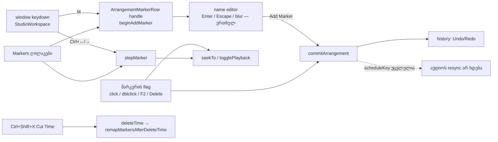

# Studio Lab — სახელიანი მარკერები, ეტაპი 1 (SRW-16 / FB-10)

**თარიღი:** 2026-10-21
**სტატუსი:** Round 73 — C-R72-01-ის გასწორება (D-29z38); C-ის შემოწმებას ელოდება
**შეცვლილი პროექტი:** Store

## კონტექსტი

მომხმარებელს (FB-10, `transcripts/2.srt` 01:28–02:12) გრძელ პროექტში სახელიანი ნიშნულები სჭირდება, მაგალითად „აქ შედის მუსიკა“. მათგან უნდა შეეძლოს დაკვრის დაწყება და მათ შორის გადასვლა. ნიშნულები ზემოთ უნდა ჩანდეს, რომ ბევრი ხაზის და ვიდეოს მონტაჟისას ორიენტაცია არ დაკარგოს. Ableton-ში ამას locator ჰქვია (Live 12 manual, §6.4).

SRW-16 ორ ეტაპად იყოფა. ეს დოკუმენტი პირველ ეტაპს აღწერს: მონაცემთა მოდელი, დამატება სახელით, ჩვენება, გადასვლა, დაკვრა მარკერიდან, წინა/შემდეგი, სახელის შეცვლა, წაშლა, Undo/Redo და Cut Time-ის remap.

## მიდგომა

- **მარკერები `Arrangement`-ის ნაწილია** (`markers?`, არასავალდებულო ველი). ამიტომ Undo/Redo, `isSameArrangement` და `commitHistory` მათ ახალი history კოდის გარეშე ფარავს. ველი არასავალდებულოა, რომ Studio-ს გარეთ არსებული `Arrangement`-ის literal-ები (SFX scene, free downloads) და ძველი ტესტები არ დაზიანდეს.
- **Normal form:** სია დროით დალაგებულია, ერთ მილიწამზე მაქსიმუმ ერთი მარკერია, დრო ms-ზე მრგვალდება და ≥ 0-ია, სახელი trim-ირებულია და 1–64 code point-ია. ბოლო მარკერის წაშლისას გასაღები იშლება და `[]` არასოდეს რჩება. ამის გამო მარკერის დამატება+წაშლა პროექტის JSON-ს ზუსტად აღადგენს.
- **აუდიოს resync არ ხდება.** `scheduleKey` კვლავ `[clips, loop]`-ია, ამიტომ მარკერის ცვლილება დაკვრას არ წყვეტს და graph-ს თავიდან არ აგებს. ექსპორტი მარკერებს არ იყენებს.
- **სუფთა ლოგიკა ცალკე ფაილშია** (`markers.ts`). ის React-ს და `model.ts`-ს არ იმპორტებს, რაც import cycle-ს გამორიცხავს. `model.ts`-ის `deleteTime` მას იყენებს.
- **ცალკე რიგი timeline chrome-ში**, ტემპის რიგსა და Loop რიგს შორის. ruler ხელშეუხებელი დარჩა, რომ მისი double-click Fit-ის ქცევა არ დაზიანდეს. რიგი sticky-ა, ამიტომ ხაზების ვერტიკალური scroll-ისას ზემოთ რჩება.
- **Wiring:** `ArrangementMarkerRow` არის `forwardRef` კომპონენტი, რომელიც `useImperativeHandle`-ით `{ beginAddMarker, stepMarker }`-ს აჩენს. `StudioWorkspace` მხოლოდ კლავიშებს გადასცემს. ასე workspace-ის ცვლილება მცირეა.
- **ვიზუალი** (design-philosopher-ის რჩევით): მარკერი ნეიტრალურია (`bg-muted` ხაზი, `bg-foreground/10` ტეგი). არჩეული მარკერი `brand`-ია. `accent` რიგში არ გამოიყენება, რადგან playhead-ი და Loop უკვე accent-ია.

### Ableton-თან მიმართება (Live 12 manual, §6.4, §6.9, §6.11; B-ის 2026-10-21 capture)

| ქცევა | CZABA |
|---|---|
| დამატება insert marker-ზე ან მონიშვნის დასაწყისში | იგივე: position ან `range.start` |
| დამატება დაკვრისას | live position-ზე, quantization-ის გარეშე (შეგნებული განსხვავება) |
| სახელი შექმნისას | CZABA-ს არჩევანი (editor მაშინვე იხსნება); Ableton-ში ეს არ წერია |
| click / double-click | იგივე: გადასვლა / გაჩერებულისას დაკვრა |
| Ctrl+←/→ | მხოლოდ მარკერებზე, 0-ზე და ბოლოზე; კლიპის კიდეები მე-2 ეტაპშია. ღილაკები დაკვრას არ იწყებენ (D-15) |
| სახელის შეცვლა | F2 (Ctrl+R ბრაუზერის reload-ია) — შეგნებული განსხვავება |
| Delete Time | შიგნით მოხვედრილი მარკერი იშლება, შემდეგი გადაიწევს; Ableton-თან თანხვედრა დაუდასტურებელია |

## არქიტექტურა

## შეცვლილი ფაილები

- `app/types/arrangement.ts` — `ArrangementMarker` და არასავალდებულო `markers?`.
- `app/lib/arrangement/markers.ts` (ახალი) — normal form, ნაგულისხმევი სახელი `Marker N`, დამატება/სახელის შეცვლა/წაშლა, წინა/შემდეგი სამიზნე, Delete Time-ის remap.
- `app/lib/arrangement/model.ts` — `deleteTime` მარკერებსაც remap-ავს; სხვა ქცევა უცვლელია.
- `app/contexts/ArrangementContext.tsx` — Cut Time-ის სტატუსს ემატება „N მარკერი წაიშალა.“.
- `app/components/arrangement/ArrangementMarkerRow.tsx` (ახალი) — Markers რიგი: header-ის ღილაკები (+ ◀ ▶), flag-ები, სახელის editor.
- `app/components/arrangement/StudioWorkspace.tsx` — რიგის ჩასმა chrome-ში; M და Ctrl+←/→; ორივე drag-ის დროს უარყოფილია; Delete და ისრით კლიპის გადაწევა მარკერზე ფოკუსისას არ მუშაობს. Round 73: timeline-ზე დაჭერა მარკერის გარეთ ფოკუსირებულ flag-ს blur-ს უკეთებს.
- `app/lib/arrangement/__tests__/markers.test.ts`, `markers-ui.test.tsx` (ახალი) — MK1–MK10, MU1–MU14. Round 73: MU8c–MU8f.

## პრობლემები და გადაწყვეტები

- **Enter-ის შემდეგ blur-მა შეიძლება მეორედ დაამატოს.** → editor ერთხელ წყდება (`settledRef`). პირველი Enter, Escape ან blur წყვეტს, შემდეგი არაფერს აკეთებს. Escape-ის შემდეგ ფოკუსი წინა ელემენტს უბრუნდება და input-ის სინქრონული blur-ი არაფერს ამატებს.
- **Delete სახელის input-ში მარკერს არ უნდა შლიდეს.** → input მარკერის ღილაკის შიგნით კი არა, მის გვერდით დგას. window handler typing target-ს უგულებელყოფს. ამიტომ მუტაცია (m) ექვივალენტურია.
- **მარკერზე Delete-მა არჩეული კლიპი არ უნდა წაშალოს.** → flag-ი კლავიშს თვითონ ამუშავებს და `stopPropagation`-ს აკეთებს. window-ის Delete-ის და ისრის შტოები `isMarkerTarget`-ს გამორიცხავს.
- **drag-ის დროს რედაქტირება.** → M და Ctrl+←/→ window-ის უარყოფის სიაშია (`GESTURE_EDIT_BLOCKED_MESSAGE`). ღილაკებს და flag-ის Delete-ს თავისი შემოწმება აქვს, რადგან ისინი window-ის სიას არ გადიან.
- **Blur drag-ის დაწყებისას.** კლიპზე დაჭერა input-ს blur-ს უკეთებს, gesture-ის `before` snapshot-ი კი მარკერს გადაფარავდა. Undo-ში ცარიელი `Add Marker` რჩებოდა (code-review #1). → blur აქტიური gesture-ის დროს არაფერს ინახავს და `GESTURE_EDIT_BLOCKED_MESSAGE`-ს აჩვენებს (MU13).
- **Blur-ის შემდეგ ფოკუსი flag-ზე ბრუნდებოდა** (code-review #2). → ფოკუსი მხოლოდ Enter-ზე და Escape-ზე გადადის. blur-ისას ის იქ რჩება, სადაც მომხმარებელმა გადაიტანა (MU14). ორივე R6-ის ტექსტიდან გადახვევაა და B-მ უნდა დაადასტუროს.
- **C-R72-01: მარკერის დამატების შემდეგ კლიპზე click და Delete მარკერს შლიდა** (round 73). Enter-ის შემდეგ ფოკუსი flag-ზე რჩება. `ArrangementClip.beginGesture` pointerdown-ზე `preventDefault`-ს აკეთებს, ამიტომ ბრაუზერი ფოკუსს არ გადაიტანდა. `releaseEditFocusOnTimelinePointerDown`-ს flag-ის შემთხვევა არ ჰქონდა, window-ის Delete-ისა და ისრის შტოები კი marker target-ზე ჩერდებოდა. → loop brace-ის პარალელური ერთი პირობა: ფოკუსი flag-ზეა და pointer-ის სამიზნე მარკერის გარეთაა → blur. Handler scroller-ის capture-ზეა და ფარავს ruler-ს, ტემპის რიგს, Markers რიგს, Loop რიგს, ხაზების ფონსა და კლიპებს. capture კლიპის gesture-ის claim-მდე სრულდება, ამიტომ `isPointerGestureActive()` იქ ჯერ false-ია. Markers header-ის ღილაკები (+ ◀ ▶) მარკერის გარეთაა: დაჭერა flag-ს blur-ს უკეთებს (MU8d). შემდეგ ფოკუსს Chrome-ში ღილაკი იღებს, Safari-ში კი body (ღილაკი click-ზე ფოკუსს არ იღებს). სახელის input-იც მარკერის გარეთაა (გვერდით დგას), მაგრამ ღია editor-ის დროს ფოკუსი input-ზეა და არსებული `focused.contains(target)` დაცვა მას ტოვებს. flag-ზე ფოკუსი და ღია editor ერთად ვერ იარსებებს, რადგან input-ის blur editor-ს ხურავს.
- **ორი მიღებული გადახვევა (B, D-29z38).** gesture-ის დროს blur არაფერს ინახავს; blur ფოკუსს არსად გადაიტანს. ფოკუსს მომხმარებლის click წყვეტს. ეს CZABA-ს მოდელია, Ableton-თან შესაბამისობა არ ეხება.
- **window-ის Delete/ისრის `isMarkerTarget` დაცვა** (C round 72-ის მუტაცია h). flag-ი კლავიშს თვითონ ამუშავებს მხოლოდ მაშინ, როცა `event.target` თვითონ flag-ია. MU8f კლავიშს flag-ის შიგნითა label-იდან აგზავნის, რომელიც `stopPropagation`-ს არ აკეთებს. ასე window-ის დაცვა პირდაპირ მოწმდება. ეს სინთეზური გზაა (რეალური კლავიატურა ფოკუსირებულ ღილაკს მიმართავს), ანუ defense-in-depth.
- **ES2022 lib-ში `findLast` არ არის.** → წინა მარკერი უკუღმა ციკლით იძებნება.

## ტესტირება

- **Red run** (წყაროს ცვლილებამდე): `markers.test.ts` — მოდული არ არსებობს; `markers-ui.test.tsx` — 15 ჩავარდა / 1 გავიდა. MU12 typing-ის დაცვის ტესტია და baseline-ზეც მწვანეა.
- **ახალი ტესტები:** 26 pure + 18 UI. ასევე 44 ფაილი / 835 ტესტი, რომლებიც `StudioWorkspace`-ს ან `ArrangementContext`-ს ეხება — ყველა მწვანეა.
- **მუტაციები** (`tmp/studio-real-loop/a-round-72/mutations.txt`): a–l და n დაიჭირეს, ასევე o, p, q და review-ის შემდეგ დამატებული r, s. m ექვივალენტურია (input მარკერის გვერდით დგას).
- **Gates (A):** `tsc` 0; Biome შეცვლილ ფაილებში 0 დიაგნოსტიკა, `./app` 0 error / 218 warning / 1 info. სრული vitest და `npm run verify` root-ის gate-ია (speed rules, 2026-10-21).
- **ბრაუზერის smoke** (A, PASS არ არის): `/studio-lab`, 1440×900. Middle East 0-ზე; ruler-ზე click 12 წმ-ზე; M; „აქ შედის მუსიკა“; Enter. flag-ი 12 წმ-ის tick-ზეა (480 px, 40 px/წმ). Undo-ს სათაურია `Add Marker`. დაჭერისას 12.000. double-click-იდან 1 წმ-ში პოზიცია 12.972 იყო. დაკვრისას M-მა `createBufferSource` 0-ჯერ გამოიძახა. Ctrl+→ ×4: 12 → 12.98 → ბოლო → სტატუსი. აკრძალული მოთხოვნა 0, hydration warning 0.

- **Round 73:** MU8c (bug: flag focus → clip body click → Delete/ArrowRight კლიპზე მოქმედებს, მარკერები უცვლელია, Undo), MU8d (ხაზის ფონი, ruler), MU8e (სხვა flag, label, ღია input — ფოკუსი რჩება), MU8f (window-ის დაცვა). მუტაციები (`tmp/studio-real-loop/a-round-73.md`): (i) პირობის წაშლა → MU8c/MU8d წითელი; (ii) `!isMarkerTarget(event.target)`-ის მოხსნა → MU8e წითელი; (h1) window-ის Delete-ის დაცვის მოხსნა → MU8f წითელი; (h2) ისრის დაცვის მოხსნა → MU8 და MU8f წითელი. A-ის ბრაუზერის self-check (PASS არ არის): Chromium 1440×900 და 1280×720, M → Enter → clip body click → → → Delete: კლიპი 0.050 → 0.150 → წაიშალა, მარკერი დარჩა.

## TODO / შემდეგი ნაბიჯები

- **SRW-16 ეტაპი 2** (შემდეგი რაუნდი):
  - მარკერის გადაადგილება drag-ითა და ისრებით, snap-ით;
  - მარჯვენა click-ის მენიუ (Rename, Delete, Play from here) — სახელის შეცვლის mouse-გზა;
  - კლიპების, მონიშვნისა და playhead-ის snap მარკერებზე (Live 6.7, SRW-14-ის გაგრძელება);
  - Ctrl+←/→ კლიპის კიდეებზეც.
- C-ის ბრაუზერის შემოწმება (§4.6–§4.8) და Ableton-ის ორი ვერდიქტი თითო ქცევაზე.
- workspace-ის ქვედა shortcut-ის ზოლში M და Ctrl+←/→ ჯერ არ წერია (ამ რაუნდში `StudioWorkspace`-ის ცვლილება §2.1-ის wiring-ით შემოიფარგლა).
