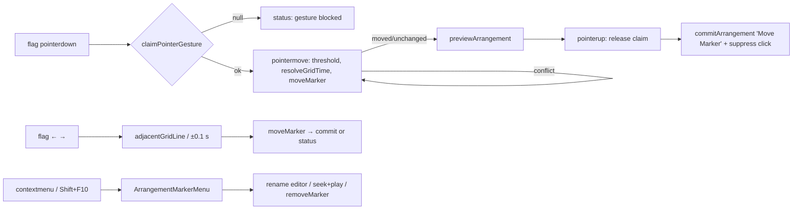

# Studio Lab — მარკერის გადატანა და კონტექსტური მენიუ, ეტაპი 2a (SRW-16 / FB-10)

**თარიღი:** 2026-10-21
**სტატუსი:** Round 74 — იმპლემენტირებულია; C-ის შემოწმებას ელოდება (D-29z39)
**შეცვლილი პროექტი:** Store

## კონტექსტი

ეტაპი 1-ის ([064](064-studio-lab-markers.md)) შემდეგ მარკერი იქმნებოდა, ერქმეოდა სახელი და იშლებოდა, მაგრამ ადგილს ვერ იცვლიდა. მომხმარებელს (FB-10) ნიშნულის გადაწევა სჭირდება, როცა მონტაჟი იცვლება, და მარკერზე მარჯვენა ღილაკით სწრაფი მოქმედებები. Live 12 manual §6.4: „Selected locators can be moved by clicking and dragging or by using the arrow keys“.

SRW-16-ის მეორე ეტაპი ორად გაიყო. 2a (ეს დოკუმენტი) მხოლოდ მარკერების რიგს ეხება. 2b (round 75) — კლიპების/მონიშვნის/playhead-ის snap მარკერებზე და Ctrl+←/→-ის გაჩერება კლიპის კიდეებზე.

## მიდგომა

- **`moveMarker` (markers.ts)** აბრუნებს discriminated result-ს: `moved` (ახალი arrangement + მარკერი), `unchanged` (იგივე reference — უცნობი id ან იგივე მრგვალებული დრო) ან `conflict` (`other` — სხვა მარკერი `MARKER_TIME_EPS`-ში). დრო ms-ზე მრგვალდება, 0-ზე ჩერდება, სია თავიდან ლაგდება; `id` და `name` უცვლელია. `projectEnd`-ის იქით გადატანა დაშვებულია (CZABA-ს არჩევანი).
- **Drag** loop brace-ის pattern-ს იმეორებს: `claimPointerGesture` → `setPointerCapture` (`watchUncapturedPointerGesture` fallback) → 3 px threshold → `resolveGridTime(roundMarkerTime(original + dx / pxPerSecond), snapSeconds, gridSeconds, altKey)` → `previewArrangement`. ხელის აშვებისას claim ჯერ თავისუფლდება, შემდეგ ერთი `Move Marker` commit კეთდება. Abort (blur, სხვა claim) `before`-ს აღადგენს. კოლიზიისას preview ბოლო ვალიდურ დროზე რჩება.
- **Click drag-ის შემდეგ:** drag-ის ბოლოს `suppressClickRef` იმავე მარკერზე ერთ task-ზე (`setTimeout 0`) ბლოკავს `click`-ს და `dblclick`-ს. ასე drag-ის შემდეგ playhead არ ხტება და დაკვრა არ იწყება; შემდეგი ჩვეულებრივი click ისევ მუშაობს.
- **Focus press-ზე:** pointerdown `preventDefault`-ს იძახებს, ამიტომ flag-ს ცალსახად `focus({ preventScroll: true })` ეძლევა და ის მოინიშნება (MU8e შესაბამისად შეიცვალა — Chromium-ის რეალური ქცევა, C73-2c).
- **DOM-ის რიგი drag-ის დროს:** React keyed სიის გადალაგებისას შესაძლოა გადაწეული flag DOM-ში გადაადგილდეს და pointer capture/focus დაკარგოს. ამიტომ drag-ის დროს flag-ები drag-ის დაწყების რიგით (`dragOrder`) იხატება, პოზიცია კი დროით; label-ის სიგანე დალაგებული სიით ითვლება. Commit-ის შემდეგ `pendingFocusRef` focus-ს გადაწეულ flag-ზე აბრუნებს.
- **ისრები** (focused flag, modifier-ების გარეშე, `target === currentTarget`): Snap ჩართულისას `adjacentGridLine`, გამორთულისას ±0.1 s. 0-ზე ← → სტატუსი `მარკერი დროის დასაწყისშია.`; კოლიზია → `ამ დროზე მარკერი უკვე არის: «…»`, history-ის გარეშე. `preventDefault` + `stopPropagation`; window-ის `!isMarkerTarget` guard მეორე დაცვაა. Ctrl/Meta/Alt+ისრები window-ს რჩება (Ctrl+←/→ = ნავიგაცია).
- **კონტექსტური მენიუ** (`ArrangementMarkerMenu`, ახალი): მარჯვენა ღილაკი, Shift+F10 ან ContextMenu კლავიში. პუნქტები: `სახელის შეცვლა (F2)`, `დაკვრა აქედან`, `წაშლა (Delete)`. მენიუ viewport-ში 4 px margin-ით ჯდება, პირველ პუნქტს focus ეძლევა, ↑/↓ ბრუნავს, Home/End, Enter/Space, Escape/Tab ხურავს და focus flag-ს უბრუნდება. გარე press მხოლოდ ხურავს — grid menu-ის `armGridMenuDismissClickSwallow` ხელახლა გამოიყენება (ერთი `export`). მოქმედება ყოველთვის მარჯვენა ღილაკით დაჭერილ მარკერს ეხება. Drag/gesture-ის დროს მოქმედებები `GESTURE_EDIT_BLOCKED_MESSAGE`-ით უარყოფილია.
- **მენიუ `document.body`-ში portal-ით იხატება** (code-review): sticky `z-30` chrome-ის stacking context-ში ის floating video dock-ის (`z-40`) ქვეშ მოხვდებოდა. flag-ს აქვს `aria-haspopup="menu"` და ღია მენიუსას `aria-expanded`. Drag-ის abort-ის (blur) შემდეგაც click ერთ task-ზე იბლოკება.
- **`forwardRef` არ არის საჭირო** `ArrangementMarkerMenu`-სთვის: მშობელს მასზე ref არ სჭირდება, focus-ს მენიუ თავად მართავს (იგივე, რაც `ArrangementGridMenu`).
- **აუდიო:** `scheduleKey` მხოლოდ `[clips, loop]`-ს ითვალისწინებს, ამიტომ გადატანა დაკვრის დროს ახალ `AudioBufferSourceNode`-ს არ ქმნის.

### Ableton-თან მიმართება (Live 12 manual §6.4; B-ის 2026-10-21 capture)

| ქცევა | სტატუსი | CZABA |
|---|---|---|
| გადატანა drag-ით და ისრებით | დადასტურებული | იგივე |
| ისრის ბიჯი, drag-ის snap, Alt | დაუდასტურებელი | grid line / 0.1 s; Alt Snap-ს აბრუნებს (SRW-14) |
| ორი მარკერი ერთ დროზე | დაუდასტურებელი | უარყოფილია |
| კონტექსტური მენიუს პუნქტები | შეგნებული განსხვავება | Rename / Play from here / Delete (FB-10) |
| დაკვრა მარკერიდან | დადასტურებული (double-click) | მენიუს პუნქტი იმავე მოქმედებას იძახებს |

## არქიტექტურა

## შეცვლილი ფაილები

- `app/lib/arrangement/markers.ts` — `moveMarker`, `MoveMarkerResult`
- `app/components/arrangement/ArrangementMarkerRow.tsx` — drag, ისრები, მენიუს გახსნა და მოქმედებები, a11y ტექსტი, ახალი props `snapSeconds`/`gridSeconds`
- `app/components/arrangement/ArrangementMarkerMenu.tsx` — ახალი
- `app/components/arrangement/ArrangementGridMenu.tsx` — მხოლოდ `export armGridMenuDismissClickSwallow`
- `app/components/arrangement/StudioWorkspace.tsx` — მხოლოდ ორი prop `ArrangementMarkerRow`-ზე
- `app/lib/arrangement/__tests__/markers.test.ts` — MK-MOVE1–4
- `app/lib/arrangement/__tests__/markers-move-ui.test.tsx` — ახალი, MV1–MV14 (+MV11b)
- `app/lib/arrangement/__tests__/markers-ui.test.tsx` — მხოლოდ MU8e-ის ორი assertion
- `docs/implementation/2026/quarter-IV/064-studio-lab-markers.md` — სტატუსის ხაზი

## პრობლემები და გადაწყვეტები

- **Problem:** pointerdown-ის `preventDefault` flag-ს focus-ს არ აძლევს. → **Solution:** ცალსახა `focus({ preventScroll: true })` და მონიშვნა press-ზე.
- **Problem:** drag-ის შემდეგ ბრაუზერის `click`/`dblclick` playhead-ს გადახტუნებდა ან დაკვრას დაიწყებდა. → **Solution:** `suppressClickRef` ერთი task-ის განმავლობაში.
- **Problem:** მეზობელი მარკერის გადაკვეთისას keyed სიის გადალაგება გადაწეულ flag-ს capture-ს/focus-ს დააკარგვინებდა. → **Solution:** drag-ის დროს `dragOrder` DOM-ის რიგს ყინავს; commit-ის შემდეგ `pendingFocusRef`.
- **Problem:** Shift+F10 / ContextMenu კლავიშმა შეიძლება native `contextmenu`-ც გამოიწვიოს. → **Solution:** keydown მენიუს flag-ის ქვედა-მარცხენა კუთხეზე ხსნის; იმავე მარკერზე ღია მენიუსას კლავიატურიდან მოსული `contextmenu` (button ≠ 2) იგნორირდება.
- **Problem (ღია):** MU8 (`markers-ui.test.tsx` ხაზი 526) ელის, რომ ← → focused flag-ზე history-ს არ ქმნის. B5-ით ეს ახლა `Move Marker`-ია. ხაზი A-ის grant-ის გარეთაა; B-მ უნდა დაუშვას ერთი assertion-ის შეცვლა.

## ტესტირება

- `npx vitest run` — markers.test.ts (30), markers-ui.test.tsx (22, 1 ჩავარდნა — MU8 ხაზი 526, იხ. ზემოთ), markers-move-ui.test.tsx (15), delete-selection-ui (13), grid-musical-ui (14), grid-snap-menu (39), grid-snap-keys (13), grid-triplet-ui (10).
- Mutation proofs: re-sort-ის მოხსნა → MK-MOVE1/MV5 წითელი; click guard-ის მოხსნა → MV4/MV13 წითელი; press focus-ის მოხსნა → MV8/MU8e წითელი; ისრის branch-ის `target === currentTarget`-ის გარეშე → MU8f წითელი; მხოლოდ `stopPropagation`-ის მოხსნა გადარჩა (window `!isMarkerTarget` guard); კოლიზიის შემოწმების მოხსნა → MK-MOVE2/MV5/MV6 წითელი; კლავიატურის ორმაგი გახსნის guard-ის მოხსნა → MV11 წითელი; abort-ზე click suppression-ის მოხსნა → MV14 წითელი.
- `npm run typecheck`, `npm run lint` — სუფთა. ბრაუზერის შემოწმება C-ს ეკუთვნის.

## TODO / შემდეგი ნაბიჯები

- B: MU8 ხაზი 526-ის grant (`toBe('Move Marker')` ან assertion-ის ამოღება).
- Round 75 — ეტაპი 2b: snap მარკერებზე და Ctrl/Option+←/→ კლიპის კიდეებზე.
- მენიუ ჰორიზონტალურ scroll-ზე არ იხურება (resize/blur-ზე იხურება); საჭიროების შემთხვევაში B-მ დაგეგმოს.
