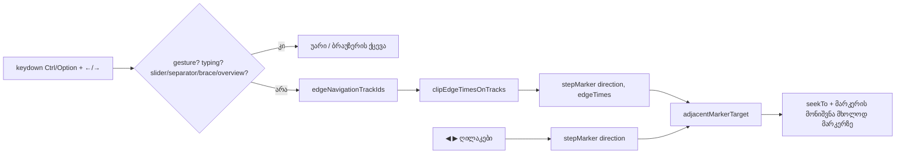

# Studio Lab — Ctrl/Option+←/→ კლიპების კიდეებზეც ჩერდება, ეტაპი 2b-2 (SRW-16 / FB-10)

**თარიღი:** 2026-10-22
**სტატუსი:** Round 77 — იმპლემენტირებულია, C-ის შემოწმებას ელოდება (D-29z42)
**შეცვლილი პროექტი:** Store

## კონტექსტი

SRW-16-ის პირველ ეტაპზე Ctrl+←/→ playhead-ს მხოლოდ მარკერებზე, შემდეგ კი პროექტის ბოლოზე ან 0-ზე გადაიყვანდა. Live 12-ის manual-ში (§6.9) ეს ღილაკები locator-ებთან ერთად მონიშნული ხაზ(ებ)ის კლიპების კიდეებზეც ჩერდება. Mac-ზე Ctrl+←/→ macOS-ს Spaces-ისთვის აქვს დაკავებული, ამიტომ იქ ეს shortcut დღემდე მიუწვდომელი იყო (gate-73 reviewer-ის S1, ROOT-R73-S1-MAC-CTRL-ARROWS).

## მიდგომა

### წესები (N1–N9)

| # | წესი |
|---|---|
| N1 | Ctrl+←/→ (Apple-ზე Option+←/→-იც) playhead-ს გადაიყვანს მიმდინარე პოზიციის მკაცრად წინა/მომდევნო გაჩერებაზე (`MARKER_TIME_EPS`). გაჩერებებია მარკერების დროები და მონიშნული ხაზების ყველა კლიპის დასაწყისი და ბოლო. თუ ამ მიმართულებით გაჩერება აღარ არის, ძველებურად მოქმედებს პროექტის ბოლო / 0, შემდეგ კი უარის ტექსტი. |
| N2 | „მონიშნული ხაზები“ არის `activeTrackId`, `selectedClipIds`-ის კლიპების ხაზები და time range-ის ხაზი (`range.allTracks` შემთხვევაში ყველა ხაზი). უცნობი id იგნორირდება. ვიდეოხაზიც იგივე წესით ითვლება. |
| N3 | მარკერი და კლიპის კიდე `MARKER_TIME_EPS`-ის ფარგლებში ერთი გაჩერებაა და ის მარკერად ითვლება (მარკერი მოინიშნება). |
| N4 | მარკერზე გაჩერება მარკერს ძველებურად მონიშნავს. კლიპის კიდეზე და ბოლო/0-ზე გაჩერებისას მარკერის მონიშვნა არ იცვლება. წარმატებისას status ტექსტი არ ჩნდება. |
| N5 | ◀ ▶ ღილაკები ისევ მხოლოდ მარკერებზე გადადის (Live 12 §6.4 Previous/Next Locator). label, `title` და `aria-keyshortcuts` უცვლელია. |
| N6 | Apple პლატფორმაზე Option(Alt)+←/→ Ctrl/Meta/Shift-ის გარეშე Ctrl+←/→-ის ტოლფასია, იგივე target guard-ებით. ეს branch clip nudge-მდე სრულდება, ამიტომ Mac-ზე Option+→ მონიშნულ კლიპს არ ამოძრავებს. Ctrl+←/→ Mac-ზეც მუშაობს. |
| N7 | პლატფორმა მხოლოდ keydown-ის დროს მოწმდება (`navigator.platform`, ცარიელობისას `navigator.userAgent`; `Mac`, `iPhone`, `iPad`, `iPod`). render-ში პლატფორმა არ იკითხება, ამიტომ hydration-ის განსხვავება არ წარმოიქმნება. |
| N8 | Windows/Linux-ზე Alt+←/→ ზუსტად round 76-ის ქცევას ინარჩუნებს (nudge branch არ შეცვლილა). |
| N9 | history, arrangement და მარკერები არ იცვლება. დაკვრა გრძელდება. თუ მონიშნულ ხაზებზე ძველ გაჩერებებს შორის კლიპის კიდე არ არის, შედეგი round 76-ს ემთხვევა. |

### რატომ ასე (N2, N5)

- **N2:** Live-ის manual ამბობს „the selected track or tracks“, მაგრამ განმარტებას არ იძლევა. CZABA-ში ხაზის „მონიშვნას“ სამი წყარო აქვს: აქტიური ხაზი (lane name-ის `aria-pressed`), მონიშნული კლიპები და time range. სამივეს გაერთიანება ყველაზე ნაკლებად მოულოდნელია: მომხმარებლის მიერ დანახული ნებისმიერი მონიშვნა გაჩერებებს ამატებს.
- **N5:** §6.4-ის მიხედვით Previous/Next Locator ღილაკები მხოლოდ locator-ებზე გადადის. ღილაკები გაჩერებას `stepMarker(±1)`-ით, კიდეების გარეშე ითხოვს. მათი `aria-keyshortcuts` ისევ `Control+ArrowLeft/Right`-ს აცხადებს, თუმცა კლავიში ახლა მეტ გაჩერებას იცნობს. ეს შეუსაბამობა B-მ Low სიგნალად აღრიცხა (R77-BUTTON-SHORTCUT-SUPERSET).

### Ableton-თან მიმართება

| ქცევა | წყარო | იქ დადასტურებული | CZABA-ს გადაწყვეტილება |
|---|---|---|---|
| Ctrl (Win) / Option (Mac) + ←/→ locator-ებზე და მონიშნული ხაზ(ებ)ის კლიპების კიდეებზე | Live 12 manual §6.9, B-ის capture `b-round-71/ableton-arrangement-view-20261021.txt` (2026-10-22-ს ხელახლა წაკითხული) | დადასტურებული (ტექსტი) | N1, N6. Live insert marker-ს ამოძრავებს, CZABA კი playhead-ს (D-29z37). Mac-ზე Ctrl-იც რჩება |
| რას ნიშნავს „selected tracks“ | §6.9 | დაუდასტურებელი | N2 — CZABA-ს გადაწყვეტილება |
| Previous/Next Locator ღილაკები | §6.4 | დადასტურებული (ტექსტი) | N5 — უცვლელი |
| locator-ისა და კლიპის კიდის დამთხვევა | — | დაუდასტურებელი | N3 — ერთი გაჩერება, მარკერი |
| Windows Alt+←/→ | — | Live-ის shortcut არ არის | N8 — უცვლელი |
| insert marker ხაზებს შორის (↑/↓) | §6.9 | დადასტურებული Live-ში | არ ეხება: CZABA-ს playhead-ისგან ცალკე insert marker არ აქვს |

### ტექნიკური გადაწყვეტა

- ახალ `edge-navigation.ts`-ში სამი სუფთა ფუნქციაა (React-ისა და `navigator`-ის გარეშე): `edgeNavigationTrackIds` (N2), `clipEdgeTimesOnTracks` (კიდეები 1 ms-მდე მრგვალდება `roundMarkerTime`-ით, შემდეგ სორტირდება და `MARKER_TIME_EPS`-ით ერთიანდება) და `isApplePlatform` (N7).
- `adjacentMarkerTarget` ახალ არასავალდებულო `edgeTimes` პარამეტრს იღებს. ის უახლოეს მარკერსა და უახლოეს კიდეს ცალ-ცალკე პოულობს და კიდეს მხოლოდ მაშინ აბრუნებს, როცა ის მარკერზე მკაცრად (EPS-ზე მეტით) ახლოსაა. წინააღმდეგ შემთხვევაში მარკერს აბრუნებს (N3). დამრგვალებული კიდე პროექტის ბოლოს ვერ გადააჭარბებს (`Math.min(edge, end)`). თუ პარამეტრი გამოტოვებულია, შედეგი ძველია.
- `stepMarker` `edgeTimes`-ს უბრალოდ გადასცემს. ღილაკები მას არ გადასცემს (N5).
- `StudioWorkspace`-ის Ctrl+←/→ branch-ს Apple Option-ის პირობა დაემატა. ის კიდეებს `getArrangement()`-ით, `activeTrackId`-ით, `selectedClipIds`-ითა და `range`-ით ითვლის.

## არქიტექტურა

## შეცვლილი ფაილები

- `app/lib/arrangement/edge-navigation.ts` (ახალი): მონიშნული ხაზები, კლიპების კიდეები და Apple პლატფორმის predicate.
- `app/lib/arrangement/markers.ts`: `adjacentMarkerTarget`-ის არასავალდებულო `edgeTimes` პარამეტრი.
- `app/components/arrangement/ArrangementMarkerRow.tsx`: `stepMarker` და handle-ის ტიპი `edgeTimes`-ს გადასცემს.
- `app/components/arrangement/StudioWorkspace.tsx`: Ctrl+←/→ branch-ს Option (Apple) და კიდეების გამოთვლა დაემატა, ასევე import.
- `app/lib/arrangement/__tests__/edge-navigation.test.ts` (ახალი): EU1–EU4.
- `app/lib/arrangement/__tests__/marker-edge-nav-ui.test.tsx` (ახალი): EN1–EN11.
- `docs/implementation/2026/quarter-IV/066-studio-lab-clip-snap-markers.md`: მხოლოდ სტატუსის ხაზი (GATE76-S4).

## პრობლემები და გადაწყვეტები

- **პრობლემა:** floating point-ის გამო `4.1 + 1.8 = 5.8999999999999995`, ამიტომ კიდე მოსალოდნელ 5.9-ს არ ემთხვეოდა და dedupe-ს ტოლერანსი სჭირდებოდა. **გადაწყვეტა:** კიდეები `roundMarkerTime`-ით მრგვალდება (მარკერების იგივე 1 ms grain) და ერთიანდება `MARKER_TIME_EPS`-ით.
- **პრობლემა:** ყველა Chromium-ის user agent შეიცავს `AppleWebKit`-ს. **გადაწყვეტა:** predicate ეძებს მხოლოდ `Mac`/`iPhone`/`iPad`/`iPod`-ს, ჯერ `platform`-ში, ხოლო ცარიელი `platform`-ის შემთხვევაში user agent-ში. Linux Chromium-ის UA შედეგად `false`-ს იძლევა (EU4).
- **პრობლემა:** Mac-ზე Option+→ მონიშნულ კლიპს ამოძრავებდა, რადგან nudge branch `altKey`-ს არ გამორიცხავს. **გადაწყვეტა:** Option-ის პირობა Ctrl-ის branch-შია, რომელიც nudge-მდე სრულდება. nudge branch არ შეცვლილა (N8).
- **პრობლემა:** 1 ms-მდე დამრგვალებული ბოლო კიდე (მაგ. 29.9996 → 30.000) playhead-ს პროექტის ბოლოს მიღმა გადაიყვანდა (code-reviewer-ის L3). **გადაწყვეტა:** წინ მიმართულებით კიდე `end`-ით იზღუდება.
- **პრობლემა:** pointer gesture-ის დროს Option+arrow-ის ბლოკირება. **გადაწყვეტა:** არსებული ბლოკი (`!modifier` + ისრები) მას უკვე ფარავს. EN9 ამას ამოწმებს.

## ტესტირება

- `edge-navigation.test.ts`: 21 ტესტი (EU1–EU4, ასევე EPS-ის ფარგლებში მდებარე კიდე, დაულაგებელი `edgeTimes` და პროექტის ბოლოს clamp). EU3 ამოწმებს 16 პოზიცია/მიმართულების ცხრილს გამოტოვებული და ცარიელი `edgeTimes`-ით, round 76-ის შედეგებთან შედარებით.
- `marker-edge-nav-ui.test.tsx`: 12 ტესტი (EN1–EN11; EN8 Win32-სა და Linux-ზე). fixture: music 2.25–7.75, sfx 4.1–5.9, video 1.75–30, მარკერები 6.3 „A“ და 12 „B“, პროექტის ბოლო 30.
- სამიზნე სია (9 ფაილი, 202 ტესტი) მწვანეა. `npm run typecheck` სუფთაა. `npm run lint` 0 error-ით სრულდება, Biome 6 ფაილზე სუფთაა.
- Mutation-ები (თითოეული აღდგა და `cmp`-ით შემოწმდა): (a) workspace `[]` კიდეებს გადასცემს: EN1 და 8 სხვა წითელია. (b) `edgeNavigationTrackIds` მონიშნული კლიპების ხაზებს ტოვებს: EN2 და EU1 წითელია. (c) range-ის ხაზს ტოვებს: EN3 და EU1 წითელია. (d) Apple Option-ის პირობა ამოღებულია: EN7, EN9 და EN11 წითელია. (e) Option პლატფორმის შემოწმების გარეშე: EN8 (Win32, Linux) წითელია. (f) ღილაკები კიდეებს გადასცემს: EN6 წითელია. (g) დამთხვევისას კიდე იმარჯვებს: EN5 და EU3 წითელია. (h) კიდის ფილტრს EPS აკლია: EU3-ის EPS row წითელია. (i) clamp ამოღებულია: პროექტის ბოლოს ტესტი წითელია.
- Apple Option-ის რეალური შემოწმება Linux Chromium-ზე შეუძლებელია. ის vitest-ის stub-ით (EN7/EN9/EN11) და Tech Lead-ის R77-T-ით მოწმდება.

## TODO / შემდეგი ნაბიჯები

- C-ის ბრაუზერული შემოწმება (EK-ACTIVE, EK-SELECT, EK-RANGE, EK-BUTTONS, EK-MARKER-SEL, EK-AUDIO, EK-PLAYING, EK-ALT-LINUX, EK-GUARDS).
- R77-T: რეალურ Mac-ზე Option+←/→-ის შემოწმება.
- R77-BUTTON-SHORTCUT-SUPERSET (Low): ღილაკების `aria-keyshortcuts` შეუსაბამობა.
- ეტაპი 2b-3: range/playhead-ის snap მარკერებზე.
