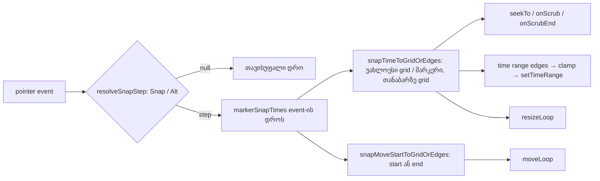

# Studio Lab — playhead, დროის მონაკვეთი და Loop მარკერებზეც ეწებება, ეტაპი 2b-3 (SRW-16 / FB-10)

**თარიღი:** 2026-10-22
**სტატუსი:** Round 78 — იმპლემენტირებულია, C-ის შემოწმებას ელოდება (D-29z43)
**შეცვლილი პროექტი:** Store

## კონტექსტი

2b-1 ეტაპზე (round 76) კლიპების გადატანა, trim და library drop მარკერებზე ეწებება. 2b-2 ეტაპზე (round 77) Ctrl/Option+←/→ კლიპების კიდეებზეც ჩერდება. სხვა ადგილებში დრო ჯერ კიდევ მხოლოდ grid-ზე ეწებებოდა: ruler-ზე click-ი, playhead-ის გადათრევა, ცარიელ ხაზზე click-ი, კლიპის waveform-ზე click-ი და დროის მონაკვეთის მონიშვნა, ასევე Loop brace-ის გადატანა და სიგრძის შეცვლა. FB-10 („snap to markers“) და round 76-ის R3 წესი მოითხოვს, რომ მარკერი ყველგან ერთნაირად იყოს snap-ის სამიზნე. ეს არის SRW-16 2b ეტაპის ბოლო ნაწილი.

## მიდგომა

### წესები (T1–T7)

| # | წესი |
|---|---|
| T1 | P1–P6 ადგილებზე, როცა snap-ის ბიჯი არ არის `null`, შედეგია უახლოესი {grid-ის ხაზი, ყველა მარკერის დრო}-დან. თანაბარ მანძილზე grid-ის ხაზი იმარჯვებს. pixel-ის რადიუსი არ არის. |
| T2 | bypass-ის ცხრილი უცვლელია: Snap on → grid ∪ მარკერები. Snap on + Alt → თავისუფალი დრო (იგივე ბაიტები). Snap off → თავისუფალი. Snap off + Alt → grid ∪ მარკერები. Shift time-lock ამ ადგილებზე არ არსებობს. |
| T3 | მარკერების გარეშე ყველა ადგილი ზუსტად ძველ შედეგს იძლევა. |
| T4 | მონაკვეთი (P5): ორივე კიდე T1-ით იწებება, შემდეგ ძველებურად კლიპის საზღვრებში იზღუდება. თუ ორივე ერთ დროზე მოხვდა, მონაკვეთი არ იქმნება (`setTimeRange(null)`). |
| T5 | Loop-ის გადატანა (P6): დასაწყისი ან დასასრული მარკერზე ეცემა, რომელიც უფრო ახლოსაა (2b-1-ის კლიპის გადატანის წესი, `snapMoveStartToGridOrEdges(raw, length, step, markers, markers)`), შემდეგ ძველებურად `moveLoop`. grid-ის გარეთ მდებარე მარკერზე `moveLoop` სიგრძეს ms-ში ინარჩუნებს. 0-ზე ნაკლებ დასაწყისს მომცემი კანდიდატი იგნორირდება. სიგრძის შეცვლისას გადათრეული კიდე T1-ით იწებება, შემდეგ `resizeLoop`-ის მინიმალური სიგრძის clamp მოქმედებს. Loop-ის ისრებიანი ღილაკები უცვლელია (მხოლოდ grid). |
| T6 | უცვლელია: მარკერის გადათრევა (სხვა მარკერზე არ ეწებება), კლიპის move/trim/drop, Ctrl/Option+ისრები, playhead-ის ისრები (0.1 წმ), ruler-ის ორმაგი click, overview, zoom. seek და მონაკვეთი history-ს არ ქმნის. Loop-ის gesture ისევ ერთ history ჩანაწერს ქმნის. დაკვრა seek-ზე გრძელდება. |
| T7 | მარკერების დრო event-ის მომენტში იკითხება: კლიპსა და Loop brace-ში gesture-ის `before`-დან, workspace-ში `getArrangement()`-დან. ruler მარკერებს იღებს ახალი არასავალდებულო prop-ით `getSnapMarkerTimes`. ის `useArrangement`-ს არ იძახებს და render-ზე arrangement-ზე დამოკიდებულება არ ემატება. |

### ადგილები

| ადგილი | ფაილი | ახლა |
|---|---|---|
| P1 ruler-ზე click (seek) | `ArrangementRuler.tsx`, `endRulerNavigation` | `resolveGridTimeWithTargets(..., getSnapMarkerTimes())` |
| P2 playhead-ის გადათრევა | `ArrangementRuler.tsx`, scrub move და pointerup | იგივე, ყოველ sample-ზე და გაშვებისას |
| P3 ცარიელ ხაზზე click | `StudioWorkspace.tsx`, marquee `finish` | `markerSnapTimes(latest.getArrangement())` |
| P4 click waveform-ზე | `ArrangementClip.tsx`, `finishGesture` | `markerSnapTimes(gesture.before)` |
| P5 მონაკვეთი waveform-ზე | `ArrangementClip.tsx`, `onGrid` | `snapTimeToGridOrEdges(time, step, markers)` |
| P6 Loop brace | `ArrangementLoopBrace.tsx`, pointer move | move: `snapMoveStartToGridOrEdges`; resize: `resolveGridTimeWithTargets` |

### ტექნიკური გადაწყვეტა

- `grid.ts`-ში `resolveGridTime`-ის გვერდით დაემატა ერთი export: `resolveGridTimeWithTargets(time, snapSeconds, gridSeconds, bypass, targets)`. ის ბიჯს `resolveSnapStep`-ით ადგენს. `null` ბიჯზე თავისუფალ დროს აბრუნებს, სხვა შემთხვევაში `snapTimeToGridOrEdges`-ს იძახებს, რომელიც 2b-1-დან უკვე იცავს უახლოესობის, თანაბარი მანძილისა და უარყოფითი კანდიდატის წესებს. სახელი ამბობს, რომ ეს `resolveGridTime`-ის ვარიანტია დამატებითი სამიზნეებით.
- ruler-ის prop-ის default ფუნქცია მუდმივ ცარიელ მასივს აბრუნებს. ამიტომ prop-ის გარეშე (სხვა გამომყენებლები, ტესტები) ქცევა ძველია.
- `StudioWorkspace` callback-ს `useCallback`-ით `[]` დამოკიდებულებით ქმნის, ის `workspaceRef.current.getArrangement()`-ს კითხულობს. ეს callback სტაბილურია, ამიტომ ruler-ის re-render-ები არ მატულობს.
- `ArrangementClip.tsx`-სა და `ArrangementLoopBrace.tsx`-ში `resolveGridTime` და `snapTimeToGrid` აღარ გამოიყენება, ამიტომ მათი import შეიცვალა. `StudioWorkspace.tsx`-ს `markerSnapTimes`-ის import დაემატა.

### Ableton-თან მიმართება

| ქცევა | წყარო | იქ დადასტურებული | CZABA-ს გადაწყვეტილება |
|---|---|---|---|
| კლიპები locator-ებზე ეწებება | Live 12 manual §6.7, B-ის capture `b-round-71/ableton-arrangement-view-20261021.txt` | დადასტურებული (ტექსტი) | 2b-1-ში უკვე გაკეთდა, T6 უცვლელად ტოვებს |
| cursor (insert marker / time selection) grid-ზე ეწებება | §6.10 | დადასტურებული (ტექსტი) | უკვე გაკეთდა (rounds 48–51) |
| cursor, time selection ან loop brace locator-ებზეც ეწებება | §6.4, §6.7, §6.10 — ამაზე არაფერს ამბობს | დაუდასტურებელი | T1/T5: CZABA-ს გადაწყვეტილებაა 2b-1-თან თანმიმდევრულობისთვის. Live-ის ქცევად არ წარმოგვიდგენია |
| Alt-ით grid-ის გვერდის ავლა | §6.10, `b-round-46/ableton-6.7-6.10-20261016.txt`, D-29z12 | დადასტურებული (ტექსტი) | T2 უცვლელია |
| cursor-ისთვის კლიპის კიდეები სამიზნედ | — | დაუდასტურებელი | არ დაემატა |

## არქიტექტურა

## შეცვლილი ფაილები

- `app/lib/arrangement/grid.ts`: `resolveGridTimeWithTargets`.
- `app/components/arrangement/ArrangementRuler.tsx`: `getSnapMarkerTimes` prop და P1/P2.
- `app/components/arrangement/ArrangementClip.tsx`: P4/P5, import.
- `app/components/arrangement/ArrangementLoopBrace.tsx`: P6 move/resize (move-ის შედეგი 1 µs-მდე მრგვალდება), import.
- `app/components/arrangement/StudioWorkspace.tsx`: P3, ruler-ის სტაბილური callback და JSX ატრიბუტი, import.
- `app/lib/arrangement/__tests__/marker-time-snap.test.ts` (ახალი): TU1a–TU1e.
- `app/lib/arrangement/__tests__/marker-time-snap-ui.test.tsx` (ახალი): TS1–TS9 (17 ტესტი).
- `docs/implementation/2026/quarter-IV/067-studio-lab-marker-edge-navigation.md`: მხოლოდ სტატუსის ხაზი (GATE77-S2).

## პრობლემები და გადაწყვეტები

- **პრობლემა:** ruler უნდა გაიგოს მარკერების შესახებ, მაგრამ `useArrangement`-ის გამოძახება მას arrangement-ის ყოველ ცვლილებაზე გადარენდერავდა (ruler-ი RU-DBLCLICK-ის მგრძნობიარე ზედაპირია). **გადაწყვეტა:** სტაბილური `getSnapMarkerTimes` callback, რომელიც მხოლოდ event-ის დროს იძახება (T7).
- **პრობლემა:** Loop-ის გადატანისას დასასრულის კანდიდატი (`marker - length`) შეიძლება 0-ზე ნაკლები იყოს. **გადაწყვეტა:** `nearestGridOrEdge` უარყოფით კანდიდატს უკვე აგდებს (TU1d). UI დონეზე ეს ვერ შემოწმდება, რადგან `moveLoop` დასაწყისს ისედაც 0-ზე ზღუდავს და შედეგი ორივე შემთხვევაში ერთნაირია.
- **პრობლემა:** `marker - length` float-ის ხმაურს იძლევა (მაგ. 1.3 − 0.7 = 0.6000000000000001), `moveLoop` კი დასაწყისს არ ამრგვალებს (code-reviewer-ის #1). **გადაწყვეტა:** Loop brace გადატანის შედეგს 1 µs-მდე ამრგვალებს, როგორც კლიპის `snapGroupMoveDelta` (TS7c). grid-ის შედეგები უკვე ms-ზე ზუსტია, ამიტომ მარკერების გარეშე ქცევა არ იცვლება.
- **პრობლემა:** jsdom-ში წილადი `clientX` საიმედო არ არის, ხოლო 40 px/წმ-ზე 6.42 წმ = 256.8 px. **გადაწყვეტა:** TS7-ის მეორე გადატანაში raw დასასრული 6.425 წმ-ია (97 px), მოსალოდნელი შედეგი იგივეა: დასასრული 6.375, დასაწყისი 4.375.

## ტესტირება

- `marker-time-snap.test.ts`: 5 ტესტი. bypass-ის ცხრილი (6.45 → 6.375 / 6.45 / 6.45 / 6.375), უახლოესობა (6.10 → 6, 6.30 → 6.375), თანაბარი მანძილი (6.1875 → 6), უარყოფითი სამიზნეები, ასევე `[]` სამიზნეებით `resolveGridTime`-თან სრული ტოლობა 10 raw დროისა და 3 ბიჯის (1, 0.25, 60/90) ცხრილზე, ოთხივე Snap/Alt კომბინაციაში.
- `marker-time-snap-ui.test.tsx`: 17 ტესტი. fixture: ხაზები video, music, sfx, კლიპი music 0–40, მარკერები 6.375 „A“ (grid-ის გარეთ) და 12.000 „B“ (grid-ზე; B-ის fixture-ში 20.000 იყო, TS9-სა და C-ის setup-ში კი 12.000, ამიტომ 12.000 ავირჩიეთ), 40 px/წმ, grid 1 წმ. TS1 (ruler, bypass-ის ცხრილი), TS1b (მარკერი mount-ის შემდეგ ემატება და ruler-ი მას იყენებს — T7), TS2 (scrub + Alt), TS2b (გაუქმებული scrub ბოლო მარკერის sample-ს ინარჩუნებს), TS3 (ცარიელი sfx ხაზი), TS4 (click waveform-ზე), TS5 (მონაკვეთი 3.000–6.375, ტოლი კიდეები → მონაკვეთი არ არის, Alt), TS6a/b (Loop-ის resize, ერთი history ჩანაწერი, Undo, 6.8 → 7), TS7 (Loop move: 6.375–8.375 და 4.375–6.375), TS7b (მარკერების გარეშე grid), TS7c (loop 0.3–1.0, მარკერი 1.3 → 0.600–1.300, float-ის ხმაურის გარეშე), TS7d (Snap on + Alt და Snap off brace-ზე: თავისუფალი move/resize, Snap off + Alt → მარკერი), TS8 (მარკერების გარეშე), TS9a–c (Loop-ის ისრები, playhead-ის ისრები 6.3 → 6.4, მარკერი B 6.45-ზე → 6.000).
- სამიზნე სია: B-ის grep-ით ნაპოვნი და დასახელებული 26 ფაილი (508 ტესტი) მწვანეა. გარდა ამისა, ყველა სხვა ფაილი, რომელიც `StudioWorkspace`-ს რენდერავს (24 ფაილი, 436 ტესტი), მწვანეა. `npm run typecheck` სუფთაა, `npm run lint` 0 error-ით სრულდება, Biome 7 კოდის ფაილზე სუფთაა.
- Mutation-ები (თითოეული აღდგა და `cmp`-ით შემოწმდა): (a) helper სამიზნეებს აგდებს: TU1a, TU1b, TS1, TS1b, TS2, TS2b, TS3, TS4, TS6a, TS6b, TS7d წითელია. (b) scrub `[]`-ს იყენებს: TS2, TS2b წითელია. (c) P3 მარკერების გარეშე: TS3 წითელია. (d) P5 `onGrid` მარკერების გარეშე: TS5 წითელია. (e) Loop move-ს end კანდიდატები აკლია: TS7, TS7c წითელია. (f) `null` ბიჯზე მარკერები გამოიყენება: TU1a, TU1e, TS1, TS2, TS3, TS7d, TS9b წითელია. (g) თანაბარ მანძილზე მარკერი იმარჯვებს: TU1c წითელია. (h) Loop resize მარკერების გარეშე: TS6a, TS6b, TS7d წითელია. (i) move-ის 1 µs დამრგვალება ამოღებულია: TS7c წითელია.

## TODO / შემდეგი ნაბიჯები

- C-ის ბრაუზერული შემოწმება (MT-RULER, MT-SCRUB, MT-LANE, MT-CLIPCLICK, MT-RANGE, MT-LOOP-RESIZE, MT-LOOP-MOVE, MT-AUDIO, REG-* და RU-DBLCLICK) ორივე viewport-ზე.
- R78-T: Tech Lead-ის ხელით შემოწმება 10 წმ grid-ზე (pixel-ის რადიუსი არ არის, ROOT-R64-M1).
- SRW-16-ის საზღვარზე frontend-architect-ის checkpoint (B/root).
