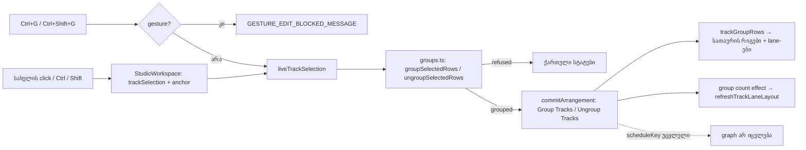

# Studio Lab — ხაზების ჯგუფები, ეტაპი 1 (SRW-17 / FB-12)

**თარიღი:** 2026-10-22
**სტატუსი:** Round 79 — იმპლემენტირებულია, C-ის შემოწმებას ელოდება (D-29z44)
**შეცვლილი პროექტი:** Store

## კონტექსტი

მომხმარებელს სჭირდება რამდენიმე ხაზის ერთ ჯგუფად შეკვრა, როგორც Ableton Live-ის Group Tracks (Live 12 manual §18.2, §18.3, shortcuts §42). SRW-17 სამ ეტაპად იყოფა და სამივე ეტაპი სამუშაოს ნაწილია:

1. **ეტაპი 1 (ეს დოკუმენტი):** ჯგუფის მოდელი, ხაზების მრავლობითი მონიშვნა, Ctrl+G / Ctrl+Shift+G (ჩადგმის ჩათვლით), ჯგუფის სათაურის რიგები, F2 სახელის შეცვლა, Undo/Redo. **აუდიო არ იცვლება.**
2. **ეტაპი 2:** ჯგუფის დაკეცვა/გაშლა (ღილაკი და `U`), დამალული შვილები accessibility tree-დან გადის, დაკეცილ რიგზე შვილების კლიპების overview.
3. **ეტაპი 3:** ჯგუფის Mute / Solo / Volume, რომელიც შვილებს playback-შიც და export-შიც აჯამებს (ჩადგმულადაც), და half-solo ინდიკატორი.

## მიდგომა

### კონტრაქტი G1–G13

| # | რა გაკეთდა |
|---|---|
| G1 | `ArrangementTrack.groupId?` (პირდაპირი მშობელი ჯგუფი) და `Arrangement.groups?: ArrangementTrackGroup[]` (`id`, `name`, `parentId`). ცალკე `kind: 'group'` ხაზი არ არსებობს. **Normal form:** ჯგუფების გარეშე `groups` key საერთოდ არ არის, დაუჯგუფებელ ხაზზე `groupId` key არ არის (არც `undefined`, არც `[]`). ამიტომ `ungroup(group(a))` ზუსტად `a`-ს უდრის. ინვარიანტი: ჯგუფის ყველა შთამომავალი `tracks`-ში მიყოლებით დგას და ყველა ჯგუფს ერთი შვილი მაინც ჰყავს. |
| G2 | ხაზების მონიშვნა `StudioWorkspace`-ის UI state-ია (ისტორიაში არ შედის). ინახავს რიგების id-ებს (ხაზი ან ჯგუფი). ყოველ რენდერსა და ყოველ ბრძანებამდე იფილტრება ცოცხალი arrangement-ით (`liveTrackSelection`), რადგან Undo-ს შემდეგ ჯგუფი შეიძლება აღარ არსებობდეს. |
| G3 | ხაზის სახელზე დაწკაპუნება ისევ `setActiveTrack`-ს იძახებს (აქტიური ხაზი უცვლელია, modifier-ითაც). დამატებით: უბრალო click → `{track}`; Ctrl/Cmd+click → toggle; Shift+click → თუ anchor-სა და სამიზნეს ერთი მშობელი აქვთ, მათ შორის ყველა პირდაპირი შვილი, თორემ უბრალო click. Anchor ახლდება მხოლოდ უბრალო და Ctrl click-ზე. კლავიატურა (Enter/Space) უბრალო click-ია. |
| G4 | ჯგუფის სათაურის რიგი დგას მისი პირველი შთამომავლის **ზემოთ**; ჩადგმული ჯგუფები ერთმანეთზე ლაგდება (გარე, შიდა, შიდის წევრები). რიგი შეიცავს სახელის ღილაკს (G3-ის წესით, ჯგუფი ერთ ერთეულად; აქტიურ ხაზს **არ** ცვლის), სიღრმის მიხედვით შეწევას (`d × 12 px`, inline `paddingLeft`), ფიქსირებულ სიმაღლეს და ცარიელ timeline ზოლს. **რიგის სიმაღლე 28 px** (`TRACK_GROUP_ROW_HEIGHT_PX`, border-ის ჩათვლით); სახელის ღილაკი 24 px სიმაღლისაა (WCAG 2.5.8). Fold ღილაკი და mixer controls არ არის (ეტაპი 2/3). რიგს არ აქვს `data-track-id`, აქვს `data-group-id` და `data-group-depth`; lane-ების პირდაპირი sibling-ია, wrapper element არ არსებობს. მხოლოდ tokens (`bg-elevated`, `border-outline`, `bg-brand/20`, `ring-brand`). |
| G5 | **Ctrl/Cmd+G — Group Tracks.** დასაშვებია, როცა მონიშვნა არ არის ცარიელი, ვიდეო ხაზი არ შედის, ყველა რიგს ერთი მშობელი ჰყავს და ისინი ამ მშობლის პირდაპირ შვილებში მიყოლებით დგანან. ახალი ჯგუფი იღებს საერთო მშობელს და სახელს `ჯგუფი n` (უმცირესი თავისუფალი n ≥ 1). ერთი ისტორიის ჩანაწერი `Group Tracks`, მონიშვნა ხდება `{ახალი ჯგუფი}`, სტატუსი `ჯგუფი «ჯგუფი 1» შეიქმნა: მუსიკა, სტემები.` ერთხაზიანი ჯგუფი დასაშვებია; ჯგუფის და მეზობელი ხაზის ერთად მონიშვნა ჯგუფს ჩადგამს. |
| G6 | უარი (ისტორია და მონიშვნა უცვლელი, ქართული სტატუსი): ცარიელი მონიშვნა (მინიშნებით), ვიდეო, სხვადასხვა მშობელი, ხვრელი, pointer gesture-ის დროს `GESTURE_EDIT_BLOCKED_MESSAGE`. `preventDefault()` ყოველთვის სრულდება Ctrl/Cmd+G-სა და Ctrl/Cmd+Shift+G-ზე; ტექსტურ ველში არსებული `isTypingTarget` guard კლავიშს უგულებელყოფს. |
| G7 | **Ctrl/Cmd+Shift+G — Ungroup Tracks.** ყოველი მონიშნული ჯგუფი იშლება: პირდაპირი შვილები ჯგუფის მშობელს იღებენ. თუ გარე და შიდა ერთად არის მონიშნული, შვილები პირველ გადარჩენილ წინაპარს იღებენ (წინაპარი `trackGroupRows`-ის მიერ გამოთვლილი parent-ით დგინდება, ამიტომ შენახული cycle ან არარსებული parent self-parent-ს ვერ ქმნის). ჯგუფის გარეშე მონიშვნა → უარი. ერთი ჩანაწერი `Ungroup Tracks`; მონიშვნა ხდება დაშლილი ჯგუფების პირდაპირი შვილები. |
| G8 | F2 ჯგუფის სახელის ღილაკზე ხსნის inline editor-ს: Enter ან blur → `Rename Group`; Escape → გაუქმება; ცარიელი ან იგივე სახელი → ისტორიის ჩანაწერი არ არის, ცარიელზე სტატუსი `სახელი ცარიელია — დარჩა «…»`; Enter/Escape-ის შემდეგ ფოკუსი სახელის ღილაკს უბრუნდება. editor `type="text"`-ია, ამიტომ გლობალური `handleKeyDown` მასში აკრეფილ `g`/`m`/Space-ს არ ამუშავებს (TG6 ამოწმებს). |
| G9 | არ შეცვლილა: audio, playback, meters, export, `scheduleKey`, clip edits, markers, loop, grid/snap, ხაზის Mute/Solo/Volume/Pan/fold/height, plain `g` = Snap. `arrangement.tracks`-ის რიგი არასოდეს იცვლება. |
| G10 | `laneTrackIdAtPointer` სამ ზონას არჩევს: lane რიგზე → ის lane; პირველი რიგის ზემოთ ან ბოლოს ქვემოთ → პირველი/ბოლო (როგორც ადრე); lane-ების დიაპაზონში, მაგრამ არცერთ lane-ზე (ჯგუფის სათაურზე) → `null`. **A-ს გადაწყვეტილება:** caller ასეთ დროს ინარჩუნებს gesture-ის წინა სამიზნეს — `gesture.laneTarget?.trackId`, ანუ ბოლო წარმატებული cross-lane გეგმის ხაზს, ხოლო ასეთის არქონისას კლიპის საკუთარ ხაზს. ჯგუფების გარეშე შედეგი დღევანდელის იდენტურია. |
| G11 | auto-fit: `withTrackGroupRows` `timelineChromeHeight`-ს `trackGroupRowCount × 28 px`-ს უმატებს (მხოლოდ რეალურად დახატული სათაურის რიგები), ამიტომ მცირდება `visibleRowsHeight`-იც და `detailPanelOpenHeightCap`-ის metrics-იც. `panels.ts` არ შეცვლილა. ჯგუფის რიგების რაოდენობის ცვლილებაზე `useIsomorphicLayoutEffect` იძახებს `refreshTrackLaneLayout()`-ს (paint-მდე, ერთკადრიანი ნახტომის გარეშე). 0 ჯგუფზე metrics იგივე object-ია. |
| G12 | Marquee კოდი არ შეცვლილა: რიგებად ისევ მხოლოდ `[data-track-id]` lane-ები ითვლება, ამიტომ ჯგუფის რიგის გადამკვეთი marquee ორივე მხარის კლიპებს ირჩევს. |
| G13 | `deleteTime`, Cut Time, cut range, duplicate, clip move, `setTrackMix`, solo, pan და marker add ინახავს `groups`-სა და `groupId`-ს (GU6). frozen `model.ts`-ის არცერთი ფუნქცია მათ არ კარგავს, ამიტომ escape clause არ გააქტიურდა. |

### განხილული ალტერნატივები

- **`kind: 'group'` ხაზი** — უარყოფილია: playback, export, meters და fit ყველა ხაზს აუდიო არხად ითვლის; additive optional ველები ეტაპ 1-ში აუდიოს არ ეხება.
- **wrapper element ჯგუფისა და შვილების გარშემო** — უარყოფილია: `laneTrackIdAtPointer` და marquee lane-ების პირდაპირ `children`-ზე მუშაობს.
- **არამეზობელი ხაზების დაჯგუფება გადალაგებით** — შეგნებული განსხვავება (signal `GROUP-NONADJACENT`): CZABA-ში ხაზების გადალაგება არ არსებობს, ამიტომ ხვრელიანი მონიშვნა უარდება.

## არქიტექტურა

## შეცვლილი ფაილები

| ფაილი | დანიშნულება |
|---|---|
| `app/types/arrangement.ts` | `ArrangementTrackGroup`, `groupId?`, `groups?` (G1) |
| `app/lib/arrangement/groups.ts` (ახალი) | pure ფუნქციები: `arrangementGroups`, `trackGroupRows`, `rowParentId`, `liveTrackSelection`, `nextTrackGroupName`, `groupSelectedRows`, `ungroupSelectedRows`, `renameTrackGroup`, `normalizeTrackGroupName`, `expandShiftSelection` და სტატუსის ტექსტები |
| `app/components/arrangement/ArrangementGroupHeader.tsx` (ახალი) | G4 რიგი და G8 editor |
| `app/components/arrangement/ArrangementLane.tsx` | props `selected`, `depth`, `onSelectTrack`; სახელის ღილაკის `onClick`; შეწევა; `data-track-selected` და `, მონიშნული` aria-label-ში |
| `app/components/arrangement/ArrangementClip.tsx` | მხოლოდ `laneTrackIdAtPointer` და მისი caller (G10) |
| `app/components/arrangement/StudioWorkspace.tsx` | მონიშვნა და anchor, Ctrl/Cmd+G ბლოკი `if (modifier) return;`-მდე, რიგების interleave რენდერი, G11 |
| `docs/implementation/2026/quarter-IV/068-…` | მხოლოდ სტატუსის ხაზი (gate-78 review #3) |
| `app/lib/arrangement/__tests__/groups.test.ts` (ახალი) | GU1–GU6 |
| `app/lib/arrangement/__tests__/track-groups-ui.test.tsx` (ახალი) | TG1–TG11, TG8b |

**სახელების გადარქმევა B-ის შეთავაზებიდან:** დამატებულია `liveTrackSelection` (G2 ფილტრი) და `normalizeTrackGroupName` (trim + 64 სიმბოლო, rename-ისა და ცარიელი სახელის შემოწმებისთვის). დანარჩენი სახელები B-ის შეთავაზებას ემთხვევა.

## Ableton-ის წყაროსთან კავშირი

| ქცევა | წყარო | იქ დადასტურებული | CZABA-ს გადაწყვეტილება | C |
|---|---|---|---|---|
| მონიშნული ხაზების დაჯგუფება; იგივე ბრძანება ჯგუფს ჩადგამს | Live 12 §18.3 | დადასტურებული (ტექსტი) | G5 | TG-GROUP, TG-NEST |
| Ctrl+G / Ctrl+Shift+G | §42 shortcuts | დადასტურებული (ტექსტი) | იგივე კლავიშები (Apple-ზე Cmd) | TG-GROUP, TG-UNGROUP |
| Ungroup ხაზებს ინდივიდუალურად აბრუნებს | §18.3 | დადასტურებული (ტექსტი) | როგორც Live; ჯგუფის წაშლა CZABA-ში არ არსებობს | TG-UNGROUP |
| Shift — მეზობლები, Ctrl — არამეზობელი | §18.2 | დადასტურებული (ტექსტი) | G3; Shift range მხოლოდ ერთი მშობლის ქვეშ | TG-SELECT |
| არამეზობელი ხაზების დაჯგუფება | §18.3 (გადალაგება არ არის აღწერილი) | დაუდასტურებელი | შეგნებული განსხვავება: უარი (G6 gap) | TG-REFUSE |
| ჯგუფის mixer, half-solo, summing | §18.3 | დადასტურებული (ტექსტი) | ეტაპი 3; ეტაპ 1-ში controls არ არის | — |
| დაკეცილი ჯგუფის overview, `U` | §18.3, §42 | დადასტურებული (ტექსტი) | ეტაპი 2 | — |
| სახელის შეცვლა | §42 Ctrl+R | დადასტურებული | შეგნებული განსხვავება: F2 (Ctrl+R ბრაუზერის reload-ია) | TG-RENAME |
| ვიდეო ხაზი ჯგუფში | §18.3 audio/MIDI | ვიდეოზე არ ეხება | უარი (G6) | TG-REFUSE |
| ცარიელი მონიშვნა + Ctrl+G | — | დაუდასტურებელი | CZABA-ს გადაწყვეტილება: უარი მინიშნებით | TG-REFUSE |

## პრობლემები და გადაწყვეტები

- **პრობლემა:** `isSameArrangement` `JSON.stringify`-ს იყენებს და `undefined`-ს ვერ ხედავს, ამიტომ normal form-ის დარღვევა (`groupId: undefined`) შეიძლება შეუმჩნეველი დარჩეს. → **გადაწყვეტა:** key-ები destructuring-ით იშლება, GU1 კი `Object.hasOwn`-ითაც ამოწმებს.
- **პრობლემა:** ჯგუფის შექმნა scroller-ის ზომას არ ცვლის, ამიტომ ResizeObserver auto-fit-ს თავად არ გაუშვებდა. → **გადაწყვეტა:** ჯგუფის რიგების რაოდენობაზე მიბმული layout effect იძახებს `refreshTrackLaneLayout()`-ს; ჯგუფის რიგები `resolveTrackLaneLayout`-ში ემატება, ამიტომ cached metrics-ზე დაფუძნებული გამოძახებებიც (fold, snapshot) სწორად ითვლის.
- **პრობლემა (code review #1, #3, #5):** შენახულ `parentId`-ზე დაფუძნებული ungroup დაზიანებულ მონაცემზე self-cycle-ს ქმნიდა; commit-ის უარზეც სტატუსი იცვლებოდა; ჯგუფის ღილაკზე `aria-pressed` სხვა მნიშვნელობით გამოიყენებოდა, ვიდრე lane-ზე. → **გადაწყვეტა:** derived parent, `commitArrangement`-ის შედეგის შემოწმება, ჯგუფის ღილაკიდან `aria-pressed` ამოღებულია (მონიშვნა ჩანს `, მონიშნული` label-ითა და `data-group-selected`-ით); ორივე სახელის ღილაკს აქვს `select-none`.
- **პრობლემა:** ტესტში პირდაპირი `dispatchEvent` `act`-ის გარეშე React state-ს არ ასრულებდა. → **გადაწყვეტა:** TG7-ში dispatch `act`-შია გახვეული.

## ტესტირება

- `groups.test.ts` — 11 ტესტი (GU1–GU6, მათ შორის დაზიანებული parent-ების ungroup); `track-groups-ui.test.tsx` — 14 ტესტი (TG1–TG11, TG8b). Fixture: `/studio-lab`-ის ხაზები; კლიპები music `0–10` (`cm`) და `20–22` (`cm2`, TG8-ის discriminating შემთხვევისთვის), stems `2–8`, sfx `4–6`.
- `npm run typecheck`, Biome (`biome check`) შეცვლილ ფაილებზე, targeted vitest სია (`a-round-79.md`).
- **Mutation proofs** (`tmp/studio-real-loop/a-round-79/mutations.txt`, თითოეული აღდგა და `cmp` OK):
  - (a) `groups: []` დატოვებული → GU1, GU3, TG4, TG11 წითელი;
  - (b) contiguity check ამოღებული → GU2 (2), TG5 წითელი;
  - (c) parent check ამოღებული → GU2, TG5 წითელი;
  - (d) ჩადგმული მშობელი არ ისმება → GU3, TG3, TG4 წითელი;
  - (e) მონიშვნა Undo-ს შემდეგ არ იფილტრება → TG2 variant წითელი;
  - (f) ჯგუფის რიგს `data-track-id` აქვს → TG8b, TG2, TG3, TG4 წითელი; **TG9 და TG8 მწვანე რჩება** (marquee და drag ამ შემთხვევას ვერ არჩევს), მკვლელი ტესტია TG8b;
  - (g) G10 fallback დაბრუნებული → TG8 წითელი;
  - (h) fit subtraction ამოღებული → TG10 წითელი;
  - (i) Ctrl+G ბლოკი `if (modifier) return;`-ის შემდეგ → TG2 და კიდევ 10 ტესტი წითელი.
- ბრაუზერში რეალური შემოწმება C-ის საქმეა (`current-task.md` §5).

## TODO / შემდეგი ნაბიჯები

- ეტაპი 2: collapse/expand, `U`, დამალული შვილების a11y, clip overview ზოლი.
- ეტაპი 3: ჯგუფის Mute/Solo/Volume summing playback-სა და export-ში, ჩადგმულად, half-solo.
- Tech Lead R79-T: რეალურ Chrome-ში (Windows და Mac Cmd+G) Ctrl+G არ ხსნის find bar-ს; რიგები და შეწევა ორივე viewport-ზე კარგად იკითხება.
