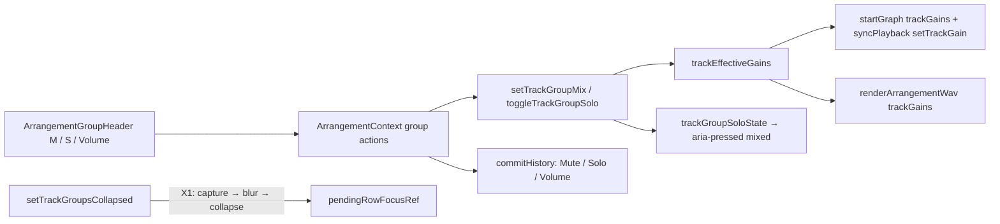

# Studio Lab — ხაზების ჯგუფები, ეტაპი 3: ჯგუფის Mute / Solo / Volume (SRW-17 / FB-12)

**თარიღი:** 2026-10-22
**სტატუსი:** Round 81 — იმპლემენტირებულია, C-ის შემოწმებას ელოდება (D-29z46)
**შეცვლილი პროექტი:** Store

## კონტექსტი

ეტაპ 1-მა (doc 069) ჯგუფი შექმნა, ეტაპ 2-მა (doc 070) კი დაკეცვა დაამატა. ჯგუფს მიქსერის საკუთარი კონტროლი მაინც არ ჰქონდა. R17-G2 მოითხოვს, რომ ჯგუფის Volume-მა და Mute-მა მის ყველა ხაზზე იმოქმედოს, როგორც playback-ში, ისე export-ში. R17-G3 მოითხოვს, რომ დადუმებული გარე ჯგუფის შიგნით შიდა კონტროლები ისევ რეგულირდებოდეს და ჩაწერილი მნიშვნელობა unmute-ის შემდეგ ამოქმედდეს. Live 12 §18.3-ის მიხედვით, ჯგუფის Solo ნახევრად შეფერილია, თუ მის შიგნით რომელიმე ხაზი ან ჯგუფი solo-შია. ამავე რაუნდში გასწორდა C-ის ბაგი C80-1 (X1): დაკეცვა უარს ამბობდა, თუ focus მხოლოდ იდგა იმ fader-ზე, რომელსაც დაკეცვა დამალავდა, მაშინაც კი, როცა არაფერი იყო pending.

## მიდგომა

| # | გადაწყვეტილება |
|---|---|
| M1 | `ArrangementTrackGroup`-ს დაემატა სამი არასავალდებულო ველი: `volume?` (0–1, default 1), `mute?` და `solo?` (default false). default მნიშვნელობა ობიექტში **არ იწერება** (`pan?`/`gainDb?`-ის პატერნი). `setTrackGroupMix` volume-ს [0, 1]-ში ზღუდავს, არარიცხვით მნიშვნელობას უგულებელყოფს და ცვლილების არქონისას იმავე ობიექტს აბრუნებს. ჯგუფი mix state-ის გარეშე ზუსტად `{ id, name, parentId }` რჩება |
| M2 | ერთადერთი წყარო არის `trackEffectiveGains(arrangement)` (`schedule.ts`). ხაზის gain = `track.volume × Π(წინაპარი ჯგუფების volume)`, თუ ხაზი ისმის, და 0, თუ არ ისმის. ხაზი ისმის, როცა ის და მისი ყველა წინაპარი unmute-შია და თან: ან solo არსად არ არის, ან ხაზი solo-შია, ან რომელიმე წინაპარი ჯგუფი solo-შია. **mute ყოველ დონეზე solo-ს სჯობს.** ციკლური ან ghost `parentId` ჯაჭვი უსაფრთხოდ წყდება. solo-ში მყოფი ობოლი ჯგუფი (რომელიც არცერთი ხაზის წინაპარი არ არის) „solo სადმე“-ში არ ითვლება, რადგან UI-ში მისი გასუფთავება შეუძლებელია (code-review Low 3). `isTrackAudible` უცვლელია, მისი group-aware „და“ კი `isTrackAudibleWithGroups`-ია |
| M3 | **effective gain და არა bus (D-29z46).** აუდიოს ახალი node და ტოპოლოგიის ცვლილება არ დამატებულა. `applySchedule`-ს ერთი არასავალდებულო input დაემატა: `trackGains`. ის მხოლოდ track gain-ის საწყის მნიშვნელობას ადგენს, ხოლო მის გარეშე ძველი წესი მოქმედებს. `startGraph`, `syncPlayback`-ის non-restart ციკლი და `renderArrangementWav` ერთსა და იმავე `trackEffectiveGains`-ს იყენებს. `scheduleKey` არ შეცვლილა, ამიტომ M/S/Volume, Ctrl+G და Ctrl+Shift+G ახალ buffer source-ს არ ქმნის და gain არსებული `setTrackGain` ramp-ით იცვლება |
| M4 | header-ის რიგი: fold, სახელი, **M**, **S**, **Volume**. სამივე ჩანს გახსნილ და დაკეცილ მდგომარეობაში. M/S 24×24-ია, glyph-ი `::before`-ით იწერება და ტექსტური node-ი არ ემატება. S-ის `aria-pressed` არის `true`, `mixed` ან `false` და დუბლირდება `data-solo="on|mixed|off"`-ში. `mixed` ორფეროვანია: `border-brand` ერთად `from-brand from-50% to-transparent to-50%` gradient-ით (ტოკენები). Volume არის `range` 0–1, step 0.01, `w-12` (48 px), `aria-valuetext`/`title` `<n>%`, ტექსტური readout-ის გარეშე. header-ი `useArrangement()`-ს პირდაპირ იძახებს, ისევე როგორც `ArrangementLane` |
| M5 | context-ის ახალი წევრებია `toggleGroupMute`, `toggleGroupSolo`, `previewGroupVolume`, `commitGroupVolume`, `beginGroupVolumeGesture` და `blurGroupVolume`. ჩანაწერები: `Mute — <name>`, `Solo — <name>`, `Volume`. ჩვეულებრივი click exclusive-ია (ასუფთავებს ხაზებისა და ჯგუფების solo-ს), Ctrl/Cmd+click კი additive. ხაზის exclusive `toggleSolo` ახლა ჯგუფების solo-საც ასუფთავებს. თუ არცერთი ჯგუფი solo-ში არ არის, შედეგი უცვლელია და `groups` reference-იც ინარჩუნებს. Volume pipeline განზოგადდა `MixVolumeTarget`-ით (`track` / `group`), ამიტომ ხაზისა და ჯგუფის pending preview ერთ `volumeBeforeRef`-ს იყენებს და ყველა არსებული flush წერტილი (`applyEdit`, undo/redo, gesture-ის დაწყება, Master) ჯგუფსაც ფარავს. ჯგუფიდან ხაზზე ან ხაზიდან ჯგუფზე გადასვლისას ჯერ წინა preview იკომიტება, ამიტომ ჩანაწერები არასოდეს ერწყმის. ხაზიდან ხაზზე ქცევა ძველი დარჩა |
| M6 | Ctrl+Shift+G დაშლილი ჯგუფის mix state-ს აგდებს, შვილები კი თავიანთ ველებს ინარჩუნებენ. Undo ჯგუფს mix state-იანად აბრუნებს. Ctrl+G nest-ისას და rename-ისას mix state ინახება. დაკეცვა აუდიოს არ ცვლის |
| M7 | export dialog-ის ვიდეოს ხმის ხაზი `isTrackAudibleWithGroups`-ს იყენებს |
| X1 | დაკეცვისას ჯერ ფიქსირდება focus-ის row id, შემდეგ focused ელემენტი იღებს `blur()`-ს, თუ მისი row იმალება. `onBlur` pending preview-ს ერთ `Volume` ჩანაწერად აკომიტებს, ჯგუფი იკეცება და focus (F3) დამკეცავი ჯგუფის სახელზე გადადის. pointer gesture-ისა და `isArrangementPreviewActive()`-ის უარი დარჩა |

**ალტერნატივა:** ნამდვილი summing bus (ჯგუფის GainNode). უარვყავით, რადგან Ctrl+G-ზე graph-ის rebuild-ს ან live rewiring-ს მოითხოვდა, round 79-ის TG-AUDIO კი Ctrl+G-ზე 0 source-ს ამოწმებს. ეფექტების გარეშე ხაზოვანი gain-ები მრავლდება, ამიტომ შედეგი აკუსტიკურად იგივეა.

**შედეგი მეტრებზე (CZABA-ს არჩევანი):** ხაზის მეტრი panner-ის გამოსავალზე ზის, ამიტომ post-group დონეს აჩვენებს. დადუმებულ ან 0%-ზე დაყენებულ ჯგუფში შვილის მეტრი იატაკამდე ეცემა. ჯგუფის row-ს საკუთარი მეტრი არ აქვს.

## Ableton-თან კავშირი (Live 12, წყარო: B, round 81, §4)

| ქცევა | წყარო | დადასტურება | CZABA |
|---|---|---|---|
| ჯგუფი summing container-ია მიქსერის კონტროლებით | §18.3 | დადასტურებული (ტექსტი) | M3: effective gain. ჯგუფის pan scope-ში არ შედის |
| Mute = Track Activator off; Solo დანარჩენს ადუმებს; Ctrl/Cmd ამატებს | §18.1 | დადასტურებული (ტექსტი) | M5 |
| ნახევრად შეფერილი Solo, როცა შიგნით solo-ა | §18.3 | დადასტურებული (ტექსტი) | M4: `mixed` |
| Solo არ წყვეტს იმ ხაზებს, რომლებიც სხვას კვებავს | §18.6 | დადასტურებული (ზოგადი ტექსტი) | M2: solo-ში მყოფი შვილი წინაპარ ჯგუფებს ატარებს |
| შვილის მეტრი დადუმებული ჯგუფის დროს | — | დაუდასტურებელი | CZABA-ს არჩევანი: post-group დონე |
| Ungroup და მიქსერის state | §18.3 | ნაწილობრივ | M6: ჯგუფის state იკარგება, შვილებისა რჩება |
| შიდა კონტროლები დადუმებული გარე ჯგუფის ქვეშ | R17-G3 | CZABA-ს მოთხოვნა | M2/M5 |
| მიქსერის ცვლილებების Undo | — | დაუდასტურებელი | ერთი ჩანაწერი თითო click-ზე ან gesture-ზე |

## არქიტექტურა

## შეცვლილი ფაილები

- `app/types/arrangement.ts` — ჯგუფის სამი არასავალდებულო ველი.
- `app/lib/arrangement/groups.ts` — `trackGroupAncestors`, `trackGroupAncestorIds`, `trackGroupVolume`, `setTrackGroupMix`, `toggleTrackGroupSolo`, `trackGroupSoloState` და ტიპები `TrackGroupMixPatch`, `TrackGroupSoloState`. არსებული exports არ შეცვლილა.
- `app/lib/arrangement/schedule.ts` — `trackEffectiveGains`, `isTrackAudibleWithGroups`. `isTrackAudible` უცვლელია.
- `app/lib/arrangement/graph.client.ts` — `trackGains` option და ერთი ხაზი `renderArrangementWav`-ში.
- `app/lib/arrangement/model.ts` — `toggleSolo`: exclusive რეჟიმი ჯგუფების solo-საც ასუფთავებს.
- `app/contexts/ArrangementContext.tsx` — ჯგუფის actions, განზოგადებული Volume pipeline, gain-ის სამი გამოძახება.
- `app/components/arrangement/ArrangementGroupHeader.tsx` — M4.
- `app/components/arrangement/ArrangementExportDialog.tsx` — M7.
- `app/components/arrangement/StudioWorkspace.tsx` — X1.
- `app/lib/arrangement/__tests__/track-group-collapse-ui.test.tsx` — UC2-ის fader სეგმენტი (X1).
- `docs/implementation/2026/quarter-IV/070-…` — ოთხი ხაზი.
- ახალი ტესტები: `track-group-mix.test.ts`, `track-group-mix-ui.test.tsx`.

## header-ის გაზომილი სიგანეები (Chromium, 1440×900 და 1280×720, ერთნაირი)

| სიღრმე | row | სახელის ღილაკი | M | S | Volume |
|---|---|---|---|---|---|
| 0 | 28 px | 79 px | 24×24 | 24×24 | 48 px |
| 1 | 28 px | 67 px | 24×24 | 24×24 | 48 px |
| 2 | 28 px | 55 px | 24×24 | 24×24 | 48 px |

## პრობლემები და გადაწყვეტები

- **პრობლემა:** გაყინული `rowOrder`/`selectedRows` group row-ის `textContent`-ს კითხულობს. **გადაწყვეტა:** M/S glyph-ი `::before`-ით ჩნდება (`data-mute`/`data-solo` mirror-ით), Volume-ის readout კი მხოლოდ `aria-valuetext`/`title`-შია.
- **პრობლემა:** UC2-ის უცვლელი ბოლო ნაწილი (music fader + `U`) გახსნილ G1-ს ელოდება. **გადაწყვეტა:** ჩანაცვლებული სეგმენტი სრულდება fold ღილაკის კიდევ ერთი click-ით, რომელიც G1-ს ისევ ხსნის. B-ის ტექსტში ეს ბოლო click არ ეწერა.
- **პრობლემა:** X1-ის blur `onBlur` handler-ს ეყრდნობა. **გადაწყვეტა:** jsdom-ში `blur()` React-ის `onBlur`-ს სინქრონულად იძახებს (UM9, UC2). Chromium-ში (Playwright, `:5173`) ArrowDown-ის დაჭერისას `u` ზუსტად ერთ `Volume` ჩანაწერს წერს და ჯგუფს კეცავს.
- **ცნობილი შეზღუდვა:** depth 1–2-ზე სახელის ღილაკი 67/55 px-ია და „ჯგუფი N“ ტექსტი იჭრება (truncate). M4-ის ზღვარი (≥ 40 px) დაცულია.

## ტესტირება

- Unit (`track-group-mix.test.ts`, 10): GM1–GM9 (GM8 ორი ტესტია: `applySchedule` და `renderArrangementWav` stub-ული `OfflineAudioContext`-ით).
- Workspace (`track-group-mix-ui.test.tsx`, 10): UM1–UM10. UM8 DOM-ში ვიდეოს წყაროს გარეშე აუდიბილურობის helper-ს და dialog-ის source text-ს ამოწმებს. ბრაუზერში ხაზს C ამოწმებს (GX-EXPORT-DIALOG). UM10: Space ფოკუსირებულ ჯგუფის M/S-ზე, ისევე როგორც ხაზის M/S-ზე, playback-ს რთავს და ღილაკს არ აჭერს. `m` marker-ის დამატებას იწყებს, `u` კი ჯგუფს კეცავს.
- მიზნობრივი vitest: 54 ფაილი, 983/983 მწვანე. typecheck და lint სუფთაა.
- Mutation proofs (a)–(i) წითლდება, ასევე review-ის შემდეგ დამატებული (j) (ხაზისა და ჯგუფის preview-ების cross-flush) და (k) (ობოლი ჯგუფის solo). (d)-ზე წითლდება GM1/GM6, `groups.test.ts` კი მწვანე რჩება, რადგან ის normaliser-ს არ იძახებს. დეტალები: `tmp/studio-real-loop/a-round-81.md`.
- Code review (code-reviewer subagent): 8.5/10, Critical/High/Medium არ არის. Low 1–6 გასწორდა: focus-ის assertion-ები undo/redo-მდე გადავიდა, ტესტები დაემატა cross-flush-სა და `trackGains`-ის ნაწილობრივ fallback-ზე, ობოლი solo გასწორდა, შიდა სახელები გადაერქვა (`MixVolumeGesture`, `cancelVolumeTargetGesture`, `revertVolumeTargetPreview`), ხოლო target key commit/flush/revert-ზე იწმინდება.

## TODO / შემდეგი ნაბიჯები

- C: GX-* მიღება რეალურ ბრაუზერში (export-ის RMS ფარდობები, მეტრები, half-solo-ს ხილვადობა).
- Tech Lead R81-T: ყურით შემოწმება.
- Architecture checkpoint (B/root): Volume pipeline-ის `MixVolumeTarget` განზოგადება `ArrangementContext.tsx`-ში და gate-80-ის `row-focus.ts` წინადადება.
