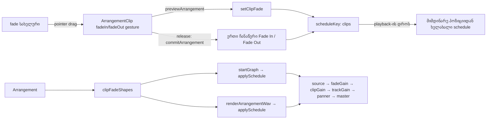

# Studio Lab — კლიპის Fade In / Fade Out, ეტაპი 1 (SRW-18 / FB-06)

**თარიღი:** 2026-10-22
**სტატუსი:** Round 82 — იმპლემენტირებულია, C-ის შემოწმებას ელოდება (D-29z47)
**შეცვლილი პროექტი:** Store

## კონტექსტი

FB-06 და R18-A1 ითხოვს, რომ აუდიოკლიპის დასაწყისსა და ბოლოს რეგულირებადი fade ჰქონდეს, რომელიც ისმის playback-შიც და export-შიც. Live 12-ის Reference Manual-ის §6.8 („Audio Clip Fades and Crossfades“) აღწერს fade-ის სახელურებს, რომლებიც clip-ის კიდეებზე პატარა კვადრატებად ჩნდება hover-ისას. იქვე წერია, რომ start და end fade ერთმანეთს ვერ გადაფარავს. ეს ეტაპი ამატებს fade-ის მოდელს, live playback-ს, export-ს, სახელურებს და Undo-ს. ეტაპი 2 (clip volume envelope, R18-A2) ცალკე რაუნდია.

ამავე რაუნდში გასწორდა C-R80-O3 (X1). თუ ერთი კლიპი დაკავებულ ხაზზე უარით გაიშვება, ის რჩება ბოლო თავისუფალ ადგილას (FB-03-ის წესი). release-ის სტატუსი კი მხოლოდ უარის ტექსტს წერდა და არ ამბობდა, სად დარჩა კლიპი.

## მიდგომა

| ID | გადაწყვეტილება |
|---|---|
| F1 | `ArrangementClip`-ს და clipboard-ის item-ს დაემატა არასავალდებულო `fadeIn` / `fadeOut` (timeline-ის წამები, მთელი ms). 0 ინახება როგორც არარსებული key, არა `undefined`. ინვარიანტია `fadeIn + fadeOut ≤ duration`. ვიდეოხაზის კლიპს fade არ აქვს (სურათის fade SRW-19-ია) |
| F2 | ახალი სუფთა მოდული `fades.ts`: effective მნიშვნელობები (`clipFadeIn` / `clipFadeOut` კითხვისას ინვარიანტით იჭრება), `setClipFade` (clamp, ms-ზე დამრგვალება, უცვლელობისას იგივე reference), `withCutEdges`, `clampClipFadesAfterTrim`, `clipFadeGainAt` და `clipFadeShapes` |
| F3 | move, ხაზის შეცვლა, ჯგუფური move, Ctrl+D და კლიპების copy/paste fade-ს უცვლელად ატარებს. Trim ორივე სიგრძეს ინარჩუნებს; თუ აღარ ეტევა, ჯერ trim-ის მხარის fade მცირდება. Split, Delete Time (Ctrl+Shift+X), Delete/Cut range ახალ ჭრილზე fade-ს აშორებს. range copy fade-ს მხოლოდ მაშინ იტოვებს, თუ ფანჯარაში კლიპის თავდაპირველი კიდეა |
| F4 | live playback და export ერთი `applySchedule` გზით მიდის. fade-იან კლიპს ემატება ცალკე `fadeGain` (`source → fadeGain → clipGain`), ამიტომ live Clip Gain-ის `setTargetAtTime` fade-ის ramp-ს არ ეჯახება. კლიპი fade-ის გარეშე ძველ graph-ს აგებს (დამატებითი node არ იქმნება). შუა fade-იდან დაწყებისას საწყისი gain იმ მომენტის ramp-ის მნიშვნელობაა |
| F5 | ორი 10×10 px სახელური body-ის თავში, header-ის ქვეშ, trim strip-ებზე მაღლა (`z-30`). ჩანს hover-ისას, მონიშნულ კლიპზე ან როცა fade > 0. დაკეცილ ხაზზე, ვიდეოკლიპზე და 24 px-ზე ვიწრო კლიპზე არ ჩანს. body-ში `pointer-events-none` SVG ramp-ს აჩვენებს. root-ზე იწერება `data-fade-in` / `data-fade-out` |
| F6 | ახალი gesture-ები `fadeIn` / `fadeOut` არსებული `beginGesture`-ით. drag თავისუფალია (grid snap არ მოქმედებს). release წერს ერთ ჩანაწერს `Fade In` / `Fade Out`. ადგილზე დაჭერა არაფერს წერს. `pointercancel` და დაკარგული pointer ცვლილებას აბრუნებს ჩანაწერის გარეშე. double-click fade-ს 0-ზე აყენებს |
| X1 | ერთი კლიპის move-ში ინახება ბოლო hover-ის უარის ტექსტი. თუ release-ზე lane target არ არის და კომიტმა რამე შეცვალა, სტატუსია `<უარი> — კლიპი ბოლო თავისუფალ ადგილას დარჩა: <ხაზი>, start <დრო>.`. ჩადებული პოზიცია, ghost-ები და ჯგუფური გზა უცვლელია |

ალტერნატივა იყო ramp-ის პირდაპირ `clipGain`-ზე დადება. ეს ერთ node-ს დაზოგავდა, მაგრამ Clip Gain-ის live ცვლილება (`setTargetAtTime`) ramp-ს გააფუჭებდა. ამიტომ fade ცალკე node-ზეა.

### Ableton-თან შედარება (Live 12 §6.8, capture 2026-10-21)

- **დადასტურებული და იგივე:** fade აუდიოკლიპის დასაწყისსა და ბოლოს; სახელურები hover-ზე; სიგრძე იცვლება drag-ით; start და end fade ერთმანეთს ვერ გადაფარავს; fade კლიპის თვისებაა და კლიპთან ერთად მოძრაობს.
- **შეგნებული განსხვავება:** მხოლოდ წრფივი ramp, Fade Curve სახელური არ არის. Live-ში fade სახელურის მონიშვნით და Delete-ით იშლება, CZABA-ში double-click-ით, რადგან Delete ყოველთვის კლიპს ან range-ს ეხება (SRW-24). Live-ის 4 ms-იანი ავტომატური edge fade („Create Fades on Clip Edges“) არ დამატებულა. ამით C-R28-INFO-NO-EDGE-FADES იხურება ჩაწერილ განსხვავებად.
- **არ ეხება:** crossfade მეზობელ კლიპებს შორის. CZABA-ში კლიპები ერთმანეთს არ ფარავს.
- **დაუდასტურებელი:** fade-ის ქცევა split-ზე, trim-ზე და Delete Time-ზე capture-ში არ არის. F3-ის წესები CZABA-ს გადაწყვეტილებაა. fade drag-ის snap-ი Live-ში დაუდასტურებელია; CZABA-ში drag თავისუფალია.

## არქიტექტურა

## შეცვლილი ფაილები

- `app/types/arrangement.ts` — `fadeIn?` / `fadeOut?` `ArrangementClip`-ზე.
- `app/lib/arrangement/fades.ts` — ახალი სუფთა მოდული (F2).
- `app/lib/arrangement/model.ts` — `trimClipStart`, `trimClipEnd`, `splitClipAt`, `deleteTime` (F3).
- `app/lib/arrangement/clipboard.ts` — clipboard item-ის ორი ველი, `materialInWindow`, `copyClipsToClipboard`, `cutRangeFromArrangement`, `planClipboardPaste` (F3).
- `app/lib/arrangement/graph.client.ts` — `ScheduleAudioParam`-ის ორი არასავალდებულო მეთოდი, `clipFades` ოფცია, fade node, ორი cleanup ადგილი და export-ის ერთი ხაზი (F4).
- `app/contexts/ArrangementContext.tsx` — `startGraph`-ში ერთი ხაზი `clipFades: clipFadeShapes(arrangement),` და import.
- `app/components/arrangement/ArrangementClip.tsx` — სახელურები, ramp overlay, gesture და X1 (F5, F6, X1).
- `app/lib/arrangement/__tests__/clip-fades.test.ts` — FD1–FD8b.
- `app/lib/arrangement/__tests__/clip-fades-ui.test.tsx` — FU1–FU5.
- `docs/implementation/2026/quarter-IV/070-…` (l.72) და `071-…` (l.4) — ერთხაზიანი შესწორებები (C81-2, GATE81-S1).

## პრობლემები და გადაწყვეტები

- **პრობლემა:** სამი გაყინული ტესტი `ScheduleAudioParam`-ს საკუთარი fake-ით ახორციელებს, რომელსაც მხოლოდ `value` და `setTargetAtTime` აქვს. **გადაწყვეტა:** `setValueAtTime` და `linearRampToValueAtTime` interface-ში არასავალდებულოა და optional chaining-ით იძახება. ნამდვილ `AudioParam`-ს ორივე აქვს.
- **პრობლემა:** გაყინული source-text ტესტები `renderArrangementWav`-ში `pan`-ის substring-ს კრძალავს. **გადაწყვეტა:** export-ში მხოლოდ ზუსტი ხაზია `clipFades: clipFadeShapes(arrangement),`. FD8 ამას იმეორებს, ამიტომ სახელის შეცვლა ჯერ აქ წითლდება.
- **პრობლემა:** release კომიტამდე უწოდებს claim-ის release-ს, რომელიც `previewActiveRef`-ს ნულავს. `pointercancel`-ზე preview-ის უკან დაბრუნება release-ის შემდეგ preview-ს აქტიურად დატოვებდა. **გადაწყვეტა:** fade-ის `pointercancel` მიდის `endStaleClipGesture`-ზე, რომელიც ჯერ `gesture.before`-ს აბრუნებს, მერე claim-ს ათავისუფლებს. FU3 ამოწმებს, რომ `isArrangementPreviewActive()` false-ია.
- **პრობლემა:** hover-ის React state-ი `render-budget.test.tsx`-ის `ArrangementClipViewInner: 0` ბიუჯეტს დაარღვევდა. **გადაწყვეტა:** ხილვადობას მხოლოდ CSS მართავს (`group` / `group-hover:opacity-100`). სახელურები DOM-ში ყოველთვის არის.
- **პრობლემა (code review H1, რეალურ Chromium-ში დადასტურდა):** pointer capture clip-ის root-ზე იყო, ამიტომ ნამდვილი `dblclick` root-ზე ხვდებოდა და სახელურის reset არ მუშაობდა (jsdom-ის `fireEvent.doubleClick` ამას ვერ აჩვენებდა). **გადაწყვეტა:** fade gesture pointer-ს თავად სახელურზე იჭერს; event-ები ისევ root-ის handler-ებამდე ადის. FU6 ამოწმებს capture-ის ელემენტს, Playwright-ის `page.mouse.dblclick` კი fade-ს 0-ზე აყენებს ერთი ჩანაწერით.
- **პრობლემა (review M1):** როცა `fadeIn + fadeOut = duration`, `start + fadeIn` და `end − fadeOut` float-ში შეიძლება ერთი ulp-ით განსხვავდებოდეს (მაგ. 0.1 / 0.4 / 0.2 / 0.2). მაშინ `setValueAtTime(1)` ramp-ის ბოლოზე ადრე ჯდება და fade-in ჩუმდება, მერე ხტება. **გადაწყვეტა:** fade-out-ის დასაწყისი არასოდეს არის fade-in-ის ბოლოზე ადრე. FD7g ამოწმებს event-ების დროის რიგს.
- **პრობლემა (review M2):** fade-out 0-ზე და კიდემდე გაწეულ fade-in-ზე ორი სახელური ერთმანეთს ფარავდა და მოძრავი სახელური მიუწვდომელი იყო. **გადაწყვეტა:** fade > 0 სახელური `z-40`-ზეა. fade-out სახელური ახლა `right`-ით პოზიციონირდება, ამიტომ root-ის border მას აღარ ანაცვლებს (review L1).
- **პრობლემა:** მუტაცია (g)-ის პირველი ვარიანტი მწვანე დარჩა, რადგან revert კომიტამდე ხდებოდა და კომიტი no-change იყო. **გადაწყვეტა:** ჩაწერილი (g) ორივე cancel guard-ს შლის; FU3 წითლდება.

## ტესტირება

- `clip-fades.test.ts` 25/25 და `clip-fades-ui.test.tsx` 16/16.
- ცვლილებასთან დაკავშირებული გაყინული ტესტები: 72 ფაილი (`a-round-82/targeted-list.txt`) მწვანეა.
- მუტაციები (a)–(h) ყველა წითელია (`a-round-82/mut/SUMMARY.md`).
- `npm run typecheck`, `npm run lint` და Biome check მფლობელობის ფაილებზე სუფთაა.
- A-მ Chromium-ში შეამოწმა მხოლოდ handle-ის hover, +40 px drag (`1.000`) და `dblclick` reset (`0.000`). რეალური ბრაუზერის სრული შემოწმება (export-ის ratio, live meter, handle-ები ორ viewport-ზე) C-ის რაუნდია.
- playback-ის დროს სახელურის ყოველი preview მოძრაობა ცვლის `scheduleKey`-ს და graph-ს მიმდინარე პოზიციიდან თავიდან აწყობს, ისევე როგორც კლიპის move დღეს. ეს მიღებული ქცევაა (FD-PLAY-EDIT).

## TODO / შემდეგი ნაბიჯები

- **ხელმისაწვდომობა:** fade-ის სიგრძე ეტაპ 1-ში მხოლოდ მაუსით იცვლება. კლავიატურის გზა SRW-18-ის ეტაპ 2-ის დაგეგმვის signal-ია (SRW18-KEYBOARD-FADES).
- **touch:** დამალული სახელური (`opacity-0`) clip-ის ზედა კუთხეებში დაჭერას მაინც იჭერს, `touch-none` კი არ აქვს, ამიტომ touch drag შეიძლება `pointercancel`-ით დაბრუნდეს. იგივეა trim strip-ებზეც; ცალკე signal-ია.
- **ეტაპი 2:** clip volume envelope (R18-A2).
- Fade Curve და Live-ის 4 ms edge fade ჩაწერილი განსხვავებებია. თუ მომხმარებელი მოითხოვს, ცალკე დავალება გახდება.
