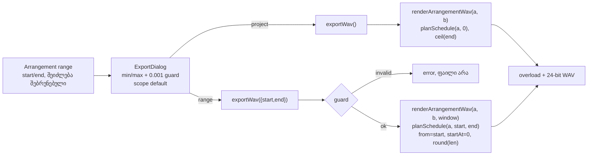
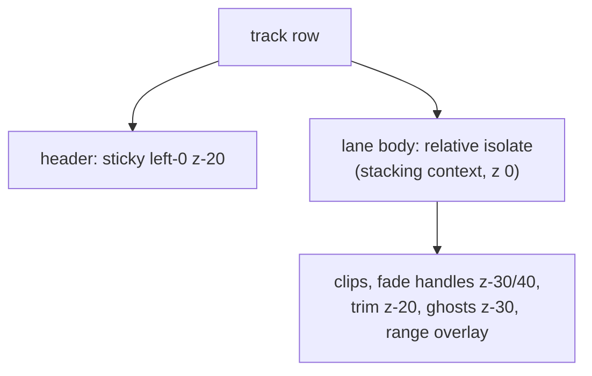

# Studio Lab — მონიშნული მონაკვეთის ექსპორტი (SRW-20 ეტაპი 1) და track header-ის stacking (C-R84-M1)

**თარიღი:** 2026-10-22
**სტატუსი:** Round 85 — იმპლემენტირებულია, C-ის შემოწმებას ელოდება (D-29z50)
**შეცვლილი პროექტი:** Store

## კონტექსტი

რაუნდში ორი დამოუკიდებელი ნაწილია:

1. **X1 — C-R84-M1 (Medium).** როცა კლიპი horizontal scroll-ით sticky track header-ის ქვეშ შედის, მისი fade handle-ები (`z-30`/`z-40`) და trim ზოლები (`z-20`) header-ის (`z-20`) ზემოთ იხატება და hit-test-შიც ზემოთაა. C-მა რეალური drag-ით header-ის ადგილზე დამალული ვიდეოკლიპის fade 1.000-დან 2.000-მდე შეცვალა, Undo-ს ჩანაწერითაც.
2. **SRW-20 ეტაპი 1 — დროის მონაკვეთის ექსპორტი (R20-X1, R20-X3).** აქამდე ექსპორტი ყოველთვის მთელ პროექტს (`0 … projectEnd`) ქმნიდა. დიალოგში „მხოლოდ მონიშნული მონაკვეთი“ disabled იყო. მომხმარებელს სჭირდება, რომ Arrangement-ში მონიშნული დროის მონაკვეთი ცალკე WAV-ად შეინახოს.

## მიდგომა

### X1 — stacking context lane body-ზე

ხაზის row-ში ჯერ header მოდის (`sticky left-0 z-20`), შემდეგ lane body (`relative`, z-index-ის გარეშე). Lane body stacking context არ იყო. ამიტომ მონიშნულ კლიპზე (`z-10`) ნაკლებად დაცული, **მოუნიშნავი** კლიპის შვილობილი ელემენტები header-ს იმავე stacking context-ში ეჯიბრებოდნენ. Envelope-ის წერტილები დაცული იყო, რადგან მათი მშობელი უკვე `absolute z-10` stacking context-ია.

გადაწყვეტა: lane body-ს ემატება Tailwind-ის `isolate` (`isolation: isolate`). ამით lane body ერთი stacking context ხდება, რომელიც row-ში z-index 0-ის დონეზე იხატება, ანუ header-ის (`z-20`) ქვემოთ. მის შიგნით handle-ების, trim ზოლების, ghost-ებისა და range overlay-ის ურთიერთრიგი უცვლელია. Header-ის z-index არ გაზრდილა, handle-ების z-კლასები კი ისევ ადგილზეა (ამას frozen `clip-fades-ui` ამოწმებს).

ალტერნატივა იყო `isolate` კლიპის root-ზე, მაგრამ ის ghost-ებსა და library drop ghost-ს არ ფარავს. Lane body-ის ვარიანტს არცერთი frozen ტესტი არ არღვევს, ამიტომ ალტერნატივა არ გამოგვიყენებია (`ArrangementClip.tsx` ბაიტ-ბაიტ უცვლელია).

### E1 — render window

`renderArrangementWav(arrangement, buffers, renderWindow?)`:

- **window-ის გარეშე** — იგივე გამოძახება, რაც აქამდე: `planSchedule(arrangement, 0)`, `from 0`, სიგრძე `ceil(projectEnd × 48000)`.
- **window-ით** — სიგრძე `round((end − start) × 48000)` frame-ია, schedule `planSchedule(arrangement, start, end)`, `from = start`, `startAt = 0`. ეს იგივე mid-start გზაა, რასაც live დაკვრა ნებისმიერი პოზიციიდან იყენებს (FD-MIDSTART, EN-MIDSTART). Window-ის დაწყებამდე დაწყებული კლიპი სწორი offset-ით უკრავს, fade და envelope კი შუალედური მნიშვნელობიდან იწყება.
- Overload იზომება მხოლოდ დარენდერებულ window-ზე, რადგან OfflineAudioContext მხოლოდ window-ის სიგრძისაა. Encoding უცვლელია (24-bit, 48 kHz, stereo).
- Window `projectEnd`-ს იქით გრძელდება? ბოლო ნაწილი სიჩუმეა.

**round vs ceil.** მთელი პროექტისთვის `ceil` რჩება, რომ ბოლო კლიპის ბოლო sample არ დაიკარგოს (ძველი ქცევა). მონაკვეთისთვის `round` გამოიყენება. მონიშვნა grid/zoom-იდან მოდის და floating-point შეცდომა იძლევა მნიშვნელობებს, როგორიცაა 4.999999 ან 5.000001 წმ. `ceil` მეორე შემთხვევაში ზედმეტ frame-ს დაამატებდა, მაშინ როცა 5.000 წმ-იანი მონაკვეთი ზუსტად 240000 frame უნდა იყოს.

**Master-only.** მონაკვეთის ფაილი ყოველთვის ყველა ხაზის Master მიქსია, მიუხედავად იმისა, რომელ ხაზზეა range დახატული ან ყველა ხაზზეა თუ არა (Ctrl+Shift+L).

### E2 — დიალოგის „მონაკვეთი“

- ახალი fieldset „მონაკვეთი“, ორი radio-თი: „მთელი პროექტი · 00:00.000 — {ბოლო}“ და „მონიშნული მონაკვეთი · {a} — {b} ({len} წმ)“. a/b range-ის min/max-ია, რადგან context-ის range შეიძლება შებრუნებული იყოს.
- **Default ყოველ გახსნაზე:** ვალიდური range (≥ 0.001 წმ) არსებობისას — მონაკვეთი, სხვა შემთხვევაში — მთელი პროექტი. დახურვისას არჩევანი ნულდება.
- **Range-ის გარეშე ორივე radio disabled-ია.** მთელი პროექტი checked რჩება, მონაკვეთს კი მიზეზი აქვს: „მონიშნე დროის მონაკვეთი Arrangement-ში (drag კლიპზე ან სახაზავზე)“. მიზეზი: frozen `export-dialog-focus` (C-R14-02) ზუსტად 4 enabled control-ს ითვლის (✕ → ფორმატის radio → დახურვა → ექსპორტი). ერთადერთი შესაძლო არჩევანის enabled radio ამ კონტრაქტს დაარღვევდა და ახალს არაფერს მისცემდა. Range-ის არსებობისას ორივე enabled-ია და Tab/ისრებით მისაწვდომია. Render-ის დროს ორივე disabled-ია.
- ძველი disabled „მხოლოდ მონიშნული მონაკვეთი“ ამოღებულია. MP3 რჩება disabled-ად `ამ ეტაპზე ხელმისაწვდომი არ არის` მიზეზით (ეტაპი 2). ვიდეოს ოფცია და round 84-ის video-fades შენიშვნა უცვლელია (R20-X3).
- Description, graph note, loop note, master-mute note და no-sound note მონაკვეთის რეჟიმში მონაკვეთის სიგრძეს ასახელებს. მთელი პროექტის რეჟიმში ყველა ტექსტი ბაიტ-ბაიტ ძველია.

### E3 — `exportWav(renderWindow?)`

- ძველი guard-ები (Web Audio არ არის, ცარიელი პროექტი, ვიდეოს ხმა იშიფრება) პირველად სრულდება, უცვლელად.
- არავალიდური window (non-finite, `start < 0`, `end − start < 0.001`) იწვევს შეცდომას „მონაკვეთი არასწორია — ფაილი არ შეიქმნა.“. ამ დროს არც render ხდება, არც download.
- ვალიდური window იძლევა ფაილს `czaba-studio-lab-range.wav` და შეტყობინებას „WAV შეიქმნა: მონაკვეთი {start} — {end} ({len} წმ), 24-bit · 48 kHz · stereo.“ (+ Master mute-ის ძველი სუფიქსი). Overload-ის გაფრთხილება window-ის პიკიდან მოდის.
- Window-ის გარეშე renderer-ს ზუსტად ორი არგუმენტით ვიძახებთ, ამიტომ ძველი mock-ზე დაფუძნებული ტესტები უცვლელად მუშაობს.

## არქიტექტურა

## შეცვლილი ფაილები

- `app/components/arrangement/ArrangementLane.tsx` — lane body-ს `isolate` (X1).
- `app/lib/arrangement/graph.client.ts` — `ArrangementRenderWindow` ტიპი და `renderArrangementWav`-ის არჩევითი window (E1).
- `app/contexts/ArrangementContext.tsx` — `exportWav(renderWindow?)`: guard, ფაილის სახელი, შეტყობინება (E3).
- `app/components/arrangement/ArrangementExportDialog.tsx` — „მონაკვეთი“ fieldset, scope-ის default და ტექსტები (E2).
- `app/lib/arrangement/__tests__/graph.test.ts` — ერთი დამატებითი source-text assertion window-ის გამოძახებაზე.
- `app/lib/arrangement/__tests__/export-range.test.ts` (ახალი) — XR1–XR4, renderer-ის დონე.
- `app/lib/arrangement/__tests__/export-range-ui.test.tsx` (ახალი) — XU1–XU5, დიალოგი და context.
- `app/lib/arrangement/__tests__/track-header-stacking.test.tsx` (ახალი) — X1-ის სტრუქტურული guard.
- `docs/implementation/2026/quarter-IV/074-studio-lab-video-opacity-fade.md` — სტატუსი.

## პრობლემები და გადაწყვეტები

- **პრობლემა:** ამოცანა `graph.test.ts` l.388-ის literal-ის შეცვლას ითვალისწინებდა, მაგრამ იგივე literal `applySchedule(ctx, planSchedule(arrangement, 0)` სამ სხვა frozen ტესტშიც არის ჩაკეტილი (`clip-fades` FD8, `clip-gain`, `track-pan`).
  **გადაწყვეტა:** window-ის გარეშე შტო ძველ გამოძახებას ზუსტად ინარჩუნებს, window-ის შტო კი ცალკე გამოძახებაა. ოფციები ერთხელ იწყობა და ორივე შტო მას იყენებს. l.388 უცვლელია, დაემატა მხოლოდ ერთი assertion.
- **პრობლემა:** FD8/EV6/track-pan `renderArrangementWav`-ის ტექსტში `pan` substring-ს კრძალავს (`span`-იც მასში შედის).
  **გადაწყვეტა:** სახელები `renderWindow`/`options` ისე შეირჩა, რომ ეს წესი არ დაირღვეს. ტიპი ფუნქციის წინაა განთავსებული.
- **პრობლემა:** frozen C-R14-02 ზუსტად 4 enabled control-ს ითვლის.
  **გადაწყვეტა:** range-ის გარეშე ორივე scope radio disabled-ია (იხ. E2).

## Ableton-თან განსხვავებები (Live 12 Manual §5.1.3.1, B-ის წყარო 2026-10-22)

- დროის მონიშნვა ექსპორტის დიაპაზონს ადგენს — **იგივეა**: ვალიდური range default-ად მონაკვეთის რეჟიმს ირჩევს.
- Default მთელი Set-ია — **იგივეა**: range-ის გარეშე მთელი პროექტი იქმნება.
- Rendered Track = Main — **იგივეა**: მონაკვეთის ფაილი Master მიქსია.
- Render Start/Length ველები — **შეგნებული გამარტივება**: ველებში აკრეფა არ არის, მონაკვეთი Arrangement-ის მონიშვნიდან მოდის.
- ცალკეული ტრეკების/სტემების რენდერი — **CZABA-ს ფარგლებს გარეთ**, მხოლოდ Master.
- Render as Loop / MP3 / progress — loop იგნორირდება (ძველი D-შენიშვნა). MP3 ეტაპი 2-შია, progress ეტაპი 3-ში.
- X1 ზოგადი UI layering-ის ბაგფიქსია, Ableton-ის წყაროს არ ეყრდნობა.

## ტესტირება

- XR1–XR4 (8 ტესტი) იყენებს ჩამწერ fake OfflineAudioContext-ს. ის იწერს constructor-ის `length`-ს, `start(when, offset, duration)`-ს და gain-param-ების გამოძახებებს. Deterministic fake render-ით მოწმდება overload და WAV-ის sample-ები.
- XU1–XU5 (11 ტესტი): დიალოგი და context mock-ირებული renderer-ით. მოწმდება ზუსტი ტექსტები, ფაილის სახელები, ხელახლა გახსნისას default და Tab-wrap range-ით.
- X1 guard (4 ტესტი): კლასებით ამოწმებს lane body-ის `isolate`-სა და header-ის `sticky left-0 z-20`-ს handle-ებისთვის, trim-ისთვის, ghost-ისთვის და envelope-ის წერტილებისთვის. **jsdom არ ხატავს და hit-test-ს არ აკეთებს**, ამიტომ ეს regression lock-ია და არა ქცევის მტკიცებულება. ქცევას C-ის ბრაუზერის M1-* რიგები ამოწმებს.
- Mutation-ები (a)–(g) scratch ასლში გაეშვა. თითოეულმა მინიმუმ ერთი ტესტი გააწითლა.
- Targeted vitest, typecheck, lint და scoped Biome. სრული suite/verify root gate-ის საქმეა.

## TODO / შემდეგი ნაბიჯები

- SRW-20 ეტაპი 2: MP3 არსებული `app/utils/ffmpeg.ts`-ით, CDN-ის ჩავარდნისას მკაფიო შეცდომა და ფაილის გარეშე (R20-X2).
- SRW-20 ეტაპი 3: encoding main thread-ის გარეთ, progress-ითა და cancel-ით 5-წუთიან პროექტზე (R20-X4).
- C-R84-L1 (±1 LSB ვიდეოს ხმის მონაკვეთზე) რჩება Lows batch-ში.
- დიალოგის ღია მდგომარეობაში range-ის ცვლილებაზე default-ის ხელახალი გამოთვლა ამ ეტაპზე არ მოითხოვება.
