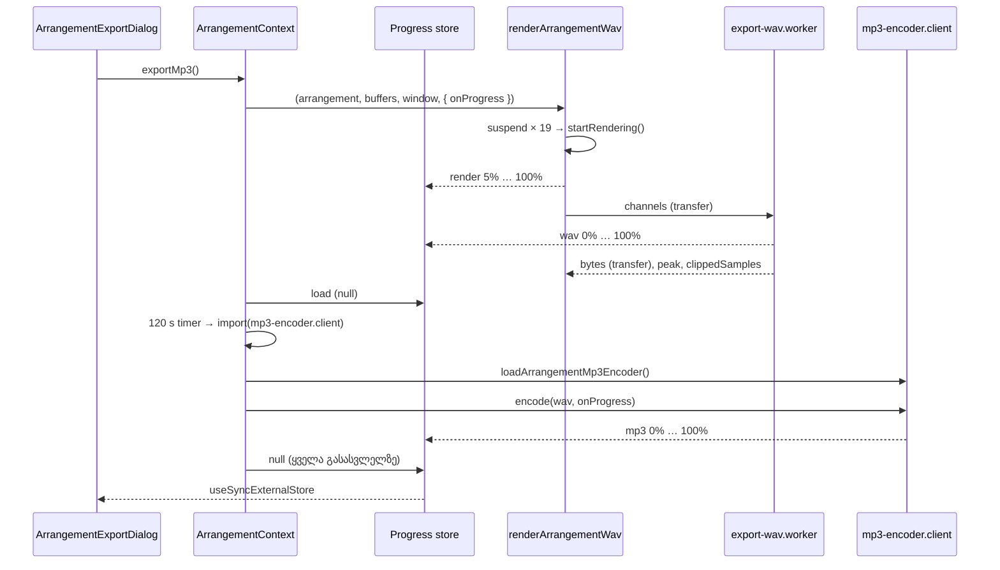

# Studio Lab — WAV-ის ჩაწერა worker-ში, ექსპორტის პროგრესი და lab-ის საკუთარი MP3 encoder (SRW-20 ეტაპი 3a)

**თარიღი:** 2026-10-22
**სტატუსი:** Round 88 — C round 87: 18/18 PASS, ერთი medium ბაგი (R87-PROGRESS-BELOW-FOLD-1280) — გასწორდა sticky footer-ით, C-ის შემოწმებას ელოდება (D-29z53)
**შეცვლილი პროექტი:** Store

## კონტექსტი

SRW-20-ის მეორე ეტაპმა (Round 86, `971141d`) დაამატა MP3 და WAV + MP3 ექსპორტი. R20-X4 მოითხოვს, რომ 5 წუთიანი პროექტის ექსპორტისას UI არ გაიყინოს, პროგრესი ჩანდეს და Cancel მუშაობდეს.

B-ის probe-მა (`b-round-86/probe/PROBE-SUMMARY.md`, `971141d`-ზე) აჩვენა:

- 5 წუთიანი პროექტი (`00:00.000 — 05:04.406`, მუსიკის კლიპი + Ctrl+D ორჯერ) WAV ექსპორტისას main thread-ს ერთხელ **445 ms**-ით ბლოკავს. ჩვეულებრივი frame gap 45–57 ms-ია. 101.702 წმ პროექტზე gap 201 ms-ია.
- ბლოკს იწვევს `startRendering()`-ის შემდეგი სამი ნაბიჯი: overload-ის გაზომვა, clamp loop და `encodeSfxWav`. თვითონ `OfflineAudioContext`-ის რენდერი UI-ს არ ბლოკავს.
- MP3 conversion უკვე ffmpeg.wasm-ის საკუთარ worker-შია: 300 წმ 1.8 წამში, max gap 44 ms. FFmpeg instance `progress` event-ს დაახლოებით ყოველ 500 ms-ში აგზავნის.
- გაყინული `app/utils/ffmpeg.ts` 120 წამიანი timeout-ის შემდეგ არ reset-დება (`isLoading` true რჩება, poller გაჟონავს), ამიტომ ხელახალი ცდაც ჩამოეკიდება (GATE86-S1).

ეტაპი 3a ამ სამ პრობლემას აგვარებს. Cancel, unmount-ზე abort და WAV + MP3-ის მიწოდების შენიშვნა (GATE86-S2) ეტაპ 3b-შია. R20-X4 მხოლოდ 3b-ის შემდეგ ჩაითვლება დასრულებულად.

## მიდგომა

**WAV-ის ჩაწერა worker-ში.** ახალი pure მოდული `export-wav.ts` შეიცავს `measureExportOverload`-ს (უცვლელად გადმოტანილს) და `encodeArrangementWav`-ს. ეს უკანასკნელი ზუსტად იმავე სამ ნაბიჯს აკეთებს, რასაც ადრე renderer აკეთებდა: ჯერ ზომავს clamp-მდე, შემდეგ clamp-ავს `[−1, MAX_24BIT_SAMPLE]` დიაპაზონში და ბოლოს იძახებს `encodeSfxWav`-ს. ბაიტები ძველი გზის იდენტურია. `graph.client.ts` `measureExportOverload`-ს იმავე სახელით რეექსპორტს უკეთებს, ამიტომ არსებული import-ები და ტესტები უცვლელია.

worker-ის trio იმეორებს `sfx-export`-ის გამოქვეყნებულ pattern-ს:

- `export-wav.ts` — pure ლოგიკა, მხოლოდ relative import-ები (`./meter`, `../sfx-edit`). ასე worker bundle-ში `~` alias-ის resolution არ ხვდება.
- `export-wav.worker.ts` — იღებს `{ channels, sampleRate }`-ს, პროგრესს აგზავნის მაქსიმუმ ერთხელ ყოველ მთელ პროცენტზე და ბაიტებს transfer-ით აბრუნებს.
- `export-wav.client.ts` — ყოველ ექსპორტზე ერთ worker-ს ქმნის, არხების buffer-ებს transfer-ით გადასცემს და complete-ის, error-ის, `onerror`-ისა და `onmessageerror`-ის შემდეგ worker-ს `terminate()`-ს უკეთებს. ნებისმიერი ჩავარდნა იძლევა შეცდომას `WAV-ის ჩაწერა ვერ მოხერხდა (worker).`, რომელსაც context-ის არსებული catch აჩვენებს.

**Fallback-ის წესი.** main thread-ზე ჩაწერა ხდება **მხოლოდ** მაშინ, როცა `Worker` საერთოდ არ არსებობს (vitest/jsdom/node). ასე გაყინული direct-render ტესტები ბაიტებით უცვლელი რჩება. worker-ის ჩავარდნის შემდეგ main thread-ზე ჩუმი გადართვა არ ხდება.

**რენდერის პროგრესი.** როცა `onProgress` გადაცემულია და context-ს `suspend` აქვს, renderer `startRendering()`-მდე 19 წერტილს გეგმავს (`arrangementRenderSuspendFrames`: 20 ნაწილი, 128 frame-ის render quantum-ის ჯერადი). ყოველ წერტილზე იძახებს `onProgress('render', frame / length)`-ს, შემდეგ `resume()`-ს. `suspend`/`resume`-ის rejection იყლაპება. ყოველი გამოძახება microtask-შია, რომ fake ან უჩვეულო context-ის სინქრონულმა შეცდომამ რენდერი არ ჩააგდოს. `onProgress`-ის გარეშე `suspend` საერთოდ არ გამოიძახება.

**პროგრესის store და არა `exportState`.** პროგრესი ცალკე external store-შია (`export-progress.ts`, `position-store`-ის pattern-ით). ამის ორი მიზეზი არსებობს:

1. გაყინული ტესტები `exportState`-ს `toEqual({ phase, message[, warning] })`-ით ამოწმებენ.
2. პროცენტის ყოველი ცვლილება provider-ის და `useArrangement()`-ის ყველა consumer-ის ხელახალ render-ს გამოიწვევდა.

store ატყობინებს მხოლოდ phase-ის, null-ობის ან მთელი პროცენტის ცვლილებას. dialog მას `useSyncExternalStore`-ით კითხულობს.

**Dialog.** რენდერის დროს სტატუსის შემდეგ ჩანს label (`რენდერი · N%`, `WAV-ის ჩაწერა · N%`, `MP3 encoder-ის ჩატვირთვა…`, `MP3-ის შექმნა · N%`) და `<progress>`. encoder-ის ჩატვირთვისას `value` ატრიბუტი არ არსებობს, ანუ bar indeterminate-ია. `<progress>` focus-ს არ იღებს, ამიტომ focus trap-ის წესები არ იცვლება.

**lab-ის საკუთარი MP3 encoder (`mp3-encoder.client.ts`).** გაყინულ util-ს protected purchased Studio (`StudioContext.tsx`) იყენებს. ის Studio cloud-ში ვერ მოწმდება (backend მიუწვდომელია), ამიტომ util არ შეცვლილა. lab-ის მოდული იყენებს იმავე `@ffmpeg/*` პაკეტებს, იმავე unpkg core-ს (`@ffmpeg/core@0.12.6/dist/esm`) და ბაიტით იმავე ბრძანებას: `-i input.wav -codec:a libmp3lame -b:a 320k -q:a 0 output.mp3`. util-ისგან განსხვავებით:

- ერთდროული გამოძახებები ერთ in-flight promise-ს იზიარებს და polling არ არსებობს.
- ჩავარდნისას instance `terminate()`-დება და cache სუფთავდება.
- `resetArrangementMp3Encoder()` ჩატვირთულ ან ჩატვირთვის პროცესში მყოფ instance-ს წყვეტს. generation counter-ის გამო reset-ის შემდეგ დასრულებული ჩატვირთვა cache-ს ვეღარ ავსებს. generation მოწმდება ყოველი ჩამოტვირთვის შემდეგ: თუ reset `ffmpeg-core.js`-ის ჩამოტვირთვის დროს მოხდა, `ffmpeg-core.wasm`-ის მოთხოვნა აღარ იწყება და ძველ instance-ზე `load()` არ გამოიძახება. უკვე დაწყებულ ჩამოტვირთვას `toBlobURL` ვერ წყვეტს (signal არ აქვს).
- core-ის blob URL-ები ჩატვირთვის დასრულების შემდეგ (წარმატებით თუ არა) `revokeObjectURL`-ით თავისუფლდება.
- `encode`-ის შემდეგ `progress` listener-ი ყოველთვის იხსნება და ორივე ფაილი იშლება.
- არანულოვანი exit code იძლევა შეცდომას `ffmpeg exit code N`.

**Timeout ფარავს import-საც (GATE86-S3, პირველი ნახევარი).** context-ში 120 წამიანი timer encoder-ის ჩატვირთვის შეტყობინებისთანავე იწყება, dynamic import-მდე. timeout-ზე context reset-ს აკეთებს და შეტყობინება უცვლელია. თუ მოდული timeout-ის შემდეგ ჩამოვა, continuation load-ს აღარ იწყებს: reset-ს აკეთებს და ჩერდება. ასე timeout-ის შემდეგ ჩამოსულ მოდულზე 31 MB-იანი მოთხოვნა აღარ იწყება. თუ timeout core-ის ჩამოტვირთვის დროს მოხდა, reset ახალ მოთხოვნას აჩერებს, მაგრამ უკვე დაწყებული fetch ბოლომდე მიდის. იმავე გვერდზე შემდეგი MP3 ხელახლა ჩაიტვირთება. context-ში `~/utils/ffmpeg` ან `@ffmpeg/*`-ის სტატიკური import აღარ არის.

**Conversion-ს ფიქსირებული დროის ლიმიტი არ აქვს.** მისი ხანგრძლივობა პროექტის სიგრძეს მიჰყვება. Cancel ეტაპ 3b-ში დაემატება.

**VBR.** ბრძანება Round 86-ის იდენტურია (`-b:a 320k -q:a 0`). Round 86-ის smoke-მა ამ ბრძანებით Xing (VBR) header აჩვენა. Live-ის manual-ი CBR 320-ს აღწერს. ეს შეგნებული განსხვავება Round 86-დან უცვლელია.

## არქიტექტურა

## შეცვლილი ფაილები

- `app/lib/arrangement/export-wav.ts` (ახალი) — `measureExportOverload`, `encodeArrangementWav` და worker-ის message ტიპები.
- `app/lib/arrangement/export-wav.worker.ts` (ახალი) — WAV-ის ჩაწერა worker-ში, პროგრესი მთელ პროცენტებზე.
- `app/lib/arrangement/export-wav.client.ts` (ახალი) — worker-ის lifecycle და fallback მხოლოდ `Worker`-ის არარსებობისას.
- `app/lib/arrangement/export-progress.ts` (ახალი) — phase-ები, suspend frame-ები, store და label-ები.
- `app/lib/arrangement/mp3-encoder.client.ts` (ახალი) — lab-ის MP3 encoder, reset-ითა და generation counter-ით.
- `app/lib/arrangement/graph.client.ts` — `renderArrangementWav`-ის მე-4 არგუმენტი (`onProgress`), suspend პროგრესი და worker-ში ჩაწერა. `measureExportOverload` გადატანილია და რეექსპორტირებულია.
- `app/contexts/ArrangementContext.tsx` — progress store (`exportProgress`), renderer-ის მე-4 არგუმენტი, encoder-ის მოდული, timer import-მდე, `setProgress(null)` ყველა გასასვლელზე.
- `app/components/arrangement/ArrangementExportDialog.tsx` — პროგრესის label და `<progress>`.
- ტესტები: `export-wav.test.ts`, `export-progress.test.ts`, `mp3-encoder.test.ts` და `export-progress-ui.test.tsx` ახალია. `export-mp3.test.tsx`-ში encoder-ის mock-ები lab-ის მოდულზე გადავიდა. `export-range-ui.test.tsx`-ში და `metronome-ui.test.tsx`-ში call-shape-ის ხაზები შეიცვალა.
- `docs/implementation/2026/quarter-IV/076-studio-lab-mp3-export.md` — მხოლოდ სტატუსის ხაზი.
- Round 88: `ArrangementExportDialog.tsx` — სტატუსი, პროგრესი, overload-ის გაფრთხილება და ღილაკები ერთ sticky footer-შია (`arrangement-export-footer`), დამატებულია `focusin` guard და `ARRANGEMENT_EXPORT_FOOTER_FOCUS_MARGIN_PX`. ახალი ტესტი: `export-dialog-footer.test.tsx`.

## პრობლემები და გადაწყვეტები

- **პრობლემა:** source-text ტესტები `graph.client.ts`-ს `renderArrangementWav`-იდან ფაილის ბოლომდე ჭრიან და ამოწმებენ, რომ იქ `pan` არ ჩანს. → **გადაწყვეტა:** renderer ფაილის ბოლო ფუნქციად დარჩა. ახალი helper (`scheduleArrangementRenderProgress`) მის ზემოთაა და მის სახელებში `pan` არ ჩანს.
- **პრობლემა:** `suspend` microtask-ში უნდა გამოიძახებოდეს, მაგრამ `startRendering()`-მდე. → **გადაწყვეტა:** დაგეგმვის შემდეგ renderer ერთხელ ელოდება microtask-ს (`await Promise.resolve()`) და მხოლოდ შემდეგ იწყებს რენდერს.
- **პრობლემა:** worker-იდან ბაიტების transfer-ით დაბრუნება `Window.postMessage`-ის ტიპებს type assertion-ის გარეშე არ ერგება. → **გადაწყვეტა:** გამოყენებულია `postMessage(message, { transfer })` ფორმა.
- **პრობლემა:** timeout-ით წაგებული import/load promise-ის rejection შეიძლება unhandled დარჩეს. → **გადაწყვეტა:** context-ში და encoder-ის მოდულში ასეთ promise-ს noop `.catch` აქვს.
- **პრობლემა (code-reviewer):** `new Worker(...)`-ის სინქრონული შეცდომა (CSP, module worker-ის მხარდაჭერის არქონა) ბრაუზერის ტექსტით ჩანდა და არა ზუსტი შეტყობინებით. → **გადაწყვეტა:** constructor-იც `try`-შია და იგივე `WAV-ის ჩაწერა ვერ მოხერხდა (worker).` შეცდომას იძლევა (EW5).
- **პრობლემა (code-reviewer):** თუ პროგრესის callback შეცდომას ისვრის, `resume()` აღარ გამოიძახებოდა და რენდერი ჩამოეკიდებოდა. → **გადაწყვეტა:** წარმატებული `suspend`-ის შემდეგ `resume()` ყოველთვის გამოიძახება, callback კი ცალკე microtask-შია (EW6).
- **პრობლემა (code-reviewer):** generation მოწმდებოდა მხოლოდ ორივე ჩამოტვირთვის შემდეგ, ამიტომ reset-ის შემდეგაც იწყებოდა `ffmpeg-core.wasm`-ის მოთხოვნა. ამასთან core-ის blob URL-ები არ თავისუფლდებოდა. → **გადაწყვეტა:** generation მოწმდება ყოველი ჩამოტვირთვის შემდეგ და URL-ები `finally`-ში revoke-დება (ME1, ME3).
- **პრობლემა:** UI ტესტში encoder-ის import-ის ჩამოგვიანება async `vi.mock` factory-ით ხდება. ტესტის ფაილის სტატიკურმა import-მა იგივე gate დაბლოკა. → **გადაწყვეტა:** mock ფუნქციები `vi.hoisted`-შია და ტესტი მოდულს სტატიკურად აღარ აიმპორტებს.
- **პრობლემა (C round 87, R87-PROGRESS-BELOW-FOLD-1280):** 1280×720-ზე dialog-ის panel (`max-h-[90vh] overflow-auto`, clientHeight 646, scrollHeight 758) რენდერის დროს progress label-ს ჭრიდა, `<progress>` და `მიმდინარეობს…` ღილაკი კი სრულად ქვემოთ რჩებოდა. ექსპორტამდეც panel 12 px-ით გადადიოდა. → **გადაწყვეტა:** სტატუსი, label, bar, overload-ის გაფრთხილება და ღილაკები ერთ `sticky bottom-0` footer-შია (`bg-surface`, `border-t border-outline`), ამიტომ ისინი scroll-ის ნებისმიერ პოზიციაზე ჩანს. `scrollIntoView` არ გამოიყენება: ის sticky footer-ს არ ითვალისწინებს (scrollport-ში მყოფ, მაგრამ footer-ით დაფარულ ელემენტს არ გადაახვევს) და jsdom-შიც არ არსებობს; `scrollTop`-ის მინიჭება jsdom-შიც და ბრაუზერშიც მუშაობს. DOM-ის და Tab-ის რიგი უცვლელია, რადგან footer ModalBody-ს ბოლო შვილია. sticky footer-ს შეუძლია focus-ში მყოფი ელემენტის დაფარვა, ამიტომ `focusin` guard panel-ს `overlap + 8` px-ით ჩამოახვევს მხოლოდ მაშინ, როცა target footer-ის გარეთაა და footer-ს არ შეიცავს. ბოლო პირობა focus-trap wrapper-ს გამორიცხავს, რომელსაც არსებული effect რენდერის დაწყებისას აფოკუსებს.

## ტესტირება

- Unit/UI ტესტები: EW1–EW7 (EW7 თვითონ worker მოდულს ამოწმებს), PR1–PR3, ME1–ME6 (blob URL-ების revoke-ისა და ჩამოტვირთვის დროს reset-ის ჩათვლით) და PU1–PU5. ბაიტების იდენტურობა მოწმდება oracle-ით, რომელიც ძველ inline ხაზებს იმეორებს.
- jsdom-ში `typeof Worker === 'undefined'` (EW4), ამიტომ გაყინული direct-render ტესტები main thread-ის გზით გადის.
- A-ს Playwright smoke 1440×900-ზე, 5 წუთიან პროექტზე: შედეგები `tmp/studio-real-loop/a-round-87.md`-შია. ეს C-ის მტკიცებულება არ არის.
- Production build-ში worker-ი და MP3 cloud-ში არ შემოწმებულა, რადგან preview server არ არის. ეს root-ის gate-ის საკითხია.
- Round 88: FT1–FT4 (`export-dialog-footer.test.tsx`) ამოწმებს footer-ის სტრუქტურას, რიგს, Tab-ის უცვლელობას და focus guard-ის არითმეტიკას. jsdom-ს layout არ აქვს, ამიტომ ხილვადობის მტკიცებულება C-ის ბრაუზერის გაზომვაა. რვავე mutation proof (B-ის (a)–(g) და listener-ის cleanup-ის მოხსნა) წითელია.

## TODO / შემდეგი ნაბიჯები

- **ეტაპი 3b:** Cancel ყველა phase-ში. რენდერზე: suspended context აღარ resume-დება. WAV-ზე: worker-ის terminate. load და MP3-ზე: `resetArrangementMp3Encoder()`. ფაილი არ იქმნება, ჩანს ზუსტი cancelled შეტყობინება, შემდეგი ექსპორტი კი მუშაობს. ასევე unmount-ზე abort (A-R86 L2) და WAV + MP3-ის მიწოდების შენიშვნა (GATE86-S2). ამის შემდეგ R20-X4 დასრულებულად ჩაითვლება.
- **FFMPEG-UTIL-UNIFY (SRW-21):** lab-ისა და purchased Studio-ს encoder-ების გაერთიანება. გაყინული util-ის poller-ის გაჟონვა (FFMPEG-LOAD-POLLER-HANG / GATE86-S1, purchased path) მისი მფლობელის ღია საკითხად რჩება.
