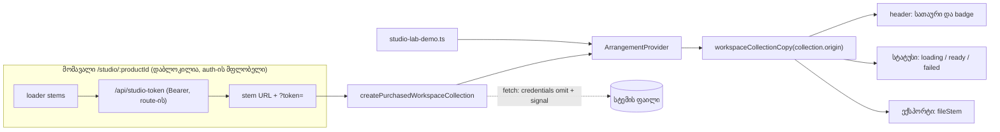

# Studio workspace — შეძენილი კოლექციის adapter და origin-ზე დამოკიდებული ტექსტი (SRW-21 ეტაპი 1)

**თარიღი:** 2026-10-22
**სტატუსი:** Round 92 — C-ის შემოწმებას ელოდება (D-29z57)
**შეცვლილი პროექტი:** Store

## კონტექსტი

SRW-21-ის მიზანია, რომ შეძენილმა Studio-მ (`/studio/:productId`) იგივე სამუშაო სივრცე გამოიყენოს, რომელიც `/studio-lab`-ზე მუშაობს. Route-ის mount ამ ეტაპზე დაბლოკილია: `app/routes/studio.$productId.tsx` და studio-token-ის flow auth-ის მფლობელს ეკუთვნის.

B-მა კოდში აღმოაჩინა, რომ backlog-ის მოლოდინი („workspace-ის კოდი არ იცვლება“) მცდარი იყო. Workspace-ში დემოს ტექსტი hardcoded იყო:

- სათაური `CZABA Studio Lab` და badge `დემო კოლექცია — ავტორიზაცია არ სჭირდება` (`StudioWorkspace.tsx`-ის header);
- სტატუსები „დემო კოლექცია იტვირთება…“, „დემო კოლექცია მზადაა…“ და „დემო კოლექციიდან N წყარო ვერ ჩაიტვირთა…“ (`ArrangementContext.tsx`);
- ექსპორტის ფაილების სახელები `czaba-studio-lab*.wav/.mp3`.

შეძენილ სტემებზე mount-ისას ეკრანზე „დემო — ავტორიზაცია არ სჭირდება“ გამოჩნდებოდა, რაც მცდარია. ამიტომ ამ რაუნდში ტექსტი `collection.origin`-დან მოდის.

## მიდგომა

- ახალი სუფთა მოდული `app/lib/arrangement/collection.ts` ორ ფუნქციას აქვეყნებს:
  - `workspaceCollectionCopy(origin)` — origin-ის მიხედვით აბრუნებს სათაურს, badge-ს, სამ სტატუსს და ფაილის სახელის საფუძველს (`fileStem`). დემოს მნიშვნელობები ბაიტამდე ემთხვევა გამოქვეყნებულ ტექსტს.
  - `createPurchasedWorkspaceCollection(input)` — შეძენილი სტემების (`AudioStem[]`) `WorkspaceCollection`-ად გადაქცევა.
- Workspace-ის header, provider-ის სტატუსები და `exportWav`/`exportMp3`-ის ფაილის სახელები ახლა `workspaceCollectionCopy(collection.origin)`-ს კითხულობს. `/studio-lab`-ის (origin `demo`) შედეგი უცვლელია.
- **უარყოფილი ალტერნატივა:** მხოლოდ კონტრაქტის ტესტები და ბაგის ჩაწერა, ტექსტის შეცვლის გარეშე. ასეთი „mount readiness“ მცდარ დემოს ტექსტს დატოვებდა.
- **შეძენილი ტექსტი (ყველაზე მცირე პატიოსანი ვარიანტი):** სათაური `CZABA Studio`, badge `შეძენილი კოლექცია`, სტატუსები „შეძენილი კოლექცია …“ (დემოს ფორმით), ფაილები `czaba-studio.wav`, `czaba-studio-range.wav`, `czaba-studio.mp3`, `czaba-studio-range.mp3`.
- **VISUAL-A V-0-თან თავსებადობა:** V-0 მოგვიანებით Studio-ს ტექსტს ერთ ინგლისურ strings მოდულში გადაიტანს. `workspaceCollectionCopy` ერთ ადგილას აგროვებს origin-ზე დამოკიდებულ ტექსტს, ამიტომ V-0-ს მხოლოდ ამ მოდულის მნიშვნელობების ჩანაცვლება დასჭირდება. ამ რაუნდში ის წინასწარ არ იცვლება.

### Adapter-ის კონტრაქტი

- **შესავალი:** `productId`, `productTitle`, `stems` (უკვე `?token=`-იანი URL-ებით, route-ის არსებული flow-დან) და არასავალდებულო `fetchAudio`. Adapter URL-ს არაფერს უმატებს.
- **ვალიდაცია:** ცარიელი `productId`, ცარიელი `stems` ან დუბლირებული stem `id` factory-ის გამოძახებისთანავე `Error`-ს აგდებს.
- **შედეგი:** `id` = `purchased-{productId}`, `label` = `{productTitle} · შეძენილი სტემები`, `origin` = `purchased`, `notice` არ აქვს. წყაროები `order`-ით არის დალაგებული (თანაბარ მნიშვნელობაზე სტაბილურად), `kind: 'stem'`. URL-ები factory-ის დროს კერძო `Map`-ში კოპირდება, ამიტომ შესავალი მასივის მოგვიანებითი ცვლილება კოლექციაზე არ მოქმედებს.
- **Request:** `fetchAudio(url, { credentials: 'omit', signal })` ერთხელ. Header, `Authorization` და `method` არ გადაეცემა. ნაგულისხმევი `fetchAudio` გლობალურ `fetch`-ს გამოძახების დროს იძახებს და არა მოდულის ჩატვირთვისას (SSR).
- **შეცდომები** (ბიბლიოთეკა აჩვენებს `შეცდომა: {message}`-ს):
  - უცნობი წყარო → `უცნობი წყარო`, `fetchAudio` არ გამოიძახება;
  - ქსელის შეცდომა → `ფაილი ვერ ჩაიტვირთა (ქსელი)`; თუ signal უკვე aborted-ია, თავდაპირველი შეცდომა უცვლელად ბრუნდება;
  - HTTP შეცდომა → `ფაილი ვერ ჩაიტვირთა ({status})`;
  - decode-ის შეცდომა → `ფაილი ვერ გაიშიფრა`.
  - **არცერთი ტექსტი არ შეიცავს URL-ს, query-ს ან token-ს.**
- Response-ის body-ის წაკითხვის შეცდომა (`arrayBuffer()`) ქსელის შეცდომად ითვლება და იმავე წესით მუშავდება (PC10).

## არქიტექტურა

## შეცვლილი ფაილები

| ფაილი | დანიშნულება |
|---|---|
| `app/lib/arrangement/collection.ts` | ახალი: `workspaceCollectionCopy` და `createPurchasedWorkspaceCollection` |
| `app/components/arrangement/StudioWorkspace.tsx` | header-ის სათაური და badge origin-დან |
| `app/contexts/ArrangementContext.tsx` | სამი სტატუსი და ექსპორტის ფაილების სახელები origin-დან; `collection.origin` ექსპორტის callback-ების deps-ში |
| `app/lib/arrangement/__tests__/collection.test.ts` | ახალი: PC1–PC10 (adapter-ის კონტრაქტი და ტექსტი) |
| `app/lib/arrangement/__tests__/purchased-collection-ui.test.tsx` | ახალი: PW1–PW6 (workspace შეძენილი და დემო კოლექციით) |
| `docs/implementation/2026/quarter-IV/079-studio-lab-export-notes-and-memory.md` | სტატუსის ხაზი (gate-91 S2) |
| `docs/technical/arrangement-workspace.md` | ახალი: შეძენილი route-ის mount-ის გზამკვლევი |

## პრობლემები და გადაწყვეტები

- **პრობლემა:** სტატუსის საწყისი მნიშვნელობა SSR-ზეც და კლიენტზეც იქმნება. **გადაწყვეტა:** `useState`-ის initializer `workspaceCollectionCopy(collection.origin).loading`-ს იძახებს. ეს სუფთა, დეტერმინისტული ფუნქციაა, ამიტომ server და client ერთსა და იმავე ტექსტს იღებენ და hydration-ის განსხვავება არ ჩნდება.
- **პრობლემა:** ტესტებში type assertion აკრძალულია, `loadSource` კი `BaseAudioContext`-ს ელოდება. **გადაწყვეტა:** `OfflineAudioContext` stub-ით იცვლება (`decodeAudioData` mock-ით), ტესტი კი `new OfflineAudioContext(...)`-ს ქმნის. Response-ები ნამდვილი `Response` ობიექტებია.
- **პრობლემა:** ქსელის შეცდომის ტექსტი (მაგ. `TypeError: Failed to fetch <url>`) შეიძლება URL-ს შეიცავდეს. **გადაწყვეტა:** adapter ქსელის, HTTP-ისა და decode-ის შეცდომებს საკუთარი ტექსტით ცვლის. Abort-ზე თავდაპირველი შეცდომა ბრუნდება, provider კი aborted signal-ზე მას არ აჩვენებს.

## სიგნალი COLLECTION-EMPTY-STATUS (Low, დაგეგმილი არ არის)

როცა `collection.sources.length === 0`, provider-ის `settle` არასდროს გაეშვება და სტატუსი „იტვირთება…“-ზე რჩება. Factory ცარიელ შესავალს უარყოფს, ამიტომ შეძენილი გზა ამ მდგომარეობას ვერ მიაღწევს. Provider-ის გამოსწორება Low-ების პაკეტშია.

## ტესტირება

- `collection.test.ts` — 14 ტესტი (PC1–PC10; PC5 ოთხ სტატუსზე, PC3 ნაგულისხმევ `fetch`-ზეც, PC10 body-ის წაკითხვის შეცდომაზე) — PASS.
- `purchased-collection-ui.test.tsx` — 6 ტესტი (PW1–PW6) — PASS.
- Mutation proofs (a–h) scratch ასლში: თითოეულმა მოსალოდნელი ტესტი გააწითლა, PW6 ყველგან მწვანე დარჩა (`tmp/studio-real-loop/a-round-92/mutation-results.json`).
- `npm run typecheck`, `npm run lint` და Biome check შეცვლილ ფაილებზე — სუფთა. Targeted vitest (Workspace/Provider-ის ყველა ტესტი, `export-*`, `library.test.ts`, ორი ახალი ფაილი) — PASS.
- შეძენილი MP3-ის სახელები (`czaba-studio.mp3`, `czaba-studio-range.mp3`) კოდში იმავე `fileStem`-ით იქმნება, მაგრამ ცალკე ტესტი მათ არ ამოწმებს: PW5 მხოლოდ WAV-ს ფარავს. დემოს MP3-ის სახელებს გაყინული ტესტები და C-ის EXPORT-NAMES ამოწმებს.
- **შეძენილი გზა მხოლოდ unit-ით მოწმდება.** ბრაუზერში მიუწვდომელია, რადგან route mount დაბლოკილია. ბრაუზერი ამტკიცებს მხოლოდ იმას, რომ `/studio-lab`-ის დემოს გზა ახალ კოდში ბაიტამდე უცვლელია (C round 92).

## TODO / შემდეგი ნაბიჯები

- **არ გაკეთებულა:** შეძენილი route-ის mount. ის auth-ის მფლობელის ნებართვას ელოდება. შეძენილი Studio ჯერ ისევ `StudioContext`-ს იყენებს.
- Mount-ის გზამკვლევი: `docs/technical/arrangement-workspace.md`.
- R21-I2: სრული რეგრესია mount-ის შემდეგ.
- COLLECTION-EMPTY-STATUS → Low-ების პაკეტი.
