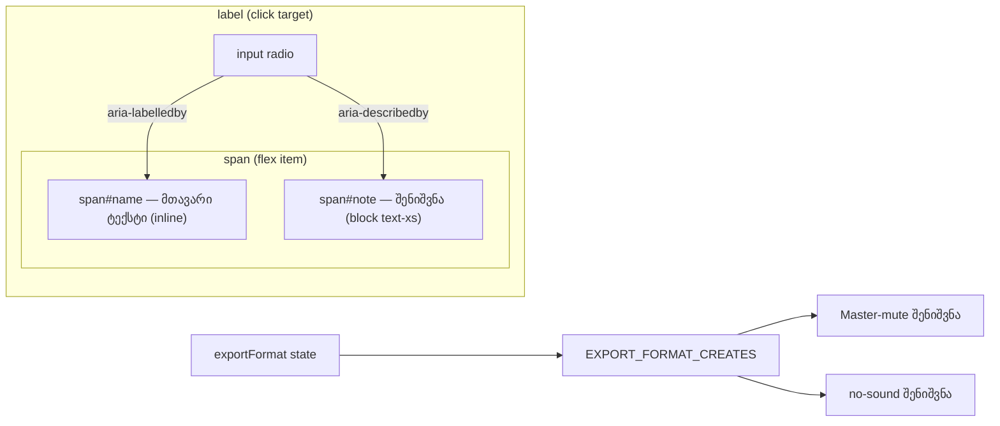

# Studio Lab — ექსპორტის დიალოგის radio-ების სახელები, აღწერები და ფორმატზე დამოკიდებული შენიშვნები (Lows, ნაწილი 1)

**თარიღი:** 2026-10-23
**სტატუსი:** Round 93 — C-ის შემოწმებას ელოდება (D-29z58)
**შეცვლილი პროექტი:** Store

## კონტექსტი

ექსპორტის დიალოგში (`ArrangementExportDialog`) სამი Low ბაგი დარჩა, სამივე ერთ ფაილსა და ერთ დიალოგში:

1. **GATE91-S1-NOTE-IN-LABEL** — ფორმატის ყველა radio-ს accessible name შენიშვნასაც შეიცავდა, რადგან შენიშვნა `<label>`-ის შიგნით იყო. screen reader-ი WAV-ს, MP3-ს, WAV + MP3-სა და გამორთულ ვიდეოს სახელად მთელ აბზაცს უკითხავდა.
2. **A-R86-L7-REASON-READ-TWICE** — გამორთულ „მონიშნული მონაკვეთი“ radio-ს მიზეზი ერთდროულად სახელშიც იყო (label-ის შიგნით) და `aria-describedby`-შიც, ამიტომ ორჯერ იკითხებოდა.
3. **A-R86-L8-NOTES-SAY-WAV** — „ხმოვანი კლიპი არ არის“ და Master-mute შენიშვნები ყოველთვის `WAV შეიქმნება`-ს წერდა, MP3 ან WAV + MP3 არჩევის დროსაც.

## მიდგომა

- **სახელი = მთავარი ტექსტი, აღწერა = შენიშვნა.** თითო radio-ზე მთავარი ტექსტი ცალკე `span`-შია საკუთარი id-ით, შენიშვნა ან მიზეზი მის გვერდით მეორე `span`-შია (ადრე WAV-ის შენიშვნა მთავარი ტექსტის `span`-ის შიგნით იყო). `input`-ს აქვს `aria-labelledby` (მთავარი ტექსტი) და `aria-describedby` (შენიშვნა). ეს ეხება მთელ ფორმატის ჯგუფს — ერთი radio-ს გასწორება სამ არათანმიმდევრულ მეზობელს დატოვებდა.
- **გამორთული მონაკვეთი:** იგივე წესი — `aria-labelledby` მხოლოდ მაშინ ემატება, როცა ვალიდური მონაკვეთი არ არის; არსებული `aria-describedby` (მიზეზი) უცვლელია. ვალიდური მონაკვეთისას radio-ს არც ერთი ატრიბუტი არ აქვს, სახელი კი ისევ label-იდან მოდის (`მონიშნული მონაკვეთი · {მონაკვეთი}`).
- **„მთელი პროექტი“ radio** შენიშვნას არ შეიცავს, ამიტომ არ შეცვლილა.
- **id-ები:** ერთი `useId()` + სუფიქსები (`-wav-name`, `-wav-note`, …). `useId` SSR-სა და client-ზე ერთნაირ მნიშვნელობას აბრუნებს, ამიტომ hydration-ის შეუსაბამობა არ ჩნდება.
- **რატომ რჩება DOM-ის ტექსტი იგივე:** ყინული ტესტები (`export-range-ui`, `export-mp3`) კითხულობს `label.textContent`-ს. ახალი `span`-ები ცალკე ხაზებზეა JSX-ში, ამიტომ ტექსტებს შორის ახალი სიცარიელე არ ჩნდება და `textContent` byte-identical-ია. სახელის ახალ `span`-ს კლასი არ აქვს — inline რჩება, ზუსტად ისე, როგორც ადრე შიშველი ტექსტი. შენიშვნის `span`-ებმა არსებული კლასები შეინარჩუნა. radio ისევ `label`-ის შიგნითაა, ამიტომ ტექსტზე დაჭერა ისევ ირჩევს მას.
- **ფორმატზე დამოკიდებული შენიშვნები:** ახალი მუდმივა `EXPORT_FORMAT_CREATES` (`WAV შეიქმნება` / `MP3 შეიქმნება` / `WAV და MP3 შეიქმნება`) — ფორმულირება context-ის დასრულების შეტყობინებებს ემთხვევა (`WAV შეიქმნა`, `MP3 შეიქმნა`, `WAV და MP3 შეიქმნა`). ორივე შენიშვნა არჩეული ფორმატიდან კითხულობს. WAV-ით ტექსტი byte-identical-ია; ჩვენების პირობები არ შეცვლილა.
- **ალტერნატივა, რომელიც უარვყავით:** `aria-label`-ით სახელის გადაწერა. ის ტექსტს დააკოპირებდა და ხილულ ტექსტს დააშორებდა; `aria-labelledby` ხილულ ელემენტზე მიუთითებს.

## არქიტექტურა

## შეცვლილი ფაილები

| ფაილი | ცვლილება |
|---|---|
| `app/components/arrangement/ArrangementExportDialog.tsx` | ფორმატის ოთხი radio და გამორთული მონაკვეთის radio: სახელის/შენიშვნის `span`-ები, `aria-labelledby`/`aria-describedby`; `useId`-ის ერთი ბაზა; ახალი `EXPORT_FORMAT_CREATES`; ორი შენიშვნა |
| `app/lib/arrangement/__tests__/export-dialog-a11y-copy.test.tsx` | ახალი: AN1–AN6, NC1–NC3 |
| `docs/implementation/2026/quarter-IV/080-studio-workspace-purchased-collection-readiness.md` | მხოლოდ სტატუსის ხაზი |
| `docs/implementation/2026/quarter-IV/081-studio-lab-export-dialog-names-and-notes.md` | ეს დოკუმენტი |

## პრობლემები და გადაწყვეტები

- **პრობლემა:** WAV-ის მთავარი ტექსტი თავის შიგნით შეიცავდა შენიშვნის `span`-ს, ამიტომ მას ცალკე id ვერ მიენიჭებოდა შენიშვნის გარეშე. **გადაწყვეტა:** მთავარი ტექსტი ცალკე `span`-ში, შენიშვნა მის გვერდით; გარე `span` (flex item) უცვლელია, ამიტომ განლაგება იგივეა.
- **პრობლემა:** შენიშვნის JSX-ში `—`-სა და ახალ გამოსახულებას შორის სიცარიელე მხოლოდ მაშინ რჩება, თუ ორივე ერთ ხაზზეა. **გადაწყვეტა:** Biome-ის formatter-ის გამოსავალი stdin-ით შემოწმდა — ხაზი არ გადაიტანა; ყინული WAV-ის ტექსტის ტესტები მწვანეა.
- **პრობლემა:** `useId`-ის მნიშვნელობა `:`-ს შეიცავს, ამიტომ escape-ის გარეშე `#id` სელექტორი ვერ იმუშავებს (საჭიროა `CSS.escape`). **გადაწყვეტა:** ტესტი escape-ის ნაცვლად `getElementById`-სა და `[id="…"]` სელექტორს იყენებს.

## ტესტირება

- ახალი `export-dialog-a11y-copy.test.tsx` (9 ტესტი): AN1 (ზუსტი name + description ხუთ radio-ზე, project-ს ატრიბუტები არ აქვს), AN2 (შენიშვნის ტექსტი სახელში არ ჟონავს), AN3 (ვალიდური მონაკვეთი + loop, WAV-ის აღწერა მიჰყვება ცოცხალ შენიშვნას), AN4 (ტექსტზე დაჭერა ირჩევს radio-ს), AN5 (id-ები უნიკალურია და დიალოგში იხსნება), AN6 (label-ის ტექსტი ყინულის ტოლია), NC1–NC3 (Master-mute/no-sound შენიშვნები სამივე ფორმატზე და reset).
- ძველ დიალოგზე (baseline `b93710cd`) ახალი ფაილიდან 7 ტესტი წითელია; AN4 და AN6 შენარჩუნების ტესტებია და ორივე ვერსიაზე მწვანეა.
- Mutation proofs a–h scratch ასლში (`tmp/studio-real-loop/a-round-93/mut/`): a–g წითელია; h (`block` კლასი სახელზე) unit ტესტით არ იჭერება — ეს C-ის ბრაუზერის VIS-LAYOUT შემოწმებაა.
- Targeted vitest, `npm run typecheck`, `npm run lint`, scoped Biome და A-ის smoke — `a-round-93.md`-ში. ბრაუზერის მიღება (AX-NAMES, NOTE-FORMAT, VIS-LAYOUT და სხვ.) C-ის round 93-ის საქმეა.

## TODO / შემდეგი ნაბიჯები

- C PASS-ის შემდეგ GATE91-S1, A-R86-L7 და A-R86-L8 იხურება.
- Lows-ის დარჩენილი ნაწილი: COLLECTION-EMPTY-STATUS, GATE92-S1, GATE92-S2 (ნაწილი 2), შემდეგ ექსპორტის დიალოგის დანარჩენი Lows (GATE90-S3/S4/S5, A-R88-REVIEW-EDGES, GATE89-S3/S4/S6, C-R90-MUT-B-CU4-GAP, A-R87-LOW-PU-ORDER) და grid/tempo-ს Lows.
