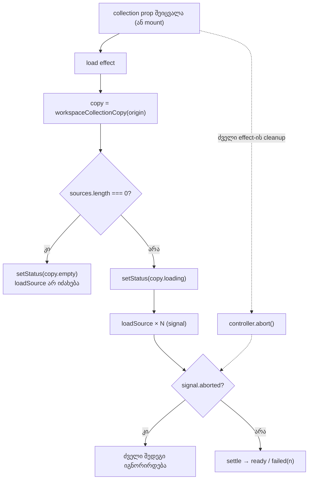

# Studio Workspace — კოლექციის ჩატვირთვის სტატუსი: ცარიელი კოლექცია, კოლექციის შეცვლა და შეძენილი MP3-ის სახელები (Lows, ნაწილი 2)

**თარიღი:** 2026-10-23
**სტატუსი:** Round 94 — C-ის შემოწმებას ელოდება (D-29z59)
**შეცვლილი პროექტი:** Store

## კონტექსტი

`ArrangementProvider`-ის კოლექციის ჩატვირთვის effect-ში ორი Low ბაგი და ერთი ტესტის ხარვეზი დარჩა:

1. **COLLECTION-EMPTY-STATUS** — თუ კოლექციას წყარო არ აქვს (`sources.length === 0`), `settle` არასდროს გაეშვება და სტატუსი სამუდამოდ „…იტვირთება…“-ზე რჩება.
2. **GATE92-S1-STATUS-NOT-RESET-ON-SWAP** — `collection` prop-ის შეცვლისას effect-ი წყაროების მდგომარეობას თავიდან აყენებს, სტატუსს კი — არა. ძველი „…მზადაა“ ტექსტი ჩანს, სანამ ახალი ჩატვირთვა არ დასრულდება, თანაც შეიძლება სხვა origin-ისაც იყოს (დემოს ტექსტი შეძენილ კოლექციაზე).
3. **GATE92-S2-PURCHASED-MP3-NAMES-TEST** — შეძენილი კოლექციის MP3 ფაილების სახელები (`czaba-studio.mp3`, `czaba-studio-range.mp3`) მხოლოდ კოდის წაკითხვით იყო დადასტურებული.

ორივე ბაგი სწორედ იმ გზაზეა, რომელსაც შეძენილი Studio-ს მომავალი mount (SRW-21) გაივლის. მაგალითად, token-ის განახლებამ შეიძლება ახალი collection ობიექტი შექმნას. ამიტომ ისინი mount-მდე, უსაფრთხო დემო გზაზე გასწორდა.

## მიდგომა

- **ორი სტატუსის წესი, ერთ effect-ში.** effect-ის დასაწყისში ერთხელ ვიღებთ კოლექციის origin-ის ტექსტებს (`workspaceCollectionCopy`). იგივე ობიექტს იყენებს `settle`-იც, რომელსაც ადრე საკუთარი ასლი ჰქონდა.
  - წყარო არ არის → სტატუსი = origin-ის ახალი `empty` ტექსტი, `loadSource` არ იძახება, effect-ი მხოლოდ abort-ის cleanup-ს აბრუნებს.
  - წყარო არის → სტატუსი = origin-ის `loading` ტექსტი, შემდეგ არსებული ჩატვირთვა უცვლელად.
- **რატომ `empty` და არა `ready`.** `ready` ეუბნება მომხმარებელს, აირჩიოს ხაზი და დაამატოს ხმა. ცარიელ ბიბლიოთეკაზე ეს ტყუილია. ახალი ტექსტები:
  - დემო: `დემო კოლექციაში წყარო არ არის — ბიბლიოთეკა ცარიელია.`
  - შეძენილი: `შეძენილ კოლექციაში წყარო არ არის — ბიბლიოთეკა ცარიელია.`
- **რა არ შეცვლილა.** `useState`-ის initializer (SSR და პირველი client render ისევ loading ტექსტს აჩვენებს — hydration უცვლელია); effect-ის deps `[collection, getDecodeContext, patchSourceState]` (ორივე callback-ს `[]` deps აქვს, ამიტომ effect-ი მხოლოდ კოლექციის შეცვლაზე ეშვება); abort-ის guard-ები `then`/`catch`-ში; `ready` და `failed(n)` ტექსტები; ფაილების სახელები; factory ისევ უარყოფს ცარიელ stems-ს.
- **რატომ უსაფრთხოა mount-ზე.** grep-მა აჩვენა, რომ l.3000-მდე არც ერთი provider-ის effect-ი არ იძახებს `setStatus`-ს. შვილი კომპონენტების mount effect-ებიც (`StudioWorkspace`, `ArrangementDetailPanel`, `ArrangementMarkerRow`) არ იძახებს, აპლიკაცია `StrictMode`-ს არ იყენებს, `studio-lab` route კი სტატუსს არ წერს. ამიტომ პირველ mount-ზე ახალი `setStatus(copy.loading)` იმავე მნიშვნელობას წერს, რაც state-ში უკვე არის.
- **ალტერნატივა, რომელიც უარვყავით:** სტატუსის ცალკე `useEffect` `collection.origin`-ზე. ის origin-ის შეუცვლელ swap-ზე (ახალი ობიექტი, იგივე origin) სტატუსს ვერ დააბრუნებდა და ორ effect-ს შორის რიგითობაზე იქნებოდა დამოკიდებული.

## არქიტექტურა

## შეცვლილი ფაილები

| ფაილი | ცვლილება |
|---|---|
| `app/lib/arrangement/collection.ts` | `WorkspaceCollectionCopy`-ში ახალი `empty` ველი და მისი ორი ტექსტი |
| `app/contexts/ArrangementContext.tsx` | load effect: ერთი `copy`, ცარიელი კოლექციის შტო, `setStatus(copy.loading)` ჩატვირთვამდე |
| `app/lib/arrangement/__tests__/collection.test.ts` | PC9: მხოლოდ `empty` გასაღებები |
| `app/lib/arrangement/__tests__/collection-load-status.test.tsx` | ახალი: LS1–LS7, PM1 |
| `docs/implementation/2026/quarter-IV/081-studio-lab-export-dialog-names-and-notes.md` | მხოლოდ სტატუსის ხაზი |
| `docs/technical/arrangement-workspace.md` | ერთი ხაზი ჩატვირთვის სტატუსის წესებზე |
| `docs/implementation/2026/quarter-IV/082-studio-workspace-collection-load-status.md` | ეს დოკუმენტი |

## პრობლემები და გადაწყვეტები

- **პრობლემა:** B-მ LS4 შენარჩუნების ტესტად (ორივე ვერსიაზე მწვანე) მიიჩნია, თუმცა მისივე სპეციფიკაცია swap-ის შემდეგ ზუსტად შეძენილი `loading` ტექსტს ითხოვს. ეს ძველ კოდზე შეუძლებელია. **გადაწყვეტა:** ტესტი სპეციფიკაციას მიჰყვება. ძველ კოდზე ის მხოლოდ swap-ის შემდეგი სტატუსის assertion-ზე ვარდება. მისი stale-guard ნაწილი mutation **e**-თი დამოწმდა: `then`-ში guard-ის მოხსნა LS4-ს წითლად აქცევს.
- **პრობლემა:** swap-ის შემდეგ ძველი წყაროს რიგი ბიბლიოთეკაში აღარ ჩანს, ამიტომ „ძველი წყაროს მდგომარეობა არ ჩაიწერა“ DOM-ით ვერ შემოწმდება. **გადაწყვეტა:** ტესტი context-ის `sourceStates`-ს კითხულობს — ძველი წყარო `ready`/`error`-ზე არ გადადის. ტესტი `loading`-ს არ აფიქსირებს, რომ swap-ზე მდგომარეობის მომავალი გასუფთავება რეგრესიად არ ჩაითვალოს.
- **პრობლემა:** ჩატვირთვის დროის მიხედვით loading → ready გადასვლა შეიძლება ტესტში არასტაბილური იყოს. **გადაწყვეტა:** ყველა swap ტესტში `loadSource` deferred spy-ა. ტესტი თავად წყვეტს, როდის დასრულდეს თითო ჩატვირთვა.

## ტესტირება

- ახალი `collection-load-status.test.tsx` (10 ტესტი): LS1/LS2 (ცარიელი დემო/შეძენილი → ზუსტი `empty`, `loadSource` არ იძახება, `console.error` არ არის), LS3 (swap → შეძენილი `loading`, B-ის რიგი „იტვირთება…“, შემდეგ `ready`), LS3b (იგივე origin-ის ახალი ობიექტი → ისევ `loading`), LS4 ×2 (ძველი კოლექციის გვიანი resolve/reject იგნორირდება, signal aborted), LS5 (ცარიელზე და უკან), LS6 (იგივე ობიექტით rerender სტატუსს და ჩატვირთვას არ ეხება), LS7 (mount-ის loading → ready და `failed(1)`), PM1 (შეძენილი MP3-ის სამი ექსპორტის ზუსტი სახელები).
- **Fail-before** (baseline snapshot-ები, scratch): წითელია LS1, LS2, LS3, LS3b, LS4 (ორივე), LS5; მწვანეა LS6, LS7, PM1 (შენარჩუნების ტესტები).
- **Mutation proofs a–f** (`tmp/studio-real-loop/a-round-94/mut/`): ექვსივე ერთ ან მეტ ტესტს წითლად აქცევს. მუტაციების გარეშე scratch ასლში 41/41 მწვანეა. დეტალები — `a-round-94/mutation-results.json`.
- **ბრაუზერში მხოლოდ unit-ით:** `/studio-lab` route ერთ ფიქსირებულ დემო კოლექციას გადასცემს, შეძენილი route-ის mount კი ჯერ დაბლოკილია. ამიტომ ცარიელი კოლექცია და კოლექციის შეცვლა ბრაუზერში ჯერ მიუწვდომელია. C ბრაუზერში ამოწმებს დემოს ჩატვირთვის რეგრესიას (SSR loading → ready, failed(1)) და იმას, რომ მომხმარებლის მოქმედებით დაწერილ სტატუსს load effect-ი არ შლის.
- Targeted vitest, `npm run typecheck`, `npm run lint`, scoped Biome და A-ის smoke — `tmp/studio-real-loop/a-round-94.md`-ში.

## TODO / შემდეგი ნაბიჯები

- C PASS-ის შემდეგ COLLECTION-EMPTY-STATUS და GATE92-S1 იხურება (unit-ით დადასტურებული, ბრაუზერში მიუწვდომელი SRW-21 mount-მდე), ასევე GATE92-S2.
- SRW-21 mount-ის შემდეგ ორივე წესი ბრაუზერში უნდა შემოწმდეს.
- Lows-ის ნაწილი 3: C-R92-N1 (დემოს ქსელის შეცდომის ქართული ტექსტი), GATE90-S3/S4/S5, A-R88-REVIEW-EDGES, GATE89-S3/S4/S6, C-R90-MUT-B-CU4-GAP, A-R87-LOW-PU-ORDER, შემდეგ grid/tempo-ს Lows.
