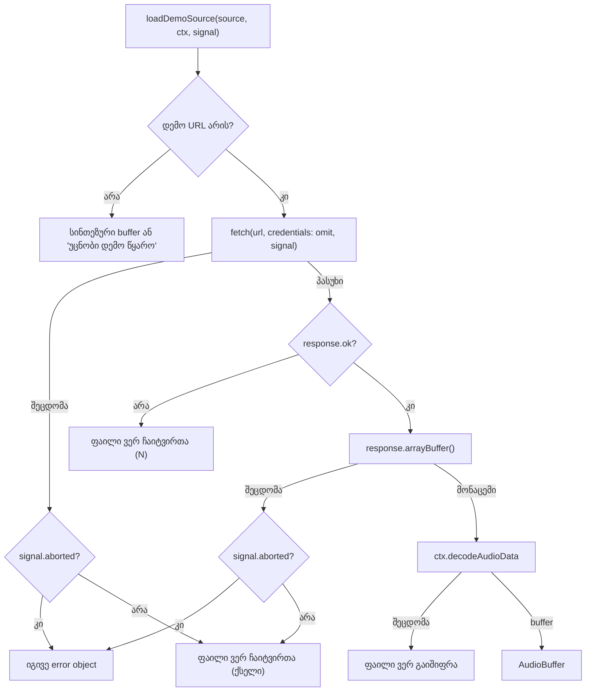

# Studio Lab — დემო loader-ის შეცდომის ტექსტი ქართულად (Lows, ნაწილი 3a)

**თარიღი:** 2026-10-23
**სტატუსი:** Round 95 — C-ის შემოწმებას ელოდება (D-29z60)
**შეცვლილი პროექტი:** Store

## კონტექსტი

`/studio-lab`-ის ბიბლიოთეკაში დემო ფაილის ჩატვირთვის შეცდომაზე რიგში ბრაუზერის ნედლი ინგლისური ტექსტი ჩანდა:

- ქსელის შეცდომაზე — `შეცდომა: Failed to fetch` (C round 92-მა ბრაუზერში გაიმეორა, C-R92-N1);
- გაშიფვრის შეცდომაზე — მაგალითად `Unable to decode audio data`.

შეძენილი კოლექციის adapter-ი (`collection.ts`) ამ შემთხვევებს უკვე ქართულ ტექსტზე ასახავს. დემო loader-ი (`loadDemoSource`) კი შეცდომას უცვლელად ატარებდა. მომხმარებელი ერთ ქართულ Studio-ს ხედავს, ამიტომ ერთი და იგივე შეცდომა ორ სხვადასხვა ტექსტად არ უნდა ჩანდეს.

## მიდგომა

- **ზუსტად იგივე წესი, რაც შეძენილ adapter-ში.** `loadDemoSource`-ის URL-ის შტოში სამი `try/catch`:
  - `fetch` ვერ შესრულდა → `ფაილი ვერ ჩაიტვირთა (ქსელი)`;
  - პასუხის სხეულის (`arrayBuffer`) წაკითხვა ვერ მოხერხდა → იგივე ქსელის ტექსტი;
  - `decodeAudioData` ვერ შესრულდა → `ფაილი ვერ გაიშიფრა`.
  - `!response.ok` → `ფაილი ვერ ჩაიტვირთა (N)` — უცვლელია.
- **Abort უცვლელად გადადის.** თუ `signal` უკვე aborted-ია, fetch-ისა და body-ის წაკითხვის `catch` ნებისმიერ შეცდომას იმავე error object-ად ხელახლა აგდებს. decode-ის შეცდომა ყოველთვის ქართულ ტექსტად გადაიქცევა, როგორც შეძენილ adapter-ში. provider-ი aborted ჩატვირთვას იგნორირებს და შეცდომის რიგს არ წერს, ამიტომ unmount-ზე ან კოლექციის შეცვლაზე ცრუ შეცდომა არ ჩნდება.
- **შეტყობინებაში არც URL, არც ბრაუზერის ტექსტი, არც stack.**
- **რა არ შეცვლილა:** URL-ების ცხრილი, `credentials: 'omit'`, `signal`-ის გადაცემა, სინთეზური წყაროები, `'უცნობი დემო წყარო'` ტექსტი, `studioLabDemoCollection`, `WorkspaceCollection` ტიპი. ახალი export არ დამატებულა. სტატუსის `failed(n)` ტექსტი და რიგის `შეცდომა: ` პრეფიქსი (`ArrangementLibrary.tsx`) უცვლელია.
- **ალტერნატივა, რომელიც უარვყავით:** საერთო helper-ის `collection.ts`-დან იმპორტი. `collection.ts` ამ რაუნდში frozen-ია, ამიტომ ტექსტები დუბლირდება. დუბლირება აღრიცხულია nit-ად (GATE95-DUP-ERROR-MAP, არ არის დაგეგმილი); პარიტეტს ტესტი DL8 იცავს.

## არქიტექტურა

## შეცვლილი ფაილები

| ფაილი | ცვლილება |
|---|---|
| `app/data/studio-lab-demo.ts` | `loadDemoSource`: სამი `try/catch` ქართული ტექსტებით და abort-ის იგივე error object-ით |
| `app/data/__tests__/studio-lab-demo.test.ts` | ახალი: DL1–DL8 (12 ტესტი) |
| `docs/implementation/2026/quarter-IV/082-studio-workspace-collection-load-status.md` | მხოლოდ სტატუსის ხაზი |
| `docs/technical/arrangement-workspace.md` | სტატუსის ორი ხაზი და ერთი ახალი ხაზი შეცდომის ტექსტებზე |
| `docs/implementation/2026/quarter-IV/083-studio-lab-demo-loader-error-text.md` | ეს დოკუმენტი |

## პრობლემები და გადაწყვეტები

- **პრობლემა:** jsdom-ში `DOMException` `instanceof Error` არ არის. ტესტის helper-მა, რომელიც `instanceof Error`-ით ირჩევდა resolve-სა და reject-ს შორის, aborted body read-ის შემთხვევაში არასწორი შტო აირჩია. **გადაწყვეტა:** ორი ცალკე helper — წარმატებული და ჩავარდნილი `arrayBuffer`-ისთვის.
- **პრობლემა:** რეალური `Response.arrayBuffer()` ყოველ გამოძახებაზე ახალ buffer-ს აბრუნებს, ამიტომ „decode-ს იგივე buffer მიეწოდა“ ვერ შემოწმდება. **გადაწყვეტა:** `vi.spyOn(response, 'arrayBuffer')` ცნობილ `ArrayBuffer`-ს აბრუნებს, ტესტი კი `toBe`-ით ადარებს.
- **პრობლემა:** code-reviewer-მა აღნიშნა, რომ DL6-ის `toStrictEqual` init-ზე `signal`-ის იდენტობას ვერ ამოწმებს (AbortSignal-ის ველები prototype-ის getter-ებია). scratch-ში დადასტურდა: სხვა `signal`-ის გადაცემით (mutation g) `toStrictEqual` მწვანე რჩებოდა. **გადაწყვეტა:** დაემატა `expect(init?.signal).toBe(controller.signal)`; mutation g ახლა DL6-ს წითლად აქცევს.
- **პრობლემა:** ტესტში `BaseAudioContext`-ისა და `AudioBuffer`-ის ტიპები type assertion-ის გარეშე უნდა მიგვეღო. **გადაწყვეტა:** `collection.test.ts`-ის მსგავსად fake კლასები `vi.stubGlobal`-ით `OfflineAudioContext`-სა და `AudioBuffer`-ზე, შემდეგ `new OfflineAudioContext(...)` და `new AudioBuffer(...)`.

## ტესტირება

- ახალი `studio-lab-demo.test.ts` (12 ტესტი): DL1 (ქსელი → ზუსტი ტექსტი, არც `Failed to fetch`, არც URL), DL2 (body read), DL3 (decode), DL4 (404, decode არ იძახება), DL5 ×4 (aborted fetch, aborted body read და abort-ის შემდეგ ჩვეულებრივი `TypeError` → იგივე error object; abort-ის შემდეგ decode-ის შეცდომა → ქართული decode ტექსტი), DL6 ×2 (ორივე დემო URL: ერთი fetch, ზუსტი init, იგივე `signal` ობიექტი `toBe`-ით, იგივე buffer decode-ში, იგივე შედეგი), DL7 (უცნობი წყარო, fetch არ იძახება), DL8 (პარიტეტი შეძენილ adapter-თან ქსელისა და decode-ის შეცდომაზე).
- **Fail-before** (B-ის baseline snapshot, scratch): წითელია DL1, DL2, DL3, DL8 (B-ის მოლოდინი) და review-ის შემდეგ დამატებული DL5 „decode abort-ის შემდეგ“ (ძველი კოდი ბრაუზერის `DOMException`-ს ატარებდა); მწვანეა DL4, DL5-ის დანარჩენი სამი, DL6 ×2, DL7.
- **Mutation proofs a–h** (`tmp/studio-real-loop/a-round-95/mut/`): ყველა სახელდებულ ტესტს წითლად აქცევს (a → DL1/DL8, b → DL5 fetch ×2, c → DL3/DL5 decode/DL8, d → DL2, e → DL6 ×2, f → DL1/DL8, g — სხვა `signal` → DL6 ×2, h — body-ის abort rethrow-ის მოხსნა → DL5 body). მუტაციების გარეშე 42/42 მწვანეა.
- Targeted vitest (4 ფაილი, 42 ტესტი), `npm run typecheck`, `npm run lint` და scoped Biome — `tmp/studio-real-loop/a-round-95.md`-ში.
- ბრაუზერის შემოწმება (ERR-NET, ERR-DECODE, ERR-HTTP, ERR-BOTH, AUDIO-REG) — C-ის რაუნდი.

## TODO / შემდეგი ნაბიჯები

- C PASS-ის შემდეგ C-R92-N1 იხურება.
- GATE95-DUP-ERROR-MAP (nit): შეცდომის ტექსტების საერთო წყარო, როცა `collection.ts` ownership-ში დაბრუნდება.
- შემდეგ: რეგრესიის რაუნდი (2026-10-24-დან), შემდეგ Export-ის დარჩენილი Low-ები.
