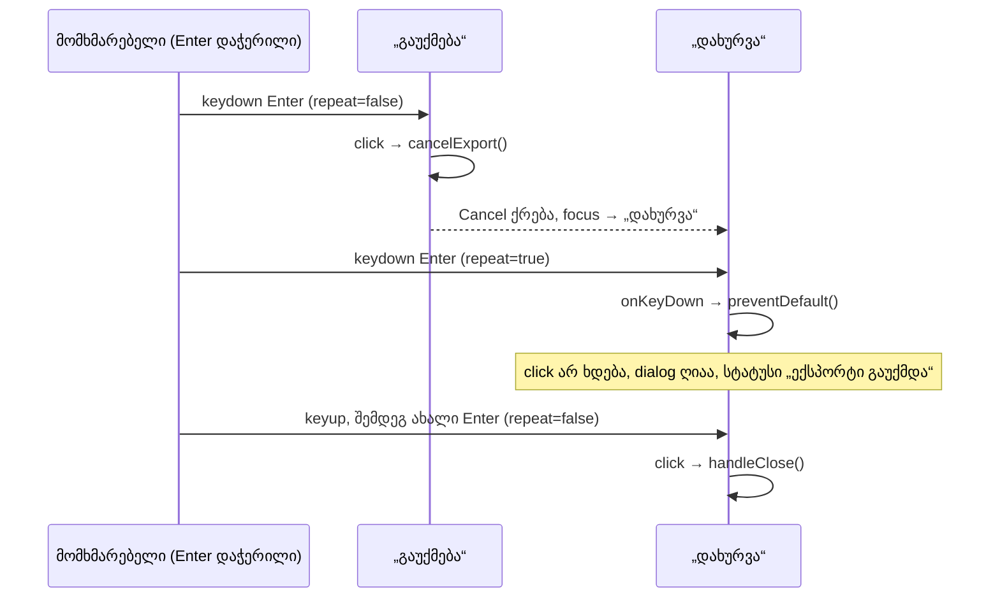

# Studio — ექსპორტის dialog-ში დაჭერილი Enter „დახურვა“-ს აღარ აჭერს (Export Lows, ნაწილი 1)

**თარიღი:** 2026-10-23
**სტატუსი:** Round 97 — C-ის შემოწმებას ელოდება (D-29z62)
**შეცვლილი პროექტი:** Store

## კონტექსტი

Root gate 90-მა ექსპორტის dialog-ში სამი Low დატოვა:

- **GATE90-S3.** ექსპორტის დროს Enter „გაუქმება“-ზე ექსპორტს აუქმებს. Cancel ქრება და არსებული focus effect focus-ს „დახურვა“-ზე გადაიტანს. თუ მომხმარებელს Enter ისევ აქვს დაჭერილი, ბრაუზერის განმეორებითი keydown (`repeat=true`) უკვე „დახურვა“-ს აჭერს. Dialog იხურება და გაუქმების სტატუსი იკარგება.
- **GATE90-S4.** Cancel ღილაკს `disabled:opacity-40` კლასი ჰქონდა, თუმცა ის არასდროს ხდება `disabled`, ამიტომ ეს კლასი ვერასდროს მოქმედებდა.
- **GATE90-S5.** `isArrangementExportCancelledError` აპლიკაციაში არ გამოიყენება.

A-მ ბაგი რედაქტირებამდე რეალურ ბრაუზერში გაიმეორა (Playwright Chromium, `/studio-lab`, 1280×720): პირველი keydown იყო `repeat=false` „გაუქმება“-ზე, მეორე `repeat=true` „დახურვა“-ზე. Dialog დაიხურა, ჩამოტვირთვა არ ყოფილა.

## მიდგომა

- **„დახურვა“ მხოლოდ განმეორებით Enter-ს უგულებელყოფს.** ღილაკს აქვს inline `onKeyDown`: თუ `key === 'Enter'` და `repeat === true`, იძახება `preventDefault()`. ბრაუზერი ამ keydown-ზე click-ს აღარ აგზავნის. სხვა კლავიში ან ახალი (არაგანმეორებითი) Enter უცვლელია, `stopPropagation` არ იძახება.
- **Guard ყველა ფაზაში მოქმედებს**, არა მხოლოდ გაუქმების შემდეგ. „დახურვა“-ზე დაჭერილი Enter განზრახ მეორე მოქმედება არასდროს არის. იგივე მექანიზმი dialog-ის გახსნისასაც ჩნდება: toolbar-ის Export-ზე დაჭერილი Enter dialog-ს ხსნის, საწყისი focus „დახურვა“-ზეა და განმეორებითი keydown dialog-ს მაშინვე დახურავდა. ერთი guard ორივე შემთხვევას ფარავს.
- **ცნობილი საზღვარი.** ზოგი გარემო (მაგალითად remote desktop/VNC, ზოგი X11 კონფიგურაცია, soft keyboard) auto-repeat-ს ახალ keydown-ებად `repeat=false`-ით აგზავნის. ასეთ keydown-ს guard ვერ არჩევს ახალი დაჭერისგან, ამიტომ იქ dialog შეიძლება კვლავ დაიხუროს. ეს შეგნებული საზღვარია და არა რეგრესია.
- **Space არ ეხება.** ღილაკი Space-ზე keyup-ისას აქტიურდება, ამიტომ დაჭერილი Space ამ ბაგს არ იწვევს.
- **უარყოფილი ალტერნატივები:**
  - focus-ის გადატანის დაყოვნება ან timer: შეცვლიდა დადგენილ focus-ის წესებს (focus „დახურვა“-ზე გაუქმების შემდეგ) და დაამატებდა state-ს;
  - Enter-ის დაბლოკვა გარკვეული დროით გაუქმების შემდეგ: დამატებითი state და დროზე დამოკიდებული ქცევა;
  - guard-ის მიბმა მხოლოდ გაუქმების მომენტზე: უფრო რთულია და გახსნის შემთხვევას არ ფარავს;
  - export ღილაკსა და radio-ებზე guard: გაუქმების შემდეგ focus მათზე არ გადადის.
- **GATE90-S4.** Cancel-ის `className`-იდან მოიხსნა მხოლოდ `disabled:opacity-40`, სხვა token-ები იგივე რიგით დარჩა. „დახურვა“ რენდერისას `disabled`-ია, ამიტომ მისი `disabled:opacity-40` ცოცხალია და რჩება. Doc 078-ის შენიშვნა, რომ Cancel-ის კლასები ზუსტად „დახურვა“-ს კლასებია, `disabled:` token-ის ნაწილში ამ doc-ით ჩანაცვლებულია.
- **GATE90-S5 — B-ის გადაწყვეტილება, კოდის ცვლილების გარეშე.** `isArrangementExportCancelledError` რჩება exported `ArrangementExportCancelledError` კლასის type guard-ად და მას `export-cancel.test.ts` იყენებს. აპლიკაცია სწორად ამოწმებს `signal.aborted`-ს: ასე გაუქმების შემდეგ გვიან მოსული სხვა შეცდომაც იმალება. `export-cancel.ts` და მისი ტესტი არ შეცვლილა.

## არქიტექტურა

## შეცვლილი ფაილები

- `app/components/arrangement/ArrangementExportDialog.tsx` — „დახურვა“-ს `onKeyDown` guard; Cancel-ის `disabled:opacity-40`-ის მოხსნა.
- `app/lib/arrangement/__tests__/export-dialog-hold-enter.test.tsx` — ახალი ტესტები HE1–HE7.
- `docs/implementation/2026/quarter-IV/084-studio-failed-source-refusal-text.md` — სტატუსის ხაზი (C PASS, round 96, გამოქვეყნდა).
- `docs/implementation/2026/quarter-IV/085-studio-export-dialog-hold-enter.md` — ეს დოკუმენტი.

## პრობლემები და გადაწყვეტები

- **პრობლემა:** jsdom keydown-ს click-ად არ აქცევს, ამიტომ dialog-ის დახურვა keydown-ით პირდაპირ ვერ შემოწმდება. **გადაწყვეტა:** ტესტი იყენებს `fireEvent.keyDown`-ის დაბრუნებულ მნიშვნელობას (`false` ნიშნავს, რომ `preventDefault` გამოიძახეს). ბრაუზერში click-ის შეჩერება ცალკე მოწმდება რეალური კლავიატურით (C row HOLD-ENTER).
- **პრობლემა:** HE6-ის პირველ ვერსიაში propagation-ის შემოწმებას `preventDefault`-ის შემოწმებაც ჰქონდა, ამიტომ baseline-ზე ის წითელი იყო, B-ის მოლოდინის საწინააღმდეგოდ. **გადაწყვეტა:** HE6 ახლა მხოლოდ იმას ამოწმებს, რომ `document`-ის listener-ი keydown-ს იღებს. `preventDefault`-ს HE1, HE4 და HE7 ფარავს.

## ტესტირება

- **Fail-before** (ახალი ფაილი baseline-ის dialog-ზე, scratch-ში): წითელია HE1, HE4, HE5 და HE7; HE2, HE3 და HE6 ორივე ვერსიაზე მწვანეა. ეს B-ის მოლოდინს ემთხვევა.
- **Mutations** (scratch-ში): guard-ის მოხსნა → HE1/HE4/HE7; `repeat`-ის შემოწმების მოხსნა → HE2/HE4; `key`-ის შემოწმების მოხსნა → HE3; `stopPropagation`-ის დამატება → HE6; Cancel-ზე `disabled:opacity-40`-ის დაბრუნება → HE5; „დახურვა“-დან `disabled:opacity-40`-ის მოხსნა → HE5. Mutation-ის გარეშე: 7/7 მწვანე.
- ექსპორტის dialog-ის ტესტები და დაკავშირებული UI ტესტები (14 ფაილი, 154 ტესტი) მწვანეა. `npm run typecheck` და `npm run lint` წარმატებით სრულდება, ახალი diagnostic-ის გარეშე. Biome ორივე კოდის ფაილზე სუფთაა. ანგარიში და logs ინახება loop-ის საქაღალდეში (`tmp/studio-real-loop/a-round-97*`), რომელიც რეპოს ნაწილი არ არის.
- **ბრაუზერი (A, მხოლოდ Chromium, რედაქტირების შემდეგ):** იგივე სცენარში მეორე keydown `repeat=true` „დახურვა“-ზე მოვიდა. Dialog ღია დარჩა, სტატუსი იყო `ექსპორტი გაუქმდა — ფაილი არ შეიქმნა.`, focus „დახურვა“-ზე, 10 წამში ჩამოტვირთვა არ ყოფილა. სრული მიღება C-ის საქმეა.

## TODO / შემდეგი ნაბიჯები

- C round 97: HOLD-ENTER, HOLD-ENTER-MP3, FRESH-ENTER-CLOSES, OPEN-HOLD, SPACE-REG, CANCEL-CLASS და დანარჩენი რეგრესიის რიგები.
- დარჩენილი Export Lows (GATE89-S4 footer, GATE89-S6 progress) შემდეგ რაუნდებშია.
