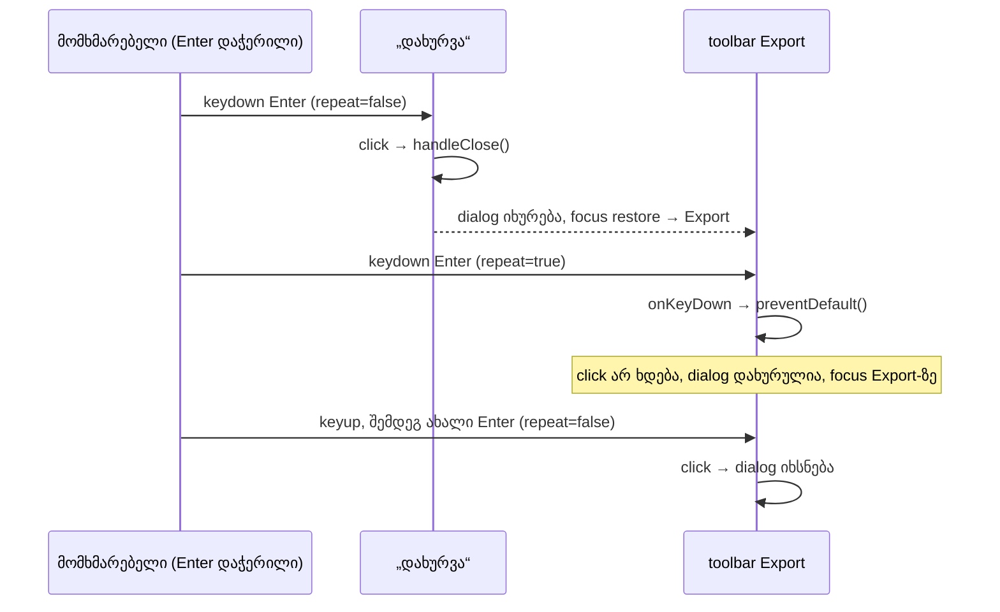

# Studio — dialog-ის დახურვის შემდეგ დაჭერილი Enter toolbar-ის Export-ით dialog-ს თავიდან აღარ ხსნის

**თარიღი:** 2026-10-23
**სტატუსი:** Round 98 — C-ის შემოწმებას ელოდება (D-29z63)
**შეცვლილი პროექტი:** Store

## კონტექსტი

Doc 085-მა (round 97) ექსპორტის dialog-ის „დახურვა“-ს ღილაკზე განმეორებითი Enter-ის guard დაამატა. ამან დახურვისა და გახსნის უსასრულო ციკლი შეაჩერა, მაგრამ ერთი გზა ღია დარჩა (gate 97 review, GATE97-S1):

1. focus „დახურვა“-ზეა და მომხმარებელი Enter-ს აჭერს და ხელს არ უშვებს;
2. პირველი keydown (`repeat=false`) dialog-ს ხურავს;
3. dialog-ის focus restore focus-ს toolbar-ის **Export** ღილაკზე აბრუნებს;
4. შემდეგი განმეორებითი keydown (`repeat=true`) Export-ს აჭერს და dialog თავიდან იხსნება.

A-მ ბაგი რედაქტირებამდე რეალურ ბრაუზერში გაიმეორა (Playwright Chromium, `/studio-lab`, 1280×720). პირველი keydown იყო `repeat=false` „დახურვა“-ზე, რასაც click მოჰყვა. მეორე იყო `repeat=true` Export-ზე, `defaultPrevented=false`-ით, და მას click მოჰყვა Export-ზე. მესამე `repeat=true` უკვე ხელახლა გახსნილ „დახურვა“-ზე მოვიდა და doc 085-ის guard-მა შეაჩერა. ბოლოს dialog ღია იყო.

## მიდგომა

- **Export ღილაკი მხოლოდ განმეორებით Enter-ს უგულებელყოფს.** მას აქვს inline `onKeyDown`: თუ `key === 'Enter'` და `event.repeat` ჭეშმარიტია, იძახება `preventDefault()`. ბრაუზერი ამ keydown-ზე click-ს აღარ აგზავნის. სხვა კლავიში და ახალი (არაგანმეორებითი) Enter უცვლელია. `stopPropagation` არ იძახება, ამიტომ სხვა listener-ები keydown-ს კვლავ იღებენ.
- **ეს doc 085-ის წესია, dialog-ის ერთადერთ opener-ზე გამოყენებული.** ბაგის არსი ისაა, რომ „დახურვა“-სთვის განკუთვნილი დაჭერა იმ ღილაკზე ხვდება, რომელსაც focus უბრუნდება. ამ ღილაკზე განმეორებითი Enter-ის უგულებელყოფა ზუსტად ამ გზას კეტავს. Doc 085-ის მიერ ღია დატოვებული ხელახლა გახსნის გზა ამით იხურება.
- **რა რჩება უცვლელი:**
  - ახალი Enter, Space ან mouse click Export-ზე dialog-ს ისევ ხსნის. Space keyup-ისას აქტიურდება, ამიტომ ამ ბაგს არ ეხება.
  - Export-ზე დაჭერილი Enter dialog-ს პირველივე (არაგანმეორებით) keydown-ზე ხსნის. საწყისი focus „დახურვა“-ზე გადადის და იქ შემდეგ განმეორებებს doc 085-ის guard აჩერებს.
  - `StudioWorkspace.tsx`-ის გლობალური Enter shortcut button target-ს უკვე გამოტოვებს, ამიტომ Export-ზე შეჩერებული Enter ბიბლიოთეკიდან წყაროს არ ამატებს.
- **უარყოფილი ალტერნატივები:**
  - focus restore-ის keyup-მდე გადავადება: ცვლის გაყინულ `ArrangementExportDialog.tsx`-ის focus effect-ს;
  - timer ან „ახლახან დაიხურა“ flag: ამატებს state-ს და დროზე დამოკიდებულ ქცევას;
  - guard toolbar-ის ყველა ღილაკზე: სხვა ღილაკი dialog-ს არც ხსნის და არც ხურავს, ამიტომ ქცევა შეიცვლებოდა ბაგის გარეშე;
  - `stopPropagation`: სხვა listener-ებმა keydown უნდა მიიღონ.
- **ცნობილი საზღვარი (doc 085-ის იგივე).** ბრაუზერის მტკიცებულება მხოლოდ Chromium-ზეა. ზოგი გარემო (მაგალითად remote desktop/VNC, ზოგი X11 კონფიგურაცია, soft keyboard) auto-repeat-ს `repeat=false`-ით აგზავნის. ასეთ keydown-ს guard ახალი დაჭერისგან ვერ არჩევს, ამიტომ იქ dialog შეიძლება კვლავ გაიხსნას. ეს შეგნებული საზღვარია და არა რეგრესია.
- **მეორე საზღვარი: focus restore იმ ელემენტზე ბრუნდება, რომელიც dialog-ის გახსნისას იყო focus-ში.** Guard მოქმედებს მაშინ, როცა ეს ელემენტი Export-ია: კლავიატურით გახსნისას და Chromium-ში mouse click-ით გახსნისას. Safari-სა და macOS Firefox-ში mouse click ღილაკს focus-ს არ აძლევს (code review-ის დასკვნა, ამ რაუნდში ბრაუზერში არ შემოწმებულა). ასეთ შემთხვევაში focus შეიძლება `body`-ზე დაბრუნდეს, და დაჭერილი Enter-ის განმეორებები `StudioWorkspace.tsx`-ის გლობალურ Enter shortcut-ს მიაღწევს, რომელიც `repeat`-ს არ ამოწმებს. ეს არსებული ქცევაა და არა ამ ცვლილების რეგრესია; გადაწყვეტა გაყინულ dialog-ს ან `StudioWorkspace.tsx`-ს ეხება და B-ს გადაეცა.

## არქიტექტურა

## შეცვლილი ფაილები

- `app/components/arrangement/ArrangementTransport.tsx` — Export ღილაკის `onKeyDown` guard. სხვა ღილაკი, `toolButtonClass` და props უცვლელია.
- `app/lib/arrangement/__tests__/export-toolbar-hold-enter.test.tsx` — ახალი ტესტები TH1–TH5 (რეალური `ArrangementTransport` და `ArrangementExportDialog` ერთ provider-ში).
- `docs/implementation/2026/quarter-IV/085-studio-export-dialog-hold-enter.md` — სტატუსის ხაზი (C PASS, round 97, გამოქვეყნდა 11d042c).
- `docs/implementation/2026/quarter-IV/086-studio-toolbar-export-hold-enter.md` — ეს დოკუმენტი.

## პრობლემები და გადაწყვეტები

- **პრობლემა:** jsdom keydown-ს click-ად არ აქცევს, ამიტომ ხელახლა გახსნა jsdom-ში keydown-ით არ ხდება. ამის გამო „spy-ს ერთი გამოძახება“ და „dialog არ არის“ baseline-ზეც მწვანეა. **გადაწყვეტა:** TH1-ის მთავარი შემოწმება `fireEvent.keyDown`-ის დაბრუნებული მნიშვნელობაა (`false` ნიშნავს, რომ `preventDefault` გამოიძახეს). Click-ის რეალური შეჩერება ბრაუზერში მოწმდება (C row CLOSE-HOLD).
- **პრობლემა:** TH4-ის პირველ ვერსიაში propagation-ის შემოწმებას `defaultPrevented`-ის შემოწმებაც ჰქონდა, ამიტომ baseline-ზე ის წითელი იქნებოდა, B-ის მოლოდინის საწინააღმდეგოდ. **გადაწყვეტა:** TH4 მხოლოდ იმას ამოწმებს, რომ `document`-ის bubble-phase listener-ი keydown-ს იღებს. `preventDefault`-ს TH1 ფარავს.

## ტესტირება

- **Fail-before** (ახალი ფაილი baseline-ის `ArrangementTransport.tsx`-ზე, scratch-ში): წითელია მხოლოდ TH1; TH2–TH5 ორივე ვერსიაზე მწვანეა. ეს B-ის მოლოდინს ემთხვევა.
- **Mutations** (scratch-ში): guard-ის მოხსნა → TH1; `repeat`-ის შემოწმების მოხსნა → TH2; `key`-ის შემოწმების მოხსნა → TH3; `stopPropagation`-ის დამატება → TH4; იგივე guard საერთო handler-ით Fit-ზეც → TH5. Mutation-ის გარეშე: 5/5 მწვანე.
- ექსპორტის dialog-ის, toolbar-ის და დაკავშირებული UI ტესტები (14 ფაილი, 210 ტესტი, `render-budget`-ის ჩათვლით) მწვანეა. `npm run typecheck` და `npm run lint` წარმატებით სრულდება, ახალი diagnostic-ის გარეშე. Biome ორივე კოდის ფაილზე სუფთაა.
- **ბრაუზერი (A, მხოლოდ Chromium, რედაქტირების შემდეგ):** იგივე სცენარში ორივე განმეორებითი keydown Export-ზე მოვიდა `defaultPrevented=true`-ით, Export-ზე click არ ყოფილა. 1 წამის შემდეგ dialog დახურული იყო და focus Export-ზე. სრული მიღება C-ის საქმეა.

## TODO / შემდეგი ნაბიჯები

- C round 98: CLOSE-HOLD, CANCEL-CLOSE-HOLD, FRESH-OPEN, OPEN-HOLD, ENTER-ADD-REG, EXPORT-REG და დანარჩენი რიგები.
- GATE97-S4 (`=== true` `ArrangementExportDialog.tsx`-ში) GATE89-S4-თან ერთად, footer-ის რაუნდში.
- არა-Chromium ბრაუზერში შემოწმება, როცა ასეთი გარემო ხელმისაწვდომი იქნება.
