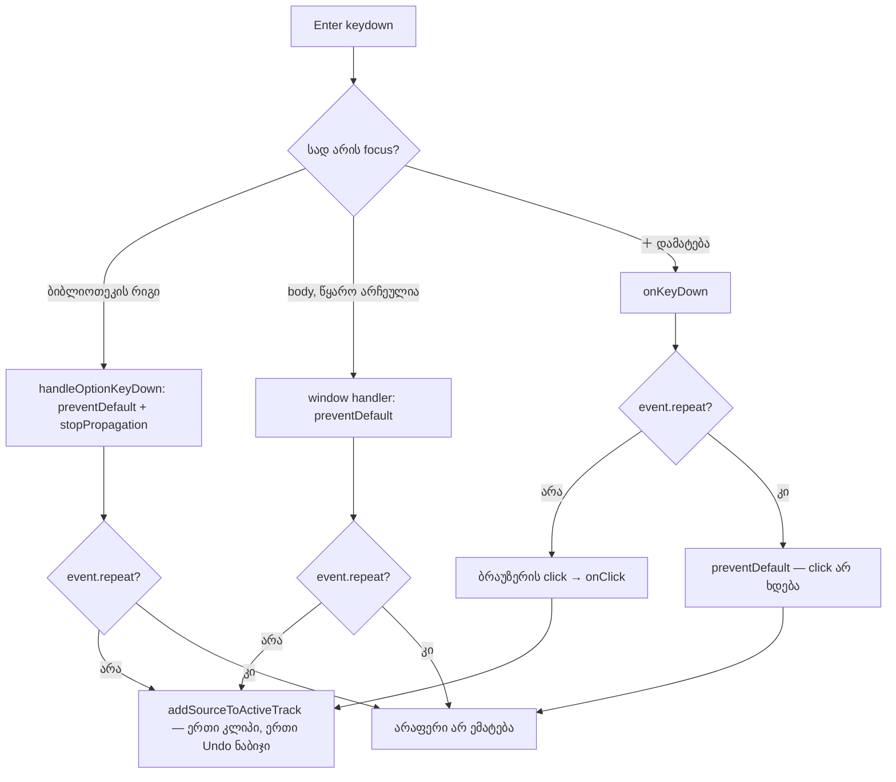

# Studio — დაჭერილი Enter ბიბლიოთეკიდან მხოლოდ ერთ კლიპს ამატებს

**თარიღი:** 2026-10-23
**სტატუსი:** Round 99 — C-ის შემოწმებას ელოდება (D-29z64)
**შეცვლილი პროექტი:** Store

## კონტექსტი

SRW-12 R12-L2-ის კონტრაქტით Enter არჩეულ ხმას აქტიურ ხაზზე, insert marker-თან ამატებს. ერთი დაჭერა ერთ დამატებას ნიშნავს. თუ მომხმარებელი Enter-ს ხელს არ უშვებს, ბრაუზერი auto-repeat keydown-ებს აგზავნის (`repeat=true`). ყოველი მათგანი ახალ კლიპს ამატებდა, თან თითოეული Undo-ს ცალკე ნაბიჯი იყო (B-R98-HELD-ENTER-MULTI-ADD).

B-მ ეს რეალურ Chromium-ში გაიმეორა (`/studio-lab`, 1280×720, `keyboard.down('Enter')` სამჯერ 50 ms ინტერვალით). Enter-ის დამატებამდე სამი გზა მიდის და სამივეზე კლიპების რაოდენობა 0-დან **3**-მდე გაიზარდა:

1. **ბიბლიოთეკის რიგი:** focus მზა წყაროს რიგზეა (`role="option"`, `<button>`). რიგის საკუთარი `handleOptionKeyDown` ყოველ Enter-ზე ამატებდა.
2. **გლობალური Enter:** წყარო არჩეულია და focus `body`-ზეა (მაგალითად სტატუსის ტექსტზე click-ის შემდეგ). `StudioWorkspace.tsx`-ის window handler ყოველ Enter-ზე ამატებდა. ეს doc 086-ის მეორე საზღვარია (gate 98 review Low #1). B-მ აჩვენა, რომ ის Chromium-შიც მიღწევადია.
3. **＋ დამატება:** focus preview panel-ის დამატების ღილაკზეა. Chromium ყოველ Enter keydown-ს, განმეორებითსაც, click-ად აქცევს.

A-მ რედაქტირებამდე იგივე probe-ები გაუშვა და იგივე შედეგი მიიღო (სამივე გზაზე 0 → 3).

## მიდგომა

- **მხოლოდ განმეორებითი keydown-ები გამოიტოვება.** პირველი keydown (`repeat=false`) ამატებს ზუსტად ისე, როგორც ადრე. განმეორებითი keydown არაფერს ამატებს. Guard დგას სამივე ადგილას, სადაც Enter დამატებად იქცევა:
  - **რიგი:** `preventDefault()` და `stopPropagation()` ყოველ Enter-ზე რჩება. წყაროს არჩევა და დამატება მხოლოდ `!event.repeat`-ზე ხდება. ისრების ქცევა უცვლელია: დაჭერილი ArrowDown ისევ თითო რიგით ჩამოდის ყოველ განმეორებაზე.
  - **გლობალური Enter:** პირობა და `preventDefault()` უცვლელია, დამატება მხოლოდ `!event.repeat`-ზე ხდება. ეს იგივე წესია, რასაც იმავე handler-ში Space იყენებს.
  - **＋ დამატება:** ღილაკს აქვს inline `onKeyDown`, რომელიც განმეორებით Enter-ზე `preventDefault()`-ს იძახებს. ბრაუზერი ამ keydown-ზე click-ს აღარ აგზავნის. სხვა კლავიში და ახალი Enter უცვლელია, `stopPropagation` არ იძახება. ეს doc 085/086-ის Export ღილაკის წესია.
- **ეს doc 086-ის გლობალური Enter-ის გზას ყველა ბრაუზერში ხურავს.** Guard აღარ არის დამოკიდებული იმაზე, სად აღმოჩნდება focus dialog-ის დახურვის შემდეგ. თუ Safari-ში ან macOS Firefox-ში focus `body`-ზე დაბრუნდება, დაჭერილი Enter-ის განმეორებები გლობალურ handler-ს მიაღწევს, მაგრამ ის მათ აღარ ამატებს. ეს დასკვნაა კოდიდან; ამ ბრაუზერებში შემოწმება არ ჩატარებულა.
- **უარყოფილი ალტერნატივები:**
  - დროის ფანჯარა ან de-duplication `addSourceToActiveTrack`-ში: სწრაფ, შეგნებულ მეორე დაჭერასაც დაბლოკავდა და გაყინულ `ArrangementContext.tsx`-ს შეცვლიდა;
  - „კლავიში დაჭერილია“ flag ან keyup listener: ამატებს state-სა და lifecycle-ს;
  - guard ბიბლიოთეკის ან workspace-ის ყველა ღილაკზე: სხვა ღილაკზე განმეორების ბაგი არ დაფიქსირებულა, ამიტომ ქცევა მტკიცებულების გარეშე შეიცვლებოდა;
  - `stopPropagation` ＋-ზე: სხვა listener-ებმა keydown უნდა მიიღონ.
- **ცალკე, შეუმოწმებელი ჰიპოთეზა:** დაჭერილმა Enter-მა ▶ მოუსმინე-ზე preview შეიძლება ყოველ განმეორებაზე ჩართოს და გამორთოს (`B-R98-H1-PREVIEW-TOGGLE-HOLD`). B-ს ეს ჯერ არ შეუმოწმებია და ამ რაუნდში არ იცვლება. Waveform-ის საკუთარი handler განმეორებებს უკვე უგულებელყოფს.
- **ცნობილი საზღვარი (doc 085-ის იგივე).** ზოგი გარემო (მაგალითად remote desktop/VNC, ზოგი X11 კონფიგურაცია, soft keyboard) auto-repeat-ს `repeat=false`-ით აგზავნის. ასეთ keydown-ს guard ახალი დაჭერისგან ვერ არჩევს და იქ თითო განმეორება ისევ თითო კლიპს დაამატებს. ეს შეგნებული საზღვარია და არა რეგრესია.

## არქიტექტურა

## შეცვლილი ფაილები

- `app/components/arrangement/ArrangementLibrary.tsx` — რიგის Enter-ის branch: დამატება მხოლოდ არაგანმეორებით keydown-ზე.
- `app/components/arrangement/StudioWorkspace.tsx` — გლობალური Enter-ის branch: დამატება მხოლოდ არაგანმეორებით keydown-ზე.
- `app/components/arrangement/ArrangementLibraryPreview.tsx` — ＋ დამატება-ს `onKeyDown` guard.
- `app/lib/arrangement/__tests__/held-enter-add.test.tsx` — ახალი ტესტები HA1–HA8 (რეალური `StudioWorkspace` `ArrangementProvider`-ში, სამი მზა წყაროთი).
- `docs/implementation/2026/quarter-IV/086-studio-toolbar-export-hold-enter.md` — სტატუსის ხაზი (C PASS, round 98, გამოქვეყნდა 736db33).
- `docs/implementation/2026/quarter-IV/087-studio-held-enter-single-add.md` — ეს დოკუმენტი.

## პრობლემები და გადაწყვეტები

- **პრობლემა:** ტესტში `getAllByRole('option')` ბიბლიოთეკის რიგების გარდა სხვა `option`-ებსაც პოულობს (მაგალითად grid-ის `<select>`-ის ვარიანტებს). **გადაწყვეტა:** რიგები `data-source-id`-ით იფილტრება.
- **პრობლემა:** ისრით გადასვლისას რიგი focus-ს `requestAnimationFrame`-ში გადასცემს, ხოლო სხვა ტესტების მოდელი rAF-ს არაფრის მკეთებლად ანაცვლებს. **გადაწყვეტა:** ახალ ფაილში rAF callback-ები რიგში გროვდება და HA7 მათ ყოველი ისრის შემდეგ ერთხელ უშვებს.
- **პრობლემა:** HA6-ის პირველ ვერსიაში propagation-ის შემოწმებას `defaultPrevented`-ის შემოწმებაც ჰქონდა, ამიტომ baseline-ზე წითელი იყო, B-ის მოლოდინის საწინააღმდეგოდ. **გადაწყვეტა:** HA6 მხოლოდ იმას ამოწმებს, რომ განმეორებითი `q` არ ჩერდება და `document`-ის bubble-phase listener-ი ორივე keydown-ს იღებს. `preventDefault`-ს HA5 ფარავს (doc 086-ის TH4-ის იგივე გადაწყვეტა).
- **პრობლემა:** jsdom keydown-ს click-ად არ აქცევს, ამიტომ ＋-ზე keydown-ით კლიპი jsdom-ში ვერც ბაგამდე ემატება. **გადაწყვეტა:** HA5-ის მთავარი შემოწმება `fireEvent.keyDown`-ის დაბრუნებული მნიშვნელობაა; click-ის რეალური შეჩერება ბრაუზერში მოწმდება (C row HOLD-PLUS).

## ტესტირება

- **Fail-before** (ახალი ფაილი baseline-ის სამ snapshot-ზე, scratch-ში): წითელია HA1, HA3, HA5 და HA8; HA2, HA4, HA6 და HA7 ორივე ვერსიაზე მწვანეა. ეს B-ის მოლოდინს ემთხვევა.
- **Mutations** (scratch-ში, თითოეული მინიმუმ ერთ დასახელებულ ტესტს აწითლებს): რიგის guard-ის მოხსნა → HA1, HA8; გლობალური guard-ის მოხსნა → HA3; ＋-ის guard-ის მოხსნა → HA5; გლობალური Enter არასოდეს ამატებს → HA3, HA4; რიგი არასოდეს ამატებს → HA1, HA2, HA8; ＋-ის guard `key`-ის შემოწმების გარეშე → HA6; `stopPropagation` ＋-ის guard-ში → HA6; რიგი ყველა განმეორებით კლავიშს გამოტოვებს → HA1, HA7. Mutation-ის გარეშე 8/8 მწვანეა.
- `npm run typecheck`, `npm run lint`, Biome სამ კოდის ფაილსა და ტესტზე, და დაკავშირებული ტესტები (`a-round-99/targeted-list.txt`) — შედეგები A-ს ანგარიშშია.
- **ბრაუზერი (A, მხოლოდ Chromium, რედაქტირების შემდეგ, B-ის იგივე probe-ები):** რიგზე, `body`-ზე (სტატუსზე click-ით და `blur()`-ით) და ＋-ზე კლიპები 0 → **1** გახდა. Recorder-მა სამივე შემთხვევაში დაინახა ერთი `repeat=false` და ორი `repeat=true`. დაჭერილმა ArrowDown-მა არჩევანი ისევ სამი რიგით ჩამოიტანა (`demo-slow-rise`-მდე). სრული მიღება C-ის საქმეა.

## TODO / შემდეგი ნაბიჯები

- C round 99: HOLD-ROW, HOLD-BODY, HOLD-PLUS, FRESH-ADD, HELD-ARROW-REG, SPACE-REG, CLOSE-HOLD-REG, EXPORT-REG და დანარჩენი რიგები.
- `B-R98-H1-PREVIEW-TOGGLE-HOLD` — ▶ მოუსმინე-ზე დაჭერილი Enter-ის შემოწმება მომდევნო რაუნდში.
- ექსპორტის dialog-ის footer-ის Low-ები (GATE89-S4, A-R88 #4, GATE97-S4, GATE89-S6) — შემდეგი რაუნდი.
- არა-Chromium ბრაუზერში შემოწმება, როცა ასეთი გარემო ხელმისაწვდომი იქნება.
