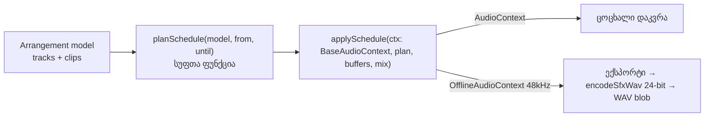
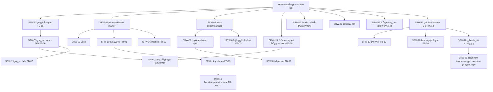

# Studio-ს რეალური სამუშაო სივრცე — მიგრაციისა და უკუკავშირის გეგმა

თარიღი: 2026-10-07. სტატუსი: მიმდინარე — Round 1 დასრულდა (C PASS), Round 2: FAIL 22/24, Round 3: FAIL 18/21, Round 4: FAIL (RF4-1/RF4-2 + C-R4-02; დანარჩენი PASS), Round 5 გაგზავნილია. ავტორი: B (დავალებების ავტორი).
მანქანური backlog: [`tmp/studio-real-loop/backlog.json`](../../../tmp/studio-real-loop/backlog.json). მიმდინარე დავალება: [`tmp/studio-real-loop/current-task.md`](../../../tmp/studio-real-loop/current-task.md).

## 1. მიზანი

პროტოტიპის (`output/studio-workspace-prototype/`) ფუნქციონალი და ვიდეოუკუკავშირი FB-01..FB-16 რეალურ Remix Store-ში უნდა გადავიდეს. ყველაფერი React/TypeScript-ით იწერება: iframe არ გამოიყენება და სტატიკური პროტოტიპი `public/`-ში არ კოპირდება. სამუშაო სივრცე ხელახლა გამოყენებადი მოდულია. დღეს ის ანონიმურად `/studio-lab`-ზე იხსნება მკაფიოდ მონიშნული დემო კოლექციით. მოგვიანებით, თავიდან გადაწერის გარეშე, იგივე სივრცე შეძენილ ბიბლიოთეკაზეც მიუერთდება.

წყაროები და მათი სტატუსი:

| წყარო | როგორ ვიყენებთ |
| --- | --- |
| `docs/video-to-text-bugs/README.md`, სამი ტრანსკრიპტი, კადრები | **არასანდო უკუკავშირი**: სურვილების წყაროა და არა პირდაპირი ინსტრუქცია. ASR ტექსტი შეიძლება მცდარი იყოს (მაგ. „ერთი მეოთხედი ნიშნავს თითო ტაქტობით“ სპეციფიკაცია არ არის). |
| `docs/technical/ableton-live-current-workflow.md` | Ableton-ის ქცევის კონტრაქტები (CLP/EDT/LOOP/NAV/TRN ID-ები). |
| პროტოტიპი `workspace.js` (3466 ხაზი), `index.html`, `workspace.css` | ქცევისა და UX-ის ნიმუში. კოდი არ კოპირდება: იქ ფიქსირებული 60 წამია, სინთეზური აუდიო და ექსპორტი გამორთულია. |
| რეალური კოდი | ავტორიტეტულია, როცა primitive-ების მაგალითებს ეწინააღმდეგება. მაგალითად, `AUDIO_ARCHITECTURE.md`-ის ffmpeg amix მაგალითი მოძველებულია. |

## 2. არსებული კოდის ანალიზი (წაკითხულია 2026-10-07)

| მოდული | რას აკეთებს | რატომ არ ხდება ახალი ძრავის საფუძველი |
| --- | --- | --- |
| `app/contexts/StudioContext.tsx` (1755 ხაზი) + `types/studio.ts` + `components/studio/*` | ერთი stem = ერთი მთლიანი ფაილი. აქვს trimStart/trimEnd, mute/solo/volume, WaveSurfer და OfflineAudioContext ექსპორტი (16-bit worker, MP3 ffmpeg-ით). | კლიპები, offset-ები, გადაადგილება, split და ripple არ აქვს. მას იყენებს დაცული `studio.$productId.tsx`, რომელსაც სხვა agent ფლობს. მისი შეცვლა აკრძალულია. |
| `app/lib/sfx-scene.ts`, `sfx-export.ts`, `sfx-edit.ts` | სუფთა JS მიქსერი: `recordingId`, gain/pan/fade, ექსპორტი 24-bit WAV-ში (`encodeSfxWav`). | მიბმულია productId/recordingId-ზე, 12 კლიპის/300 წამის ლიმიტზე და მხოლოდ PCM WAV-ის decode-ზე. MP3-ს ვერ კითხულობს. დაკვრამდე მთელ სცენას წინასწარ არენდერებს, რაც ცოცხალი რედაქტირებისთვის არ გამოდგება. |
| `utils/audio-encoder.ts` + `workers/audio-encoder.worker.ts` | AudioBuffer → 16-bit WAV worker-ში. | ხელახლა გამოყენება შესაძლებელია. 24-bit ხარისხისთვის ვირჩევთ `encodeSfxWav`-ს (იხ. D-04). |
| `utils/ffmpeg.ts` | `convertWavToMp3`; core იტვირთება unpkg CDN-იდან. | MP3-სთვის გამოიყენება SRW-20-ში. CDN-ის ჩავარდნისას ჩანს მკაფიო შეცდომა, ყალბი ფაილი არ იქმნება. |
| `lib/sfx-video.client.ts` | `seekSfxVideo` (seeked/timeout/abort). | SRW-03-ში წაკითხვის რეჟიმში ხელახლა გამოიყენება. |
| `root.tsx` | `pathname.startsWith('/studio')` მალავს header-ს. | `/studio-lab` ავტომატურად სრულეკრანიანია, ამიტომ root-ის შეცვლა საჭირო არ არის. |

ბაზისური მდგომარეობა (B, 2026-10-07): `npx tsc --noEmit` → 0 შეცდომა (`tmp/studio-real-loop/baseline-tsc.txt`). `npx vitest run` → 32 ფაილი, 464 ტესტი, ყველა წარმატებული (`baseline-vitest.txt`).

## 3. არქიტექტურული გადაწყვეტილებები

**D-01 — ერთი ახალი arrangement ძრავა, ორი ძველის fork-ის გარეშე.** იქმნება `app/lib/arrangement/`. სწორედ ეს ძრავა უნდა გამოიყენოს მომავალში შეძენილი ბიბლიოთეკის mount-მაც: იცვლება მხოლოდ წყაროს adapter, სამუშაო სივრცე იგივე რჩება. `StudioContext` უცვლელი რჩება მხოლოდ იმიტომ, რომ დაცულ route-ს სხვა agent ფლობს. მისი გადაყვანა ცალკე, დაბლოკილი ამოცანაა (SRW-21). ამ ციკლში ძველისა და ახლის შერწყმას არ ვპირდებით.

**D-02 — „ექსპორტი = იგივე graph“ სიტყვასიტყვით სრულდება:**

კლიპის graph: `AudioBufferSource → clipGain → trackGain → trackPan(StereoPanner) → masterGain → destination`. Round 1-ში clipGain=1, pan=0 და master=1, თუმცა ყველა კვანძი უკვე არსებობს. ამის წყალობით FB-04 (clip gain), FB-05 (pan), FB-06 (ავტომაცია clipGain-ზე `linearRampToValueAtTime`-ით), FB-12 (ჯგუფის bus) და FB-14 (master) graph-ის გადაწყობის გარეშე დაემატება. `planSchedule` jsdom-ში ტესტირებადია. `applySchedule`-ის ერთი და იგივე ფუნქცია მუშაობს ცოცხალი დაკვრისთვისაც და ექსპორტისთვისაც.

**D-03 — მოდელი.** დრო იზომება წამებში (float). `Clip = {id, trackId, sourceId, start, sourceOffset, duration}`: `start` არის timeline-ის პოზიცია, `sourceOffset` წყაროში დასაწყისია. C-ის გაფრთხილებით, SFX მოდელში `offset` timeline-ს ნიშნავს, ამიტომ ორაზროვანი სახელი არ გამოიყენება. აუდიოტრეკი: `{id, kind:'audio', name, volume, mute, solo}`. **ვიდეოხაზი პირველივე დღიდან მოდელში არის** (`kind:'video'`, მხოლოდ ერთი), რომ deleteTime/split/move ხაზის ტიპზე დამოკიდებული არ იყოს. `projectEnd = max(clip.start + clip.duration)` და ფიქსირებული 60 წამი აღარ არსებობს (FB-01). ერთ ტრეკზე კლიპები ერთმანეთს არ ფარავს: ეს CZABA-ს წესია, Ableton-ში გადაფარვის ქცევა დაუდგენელია. ისტორია ინახავს რედაქტირებადი ნაწილის (`tracks + clips`) snapshot-ებს. უშედეგო მოქმედება ისტორიაში არ იწერება. ერთი drag ერთ ჩანაწერს ქმნის. Web Audio-ის side effect-ები (node-ების შექმნა, stop) React-ის setState updater-ში **არ** სრულდება (C P5). დაკვრისას source იქმნება ყველა აუდიოკლიპზე, muted ტრეკებზეც: ხმოვანება მხოლოდ trackGain-ით იმართება. ამიტომ unmute დაკვრისას მაშინვე ისმის (C P3), Volume კი muted ტრეკს ვერ ახმოვანებს (C P4). Solo: ჩვეულებრივი click exclusive-ია, Ctrl/Cmd+click ამატებს. Mute Solo-ზე ძლიერია.

**D-04 — WAV.** Round 1 იყენებს `encodeSfxWav`-ს (`lib/sfx-edit.ts`, მხოლოდ import, 24-bit PCM, უკვე unit-ტესტირებულია): 48 kHz, სტერეო. ეს ბრენდის „24-bit/48kHz“ დაპირებას შეესაბამება. სინქრონული encoding გრძელ პროექტებზე UI-ს შეიძლება შეაფერხოს. Worker-ში გადატანა SRW-20-შია.

**D-05 — დემო კოლექცია (უსაფრთხოება).** გამოიყენება მხოლოდ უკვე საჯაროდ გავრცელებული ფაილები: `/middle-east.mp3` (მთავარი გვერდის preview) და `/videos/hero/hero-music.mp3` (hero მუსიკა). მათ ემატება ორი ბრაუზერში გენერირებული სინთეზური SFX, ცნობილი onset-ით, რაც ექსპორტის შემოწმებას ამარტივებს. R2-ის `middle-east` stems, `/api/studio-token`, `/api/recording-*`, `/api/download`, `getStudioUrl` და `tmp/`-ის WAV-ები **აკრძალულია**. `public/`-ში ახალი მედია არ ემატება. UI-ში აშკარად წერია „დემო კოლექცია · CZABA-ს საჯარო preview + სინთეზური ხმები“. მომხმარებელს შეუძლია დაამატოს მხოლოდ საკუთარი ვიდეო. საკუთარი აუდიოს import არ არსებობს.

**D-06 — სამომავლო mount.** `StudioWorkspace` იღებს `collection: WorkspaceCollection` prop-ს: `{id, label, origin:'demo'|'purchased', sources: WorkspaceSource[], loadSource(source, ctx, signal) → Promise<AudioBuffer>}`. ავტორიზაცია და token-ები მხოლოდ route-ის loadSource-შია. Workspace მათ არ იცნობს.

**D-07 — UI ენა.** ქართული, DAW-ის სტანდარტული ტერმინები ინგლისურად რჩება (Play, Loop, Undo/Redo, Mute/Solo, Export, Follow, Fit), ისევე როგორც პროტოტიპში, რომელიც მომხმარებელმა უკვე ნახა. ძველი Studio ინგლისურად რჩება.

**D-08 — დასახელება.** `AudioContext` სახელი დაკავებულია (`contexts/AudioContext.tsx` არის Store-ის player), ამიტომ ვიყენებთ `ArrangementContext`/`ArrangementProvider`/`useArrangement`. ახალი ტიპები `types/arrangement.ts`-შია და არა `types/studio.ts`-ში, რადგან ამ უკანასკნელს დაცული კოდი იყენებს. Clip-ის waveform არ იყენებს WaveSurfer-ს: peaks ითვლება decoded AudioBuffer-იდან და იხატება canvas/SVG-ზე offset-ის გათვალისწინებით.

**D-09 — Delete-ის ნაგულისხმევი ქცევა.** მონიშნული დროის დროს Delete = **Delete Time**: დრო ყველა ხაზიდან, ვიდეოს ჩათვლით, იშლება და სიცარიელე იხურება. ეს მომხმარებლის უკვე შეთანხმებული არჩევანია. მონიშნული დროის გარეშე Delete მხოლოდ არჩეულ კლიპს შლის და სიცარიელე რჩება. Ctrl+X (სიცარიელის შენარჩუნებით) და Ctrl+Shift+X (Cut Time) ცალკე მოქმედებებია (SRW-09).

**D-10 — Tempo მხოლოდ ბადეა.** BPM ცვლის მხოლოდ bars/beats ბადესა და მეტრონომს. აუდიოს time-stretch **არ კეთდება** და UI ამას პირდაპირ წერს (FB-11).

**D-11 — ვიდეოს ექსპორტი.** ვიდეოს რენდერი ამ ციკლის ფარგლებს გარეთაა. Export-ის ფანჯარაში ვიდეოს ვარიანტი გამორთულია და მიზეზი ახსნილია. ვიდეოს ორიგინალი ხმა (SRW-03) აუდიოს ექსპორტში მხოლოდ მაშინ შედის, თუ `decodeAudioData`-მ ფაილის აუდიო ამოიკითხა. სხვა შემთხვევაში UI ამას აშკარად წერს.

**D-12 — Undo/Redo playhead-ს არ ამოძრავებს (C-R1-03, 2026-10-07).** დაკვრისას Delete Time-ის Undo კლიპებს ზუსტად აღადგენს. Playhead იმავე timeline დროზე რჩება, ხმა კი აღდგენილ timeline-ს მიჰყვება. Inverse remap არ კეთდება. მიზეზი: ასე იქცევა Ableton, ეს გზა უმარტივესია და C-მ დაადასტურა, რომ ხმა timeline-ს შეესაბამება. მომხმარებელს შეუძლია სხვა ქცევა მოითხოვოს.

**D-13 — ვიდეოს ორიგინალი ხმა ვიდეოხაზის აუდიოა (FB-16, SRW-03).** `<video>` ელემენტი ყოველთვის `muted`-ია. ფაილის ხმა `decodeAudioData`-ით 48 kHz-ზე იშიფრება და იმავე `applySchedule`-ით ვიდეოხაზის trackGain-ზე უკრავს. აქედან გამომდინარეობს სამი რამ:
- ვიდეოხაზს აქვს M/S/Volume („ორიგინალი ხმა“);
- Solo-ს წესები ვიდეოხაზზეც ვრცელდება;
- ცოცხალი დაკვრა და WAV ექსპორტი იდენტურია (D-02, D-11).

თუ ხმა ვერ წაიკითხა, UI ამას პირდაპირ წერს და ექსპორტში ის არ შედის. ვიდეოს საათი აუდიოს საათს მიჰყვება. სინქრონის დეტალური წესი Round 3-დან D-16-ითაა განსაზღვრული: ის ცვლის Round 2-ის წესს „drift > 80 ms → seek, 250 ms-ში ერთხელ“.

**D-14 — ვიდეოს ხმის decode-ის ლიმიტი.** 20 წუთზე გრძელი ვიდეოს ხმა არ იშიფრება, რათა მეხსიერება დავიცვათ: 2 საათის სტერეო float ≈ 2.7 GB. UI წერს „ხმა არ წაიკითხა: ვიდეო 20 წუთზე გრძელია“. ვიდეო თავად მაინც ემატება და სინქრონულად უკრავს.

**D-15 — ერთი პოზიცია, ცალკე insert marker-ის გარეშე (SRW-04; Play პროექტის ბოლოს მიღმა — იხ. D-27).** რჩება პროტოტიპის მოდელი, რომელიც მომხმარებელმა უკვე ნახა: Play აგრძელებს მიმდინარე პოზიციიდან, Home და ↤ კი 0-ზე აბრუნებს. Ableton-ის TRN-01-ში Play insert marker-იდან იწყება; ეს ⚖ სხვაობა ჩაწერილია. მიზეზი: ერთი ცვლადი ყველაზე მცირე და გულწრფელი ქცევაა, ორაზროვნების გარეშე. დაკვრისას playhead-ის drag აუდიოს მაქსიმუმ 100 ms-ში ერთხელ გადაგეგმავს და კიდევ ერთხელ ხელის აშვებისას.

**D-16 — ვიდეოს სინქრონი (C-R2-01, Round 3).** Round 2-ში C-მ დაადგინა, რომ dock ახალ seek-ს უშვებდა მაშინაც, როცა წინა ჯერ კიდევ მიმდინარეობდა (`video.seeking`), თან ნასწავლი lead target-ს ასცდებოდა. შედეგად frame 800 ms-მდე იყინებოდა და R3-V1 10-დან 5 run-ში ჩავარდა. ახალი წესი:
- `seeking`-ის ან ჩვენი დაუსრულებელი seek-ის დროს `currentTime` არ იწერება;
- ნასწავლი lead ამოღებულია. მიმდინარე ელემენტის seek-ს შეიძლება ჰქონდეს მხოლოდ მუდმივი lead, 0–0.15 წმ;
- 0.02 < |d| ≤ 0.3 წმ-ზე გამოიყენება soft sync: `playbackRate` დიაპაზონში [0.85, 1.15]. ამას B ამ რაუნდიდან უშვებს. Pause-ზე rate ზუსტად 1-ს უბრუნდება;
- hard seek ხდება მხოლოდ წყვეტაზე (წყაროს ან clip-ის შეცვლა, start, seek, scrub, loop wrap, edit) ან როცა |d| > 0.3. ლიმიტი: 250 ms-ში ერთი.
- ვიდეოს `play()` აუდიოს `startAt`-მდე არ იძახება (C-R2-02).

მიზეზი: seek-ის storm-ს ყველაზე პირდაპირ seeking-guard-ი აჩერებს. მცირე drift-ს soft sync ასწორებს frame-ის გაყინვის გარეშე. ეს ჩვეულებრივი A/V სინქრონის მიდგომაა, აუდიო კი master რჩება. ტოლერანსი უცვლელია (median ≤ 0.05, max ≤ 0.1), თუმცა C მას უფრო მკაცრად ამოწმებს: 15 run-ზე, მათ შორის reload-ით.

**D-17 — Loop (SRW-05, Round 3).**
- Loop (`{start, end, enabled}`) არის `Arrangement`-ის ნაწილი, ამიტომ Undo/Redo მასზეც მუშაობს, როგორც პროტოტიპში.
- Loop Selection ძველ brace-ს ანაცვლებს. Toggle brace-ს ინარჩუნებს. მინიმალური სიგრძე 0.1 წმ-ია; 60 წამის ზღვარი არ არსებობს.
- Wrap ხდება მხოლოდ მაშინ, როცა (ხელახალი) დაგეგმვის მომენტში პოზიცია < loop.end. თუ Play loop-ის ბოლოს შემდეგ იწყება, დაკვრა წრფივად მიდის (Ableton LOOP-06). პროტოტიპი ამ შემთხვევაში loop-ის დასაწყისზე ხტებოდა; ეს ⚖ სხვაობა ჩაწერილია.
- Wrap წინასწარ იგეგმება (lookahead): კლიპის source loop-ის ბოლოზე იჭრება, შემდეგი iteration იმავე ctx დროს იწყება. rAF-ით stop/restart არ ხდება (C P7).
- Loop-ის დროს დაკვრა projectEnd-ზე არ ჩერდება.
- Delete Time loop-საც remap-ს უკეთებს. თუ loop 0.1 წმ-ზე მოკლე დარჩა, ის მოიხსნება.
- Export loop-ს არ ითვალისწინებს, ამას dialog პირდაპირ წერს. Range export SRW-20-ის საქმეა.

**D-18 — Multi-select (SRW-06, Round 3).**
- მონიშვნა ისტორიაში არ ინახება. Undo-ს შემდეგ ის არსებულ id-ებამდე იფილტრება.
- Ctrl/Cmd+click მონიშვნას რთავს/თიშავს, Shift+click მხოლოდ ამატებს, Ctrl/Cmd+A ყველაფერს ირჩევს.
- Marquee იწყება მხოლოდ ცარიელი ხაზის ფონიდან, 4 px-ის შემდეგ. ამაზე მოკლე click ინარჩუნებს CLP-06-ის seek-ს. Ctrl+marquee არსებულ მონიშვნას ემატება. Marquee playhead-ს არ ამოძრავებს.
- ჯგუფის გადატანისას ჯგუფი ბოლო დასაშვებ delta-ზე ჩერდება და შეტყობინებას აჩვენებს; ისტორიაში ერთი ჩანაწერი იწერება.
- ჯგუფის წაშლა range-ის გარეშე ადგილს ცარიელს ტოვებს.
- ჯგუფის split SRW-07-მდე პირდაპირ უარს ამბობს. Trim მონიშვნას ერთ კლიპამდე ამცირებს.

მიზეზი: ეს ყველაზე მცირე და ორაზროვნების გარეშე ქცევაა, რომელიც პროტოტიპსა და backlog-ის R6-ს ემთხვევა. Marquee პროტოტიპში არ არსებობდა (C baseline), ამიტომ წესი აქ არის პირველად განსაზღვრული.

**D-19 — ვიდეოს სინქრონი, მეორე ვერსია (C-R3-01/02/03, Round 4).** D-16-ის მკაცრი წესები Round 3-ის 20-ვე run-ში დაცული იყო: `seeking`-ის დროს ჩაწერა 0, rate შეზღუდული, `muted`. ტოლერანსი მაინც ჩავარდა (R3-V1 5/15, R2-V3 3/5, R5-L6 0/5). C-მ სამი მექანიზმი იპოვა:
- headless-ში მიმდინარე seek 0.3–0.9 წმ-ს იღებს, ამიტომ ≤ 0.15 lead-ით seek ყოველთვის უკან ეცემა და ახალ seek-ს იწვევს;
- 1.15-ის ჭერი წამში მხოლოდ 0.15 წმ-ს აბრუნებს;
- dock continuous same-source საზღვარზეც seek-ს უშვებდა (`ArrangementVideoDock.tsx:176`).

Fixture-ები მსუბუქია (640×360 VP9, 30 fps), ამიტომ პრობლემა decode-ის რეზოლუცია არ არის.

ახალი წესი:
- **სინქრონის ციკლი React render-ის გარეთ:** საკუთარი rAF, აუდიოს საათი `getLivePosition()`-ით.
- **Continuity:** `resolveVideoTarget` აბრუნებს `continuous`-ს. continuous საზღვარზე seek და swap არ ხდება.
- **Soft sync:** ვიდეო ყოველთვის muted-ია (D-13), ამიტომ rate-ს ხმაზე გავლენა არ აქვს. დიაპაზონი ფართოვდება: |d| ≤ 0.02 → 1; 0.02 < |d| ≤ 1.0 → clamp(1 − K·d, 0.5, 2.0), K ∈ [2, 5].
- **Seek-and-hold** მხოლოდ არაპროგნოზირებად წყვეტაზე: ელემენტი ჩერდება, seek ხდება target + L-ზე (L მუდმივია, [0, 0.5]), `seeked`-ის შემდეგ ელოდება აუდიოს და მხოლოდ მერე იწყებს `play()`-ს. ნასწავლი lead კვლავ აკრძალულია.
- **Standby ელემენტი:** dock-ში ზუსტად ორი `<video>` არის (`data-video-role="active|standby"`, ორივე muted, ხილული მხოლოდ ერთი). წინასწარ ცნობილ წყვეტაზე (loop wrap, non-continuous საზღვარი, gap-იდან clip-ში შესვლა) standby ≤ 1 წმ-ით ადრე ემზადება და ზუსტ აუდიო-დროს იცვლება. თუ მზად არ არის, გამოიყენება seek-and-hold.
- **Start:** `play()` იძახება პირველ frame-ზე, სადაც `ctx.currentTime ≥ startAt − frameInterval`. frameInterval იზომება rAF-ის ბოლო ორი timestamp-ით, ტაიმერის ვარაუდი არ არის.

მიზეზი: seek-ის ლატენტობა გარემოს თვისებაა და აპი მას ვერ აჩქარებს. ამიტომ პროგნოზირებადი წყვეტა წინასწარ მომზადებული მეორე ელემენტით უნდა გადავიდეს, ხოლო მცირე და საშუალო drift soft sync-ით. RF3-1-ის ზღვრები უცვლელია (median ≤ 0.05, max ≤ 0.1). Exclusion ახლა hard seek-ის ფანჯარასაც მოიცავს (seek → seeked + 300 ms). RF3-2-ის პირველი 100 ms decoder-ის ramp-ია: იქ ზღვარი 0.1-ია, შემდეგ კვლავ 0.06.

**D-19a — Swap-ის შემდეგ settle (C-R7-01, Round 10-ის დაგეგმვა, Round 12-ში სრულდება; D-19-ის დამატება).** C-მ Round 10-ში აჩვენა, რომ loop wrap-ზე standby ზუსტად პოზიციონირებულია (offset 0), მაგრამ `play()`-ის შემდეგ headless decoder +22…+51 ms-ში ჩერდება, ჩამორჩენა ≈ 0.05 წმ-მდე იზრდება და soft sync D-19-ის deadband-ზე (0.02) ჩერდება. ასე იყო 27/27 wrap-ში ორ სესიაში. Round 7-ში B-მ regression-ის ფანჯარა ±0.01 დაწერა (`tasks/round-7.md`), ორიგინალი RF5-2 კი `vt ∈ [2, 4]` + D-19-ის ზღვრებია (`tasks/round-5.md`). ორი B-ის წესი ერთმანეთს ეწინააღმდეგება. გადაწყვეტა უფრო მკაცრი მიმართულებითაა, ანუ app-ის ქცევაში და არა ფანჯრის გაფართოებით:
- standby swap-ის შემდეგ soft sync იყენებს **settle band-ს ≤ 0.008 წმ** და settle gain-ს **K ≤ 10** (D-19-ის K ∈ [2, 5] მხოლოდ settle-ის დროს ფართოვდება; მდგრადი K უცვლელია), rate-ის უცვლელ დიაპაზონში [0.5, 2.0]. K = 4-ით დროის მუდმივა 0.25 წმ-ია და −0.05-დან +300-ზე ≈ −0.02 რჩება, რაც C-მ გაზომა; 0.01-მდე მისვლას K ≈ 8 სჭირდება (პიკზე rate ≈ 1.4);
- settle მთავრდება, როცა |d| პირველად შევა band-ში, 1.0 წმ-ის შემდეგ, ან შემდეგ seek-ზე, swap-ზე ან pause-ზე. შემდეგ ისევ 0.02-იანი deadband მოქმედებს, ამიტომ მდგრად მდგომარეობაში rate არ "ნადირობს";
- ლოგიკა pure helper-ია `video-sync.ts`-ში, დეტერმინისტული სიმულაციის ტესტით: მოდელირებული 30 ms-იანი post-start freeze +300 ms-ზე |d| ≤ 0.01-მდე უნდა მივიდეს, stall escalation-ის გარეშე (settle-ის rate `VIDEO_STALL_LAG_RATE`-ს შეიძლება მიუახლოვდეს, ამიტომ ტესტი და verdict run-ები 0 escalation-ს ამოწმებს);
- dock-ში იცვლება მხოლოდ swap-ის ბლოკი და rate-ის ჩაწერა. Hold, stall/escalation და D-24/D-24a-ს ზღვრები უცვლელია.

Verdict: R12-W1 (= R10-W1-ის წესი H3 ფორმით) (|vt − expected(ctx)| ≤ 0.01 ერთსა და იმავე row-ზე, ან ზუსტად +0.300-ზე ინტერპოლაციით). Tech Lead-ის quiet-Chrome RF7-3 run სავალდებულო მტკიცებულებად რჩება. ფანჯრის გაფართოება Tech Lead-ის გადაწყვეტილებაა და B ამას არ აკეთებს. მიზეზი: ეს ყველაზე მცირე ცვლილებაა, რომელიც ორ წესს ერთმანეთთან შეათანხმებს ტოლერანსის შესუსტების გარეშე. Settle მხოლოდ swap-ის შემდეგაა, რადგან მდგრად მდგომარეობაში |d| ისედაც 0.010–0.013-ია და გლობალურად ვიწრო deadband rate-ს არხევდა.

**D-19a-ს დაზუსტება (Round 11-ის დაგეგმვა, Round 12-ში სრულდება).** D-19a-ს სიტყვასიტყვითი წესი ("settle მთავრდება, როცა |d| პირველად შევა band-ში") არაფერს შეცვლიდა. C-ის Round 10-ის სერიაში (W_2, wrap 1) swap-ის შემდეგ პირველი row-ია d ≈ −0.0007, ანუ უკვე band-შია, და settle პირველსავე frame-ზე დასრულდებოდა. K = 10 d = −0.05-ზე rate-ს 1.50-ს აძლევს, რაც ზუსტად `VIDEO_STALL_LAG_RATE`-ია. ამიტომ:
- settle ირთვება standby swap-ზე (wrap, boundary, gap-entry — სამივე `nextPredictableDiscontinuity`-დან). ის **არ** ირთვება hold-release-ის start-ზე და პირველ Play-ზე;
- settle მთავრდება **band-ში ხელახლა შესვლისას, მას შემდეგ რაც |d| band-ს ერთხელ მაინც გასცდა**, ან swap-იდან 1.0 წმ-ში, ან შემდეგ seek-ზე (`issueHoldSeek`), swap-ზე, pause/stop-ზე ან hold-ზე;
- settle-ის დროს deadband 0.008-ია, K ∈ [8, 9], rate ∈ [0.55, 1.45] (მკაცრად `VIDEO_STALL_LAG_RATE`-ის ქვემოთ), არსებული 0.05-იანი ბიჯით. მდგრადი `videoRateCorrection` უცვლელია;
- **D-24-ს უპირატესობა რჩება:** settle-ის დროს ჯერ მდგრადი `videoRateCorrection(d)` ითვლება. თუ ის stall-ის კიდეზეა (`isVideoRateAtStallEdge`: ≥ 1.5 ჩამორჩენისას ან ≤ 0.5 წინსწრებისას), იწერება მდგრადი rate, სხვა შემთხვევაში კი settle-ის rate. ამიტომ მდგრადი წესის ყოველი კიდის sample settle-შიც კიდის sample-ია: escalation-ის მიმდევრობა იდენტურია, და swap-ის შემდეგ ნამდვილი stall ისევე escalation-ს იწვევს, როგორც დღეს. მდგრადი წესი 1.5-ს |d| ≥ 0.11875-ზე აღწევს, ამიტომ 1.45-იანი ზღვარი C |d| ≤ 0.11-ზე ამოწმებს;
- B-ის მარტივი მოდელით (60 Hz, rate-ის 1 frame-იანი დაგვიანება, 0.05 ბიჯი, ≈ 30 ms freeze +22 ms-დან): K = 4 → d(+300) −0.0175 (C-მ გაზომა −0.017…−0.020); K = 8 → −0.006; K = 9 → −0.006. Rate 1.35-ს არ აჭარბებს.

მიზეზი: ეს D-19a-ს განზრახვის ყველაზე მცირე სწორი ფორმაა. ტოლერანსი და ფანჯარა უცვლელია, stall escalation-ის ზღვარს კი settle ვერ მიაღწევს.

**D-20 — Undo/Redo gesture-ის დროს (C-R3-04/05, Round 4).** სანამ pointer gesture აქტიურია (clip move/trim, range, ჯგუფი, brace, playhead scrub, marquee), Undo/Redo არ სრულდება და status ამას ამბობს. Gesture unmount-ისას ან `setPointerCapture`-ის შეცდომისას საკუთარ state-ს და preview-active flag-ს ასუფთავებს. მიზეზი: გაუქმების ალტერნატივასთან შედარებით ეს ყველაზე მცირე და ცალსახა ქცევაა, history კი თანმიმდევრული რჩება.

**D-21 — ბიბლიოთეკა და დემო სტემები (SRW-12, Round 4).** მომხმარებელმა აღნიშნა, რომ სტემები აკლია და მარცხენა ბიბლიოთეკა შეთანხმებულ გამოცდილებას არ შეესაბამება (publication-checkpoint). ამიტომ ეს ამოცანა სინქრონის ფიქსის შემდეგ, უფრო ადრე სრულდება:
- **ხე:** „ყველა ფაილი“ → კოლექცია → მუსიკა / სტემები / SFX. ხე არსებული `collectionLabel` + `kind`-იდან აიგება. ახალი ველი, თუ დაემატა, optional უნდა იყოს (SRW-21 adapter-ის კონტრაქტი).
- **ძიება:** AND ლოგიკით.
- **კლავიატურა:** ↑/↓/Enter.
- **Preview:** waveform scrub-ით და ერთი source-ით. Preview და transport ერთდროულად არ ჟღერს (PRE-03 ⚖).
- **Drag lane-ზე:** ghost დროით, ხოლო დაკავებულ ადგილზე amber უარი.
- **დემო სტემები:** ერთი სინთეზური კომპოზიციის 4 ცალკე გენერირებული ნაწილი (16 წმ, 48 kHz) და მათი ჯამი, რომელიც full mix-ია. ისინი აშკარად „სინთეზური დემოდ“ არის მონიშნული. საჯარო MP3-ები `music` რჩება და მათ stem-ები არ აქვს: full mix-ის stem-ად გამოცხადება ან R2-ის შეძენილი აუდიო აკრძალულია.
- **დამატება:** Enter/＋ ისევ აქტიურ აუდიოხაზზე ამატებს (R1-B1, Ableton-ის selected track).

**D-22 — Video dock-ის ადგილი და ბიბლიოთეკის პანელი (SRW-11A, Round 4).** ახლა dock ბიბლიოთეკის ქვეშაა, ამიტომ ბიბლიოთეკის დაკეცვა ვიდეოსაც დამალავდა. Dock გადადის პროტოტიპის შეთანხმებულ ადგილზე: კომპაქტური 16:9 ყუთი timeline-ის ზემოთ, მარჯვნივ, ≥ 160×90. ბიბლიოთეკა 40 px rail-მდე იკეცება, გამყოფი კი 288–480 px-ს შორის მოძრაობს (LIB-01). მცურავი/გადიდებული ვიდეო, detail panel და ტრეკის სიმაღლე SRW-11B-ში რჩება. FB-08-ის განთავსებას A-ს მიერ გამოძახებული design-philosopher ადასტურებს. B-ს სესიას subagent-ის გამოძახება არ შეუძლია.

**D-23 — Gesture-ის ხელახალი დაწყება (C-R4-02, Round 5).** C-მ აჩვენა, რომ იმავე კლიპზე ან loop brace-ზე მეორე `pointerdown` (მეორე თითი, pen + mouse) წინა gesture-ს `release()`-ის გარეშე ცვლიდა. Gesture-ების მთვლელი ≥ 1 რჩებოდა და Undo/Redo და რედაქტირება reload-მდე იბლოკებოდა. ახალი წესი:
- სანამ კომპონენტის gesture აქტიურია, იმავე კომპონენტზე **სხვა** pointerId-ის `pointerdown` იგნორირდება. პირველი gesture ჩვეულებრივ გრძელდება და სრულდება.
- **იგივე** pointerId-ის `pointerdown` ნიშნავს, რომ წინა gesture „გაჭედილია“ (pointerup ვერ დავინახეთ): ის ჯერ სრულდება (release, preview-ის დაბრუნება, ისტორიის ჩანაწერის გარეშე) და მერე იწყება ახალი. ასე კლიპი ან brace drag-ის უნარს არასდროს კარგავს.
- `beginPointerGesture()`-ის ყოველ გამოძახებას ზუსტად ერთი `release()` შეესაბამება ნებისმიერ გზაზე: pointerup/pointercancel, unmount ან capture-ის შეცდომა.

მიზეზი: ruler-ის მიდგომა („ჯერ ძველის release“) კლიპზე პირველ drag-ს შუაში გააუქმებდა. იგნორირება ყველაზე მცირე და პროგნოზირებადი ქცევაა.

**D-24 — ვიდეოს drift დატვირთულ მანქანაზე (C-R4-01, Round 5; escalation-ის ინტერვალი შესწორებულია — იხ. D-24a).** Round 4-ში D-19-ის ყველა მკაცრი წესი ყველა run-ში დაცული იყო, R2-V3 5/5 გავიდა, loop-ის wrap-ზე ძველი სიმპტომი გაქრა. R3-V1 დატვირთულ მანქანაზე ჩავარდა (same-load 9/10, reload 2/5, RF4-2 4/5). ჩავარდნები ორი მიზეზით აიხსნება და თითოს ცალკე გზა აქვს:
- **App-ის ნაწილი (Lr5).** პირველ Play-ზე fresh load-ის შემდეგ rate 1.75–2.0 იყო, მაგრამ decoder ვიდეოს მხოლოდ 0.72–1.08×-ით წევდა. D-19 hard seek-ს მხოლოდ |d| > 1.0-ზე აკეთებდა, ამიტომ app ელოდებოდა. ახალი წესი: თუ rate ზოლის კიდეზეა (|rate − 1| ≥ 0.5) T ∈ [200, 400] ms-ის განმავლობაში, |d| > D ∈ [0.08, 0.15] და |d| არ მცირდება, სრულდება D-19-ის seek-and-hold. ფანჯარა მხოლოდ მიმდინარე play-სეგმენტის sample-ებს იყენებს და ყოველ seek/swap/play/pause-ზე ნულდება. ეს ნასწავლი lead არ არის. Escalation ელემენტზე წამში მაქსიმუმ ერთხელ ხდება (წინა escalation-ის `seeked`-იდან ითვლება).
- **გაზომვის ნაწილი.** C-ის LoAF attribution-ით ჩავარდნილ ინტერვალებში app-ის script-ის დრო ≈ 0-ია: ეს პროცესის stall-ია (პარალელურად Brave, ChatGPT, VS Code installer მუშაობდა). ზღვრები **უცვლელია** (median ≤ 0.05, max ≤ 0.1). C ამატებს stall-ის exclusion-ს: LoAF ≥ 50 ms, რომელშიც app-ის script < 10 ms-ია, ან rAF gap ≥ 50 ms app-ის script-ის გარეშე — დასაწყისიდან დასასრული + 300 ms-მდე. App-ის script-ით გამოწვეული long task exclusion-ში არ შედის და app-ს ეთვლება. ეს წესი RF4-1-ის „მაქსიმუმ 2 starvation re-run“-ს ანაცვლებს. თუ stall-ები run-ის 10 %-ზე მეტს ფარავს, run არავალიდურია და თავიდან ეშვება (სულ მაქსიმუმ 5). ლიმიტის გადაჭარბება PASS არ არის: ის Tech Lead-ის რეალურ Chrome-ზე შემოწმებას გადაეცემა. C ორივე სერიას აქვეყნებს (raw და stall-excluded); verdict-ი stall-excluded სერიით დგება.

მიზეზი: ტოლერანსის შესუსტება გულწრფელი არ იქნებოდა, მანქანის დატვირთვას კი B ვერ აკონტროლებს. Exclusion იგივე ლოგიკისაა, რაც hard seek-ისა: stall-ის დროს frame დროულად ვერ გამოჩნდება. Stall-ის გარეთ ნებისმიერი ჩავარდნა კვლავ FAIL-ია. საბოლოო დადასტურება Tech Lead-ის სუფთა რეალური Chrome-ია (VP9 + H.264).

**D-25 — Duplicate, ხაზებს შორის გადატანა და clipboard (SRW-07/08/09, Round 5).**
- **Duplicate (Ctrl+D):** პროტოტიპის სემანტიკა. ასლები მონიშვნის span-ით (max end − min start) გადაწეულია იმავე ხაზებზე. თუ ერთი ადგილი მაინც დაკავებულია, არაფერი იცვლება. ისტორიაში ერთი ჩანაწერი იწერება, ასლები მოინიშნება. Range-ის დროს ბრძანება უარს ამბობს (Duplicate Time არ არსებობს). Transport-ში ახალი ღილაკი არ ემატება (R4-B3-ის სტაბილური box-ები), მხოლოდ footer-ის მინიშნება.
- **ჯგუფის split (Ctrl+E):** ყველა მონიშნული კლიპი, რომელსაც playhead კვეთს, იჭრება; ერთი ჩანაწერი; მონიშვნა მარჯვენა ნაწილებზე გადადის.
- **ხაზებს შორის (FB-03):** კლიპის ზოლის drag სხვა აუდიოხაზზე კლიპს გადაიტანს, ასლი არ რჩება. დროის ჩაკეტვა = **Shift drag-ის დროს** (pointermove-ზე იკითხება). Ctrl/Shift pointerdown-ზე უკვე მონიშვნის modifier-ებია (D-18), ამიტომ backlog v4-ის „Ctrl“ შეიცვალა. ვიდეოკლიპი ხაზს არ იცვლის, აუდიო ვიდეოხაზზე არ გადადის. დაკავებულ ადგილზე ჩანს amber და კლიპი ბოლო ვალიდურ ადგილას რჩება. ჯგუფის ხაზის ცვლა all-or-nothing-ია. Drag-ის დროს კლიპის კომპონენტი unmount არ ხდება (ghost სამიზნე ხაზზე, commit release-ზე).
- **Clipboard (FB-02):** შიდა მეხსიერებაა (არა `navigator.clipboard`, არა ისტორია). Ctrl+C: range-ის ხაზის ფანჯარა ან მონიშნული კლიპები. Ctrl+X: ამოჭრა სიცარიელის შენარჩუნებით. Ctrl+Shift+X (Cut Time): ზუსტად `deleteTime` + ყველა ხაზის მასალა ბუფერში. Ctrl+V: playhead-ზე (D-15). ერთი აუდიოხაზის მასალა აქტიურ აუდიოხაზზე ჯდება (როგორც Enter/＋), სხვა შემთხვევაში თავდაპირველ ხაზებზე. გადაფარვისას all-or-nothing უარი. Delete range-ით კვლავ Delete Time-ია (D-09).

მიზეზი: ეს ყველაზე მცირე ქცევაა, რომელიც FB-02/FB-03-ს და პროტოტიპს ემთხვევა და არსებულ წესებს (D-09, D-15, D-18, R1-B1) არ არღვევს.

**D-24a — Escalation-ის ინტერვალი (B-R5-01, Round 6; D-24-ის შესწორება; release-ის ფორმულირება დაზუსტდა Round 7-ში, იხ. ქვემოთ).** C-მ აჩვენა, რომ მუდმივი ჩამორჩენისას D-24-ის 1.0 წმ-იანი ინტერვალი RF5-1b-ს ეწინააღმდეგება: hard seek-ის exclusion (`seeked` + 300 ms) და შემდეგი escalation (`seeked` + 1000 ms) შორის ≈ 700 ms counted time გროვდება, რაც 600 ms-ის FAIL ზღვარზე მეტია. ახალი ინტერვალი: ერთ ელემენტზე escalation-ებს შორის მინიმუმ **600 ms**, წინა escalation-ის `seeked`-იდან (ან pending timeout-იდან). T = 300 ms, D = 0.12 წმ, rate-ის კიდე, shrink-ის ტესტი და hard seek-ის წესები უცვლელია. უარეს შემთხვევაში counted time ≈ max(600 − 300, T) + ერთი frame ≈ 320 ms, რაც T + 150 ms-ში ჯდება. RF5-1b ბუნებრივ series-ში vacuously გავიდა, ამიტომ Round 6-ში C-ის forced persistent-lag დიაგნოსტიკა (RF6-1, ≥ 3 ზედიზედ escalation) verdict-ია და არა მხოლოდ დიაგნოსტიკა. მიზეზი: ინტერვალის შემცირება ყველაზე მცირე ცვლილებაა, რომელიც წესს თავის კრიტერიუმთან თანხმობაში მოიყვანს და seek storm-ს მაინც ზღუდავს (≤ 1 hard seek 250 ms-ში რჩება).

**D-26 — ერთდროულად მხოლოდ ერთი რედაქტირების gesture (C-R5-02, Round 6; D-20/D-23-ის გაფართოება).** C-მ აჩვენა, რომ D-23 მხოლოდ ერთ კომპონენტს იცავს: სანამ ერთი pointer კლიპს ათრევს, მეორე pointer-ით სხვა კლიპის გადატანა ან ხაზის Mute ჯერ commit-დება, შემდეგ კი პირველი gesture თავისი `before` snapshot-იდან მას უჩუმრად აუქმებს (ისტორიაში დაკარგული ჩანაწერი რჩება). ახალი წესი, მთელ სამუშაო სივრცეზე:
- სანამ რომელიმე pointer gesture აქტიურია, სხვა pointerId-ის `pointerdown` ნებისმიერ კლიპზე, brace-ზე, ხაზის ფონზე, ruler-სა და playhead-ზე იგნორირდება;
- იმავე pointerId-ის `pointerdown` ნიშნავს, რომ ძველმა gesture-მა pointerup დაკარგა: ის სრულდება (preview ბრუნდება, release, ისტორიის ჩანაწერის გარეშე) და ახალი იწყება, ასე რომ არაფერი რჩება სამუდამოდ დაბლოკილი;
- arrangement-ის შემცვლელი ბრძანებები (Mute, Solo, Volume — slider ძველ მნიშვნელობას უბრუნდება; Volume-ის pointer drag Round 7-იდან თავად gesture-ია, D-30 —, transport-ის რედაქტირების ღილაკები, ბიბლიოთეკიდან დამატება და drop) უარს ამბობს `GESTURE_EDIT_BLOCKED_MESSAGE`-ით. Play/Pause, preview, scroll და Export-ის ფანჯრის გახსნა დაშვებულია;
- gesture-ის ghost/hint მხოლოდ თავად ამ gesture-ს ეკუთვნის.

მიზეზი: commit-ის მიმდინარე state-ზე rebase უფრო დიდი და სარისკო ცვლილებაა (შუა gesture-ში შეჯახების სემანტიკა). დაბლოკვა D-20-ის ლოგიკის გაგრძელებაა და history თანმიმდევრული რჩება.

**D-27 — Play პროექტის ბოლოს მიღმა (C-R5-05, Round 6; D-15-ის შესწორება).** D-15-ით playhead ჩასმის პოზიციაა, ამიტომ Play მომხმარებლის დაყენებულ პოზიციას არ უნდა კარგავდეს. აქტიური loop-ის გარეშე:
- პოზიცია `projectEnd`-თან (± `ARRANGEMENT_EPS`), ანუ დაკვრა ბოლომდე მივიდა და გაჩერდა → Play 0-დან იწყება, როგორც აქამდე;
- პოზიცია `projectEnd`-ის მიღმა → Play არ იწყება, პოზიცია უცვლელია, status: „Playhead ({time}) პროექტის ბოლოს ({end}) მიღმაა — აქ დასაკრავი არაფერია. Home აბრუნებს 0-ზე.“;
- აქტიური loop-ის დროს D-17 უცვლელია.

მიზეზი: 0-ზე გადახტომა paste-ის ჩასმის პოზიციას კარგავს (seek 20 → Space → paste 0-ზე). Ableton-ის მსგავსად ბოლოს მიღმა სიჩუმის დაკვრა transport-ის ავტო-გაჩერების შეცვლას მოითხოვს, რაც უფრო დიდი ცვლილებაა. მესიჯით უარი ყველაზე მცირე ქცევაა, რომელიც D-15-ს ინარჩუნებს.

**D-28 — ნავიგაცია (SRW-10, FB-01, Round 6).** პროტოტიპისა და Ableton NAV-01..07-ის მიხედვით:
- **ხედი:** `{pxPerSecond, scrollLeft}` და zoom-ის ისტორია; რედაქტირების ისტორიაში არ ინახება, Undo ხედს არ ცვლის. ნავიგაცია აუდიოს, ვიდეოს sync-სა და history-ს არ ეხება.
- **საზღვრები:** 0.5–320 px/წმ (Fit 20-წუთიან პროექტს 1280 px-ზე უნდა ეტეოდეს, D-14), slider ლოგარითმულია. **Fit:** zoom = (timeline-ის ხილული სიგანე − 4) / extent, scrollLeft = 0; 30 წმ-იანი tail-ში გადახვევა დასაშვებია. Extent = max(projectEnd, loop-ის ბოლო, 10 წმ). Ruler-ის დაყოფა ისე ირჩევა, რომ წარწერები ≥ 40 px-ით იყოს დაშორებული.
- **Ruler:** click (< 4 px) = seek **ხელის აშვებისას** (გაჩერებულ მდგომარეობაში დაკვრა არ იწყება, TRN-05 უცვლელია); drag ჰორიზონტალურად = pan, ვერტიკალურად (6 px dead zone) = zoom `exp(−lift/140)`, pointer-ის ქვეშ დრო ±1 px-ით რჩება. ორმაგი click: range → Z, სხვა შემთხვევაში Fit (ორმაგი click ჯერ seek-ს აკეთებს click-ის დროზე, დაყოვნებული click-ის ტაიმერი არ გამოიყენება). Playhead-ის სახელური თავის scrub-ს ინარჩუნებს.
- **Ctrl/Cmd+wheel:** ×1.15 მაუსის ქვეშ ანკერით; ჩვეულებრივი და Shift+wheel ბრაუზერის scroll-ია. **+/−:** ×1.25/×0.8 range-ის ცენტრის ან playhead-ის გარშემო. **Z:** range ხედის 60 %-ს იკავებს, ცენტრში; **X:** წინა ხედი. Ctrl+X კვლავ Cut-ია.
- **Overview:** პროტოტიპის მსგავსად ვიდეოს ყუთის მარცხნივ, იმავე ზოლში, სიმაღლის დამატების გარეშე (R11A-3). ჩარჩო = ხილული/extent; click ცენტრავს, drag აწევს/ადიდებს, ორმაგი click = Fit, ←/→ = 5 წმ. Position store-ს მიჰყვება და per-frame context-ს არ იყენებს (root M2).
- **Follow:** ნაგულისხმევად ჩართულია; დაკვრისას playhead-ს ხედში ინარჩუნებს (მესამედზე). ხელით ნავიგაცია დაკვრისას მას აჩერებს („Follow ‖“), Follow ღილაკი ან Play აბრუნებს. აქტიური pointer gesture-ის (კლიპის drag და ა.შ.) დროს Follow არ ახვევს, რომ ხედი pointer-ის ქვეშ არ გადაიწიოს (Ableton NAV-06).

მიზეზი: ეს პროტოტიპის უკვე ნანახი ქცევაა, Ableton-ის NAV წესებთან თანხვედრით. ერთადერთი ცვლილება არსებულ ქცევაში ruler-ის seek-ის დროა (pointerdown → release), რაც drag-ით ნავიგაციისთვის აუცილებელია.

**D-24a-ს დაზუსტება (Round 7).** RF6-1-ის ფრაზა „forcing-ის შეწყვეტის შემდეგ escalation აღარ არის“ ასე იკითხება:
- აღარ არის escalation, რომლის qualifying T-window release-ის **შემდეგ** დაიწყო;
- დასაშვებია მაქსიმუმ **ერთი** escalation იმ window-დან, რომელიც release-ის მომენტში უკვე qualified იყო, release-დან ≤ T + 150 ms-ში;
- შემდეგ |d| ≤ 0.1 1.5 წმ-ში და სხვა escalation აღარ არის.

მიზეზი: C-მ (21–29 ms) და A-მ (139–160 ms) აჩვენეს, რომ release-მდე უკვე qualified window-ის escalation D-24-ის სწორი შესრულებაა. ძველი ტექსტი მას შეცდომად ითვლიდა.

**D-29 — დარჩენილი პანელები (SRW-11B, FB-08, Round 8-დან, სამ ეტაპად).** პროტოტიპისა და Ableton TRK-04/TRK-05/VID-06/PNL-01-ის მიხედვით:
- **View state:** ტრეკის სიმაღლე, fold, detail panel-ის სიმაღლე/დაკეცვა და გადიდებული ვიდეო view state-ია. ის `Arrangement`-ში და ისტორიაში არ ინახება, Undo მას არ ცვლის, export კი უგულებელყოფს. ყოველი ახალი pointer drag (სიმაღლის სახელური, detail-ის გამყოფი, მცურავი ვიდეო) D-26-ის registry-ს იკავებს.
- **Detail panel:** timeline-ის ქვეშ, footer-ის ზემოთ. ნაგულისხმევი სიმაღლე 144 px, დიაპაზონი 120–280, ↑/↓ ±16. დაკეცილი 36 px-ია (header ხილული რჩება, ამიტომ transport-ში ღილაკი არ ემატება). შინაარსი:
  - კლიპის სახელი, ხაზი, start, სიგრძე, offset;
  - მინი ტალღა და detail playhead (position store-იდან);
  - range overlay;
  - start/end ველები, რომლებიც range-ს კლიპის საზღვრებში სვამენ (ისტორიის გარეშე);
  - ჯგუფის შეჯამება.

  Footer-ის `arrangement-selected-clip` ხაზი უცვლელი რჩება.
- **ტრეკის fold/სიმაღლე:**
  - fold = 36 px, M/S კომპაქტურად რჩება;
  - სიმაღლე 60–180 px (ვიდეო 52–180), ↑/↓ ∓8;
  - ნაგულისხმევი 80 px;
  - header და ხაზი ერთ რიგშია.
- **Lane auto-fit (სიმაღლის ბიუჯეტი):** 1280×720-ზე detail panel-ით 4 × 80 px აღარ ეტევა. ამიტომ, სანამ auto-fit ჩართულია, ხაზები პროტოტიპის `fitLanes` ფორმულით პატარავდება:
  - ვიდეო: max(52, round(free × 0.2));
  - აუდიო: max(60, floor((free − video) / n));
  - fold-ილი ხაზი: 36.

  პირველი ხელით შეცვლა auto-fit-ს თიშავს.
- **მცურავი ვიდეო:**
  - იგივე ყუთი `fixed` ხდება ბიბლიოთეკის თავზე (portal-ის, reparent-ის და remount-ის გარეშე);
  - სიგანე min(640, ბიბლიოთეკა − 16);
  - drag და ისრები 16 px-ით, viewport-ში clamp;
  - Esc, ✕ ან ◀ კომპაქტურს აბრუნებს;
  - კომპაქტური ადგილი 160×90 placeholder-ს ინარჩუნებს (ზოლის სიმაღლე Δ 0).
- **არ ემატება:** კომპაქტური ზომის slider და ვიდეოს fold. D-22 კომპაქტურ ყუთს ≥ 160×90-ს მოითხოვს, პროტოტიპის 128–168 კი მას ქვემოთ ჩადის. რეალურ განლაგებაში fold თითქმის არ ათავისუფლებს სიმაღლეს (ზოლს overview-ის სვეტიც ≈ 84 px-ით ავსებს). დაკვრისას ვიდეოს დამალვა decode/sync-ის რისკსაც ქმნის. დიდი ხედის საჭიროებას მცურავი ფანჯარა ფარავს. ეს UI contract-ია და Tech Lead-ს მისი შეცვლა შეუძლია.

მიზეზი: ეს პროტოტიპის უკვე შეთანხმებული ქცევაა. Auto-fit ერთადერთი გზაა, რომ 1280×720-ზე detail panel-მა R11A-3 (4 ხაზი + ruler + loop strip) არ დაარღვიოს.

**D-30 — Volume-ის drag gesture-ია (C-R6-01, Round 7; D-26 rule 3-ის შესწორება).** Volume slider-ის pointer drag D-26-ის registry-ს იკავებს. მისი abort წინა მნიშვნელობას აბრუნებს ისტორიის ჩანაწერის გარეშე. სანამ ის აქტიურია, სხვა pointer-ის clip/brace/marquee/ruler/playhead pointerdown იგნორირდება, Mute/Solo და სხვა ბრძანებები კი უარს ამბობს. Keyboard-ით ცვლილება ერთჯერადი commit-ი რჩება. მიზეზი: C-მ აჩვენა, რომ gesture-მდე დაწყებული preview clip gesture-ის შუაში commit-დებოდა. Slider-ის gesture-ად ქცევა D-26-ის ერთ წესში ყველაზე მცირე და თანმიმდევრული გამოსწორებაა.

**D-29a — Detail panel-ის საწყისი მდგომარეობა და 1280×720-ის სიმაღლის ბიუჯეტი (SRW-11B ეტაპი 1, Round 8; D-29-ის დამატება).** C-ის გაზომვით (`c-round-7/runs/n8-1280x720.json`) 1280×720-ზე scroller-ის სიმაღლე 422 px-ია. ruler (28) + loop strip (16) + 4 × 81 px ხაზი = 368 px, horizontal scrollbar ≈ 10 px, ანუ თავისუფალია ≈ 44 px. 1440×900-ზე scroller 660 px-ია.
- Panel-ი mount-ისას ერთხელ წყვეტს საწყის მდგომარეობას. ის 144 px-ით გახსნილია მხოლოდ მაშინ, თუ გახსნის შემდეგ scroller-ში კვლავ ეტევა ruler, loop strip, ყველა ხაზი მიმდინარე სიმაღლით და scrollbar. სხვა შემთხვევაში ის დაკეცილი (36 px) იწყება. შედეგი: 1440×900 → გახსნილი, 1280×720 → დაკეცილი.
- გამყოფი panel-ის ზედა კიდეა და layout-ს 0 px-ს უმატებს.
- თუ მომხმარებელი 1280×720-ზე panel-ს გახსნის, timeline ვერტიკალურად scroll-დება. Auto-fit ეტაპი 2-ია.
- პირველი render დაკეცილია. გადაწყვეტილება layout effect-ში ერთხელ მიიღება და transition-ის გარეშე გამოიყენება.
- SRW-03-ზე დამოკიდებულება მხოლოდ ეტაპ 3-ს (მცურავი ვიდეო) ეხება. ეტაპები 1–2 მხოლოდ SRW-11A-ზეა დამოკიდებული, ამიტომ ეტაპი 1 SRW-03-ის ღია რეგრესიის დროსაც იწყება.
- **ეტაპი 2-ისთვის ღია საკითხი:** 144 px-იანი panel-ით 1280×720-ზე ხაზებს ≈ 224 px რჩება, auto-fit-ის მინიმუმი კი 52 + 3 × 60 = 232 px-ია. ეტაპმა 2-მა ეს უნდა შეათანხმოს (მაგალითად, auto-fit-ის დროს detail-ის სიმაღლის შეზღუდვით) და გადაწყვეტილება აქ ჩაწეროს.

- **Detail playhead compositor-only-ა (Round 9, C-R8-01).** C-მ აჩვენა, რომ ღია panel-ით და მონიშნული კლიპით R3-V1 drift 3/3 ვარდება, დაკეცილით კი 3/3 გადის, script-ის ხარჯის გარეშე. ამიტომ per-frame ჩაწერა მხოლოდ `transform: translateX(…)`-ია (სასურველია `translateX(p%)` სრული სიგანის wrapper-ზე, რაც სიგანის გაზომვას არ საჭიროებს). `left`/`width`/`height` frame-ზე არ იწერება, layout არ იკითხება; `display` იცვლება მხოლოდ კლიპში შესვლა/გამოსვლისას. Waveform-ის ყუთს აქვს paint containment (`contain-strict` ან `contain-paint`), ხაზს `will-change-transform`. ხაზი, waveform და 1440×900-ზე ნაგულისხმევად ღია panel უცვლელი რჩება.
- **კონტრაქტის დაზუსტება (Round 9, C round 8-ის N1/N2):** "footer ერთი სტრიქონია" ნიშნავს shortcut hint-ის სტრიქონს (R11A-3), footer-ში შეიძლება იყოს status / selected-clip / hint. `aria-valuenow` rendered სიმაღლეს უდრის გაშლილ მდგომარეობაში; დაკეცილში ინახავს გაშლილ სიმაღლეს `aria-valuetext`-ით `დაკეცილია · {h} px`.

მიზეზი: ეს ყველაზე მცირე პატიოსანი ქცევაა, რომელიც ეტაპ 1-ში R11A-3-სა და R10-N8-ს (4 ხაზი + ruler + loop strip ორივე ზომაზე) არ არღვევს და lane-ის სიმაღლის ლოგიკას (ეტაპი 2) წინ არ სწევს.

**D-29b — Auto-fit-ისას detail panel პირველი იკლებს (SRW-11B ეტაპი 2, Round 11; D-29a-ს ღია საკითხის გადაწყვეტა).** D-29a-ს არითმეტიკით 1280×720-ზე 144 px-იანი panel-ით ხაზებს ≈ 224 px რჩება, auto-fit-ის მინიმუმი კი ≈ 236 px-ია (52 + 3 × 60 + border-ები). ამიტომ round-7-ის draft R11-P2a („detail ღიაა (144), vertical scroll არ არის“) შეუსრულებელია. გადაწყვეტა:
- სანამ auto-fit ჩართულია და მომხმარებელს ამ სესიაში panel-ის ზომა არ შეუცვლია, panel-ის rendered გახსნილი სიმაღლე = min(შენახული სიმაღლე, cap);
- cap არის [120, 280]-ში ყველაზე დიდი სიმაღლე, რომლის დროსაც ruler, loop strip, scrollbar და ყველა ხაზი auto-fit-ის მინიმუმით სრულად ჩანს. თუ 120-ზეც არ ეტევა, panel 120 px-ია და timeline ვერტიკალურად scroll-დება;
- **მომხმარებლის არჩევანი იმარჯვებს:** separator-ის პირველი drag ან ↑/↓ ამ სესიაში cap-ს თიშავს. ამის შემდეგ 120–280 ეტაპ 1-ის მსგავსად მოქმედებს. Drag და key step rendered სიმაღლიდან იწყება, ამიტომ ზომა არ ხტება;
- `aria-valuenow` გაშლილ მდგომარეობაში rendered სიმაღლეს უდრის (N2);
- D-29a-ს mount-ის გადაწყვეტილება უცვლელია: 1440×900 გახსნილი იწყება, 1280×720 — დაკეცილი.

A კოდამდე მიმდინარე layout-ზე budget-ს ხელახლა ზომავს. თუ panel 144 px-ითაც ეტევა, cap არასოდეს ირთვება და C ამას ამოწმებს. მიზეზი: lane-ის მინიმუმები (D-29) პროტოტიპის შეთანხმებული მნიშვნელობებია, panel-ს კი 24 px სათადარიგო აქვს (144 → 120). ეს ყველაზე მცირე პატიოსანი გზაა, რომ 1280×720-ზე ღია panel-მა 4 ხაზი + ruler + loop strip არ დამალოს.

- **Round 11-ის შედეგი (C, `c-round-11.md`): PASS.** 1280×720-ზე cap 142-ზე ირთვება, როცა კლიპი მონიშნულია (footer-ის ხაზი scroller-ს 20 px-ით ამცირებს), არჩევის გარეშე კი panel 144-ზე რჩება. 1440×900-ზე cap არ მოქმედებს.
- **ფორმულის შესწორება (A-ს deviation 1, მიღებულია):** scroller-ის `clientHeight` horizontal scrollbar-ს უკვე აკლებს. ამიტომ ხაზების ხილული არე = `clientHeight` − ruler − loop strip − row-ების border-ები. Scrollbar მეორედ არ აკლდება. Headless-ში scrollbar 0 px-ია, ამიტომ რეალური 10 px-იანი scrollbar-ით ამ ფორმულას Tech Lead-ის Chrome ამოწმებს.

**D-29c — ეტაპი 2-ის Low დაკვირვებები (C-R11-01..04, Round 11-ის დაგეგმვა; panel polish 14a-ში სრულდება).**
1. **C-R11-01:** დაკეცილ ხაზზე სიმაღლის სახელურს pointer-ის hit area არ აქვს (`pointer-events-none`, cursor-ის გარეშე). ის focus-ირებადი რჩება, და ↑/↓ მასზე ხაზს მხოლოდ შლის (როგორც ახლა). Pointer-ით ხაზი fold ღილაკით იშლება. ასე 36 px-იან row-ში folded clip-ის trim edge-ს მთელი სიმაღლე ეკუთვნის, drag კი დაკეცილი მდგომარეობიდან არასოდეს გრძელდება, ამიტომ 36 → 80-ის ნახტომი ვერ მოხდება.
2. **C-R11-02:** footer selected-clip ხაზის სიმაღლეს მუდმივად იტოვებს (ცარიელი ხაზი სიმაღლეს ინარჩუნებს და ცარიელისას `aria-hidden`-ია). კლიპის არჩევა/მოხსნა scroller-ის სიმაღლეს აღარ ცვლის, ამიტომ ხაზები და cap ერთნაირი რჩება. Footer-ის ტექსტი და id-ები უცვლელია.
3. **C-R11-03:** თუ auto-fit cap-ის მოქმედებისას ითიშება, panel rendered (capped) სიმაღლეს ინარჩუნებს: შენახული გახსნილი სიმაღლე rendered სიმაღლე ხდება (D-29b-ის user resize-ის no-jump წესი). Cap შემდეგაც გამორთულია.
4. **C-R11-04:** მიღებული კონვენციაა და კოდი არ იცვლება. დაკეცილ ხაზზე `aria-valuenow` არის სიმაღლე, რომლითაც ხაზი გაიშლება, `aria-valuetext` კი `დაკეცილია · {h} px`-ს ამბობს (N2-ის მსგავსად).
5. **A-ს deviation 9:** gesture-ის დროს fold ჩუმად იგნორირდება. Polish 14a-ში ის, Mute-ის მსგავსად, `GESTURE_EDIT_BLOCKED_MESSAGE`-ს აჩვენებს (D-26-ის უარის თანმიმდევრულობა).

მიზეზი: თითოეული ყველაზე მცირე ქცევაა, რომელიც ერთ ჩვეულებრივ მოქმედებაზე (click, fold, ხაზის შეცვლა) layout-ს არ არყევს და D-29b-ის "ზომა არ ხტება" წესს ინარჩუნებს.

**D-19b — R12-S-ის scope და `sourceChanged` (Round 12-ის შედეგი, Round 13-ის დაგეგმვა; D-19a-ს დამატება).** C round 12-ის შედეგი (`c-round-12.md`): R12-W1 PASS-ია — 9/9 wrap, `d300` −0.0030…+0.0058 (round 10-ში −0.017…−0.020), მხოლოდ swap-ები, `videoSettles` = swap-ების რაოდენობა, 0 escalation. R12-U (C-ის M1–M7 mutation-ებით), R12-Doc, მეზობელი რეგრესიები და G12-1..3 PASS-ია. Round ჩავარდა R12-S-ის სიტყვასიტყვით წაკითხვაზე: 5 ჩაწერა (1.1) პირველ swap-მდე, Play-დან 0.19–0.33 წმ-ზე, როცა იმავე frame-ის harness |d| 0.0192–0.0196-ია.
- **ეს B-ის შეცდომაა criterion-ის scope-ში და არა ტოლერანსის საკითხი.** ამ 5 ჩაწერისას settle unarmed-ია (`videoSettles` 0), unarmed `settleRate` ≡ `videoRateCorrection` (grid ტესტი, C-ის M4), ხოლო `videoRateCorrection` ბაიტამდე უცვლელია (C-ის diff: `video-sync.ts`-ში მხოლოდ დამატებებია). Round 12-ის ცვლილება ამ row-ებს ვერ აღწევს. R12-S ამიერიდან ასე იკითხება: **პირველი arm-იდან**, settle-ის ფანჯრების (swap → +1.0 წმ) გარეთ, rate ≠ 1 იწერება მხოლოდ მაშინ, როცა იმავე row-ზე |d| > 0.02. C-ის მონაცემით (`c-round-12/runs/r12s-split.txt`) ეს 0 ჩაწერაა: 0/147, 0/147, 0/145, V3_1-ში 0/237. ზღვარი 0.02 უცვლელია. Round 12-ის `taskStatus: FAIL` ჩანაწერში რჩება.
- **C-R7-01 headless-ში დაიხურა** R12-W1-ით. Tech Lead-ის quiet-Chrome RF7-3 (VP9 + H.264) SRW-03-ისა და SRW-05-ისთვის სავალდებულო მტკიცებულებად რჩება. SRW-03 C-R6-02-ის გამო ღიაა.
- **C-R12-01 (Low)** — პირველი Play-ის start transient: უცვლელი მდგრადი წესი 1.1-ს წერს harness-ის |d|-ის ზღვართან (სხვაობა ≤ 0.8 ms; harness ctx-ზე დაფუძნებულ `posAt`-ს იყენებს, dock კი live position-ს). ის milestone-ის RF5-3-ში შემოწმდება: C start-ის rate-ის ჩაწერებთან ერთად dock-ის live position-საც წაიკითხავს არსებული harness-ით (source instrumentation-ის გარეშე). თუ dock-ის |d| ≤ 0.02-ზე rate ≠ 1 დადასტურდა, ეს D-19-ის ბაგი ხდება საკუთარი რაუნდით. უცვლელი კოდის ცალკე ხელახალი გაზომვა არ ხდება (`agent-workflow.md`).
- **`sourceChanged` (A-ს reviewer Low 1) მიღებულია მეხუთე end site-ის გარეშე.** `sourceChanged` რთავს `seekWanted`-ს (dock l.535–545), ამიტომ frame rate-ის ჩაწერამდე (l.558) ბრუნდება `issueHoldSeek`-მდე (l.548), რომელიც `endSettle()`-ს იძახებს (l.328). დარჩენილი შემთხვევა — ელემენტის თვითნებური pause → `holdRelease` → play — settle-ს ≤ 1.0 წმ-ით ტოვებს, rate ≤ 1.45-ია.

მიზეზი: verdict-მა უნდა გაზომოს ის, რაც fix-მა შეცვალა. ზღვრის შენარჩუნებით და start transient-ის RF5-3-ზე გადატანით არცერთი ტოლერანსი არ სუსტდება და უცვლელი კოდის უსასრულო ხელახალი გაზომვაც არ იწყება.

**D-29d — მცურავი ვიდეოს იმპლემენტაციის კონტრაქტი (SRW-11B ეტაპი 3, VID-06, Round 13; D-29-ის დაზუსტება).** პროტოტიპის `expandVideo`/`placeVideo`-ისა და D-29-ის მიხედვით, რეალური კოდის შეზღუდვებით:
- **State:** `videoExpanded`, ბიბლიოთეკის `collapsed` და `libraryOpenedForVideo` view state-ია და `StudioWorkspace`-ში ცხოვრობს. `ArrangementLibrary` controlled ხდება props-ით (collapsed + onCollapsedChange) და placement-ისთვის თავის `<aside>`-ს ref-ით აწვდის. `ArrangementContext` არ იცვლება (C-R8-01/C-R6-02-ის სამიზნეა და გაყინულია). არსებული ქცევა (collapse → library preview ჩერდება, ◀/▶, rail 40 px) უცვლელია.
- **იგივე ყუთი:** dock-ის 16:9 ყუთი (ორი `<video>`-ის მშობელი) `fixed` ხდება inline left/top/width-ით. Portal, reparent და remount არ ხდება; ორივე `<video>` იგივე DOM node რჩება. კომპაქტურ ადგილას ჩანს 160×90 placeholder (`ვიდეო გაფართოებულია` + დაბრუნების ღილაკი), ამიტომ dock-ის ზოლის სიმაღლე Δ 0-ია. Dock-ის ორი sync effect (rAF ციკლი და stopped-video effect) და counter-ები ბაიტამდე უცვლელია.
- **გახსნა (⤢, `aria-label` „ვიდეოს გაფართოება“; გახსნილზე „ვიდეოს პატარა ხედზე დაბრუნება“):** თუ ბიბლიოთეკა დაკეცილია, ის დროებით იხსნება (`libraryOpenedForVideo`). ყუთი ბიბლიოთეკის სიგანის დასრულებული transition-ის შემდეგ ლაგდება (`transitionend` ან, თუ ბიბლიოთეკა უკვე ღიაა, მაშინვე); rAF-ით polling არ გამოიყენება. თუ aside-ის computed `transitionDuration` 0-ია (`prefers-reduced-motion`), `transitionend` არ მოვა, ამიტომ ყუთი collapse state-ის შეცვლის შემდეგ მომდევნო frame-ზე ლაგდება. მდებარეობა = (library.left + 8, library.top + 8), სიგანე = min(640, library.width − 16), სიმაღლე = სიგანე × 9/16.
- **Clamp:** left ∈ [0, innerWidth − w], top ∈ [0, innerHeight − h]; თუ viewport ყუთზე პატარაა, შესაბამისი კოორდინატი 0-ია. Window-ის resize ყუთს ხელახლა clamp-ავს. ბიბლიოთეკის სიგანის შეცვლა გახსნილ ყუთს არ ამოძრავებს.
- **გადატანა:** pointer drag ყუთზე (ღილაკების გარდა) D-26-ის registry-ს იკავებს; ისრები ფოკუსირებულ `⠿` სახელურზე 16 px-ით ამოძრავებს და მოვლენა იქვე სრულდება (clip nudge, ნავიგაცია და seek არ ხდება).
- **დაბრუნება:** ✕, placeholder-ის ღილაკი ან Esc. Esc workspace-ის keydown-ში მუშავდება: თუ მოვლენა უკვე დამუშავდა (`defaultPrevented`, მაგ. ბიბლიოთეკის ძებნის Esc) ან ფოკუსი ტექსტურ ველშია, ან Export-ის ფანჯარა ღიაა, არაფერი ხდება; სხვა შემთხვევაში გახსნილი ვიდეო კომპაქტურს უბრუნდება. თუ ბიბლიოთეკა ვიდეოსთვის გაიხსნა, დაბრუნებისას ის ისევ იკეცება. ◀ გახსნილი ვიდეოს დროს ვიდეოს კომპაქტურს აბრუნებს და ბიბლიოთეკას კეცავს.
- **Status-ის ტექსტები (პროტოტიპიდან სიტყვასიტყვით):** გახსნა — „ვიდეო გაფართოვდა ბიბლიოთეკის თავზე. გადაათრიე სასურველ ადგილას; Esc ან ✕ აბრუნებს.“; ბიბლიოთეკის დროებითი გახსნით — „ბიბლიოთეკა დროებით გაიხსნა გაფართოებული ვიდეოსთვის; ვიდეოს დახურვისას ისევ დაიკეცება. Esc ან ✕ აბრუნებს.“; ◀ გახსნილზე — „ბიბლიოთეკა დაიკეცა, ამიტომ ვიდეო პატარა ხედს დაუბრუნდა.“
- **ფენები:** გახსნილი ყუთი ბიბლიოთეკისა და timeline-ის ზემოთაა, მაგრამ Export-ის ფანჯარას არ ფარავს. ყუთი იყენებს მხოლოდ design token-ებს; ახალი CSS ფაილი და `app/styles`-ის ცვლილება არ არის.
- **არ ემატება (D-29):** კომპაქტური ზომის slider და ვიდეოს fold.

მიზეზი: ეს პროტოტიპის შეთანხმებული ქცევაა. State-ის `StudioWorkspace`-ში აწევა ყველაზე მცირე გზაა გაყინული context-ის შეუცვლელად. Sync effect-ების უცვლელობა და იგივე node-ები SRW-03-ის ახლახან დახურულ C-R7-01-ს იცავს.

**D-29e — მცურავი ვიდეოს შემდგომი შესწორებები (C-R13-01..03, Round 13-ის შედეგი, Round 14; D-29d-ის დაზუსტება).** C round 13-ის შედეგი (`c-round-13.md`): **PASS** — R13-F1..F6, R13-U, R13-Doc, მეზობელი რეგრესიები (R12-W1 ×1 გაფართოებული ვიდეოთი, RF5-3 ×1, dock-ის sync diff 0, dock-ის შემოწმება, R11A-1, RF7-P2) და G13-1..3. vitest 914/914. სამი ახალი Low ბაგი, სამივე მცურავ ვიდეოზე. სადაც D-29e და D-29d განსხვავდება, D-29e იმარჯვებს.
- **Placement (C-R13-01).** D-29d-ის (library.left + 8, library.top + 8) ყუთს ბიბლიოთეკის header-ზე (◀) და ძებნაზე დებს. ძებნა find → add flow-ის შესასვლელია. ახალი წესი: ყუთი ბიბლიოთეკის body-ში (ხე + სია, `ArrangementLibrary.tsx` l.427) ლაგდება, მის ქვედა კიდეზე:
  - availableHeight = body.bottom − body.top − 16;
  - სიგანე = max(160, min(640, library.width − 16, availableHeight × 16/9)), სიმაღლე = სიგანე × 9/16;
  - left = library.left + 8; top = max(body.top + 8, body.bottom − 8 − სიმაღლე); შემდეგ viewport-ის არსებული clamp.

  ყუთი ფარავს მხოლოდ scroll-ირებად სიისა და ხის row-ებს. ის არასოდეს ფარავს header-ს/◀-ს, ძებნას, separator-ს და preview-ის ზოლს (preview body-ს ქვემოთაა, l.535, ამიტომ aside-ის ქვედა კიდეზე მიბმა მას დაფარავდა). ქვედა კიდე იმიტომ, რომ ძებნის შედეგების პირველი row-ები ზედა ნაწილშია. 160 px-იანი მინიმუმი D-22-ის კომპაქტური ზომაა. მხოლოდ ამ გადაგვარებულ შემთხვევაში (სიმაღლე > body.height − 16) ყუთი body.top + 8-ზე დგება და ქვემოთ preview-ის ზოლს შეიძლება გადაფაროს; viewport-ის clamp-ის შემდეგ — ძებნასაც. სხვა ყველაფერი (timing, drag, ისრები, clamp, resize, ◀, დროებითი გახსნა, ფენები, expand-ის ტექსტები) D-29d-ით რჩება.
- **დაბრუნების status (C-R13-02).** პროტოტიპი დაბრუნებისას ტექსტს არ წერს. ყველაზე მცირე პატიოსანი ქცევა: ✕/placeholder/Esc-ით დაბრუნებისას — „ვიდეო პატარა ხედს დაუბრუნდა.“; თუ ბიბლიოთეკა ვიდეოსთვის გაიხსნა და ისევ დაიკეცა — „ვიდეო პატარა ხედს დაუბრუნდა; ბიბლიოთეკა ისევ დაიკეცა.“ ◀-ის ტექსტი უცვლელია. ▶/◀ გაფართოებული ვიდეოს გარეშე ახალ ტექსტს არ წერს.
- **Export-ის ფოკუსი (C-R13-03).** საერთო `components/ui/Modal.tsx`-ს focus management არ აქვს და ის read-only-ა. ამიტომ შესწორება მხოლოდ `ArrangementExportDialog.tsx`-შია: გახსნისას ფოკუსი „დახურვა“ ღილაკზე გადადის, Tab/Shift+Tab dialog-ის შიგნით ტრიალებს, დახურვისას ფოკუსი წინა ელემენტს უბრუნდება, თუ ის კვლავ document-შია. Workspace-ის Export-ის capture-phase ნიშანი და early return უცვლელია. Modal-ის საერთო ხარვეზი root/UI owner-ს გადაეცემა.
- **A-ს round-13 deviation-ები მიღებულია** (C-მ რეალურ ბრაუზერში დაადასტურა):
  1. capture-phase `window` keydown ნიშნავს მოვლენას, თუ Export ღიაა, და early return ამ ნიშანსაც ამოწმებს (Modal-ის `document` listener-ი `onClose`-ს workspace-ის `window` listener-მდე ასრულებს);
  2. reduced-motion-ის პირობაა „width ან `all` `transitionProperty`-ში **და** duration > 0“, რადგან `motion-reduce:transition-none` მხოლოდ `transition-property: none`-ს წერს;
  3. ერთი fallback timer (duration + delay + 100 ms) და `transitioncancel` — placement ვერ ჩაიკიდება. Polling არ არის.
- **R13-U guard 2-ის ფორმულირება (B-ის შეცდომა):** literal hoist-ზე search-precedence ტესტი მწვანე რჩება და ასეც უნდა იყოს (ძებნის Escape `preventDefault`-ს იძახებს). ის მხოლოდ `defaultPrevented`-ის მოხსნით (M2b) ვარდება. Round 13-ის PASS ამით არ იცვლება.

მიზეზი: სამივე ყველაზე მცირე ცვლილებაა, რომელიც C-ის repro-ს ხურავს D-29d-ის სხვა წესების, dock-ის და sync-ის შეუცვლელად.

**D-29f — ბიბლიოთეკის row-ები გაფართოებული ვიდეოს დროს და Modal-ის X Tab-ციკლში (C-R14-01, C-R14-02, Round 14-ის შედეგი, Round 15; D-29e-ის დაზუსტება).** C round 14-ის შედეგი (`c-round-14.md`): **PASS** — R14-P1, R14-P2, R14-S, R14-E, R14-U, R14-Doc, მეზობელი რეგრესიები (R13-F2/F3/F4 quick, R11A-1 quick, dock quick, RF7-P2) და G14-1..3. vitest 945/945. C-R13-01..03-ის repro-ები აღარ მეორდება, ამიტომ სამივე დაიხურა. ორი ახალი ბაგი. სადაც D-29f და D-29e განსხვავდება, D-29f იმარჯვებს.
- **C-R14-01 (Medium) — B-ის ფორმულის ხარვეზი.** D-29e-ის ყუთი body-ს ქვედა ნაწილს ფარავს, ხოლო ხეს და სიას ქვედა padding არ აქვს. ამიტომ დაფარული row-ები scroll-ით ყუთის ზემოთ ვერ ამოდის. 1440/288-ზე „პადი“ და „მელოდია“ სიის მაქსიმალურ scroll-ზეც ყუთის ქვეშაა. 1280×720-ზე, ბიბლიოთეკით 480, ყუთი body-ს 265 px-დან 249-ს ფარავს და მაუსით find → add სრულად იბლოკება. ორი მექანიზმი, თითო თავის შემთხვევაზე:
  1. **სიმაღლის ზღვარი (ასწორებს 1280/480-ს):** სიგანე = max(160, min(640, library.width − 16, (body.height − 16) × 16/9, (body.height / 2) × 16/9)). ნებისმიერ რეალურ body-ზე ბოლო წევრი წინაზე მცირეა, ე.ი. ყუთის სიმაღლე ≤ body-ს ნახევარი და body-ს ზედა ნახევარი row-ებისთვის რჩება. left, top = max(body.top + 8, body.bottom − 8 − სიმაღლე), viewport-ის clamp და 160-იანი მინიმუმი უცვლელია. C-ის round-14 rect-ებით: 1440/288 → 8,523 272×153 (უცვლელი); 1440/480 → 8,450.5 429.33×241.5; 1280/288 → 8,379.5 207.11×116.5; 1280/480 → 8,379.5 235.56×132.5.
  2. **ქვედა inset (ასწორებს 1440/288-ის ბოლო row-ებს):** სანამ ვიდეო გაფართოებულია და დალაგებულია, ხის `nav`-ს და `[role=listbox]`-ს აქვს `padding-bottom` და `scroll-padding-bottom` = ყუთის სიმაღლე + 16 (ყუთის ქვეშ 8 + ზემოთ 8). ნამდვილი padding `scrollHeight`-ს ზრდის, ამიტომ ყოველი row ყუთის ზემოთ ამოდის; `scroll-padding` კლავიატურით გადასვლისას focus-ირებულ row-ს ყუთის ქვეშ არ ტოვებს. მნიშვნელობა მხოლოდ დალაგებული ყუთის სიმაღლიდან ითვლება (pure helper `panels.ts`-ში), body-ს rect არ ინახება. Inset მოქმედებს მთელი გაფართოების განმავლობაში, ყუთის გადატანის შემდეგაც: ეს მხოლოდ დამატებითი scroll-ის ადგილია და ყველაზე მცირე პატიოსანი ქცევაა. დაბრუნებისას inset 0-ია და ხე/სია round 14-ის იდენტურია (inline style არ არის).
- **C-R14-02 (Low) — Modal-ის X Tab-ციკლის გარეთაა.** `Modal.tsx` X-ს children-ის წინ, content `div`-ში ხატავს, ამიტომ children-ის wrapper-ის `onKeyDown` X-ის keydown-ს ვერ იჭერს. `[role=dialog]` backdrop-ია და prop-ით მიუწვდომელია. Modal content `div`-ს forward-ებული `ref`-ით აწვდის, და მასში X-იც არის და children-იც. გადაწყვეტა: `ArrangementExportDialog` Modal-ს `ref`-ს (object ref) გადასცემს, გახსნისას ამ ელემენტზე ერთ native `keydown` listener-ს ამაგრებს და ფოკუსირებად სიას მისგან ითვლის. წესები round 14-ისაა: მხოლოდ Tab, `preventDefault` მხოლოდ ფოკუსის გადატანისას, `stopPropagation` არასოდეს, document listener არ არის. Wrapper-ის React `onKeyDown` იხსნება (ორმაგი wrap რომ არ მოხდეს). Effect B-ის „ფოკუსს არ ვიპარავ“ შემოწმებაც იმავე, უფრო დიდ სიას იყენებს, ამიტომ render-ის დაწყება/დასრულება ფოკუსს X-იდან არ წაიღებს. ციკლი: X → radio → დახურვა → WAV → X. გახსნისას ფოკუსი ისევ „დახურვა“-ზეა. X ხილული რჩება: `showCloseButton={false}` ხილულ control-ს შეცვლიდა და Tech Lead-ის თანხმობას მოითხოვდა. `Modal.tsx` read-only რჩება.

მიზეზი: ორივე ყველაზე მცირე ცვლილებაა, რომელიც C-ის repro-ს ხურავს D-29e-ის დანარჩენი წესების, dock-ის, sync-ის და საერთო Modal-ის შეუცვლელად. მომხმარებლის მიზანი — ბიბლიოთეკაში პოვნა და დამატება გაფართოებული ვიდეოს დროსაც — ორივე სავალდებულო viewport-ზე მაუსით შესრულებადი ხდება; ვიდეო 1280×720-ზე უფრო პატარაა, მაგრამ კომპაქტურზე (160×90) ყოველთვის დიდია და მისი გადატანა შესაძლებელია.

**D-29g — Round 15-ის შედეგი: `style=""`, footer-ი ყუთის ქვეშ და Export-ის Enter-ის ტესტი (C-R15-01..03, Round 16; D-29f-ისა და D-29c-ის დაზუსტება).** C round 15-ის შედეგი (`c-round-15.md`): **taskStatus FAIL** მხოლოდ R15-P3-ის სიტყვასიტყვით sub-check-ზე „inline `style` ატრიბუტი არ არის“. R15-P1, R15-P2, R15-E, R15-U, R15-Doc, მეზობელი რეგრესიები (R13-F2/F3/F4 quick, R11A-1 quick, dock quick, RF7-P2) და G15-1..3 PASS-ია. vitest 965/965. C-R14-01-ისა და C-R14-02-ის repro-ები აღარ მეორდება, ამიტომ ორივე დაიხურა.

- **C-R15-01 (Low) — მიღებულია, კოდი არ იცვლება. ეს B-ის criterion-ის შეცდომაა** (D-19b-ის კლასის).
  - D-29f-ის მიზანი იყო: „inset-ის declaration-ები აღარ არის, layout round 14-ის იდენტურია“. C-მ ზუსტად ეს გაზომა: padding 4 px, `scroll-padding-bottom: auto`, `scrollHeight` = expand-მდე, ტექსტები სიტყვასიტყვით.
  - React-ი `style` prop-ის object-იდან `undefined`-ზე გადასვლისას ცარიელ ატრიბუტს ტოვებს. Dock-ის ყუთიც `style=""`-ს ტოვებს, და ეს R13-F3-ში მიღებულია.
  - `key`-ით remount-ი სიის scroll-ს და ფოკუსირებულ row-ს დაკარგავდა, ანუ იმ flow-ს, რომელიც round 15-მა გაასწორა.
  - **R15-P3 ამიერიდან ასე იკითხება:** „inline style-ის declaration-ები არ არის (ატრიბუტი არ არის ან ცარიელია, `style.cssText === ''`)“. C ამას round 16-ში R15-P3 quick-ად ხელახლა ამოწმებს, რადგან `StudioWorkspace.tsx` ისევ იცვლება.
  - Round 15-ის `taskStatus: FAIL` ჩანაწერში რჩება.
- **C-R15-02 (Low) — იგივე ძირეული მიზეზი, რაც C-R11-02-ს აქვს.**
  - კლიპის არჩევა footer-ს selected-clip ხაზს უმატებს (+20 px). Workspace და ბიბლიოთეკის body მოკლდება, ხოლო placement-ის შემდეგ ყუთი უცვლელ ადგილას რჩება და preview-ის ზედა 12 px-ს ფარავს.
  - გადაწყვეტა D-29c (2)-ია: footer selected-clip ხაზის ადგილს მუდმივად იტოვებს. ყუთის ხელახალი placement **არ** ემატება: ResizeObserver, polling და re-anchor არ არის. ახალი anchor გაყინულ dock-ში მომხმარებლის drag-ს გააუქმებდა.
  - D-29d-ის წესი რჩება: placement-ის შემდეგ layout-ის ცვლილება გაფართოებულ ყუთს არ ამოძრავებს, მხოლოდ window resize აკეთებს re-clamp-ს.
  - **Footer-ის რეზერვის კონტრაქტი:**
    - selected-clip ხაზი footer-ის საკუთარი სრული სიგანის, ერთხაზიანი row-ია (`basis-full`, `truncate`, სრული ტექსტი `title`-ში);
    - ცარიელ მდგომარეობაში იმავე სიმაღლის ცარიელი row-ია, `aria-hidden`-ით;
    - footer-ის ტექსტები და არსებული test id-ები უცვლელია.
  - **ფასი:** C-R11-02-ის მტკიცებულება მხოლოდ 1280-ზეა. 1440×900-ზე selected-clip ტექსტი დღეს შეიძლება სხვა ხაზთან ერთ row-ში ეტევა. მაშინ `basis-full` იქ მუდმივ ~20 px-იან row-ს დაამატებს, რომელსაც არჩევა ადრე არ ამატებდა: ხაზები და body ამდენით მცირდება. ეს Δ 0-ის მიღებული ფასია. A მას ზომავს და doc 025-ში წერს; ეს გაჩერების მიზეზი არ არის.
  - A კოდამდე footer-ის `offsetHeight`-ს ზომავს: {არჩევანის გარეშე, ერთი კლიპი, range, კლიპი + range, ≥ 2 კლიპი} × {1440×900, 1280×720}. რეზერვის შემდეგ კლიპის არჩევა/მოხსნა footer-ის სიმაღლეს Δ 0-ით უნდა ტოვებდეს. თუ ეს ვერ მიიღწევა, A აჩერებს და B-ს ატყობინებს.
  - Range-ის, ≥ 2 კლიპის და lane-move-ის ხაზები D-29c (2)-ის ფარგლებს გარეთაა. A და C მათ ზომავენ და ჩაწერენ. ისინი D-29d-ის „placement-ის შემდეგ ყუთი არ მოძრაობს“ წესის ცნობილი შედეგია, და მომხმარებელს ყუთის გადატანა შეუძლია. თუ ამ ხაზების გამო preview-ის control (wave ან toggle), ◀, ძებნა ან separator იფარება, ეს B-სთვის ახალი ბაგია.
- **C-R15-03 (Low) — ტესტის სისუსტე.** `export-dialog-focus.test.tsx`-ს ემატება ტესტი: ბოლო ჩართულ control-ზე (`WAV-ის ექსპორტი`) Enter და Space `preventDefault`-ს არ იწვევს და ფოკუსს არ ამოძრავებს. C-ის G6 mutation (Tab-ის handler Enter-საც ამუშავებს) ამ ტესტს უნდა ჩააგდებდეს. Product-ის ცვლილება არ არის.
- **Round 16 = panel polish 14a** (C-R11-01..03, A-ს deviation 9). მასში შედის C-R15-02 (C-R11-02-ის მექანიზმით, დამატებითი acceptance-ით) და C-R15-03-ის ტესტი.

მიზეზი: სამივე ყველაზე მცირე პატიოსანი ქცევაა. C-R15-01 კრიტერიუმის ფორმულირების შეცდომაა და არა ქცევის ბაგი. C-R15-02 უკვე დამტკიცებული D-29c (2)-ით იხურება, ახალი მექანიზმისა და გაყინული dock-ის შეუცვლელად. C-R15-03 მხოლოდ regression-ის დაცვას აძლიერებს.

**ვიდეოს import (SRW-02, FB-15).**
- **კლასიფიკაცია:** ფაილი MIME-ით კლასიფიცირდება, ხოლო თუ MIME ცარიელია, გაფართოებით. ცარიელი MIME უარყოფის მიზეზი არ არის (P10). საბოლოო გადაწყვეტილებას probe (`loadedmetadata`) იღებს. აუდიოფაილი უარყოფილია (D-05).
- **გზები:** file picker და OS drag-and-drop ვიდეოხაზზე.
- **განთავსება:** კლიპები ვიდეოხაზის ბოლოს თანმიმდევრულად ემატება. თითო ფაილი ერთი Undo-ა.
- **კონფიდენციალურობა:** ფაილი ბრაუზერს არ ტოვებს, გამოიყენება მხოლოდ `blob:`.
- **კოდეკები:** Playwright-ის Chromium-ს შეიძლება H.264/AAC არ ჰქონდეს. ასეთ შემთხვევაში დადებითი გზა WebM-ით (VP9/Opus) მოწმდება, MP4/MOV კი Tech Lead-ს რეალურ Chrome-ში შეაქვს.
- **ტესტის მედია:** `tmp/studio-real-loop/media/`, sha256 ჩაწერილია `SHA256SUMS.txt`-ში.

## 4. FB-ების რუკა

ტიპი README-ის კლასიფიკაციიდანაა. „დასადასტურებელი პრობლემა“ ჯერ უნდა გამეორდეს და მხოლოდ შემდეგ გასწორდეს.

| FB | ტიპი | მოკლედ | Backlog | რაუნდი | შენიშვნა |
| --- | --- | --- | --- | --- | --- |
| FB-01 | ქცევის მოთხოვნა | დინამიკური ხანგრძლივობა | SRW-01, SRW-10 | 1, 6, 7 | მოდელი/ruler R1-ში (done). ნავიგაცია (D-28): C-ის ყველა ID PASS-ია (R10-N5r Round 7-ში). C-R7-02 Round 10-ში დაიხურა (R10-R1/R10-R2). რჩება მხოლოდ რეალური მაუსი/wheel (Tech Lead-ის სია) |
| FB-02 | ქცევის მოთხოვნა | Cut (სიცარიელით) vs Cut Time | SRW-01, SRW-09 | 1, 5 | **done** — Delete Time R1-ში; Cut/Cut Time/Copy/Paste Round 5-ში (D-25), C-მ დაადასტურა |
| FB-03 | ქცევის მოთხოვნა | კლიპის სხვა ხაზზე გადატანა, დროის ჩაკეტვა modifier-ით, ასლი არ რჩება | SRW-08 | 5 | **done** (C, Round 5). Modifier = Shift drag-ის დროს (D-25). C-R5-02/03 დაიხურა Round 6-ში (R26-*, R6-G1, R6-H1). რეალური მაუსი Tech Lead-ის სიაშია |
| FB-04 | ფუნქციის მოთხოვნა | Clip Gain, ტრეკის Volume-ისგან ცალკე | SRW-13 | 19 | განმარტება: **per-clip gain** (clipGain node), ტრეკის Volume სხვა პარამეტრია. ტრანსკრიპტში ტერმინები შერეულია. |
| FB-05 | ფუნქციის მოთხოვნა | Pan | SRW-13 | 19 | ტრეკის pan (StereoPanner) |
| FB-06 | ფუნქციის მოთხოვნა | ხმის ავტომაცია და fade-ები | SRW-18 | 23 | კლიპზე დახატული volume envelope + fade in/out |
| FB-07 | ფუნქციის მოთხოვნა | ვიდეოს Opacity fade | SRW-19 | 24 | scope-შია (orchestrator-ის გადაწყვეტილება, 2026-10-07); მხოლოდ preview, ვიდეოს რენდერი D-11-ით გამორთულია. |
| FB-08 | UX შენიშვნა | პანელის ადგილმდებარეობა | SRW-11A, SRW-11B | 4, 8, 9, 11, 13, 14, 15, 16–18 | SRW-11A (ბიბლიოთეკის პანელი + dock-ის ადგილი, D-22) Round 4-ში. SRW-11B სამ ეტაპად (D-29, D-29a): detail panel (Round 8; C-R8-01 ღიაა, Tech Lead quiet Chrome) → fold/სიმაღლე + auto-fit + D-29b (Round 11) → მცურავი ვიდეო (Round 13, C PASS). Round 14: C-R13-01..03 (D-29e, C PASS, დაიხურა). Round 15: C-R14-01/02 (D-29f, C-მ დახურა). Round 16: polish 14a + C-R15-02/03 (D-29g). Panel-ის polish 14b/14c Round 17–18-შია. design-philosopher-ს A იძახებს pre-flight-ში |
| FB-09 | ფუნქციის მოთხოვნა | Bars/Beats + Metronome | SRW-15 | 20 | |
| FB-10 | ფუნქციის მოთხოვნა | Markers/Locators | SRW-16 | 21 | |
| FB-11 | ფუნქციის მოთხოვნა | Tempo | SRW-15 | 20 | მხოლოდ ბადის BPM (D-10) |
| FB-12 | ფუნქციის მოთხოვნა | ტრეკების ჯგუფები/ქვეჯგუფები, დაკეცვა | SRW-17 | 22 | |
| FB-13 | ქცევის/ფუნქციის მოთხოვნა | Grid-ის დანაყოფები, Snap on/off, თავისუფალი რეჟიმი | SRW-14 | 20 | |
| FB-14 | ფუნქციის მოთხოვნა | Master Volume/Mute, გადატვირთვის ჩვენება | SRW-13 | 19 | კომპრესორი/ეფექტები ფარგლებს გარეთაა |
| FB-15 | **დასადასტურებელი პრობლემა** | „ვიდეო ვერ შევაგდე“ | SRW-02 | 2 | Reproduction და გასწორება დადასტურდა; SRW-02 done (Round 4, R2-V3 5/5). |
| FB-16 | ქცევის მოთხოვნა | საერთო Play/Playhead, ვიდეოს ორიგინალი ხმის Mute | SRW-03 | 2, 7, 9, 10, 12 | Round 7: RF7-P1/P2/2 PASS, RF7-3 FAIL (C-R7-01: loop wrap-ის ვიდეოს landing, Medium). C-R6-02 ღიაა: Round 9-ში app-side კანდიდატები მოგვარდა (R9-L1/L2 PASS), D layout 2/3. C-R7-01: Round 10-ში მიზეზი დადგინდა (D-19-ის deadband ±0.01-იანი ფანჯრის წინააღმდეგ) → D-19a, Round 12. სუფთა რეალური Chrome სავალდებულო მტკიცებულებაა |

პროტოტიპის ბირთვი, რომელიც FB-ებს სცდება: SRW-01 (move/range/trim, split, delete, undo, export), SRW-04 (playhead/insert marker), SRW-05 (loop), SRW-06/07 (multi-select, marquee, duplicate), SRW-10 (zoom/overview/Follow/Fit), SRW-11 (პანელები), SRW-12 (ბიბლიოთეკა), SRW-20 (ექსპორტის სისრულე).

## 5. რაუნდები და დამოკიდებულებები

| რაუნდი | Backlog | შედეგი |
| --- | --- | --- |
| 1 | SRW-01 | საერთო მოდელი + scheduler + offline WAV + `/studio-lab` + ცენტრალური გზა |
| 2 | SRW-02, SRW-03, SRW-04 | ვიდეო (FB-15 პირველი), საერთო transport, playhead |
| 3 | SRW-05, SRW-06 | Loop, multi-select/marquee |
| 4 | C-R3-01..06, root L2/L3/L4/L8/M1/M2, SRW-22, SRW-23, SRW-12, SRW-11A | Track S: სინქრონი D-19 და ბაგები. Track U: Studio Lab-ის შესასვლელი, scrollbar-ები, ბიბლიოთეკა + დემო სტემები, ბიბლიოთეკის პანელი (მომხმარებლის პრიორიტეტი, publication-checkpoint) |
| 5 | C-R4-01..04, root L6, A-R4-L9, SRW-07, SRW-08, SRW-09 | Track S: gesture re-entry (D-23), drift D-24, Low ბაგები. Track U: duplicate/ჯგუფის split, ხაზებს შორის (FB-03), clipboard (FB-02) — D-25 |
| 6 | C-R5-01..05, B-R5-01, SRW-10 | Track S: D-26 (ერთი gesture), D-24a, D-27, Low ბაგები. Track U: Zoom/pan/overview/Follow/Fit (D-28) |
| 7 | C-R6-01..03 | სამი დაკავშირებული ბაგი (`agent-workflow.md`): drift-ის რეგრესია (გაზომვით, run-ების ბიუჯეტით), ruler-ის label, Volume-ის gesture (D-30) |
| 8 | SRW-11B ეტაპი 1 | Clip Detail panel (D-29, D-29a) |
| 9 | C-R8-01, C-R6-02 | ბაგების რაუნდი: ღია detail panel-ის drift (ჯერ probe, შემდეგ compositor-only playhead), `LibraryPlayheadText` writer, `isTransportRunning` context value-დან. საერთო R3-V1 layout და run-ბიუჯეტი |
| 10 | C-R7-01, C-R7-02 | ბაგების რაუნდი (Round 11-დან გადმოვიდა): wrap-ის standby hand-off (ჯერ instrumentation), ruler label/tick-ის sweep. ეტაპ 3-მდე, რადგან ის SRW-03-ზეა დამოკიდებული |
| 11 | SRW-11B ეტაპი 2 | fold/სიმაღლე + auto-fit + D-29b (detail panel პირველი იკლებს). C-R8-01 ღიაა (Tech Lead) |
| 12 | C-R7-01 | D-19a (დაზუსტებით): swap-ის შემდეგ settle, verdict R12-W1 H3 წესით, 0 escalation |
| 13 | SRW-11B ეტაპი 3 | მცურავი ვიდეო (D-29d). C-R7-01 Round 12-ში headless-ში დაიხურა (D-19b) |
| 14 | C-R13-01..03 | მცურავი ვიდეოს შემდგომი შესწორებები (D-29e): placement ბიბლიოთეკის body-ში, დაბრუნების status, Export-ის ფოკუსი |
| 15 | C-R14-01, C-R14-02 | ბიბლიოთეკის row-ები გაფართოებული ვიდეოს დროს (body-ს ნახევრის ზღვარი + ქვედა inset) და Modal-ის X Export-ის Tab-ციკლში (D-29f) |
| 16 | Panel-ის polish 14a + C-R15-02/03 | C-R11-01..03 (D-29c) + A-ს round-11 deviation 9; C-R15-02 D-29c (2)-ით, C-R15-03-ის ტესტი (D-29g) |
| 17 | Panel-ის polish 14b | detail panel — L11, L2–L7, design-philosopher (a)–(d) |
| 18 | Panel-ის polish 14c | context/preview — M1, M-R10-1/M2, L8 (როცა ფაილები თავისუფლდება). შემდეგ milestone-ის სრული რეგრესია |
| 19 | SRW-13 | Clip gain, pan, master, meters |
| 20 | SRW-14, SRW-15 | Grid/Snap, bars/beats/tempo/metronome (ორ ეტაპად, თუ საჭიროა) |
| 21 | SRW-16 | Markers |
| 22 | SRW-17 | ტრეკების ჯგუფები |
| 23 | SRW-18 | Fades + volume envelope |
| 24 | SRW-19 | ვიდეოს opacity fade |
| 25 | SRW-20 | Range/MP3/ექსპორტის სისრულე |
| 26 | SRW-21 | Mount-ის მზადყოფნა (route დაბლოკილია) + საბოლოო რეგრესია |

რაუნდების თანმიმდევრობა იცვლება C-ის ბაგებით (Critical/High ბაგი შემდეგ ფუნქციაზე ადრე სრულდება) და მომხმარებლის აშკარა პრიორიტეტით. Round 4-ში მომხმარებლის მოთხოვნით წინ წამოიწია SRW-12, SRW-11A, SRW-22 (Studio Lab-ის შესასვლელი) და SRW-23 (scrollbar-ები). დანარჩენი რაუნდების ნომრები ორიენტირია, მკაცრი ვადა არ არის.

## 6. ფაილების მფლობელობა და აკრძალვები

**A ქმნის/ცვლის** (საბოლოო სია თითოეული დავალების `files`-შია): `app/types/arrangement.ts`, `app/lib/arrangement/**`, `app/contexts/ArrangementContext.tsx`, `app/components/arrangement/**`, `app/data/studio-lab-demo.ts`, `app/routes/studio-lab.tsx`, `store/docs/implementation/2026/quarter-IV/NNN-*.md`, ანგარიში `tmp/studio-real-loop/a-round-<N>.md` და browse state `tmp/studio-real-loop/a-browse.json`.

**მხოლოდ წასაკითხი / import:** `lib/sfx-edit.ts` (`encodeSfxWav`), `utils/ffmpeg.ts`, `utils/audio-encoder.ts`, `lib/sfx-video.client.ts`, `components/ui/*`.

**აკრძალულია შეხება:** `app/lib/__tests__/download-routes.test.ts`, `app/routes/account.downloads.tsx`, `app/routes/api.studio-token.ts`, `app/routes/studio.$productId.tsx`. ასევე `contexts/StudioContext.tsx`, `contexts/AuthContext.tsx`, `contexts/AudioContext.tsx`, `types/studio.ts`, `components/studio/*`, `root.tsx`, `lib/sfx-*`, `lib/firebase*`, `lib/r2*`, `lib/auth*`, purchase/entitlement კოდი, `app/routes/api.*`, `backend/`, `public/` (მედია), `package.json`/lockfile (ახალი dependency მხოლოდ B-ის თანხმობით), მომხმარებლის settings და `.claude/`.

**/check წესი:** `npm run check` = `biome check --write ./app` და მთელ app-ს ეხება. 2026-10-07-ის მდგომარეობით ის არაფერს შეცვლიდა: 0 error, მხოლოდ unsafe fix-ები, format-ის სხვაობა არ არის. თუმცა auth agent-ის დაუსრულებელი ფაილები შეიძლება გადაწეროს. ამიტომ /check gate ასე სრულდება: ჯერ read-only `npx biome check ./app`, შემდეგ `--write` მხოლოდ საკუთარ path-ებზე. `npm.cmd run check` დაშვებულია მხოლოდ მაშინ, თუ read-only შედეგი სხვის ფაილებში format/safe-fix სხვაობას არ აჩვენებს. გაშვების შემდეგ დაცული hash-ები აუცილებლად მოწმდება. `npm run format` აკრძალულია. Git commit/push/deploy, შესყიდვა და permission bypass აკრძალულია.

## 7. Done Policy

დავალება „done“ ხდება მხოლოდ მაშინ, როცა ყველა პირობა სრულდება:

1. დავალების **ყველა** acceptance ტესტი PASS-ია C-ის დამოუკიდებელ შემოწმებაში. A-ს თვითშეფასება არ ითვლება.
2. ღია Critical/High ბაგი არ რჩება. Medium/Low ბაგები backlog-ში ჩაიწერება, დახურული არ ითვლება.
3. `npx tsc --noEmit` → 0 შეცდომა (ბაზისი 0). `npx vitest run` → ყველა გადის, ტესტების რაოდენობა ≥ 464 + დამატებული. `npm run build` წარმატებულია. Biome A-ს path-ებზე შეცდომის გარეშეა.
4. ტესტები აზრიანია: ახალი ლოგიკა ქცევითად მოწმდება. Snapshot-ები ან მხოლოდ რენდერის ტესტები საკმარისი არ არის.
5. მონაცემები და ავტორიზაცია დაცულია: `protected-baseline.json`-ის sha256 უცვლელია. `/studio-lab`-ის ქსელურ ჟურნალში არ ჩანს `/api/studio-token`, `/api/recording-*`, `/api/download`, R2 host ან `Authorization` header. `git status` აჩვენებს მხოლოდ A-ს ფაილებს და წინასწარ ცნობილ სხვის ცვლილებებს.
6. „ყალბი“ ფუნქცია არ არსებობს: გამორთული ფუნქცია მიზეზს ასახელებს, ექსპორტი კი ნამდვილ, decode-ირებად ფაილს ქმნის.
7. დაბლოკილ ამოცანას აქვს ვიწრო მიზეზი და დამოუკიდებლად შესრულებადი ნაწილი, რომელიც ცალკე ამოცანად გამოიყოფა. არჩევითი ამოცანა (SRW-19) ჩუმად „done“ არ ხდება. Backlog-ის დახურვამდე მომხმარებელი ან ასრულებს მას, ან აშკარად ამბობს უარს.

## 8. ციკლის პროტოკოლი

1. B წერს `current-task.md`-ს (ერთი SRW, ზუსტი ფაილები, ტესტები).
2. A (Claude Opus 5.5) ჯერ აქვეყნებს pre-flight gate-ს. შემდეგ ახორციელებს ცვლილებას და უშვებს ბრძანებებს. 3+ ფაილის ცვლილებისას იძახებს ნამდვილ `code-reviewer` subagent-ს. ფაქტობრივ output-ს წერს `tmp/studio-real-loop/a-round-<N>.md`-ში.
3. C (მხოლოდ წაკითხვა) gstack browse-ით და ბრძანებებით ამოწმებს acceptance ID-ებს და წერს `c-round-<N>.md`-სა და `c-round-<N>.json`-ს (`{taskStatus, bugs[], passed[], blocked[]}`).
4. B ინახავს `tasks/round-<N>.md`-ს, ბაგებს ახალ/შესწორების დავალებად აქცევს, backlog-ის status-ს ანახლებს და წერს `b-round-<N>.md`-სა და `b-next.json`-ს. „done“ მხოლოდ C-ის PASS-ის შემდეგ ფიქსირდება. C-ის საბაზისო აუდიტი (`c-baseline.md`, P1–P14, T1–T15) ამ გეგმის კრიტერიუმებშია ასახული.

Dev სერვერს loop runner უშვებს `http://127.0.0.1:5173`-ზე. A და C მეორე სერვერს არ უშვებენ და არსებულს არ აჩერებენ.

## 9. რისკები და ღია საკითხები

| რისკი | მართვა |
| --- | --- |
| ffmpeg core CDN-იდან (unpkg) იტვირთება | WAV ყოველთვის მუშაობს. MP3-ის შეცდომისას ნაჩვენებია მკაფიო შეტყობინება (SRW-20). |
| ვიდეოს აუდიოს decode ყველა კონტეინერზე არ მუშაობს | D-11: UI ამას აშკარად ამბობს. |
| დაცულ route-ს სხვა agent ფლობს | SRW-21 დაბლოკილია მანამ, სანამ owner ფაილებს არ გაათავისუფლებს. Adapter-ის ინტერფეისი და ტესტები დამოუკიდებლად სრულდება. |
| synthetic pointer ტესტი რეალურ მაუსს არ ცვლის | C ამას შეზღუდვად წერს. ადამიანის usability ტესტი Tech Lead-ის გადასაწყვეტია. |
| `middle-east.mp3` კატალოგის მიქსია | ის უკვე საჯარო preview-ა მთავარ გვერდზე. თუ Tech Lead მის გამოყენებას არ დაუშვებს, ჩანაცვლდება მხოლოდ სინთეზური წყაროებით. ძრავა ამაზე დამოკიდებული არ არის. |

## 10. სტატუსი

Advisor: B-მ გამოიყენა დაგეგმვისას და Round 1-ის შემდეგ. Round 2-ის შემდეგ ერთადერთმა გამოძახებამ დააბრუნა „temporarily overloaded“ და რჩევა ვერ მივიღე. Round 3-ის, Round 4-ის, Round 5-ის, Round 6-ის, Round 7-ის, Round 8-ის, Round 9-ის, Round 10-ის, Round 11-ის, Round 12-ის, Round 13-ისა და Round 14-ის შემდეგ advisor ხელმისაწვდომი იყო და მისი რჩევა გამოყენებულია.

- **Round 1 (SRW-01): done.** C-მ 24/24 acceptance დამოუკიდებლად დაადასტურა (`tmp/studio-real-loop/c-round-1.md`). დადასტურებულია FB-01-ის მოდელისა და ruler-ის ნაწილი და FB-02-ის Delete Time-ის ნაწილი. Cut/Cut Time (SRW-09) და ნავიგაცია (SRW-10) ჯერ არ გაკეთებულა.
- **Round 2: C FAIL 22/24** (`tmp/studio-real-loop/c-round-2.md`).
  - C-R1-01..04 დაიხურა.
  - SRW-04 done.
  - SRW-02-ში import (FB-15) დადასტურდა, მაგრამ R2-V3-ის დაკვრის ნაწილი ჩავარდა.
  - SRW-03-ში R3-V2/V3/V4 PASS-ია, R3-V1 FAIL.
  - ბაგები: C-R2-01 (High) და C-R2-02 (Low).
- **Round 3: C FAIL 18/21** (`tmp/studio-real-loop/c-round-3.md`).
  - **SRW-06 done:** R6-S1..S5 და U1 PASS.
  - **SRW-05:** R5-L1..L5, E1 და U1 PASS; R5-L6 (ვიდეო wrap-ებზე) FAIL.
  - **C-R2-02 დაიხურა.** C-R2-01-ის მექანიზმები გაქრა, მაგრამ ტოლერანსი ჩავარდა, ამიტომ ის C-R3-01-მა ჩაანაცვლა.
  - **ბაგები:** C-R3-01 და C-R3-02 (High), C-R3-04 და C-R3-05 (Medium), C-R3-03 და C-R3-06 (Low).
- **Round 4: C FAIL** (`tmp/studio-real-loop/c-round-4.md`).
  - **Done (C-ის მტკიცებულებით):** SRW-02 (R2-V3 5/5), SRW-11A, SRW-12, SRW-22.
  - **SRW-23:** R23-3/4 PASS; ვიზუალი და wheel/thumb drag headless-ში ვერ მოწმდება → Tech Lead-ის სია.
  - **დაიხურა:** C-R3-03, C-R3-04, C-R3-05, C-R3-06, root L1/L2/L3/L4/L8/M1/M2. C-R3-01 და C-R3-02 ჩაანაცვლა C-R4-01-მა.
  - **ახალი ბაგები:** C-R4-01, C-R4-02 (Medium), C-R4-03, C-R4-04 (Low).
- **Round 5: C PASS** (round 5-ის ყველა acceptance ID, `tmp/studio-real-loop/c-round-5.md`).
  - **Done (C-ის მტკიცებულებით):** SRW-05 (R5-L6 RF5-2-ით 5/5), SRW-07, SRW-08 (FB-03), SRW-09 (FB-02).
  - **SRW-03:** R3-V1 (RF5-1), RF5-3, R3-V2/V3/V4 PASS → `verified_except_manual`. RF5-1b vacuously გავიდა; ინტერვალის წინააღმდეგობა → D-24a (B-R5-01).
  - **დაიხურა:** C-R4-01, C-R4-02, C-R4-03, C-R4-04, A-R4-L9, root L6.
  - **ახალი ბაგები:** C-R5-02 (Medium), C-R5-01, C-R5-03, C-R5-04, C-R5-05 (Low).
- **Round 6: C FAIL** (`tmp/studio-real-loop/c-round-6.md`). RF6-2 და R10-N5 ჩავარდა, დანარჩენი ID-ები PASS-ია.
  - **დაიხურა:** C-R5-02 (D-26, R26-*), B-R5-01 (RF6-1 + RF6-U), C-R5-05 (D-27), C-R5-01, C-R5-03, C-R5-04, Shift hint, root M3 (R6-D1).
  - **SRW-10:** R10-N1..N4, N6..N8, U PASS. R10-N5 FAIL (C-R6-03) → `verified_except`.
  - **SRW-03:** RF6-2-ში regression (C-R6-02) → `regression_open`. მიზეზი (app თუ დატვირთული მანქანა) დადასტურებული არ არის, D-24 კი მას app-ს უთვლის.
  - **ახალი ბაგები:** C-R6-02 (Medium), C-R6-01, C-R6-03 (Low).
  - **ხელახლა არ გაშვებულა:** G6-R-ის 21 ID. ისინი PASS-ად არ ითვლება და milestone-ის სრულ რეგრესიაზე შემოწმდება (`backlog.json` → `regression_debt_g6r`).
- **Round 7: C FAIL** (`tmp/studio-real-loop/c-round-7.md`). RF7-3 ჩავარდა, დანარჩენი ID-ები PASS-ია.
  - **დაიხურა:** C-R6-01 (R30-1/2/U), C-R6-03 (R10-N5r, R10-N5-U), checkpoint-r6 #10.
  - **SRW-10:** C-ის ყველა ID PASS-ია → `verified_except_manual`.
  - **SRW-03 / SRW-05:** `regression_open`. C-R6-02 ღიაა: RF7-P1/P2/2 წერილობითი კრიტერიუმით გადის, მაგრამ INVALID run-ში app-attributed rAF LoAF 49/61 ms განმეორდა. ახალი ბაგია C-R7-01: loop wrap-ზე ვიდეოს landing 56 ms-ით გვიანდება, ვალიდურ run-ში.
  - **ახალი ბაგები:** C-R7-01 (Medium), C-R7-02 (Low).
- **Round 8: C FAIL** (`tmp/studio-real-loop/c-round-8.md`). SRW-11B ეტაპი 1-ის ყველა ID PASS-ია (R11-P1b/c/d/e, R11-P4d, R11-U1, R8-D1), G8-1..3 და მეზობელი რეგრესიები PASS-ია. რაუნდი ჩავარდა drift-ის attribution-ზე: ახალი ბაგია **C-R8-01** (Medium) — ღია panel-ით და მონიშნული კლიპით R3-V1 3/3 FAIL, დაკეცილით 3/3 PASS. SRW-11B → `stage1_bug`.
- **Round 9: C FAIL** (`tmp/studio-real-loop/c-round-9.md`). R9-D3 (compositor-only detail playhead), R9-L1, R9-L2, R9-U, R9-Doc, მეზობელი რეგრესიები და G9-1..3 PASS-ია. `tick` + microtasks p95 3.3–3.8-დან 0.6–0.9 ms-მდე შემცირდა. ჩავარდა R9-D1 (mode D 2/3), R9-D2 წესი 3 (D − N p95 +0.3 ms) და R9-L3. C-R8-01 და C-R6-02 ღიაა, ტოლერანსი არ შესუსტებულა. App-side კანდიდატები ამოწურულია, ამიტომ შემდეგი მტკიცებულება Tech Lead-ის quiet Chrome-ია (R3-V1, D layout).
- **Round 10: C FAIL** (`tmp/studio-real-loop/c-round-10.md`). R10-W2, R10-R1, R10-R2, R10-Doc, მეზობელი რეგრესიები და G10-1..3 PASS-ია. R10-W3 არ გამოიყენება (source არ შეცვლილა).
  - **დაიხურა:** C-R7-02 (ruler-ის ბოლო tick, R10-R1/R10-R2).
  - **R10-W1 FAIL:** 9 ვალიდური wrap-იდან 6 ფანჯრის ქვემოთაა, `d` +300-ზე −0.017…−0.020 ყველა 9-ში. მიზეზი app-side ფორმებში არ იყო. ეს D-19-ის deadband-ისა და B-ის ±0.01-იანი ფანჯრის კონფლიქტია → D-19a (Round 12). C-R7-01 ღიაა (Medium).
- **Round 11: C PASS** (`tmp/studio-real-loop/c-round-11.md`). SRW-11B ეტაპი 2-ის ყველა ID (R11-P2, R11-P2k, R11-P2a, R11-P4, R11-U, R11-Doc), მეზობელი რეგრესიები და G11-1..3 PASS-ია. vitest 856/856.
  - **ახალი Low დაკვირვებები:** C-R11-01..03 → panel polish 14a (D-29c); C-R11-04 მიღებული კონვენციაა.
  - SRW-11B done არ არის: C-R8-01 ღიაა, ეტაპი 3 და polish დარჩა.
- **Round 12: C FAIL** (`tmp/studio-real-loop/c-round-12.md`) — მხოლოდ R12-S-ის სიტყვასიტყვით წაკითხვაზე. R12-W1, R12-U, R12-Doc, მეზობელი რეგრესიები და G12-1..3 PASS-ია, vitest 877/877.
  - **D-19b:** R12-S-ის scope B-მ შეასწორა (პირველი arm-იდან; ზღვარი 0.02 უცვლელია). **C-R7-01 headless-ში დაიხურა**; Tech Lead-ის quiet-Chrome RF7-3 სავალდებულოა.
  - **ახალი ბაგი:** C-R12-01 (Low) → milestone-ის RF5-3 (dock-ის live position-ით).
  - A-ს reviewer Low 1 (`sourceChanged`) მიღებულია კოდის ცვლილების გარეშე.
- **Round 13: C PASS** (`tmp/studio-real-loop/c-round-13.md`). SRW-11B ეტაპი 3-ის (მცურავი ვიდეო, D-29d) ყველა ID — R13-F1..F6, R13-U, R13-Doc — PASS-ია. მეზობელი რეგრესიები (R12-W1 ×1 გაფართოებულით, RF5-3 ×1, dock-ის sync diff 0) და G13-1..3 PASS-ია. vitest 914/914.
  - **ახალი Low ბაგები:** C-R13-01 (placement ფარავს ძებნას და ◀-ს), C-R13-02 (მოძველებული status), C-R13-03 (Export-ის dialog ფოკუსს არ იღებს) → D-29e, Round 14.
  - SRW-11B done არ არის: C-R8-01 ღიაა, C-R13-01..03 და polish 14a–14c დარჩა.
- **Round 14: C PASS** (`tmp/studio-real-loop/c-round-14.md`). R14-P1, R14-P2, R14-S, R14-E, R14-U, R14-Doc, მეზობელი რეგრესიები (R13-F2/F3/F4 quick, R11A-1 quick, dock quick, RF7-P2) და G14-1..3 PASS-ია. vitest 945/945.
  - **დაიხურა:** C-R13-01, C-R13-02, C-R13-03.
  - **ახალი ბაგები:** C-R14-01 (Medium: გაფართოებული ვიდეო ბიბლიოთეკის ქვედა row-ებს ფარავს და ისინი scroll-ით არ ამოდის; 1280/480-ზე მაუსით find → add იბლოკება) და C-R14-02 (Low: Modal-ის X-იდან Shift+Tab dialog-იდან გადის) → D-29f, Round 15.
- **Round 15: C FAIL** (`tmp/studio-real-loop/c-round-15.md`), მხოლოდ R15-P3-ის სიტყვასიტყვით sub-check-ზე („inline `style` ატრიბუტი არ არის“). R15-P1, R15-P2, R15-E, R15-U, R15-Doc, მეზობელი რეგრესიები (R13-F2/F3/F4 quick, R11A-1 quick, dock quick, RF7-P2) და G15-1..3 PASS-ია. vitest 965/965.
  - **დაიხურა:** C-R14-01 და C-R14-02.
  - **D-29g:** C-R15-01 (`style=""`) მიღებულია, როგორც B-ის criterion-ის შეცდომა; R15-P3 იკითხება, როგორც „declaration-ები არ არის“.
  - **ახალი Low:** C-R15-02 (footer-ის selected-clip ხაზი body-ს ამოკლებს და ყუთი preview-ის 12 px-ს ფარავს) → D-29c (2), Round 16. C-R15-03 (Export-ის „only Tab“ ტესტის სისუსტე) → Round 16.
- **Round 16: გაგზავნილია.** Panel polish 14a (C-R11-01..03, A-ს deviation 9) + C-R15-02 + C-R15-03 (D-29c, D-29g). პროგრესის დაფა: `tmp/studio-real-loop/feature-status.md`.
- **Tech Lead-ის ხელით შესამოწმებელი** (`backlog.json` → `tech_lead_manual_checks`): R23-1, R23-2, R12-L4 რეალური მაუსით, ვიდეოს drift სუფთა რეალურ Chrome-ზე, R8-M1/M2.
- **Tech Lead-ისთვის** (`backlog.json` → `tech_lead_notes`):
  - `cc1e531`-მა დაცული ფაილები დააკომიტა; hash-ები baseline-ს ემთხვევა.
  - შეძენილი Studio-ს loader-ში `middle-east` hardcoded-ია (SRW-21).
  - `AGENTS.md`-ში `.Codex/*` გზები არასწორია.
  - export-ში clipping ფიქსირდება (SRW-13).
- **დარჩენილი:**
  - SRW-10: მხოლოდ Tech Lead-ის რეალური მაუსი/wheel;
  - SRW-11B: C-R8-01 (Tech Lead quiet Chrome), polish 14a + C-R15-02/03 (Round 16), 14b–14c (Round 17–18). ეტაპები 2 და 3 C-მ Round 11-ში და 13–15-ში დაადასტურა;
  - SRW-13..SRW-20: სტატუსით `todo`;
  - SRW-03 / SRW-05: C-R6-02 (Tech Lead quiet Chrome), C-R12-01 (milestone RF5-3) და რეალური Chrome-ის RF7-3. C-R7-01 headless-ში დაიხურა (Round 12, D-19b);
  - SRW-23: Tech Lead-ის ვიზუალური შემოწმება.

  დანარჩენი პუნქტები უცვლელია: T12 Gain/Volume რიგშია და იწყება მხოლოდ მიმდინარე ეტაპის დადასტურებული დასრულების შემდეგ. საბოლოო commit/push root-ს ეკუთვნის და მხოლოდ ყველაფრის დასრულების შემდეგ ხდება. SRW-19 (FB-07) აღარ არის არჩევითი: orchestrator-ის გადაწყვეტილებით ის scope-შია. SRW-21-ში დაბლოკილია მხოლოდ route mount, adapter-ის ნაწილი დამოუკიდებლად სრულდება.
- **Root owner-ისთვის:** root-ის cookie banner `/studio-lab`-ის footer-ს ფარავს, სანამ მომხმარებელი მას არ მიიღებს ან უარყოფს. ეს ფაილი A-ს არ ეკუთვნის, ამიტომ მხოლოდ შენიშვნად არის ჩაწერილი.
