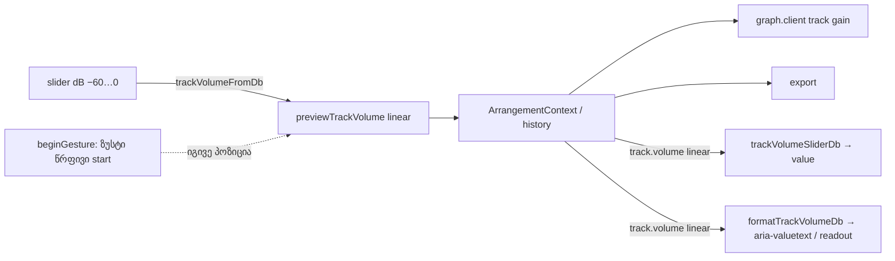

# Studio — ხაზის Volume dB-ში, ქვედა ბოლოში −∞

**თარიღი:** 2026-10-23
**სტატუსი:** Round 117 — C PASS (`c-round-117.json`), გამოქვეყნდა `9cb820b`.
**შეცვლილი პროექტი:** Store

## კონტექსტი

T12-GAIN-VOLUME-ის მესამე ეტაპის პირველი ნაწილი (T12.3, T12.5). ხაზის Volume fader-ი (აუდიო და ვიდეო ხაზი) აქამდე წრფივ სკალაზე მუშაობდა (`0…1`, ნაბიჯი `0.01`) და readout `NN%`-ს აჩვენებდა. Master და Clip Gain უკვე dB-ში იყო, ამიტომ ერთ ეკრანზე ორი სხვადასხვა ერთეული ჩანდა. მომხმარებლის მოთხოვნაა, რომ ხაზის Volume-იც dB-ში იყოს და ბოლოში −∞ ჰქონდეს, როგორც მიქშერზე.

Live 12-ის manual-ში (§18.1 „The Live Mixer“) დადასტურებულია, რომ Volume ხაზის გამოსავალ დონეს არეგულირებს. Live-ის დიაპაზონი (−∞…+6 dB) შენახულ წყაროებში **დაუდასტურებელია**, ამიტომ ზედა ზღვარი 0 dB დარჩა, boost კი ცალკე სიგნალად ჩაიწერა (TRACK-VOLUME-BOOST).

Group fader-ი და Shift fine drag მომდევნო ეტაპშია (3b). ამ რაუნდში group fader-ი ისევ `%`-ს აჩვენებს, ხოლო Shift drag ხაზის fader-ზე ჩვეულებრივი drag-ის ტოლია.

## მიდგომა

**dB მხოლოდ UI-ის კონტრაქტია (R1).** `ArrangementTrack.volume` ისევ წრფივი მამრავლია. `model.ts`, `groups.ts`, `schedule.ts`, `graph.client.ts`, ექსპორტი და context-ის API (`previewTrackVolume(trackId, linear)` და დანარჩენი) არ შეცვლილა. ამიტომ engine ხაზს ზუსტ `0`-ზე ისევ აჩუმებს, context-ის ყველა ტესტს კი თავისი მნიშვნელობა რჩება. ალტერნატივა იყო `trackVolumeDb` ველის შენახვა მოდელში. ეს მოდელს, ექსპორტს და group-ის ლოგიკას შეცვლიდა მომხმარებლისთვის ხილული სარგებლის გარეშე.

**წმინდა მოდული.** გარდაქმნა ცალკე მოდულშია, `app/lib/arrangement/track-volume-db.ts`:
- `trackVolumeFromDb` — slider-ის dB → შენახული წრფივი მნიშვნელობა. `−60` ან ნაკლები, ან არა-რიცხვი → ზუსტად `0` (−∞). დანარჩენ შემთხვევაში `10^(min(dB, 0)/20)`, დამრგვალების გარეშე.
- `trackVolumeSliderDb` — შენახული მნიშვნელობა → slider-ის პოზიცია. `0` ან ნაკლები → `−60`. დანარჩენ შემთხვევაში `20·log10`, დამრგვალებული 0.1-მდე და შეზღუდული `−59.9…0`-ით.
- `trackVolumeReadoutDb` — readout-ის dB **შეზღუდვის გარეშე**. ამიტომ `1e-4` აჩვენებს `−80.0`-ს და არა `−59.9`-ს.
- `formatTrackVolumeDb` / `formatTrackVolumeReadout` — სრული ტექსტი (`−4.4 dB`, `−∞ dB`, `+0.0 dB`) და ხილული ტექსტი ` dB`-ის გარეშე.
- კონსტანტები: `TRACK_VOLUME_DB_MIN` (−60 = −∞), `TRACK_VOLUME_DB_MAX` (0), `TRACK_VOLUME_DB_STEP` (0.1), `TRACK_VOLUME_DB_FLOOR` (−59.9), `TRACK_VOLUME_DB_DEFAULT` (0).

**Fader (R2–R8).** `ArrangementLane.tsx`-ში slider `min −60`, `max 0`, `step 0.1`-ით მუშაობს. `value` = R3-ის პოზიცია, `aria-valuetext` = სრული ტექსტი. readout ` dB`-ის გარეშე ტექსტს აჩვენებს, მისი `title` კი სრულ ტექსტს. readout-ის სიგანე `w-9`-დან `w-10`-მდე გაიზარდა (`whitespace-nowrap`, `shrink-0`). header-ის სიგანე (`ARRANGEMENT_HEADER_WIDTH_PX`) არ შეცვლილა.

**Gesture და ზუსტი Undo (R4).** `useRelativeFaderDrag` იგივეა, მხოლოდ dB სკალით. drag-ის დაწყებისას (`beginGesture`) ხაზი იმახსოვრებს ზუსტ წრფივ მნიშვნელობას და მის პოზიციას. როცა drag იმავე პოზიციაზე ბრუნდება, context-ს გადაეცემა დამახსოვრებული წრფივი მნიშვნელობა და არა `10^(pos/20)`. ამიტომ `0.6` ზუსტად `0.6` რჩება და history ჩანაწერს არ ქმნის. თუ დაჭერისას მაუსი არ გადაადგილდა, preview საერთოდ არ ხდება.

## არქიტექტურა

## შეცვლილი ფაილები

- `app/lib/arrangement/track-volume-db.ts` (ახალი) — dB ↔ წრფივი გარდაქმნა, ტექსტი და კონსტანტები.
- `app/components/arrangement/ArrangementLane.tsx` — ხაზის Volume fader dB-ში, readout, `aria-valuetext`, ზუსტი start-ის დაბრუნება.
- `app/lib/arrangement/__tests__/track-volume-db.test.tsx` (ახალი) — TV1–TV11.
- 9 არსებული ტესტი (`fader-click`, `fader-guards`, `fader-touch`, `fader-focus-order`, `gesture-guard`, `context-hygiene`, `track-group-collapse-ui`, `clip-gain-fader`, `clip-gain-multi`) — მხოლოდ ხაზის slider-ის სკალაზე დამოკიდებული ხაზები (granted scale edits).
- `docs/implementation/2026/quarter-IV/099-studio-multi-clip-gain.md` — სტატუსის ხაზი (R9).

## პრობლემები და გადაწყვეტები

- **პრობლემა:** უკან დაბრუნებული drag `10^(−4.4/20) ≈ 0.6026`-ს ჩაწერდა და არა `0.6`-ს, ამიტომ history ჩანაწერს შექმნიდა. **გადაწყვეტა:** gesture-ის დაწყებისას ზუსტი წრფივი start ინახება და იმავე პოზიციაზე სწორედ ის ბრუნდება.
- **პრობლემა:** `formatMasterGainDb(0)` აბრუნებს `0.0 dB`-ს, მიღების კრიტერიუმები კი `+0.0 dB`-ს ითხოვს. **გადაწყვეტა:** `formatTrackVolumeDb` 0 dB-ზე `+0.0 dB`-ს აბრუნებს, დანარჩენზე `formatMasterGainDb`-ს იყენებს. შედეგად 0 dB-ზე ხაზი და Master განსხვავებულად წერენ. ეს B-ს გადასაწყვეტად არის ჩაწერილი.
- **პრობლემა:** ძველი ტესტების წრფივი მნიშვნელობები (`'0.4'` და სხვ.) ახალ დიაპაზონში `0 dB`-მდე იჭრება, ზოგიერთი ტესტი კი შემთხვევით მწვანე რჩებოდა. **გადაწყვეტა:** ყველა ასეთი მნიშვნელობა dB-ში გადავიდა (`0.4 → −8`, `0.3 → −10.5`), ახალი მოლოდინები კი `toBe(trackVolumeFromDb(…))`-ით იწერება.
- **პრობლემა:** `track-group-mix-ui.test.tsx`-ის სამი ტესტი (UM3, UM5, UM9) ხაზის slider-ს წრფივი მნიშვნელობებით მართავს. ეს ფაილი ნებადართულ სიაში არ არის. **გადაწყვეტა:** round 116-ში ფაილი არ შეცვლილა და საკითხი B-ს გადაეცა (`a-round-116.md`, STOP ბლოკი). **მოგვარდა** round 117-ში (C-R116-01): UM3/UM5/UM9-ის ხაზის slider-ის ხაზები dB-ზე გადავიდა.

## ტესტირება

- `track-volume-db.test.tsx` — 11 ტესტი: წმინდა გარდაქმნა (TV1, TV2), ჩვენება (TV3), drag და ზუსტი Undo/Redo (TV4), −∞ (TV5), ზედა ზღვარი (TV6), კლავიატურა (TV7), reset (TV8), ვიდეო ხაზი (TV9), playback-ის დროს graph-ის gain ახალი schedule-ის გარეშე (TV10), must-not (TV11).
- Mutation proof m1–m6: თითოეული mutation შესაბამის ტესტს წითლად აქცევს.
- `npm run typecheck`, `npm run lint` და Biome შეცვლილ ფაილებზე — სუფთაა.
- Playwright sanity probe (`/studio-lab`, 1440×900 და 1280×720) — readout არ იჭრება, slider 103 px (ჯგუფში 91 px), header 224 px.
- რეალური drag, ხმა და ექსპორტი C-ის შესამოწმებელია (jsdom-ს არც layout აქვს, არც native thumb).
- Round 117 (D-29z82): `track-group-mix-ui.test.tsx` UM3/UM5/UM9 — ხაზის slider-ის სკალაზე დამოკიდებული ხაზები dB-ზე გადავიდა (C-R116-01).

## TODO / შემდეგი ნაბიჯები

- 3b შესრულდა: ჯგუფის fader dB-ში და Shift fine — იხ. doc 101.
- `+0.0 dB` vs Master-ის `0.0 dB` — გადადებული Low LANE-MASTER-ZERO-SIGN.
- სიგნალები: TRACK-VOLUME-BOOST (+6 dB), ციფრული Volume ველი, რამდენიმე ხაზის ერთად შეცვლა (MIXER-MULTI-TRACK).
