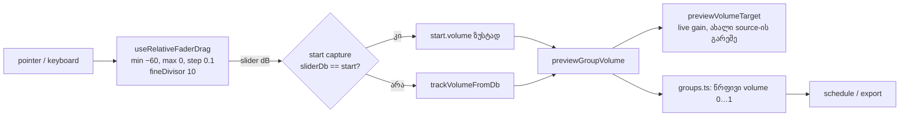

# Studio — ჯგუფის Volume dB-ში და Shift-ით ზუსტი drag Volume fader-ებზე

**თარიღი:** 2026-10-23
**სტატუსი:** Round 118 (ბრაუზერი, `c-round-118.json`) + Round 119 (CF11-ის გასწორება, D-29z84) — C-ის შედეგი `c-round-119.json`-შია; გამოქვეყნება root-ის gate-ით.
**შეცვლილი პროექტი:** Store

## კონტექსტი

T12-GAIN-VOLUME-ის მესამე ეტაპის მეორე ნაწილი. 3a-ში ხაზის Volume dB-ზე გადავიდა (doc 100), მაგრამ ჯგუფის Volume fader-ი ისევ წრფივ სკალაზე რჩებოდა (`0…1`, ნაბიჯი `0.01`), title-სა და `aria-valuetext`-ში კი `%`-ს აჩვენებდა. ერთ header-ში ორი სხვადასხვა ერთეული ჩანდა.

მეორე საკითხი Shift-ია. Live 12-ის manual-ის §42.6 („Finer Resolution When Dragging: Shift“) ადასტურებს, რომ Shift drag-ს უფრო ზუსტს ხდის. CZABA-ში ეს მხოლოდ Clip Gain fader-ზე მუშაობდა (T12 ეტაპი 1). ხაზის, ვიდეო ხაზის, ჯგუფისა და Master-ის Volume-ზე Shift drag ჩვეულებრივ drag-ს არ განსხვავდებოდა.

## მიდგომა

- **ჯგუფის fader-ი იმავე dB სკალაზე გადავიდა, რაზეც ხაზისაა:** `−60…0`, ნაბიჯი `0.1`. Slider-ის მინიმუმი ზუსტად `0`-ს ინახავს (`−∞ dB`). შენახული მნიშვნელობა ისევ წრფივია, ამიტომ context, model, groups, schedule, graph და export არ შეცვლილა.
- **ტექსტი:** `aria-valuetext` და title იყენებს `formatTrackVolumeDb`-ს (მაგ. `Volume −15.0 dB`). ჯგუფის რიგს ხილული readout არ დაემატა. SRW-17-ის კონტრაქტით რიგი ტექსტს არ ამატებს და 28 px-ია; readout სახელის ადგილს შეამცირებდა. ხილული readout layout-ის ცვლილებაა და DESIGN-UX-REVIEW-სთვის სიგნალად ჩაიწერა (GROUP-VOLUME-VISIBLE-READOUT).
- **ზუსტი დაბრუნება:** ჯგუფის header-ში გადავიტანეთ ხაზის pattern-ი (`volumeGestureStartRef`). Gesture-ის დაწყებისას ინახება ზუსტი წრფივი მნიშვნელობა და მისი slider-ის dB. თუ drag საწყის პოზიციაზე დაბრუნდა, context-ს ზუსტად ეს წრფივი მნიშვნელობა გადაეცემა. ასე უძრავი დაჭერა ან უკან დაბრუნება grid-ის გარეთ მყოფ მნიშვნელობას (მაგ. context-ით დაყენებულ `0.72`-ს) არ ცვლის და history ჩანაწერს არ ქმნის. Hook-ში stored ↔ slider mapping-ის გადატანა არქიტექტურულ checkpoint-ს ელოდება (addendum ac), ამიტომ ამ რაუნდში pattern-ი დაკოპირდა.
- **Shift fine:** `fader.ts`-ში დაემატა საერთო მუდმივა `FADER_SHIFT_FINE_DIVISOR = 10`. ის გადაეცემა არსებულ `useRelativeFaderDrag` hook-ს ხაზის (ვიდეო ხაზის ჩათვლით), ჯგუფისა და Master-ის Volume fader-ზე. Hook-ი Shift-ის შუა drag-ში დაჭერას ან აშვებას უკვე მიმდინარე მნიშვნელობიდან ხელახლა ითვლის, ამიტომ ნახტომი არ ხდება.
- **Pan უცვლელია:** ±50 მთელი ნაბიჯის გამო ×10 ცალკე დიზაინის საკითხია (სიგნალი PAN-SHIFT-FINE). Ableton-ის §42.6 ზოგადად ყველა control-ზე მოქმედებს, ამიტომ ეს **შეგნებული განსხვავებაა**.
- **ალტერნატივა:** ჯგუფის fader-ი წრფივი დარჩენილიყო და მხოლოდ ტექსტი ყოფილიყო dB. უარვყავით, რადგან drag-ის შეგრძნება ხაზისგან განსხვავდებოდა და ერთი header-ში ორი სკალა იქნებოდა.

## არქიტექტურა

## შეცვლილი ფაილები

- `app/lib/arrangement/fader.ts` — საერთო მუდმივა `FADER_SHIFT_FINE_DIVISOR`.
- `app/components/arrangement/ArrangementGroupHeader.tsx` — ჯგუფის fader-ი dB-ში, dB ტექსტები, ზუსტი დაბრუნება, Shift fine; ძველი `%` მუდმივები წაიშალა.
- `app/components/arrangement/ArrangementLane.tsx` — მხოლოდ Shift fine Volume fader-ზე (ერთი option და import).
- `app/components/arrangement/ArrangementMaster.tsx` — მხოლოდ Shift fine Master fader-ზე (ერთი option და import).
- `app/lib/arrangement/__tests__/group-volume-db.test.tsx` — ახალი ტესტები GV1–GV9.
- `app/lib/arrangement/__tests__/track-group-mix-ui.test.tsx`, `track-volume-db.test.tsx` (TV11), `clip-gain-fader.test.tsx` (CF11) — ჯგუფის fader-ის სკალისა და Shift-ის მოლოდინები B-ის ცხრილით.
- `docs/implementation/2026/quarter-IV/100-studio-track-volume-db.md` — სტატუსი და ორი დახურული საკითხი (GATE117-S1).

## პრობლემები და გადაწყვეტები

- **პრობლემა:** TV11-ში ჩანდა, რომ ხაზის drag კონტექსტით ჩაწერილ `0.72`-ს (−2.9 dB) კი არა, fixture-ის `0.6`-ს (−4.4 dB) ეყრდნობოდა. **გადაწყვეტა:** დროებითმა log-მა აჩვენა, რომ Master drag-ის შემდეგ სამივე მნიშვნელობა `0.72 / −2.9 / −2.9` იყო, ხოლო ტესტის helper-ი `undoChainLabels` ორივე ჩანაწერს აუქმებს და `0.6`-ს აბრუნებს. ბაგი არ არის. Shift-ის მოლოდინი გახდა `F(−4.4 − 1.2) = F(−5.6)`. Log წაიშალა და ფაილის sha დადასტურდა.
- **პრობლემა:** CF11-ში B-ის ფორმულა Master-ის Shift drag-ზე `−1.2`-ს ელის (−24 × 66 / 1320), მიღებული მნიშვნელობა კი `−1`-ია. Master-ის ნაბიჯი `0.5 dB`-ია და `relativeFaderValue` `−1.2`-ს `−1.0`-ზე ამრგვალებს. **გადაწყვეტა:** B-მ დაადასტურა `toBe(-1)` (D-29z84). Master-ის Shift ნაბიჯს ამრგვალებს `MASTER_GAIN_STEP_DB = 0.5`-მდე; B-ის round-118 ფორმულამ ნაბიჯი გამოტოვა. m5 (`fineDivisor`-ის გარეშე) CF11-ს `-12`-ს აძლევს.
- **პრობლემა:** ჯგუფის header-ში დაკოპირებული `volumeGestureStartRef` gesture-ის შემდეგ არ სუფთავდება, ისევე როგორც ხაზის ასლი (gate-117 S3). **გადაწყვეტა:** ქცევაზე გავლენა არ აქვს, რადგან ყოველი gesture ახლიდან წერს მნიშვნელობას. საკითხი გადადებულ Low-ში რჩება.

## ტესტირება

- `group-volume-db.test.tsx` — 9 ტესტი:
  - GV1: დიაპაზონი და ტექსტები;
  - GV2: drag, Undo და Redo;
  - GV3: `−∞` და ჩუმი წევრები;
  - GV4: ზუსტი დაბრუნება `0.72`-ზე;
  - GV5: კლავიატურა და double-click;
  - GV6: Shift fine და შუა drag-ში Shift-ის დაჭერა;
  - GV7: ვიდეო ხაზი;
  - GV8: playback-ის დროს ახალი source არ იქმნება;
  - GV9: Pan Shift-ს არ იყენებს, Clip Gain ისევ /10-ია.
- Mutation-ები: m1 (ჯგუფს `fineDivisor` არ აქვს) → GV6 წითელი; m2 (start capture არ არის) → GV4 წითელი; m3 (`onChange` dB-ს გარდაქმნის გარეშე) → GV5 წითელი; m4 (ხაზს `fineDivisor` არ აქვს) → GV7 და TV11 წითელი; m5 (Master-ს `fineDivisor` არ აქვს) → CF11 `-1`-ის ნაცვლად `-12`-ს იღებს.
- C-მ ბრაუზერში შეამოწმა (`c-round-118.md`): drag, Shift, ექსპორტის თანაფარდობა 0.501187, −∞ — 0 sample.

## TODO / შემდეგი ნაბიჯები

- სიგნალები: GROUP-VOLUME-VISIBLE-READOUT, PAN-SHIFT-FINE, TRACK-VOLUME-BOOST, TRACK-VOLUME-TAPER.
- Nit GATE118-NIT-FINE-CONST: `ArrangementDetailPanel`-ის ლოკალური `DETAIL_CLIP_GAIN_FINE_DIVISOR` საერთო მუდმივაზე გადაიყვანოს შემდეგმა owner-მა.
