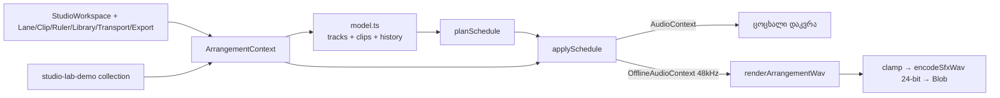
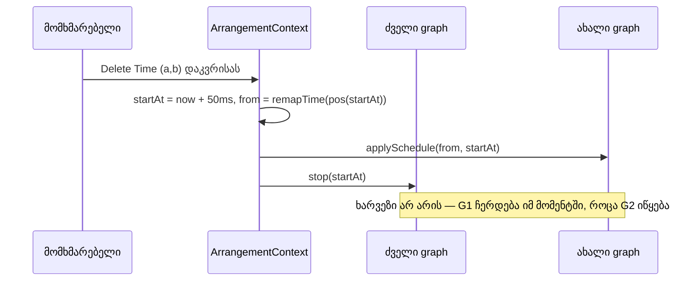

# Studio Lab — საერთო arrangement ძრავა და `/studio-lab`

**თარიღი:** 2026-10-07
**სტატუსი:** In Progress (SRW-01, Round 1 — C-ის დამოუკიდებელი შემოწმება ჯერ არ ჩატარებულა)
**შეცვლილი პროექტი:** Store

## კონტექსტი

რეალურ Studio-ს (`StudioContext`) კლიპის მოდელი არ აქვს: stem = ერთი მთლიანი ფაილი timeline-ის 0-ზე. split, move, Delete Time და კლიპზე დაფუძნებული ექსპორტი ვერ აისახება. პროტოტიპში (`output/studio-workspace-prototype/`) კლიპის მოდელი სწორია, თუმცა 60 წამზეა მიბმული, აუდიო სინთეზურია და ექსპორტი არ აქვს. გეგმის D-01/D-02 გადაწყვეტილებით იქმნება **ერთი** ახალი ძრავა, რომელიც ცოცხალ დაკვრასაც და ექსპორტსაც ერთი და იგივე graph-ით ემსახურება. ის ანონიმურად `/studio-lab`-ზე იხსნება დემო კოლექციით.

### სცენარი

ნინო, ფილმის მემონტაჟე, ხსნის `/studio-lab`-ს ავტორიზაციის გარეშე. ბიბლიოთეკიდან SFX ხაზზე ამატებს „Soft impact“-ს, მუსიკის ხაზზე კი „Middle East“-ს 5 წამიდან. მუსიკის მარჯვენა კიდეს 15 წამამდე ამოკლებს, ირჩევს მონაკვეთს 6–8 წმ და დაკვრისას Delete-ს აჭერს. დრო ყველა ხაზიდან იშლება, დაკვრა არ ჩერდება, playhead 2 წამით უკან გადადის. ბოლოს Export-ით იღებს 24-bit WAV-ს, რომელიც ზუსტად იმას შეიცავს, რაც მოისმინა.

## მიდგომა

- **სუფთა მოდელი** (`lib/arrangement/model.ts`): დრო წამებშია, `start` timeline-ია, `sourceOffset` წყაროს პოზიციაა. ერთ ტრეკზე კლიპები ერთმანეთს არ ფარავს. ვიდეოხაზი მხოლოდ ერთია. ისტორია ინახავს `{tracks, clips}`-ის snapshot-ებს. უშედეგო commit იგნორირდება. ერთი drag = ერთი ჩანაწერი: commit-ს გადაეცემა drag-ის დაწყებისას აღებული `before`.
- **Scheduler** (`schedule.ts`): `planSchedule` სუფთა ფუნქციაა. muted ტრეკების კლიპებიც იგეგმება, რომ unmute დაკვრისას მაშინვე ისმოდეს.
- **ერთი graph** (`graph.client.ts`): `applySchedule` იღებს ვიწრო სტრუქტურულ context ტიპს. მას იყენებს ცოცხალი `AudioContext`-იც და ექსპორტის `OfflineAudioContext`-იც (48 kHz, stereo). ექსპორტი 24-bit WAV-ს `encodeSfxWav`-ით ქმნის. მანამდე სიგნალი იჭრება `[-1, 8388607/8388608]` შუალედში, რადგან encoder `+1.0`-ს `-1.0`-ად გადააქცევდა.
- **Context** (`ArrangementContext.tsx`): დაკვრისას რედაქტირება ძველ graph-ს აჩერებს ზუსტად იმ `startAt`-ზე, საიდანაც ახალი იწყება. ამიტომ სიჩუმის ხარვეზი არ ჩნდება და `setTimeout` restart არ გამოიყენება. Delete Time ცოცხალ პოზიციას `remapTime`-ით გადაითვლის. Mute/Solo/Volume მხოლოდ `setTargetAtTime`-ით იცვლება. Web Audio side effect-ები setState updater-ში არ სრულდება.
- **დეკოდირება:** დემო წყაროები mount-ზე იტვირთება ცალკე `OfflineAudioContext`-ით (48 kHz). ცოცხალი `AudioContext` მხოლოდ პირველ Play-ზე იქმნება.
- **ალტერნატივა:** lookahead-window scheduler (`until`-ით) უარვყავით, რადგან ის Loop-ისთვის (SRW-05) არის საჭირო. Round 1-ისთვის ყველა დარჩენილი კლიპის ერთბაშად დაგეგმვა უფრო მარტივია.

## არქიტექტურა

## შეცვლილი ფაილები

ყველა ფაილი ახალია:

- `app/types/arrangement.ts` — ტიპები (Track, Clip, Arrangement, TimeRange, WorkspaceSource/Collection, ScheduledClip)
- `app/lib/arrangement/model.ts` — მოდელის ოპერაციები და ისტორია
- `app/lib/arrangement/schedule.ts` — `isTrackAudible`, `planSchedule`
- `app/lib/arrangement/graph.client.ts` — `applySchedule`, `renderArrangementWav`
- `app/lib/arrangement/peaks.ts` — waveform peaks
- `app/lib/arrangement/demo-synth.ts` — „Soft impact“ და „Slow rise“ (48 kHz, დეტერმინისტული)
- `app/lib/arrangement/__tests__/*.test.ts` — 53 ტესტი
- `app/contexts/ArrangementContext.tsx` — state, დაკვრა, რედაქტირება, ექსპორტი
- `app/components/arrangement/*` — სამუშაო სივრცის UI და barrel
- `app/data/studio-lab-demo.ts` — დემო კოლექცია (`/middle-east.mp3`, `/videos/hero/hero-music.mp3`, ორი სინთეზური ხმა)
- `app/routes/studio-lab.tsx` — ანონიმური route (`robots: noindex`)

## პრობლემები და გადაწყვეტები

- **პრობლემა:** ხაზის არჩევა, წყაროს არჩევა და „＋ დამატება“ ერთ სინქრონულ თანმიმდევრობაში წინა წყაროს წინა ხაზზე ამატებდა. handler-ები render-ზე სინქრონიზებულ ref-ს კითხულობდნენ. **გადაწყვეტა:** state-ის wrapper setter-ები ref-ს სინქრონულად წერენ, render ref-ს აღარ გადაწერს.
- **პრობლემა:** `encodeSfxWav` სიგნალს არ ჭრის და `+1.0` `-1.0`-ად იქცევა. **გადაწყვეტა:** ექსპორტამდე clamp 24-bit-ის მაქსიმუმამდე.
- **პრობლემა:** synthetic pointer event-ზე `setPointerCapture` exception-ს აგდებს. **გადაწყვეტა:** capture-ის მცდელობა ხდება gesture-ის დაწყების შემდეგ, შეცდომა იგნორირდება და gesture გრძელდება.
- **პრობლემა (code-reviewer):** range slider-ზე ფოკუსისას shortcut-ები ითიშებოდა. ქართულ layout-ზე Ctrl+Z `event.key`-ით შეიძლება არ ამოიცნოს. Space ფოკუსირებულ ღილაკზე ორჯერ მოქმედებდა. **გადაწყვეტა:** typing target მხოლოდ ტექსტური input-ია; Ctrl კომბინაციები `event.code`-ით მოწმდება; Space-ის keyup-ზეც `preventDefault` სრულდება.
- **პრობლემა:** volume slider-ის preview, რომელსაც commit არ მოჰყოლია (pointerup/keyup/blur არ მოხდა), შემდეგი edit-ის undo ჩანაწერს ერწყმოდა. **გადაწყვეტა:** `applyEdit`, `undo` და `redo` ჯერ დაუსრულებელ volume ცვლილებას ცალკე „Volume“ ჩანაწერად აფიქსირებს.
- **პრობლემა:** root-ის cookie banner ქვედა ზოლს ფარავს. **გადაწყვეტა:** „＋ დამატება“ ბიბლიოთეკის ზედა ნაწილში გადავიდა. root-ს არ შევხებივართ.

## ტესტირება

- `npx vitest run app/lib/arrangement` → 4 ფაილი, 53 ტესტი წარმატებით. სრული `npx vitest run` → 36 ფაილი, 517 ტესტი.
- `npx tsc --noEmit` → 0 შეცდომა. `npm run build` → წარმატებული. Biome A-ს path-ებზე შეცდომისა და warning-ის გარეშეა.
- gstack browse `/studio-lab`-ზე: დამატება, Undo/Redo, header move, edge trim, range, split, Delete, Delete Time დაკვრისას (პოზიცია −2 წმ, დაკვრა გრძელდება), 75 წმ პროექტი, Space ×10 source-ების მთვლელით, 1440×900 და 1280×720 ეკრანის სურათები.
- ექსპორტი ბრაუზერში decode-ით: RIFF/WAVE, 24-bit, 48 kHz, stereo, ხანგრძლივობა = projectEnd. სიჩუმის ხარვეზი ზუსტად 0-ია. „Soft impact“ start=3.0 და sourceOffset=0.25 მდგომარეობაში დამოუკიდებელი ფორმულით შემოწმდა: max |diff| = 5.96e-8 (< 2⁻²²). SFX-ის mute ექსპორტში იმპაქტის ფანჯარას აჩუმებს.

## TODO / შემდეგი ნაბიჯები

- C-ის დამოუკიდებელი შემოწმება (R1-*).
- ცნობილი შეზღუდვები: Delete Time-ის Undo დაკვრისას პოზიციას უკან არ ითვლის. რედაქტირება drag-ის შუაში gesture-ს არ აუქმებს. კლიპები კლავიატურით არ ირჩევა. `activeSourceCount` მომავალში დაგეგმილ source-ებსაც ითვლის.
- ვიდეო (SRW-02/03), Loop (SRW-05), multi-select (SRW-06), MP3/range ექსპორტი (SRW-20).
