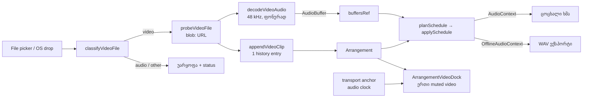

# Studio Lab — ვიდეოს import, საერთო transport და playhead

**თარიღი:** 2026-10-07
**სტატუსი:** In Progress (Round 2: C-R1-01..04, SRW-02, SRW-03, SRW-04. C-ის დამოუკიდებელი შემოწმება ჯერ არ ჩატარებულა)
**შეცვლილი პროექტი:** Store

## კონტექსტი

Round 1-ის შემდეგ `/studio-lab`-ში ვიდეოს დამატება შეუძლებელი იყო. FB-15 („ვიდეო ვერ შევაგდე“) პროტოტიპში ასე გამეორდა: file picker მუშაობს, მაგრამ ვიდეოხაზზე OS ფაილის ჩაგდება უარყოფილია. ხაზის `ondrop` მხოლოდ ბიბლიოთეკის `text/plain`-ს კითხულობს, ვიდეოხაზი `dropEffect="none"`-ს აყენებს, ძველი Studio-ს MIME allowlist კი ცარიელ `file.type`-ს უარყოფს. FB-16 ითხოვს ერთ საერთო Play/Playhead-ს ვიდეოსა და აუდიოსთვის და ვიდეოს ორიგინალი ხმის ცალკე Mute-ს. C-მ round 1-ში ოთხი Low ბაგი იპოვა: lookahead-ის დროს playhead უკან იწევდა, გვერდი 90 px-ით scroll-დებოდა, Delete Time-ის Undo დაკვრისას (D-12) და status-ის მოჭრა.

### სცენარი

ნინო `/studio-lab`-ზე ვიდეოხაზის „＋ საკუთარი ვიდეო“-თი ირჩევს `scene.webm`-ს, Explorer-იდან კი `cutaway.mov`-ს პირდაპირ ვიდეოხაზზე აგდებს. კლიპები თანმიმდევრულად ჩალაგდება, თითოეული ცალკე Undo-ა. Play-ზე კადრი და მუსიკა ერთად მიდის. ვიდეოხაზის M ვიდეოს ორიგინალ ხმას თიშავს, კადრი კი არ ჩერდება. ექსპორტში ვიდეოს ხმა ზუსტად ისე შედის, როგორც მოისმინა.

## მიდგომა

- **Transport საათი** (`transport.ts`): ანკერი არის `{startAt, position, holdUntil}`, პოზიცია კი `position + (max(t, holdUntil) − startAt)`. ახალი დაწყებისას `holdUntil = startAt`, ამიტომ lookahead-ის დროს პოზიცია `from`-ზე ჩერდება. დაკვრისას რედაქტირება წინა ანკერის `holdUntil`-ს ინარჩუნებს, ამიტომ პოზიცია handoff-მდეც და მის შემდეგაც იდენტურია. Delete Time-ის remap ერთხელ ხტება.
- **ვიდეოს import:** კლასიფიკაცია MIME-ით, ცარიელი MIME-ის შემთხვევაში გაფართოებით. საბოლოო გადაწყვეტილებას იღებს detached `<video preload="metadata">` probe 10 წამიანი timeout-ით. აუდიოფაილი უარყოფილია (D-05). კლიპი ვიდეოხაზის ბოლოს ემატება, თითო ფაილი ერთი history ჩანაწერია. მრავალი ფაილი რიგით მუშავდება ერთ promise queue-ში. ფაილი ბრაუზერს არ ტოვებს: გამოიყენება მხოლოდ `blob:` URL, რომელიც მხოლოდ unmount-ზე იშლება, რადგან Undo წაშლილ კლიპს აბრუნებს.
- **ვიდეოს ხმა (D-13):** probe-ის შემდეგ ფონურად `decodeAudioData` 48 kHz-იან decode context-ზე. buffer `buffersRef`-ში ინახება ვიდეოს `sourceId`-ით. ვიდეოხაზი ჩვეულებრივი mix lane ხდება: იგეგმება, აქვს trackGain/panner და M/S/Volume. Solo ვიდეოხაზზეც მოქმედებს. დაკვრისას მოსული buffer იძულებით continuous reschedule-ს იწვევს. 20 წუთზე გრძელი ვიდეოს ხმა არ იშიფრება (D-14). „ხმა არ აქვს“ და „ვერ წაიკითხა“ ერთმანეთისგან ფაილის byte-ებში audio track-ის მარკერით (`soun`, `A_OPUS` …) განირჩევა, რადგან Chrome ორივე შემთხვევაში ერთსა და იმავე `EncodingError`-ს აბრუნებს.
- **ვიდეოს sync:** მთელ გვერდზე ერთი `<video>`-ია, ყოველთვის `muted`. Master საათი აუდიოა. გაჩერებულ მდგომარეობაში ყოველი ცვლილება `seekSfxVideo`-თი იძებნება abort-ით. დაკვრისას ვიდეო ნატიურად უკრავს, ხოლო drift > 80 ms იწვევს hard seek-ს, მაქსიმუმ 250 ms-ში ერთხელ. გაზომვამ აჩვენა, რომ `play()`-ის გაშვებას ~45 ms სჭირდება. ამიტომ:
  - Play-ზე `play()` მაშინვე იძახება და 50 ms-იანი lookahead ამ დაყოვნებას ფარავს;
  - სიცარიელეში მომდევნო კლიპი 0.5 წამით ადრე იტვირთება და იძებნება, თუმცა paused და დამალული რჩება;
  - მიმდებარე სხვა წყაროს კლიპზე `play()` 50 ms-ით ადრე იწყება.
- **Playhead (D-15):** ruler-ში `role="slider"` handle, pointer capture-ით. დაკვრისას drag აუდიოს `shouldRescheduleScrub`-ით მაქსიმუმ 100 ms-ში ერთხელ გადაგეგმავს, ხელის აშვებისას კი კიდევ ერთხელ. drag-ის დროს `tick` პოზიციას აღარ გადაწერს. Home და ↤ 0-ზე აბრუნებს. Home text input-ში იგნორირდება.
- **Layout:** root `
`-ს ემატება `studio-container` კლასი და root CSS-ის არსებული `:has()` წესი `padding-bottom`-ს აუქმებს. status ცალკე, გადატანად რიგზეა. ვიდეოს dock ბიბლიოთეკის ქვემოთაა. ბიბლიოთეკის სია მცირე სიმაღლეზე თავად scroll-დება.
- **უარყოფილი ალტერნატივები:** `playbackRate`-ით „რბილი“ sync დავალების კონტრაქტს („სხვა შემთხვევაში არაფერი“) ეწინააღმდეგება. `<video>`-ის unmute live-სა და export-ს შორის სხვაობას გააჩენდა.

## არქიტექტურა

## შეცვლილი ფაილები

- `app/types/arrangement.ts`: `WorkspaceVideoSource`.
- `app/lib/arrangement/transport.ts`: ახალი. ანკერი, `positionAt`, continuous reschedule, scrub throttle.
- `app/lib/arrangement/video.ts`: ახალი. კლასიფიკაცია, შეტყობინებები, `findVideoClipAt`, `nextVideoStart`, `resolveVideoTarget` (preload/preroll), `videoDriftAction`.
- `app/lib/arrangement/video.client.ts`: ახალი. probe, ხმის decode და audio-track მარკერის შემოწმება.
- `app/lib/arrangement/model.ts`: `appendVideoClip`.
- `app/lib/arrangement/schedule.ts`, `graph.client.ts`: ვიდეოხაზი იგეგმება, trackGain ყველა ტრეკისთვის იქმნება.
- `app/contexts/ArrangementContext.tsx`: ანკერზე დაფუძნებული transport, scrub, import queue, ვიდეოს წყაროების registry და `pausePlaybackWithStatus`.
- `app/components/arrangement/ArrangementVideoDock.tsx`: ახალი.
- `ArrangementLane.tsx`, `ArrangementClip.tsx`, `ArrangementRuler.tsx`, `ArrangementExportDialog.tsx`, `StudioWorkspace.tsx`, `index.ts`.
- ტესტები: `video.test.ts`, `transport.test.ts` (ახალი); `schedule.test.ts`, `graph.test.ts`, `model.test.ts` (განახლებული).

## პრობლემები და გადაწყვეტები

- **ვიდეო ~50 ms-ით ჩამორჩებოდა.** პირველ ვერსიაში `play()` მხოლოდ მას შემდეგ იძახებოდა, რაც პოზიცია წინ წავიდოდა. `play()`-ის საკუთარი დაყოვნება ამას ემატებოდა, ამიტომ median drift 48 ms იყო. → `play()` ახლა Play-ზევე იძახება, მომდევნო კლიპი კი სიცარიელეში წინასწარ იტვირთება. median drift 6–24 ms-მდე შემცირდა. max headless გარემოში არასტაბილურია (0.06–0.22 წმ, decoder-ის შეფერხება) — იხ. A-ს ანგარიში.
- **სიცარიელეში ვიდეო paused უნდა იყოს.** ამიტომ preload არ უკრავს, მხოლოდ src-ს ცვლის და seek-ს აკეთებს. 50 ms-იანი preroll მხოლოდ მიმდებარე კლიპებზე მუშაობს.
- **ბიბლიოთეკა + dock 1280×720-ზე არ ეტეოდა.** `ArrangementLibrary` ამ რაუნდში არ იცვლება, ამიტომ wrapper-ში `[&>aside]:min-h-0 [&>aside]:flex-1` გამოიყენება: სია scroll-დება, dock კი ყოველთვის ჩანს.
- **`decodeAudioData` ArrayBuffer-ს detach-ს უკეთებს.** ამიტომ მარკერის შესამოწმებლად ფაილი მხოლოდ decode-ის ჩავარდნის შემდეგ ხელახლა იკითხება.
- **Seek დაკვრისას ~0.1 წმ-ით ჩამორჩებოდა** (Delete Time-ით შექმნილი ნახტომი). → seek, როცა ვიდეო უკვე უკრავს, წინ მიზნობს ნასწავლი lead-ით (ნახევარი ნაბიჯი, 0–0.2 წმ); preload-ს აქვს ცალკე start lead. seek-ის წესი (> 80 ms, 250 ms-ში ერთხელ) არ შეცვლილა.
- **code-reviewer-ის მიგნებები:** ფანჯრის დონის drop guard, 1 GB ლიმიტი და decode-ები რიგში, head/tail მარკერის ძებნა, `ended` guard, `AbortError` retry, import-ის ლოდინი drag-ის დასრულებამდე, URL-ების revoke.

## ტესტირება

- Vitest: `app/lib/arrangement` — 93 ტესტი. სრული suite: 557/557, tsc 0, build და biome-ის შედეგები A-ს ანგარიშშია (`tmp/studio-real-loop/a-round-2.md`).
- gstack browse (HeadlessChrome 145, `canPlayType`-ით H.264/AAC და VP9/Opus „probably“) — picker, drop, უარყოფები, Undo/Redo, sync-ის გაზომვა, scrub-ის მთვლელი, ექსპორტის oracle (max diff 5.96e-8 ≤ 2⁻²²).

## TODO / შემდეგი ნაბიჯები

- MP4/MOV რეალურ Chrome-ში Tech Lead-მა უნდა შეამოწმოს.
- `<video>`-ის რენდერის ექსპორტი D-11-ით ფარგლებს გარეთაა.
- Dock-ის ზომა და პანელების განლაგება SRW-11-შია.
- Cookie banner footer-ს ფარავს. ეს root-ის საკითხია.
