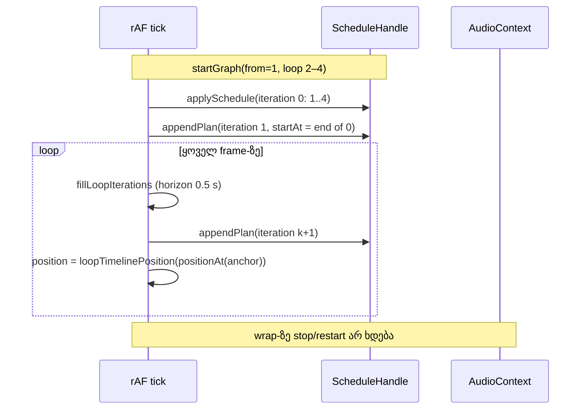
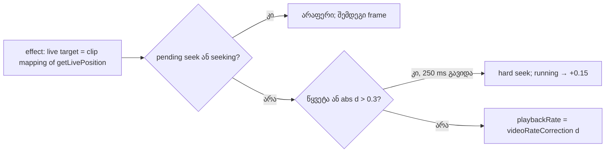

# Studio Lab — ვიდეოს soft sync, Loop და multi-select

**თარიღი:** 2026-10-07
**სტატუსი:** In Progress (Round 3: C-R2-01/02, SRW-05, SRW-06). C round 3-მა (`tmp/studio-real-loop/c-round-3.md`) შეამოწმა: RF3-1 — FAIL (C-R3-01), R5-L3, R5-L5, R5-E1, R6-S2 და R6-S3 — PASS. RF3-1-ის მემკვიდრე RF5-1 C round 5-მა გაიარა (დოკ. 013/014).
**შეცვლილი პროექტი:** Store

## კონტექსტი

Round 2-ში C-მ ვიდეოს sync-ში ორი ბაგი იპოვა:
- **C-R2-01 (High):** dock ახალ hard seek-ს უშვებდა მაშინაც, როცა წინა seek ჯერ არ დასრულებულიყო (`video.seeking`), თან ნასწავლი lead target-ს ასცდებოდა. შედეგად frame 800 ms-მდე იყინებოდა.
- **C-R2-02 (Low):** ვიდეოს `play()` აუდიოს `startAt`-მდე იძახებოდა.

ამავე რაუნდში ემატება Loop (SRW-05, D-17) და multi-select/marquee (SRW-06, D-18). ორივე პროტოტიპშიც იყო, მაგრამ პროტოტიპი loop-ის wrap-ს rAF-ით `seek()`-ავდა (C P7), რაც გამეორება არ შეიძლება.

### სცენარი

გიორგი 2–4 წამის მონაკვეთს ტალღაზე მონიშნავს და Ctrl+L-ს დააჭერს. Brace ჩნდება ruler-ის ქვეშ და მუსიკა 2–4 წამზე უწყვეტად ტრიალებს: wrap-ზე წკაპი ან სიჩუმე არ ისმის. Brace-ს კიდეს გაწევს, loop დაკვრისას გრძელდება. შემდეგ Ctrl+click-ით სამ კლიპს მონიშნავს ორ ხაზზე, header-ით ჯგუფს 2 წამით გადაიტანს და ერთი Undo-თი ყველაფერს აბრუნებს.

## მიდგომა

### ვიდეოს sync (D-16)

- **Seek-ის guard:** `currentTime`-ში ჩაწერა არ ხდება, სანამ `video.seeking` true-ა ან ჩვენი seek ჯერ pending-ია. Seek pending რჩება `seeked`/`abort`/`emptied`-მდე ან 1 წამიანი timeout-მდე. რიგში მეორე seek არ დგება: შემდეგი frame-ი თავიდან აფასებს მდგომარეობას.
- **Lead:** ნასწავლი lead (`nextVideoSeekLead`, probe-ები, Play ციკლებს შორის შენახული state) ამოღებულია. მიმდინარე ელემენტის seek წინ ისვრის მუდმივ `VIDEO_RUNNING_SEEK_LEAD_SECONDS = 0.15` წამზე, ხოლო paused ელემენტის seek lead-ს არ იყენებს.
- **Soft sync:** `videoRateCorrection(d)` სუფთა ფუნქციაა. |d| ≤ 0.02-ზე აბრუნებს ზუსტად 1-ს. მის გარეთ აბრუნებს `1 − 4·d`-ს, დამრგვალებულს 0.05-იან ნაბიჯზე და შეზღუდულს [0.85, 1.15]-ში. ნაბიჯი იმიტომ არის საჭირო, რომ ელემენტის rate ყოველ frame-ზე არ შეიცვალოს.
- **Hard seek** ხდება მხოლოდ წყვეტაზე: წყაროს შეცვლა, არაუწყვეტი clip-ის ცვლილება, ან target-ის ნახტომი, რომელიც გასული დროით არ აიხსნება (> 0.08 წმ; ასე იჭერს seek-ს, scrub-ს, loop wrap-ს და edit/undo-ს). სხვა შემთხვევაში hard seek ხდება მხოლოდ |d| > 0.3-ზე. ლიმიტი: 250 ms-ში ერთი.
- **Live target:** effect React-ის render-ის შემდეგ სრულდება, ამიტომ `position` state ხშირად რამდენიმე ათეული ms-ით ძველია. drift და ნახტომი ამიტომ ითვლება `getLivePosition()`-ით (აუდიოს საათი effect-ის მომენტში) და კლიპის mapping-ით.
- **C-R2-02:** context-ში ემატება `isTransportRunning`. მნიშვნელობა true ხდება rAF tick-ში, როცა `ctx.currentTime ≥ anchor.holdUntil`. მანამდე ვიდეო paused-ია და `seekSfxVideo`-თი დგას start mapping-ზე. ტაიმერი არ გამოიყენება.

### Loop (D-17)

- `Arrangement.loop = {start, end, enabled} | null` snapshot-ის ნაწილია, ამიტომ Undo/Redo მასზეც მუშაობს.
- სუფთა ოპერაციები `loop.ts`-შია: `setLoopFromRange`, `toggleLoop`, `moveLoop`, `resizeLoop`. მინიმალური სიგრძე 0.1 წმ-ია, 60 წამის ზღვარი არ არსებობს. no-op იგივე reference-ს აბრუნებს. `deleteTime` loop-საც `remapTime`-ით გადათვლის და 0.1-ზე მოკლეს აუქმებს.
- **Wrap:** ყოველი (ხელახალი) დაგეგმვისას `resolveActiveLoop(loop, from)` წყვეტს, wrap-ი იქნება თუ არა. Wrap მხოლოდ მაშინ ხდება, როცა `enabled` და `from < loop.end − ε`. თუ `from ≥ loop.end`, დაკვრა წრფივია (LOOP-06).
  - iteration 0 არის `from..loop.end`, ყოველი შემდეგი კი `loop.start..loop.end`;
  - კლიპები loop.end-ზე იჭრება `duration`-ით;
  - iteration k+1-ის ctx დრო ზუსტად k-ის დასასრულია;
  - შემდეგი iteration-ები 0.5 წამით ადრე იქმნება `ScheduleHandle.appendPlan`-ით, იმავე track gain-ებზე, რომ Mute/Volume ყველა iteration-ზე იმოქმედოს;
  - დასრულებული source-ები `appendPlan`-ში იხსნება.
- **საათი:** `positionAt` unwrapped რჩება. `loopTimelinePosition(u, loop, from)` timeline-ის დროს აძლევს playhead-ს, readout-ს და ვიდეოს. Loop-ის დროს დაკვრა `projectEnd`-ზე არ ჩერდება.
- **ცოცხალი ცვლილებები:** schedule key-ში ახლა loop-იც შედის. ნებისმიერი edit continuous reschedule-ს იწვევს, ხოლო handoff ძველი loop-ით map-დება. Brace-ის drag preview დაკვრისას 100 ms-ში ერთხელ გადაგეგმავს, ხოლო ხელის აშვება ერთ history ჩანაწერს ქმნის.
- **ექსპორტი** loop-ს არ ითვალისწინებს. Dialog ამას ცალკე ხაზით წერს.

### Multi-select (D-18)

- Context ინახავს `selectedClipIds`-ს (primary ბოლოშია). `selectedClipId` primary-ს აბრუნებს. მონიშვნა ისტორიაში არ იწერება, Undo/Redo-ს შემდეგ კი არსებულ id-ებამდე იფილტრება.
- Ctrl/Cmd+click მონიშვნას რთავს/თიშავს, Shift+click მხოლოდ ამატებს. ორივე range-ს შლის. drag, seek და range არ ხდება.
- მონიშნული ჯგუფის წევრის header-ზე უბრალო press ჯგუფურ გადატანას იწყებს: delta იზღუდება `groupMoveBounds`-ით და ისტორიაში ერთი ჩანაწერი `გადატანა (N)` იწერება.
- ←/→, Delete (range-ის გარეშე), Ctrl+E (უარი) და Ctrl+A ჯგუფზე მოქმედებს.
- **Marquee:** ცარიელი ფონის gesture `ArrangementLane`-დან `StudioWorkspace`-ში გადავიდა, რადგან rectangle რამდენიმე ხაზზე ვრცელდება. 4 px-ზე ნაკლები მოძრაობა ძველი click-ია (seek ხელის აშვებისას), 4 px და მეტი კი marquee. Hit test (`clipsInMarquee`) open interval-ით ითვლის. ხაზები row-ების `getBoundingClientRect`-ით განისაზღვრება.

## არქიტექტურა

## შეცვლილი ფაილები

| ფაილი | დანიშნულება |
| --- | --- |
| `app/types/arrangement.ts` | `ArrangementLoop`, `Arrangement.loop` |
| `app/lib/arrangement/loop.ts` (ახალი) | loop ოპერაციები, `resolveActiveLoop`, `loopTimelinePosition`, iteration-ის timing და plan |
| `app/lib/arrangement/selection.ts` (ახალი) | `toggleInSelection`, `clipsInMarquee`, `groupMoveBounds`, `moveClips`, `deleteClips` |
| `app/lib/arrangement/model.ts` | `createArrangement` → `loop: null`, `MIN_LOOP_LENGTH`, `deleteTime`-ის loop remap |
| `app/lib/arrangement/video.ts` | `videoRateCorrection`, `isVideoTargetJump`, მუდმივი lead, hard seek-ის ზღვარი 0.3; ნასწავლი lead ამოღებულია |
| `app/lib/arrangement/graph.client.ts` | `ScheduleHandle.appendPlan` |
| `app/contexts/ArrangementContext.tsx` | loop iteration-ების დაგეგმვა, loop ბრძანებები, multi-select, `isTransportRunning`, `getLivePosition` |
| `app/components/arrangement/ArrangementLoopBrace.tsx` (ახალი) | loop-ის ზოლი და brace: drag, კიდეები, კლავიატურა |
| `app/components/arrangement/ArrangementVideoDock.tsx` | D-16 |
| `app/components/arrangement/StudioWorkspace.tsx` | brace-ის ზოლი, marquee, Ctrl+L/Ctrl+A, მონიშვნის მთვლელი |
| `app/components/arrangement/ArrangementClip.tsx`, `ArrangementLane.tsx` | Ctrl/Shift click, ჯგუფის გადატანა, ფონის gesture-ის დელეგირება |
| `app/components/arrangement/ArrangementTransport.tsx`, `ArrangementExportDialog.tsx`, `index.ts` | ↻ Loop + readout, ექსპორტის loop ხაზი, export |
| ტესტები: `loop.test.ts`, `selection.test.ts` (ახალი); `video`, `model`, `transport`, `graph`, `schedule` | ქცევითი ტესტები |

## პრობლემები და გადაწყვეტები

- **პრობლემა:** React effect `position` state-ს იყენებდა, რომელიც render-ის შეყოვნებისას 30–250 ms-ით ძველი იყო. დაგვიანებული render ნახტომად აღიქმებოდა და running hard seek-ს იწვევდა. headless-ში ასეთ seek-ს 0.3–0.7 წმ სჭირდება, ამიტომ seek-ების კასკადი იწყებოდა.
  **გადაწყვეტა:** target ითვლება `getLivePosition()`-ით და კლიპის mapping-ით effect-ის მომენტში. ნახტომის შემოწმებაც ამავე live მნიშვნელობებით ხდება.
- **პრობლემა:** preload/stopped რეჟიმში effect ყოველ frame-ზე იძახებდა `seekSfxVideo`-ს, სანამ ახალი წყარო მზად არ იყო.
  **გადაწყვეტა:** paused seek ერთხელ სრულდება თითო (წყარო, target) წყვილზე.
- **პრობლემა (code-reviewer, High):** main thread-ის შეფერხების ან ფონური tab-ის შემდეგ `fillLoopIterations` ყველა გამოტოვებულ iteration-ს ერთად დაამატებდა წარსული `when`-ით, ამიტომ ბევრი ასლი ერთდროულად აჟღერდებოდა.
  **გადაწყვეტა:** თუ შემდეგი iteration დროულად ვერ იქმნება, tick ერთ continuous re-anchor-ს აკეთებს მიმდინარე mapped პოზიციიდან. 3 წამიანი blocking-ის ტესტში დაგვიანებული `start()` 0 იყო.
- **პრობლემა:** rate ყოველ frame-ზე ოდნავ სხვა მნიშვნელობით იწერებოდა.
  **გადაწყვეტა:** rate მრგვალდება 0.05-იან ნაბიჯზე.
- **პრობლემა:** spec ითხოვს ფოკუსირებად `role="group"` brace-ს, Biome კი `div`-ზე `role="group"`-სა და `tabIndex`-ს კრძალავს.
  **გადაწყვეტა:** დაემატა ორი მიზეზიანი `biome-ignore` (a11y rule-ები), რაც deviation-ად არის ჩაწერილი.

## ტესტირება

- `npx vitest run` → 40 ფაილი, 604 ტესტი, ყველა წარმატებული. `tsc` → 0. `npm run build` → OK. Biome A-ს path-ებზე → 0 შეცდომა.
- ბრაუზერი (gstack, `/studio-lab`, C-ის harness `setup-base.js`/`ext.js`/`vfc.js`/`r3v1.js`):
  - **R3-V1 layout:** 6 run ერთ load-ში. 5 run გავიდა (median ≤ 0.034, max ≤ 0.095), ხოლო პირველი run 1.6 წამით გაყინული ვიდეოს გამო ჩავარდა.
  - **Fresh load:** 4 run-დან 3 გავიდა. `currentTime`-ის ჩაწერა `seeking`-ის დროს ყველა run-ში 0 იყო.
  - **გარემო:** CPU დატვირთვა გაზომვის დროს ~90% იყო (სხვა პროცესები).
- **Loop 2.025–4.025, Play 1.0-დან, 3 wrap:**
  - iteration-ის source-ები 0.49 წმ-ით ადრე იქმნება;
  - `when(k+1)` ზუსტად k-ის დასასრულია;
  - თითო clip-ზე თითო source;
  - readout brace-ში რჩება.
- **Multi-select/brace smoke:** Ctrl/Shift click, count, marquee, ჯგუფის გადატანა და წაშლა, Ctrl+A, Ctrl+E-ზე უარი, brace-ის drag და კლავიატურა — ჩამოთვლილი მოქმედებები smoke-ტესტში მუშაობდა; დაკვრისას მონიშვნისა და ჯგუფური ცვლილებების სრული შემოწმება ჯერ დარჩენილია.

## TODO / შემდეგი ნაბიჯები

- RF3-1: A-ს round-3 გაზომვა ვერ გავიდა (ერთ load-ზე 5/6, ახალ load-ზე 3/4; R2-V3 განლაგება არ გაზომილა). C round 3-ში FAIL (C-R3-01). შემდეგ D-19/D-24-ით გასწორდა: RF5-1 C round 5-ში გავიდა; რეალური Chrome Tech Lead-ზეა.
- R5-L3 (master tap, brace `projectEnd`-ის მიღმა), R5-L5, R5-E1, R6-S2 (marquee დაკვრისას) და R6-S3 (ჯგუფური გადატანა ისმის დაკვრისას): C round 3-მა ბრაუზერში და აუდიო tap-ით შეამოწმა — PASS. „ტესტირების“ სექციის smoke-ის სტრიქონში ნახსენები „დაკვრისას შემოწმება დარჩენილია“ ამით დაიხურა.

- RF3-2: პირველი 300 ms-ის drift fresh load-ზე −0.055…−0.096 წმ-ია (ზღვარი 0.06). ეს headless decoder-ის ნელი გაშვების ბრალია. სჭირდება Tech Lead-ის რეალური Chrome-ის შემოწმება.
- Wrap-ზე ვიდეოს seek headless-ში 0.3–1 წმ-ს იღებს. R5-L6 ამ გარემოში ვერ დადასტურდა.
- Marquee viewport-ის კიდეზე auto-scroll-ს არ აკეთებს (ამ რაუნდში არ მოითხოვებოდა).
- Brace-ის drag preview 100 ms-ში ერთხელ გადაგეგმავს. rAF-ის შეჩერებისას (ფონური tab) loop-ის horizon 0.5 წმ-ს იქით არ ივსება.
