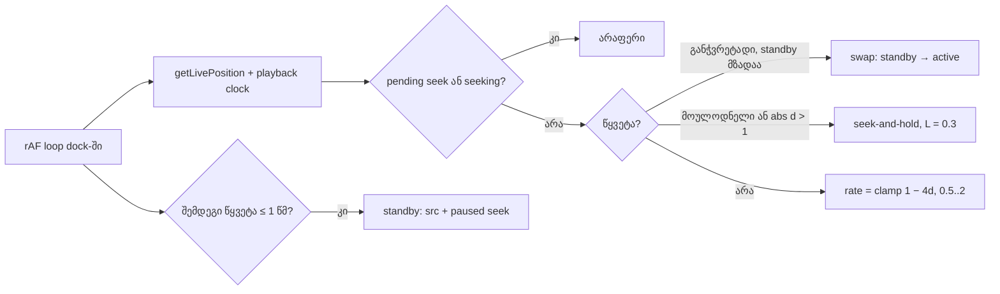
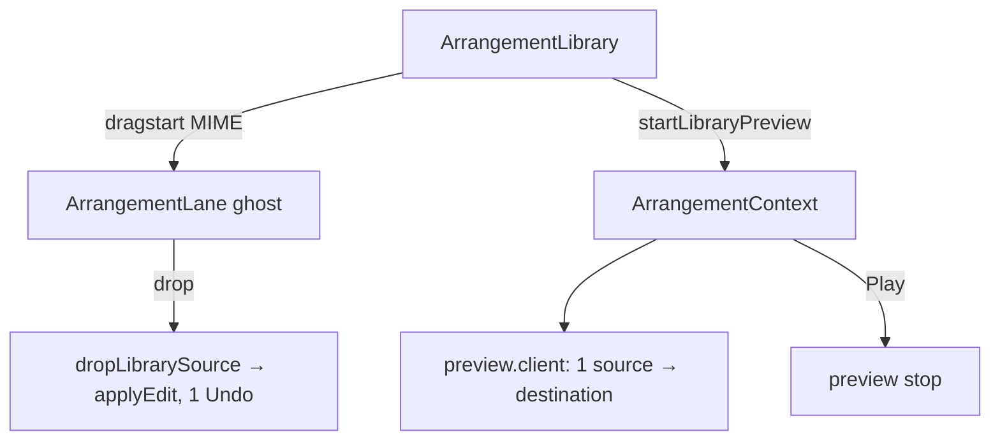

# Studio Lab — ვიდეოს sync D-19, round-3-ის ბაგები, Studio Lab-ის შესასვლელი და ბიბლიოთეკა

**თარიღი:** 2026-10-07
**სტატუსი:** In Progress. C round 4: FAIL — RF4-1, RF4-2 (C-R4-01) და C-R4-02; დანარჩენი გავიდა. C round 5-მა (`tmp/studio-real-loop/c-round-5.md`) D-23/D-24-ის შემდეგ გაიარა: RF5-1, RF5-2 (C-R4-01-ის მემკვიდრეები), R5-B1 (C-R4-02), R5-B2 (C-R4-03), R5-B3 (C-R4-04). RF5-1b მხოლოდ vacuously გავიდა (ბუნებრივი escalation არ ყოფილა) → D-24a, round 6, დოკ. 015. წყნარი რეალური Chrome Tech Lead-ის შემოწმებად რჩება.
**შეცვლილი პროექტი:** Store

## კონტექსტი

Round 3-ში C-მ RF3-1 ვერ ჩათვალა: ვიდეო სინქრონიდან ვარდებოდა. მიზეზი სამი იყო:
- **(ა) hard seek-ების კასკადი.** headless-ში seek 0.3–0.9 წმ-ს იღებს. ამიტომ ყოველი seek target-ს ჩამორჩებოდა და მომდევნო seek-ს იწვევდა.
- **(ბ) soft sync-ის ჭერი.** rate 1.15-ზე იყო შეზღუდული, ამიტომ ჩამორჩენა ნელა ნაზღაურდებოდა.
- **(გ) ბაგი.** dock-ი უწყვეტ, იმავე წყაროს clip-ის საზღვარზეც ახტებოდა.

ამას ემატება C-ის round-3-ის ბაგები (C-R3-04/05/06) და root review-ის მიგნებები (L2, L3, L4, L8, M1, M2).

მეორე track მომხმარებლის მოთხოვნებია:
- Store-ის header-ში Studio Lab-ის შესასვლელი და lab-იდან გამოსასვლელი;
- მუქი, თხელი scrollbar-ები;
- ბიბლიოთეკა ხით, ძიებით, კლავიატურით, პრევიუთი და drag-ით;
- სინთეზური დემო სტემები;
- ბიბლიოთეკის დაკეცვა და სიგანის შეცვლა.

### სცენარი

ნინო Store-ის header-ში `Studio Lab · DEMO` ბმულს აჭერს და სამუშაო სივრცე ავტორიზაციის გარეშე იხსნება.
1. ძიებაში წერს `ბასი დემო`, ↓-ით ირჩევს სინთეზური კომპოზიციის ბასს და `▶ მოუსმინე`-ს აჭერს.
2. ტალღის შუაზე დაწკაპუნებით პრევიუ 8 წამიდან იწყება.
3. ბასს სტემების ხაზზე 10 წამზე გადაათრევს. ghost აჩვენებს `00:10.000`-ს, ხოლო დაკავებულ ადგილზე ყვითლდება და `აქ ადგილი არ არის`-ს წერს.
4. Play-ზე პრევიუ ჩერდება და ბასი ზუსტად 10 წამზე ჟღერს. Export-ის WAV-შიც ბასი 10.000 წამიდან იწყება.
5. ბიბლიოთეკას ◀-ით კეცავს, timeline ფართოვდება და ვიდეო იმავე ადგილზე, სინქრონში გრძელდება.

## მიდგომა

### D-19 — ვიდეოს sync

- **Control loop React-ის render-ის გარეთ.** dock-ს საკუთარი rAF loop აქვს, რომელიც ყოველ frame-ზე აუდიოს საათს `getLivePosition()`-ით კითხულობს. React effect-ები მხოლოდ წყაროს, როლისა და დაკვრის მდგომარეობის ცვლილებას პასუხობენ.
- **ორი `<video>`.** active და standby. როლები imperatively იცვლება (`data-video-role`, opacity, z-index), ამიტომ JSX props მუდმივია და React მათ არ გადაწერს. standby ყოველთვის `opacity-0` და `pointer-events-none`-ია, `display:none` არ გამოიყენება.
- **უწყვეტობა.** `resolveVideoTarget` აბრუნებს `continuous`-ს: იგივე წყარო და media-ს უწყვეტობა ≤ `VIDEO_CONTINUITY_SECONDS` (0.03). ასეთი საზღვარი წყვეტად არ ითვლება.
- **Soft sync.** dead band |d| ≤ 0.02-ზე rate ზუსტად 1-ია. 0.02 < |d| ≤ 1.0-ზე rate = `clamp(1 − 4·d, 0.5, 2.0)`, დამრგვალებული 0.05-იან ნაბიჯზე. element-ში იწერება მხოლოდ ნაბიჯის ცვლილებისას.
- **Seek-and-hold.** მოქმედებს მომხმარებლის seek-ზე, edit-ზე, მოუმზადებელ standby-ზე და |d| > 1.0-ზე. ნაბიჯები: pause → rate 1 → `currentTime = target + 0.3` → `seeked`. თუ frame live target-ს უსწრებს, `holdRelease` ელოდება, სხვა შემთხვევაში `play()` მაშინვე იძახება.
- **Standby.** წინასწარ განჭვრეტადი წყვეტა (loop wrap, არაუწყვეტი საზღვარი, gap-დან შესვლა) ≤ 1.0 წმ-ში თუ მოდის, standby წინასწარ იტვირთება და seek-დება. წყვეტის აუდიო დროზე როლები იცვლება.
- **Start.** `play()` იძახება პირველ frame-ზე, სადაც `ctx.currentTime ≥ startAt − min(frameInterval, 0.02)`.

### Round-3-ის ბაგები და root review

- **D-20 / C-R3-04/05 / L1 / L4.** context-ი ითვლის აქტიურ pointer gesture-ებს. სანამ რიცხვი 0-ზე მეტია, Undo/Redo მხოლოდ სტატუსს წერს. code-reviewer-ის შენიშვნის შემდეგ იგივე guard Delete-ს, Ctrl+E-ს, ←/→-ს, Ctrl+L-ს და Enter-საც ბლოკავს. ამ შემთხვევაში სტატუსი არის `რედაქტირება drag-ის დროს არ მუშაობს — ჯერ ხელი აუშვი.` ბოლო gesture-ის გათავისუფლება preview-active flag-ს შლის. unmount და `setPointerCapture`-ის შეცდომა gesture-ს ათავისუფლებს.
- **C-R3-06.** transport-ის Delete ღილაკს მუდმივი წარწერა აქვს. range-ის მნიშვნელობა („სიცარიელე დაიხურება ყველა ხაზზე“) footer-ში ჩანს.
- **L3.** Delete/Backspace `event.repeat`-ს უგულებელყოფს.
- **L2.** hold-ის დროს reschedule ძველ graph-ს აჩერებს და transport-ს ახალ `startAt`-მდე running-ად არ ნიშნავს.
- **L8.** `AudioContext` თუ ვერ შეიქმნა, ჩნდება სტატუსი `ამ ბრაუზერში Web Audio მიუწვდომელია…`, `isPlaying` false რჩება და Export-იც იგივე მიზეზს აჩვენებს.
- **M1.** loop-ის iteration-ების refill-ს rAF-ის გარდა 200 ms-იანი `setInterval` ამოძრავებს, horizon 2.0 წმ-ია. დაგვიანების შემთხვევაში H1-ის re-anchor წესი რჩება.
- **M2.** გაზომვამ ზღვარს გადააჭარბა (A-ს წინა სესიის გაზომვით commit per frame 7.0–7.8 ms იყო, ზღვარი 4 ms). ამიტომ დაემატა `position-store.ts`: `useSyncExternalStore` და `useArrangementPosition()`. მთავარი context-ის მნიშვნელობა playback tick-ზე და seek-ზე აღარ იცვლება.

### Track U

- **Header.** Store-ის header-ში დაემატა ორი `Link` (desktop და mobile), რომლებსაც `Demo` badge აქვს. lab-ის header-ში დაემატა `← CZABA`.
- **Scrollbar-ები.** `studio-scrollbar.ts` ერთ class string-ს აქვეყნებს. ის Tailwind-ის arbitrary variant-ებს იყენებს: graphite track (`surface`), `dim` thumb, `brand` hover/drag, ღილაკები არ არის, ზომა 10 px, `scrollbar-gutter: stable`. `scrollbar-color` და `scrollbar-width` ამავე element-ზე არ იწერება.
- **ბიბლიოთეკა.** `library.ts` სუფთა ლოგიკაა:
  - ხე `collectionLabel` + `kind`-დან, ცარიელი folder-ები დამალულია;
  - AND ძიება სიტყვებით, ნებისმიერი თანმიმდევრობით და registry-ის გარეშე;
  - სიაში ნავიგაცია;
  - drop-ის დრო pixel-იდან და overlap-ის შემოწმება.

  `ArrangementLibrary.tsx` ხეს, `role="listbox"` სიას, ძიებას (× და Esc ფილტრს ინარჩუნებს) და ↑/↓/Enter-ს რენდერავს. drag `dataTransfer`-ით ხდება, ghost კი `ArrangementLane`-ში ჩანს.
- **პრევიუ.** `preview.client.ts` workspace-ის იმავე `AudioContext`-ზე მუშაობს: ერთი source, პირდაპირ destination-ში, export-ში არ შედის. პრევიუ transport-ს აჩერებს, Play კი პრევიუს.
- **დემო სტემები (D-21).** `demo-synth.ts` ერთ დეტერმინისტულ კომპოზიციას ქმნის 4 სტემით (პულსი, ბასი, პადი, მელოდია): 16 წმ, 48 kHz, peak ≤ −6 dBFS. სრული მიქსი 4 სტემის ჯამია. სათაურები და კოლექცია „სინთეზური დემოს“ წერენ, ხოლო caption ამბობს, რომ ეს CZABA-ს კატალოგის სტემები არ არის. ქსელში მოთხოვნა არ იგზავნება.
- **დაკეცვა და resize (D-22).** ◀ ბიბლიოთეკას 40 px-იან rail-ად კეცავს. separator `role="separator"`-ია: ←/→ 16 px-ით ცვლის სიგანეს, drag-იც მუშაობს, მნიშვნელობა 288–480 შუალედშია. ვიდეოს dock-ი timeline-ის ზედა ზოლში, მარჯვნივ გადავიდა (160×90). ის იგივე კომპონენტია, ამიტომ დაკეცვისას remount არ ხდება.

## არქიტექტურა

## შეცვლილი ფაილები

| ფაილი | დანიშნულება |
| --- | --- |
| `app/lib/arrangement/video-sync.ts` (ახალი) | D-19-ის სუფთა გადაწყვეტილებები: `videoRateCorrection`, `nextPredictableDiscontinuity`, `shouldHardSeek`, `holdRelease` |
| `app/lib/arrangement/video.ts` | `continuous` `VideoTarget`-ზე, preroll/preload რეჟიმები ამოღებულია |
| `app/lib/arrangement/transport.ts`, `loop.ts` | L2 hold reschedule, M1 refill |
| `app/lib/arrangement/position-store.ts` (ახალი) | M2: position store |
| `app/lib/arrangement/library.ts` (ახალი) | ხე, ძიება, ნავიგაცია, drop-ის დრო, overlap |
| `app/lib/arrangement/preview.client.ts` (ახალი) | ბიბლიოთეკის პრევიუს player |
| `app/lib/arrangement/demo-synth.ts` | 4 სინთეზური სტემი და მიქსი |
| `app/types/arrangement.ts` | ერთი optional ველი |
| `app/contexts/ArrangementContext.tsx` | gesture guard, L8, M1, position store, პრევიუ, drag/drop |
| `app/components/arrangement/ArrangementVideoDock.tsx` | D-19 dock, ორი `<video>`, ახალი ადგილი |
| `app/components/arrangement/ArrangementLibrary.tsx`, `ArrangementLibraryPreview.tsx` (ახალი) | ბიბლიოთეკა და პრევიუ |
| `app/components/arrangement/ArrangementLane.tsx` | drop ghost და library drop |
| `app/components/arrangement/StudioWorkspace.tsx` | `← CZABA`, dock-ის ზოლი, scrollbar-ები, separator guard |
| `app/components/arrangement/ArrangementClip.tsx`, `ArrangementLoopBrace.tsx`, `ArrangementRuler.tsx`, `ArrangementTransport.tsx` | gesture-ის რეგისტრაცია, position-ის subscription, Delete-ის სტაბილური წარწერა |
| `app/components/arrangement/studio-scrollbar.ts` (ახალი) | scrollbar-ის class string |
| `app/data/studio-lab-demo.ts` | სინთეზური კოლექცია და სტემები |
| `app/components/layout/Header.tsx` | მხოლოდ ორი `Link` |
| ტესტები: `video-sync`, `library`, `demo-synth`, `position-store`, `ArrangementContext` (ახალი); `video`, `transport` | ქცევითი ტესტები |

## პრობლემები და გადაწყვეტები

- **პრობლემა:** headless-ში მიმდინარე element-ის seek ძალიან დიდხანს გრძელდება, ამიტომ wrap-ზე frame-ები loop.end-ს მიღმა ჩანდა.
  **გადაწყვეტა:** wrap-ს წინასწარ მომზადებული standby ემსახურება. ჩვენს გაზომვაში ყველა wrap swap-ით გაკეთდა, fallback 0-ჯერ.
- **პრობლემა:** position-ის ყოველი tick მთელ context-ს და ყველა consumer-ს ხელახლა არენდერებდა.
  **გადაწყვეტა:** position ცალკე store-შია და მას მხოლოდ playhead, ruler, readout, gap caption და brace იწერენ.
- **პრობლემა:** `scrollbar-color` ან `scrollbar-width` Chrome 121+-ში `::-webkit-scrollbar` სტილს თიშავს.
  **გადაწყვეტა:** ჩვენს scroller-ებზე მხოლოდ webkit pseudo-element-ები გამოიყენება. computed style-ში ორივე `auto`-ა.
- **პრობლემა:** separator-ზე ←/→ მონიშნულ კლიპს ანაცვლებდა.
  **გადაწყვეტა:** გლობალურ nudge-ს guard-ში დაემატა `role="separator"`.

## ტესტირება

- `npx vitest run` → 45 ფაილი, 654 ტესტი, ყველა წარმატებული. `npx tsc --noEmit` → 0. `npm run build` → OK. Biome A-ს path-ებზე → 0 შეცდომა (Header-ის 6 warning ძველია).
- **ბრაუზერი** (gstack, `/studio-lab`, C-ის harness-ის ადაპტირებული ასლები):
  - RF4-1, R3-V1: 15/15 + 5/5 მიმდინარე კოდზე, ყველა ზღვარში. worst max 0.064, hard seek 0.
  - RF4-1, R2-V3: 5/5 + 2/2. 2.0-ზე seek და swap არ ხდება.
  - RF4-2: 5/5 + 2/2, 3 wrap, ყველა swap-ით.
  - RF4-3: 3/3 + 2/2.
- **ბიბლიოთეკა:**
  - `ბასი დემო` / `დემო ბასი` ერთსა და იმავე შედეგს აბრუნებს;
  - `zzz`-ზე ჩანს `ხმა ვერ მოიძებნა…` და ღილაკები disabled-ია;
  - სტემების folder-ში 4 სტემია;
  - SFX ფილტრი ×-ის შემდეგ რჩება;
  - ↓/Enter მუშაობს და ერთ Undo ჩანაწერს ქმნის.
- **პრევიუ:** ერთი source; 50%-ზე offset 8.0; ↓ წყაროს ცვლის; Play/პრევიუ ერთმანეთს გამორიცხავს.
- **Drag:** ghost `00:10.000`, clip 400 px-ზე (მოსალოდნელი 400). დაკავებულ ადგილზე და ვიდეოხაზზე უარია, history არ იცვლება. WAV ყველა ხაზზე უარყოფილია.
- **R12-S2:** master tap-ზე ბასი Play-დან 1.0 წმ-ში ჟღერს (+50 ms lookahead). Export-ში onset 10.0002 წმ-ზეა.

## TODO / შემდეგი ნაბიჯები

- C round 4-ის FAIL-ები (RF4-1, RF4-2, C-R4-02) და Low C-R4-03/04, root L6 C round 5-მა დახურა (იხ. სტატუსი). ღიაა: RF5-1b-ის ბუნებრივი escalation (D-24a, round 6) და რეალური Chrome.
- Tech Lead-ის რეალური მაუსის / რეალური Chrome-ის შემოწმება (headless-ში ვერ მოწმდება):
  - R23-1: scrollbar-ის ვიზუალი;
  - R23-2: wheel/trackpad და thumb drag;
  - R12-L4: ბიბლიოთეკიდან რეალური HTML5 drag.

- Scrollbar-ის ვიზუალი (hover/drag ფერი, thumb drag, wheel) headless-ში არ ჩანს. ეს Tech Lead-მა რეალური მაუსით უნდა შეამოწმოს.
- RF4-3: `play()` `startAt`-მდე 10 ms-ით ადრე ხდება (rule 7 ამას უშვებს). C-ის hold-ის შემოწმება („paused, სანამ ctx < startAt“) ამ 10 ms-ს შეიძლება ჩაეჭიდოს. საჭიროა B-ის გადაწყვეტილება.
- M2-ის „წინა“ რიცხვები წინა სესიაშია გაზომილი. rAF gap-ის რიცხვები ჩანაწერში არ შენახულა.
- SRW-11B (floating video, detail panel), SRW-13/14 და სხვა ამ რაუნდში არ შედის.
