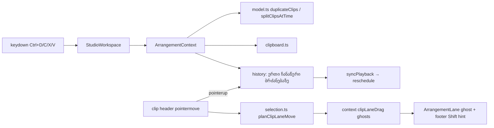
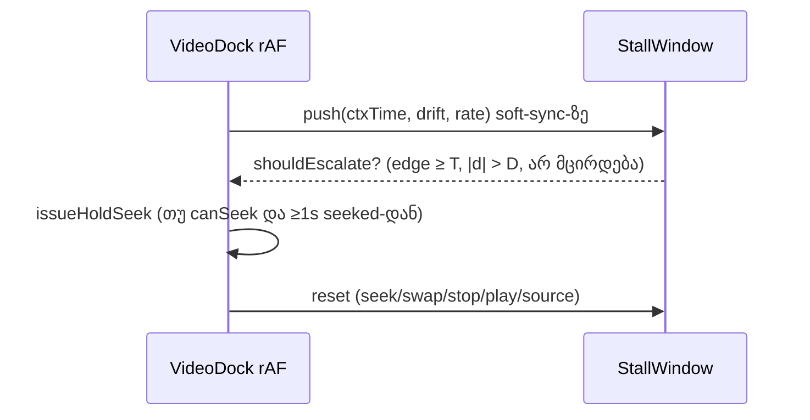

# Studio Lab — gesture re-entry, ვიდეოს stall escalation, დუბლირება, ხაზებს შორის გადატანა და clipboard

**თარიღი:** 2026-10-08
**სტატუსი:** In Progress. C round 5-მა (`tmp/studio-real-loop/c-round-5.md`) round 5-ის ყველა acceptance ID გაიარა (R5-B1..B5, RF5-1..3, RF5-U, R7, R8, R9, G5). ღია ბაგები: C-R5-01..05 (round 6, დოკ. 015). Real-mouse / real-Chrome პუნქტები PASS-ად არ ითვლება.
**შეცვლილი პროექტი:** Store

## კონტექსტი

C-ის round 4-ის შედეგი FAIL იყო. ამ რაუნდში ოთხი ბაგი და ორი Low შენიშვნა სწორდება, შემდეგ კი ემატება სამი მომდევნო ფუნქცია:

- **C-R4-02 (Medium):** კლიპზე ან loop brace-ზე მეორე `pointerdown` (მეორე თითი, pen + mouse) gesture-ების მთვლელს „აჟონავდა“. ამის შემდეგ Undo/Redo და რედაქტირება reload-მდე იბლოკებოდა.
- **C-R4-01 (Medium):** დატვირთულ მანქანაზე ვიდეო ჩამორჩებოდა. fresh load-ის შემდეგ პირველ Play-ზე decoder ბრძანებულ rate-ს (1.75–2.0) ვერ მისდევდა, |d| იზრდებოდა, D-19 კი hard seek-ს მხოლოდ |d| > 1.0-ზე აკეთებს.
- **C-R4-03 / C-R4-04 / root L6 / A-R4-L9 (Low):**
  - ბიბლიოთეკის ხე collection-ის სახელებს ჭრიდა;
  - სინთეზური stem-ების preview waveform თითქმის ბრტყელი იყო;
  - Export dialog loop-ის დროს „იგივე graph რაც დაკვრისას“ წერდა;
  - preview waveform კლავიატურით არ იმართებოდა, ცარიელი შედეგის ტექსტი კი listbox-ის შიგნით იყო.
- **SRW-07, SRW-08 (FB-03), SRW-09 (FB-02):**
  - Duplicate (Ctrl+D) და ჯგუფის გაყოფა playhead-ზე;
  - კლიპის გადატანა აუდიო ხაზებს შორის, Shift-ით დროის ჩაკეტვა;
  - შიდა clipboard: Copy / Cut / Cut Time / Paste playhead-ზე.

## მიდგომა

**D-23 — gesture-ის ხელახალი დაწყება.**
- `ArrangementClip` და `ArrangementLoopBrace`: სანამ gesture აქტიურია, სხვა `pointerId`-ის `pointerdown` იგნორირდება. ახალი gesture არ იწყება, selection არ იცვლება.
- იგივე `pointerId` ნიშნავს, რომ წინა `pointerup` დაიკარგა. ძველი gesture მთავრდება ისტორიის ჩანაწერის გარეშე: preview უკან ბრუნდება და `release()` ერთხელ იძახება. შემდეგ ახალი gesture ჩვეულებრივად იწყება.
- uncaptured listener `release()`-ს ყოველთვის იძახებს.
- დამატება D-23-ზე: `pointerdown`, რომელსაც დაჭერილი ღილაკი არ აქვს (`buttons === 0`), gesture-ს არ იწყებს. რეალური press-ს ყოველთვის აქვს `buttons ≥ 1`. ასეთი stray event (C-ის ძველი `r3v3.js`) ადრე gesture-ს ტოვებდა, რომელიც არასოდეს მთავრდებოდა.
- უარყოფილი ალტერნატივა: ძველი gesture-ის გათავისუფლება ახლის დაწყებამდე, როგორც ruler აკეთებს. ასე პირველი თითის drag შუა გზაზე გაწყდებოდა.

**D-24 — stall escalation.**
- `video-sync.ts`-ში დაემატა სუფთა ფანჯარა: `createVideoStallWindow` და `shouldEscalateVideoStall`. sample იწერება მხოლოდ იქ, სადაც dock soft-sync rate-ს წერს: audio clock, drift და ბრძანებული rate.
- ფანჯარა ნულდება:
  - ყოველ hold-seek-ზე;
  - swap-ზე;
  - გაჩერებაზე;
  - Play-ის დაწყებაზე;
  - target-ის არარსებობაზე;
  - source-ის ცვლილებაზე;
  - hold-ის და paused-ის branch-ებში.
- კონსტანტები:
  - T = 300 ms;
  - D = 0.12 s. რატომ 0.12: gain 4 და step 0.05 იძლევა rate ≥ 1.5-ს მხოლოდ |d| ≥ 0.11875-ზე. D = 0.10-ზე 0.10–0.119 ზოლში RF5-1b-ის episode-ის საათი დაიწყებოდა, ფანჯრის საათი კი არა;
  - edge = rate ≥ 1.5 ჩამორჩენისას, ≤ 0.5 წინ წასვლისას;
  - „არ მცირდება“ = ფანჯრის დასაწყისის |d| − ბოლო |d| < 0.02 s.
- ქმედება არის არსებული D-19 rule 5 `issueHoldSeek`: pause → rate 1 → seek → hold → play. ყველა guard რჩება. დამატებითი ლიმიტი: ერთ ელემენტზე მაქსიმუმ ერთი escalation 1.0 s-ში, ათვლა წინა escalation-ის `seeked`-დან (ან 1500 ms pending timeout-იდან).
- dock აქვეყნებს `data-video-escalations`-ს.

**C-R4-03.**
- ხის სვეტი `w-36`-ია. ლეიბლები გადადის ახალ ხაზზე: `break-words`, `truncate` აღარ არის.
- საჯარო collection-ის ხილული ლეიბლი ახლა არის `CZABA საჯარო preview + სინთეზური SFX` (design-philosopher-ის ruling). SFX სინთეზურია და ეს ლეიბლში ჩანს. სინთეზური collection უცვლელია.
- `collection.label` ინარჩუნებს D-05-ის სრულ ტექსტს.

**C-R4-04.**
- preview waveform ნორმალიზდება წყაროს საკუთარ peak-ზე (`normalizePeakColumns`), მხოლოდ ჩვენებისთვის.
- აუდიო არ იცვლება.
- ხაზის კლიპების waveform არ ნორმალიზდება: SRW-13-ში ის clip gain-ს აჩვენებს.

**root L6.**
- loop-ის ჩართვისას WAV-ის ქვეხაზი წერს: „მთელი პროექტი წრფივად 0-დან ბოლომდე, იგივე მიქსით — loop იგნორირდება“.

**A-R4-L9.**
- preview waveform ახლა `role="slider"`-ია. მნიშვნელობა: ბოლო პოზიცია წამებში.
- კლავიშები:
  - ←/→ = ±1 წმ;
  - Home/End;
  - Space/Enter = ▶/■ მიმდინარე ადგილიდან.
- კლავიშები slider-ზე ჩერდება. გლობალური Space და Home `role="slider"`-ს გამორიცხავს. volume-ის `input[type=range]` უცვლელია.
- ცარიელი შედეგის `<output>` listbox-ის გარეთაა.

**SRW-07.**
- `duplicateClips`:
  - ასლი იწყება `start + span` წერტილში იმავე ხაზზე;
  - all-or-nothing: ერთი გადაფარვაც კი = არაფერი იცვლება, სტატუსში ხაზი და დრო.
- `splitClipsAtTime` ჭრის მხოლოდ მონიშნულ კლიპებს, რომლებსაც playhead მკაცრად კვეთს (`MIN_CLIP_DURATION` ორივე მხარეს).
- range-ის დროს Ctrl+E ძველებურად range-ზე ჭრის.

**SRW-08.**
- `planClipLaneMove` (pure) ითვლის placement-ებს. უარის მიზეზები: `video-clip`, `video-lane`, `out-of-range`, `overlap`.
- drag-ის დროს `trackId` preview-ში **არ იცვლება**. თუ შეიცვლებოდა, კლიპის კომპონენტი unmount-დებოდა და pointer capture დაიკარგებოდა. სანაცვლოდ:
  - context-ში ინახება `clipLaneDrag` ghost-ები;
  - ხაზი თავის ghost-ს ხატავს;
  - წყარო კლიპი `opacity-40`-ზეა;
  - `trackId` commit-დება მხოლოდ ხელის აშვებაზე.
- Shift იკითხება ყოველ `pointermove`-ზე.
- ერთი კლიპი ხელის აშვებისას ბოლო ვალიდურ პოზიციაზე ჯდება.
- ჯგუფის lane-ის უარისას დროის ნაწილი D-18-ით გრძელდება.

**SRW-09.**
- `clipboard.ts` (pure):
  - copy range-იდან ან კლიპებიდან;
  - cut ინარჩუნებს სიცარიელეს;
  - cut time = `deleteTime` + ყველა ხაზის მასალა;
  - paste plan არის all-or-nothing. ერთი აუდიო ხაზის მასალა აქტიურ აუდიო ხაზზე ჯდება, დანარჩენი თავის ხაზზე.
- clipboard მეხსიერებაშია: არა history, არა `navigator.clipboard`.
- context-ის ბრძანებები gesture-ის დროს თავად ამბობენ უარს (`GESTURE_EDIT_BLOCKED_MESSAGE`). იგივე guard keydown-შიცაა.

## არქიტექტურა

## შეცვლილი ფაილები

- `app/components/arrangement/ArrangementClip.tsx`: D-23 და ხაზებს შორის drag.
- `app/components/arrangement/ArrangementLoopBrace.tsx`: D-23.
- `app/components/arrangement/ArrangementLane.tsx`: lane-move ghost და წყაროს dimming.
- `app/components/arrangement/ArrangementVideoDock.tsx`: D-24 escalation და `data-video-escalations`.
- `app/components/arrangement/ArrangementLibrary.tsx`: ხე `w-36`, ცარიელი ტექსტი listbox-ის გარეთ.
- `app/components/arrangement/ArrangementLibraryPreview.tsx`: ნორმალიზებული waveform, `role="slider"`.
- `app/components/arrangement/ArrangementExportDialog.tsx`: loop-ის ტექსტი.
- `app/components/arrangement/StudioWorkspace.tsx`:
  - კლავიშები Ctrl+D/C/X/Shift+X/V;
  - gesture guard;
  - Space/Home slider-ის გამორიცხვა;
  - footer hint.
- `app/contexts/ArrangementContext.tsx`: დუბლირება, clipboard-ის ბრძანებები, ჯგუფის გაყოფა, `clipLaneDrag`.
- `app/lib/arrangement/model.ts`: `duplicateClips`, `splitClipsAtTime`, `findClipPlacementConflict`, `createClipId` export.
- `app/lib/arrangement/selection.ts`: `planClipLaneMove`.
- `app/lib/arrangement/clipboard.ts` (ახალი).
- `app/lib/arrangement/video-sync.ts`: stall window.
- `app/lib/arrangement/peaks.ts`: `normalizePeakColumns`.
- `app/data/studio-lab-demo.ts`: საჯარო collection-ის ხილული ლეიბლი.
- ტესტები:
  - `gesture-reentry.test.tsx` (ახალი);
  - `clipboard.test.ts` (ახალი);
  - `ArrangementContext.test.ts`;
  - `selection.test.ts`;
  - `video-sync.test.ts`;
  - `peaks.test.ts`.
- `docs/implementation/2026/quarter-IV/013-studio-lab-sync-library.md`: მხოლოდ სტატუსი და TODO.

## პრობლემები და გადაწყვეტები

- **ხაზის შეცვლა drag-ის დროს კლიპს unmount-ს უკეთებდა.**
  - პრობლემა: ხაზი კლიპებს `trackId`-ით ფილტრავს.
  - გადაწყვეტა: preview-ში მხოლოდ დრო იცვლება. ხაზი ghost-ით ჩანს, commit ხდება `pointerup`-ზე.
- **D-ს არჩევა.**
  - პრობლემა: D = 0.10-ზე episode-ის და ფანჯრის საათები ერთმანეთს არ ემთხვეოდა.
  - გადაწყვეტა: D = 0.12, რაც edge rate-ის ზღვარს (0.11875) ემთხვევა.
- **Footer-ის სიმაღლე drag-ის დროს.**
  - პრობლემა: ცალკე hint-ის ხაზი footer-ს გაზრდიდა და ხაზებს pointer-ის ქვეშ გადაწევდა.
  - გადაწყვეტა: Shift-ის hint drag-ის დროს shortcut-ების ხაზს ანაცვლებს.

## ტესტირება

- `npx vitest run`:
  - სრული: 47 ფაილი, 709/709. baseline იყო 654; 55 ახალია;
  - arrangement: 245/245.
- `gesture-reentry.test.tsx`-ის 13 ტესტი გაეშვა ჯერ ძველ (round 4) კოდზე: **13/13 ჩავარდა**. გასწორების შემდეგ ყველა გადის.
- `npx tsc --noEmit`: 0 შეცდომა.
- biome:
  - owned paths: 0 შეცდომა;
  - `./app`: 0 შეცდომა, 218 warning (იგივე, რაც C-ის round 4-ის baseline).
- `npm run build`: გადის.
- ბრაუზერი (gstack, ლოკალური dev server, synthetic pointer + რეალური `press` კლავიშები):
  - **ხე:** 1280-ზე და 1440-ზე overflow არ არის; ლეიბლი ≤ 3 ხაზი; list 144 px.
  - **preview:** ყველა დემო წყაროს მაღალი bar 32/32 px.
  - **slider:** → +1.00 s, Home 0, Space pause/resume იმავე ადგილიდან (±0.03 s). transport არ იძვრის.
  - **Export dialog:** loop on → ახალი ტექსტი; loop off → ძველი.
  - **C-ის leak script-ები** (video clip, music clip, brace) და R3-V3 (ძველი `r3v3.js` და `r3v3c.js`): ამის შემდეგ Ctrl+Z, Ctrl+Shift+Z და Delete მუშაობს.
  - **Duplicate:** ექსპორტის maxDiff 0.
  - **ჯგუფის გაყოფა:** ექსპორტის maxDiff 1.19e-7 (≤ 2⁻²²).
  - **ხაზებს შორის გადატანა:**
    - ერთი კლიპი, Shift ჩაკეტვა, ვიდეოხაზი, დაკავებული ადგილი, ჯგუფი, ბოლო ხაზი +1, ჯგუფი ვიდეოთი;
    - mute-ით ექსპორტის შემოწმება: target mute → −240 dB, source mute → −13.6 dB.
  - **Clipboard:**
    - paste-ის ექსპორტი maxDiff 0;
    - Cut-ის სიცარიელე −240 dB;
    - Cut Time უდრის Delete Time-ს;
    - გადაფარვაზე უარი;
    - ძიების ველში Ctrl+C/X/V ტექსტს ჩვეულებრივად ცვლის.
  - **R3-V1 drift (light harness, მსუბუქად დატვირთული მანქანა):**
    - same-load 5/5 (max 0.0169–0.0189);
    - reload 3/3 (max ≤ 0.0198);
    - 0 escalation, 0 hard seek.
  - **იძულებითი ჩამორჩენის დიაგნოსტიკა:** rate-ის ჩაწერა გათიშულია, ელემენტი 0.3 s-ით უკან. escalation 376 ms-ში, ერთხელ; drift −0.03-მდე დაბრუნდა.

## TODO / შემდეგი ნაბიჯები

- ღიაა C round 5-დან: C-R5-01 (list-ის სათაურები), C-R5-02 (მეორე pointer-ის edit უქმდება, Medium), C-R5-03 (ghost-ის label), C-R5-04 (paste refusal-ში დრო), C-R5-05 (Play ბოლოს მიღმა) — round 6, დოკ. 015.
- RF5-1b vacuously გავიდა; escalation-ის ინტერვალი D-24a-თ იცვლება (round 6).
- Tech Lead (რეალური მაუსი / Chrome):
  - R23-1, R23-2, R12-L4;
  - RF5-1/RF5-2 (VP9 + H.264);
  - R8-M1/M2 რეალური მაუსით.
- SRW-10, SRW-11B, SRW-13..20, SRW-21 და T12 ამ რაუნდში არ შედის.
